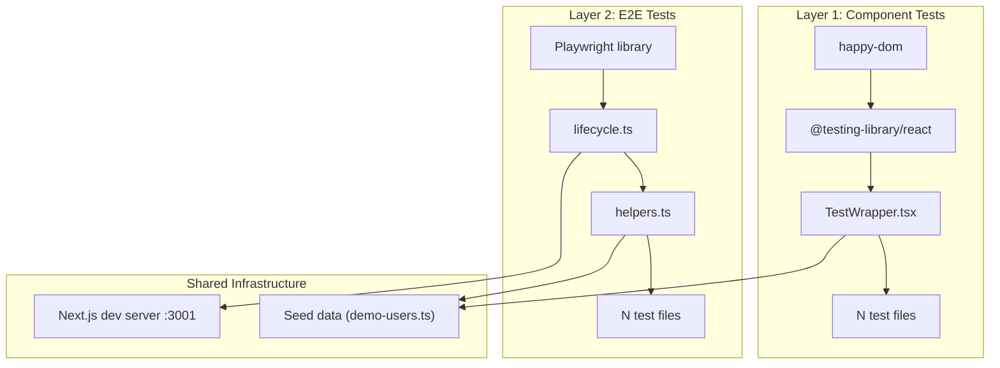

# UI Test Planning Guidelines for AI Agents

When creating automated UI test plans for any implemented sprint or story, AI Agents **MUST** strictly adhere to the following planning and execution protocol. **Failure to follow these instructions will result in immediate rejection by the user.**

This file is the authoritative guide for producing UI test implementation plans. It mirrors the structure of `.ai/siraj_stories/AGENTS.md` (used for story implementation plans) but is specialized for automated UI testing.

**Exemplar plan:** `.kilo/plans/automated-ui-tests-enhanced.md` — this is the reference implementation that all future UI test plans must follow.

---

## Document Structure Note

This AGENTS.md has two types of numbered sections:

- **Sections 1-3** (top half): Define the **rules and template** that every generated UI test plan must follow. The plan outline subsections (Section 0-7) inside Section 3 describe what the **generated plan document** must contain.
- **Sections 4-7** (bottom half): Are **authoritative reference policies** that agents must internalize and **flatten verbatim** into each task of the generated plan. These are NOT plan sections — they are the source material that gets copied into tasks.

**Rule:** When a task says "Flatten from Section 4.A", it means copy the rules from Section 4.A of this AGENTS.md directly into the task body. Do NOT rely on cross-references during execution.

---

## 1. Deep Context & Test Analysis (The Reality Check)

Before writing any test code or proposing a test plan, you must perform deep analysis and respect the verified repository facts:

### 1.1 Input Sources (MANDATORY)

Every UI test plan MUST be derived from these sources:

1. **Manual test scenarios** in `test/manual/scenario/[category]/[scenario].md` — each scenario file contains desktop and mobile test cases with step/action/expected tables and Mermaid flow diagrams.
2. **Sprint implementation plan** in `.ai/done/sprint/[N]-sprint.md` or `.ai/plan/[N]-enhanced.md` — contains the component trees, permission gates, route definitions, and GraphQL operations that were implemented.
3. **Frontend view components** in `frontend/views/dashboard/` — the actual component files that will be tested.
4. **Storybook stories** in `frontend/views/dashboard/**/*.stories.tsx` — existing mock data patterns and provider stack setup.

### 1.2 Verified Repository Facts (DO NOT CONTRADICT)

Before planning, verify and document these facts against the current repository state:

1. **Test runner**: All tests use `bun:test` (`describe`, `test`, `expect`, `beforeAll`, `afterAll`). Vitest is installed but ONLY for Storybook component testing via `vitest.config.ts`.
2. **Playwright**: `playwright` and `@playwright/test` are installed. No `playwright.config.ts` exists. E2E tests use the `playwright` library within `bun:test` files.
3. **Existing test infrastructure**: Check `frontend/graphql/test/` for `lifecycle.ts`, `testServer.ts`, `testClient.ts`, `helpers.ts` — these are proven patterns to reuse.
4. **Dev server**: `testServer.ts` spawns `bun run next dev -p 3001` with reference counting. `lifecycle.ts` wraps it in `beforeAll`/`afterAll` hooks.
5. **Auth flow**: Login sets httpOnly cookies (`access_token`, `refresh_token`, `session_id`). Access token also stored in React context memory. Apollo sends `Authorization: Bearer <token>`.
6. **Demo users**: `shared/demo-users.ts` defines roles (superAdmin, academyAdmin, teacher, parent, staff) all with password `12345678`.
7. **Provider stack**: Root layout wraps `NextIntlClientProvider` → `MuiProvider` → `AppApolloProvider` → `AuthProvider`. Storybook's `StoryWrapper.tsx` provides a similar stack.
8. **Happy-dom**: Installed (`happy-dom` + `@happy-dom/global-registrator`). Preload configured via `bunfig.toml`.
9. **Testing libraries**: `@testing-library/react`, `@testing-library/jest-dom`, `@testing-library/user-event` are installed.
10. **MCP servers**: `@playwright/mcp` and `next-devtools-mcp` are configured in `.mcp.json` for AI agent development assistance — NOT for automated testing.
11. **Package scripts**: Layer-specific test scripts exist in `package.json` (`test:db`, `test:graphql`, `test:ui:components`, `test:ui:e2e`, `test:ui`).
12. **Component boundaries**: Only `"use client"` components can be tested with component tests. Server Components (layouts, page shells with `async`) are tested via E2E only.
13. **Store reset pattern**: `useUserStore.setState({ permissions: [] }, false)` resets store without replacing the entire state object. The `false` parameter prevents full state replacement.
14. **Module mocking**: `bun:test` supports `mock.module("next/navigation")` for mocking Next.js router in component tests. Must be called before imports.
15. **Test isolation**: Each `describe` block in `bun:test` runs sequentially by default. Use `beforeEach`/`afterEach` for per-test setup/teardown, not `beforeAll`/`afterAll` (which run once per describe block).
16. **Coverage configuration**: `bunfig.toml` supports `coverageSkipTestFiles = true` to exclude test files from coverage reports. Coverage output goes to `coverage/` directory.

### 1.3 Trace the Full Stack

For each feature being tested, trace and document:

- **React Components** (Views): Which `.tsx` files render the UI? Are they `"use client"` or Server Components?
- **Permission Gates**: Which components are wrapped in `<RequirePermission>`? What permissions gate what UI elements?
- **GraphQL Operations**: Which queries/mutations drive the data? What are the `TypedDocumentNode` names?
- **Zustand Stores**: Which stores hold UI state? What are the state shape and setters?
- **Routes**: What are the Next.js route paths? What URL patterns are used?
- **Responsive Layouts**: Which components have Desktop/Mobile variants? What MUI breakpoints control visibility?

---

## 2. Planning Requirements & Length Guidelines

Your UI test implementation plan must be **detailed, structured, and exhaustive**.

### 📏 Length & Detail Thresholds:

- **Total Plan Length**: Must be at least **1,000+ lines of markdown**. Plans that are short, high-level summaries will be rejected. The exemplar plan (`.kilo/plans/automated-ui-tests-enhanced.md`) is 1,002 lines — new plans should meet or exceed this baseline.
- **Per-Task Length**: Each task within Section 3 must be at least **50 to 100+ lines long**. Infrastructure tasks (Phase 0-1) tend toward 50-70 lines. Test file tasks (Phase 2-3) tend toward 70-100+ lines due to detailed test case descriptions, mock data shapes, and assertion strategies.
- **Zero Placeholder Code**: No `...` inside code blocks. Code examples must be written out fully, displaying exact import paths, variable names, typings, and assertion patterns.
- **Mermaid Diagrams**: Every plan MUST include at least **5 Mermaid diagrams**:
  1. **Test Architecture Overview** — `graph TB` showing both layers, shared infrastructure, and execution flow
  2. **Component Test Flow** — `sequenceDiagram` showing test file → TestWrapper → store → RTL → happy-dom → component
  3. **E2E Test Flow** — `sequenceDiagram` showing test file → lifecycle → dev server → browser → page → GraphQL API
  4. **Provider Stack** — `graph TD` showing the provider hierarchy for TestWrapper
  5. **Phase Dependency Graph** — `graph LR` showing which phases depend on which
- Additionally, plans covering features with state transitions (e.g., session activation flows) MUST include a `stateDiagram-v2` showing the UI states the tests validate.

---

## 3. Plan Section Outline & Concrete Examples

Every UI test plan MUST contain these exact 9 sections in order, plus appendices.

### Section 0: Metadata & Context

Provide clear metadata, scope definition, verified repository facts, and current gaps.

#### *Example Section 0:*
```markdown
## Section 0: Metadata & Context

### 0.1 Scope

Implement a two-layer automated UI test suite covering all manual test scenarios from Sprint N:

- **Layer 1 — Component Tests**: Fast, isolated React component rendering in `happy-dom` using `@testing-library/react`. Tests permission gates, conditional rendering, and user interactions without a browser.
- **Layer 2 — E2E Tests**: Full user flows in a real Chromium browser using the `playwright` library within `bun:test`. Tests authentication, navigation, responsive layouts, and cross-page interactions against the running Next.js dev server.

### 0.2 Verified Repository Facts — Do Not Contradict

(List 12-16 verified facts about the current repository state. See Section 1.2 of the UI Test Planning AGENTS.md for the canonical list.)

### 0.3 Current Gaps To Fill

| Gap | Current State | Target State |
|---|---|---|
| `bunfig.toml` | Does not exist | Created with happy-dom preload and coverage config |
| Component test infrastructure | None | `TestWrapper.tsx`, happy-dom preload |
| Component test files | 0 files | N `.test.tsx` files |
| E2E test infrastructure | None | `lifecycle.ts`, `helpers.ts` for Playwright |
| E2E test files | 0 files | N `.test.ts` files |
```

---

### Section 1: Core Principles & Strict Rules (Mandatory Checklist)

Include testing rules, layer separation, Next.js alignment, type safety, and the **Zero Incomplete Implementation Policy** table.

#### *Example Section 1:*
```markdown
## Section 1: Core Principles & Strict Rules

### 1.1 Test Runner — Bun Only

- [ ] **All tests use `bun:test`** — `describe`, `test`, `expect`, `beforeAll`, `afterAll` imported from `"bun:test"`.
- [ ] **NO Vitest** — Vitest is installed for Storybook only. Never import from `vitest` in test files.
- [ ] **NO `@playwright/test` runner** — Use `playwright` (the library) within `bun:test` files. No `playwright.config.ts`.
- [ ] **NO Jest** — Jest types are installed but not used. Never import from `jest`.

### 1.2 Layer Separation

- [ ] **Component tests** (`test/ui/components/`) — Pure React rendering in `happy-dom`. No browser, no network, no dev server.
- [ ] **E2E tests** (`test/ui/e2e/`) — Real browser via Playwright. Requires running Next.js dev server on port 3001.
- [ ] **No cross-layer imports** — Component tests never import from `test/ui/e2e/`. E2E tests never import from `test/ui/components/`.

### 1.3 Next.js Testing Alignment

- [ ] **Only `"use client"` components in component tests** — Server Components are tested via E2E only.
- [ ] **React Testing Library patterns** — Use `screen.getByRole()`, `screen.getByText()`, `screen.queryByRole()`. Never `container.querySelector()`.
- [ ] **`userEvent` for interactions** — Use `userEvent.click()`, `userEvent.type()`. Never `fireEvent`.
- [ ] **E2E tests target running application** — No mocking of Next.js internals. Navigate real pages, trigger real GraphQL requests.
- [ ] **Auto-waiting assertions in E2E** — Use `expect(locator).toBeVisible()`, `expect(locator).toHaveText()`. Never `waitForTimeout()`.

### 1.4 Type Safety

- [ ] **No `any`** — All test helpers, wrappers, and assertions are fully typed.
- [ ] **No blind casts** — Use type narrowing, not `as any` or `as unknown as`.
- [ ] **Generated types** — Import from `frontend/graphql/generated/gql/graphql-types.ts` for permission enums and GraphQL types.

### 1.5 Zero Incomplete Implementation Policy

| Prohibited | Required | Verification |
|---|---|---|
| `test.skip("not implemented")` | Fully working test or `test.todo()` with description | `rg -i "skip.*not impl" test/ui/` |
| Empty test body `test("x", () => {})` | At least one assertion | Code review |
| `// TODO: add more tests` | Implement or use `test.todo()` | `rg -i "TODO" test/ui/` |
| Hardcoded selectors without comments | Named constants or `data-testid` attributes | Code review |
| `container.querySelector()` | Use `screen.getByRole()` or `screen.getByText()` | `rg "container.querySelector" test/ui/` |
| `fireEvent` instead of `userEvent` | Use `@testing-library/user-event` exclusively | `rg "fireEvent" test/ui/` |
| `waitForTimeout()` in E2E | Use auto-waiting assertions | `rg "waitForTimeout" test/ui/` |
| Hardcoded permission strings | Use `AppPermission.X` from generated types | `rg '"[a-z]+\.[a-z_]+"' test/ui/ --glob "*.test.*"` |

### 1.6 Package Manager & Commands

- [ ] Use `~/.bun/bin/bun` for all commands.
- [ ] Run `bun run test:ui:components` for component tests.
- [ ] Run `bun run test:ui:e2e` for E2E tests.
- [ ] Run `bun run test:ui` for all UI tests.
- [ ] Run `bun quality-gate` after all changes.
```

---

### Section 2: Architecture & Diagrams

Define the test architecture with Mermaid diagrams. Every plan MUST include at minimum **5 diagrams**:

1. **Test Architecture Overview** — `graph TB` showing both layers, shared infrastructure, and execution flow.
2. **Component Test Flow** — `sequenceDiagram` showing the interaction between test file, TestWrapper, store, RTL, happy-dom, and component.
3. **E2E Test Flow** — `sequenceDiagram` showing the interaction between test file, lifecycle, dev server, browser, page, and GraphQL API.
4. **Provider Stack** — `graph TD` showing the provider hierarchy for TestWrapper.
5. **Phase Dependency Graph** — `graph LR` showing which phases depend on which.

Additionally, plans covering features with state transitions (e.g., session activation flows) MUST include a `stateDiagram-v2` showing the UI states the tests validate.

#### *Example Section 2 (Architecture Overview):*
```markdown
## Section 2: Architecture & Diagrams

### 2.1 Test Architecture Overview



#### Diagram Requirements:
- Use `graph TB` or `graph LR` for architecture overviews.
- Use `sequenceDiagram` for interaction flows (component test flow, E2E test flow).
- Use `graph TD` for provider stack hierarchies.
- Use `graph LR` for phase dependency graphs.
- Use `stateDiagram-v2` for UI state transitions being tested (when applicable).
- Label every node with the technology or file it represents.
- Use subgraphs to group related components (Layer 1, Layer 2, Shared Infrastructure).
```

---

### Section 2.5: Prerequisites Verification (BLOCKING)

Before implementing any UI test plan, verify the sprint implementation is fully deployed. This section MUST be included in every generated plan and all items MUST pass before test implementation begins.

#### *Example Section 2.5:*
```markdown
## Section 2.5: Prerequisites Verification (BLOCKING)

Before starting test implementation, verify the sprint is fully deployed:

- [ ] `bun run test:db` passes — database layer is stable
- [ ] `bun run test:graphql` passes — GraphQL layer is stable
- [ ] `bun tsgo` passes — TypeScript compilation is clean
- [ ] `bun run lint` passes — no lint errors
- [ ] All manual test scenarios exist in `test/manual/scenario/` (list each file)
- [ ] Dev server starts successfully on port 3001: `bun run next dev -p 3001`
- [ ] Demo users are seeded and login works: verify `shared/demo-users.ts` exists with all required roles
- [ ] Component source files exist for all components listed in the plan's Appendix A
- [ ] Storybook stories exist for components being tested (check `frontend/views/dashboard/**/*.stories.tsx`)

If any prerequisite fails, STOP and fix before proceeding with test implementation.
```

---

### Section 3: Granular Task Breakdown (The Core Breakdown)

Break down the implementation into **phases** and **tasks**. Each task MUST include ALL 8 fields below. Missing any field is a plan rejection criterion.

1. **Status** (Pending / In Progress / Completed)
2. **Objective** (one-line statement of what this task achieves and why)
3. **Layer-Specific Rules (flattened)** (constraints from Section 4 of this AGENTS.md, copied verbatim into the task — agents must NOT rely on looking up Section 4 during execution)
4. **Input Sources (What to Read)** (exact file paths the agent MUST examine before writing any test code — component source, manual scenario, store shape, GraphQL types, Storybook stories)
5. **Target Files** (exact paths, marked as `(new)` or `(modify)`)
6. **Action Plan** (numbered steps with FULL code blocks — no `...`, no placeholders, no "similar to above")
7. **Test Execution Requirements** (dedicated section: exact command to run, which suite, why, and expected outcome — NOT a one-liner buried in the action plan)
8. **Completion Criteria** (checkbox list of verifiable outcomes — minimum 3 items per task)

#### Phase Structure:

Every UI test plan MUST have these phases:

| Phase | Purpose | Typical Tasks |
|---|---|---|
| **Phase 0** | Configuration & Scripts | `bunfig.toml`, `package.json` scripts, remove stale configs |
| **Phase 1** | Infrastructure | Happy-dom preload, TestWrapper, E2E lifecycle/helpers |
| **Phase 2** | Component Tests | One task per `.test.tsx` file |
| **Phase 3** | E2E Tests | One task per `.test.ts` file |
| **Phase 4** | Verification | Full test suite run, quality gate, prohibited patterns check |

#### Flattening Rule (MANDATORY)

Every task's "Layer-Specific Rules" field MUST copy the relevant constraints from Section 4 of this AGENTS.md **verbatim** into the task. The agent must NOT rely on looking up Section 4 during execution — context windows are limited and cross-references get lost.

- **Phase 0-1 tasks** (infrastructure): Flatten from Section 4.C (Shared Infrastructure)
- **Phase 2 tasks** (component tests): Flatten from Section 4.A (Component Test Layer)
- **Phase 3 tasks** (E2E tests): Flatten from Section 4.B (E2E Test Layer)
- **Phase 4 tasks** (verification): Flatten from Section 1.5 (Zero Incomplete Implementation Policy)

This duplication is intentional and required. It ensures every task is self-contained and executable without cross-referencing other sections.

#### Post-Task Verification Matrix (MANDATORY)

Every task MUST include a "Test Execution Requirements" section specifying exactly what to run after completing the task. Use this matrix as the baseline:

| Phase | Command to Run After Each Task | Why |
|---|---|---|
| Phase 0 (Config) | `bun run test:ui:components` (verify it starts without errors) | Config changes can break test runner initialization |
| Phase 1 (Infrastructure) | `bun run test:ui:components` + write a trivial smoke test | Infrastructure must work before test files are written |
| Phase 2 (Component Tests) | `bun run test:ui:components` | Verify new tests pass and no existing tests broke |
| Phase 3 (E2E Tests) | `bun run test:ui:e2e` + `bun run test:ui:components` | Verify new E2E tests pass AND component tests didn't regress |
| Phase 4 (Verification) | `bun run test:ui` + `bun run test` + `bun quality-gate` | Full suite verification |

**Rule:** An agent MUST NOT proceed to the next task until the current task's Test Execution Requirements pass. This prevents regression accumulation across tasks.

#### *Example Task (Component Test):*
```markdown
#### Task G — RequirePermission.test.tsx

**Status:** Pending

**Objective:** Verify that the `RequirePermission` gate correctly renders/hides children and fallback based on the user's permission set in the Zustand store.

**Layer-Specific Rules (Component Tests — Flattened from Section 4.A):**
- DOM Environment: `happy-dom` registered via `bunfig.toml` preload. Provides `document`, `window`, `HTMLElement` globals.
- Rendering: `@testing-library/react` with `render()` and `screen` queries.
- Interactions: `@testing-library/user-event` for `click()`, `type()`, `tab()`, `hover()`.
- Store Seeding: `useUserStore.setState()` to set permissions before rendering. Reset in `afterEach`.
- Assertions: `@testing-library/jest-dom` matchers: `toBeVisible()`, `toBeInTheDocument()`, `toHaveTextContent()`, `toBeDisabled()`.
- Only `"use client"` components can be tested with component tests.
- Permission enums: Always import from `frontend/graphql/generated/gql/graphql-types.ts`, never hardcode permission strings.

**Input Sources (What to Read):**
- `frontend/components/auth/RequirePermission.tsx` — component under test (props, rendering logic, fallback behavior)
- `frontend/graphql/generated/gql/graphql-types.ts` — `AppPermission` enum values (exact PascalCase keys)
- `frontend/stores/userStore.ts` — store shape for permission seeding (`permissions` field)
- `test/manual/scenario/permissions/rbac-gates.md` — manual scenario being automated (test case table)

**Target files:**
- `test/ui/components/RequirePermission.test.tsx` (new)

**Action plan:**

1. Import `RequirePermission` from `@/frontend/components/auth/RequirePermission`
2. Import `AppPermission` from generated GraphQL types
3. Import `renderWithWrapper` from `./TestWrapper`
4. Import `screen` from `@testing-library/react`

5. Write test cases:
   - **"renders children when user has permission"**: Seed store with `DashboardSearch`, render `<RequirePermission permissions={[AppPermission.DashboardSearch]}>Protected</RequirePermission>`, assert `screen.getByText("Protected")` is visible
   - **"renders nothing when user lacks permission"**: Seed store with empty permissions, render same component, assert `screen.queryByText("Protected")` returns null
   - **"renders children when at least one permission matches (array)"**: Seed with `ScheduleViewList`, render with `permissions={[DashboardSearch, ScheduleViewList]}`, assert visible
   - **"renders fallback when provided and permission missing"**: Seed empty, render with `fallback={<span>Denied</span>}`, assert `screen.getByText("Denied")` is visible
   - **"renders nothing (not fallback) when permission exists"**: Seed with permission, render with fallback, assert fallback is NOT visible and children ARE visible

**Test Execution Requirements:**
- **Run the component test suite** to verify all 5 tests pass and no existing component tests are broken:
  ```bash
  bun run test:ui:components
  ```
  Expected: 5 tests pass, 0 failures.

**Completion criteria:**
- [ ] 5 test cases pass
- [ ] No `any` types or blind casts
- [ ] `useUserStore` is reset in `afterEach` to prevent state leaking between tests
```

#### *Example Task (E2E Test):*
```markdown
#### Task M — admin-dashboard.test.ts

**Status:** Pending

**Objective:** Verify the Admin dashboard experience end-to-end: search visibility, timezone columns, grid filtering, navigation to class details, role-based access differences, and mobile responsive layout.

**Layer-Specific Rules (E2E Tests — Flattened from Section 4.B):**
- Browser: `playwright` library, `chromium.launch({ headless: true })`.
- Dev Server: Reuses `setupTestServerLifecycle()` from `frontend/graphql/test/lifecycle.ts`. Port 3001.
- Context Isolation: Each test creates a fresh `BrowserContext` with `baseURL: "http://localhost:3001"`. Cookies/storage isolated per test.
- Authentication: `loginAsDemoUser()` calls `demoLogin` GraphQL mutation via `page.evaluate(fetch(...))`, sets `access_token` cookie via `context.addCookies()`.
- Navigation: `page.goto("/ar/[route]")` with `page.waitForURL()` for navigation assertions.
- Assertions: Playwright auto-waiting: `expect(page.getByRole("button")).toBeVisible()`, `expect(page.locator(selector)).toHaveText()`.
- Mobile Testing: `createMobileContext()` with `{ width: 375, height: 812, isMobile: true, hasTouch: true }`.
- Seed data: E2E tests rely on existing seed data. Never create test data in E2E tests.

**Input Sources (What to Read):**
- `frontend/views/dashboard/` — dashboard page components (layout, conditional rendering)
- `shared/demo-users.ts` — demo user credentials and role slugs
- `test/manual/scenario/admin-dashboard/schedule-search.md` — manual scenario for search
- `test/manual/scenario/admin-dashboard/timezone-columns.md` — manual scenario for timezone columns
- `test/ui/e2e/lifecycle.ts` — browser lifecycle setup (created in Phase 1)
- `test/ui/e2e/helpers.ts` — login and assertion helpers (created in Phase 1)

**Target files:**
- `test/ui/e2e/admin-dashboard.test.ts` (new)

**Action plan:**

1. Import `setupBrowserLifecycle`, `createContext`, `createMobileContext` from `./lifecycle`
2. Import `loginAsDemoUser`, `DEMO_USERS` from `./helpers`
3. Import `describe`, `test`, `expect` from `bun:test`

4. Call `setupBrowserLifecycle()` at describe root.

5. Write test cases:
   - **"Admin sees search input"**: Login as academyAdmin, goto `/ar/dashboard`, assert `page.getByRole("textbox")` is visible
   - **"Admin sees timezone columns"**: Login, goto dashboard, assert `page.getByText("Your Time")` is visible
   - **"Search filters schedule grid"**: Login, goto dashboard, type "Ahmed" in search, wait for grid to update, assert row count changes
   - **"Click details navigates to class page"**: Login, goto dashboard, click details icon on first row, assert URL contains `/classes/`
   - **"Teacher does not see search input"**: Login as teacher, goto dashboard, assert `page.getByRole("textbox")` is NOT visible
   - **"Mobile: card list renders instead of data grid"**: Login as academyAdmin in mobile context, goto dashboard, assert card elements are present

6. Each test creates a fresh context via `createContext()` or `createMobileContext()`, logs in, performs actions, and closes the context in `afterEach`.

**Test Execution Requirements:**
- **Run the E2E test suite** to verify all 6 tests pass against the running dev server:
  ```bash
  bun run test:ui:e2e
  ```
  Expected: 6 tests pass (4 desktop + 1 teacher + 1 mobile), 0 failures.
- **Run the component test suite** to verify no regressions from Phase 2:
  ```bash
  bun run test:ui:components
  ```
  Expected: All Phase 2 component tests still pass.

**Completion criteria:**
- [ ] 6 test cases pass (4 desktop + 1 teacher + 1 mobile)
- [ ] Each test uses isolated browser context
- [ ] No hardcoded class/student IDs — all IDs obtained dynamically from seed data
- [ ] Phase 2 component tests still pass (no regressions)
```

#### Task Naming Convention:

- Tasks are lettered sequentially across all phases: A, B, C, D, ...
- Phase 0 tasks: Configuration (e.g., Task A — Create `bunfig.toml`)
- Phase 1 tasks: Infrastructure (e.g., Task C — Happy-dom preload)
- Phase 2 tasks: Component tests (e.g., Task G — RequirePermission.test.tsx)
- Phase 3 tasks: E2E tests (e.g., Task M — admin-dashboard.test.ts)
- Phase 4 tasks: Verification (e.g., Task R — Full test suite verification)

---

### Section 4: Execution Commands

Document all test commands with layer-specific scripts. Must include timeout strategy table.

#### *Example Section 4:*
```markdown
## Section 4: Execution Commands

```bash
# All tests across all layers
bun run test

# UI component tests only — fast, no browser
bun run test:ui:components
bun run test:ui:components:coverage

# UI E2E tests only — real browser, needs dev server
bun run test:ui:e2e

# All UI tests (components + e2e)
bun run test:ui

# Run a specific test file
bun test test/ui/e2e/admin-dashboard.test.ts
bun test test/ui/components/RequirePermission.test.tsx
```

### Timeout Strategy

| Layer | Timeout | Rationale |
|---|---|---|
| `test:db` | 60s | DB operations are fast; rollback transactions add minimal overhead |
| `test:graphql` | 120s | Next.js dev server startup takes ~60s |
| `test:ui:components` | 30s | No server or browser; pure React rendering in happy-dom |
| `test:ui:e2e` | 120s | Dev server startup + browser launch + page navigation |
| `test` (all) | 60s per test | Global default |
```

---

### Section 5: Key Technical Decisions

Document every architectural decision with rationale. Each decision must answer "Why X instead of Y?"

#### Required Decisions (every plan must address):

1. **Why `playwright` library within `bun:test` instead of `@playwright/test` runner?**
2. **Why MockedProvider for component tests?**
3. **Why login via GraphQL mutation for E2E tests?**
4. **How to handle RTL (Arabic) layout?**
5. **Why shared test server infrastructure?**
6. **Why Server Components are E2E-only?**
7. **Why not `@playwright/mcp` or `next-devtools-mcp`?**
8. **Dev server vs production build for E2E?**

#### *Example Decision:*
```markdown
### 5.1 Why `playwright` library within `bun:test` instead of `@playwright/test` runner?

User requirement: "using bun (not vitest at all)". We use `playwright` (the library) within `bun:test` to keep Bun as the test runner while still getting real browser automation. This reuses the project's existing `testServer.ts` infrastructure and reference-counted server lifecycle management, rather than Playwright's `webServer` config.
```

---

### Section 6: Risks & Mitigations

Document every identified risk with a concrete mitigation strategy.

#### Required Risks (every plan must address):

| Risk Category | Example Risk |
|---|---|
| Performance | E2E tests are slow |
| Flakiness | Timing issues, race conditions |
| Data Dependencies | Test data depends on seed state |
| Environment Conflicts | Happy-dom vs Playwright DOM globals |
| Provider Stack | MUI theme/emotion cache in tests |
| Mocking Complexity | Apollo MockedProvider setup |
| Server Components | Cannot unit test async components |
| Authentication | httpOnly cookies not accessible to JS |
| Dev vs Production | Behavior differences between dev and prod builds |
| RTL/Layout | Arabic RTL layout testing complexity |
| Module Mocking | `next/navigation` router mocking in component tests |
| Date Sensitivity | Calendar/date-dependent tests |

#### *Example Risk Table:*
```markdown
## Section 6: Risks & Mitigations

| Risk | Mitigation |
|---|---|
| E2E tests are slow | Headless Chromium, shared browser context, parallelize test files. Dev server startup shared via reference counting. |
| Flaky timing issues | Playwright auto-waiting (`waitForURL`, `toBeVisible`). Auto-retries assertions. 70s timeout for server startup. |
| Happy-dom conflicts with Playwright | Happy-dom only affects component tests via `bunfig.toml` preload. Playwright uses its own isolated browser context. |
```

---

### Section 6.5: Test Integrity Threats & Mitigations

Address specific threats to test reliability. Each threat must include: the current gap, the risk it poses, and the concrete fix with code. This is the testing equivalent of security threat remediation in implementation plans.

#### Required Threats (every plan must address):

| Threat | Risk |
|---|---|
| State leakage between component tests | `useUserStore` state bleeds across tests, causing false passes |
| Flaky E2E timing | Race conditions between page navigation and assertions |
| Hardcoded IDs from seed data | Tests break when seed data changes |
| Happy-dom vs Playwright DOM globals | `document`/`window` from happy-dom conflict with Playwright's browser context |
| MockedProvider stale mocks | Mocks that don't match actual query signatures cause silent failures |
| Date-dependent tests | Calendar/schedule tests fail on different dates |
| Missing `afterEach` cleanup | Browser contexts, store state, or module mocks leak between tests |
| Cross-layer import contamination | Component test accidentally imports E2E helper (or vice versa) |

#### *Example Threat:*
```markdown
## Section 6.5: Test Integrity Threats & Mitigations

### Threat 1: State Leakage Between Component Tests
**Current Gap:** `useUserStore.setState()` sets permissions but never resets them.
**Risk:** Test B inherits Test A's permissions, causing false passes.
**Fix in every component test file:**
```typescript
import { afterEach } from "bun:test";
import { useUserStore } from "@/frontend/stores/userStore";

afterEach(() => {
  useUserStore.setState({ permissions: [] }, false);
});
```

### Threat 2: Hardcoded IDs from Seed Data
**Current Gap:** E2E tests use hardcoded class/student IDs like `goto("/classes/42")`.
**Risk:** Tests break when seed data is regenerated with different IDs.
**Fix:** Dynamically extract IDs from the dashboard grid or API responses:
```typescript
const firstRow = page.locator("[data-testid='schedule-row']").first();
const classId = await firstRow.getAttribute("data-class-id");
await page.goto(`/ar/classes/${classId}`);
```

### Threat 3: Missing `afterEach` Cleanup
**Current Gap:** Browser contexts created in tests are not closed.
**Risk:** Memory leaks, port exhaustion, and state contamination between tests.
**Fix in every E2E test file:**
```typescript
import { afterEach } from "bun:test";

let context: BrowserContext;

afterEach(async () => {
  if (context) await context.close();
});
```
```

---

### Section 7: Final Verification & Integrity Protocol

Outline the exact commands to verify the entire system compiles and passes all checks.

#### *Example Section 7:*
```markdown
## Section 7: Final Verification & Integrity Protocol

Execute the following commands in order after all phases are complete:

```bash
# 1. Component tests
bun run test:ui:components

# 2. E2E tests
bun run test:ui:e2e

# 3. All UI tests
bun run test:ui

# 4. All tests across all layers
bun run test

# 5. TypeScript check
bun tsgo

# 6. Lint
bun run lint

# 7. Quality gate
bun quality-gate

# 8. Prohibited patterns check
rg -i "TODO|FIXME|skip.*not impl|as any|: any" test/ui/ --glob "!**/*.md"
# Expected: empty output

# 9. Stale scripts check
rg "test:e2e" package.json
# Expected: empty output (only test:ui:e2e should exist)

# 10. Cross-layer import check
rg "from.*test/ui/e2e" test/ui/components/
rg "from.*test/ui/components" test/ui/e2e/
# Expected: empty output for both

# 11. Hardcoded permission strings
rg '"[a-z]+\.[a-z_]+"' test/ui/ --glob "*.test.*"
# Expected: empty output (all permissions use AppPermission enum)

# 12. Legacy Playwright patterns
rg "waitForTimeout|waitForSelector|page\.waitFor" test/ui/e2e/
# Expected: empty output

# 13. fireEvent usage
rg "fireEvent" test/ui/
# Expected: empty output (only userEvent allowed)

# 14. container.querySelector usage
rg "container.querySelector" test/ui/
# Expected: empty output (only screen queries allowed)
```
```

---

### Appendices (REQUIRED)

Every UI test plan MUST include these appendices:

#### Appendix A: File Manifest

A table listing every file to be created or modified, its purpose, and which phase it belongs to.

```markdown
## Appendix A: File Manifest

| Path | Purpose | Phase |
|---|---|---|
| `bunfig.toml` | Test configuration with happy-dom preload | 0 |
| `test/ui/components/happydom-preload.ts` | Register happy-dom globals | 1 |
| `test/ui/components/TestWrapper.tsx` | Provider stack for component tests | 1 |
| `test/ui/e2e/lifecycle.ts` | Browser + dev server lifecycle | 1 |
| `test/ui/e2e/helpers.ts` | Login, navigation, assertion helpers | 1 |
| `test/ui/components/[Component].test.tsx` | Component test file | 2 |
| `test/ui/e2e/[feature].test.ts` | E2E test file | 3 |
```

#### Appendix B: Manual Scenario Coverage Matrix

A table mapping every manual scenario file to the component tests and E2E tests that cover it.

```markdown
## Appendix B: Manual Scenario Coverage Matrix

| Manual Scenario File | Component Tests | E2E Tests |
|---|---|---|
| `admin-dashboard/schedule-search.md` | ScheduleOverviewSection.test.tsx | admin-dashboard.test.ts |
| `class-details/admin-override-actions.md` | AdminActionsBar.test.tsx | class-details.test.ts |
| `permissions/rbac-gates.md` | RequirePermission.test.tsx | permissions.test.ts |
```

**Coverage requirement:** Every manual scenario file MUST be covered by at least one component test OR one E2E test. Complex scenarios (multi-page flows, modal interactions, file downloads) should be covered by E2E tests. Simple permission gates and conditional rendering should be covered by component tests.

---

## 4. Strict Testing Layer Architecture Constraints

### A. Component Test Layer (`test/ui/components/`)

- **DOM Environment**: `happy-dom` registered via `bunfig.toml` preload. Provides `document`, `window`, `HTMLElement` globals.
- **Rendering**: `@testing-library/react` with `render()` and `screen` queries.
- **Interactions**: `@testing-library/user-event` for `click()`, `type()`, `tab()`, `hover()`.
- **Apollo Mocking**: `MockedProvider` from `@apollo/client/testing`. Only mock queries actually used by the component under test.
- **Store Seeding**: `useUserStore.setState()` to set permissions before rendering. Reset in `afterEach`.
- **Router Mocking**: `mock.module("next/navigation")` to provide mock `useRouter` and `useParams`.
- **Theme/Intl**: `TestWrapper` provides `ThemeProvider`, `NextIntlClientProvider`, `CacheProvider` (Emotion + RTL plugin).
- **Assertions**: `@testing-library/jest-dom` matchers: `toBeVisible()`, `toBeInTheDocument()`, `toHaveTextContent()`, `toBeDisabled()`.

### B. E2E Test Layer (`test/ui/e2e/`)

- **Browser**: `playwright` library, `chromium.launch({ headless: true })`.
- **Dev Server**: Reuses `setupTestServerLifecycle()` from `frontend/graphql/test/lifecycle.ts`. Port 3001.
- **Context Isolation**: Each test creates a fresh `BrowserContext` with `baseURL: "http://localhost:3001"`. Cookies/storage isolated per test.
- **Authentication**: `loginAsDemoUser()` calls `demoLogin` GraphQL mutation via `page.evaluate(fetch(...))`, sets `access_token` cookie via `context.addCookies()`.
- **Navigation**: `page.goto("/ar/[route]")` with `page.waitForURL()` for navigation assertions.
- **Assertions**: Playwright auto-waiting: `expect(page.getByRole("button")).toBeVisible()`, `expect(page.locator(selector)).toHaveText()`.
- **Mobile Testing**: `createMobileContext()` with `{ width: 375, height: 812, isMobile: true, hasTouch: true }`.
- **File Downloads**: `page.waitForEvent("download")` for download assertions.
- **Dialogs**: `page.getByRole("dialog")` for modal/dialog assertions.

### C. Shared Infrastructure

- **No cross-layer imports**: Component tests never import from `test/ui/e2e/`. E2E tests never import from `test/ui/components/`.
- **Demo users**: `shared/demo-users.ts` is the single source of truth for test user credentials.
- **Permission enums**: Always import from `frontend/graphql/generated/gql/graphql-types.ts`, never hardcode permission strings.
- **Seed data**: E2E tests rely on existing seed data. Never create test data in E2E tests.

### D. Test File Naming Conventions

| Layer | Pattern | Example |
|---|---|---|
| Component test | `[ComponentName].test.tsx` | `RequirePermission.test.tsx` |
| E2E test | `[feature-kebab].test.ts` | `admin-dashboard.test.ts` |
| Infrastructure | `[purpose].ts` | `lifecycle.ts`, `helpers.ts`, `TestWrapper.tsx` |
| Preload | `[purpose]-preload.ts` | `happydom-preload.ts` |

### E. Test Case Naming Conventions

- **Component tests**: Describe what the user sees. Use lowercase, imperative mood.
  - ✅ `"renders search input when user has DashboardSearch permission"`
  - ✅ `"hides timezone columns without ScheduleViewTimezones permission"`
  - ❌ `"test search visibility"`
  - ❌ `"ScheduleOverviewSection renders correctly"`

- **E2E tests**: Describe the user flow. Use role + action + expected outcome.
  - ✅ `"Admin sees search input on dashboard"`
  - ✅ `"Teacher activate outside time window shows error"`
  - ❌ `"dashboard test 1"`
  - ❌ `"check search"`

---

## 5. MCP Server Policy

### `@playwright/mcp` — Development Assistance Only

The `@playwright/mcp` server (configured in `.mcp.json`) is an MCP server by Microsoft that lets AI agents interact with web pages through structured accessibility snapshots. It is **NOT a testing framework**.

| Aspect | `@playwright/mcp` | `playwright` library (our E2E tests) |
|---|---|---|
| **Purpose** | AI agent browser interaction during development | Automated test suites |
| **Invocation** | MCP protocol (LLM calls tools) | Programmatic (test code calls API) |
| **Assertions** | LLM interprets snapshots visually | Programmatic `expect()` (deterministic) |
| **Reproducibility** | Non-deterministic | Deterministic |
| **CI/CD** | Not designed for CI | Designed for CI |

**When `@playwright/mcp` IS useful:**
- During development, an AI agent can use it to visually verify a page renders correctly
- Exploratory testing: agent navigates the app and reports what it sees
- Generating test code snippets: `--codegen typescript` flag

**When `@playwright/mcp` is NOT useful:**
- Automated test suites — non-deterministic, slow, not CI-compatible
- Regression testing — no assertion framework

### `next-devtools-mcp` — Development Assistance Only

The `next-devtools-mcp` server provides runtime diagnostics, browser evaluation during development, and documentation lookup. It is NOT a testing framework.

**Conclusion:** Keep both MCP servers in `.mcp.json` for development-time AI assistance. Never use them for automated test suites.

---

## 6. Next.js Testing Alignment

Per [Next.js Testing Guide](https://nextjs.org/docs/app/building-your-application/testing):

- **E2E Testing**: Playwright is officially recommended. We use `playwright` library within `bun:test`.
- **Component Testing**: React Testing Library recommended. We use `@testing-library/react` with `happy-dom`.
- **Async Server Components**: Next.js recommends E2E over unit testing for async components. Our component tests only cover `"use client"` components; server-side layouts/auth tested via E2E.
- **Production-like testing**: Next.js recommends running E2E against `build` + `start`; we support both dev server (faster iteration) and production builds.

### Server Components Limitation

Per Next.js documentation, async Server Components cannot be tested with unit/component testing tools. Component tests only cover `"use client"` components. Server-side logic (auth in `app/[locale]/(dashboard)/layout.tsx`, server-side redirects) is tested via E2E tests.

---

## 7. Final Validation

After completing all phases of a UI test plan:

1. **All component tests pass**: `bun run test:ui:components` exits with 0.
2. **All E2E tests pass**: `bun run test:ui:e2e` exits with 0.
3. **All UI tests pass**: `bun run test:ui` exits with 0.
4. **All tests across all layers pass**: `bun run test` exits with 0.
5. **TypeScript compiles**: `bun tsgo` exits with 0.
6. **Lint passes**: `bun run lint` exits with 0.
7. **Quality gate passes**: `bun quality-gate` exits with 0.
8. **No prohibited patterns**: `rg -i "TODO|FIXME|skip.*not impl|as any|: any" test/ui/` returns empty.
9. **Manual scenario coverage**: Every file in `test/manual/scenario/` is covered by at least one automated test (verified via Appendix B matrix).
10. **No cross-layer imports**: `rg "from.*test/ui/e2e" test/ui/components/` and `rg "from.*test/ui/components" test/ui/e2e/` both return empty.
11. **No hardcoded permission strings**: `rg '"[a-z]+\.[a-z_]+"' test/ui/ --glob "*.test.*"` returns empty.
12. **No legacy Playwright patterns**: `rg "waitForTimeout|waitForSelector|page\.waitFor" test/ui/e2e/` returns empty.
13. **No fireEvent usage**: `rg "fireEvent" test/ui/` returns empty.
14. **No container.querySelector**: `rg "container.querySelector" test/ui/` returns empty.
