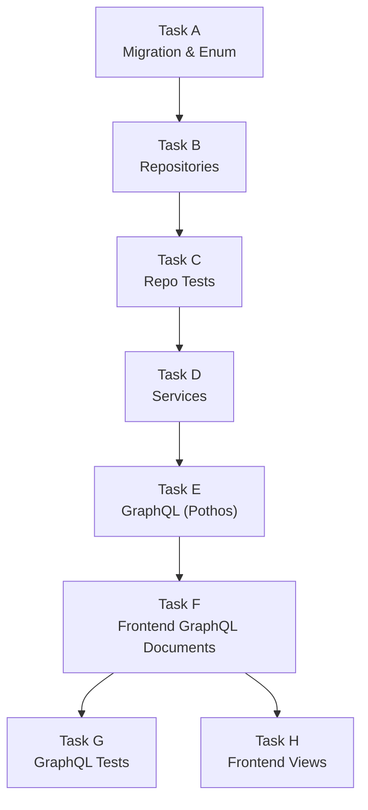

## Appendix: Story 10 — File Creation Summary, Dependency Graph & Task Overview

---

### A-1. New Files Created

| **File Path** | **Task** | **Type** | **Description** |
|---|---|---|---|
| `shared/lib/enum.ts` | A | MODIFY | Add 2 new `AppPermission` enum values for suspended lock and leave processing |
| `backend/db/migration/3-system_permissions_and_groups.sql` | A | MODIFY | Add 2 new permission inserts + `system_automated` group assignment |
| `backend/db/repo/scheduling.repository.ts` | B | MODIFY | Add `getStatusTrackingRows`, `bulkFreezeStudentClasses`, `bulkUnfreezeStudentClasses`, `getStudentFutureClasses` methods |
| `backend/db/test/repo/scheduling.repository.test.ts` | C | MODIFY | Add tests for all 4 new scheduling repository methods |
| `backend/services/student/suspended-lock.service.ts` | D | NEW | `SuspendedLockService` namespace — enforces/releases frozen class instances on SUSPENDED transitions |
| `backend/services/student/student-leave-processing.service.ts` | D | NEW | `StudentLeaveProcessingService` namespace — marks future classes as LEAVE and creates rescheduled successors on ON_LEAVE transitions |
| `backend/services/student/student-lifecycle.service.ts` | D | MODIFY | Extend `changeStudentStatus()` with side-effect dispatch to SuspendedLockService and StudentLeaveProcessingService |
| `backend/services/schedule/schedule-query.service.ts` | E | NEW | `ScheduleQueryService` namespace — permission-gated wrapper for status tracking schedule queries |
| `backend/graphql/pothos/schedule.pothos.ts` | E | MODIFY | Add `StatusTrackingScheduleRow` object type and `statusTrackingSchedule` query field |
| `frontend/graphql/sharedDocuments/schedule.documents.ts` | F | MODIFY | Add `statusTrackingScheduleQueryDocument` TypedDocumentNode |
| `frontend/graphql/test/status-tracking.test.ts` | G | NEW | GraphQL integration tests for `statusTrackingSchedule` query |
| `frontend/views/dashboard/classes/status/tracking/StatusTrackingContainer.tsx` | H | MODIFY | Replace mock store with Apollo `useQuery` + data mapping to `StatusSessionRow` |

**Total: 4 new files, 8 modified files**

---

### A-2. Files NOT Changed (Explicitly Out of Scope)

| **File Path** | **Reason Not Changed** |
|---|---|
| `backend/db/schema/scheduling.ts` | `isFrozen` column already exists at line 135 — no schema changes needed |
| `backend/db/migration/student_status_transition_trigger.sql` | DB trigger already allows REGULAR→SUSPENDED and REGULAR→ON_LEAVE — no trigger changes needed |
| `frontend/stores/mockStatusTrackingStore.ts` | `StatusSessionRow` interface remains here as shared type contract — Storybook stories and sub-components still import from it |
| `frontend/stores/mockRescheduleStore.ts` | Reschedule store remains — still used by `StatusTrackingContainer` for reschedule navigation |
| `frontend/views/dashboard/classes/status/tracking/StatusTrackingDataGrid.tsx` | Sub-component imports `StatusSessionRow` type from mock store — not modified, type contract unchanged |
| `frontend/views/dashboard/classes/status/tracking/StatusBadgeAction.tsx` | Sub-component imports `StatusSessionRow` type from mock store — not modified |
| `frontend/views/dashboard/classes/status/tracking/StatusTrackingCardList.tsx` | Sub-component imports `StatusSessionRow` type from mock store — not modified |
| `frontend/views/dashboard/classes/status/tracking/StatusTrackingView.tsx` | Sub-component imports `StatusSessionRow` type from mock store — not modified |
| `frontend/views/dashboard/classes/status/tracking/StatusTrackingContainer.stories.tsx` | Storybook stories continue using mock data — do not import from container directly |
| `backend/db/repo/student.repository.ts` | Story 9 repository — not modified in Story 10 |
| `backend/db/repo/billing.repository.ts` | Story 9 repository — not modified in Story 10 |
| `backend/services/billing/*` | Billing services from Story 9 — not touched |
| Any rescheduling UI components | Rescheduling dashboard already exists from Story 8 — ON_LEAVE successors appear automatically |

---

### A-3. Task Dependency Graph



All tasks must execute in the dependency order shown. Tasks G and H are both dependent on F but are independent of each other — they MAY be run in parallel if multiple agents are executing the sprint.

---

### A-4. New Permission Catalog Summary

| **Permission Key** | **Enum Value** | **Category** | **Is System** | **Assigned Groups** |
|---|---|---|---|---|
| `system.enforce_suspended_lock` | `SYSTEM_ENFORCE_SUSPENDED_LOCK` | System | ✅ | Super Admin, System Automated |
| `system.process_student_leave` | `SYSTEM_PROCESS_STUDENT_LEAVE` | System | ✅ | Super Admin, System Automated |

**Note:** These are system-internal permissions. They are NOT directly exposed to UI actors. The enforcement logic is triggered as a side-effect of `student.manage_status` (Story 9), which is held by Academy Admin and Super Admin.

---

### A-5. GraphQL Schema Additions Summary

**New Queries (1):**

| **Query Name** | **Input Args** | **Return Type** | **Permission Required** |
|---|---|---|---|
| `statusTrackingSchedule` | `date: String!`, `search: String?`, `viewerTimezone: String?` | `[StatusTrackingScheduleRow]` | `schedule.view_all` OR `dashboard.view_metrics` |

**New Object Types (1):**

| **Type Name** | **Fields** |
|---|---|
| `StatusTrackingScheduleRow` | `id`, `studentId`, `studentName`, `studentInitials`, `studentStatus`, `teacherId`, `teacherName`, `scheduledStartAt`, `scheduledEndAt`, `durationMinutes`, `executionState`, `outcome`, `isFrozen` |

---

### A-6. Repository Method Summary

| **Method** | **Signature** | **Purpose** | **Used By** |
|---|---|---|---|
| `getStatusTrackingRows` | `(date: Date, options?, tx?) => StatusTrackingRow[]` | Returns class instances for a date with student status joined | `ScheduleQueryService.getStatusTrackingSchedule()` |
| `bulkFreezeStudentClasses` | `(studentId: string, fromDate: Date, tx?) => number` | Sets `isFrozen = true` on all future NOT_ACTIVATED/ACTIVATED classes | `SuspendedLockService.enforceSuspendedLock()` |
| `bulkUnfreezeStudentClasses` | `(studentId: string, fromDate: Date, tx?) => number` | Clears `isFrozen = false` on future frozen classes | `SuspendedLockService.releaseSuspendedLock()` |
| `getStudentFutureClasses` | `(studentId: string, fromDate: Date, tx?) => { id, executionState, scheduledStartAt }[]` | Returns future classes for a student (NOT_ACTIVATED + ACTIVATED) | `StudentLeaveProcessingService.processStudentLeave()` |

---

### A-7. Service Architecture Summary

```
StudentLifecycleService.changeStudentStatus()
  ├── [permission check] student.manage_status
  ├── [validation] student exists, transition allowed
  ├── StudentRepository.changeStatus()
  │
  ├── [side-effect: SUSPENDED]
  │     └── SuspendedLockService.enforceSuspendedLock()
  │           └── SchedulingRepository.bulkFreezeStudentClasses()
  │
  ├── [side-effect: SUSPENDED → REGULAR]
  │     └── SuspendedLockService.releaseSuspendedLock()
  │           └── SchedulingRepository.bulkUnfreezeStudentClasses()
  │
  └── [side-effect: ON_LEAVE]
        └── StudentLeaveProcessingService.processStudentLeave()
              ├── SchedulingRepository.getStudentFutureClasses()
              └── [for each NOT_ACTIVATED class]
                    └── SchedulingRepository.processClassLeave()
                          └── createRescheduledSuccessor()
```

---

### A-8. Security Threats Coverage Map

| **Threat** | **Section 4 Reference** | **Service Fix** | **Test Coverage** |
|---|---|---|---|
| Unauthorized status change triggering side-effects | Section 4: Threat 1 | Side-effect services called ONLY after `student.manage_status` permission check in `StudentLifecycleService` | Task G: unauthorized actor test |
| IDOR on bulk class freeze | Section 4: Threat 2 | `StudentRepository.findById()` validation before bulk operations | Task C: non-existent studentId returns 0 |
| Double-processing of leave (duplicate successors) | Section 4: Threat 3 | Idempotency key pattern `leave-reschedule-{classId}-{scheduledStartAt}` with `ON CONFLICT DO NOTHING` | Task C: calling processStudentLeave twice produces no duplicates |
| isFrozen not cleared on SUSPENDED → REGULAR | Section 4: Threat 4 | `bulkUnfreezeStudentClasses()` called in `changeStudentStatus()` when transitioning back to REGULAR | Task C: unfreeze test verifies all frozen classes cleared |

---

### A-9. Data Flow Diagram

```
┌─────────────────────────────────────────────────────────────┐
│                     Academy Admin UI                         │
│  ParentProfile → StudentActions → ChangeStatusDialog        │
│  Permission: student.manage_status                          │
└─────────────────────────┬───────────────────────────────────┘
                          │ GraphQL mutation: changeStudentStatus
                          ▼
┌─────────────────────────────────────────────────────────────┐
│              StudentLifecycleService                         │
│  changeStudentStatus(actorUserId, studentId, newStatus)      │
│  ├── Permission check: student.manage_status                │
│  ├── Validate transition                                    │
│  ├── StudentRepository.changeStatus()                       │
│  │                                                           │
│  ├── if SUSPENDED:                                          │
│  │     SuspendedLockService.enforceSuspendedLock()           │
│  │     → bulkFreezeStudentClasses(studentId)                │
│  │                                                           │
│  ├── if SUSPENDED→REGULAR:                                  │
│  │     SuspendedLockService.releaseSuspendedLock()           │
│  │     → bulkUnfreezeStudentClasses(studentId)              │
│  │                                                           │
│  └── if ON_LEAVE:                                           │
│        StudentLeaveProcessingService.processStudentLeave()   │
│        → getStudentFutureClasses()                          │
│        → processClassLeave() for each NOT_ACTIVATED class   │
└─────────────────────────────────────────────────────────────┘

┌─────────────────────────────────────────────────────────────┐
│                  Teacher Dashboard                            │
│  StatusTrackingContainer                                      │
│  Permission: schedule.view_all OR dashboard.view_metrics     │
│                                                               │
│  GraphQL query: statusTrackingSchedule(date)                  │
│  → ScheduleQueryService.getStatusTrackingSchedule()           │
│  → SchedulingRepository.getStatusTrackingRows()               │
│  → Map to StatusSessionRow[]                                 │
│  → Render via StatusTrackingView                              │
│                                                               │
│  Frozen sessions: isFrozen=true → suspended_pending badge     │
│  Leave sessions: studentStatus=ON_LEAVE → on_leave badge      │
└─────────────────────────────────────────────────────────────┘
```

---

### A-10. Migration Impact Analysis

**New permissions inserted:** 2
- `system.enforce_suspended_lock`
- `system.process_student_leave`

**Group assignments modified:** 1
- `system_automated` group gains both new permissions

**Existing data affected:** None
- No new tables or columns created
- No existing permissions modified
- No existing group memberships changed

**Backward compatibility:** Full
- All existing queries, mutations, and services continue to work unchanged
- New permissions are additive only
- Side-effects in `changeStudentStatus()` are conditional (only trigger for SUSPENDED and ON_LEAVE transitions)

---

### A-11. Glossary of New Terms

| **Term** | **Definition** |
|---|---|
| Suspended Lock | The automated enforcement that sets `isFrozen = true` on all future class instances when a student's status changes to SUSPENDED. Prevents teachers from opening virtual rooms for suspended students. |
| Leave Processing | The automated workflow that marks future NOT_ACTIVATED classes as LEAVE outcome and creates rescheduled successor instances when a student's status changes to ON_LEAVE. |
| Frozen Class | A class instance with `isFrozen = true`. The class remains visible on the teacher's schedule but all action buttons (Activate, Start, Join) are hidden/disabled. |
| Rescheduled Successor | A new class instance created as a replacement for an ON_LEAVE class. The successor is scheduled for a future date (offset by system setting) and appears in the reschedule queue. |
| Status Tracking Schedule | A GraphQL query that returns class instances for a given date, enriched with student status information. Used by the StatusTrackingContainer dashboard. |
| System Automated Permission | A permission category that is not directly exposed to UI actors. These permissions gate automated side-effects triggered by user-initiated actions with different permissions. |
