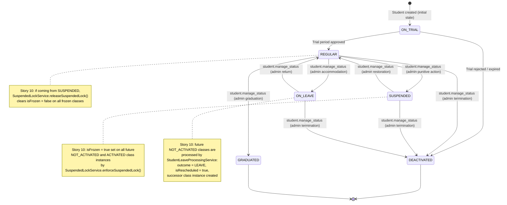
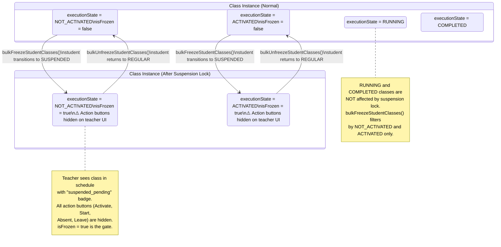
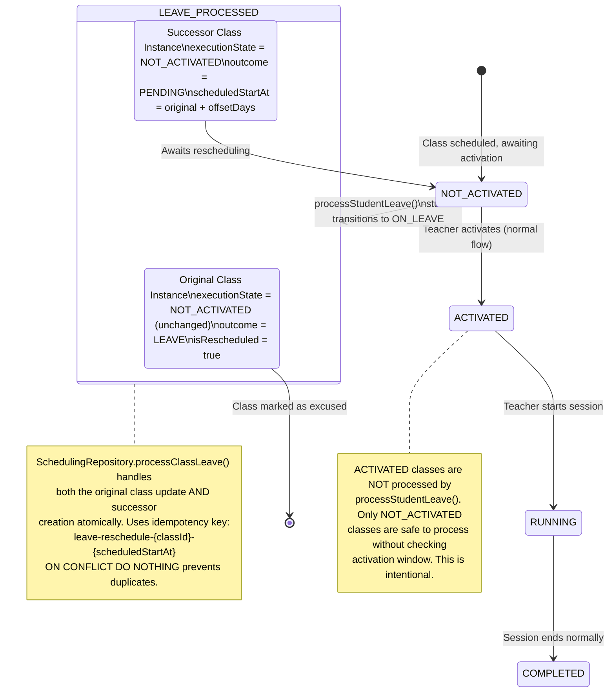
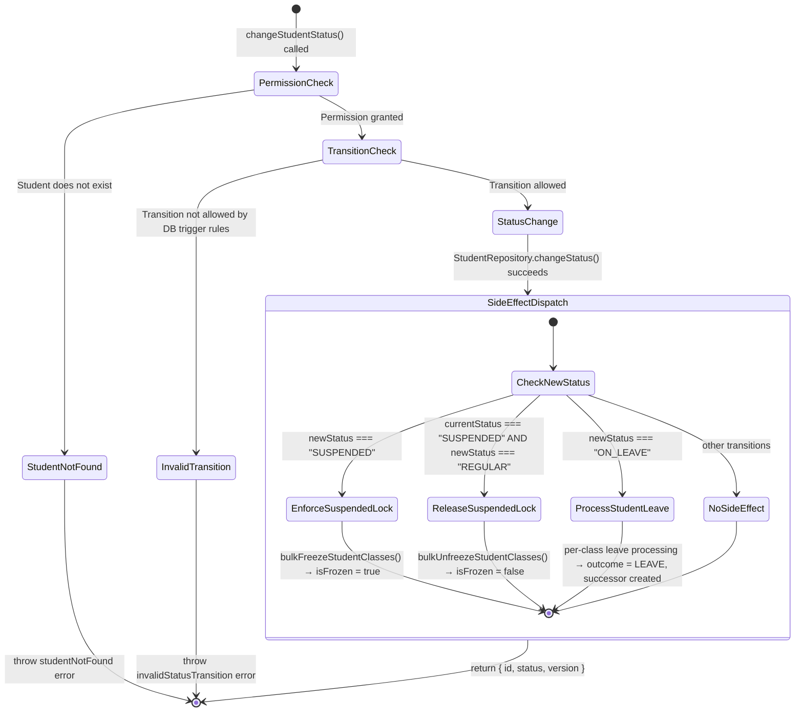

## Section 3: State Machine & Threat Alignment

Story 10 involves two distinct automated workflows triggered by student status changes. This section visualizes the state machines for student status transitions and the resulting class instance state changes.

---

### 3.1 Student Status State Machine

The DB trigger `fn_enforce_student_status_transition` in `student_status_transition_trigger.sql` enforces the following allowed transitions (verified from actual file read):

**State Transition Guards:**
- DB trigger `fn_enforce_student_status_transition` enforces allowed state paths at the database level. Any attempt to bypass the service layer and write an invalid transition directly fails at the DB level.
- The trigger uses a whitelist of allowed `(old_status, new_status)` pairs.
- Story 10 does NOT modify this trigger — the allowed transitions are already correct.

---

### 3.2 Class Instance State Machine — Suspension Lock Effect

When a student transitions to `SUSPENDED`, `SuspendedLockService.enforceSuspendedLock()` is called. The following diagram shows how the class instance state changes:

**Frontend rendering rule for `isFrozen = true`:**
- `StatusTrackingContainer.mapToSessionStatus()` returns `"suspended_pending"` when `isFrozen = true` OR `studentStatus === "SUSPENDED"`.
- `StatusBadgeAction.tsx` renders no action buttons for `suspended_pending` status — this is an existing behavior, not a new Story 10 UI change.

---

### 3.3 Class Instance State Machine — ON_LEAVE Processing

When a student transitions to `ON_LEAVE`, `StudentLeaveProcessingService.processStudentLeave()` is called. The following diagram shows how each future NOT_ACTIVATED class is processed:

**Leave Processing Rules:**
1. Only `executionState = NOT_ACTIVATED` classes are targeted (safe to process without activation window check).
2. The existing `SchedulingRepository.processClassLeave()` at line 566 is reused for each class — it handles the atomic update + successor creation.
3. A failure on one class does NOT stop processing of remaining classes (logged, then continues).
4. The idempotency key `leave-reschedule-{classId}-{scheduledStartAt}` prevents duplicate successor instances if `processStudentLeave()` is called more than once.

---

### 3.4 Complete Side-Effect Dispatch Flow

**Critical observations from this flow:**
- The permission check (`student.manage_status`) happens ONCE at the top.
- All three side-effect branches (`EnforceSuspendedLock`, `ReleaseSuspendedLock`, `ProcessStudentLeave`) execute ONLY after the permission check passes AND the status change commits to DB.
- If the status change itself fails (e.g., DB constraint violation), none of the side effects run.
- If a side-effect fails (e.g., `bulkFreezeStudentClasses()` throws), the `catch(error)` block at the bottom of `changeStudentStatus()` re-throws, so the caller gets an error. The status change IS already committed by this point — this is an acceptable design because the side-effect failure is logged and can be retried by the admin.
