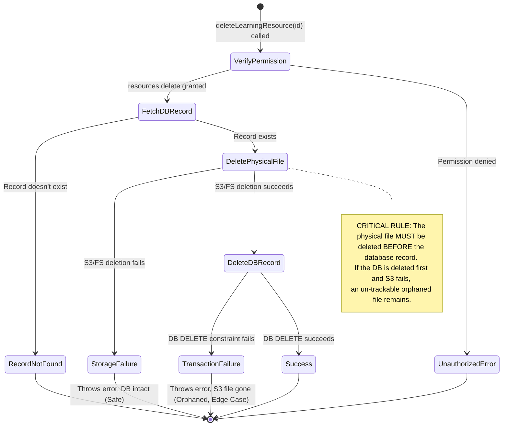
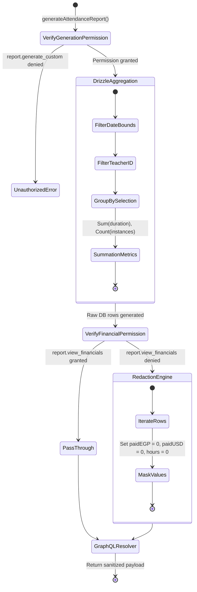
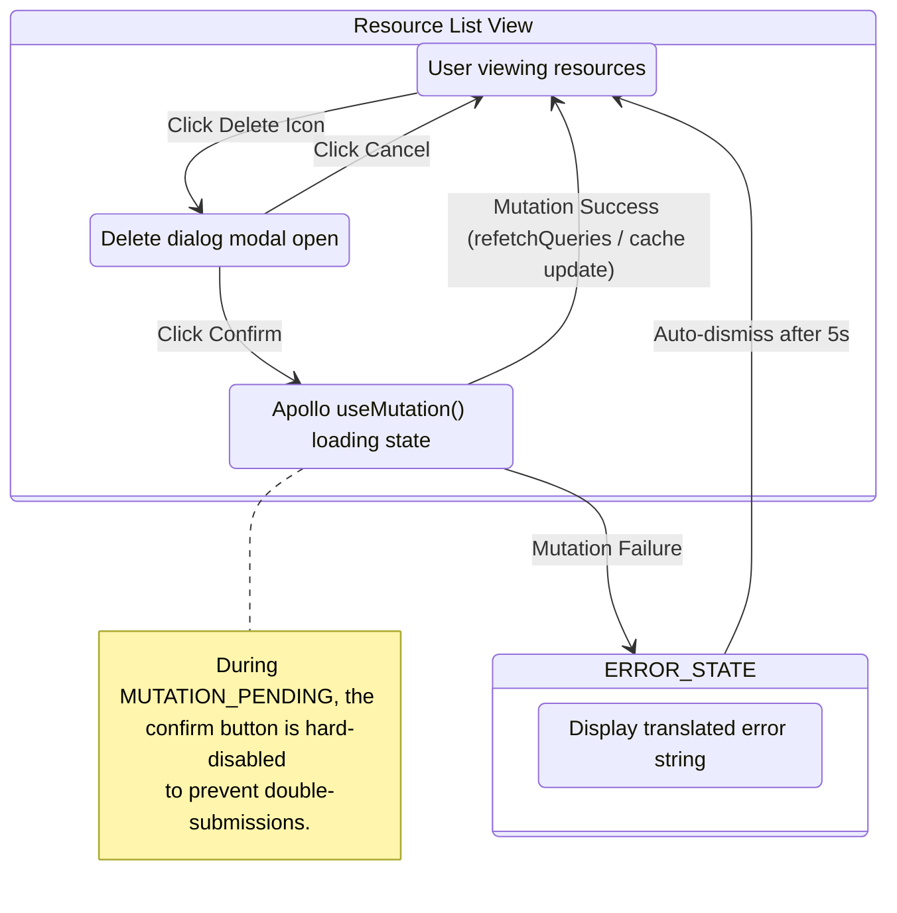

## Section 3: State Machine & Workflow Alignment

Story 12 does not introduce a classic entity-state transition graph (like the Student Status machine from Story 9/10), but it does introduce two deeply critical, multi-step backend workflows that must be modeled to guarantee atomicity and security.

---

### 3.1 Hard Deletion Lifecycle (Learning Resources)

When an Academy Admin executes a deletion, the system must navigate a distributed deletion workflow. Since physical files live outside the transactional boundaries of PostgreSQL (e.g. AWS S3 or Local FS), the order of operations dictates the risk of data corruption.

**Workflow Guards:**
- The `LearningResourceService` orchestrates this explicitly. It does not rely on a DB trigger.
- The GraphQL resolver does not interact with the DB directly; it purely waits for the Service to complete the workflow.

---

### 3.2 Reporting Aggregation Workflow

Generating the attendance report is a complex pipeline of data aggregation followed by permission-based data redaction.

**Aggregation Rules:**
1. Only `executionState IN ["COMPLETED", "ACTIVATED", "RUNNING"]` classes are historically aggregated.
2. The Drizzle ORM aggregation groups by the requested enum (e.g., `TEACHER`, `DATE`).
3. The fallback redaction (setting to `0`) is strictly enforced at the node layer, meaning the GraphQL client cannot circumvent it by tweaking the GQL AST.

---

### 3.3 UI Component State & Feedback Loop

The frontend must provide absolute clarity when dealing with destructive or long-running queries.

**State Transition Guards (UI):**
- The user is completely physically prevented from triggering the `deleteLearningResource` mutation twice rapidly. The button relies on Apollo's `loading` boolean returned by `useMutation`.
- The reporting form strictly requires a valid Date Range. If `fromDate > toDate`, the state machine prevents the GraphQL Query execution outright.
