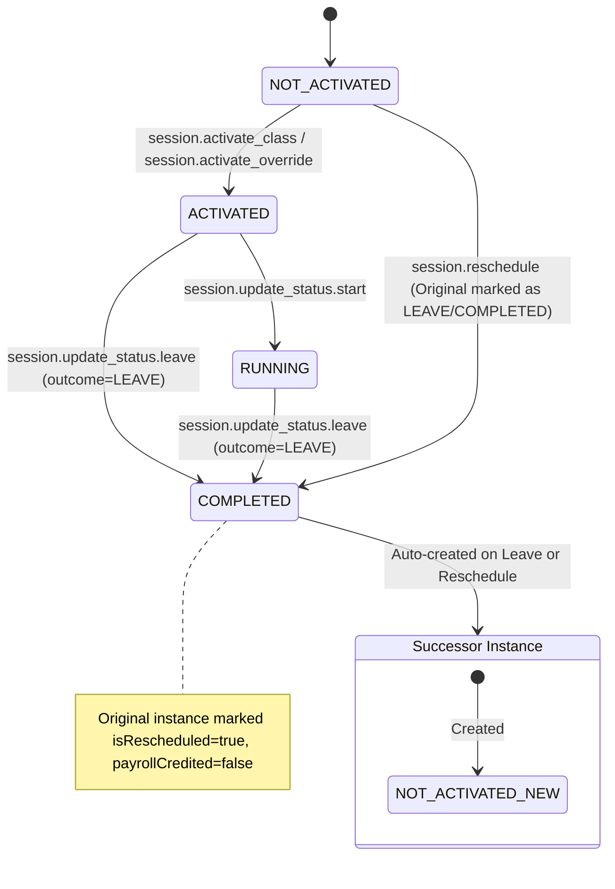

# Patch for Story 3 Implementation Plan

This patch supplements the `.ai/done/3-enhanced.md` plan to comply with the new mandatory requirements defined in `.ai/siraj_stories/AGENTS_STORY_PLANNING.md`. 
Since the original plan has already been implemented, this patch acts retrospectively to verify the current project state against these required sections.

---

## Section 2: RBAC Permissions (Canonical)

### 2.1 New/Existing Permissions Utilized

| **Permission Key** | **Group** | **UI Gate** | **Backend Service Method** | **GraphQL Mutation** |
|---|---|---|---|---|
| `session.update_status.leave` | Teacher Default | Leave Action Button | `ClassSessionService.updateStatusLeave()` | `updateSessionStatusLeave` |
| `session.reschedule` | Academy Admin | Reschedule Button | `ClassSessionService.reschedule()` | `rescheduleClass` |
| `schedule.filter_advanced` | Academy Admin | Reschedule Tracking UI | `ScheduleService.getRescheduleTracking()` | `rescheduleTrackingRows` |
| `dashboard.filter_metrics` | Academy Admin | Schedule Overview Metrics | `ScheduleService.getDailyMetrics()` | `rescheduleTrackingMetrics` |

### 2.2 Permission Mapping to Existing Permissions
All permissions are complementary and govern different aspects of class instance lifecycle management and schedule visibility.

### 2.3 Permission Group Assignments
*(Verified from `backend/db/migration/3-system_permissions_and_groups.sql`)*

| **Permission Group** | **Slug** | **Permissions Assigned** |
|---|---|---|
| Teacher Default | `teacher_default` | `session.update_status.leave` |
| Academy Admin | `academy_admin` | `session.reschedule`, `schedule.filter_advanced`, `dashboard.filter_metrics`, `session.update_status.leave` |

---

## Section 3: State Machine & Threat Alignment

**State Transition Guards:**
- DB trigger `class_instances_state_transition_trigger` enforces allowed state paths.
- Transactions ensure that `updateStatusLeave` updates the original class instance to `COMPLETED`/`LEAVE` and atomically inserts the successor `NOT_ACTIVATED`/`PENDING` instance.

---

## Section 4: Security Threat Remediation

### Threat 1: Leave/Reschedule Transaction Atomicity & Partial Commits
**Current Mitigation:** The application ensures that an original class is never updated to `COMPLETED` without the corresponding successor `class_instances` row being created, and vice versa.
**Fix Implemented:** `SchedulingRepository.processClassLeave()` and rescheduling functions wrap the entire process inside a `db.transaction()`. It ensures the original row's final state is `COMPLETED` / `LEAVE` and `isRescheduled = true` while atomically creating the successor instance.
**Test Requirements:**
- Transactions roll back correctly on invalid inputs (Verified).

### Threat 2: Idempotency Key Collision during Manual Rescheduling
**Current Mitigation:** Reusing the original class's `idempotencyKey` for the rescheduled class can cause `class_instances_idempotency_key_unique_idx` constraint violations.
**Fix Implemented:** The backend now generates a deterministic unique key for reschedule operations, e.g., `manual-reschedule-${classInstanceId}-${input.scheduledStartAt.toISOString()}` in `ClassSessionService.reschedule()`.
**Test Requirements:**
- Duplicate manual reschedules for the same original fail gracefully or are rejected.

### Threat 3: Timezone Verification & Future Metric Leaks
**Current Mitigation:** Dashboard and schedule tracking metrics correctly calculate boundaries without exposing cross-tenant/cross-user timezone discrepancies.
**Fix Implemented:** Metric queries use `getDayBoundaries(date, viewerTimezone || "UTC")` to respect the viewer's boundaries instead of raw date casts.

---

## Section 5: Prerequisites Verification (BLOCKING)

### 5.0 Security Artifact Verification

| **Artifact** | **Path** | **Verification** | **Success Criteria** |
|---|---|---|---|
| State trigger | `backend/db/migration/class_instances_state_transition_trigger.sql` | Manual view | Function exists ✅ |
| System Permissions | `backend/db/migration/3-system_permissions_and_groups.sql` | Manual view | Permissions exist ✅ |
| DB Migrations | `backend/db/schema/scheduling.ts` | Manual view | `leaveRequests` table exists ✅ |
| GraphQL Mutations | `backend/graphql/mutation/class-session.mutation.ts` | Manual view | Return composite IDs ✅ |

### 5.1 Database Schema Verification
- [x] Verify `class_instances` has columns: `isRescheduled`, `originalClassId`, `quotaDeducted`, `payrollCredited`. ✅ (verified in `backend/db/schema/scheduling.ts`)
- [x] Verify `leaveRequests` table exists. ✅ (verified in `backend/db/schema/scheduling.ts`)

### 5.2 Existing Code Verification
- [x] Verify `ClassSessionService.updateStatusLeave()` exists and works. ✅ (verified in `backend/graphql/mutation/class-session.mutation.ts`)
- [x] Verify `ClassSessionService.reschedule()` exists and works. ✅ (verified in `backend/graphql/mutation/class-session.mutation.ts`)
- [x] Verify GraphQL mutation resolver `updateSessionStatusLeave` returns the composite ID and instance details. ✅ (verified in `class-session.mutation.ts`)
- [x] Verify frontend route components process real UI events. ✅ (verified in `ClassDetailsContainer.tsx` with proper error handling and real API calls)
