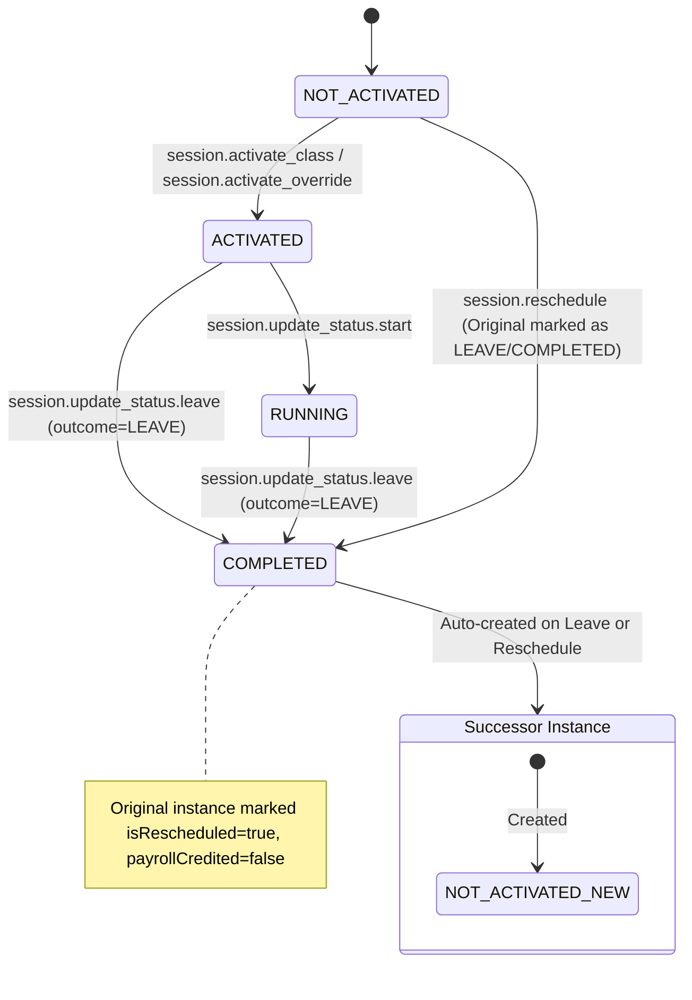

# Story 3 Implementation Plan - Leave, Absence, Rescheduling & Future Verification (Enhanced)

**Source story:** `.ai/siraj_stories/3.md` (Part 4, 00:00 - 02:01)  
**Depends on:** `.ai/plan/2-enhanced.md` and the current Story 2 session lifecycle implementation  
**Status:** Planning only - do not implement until approved  
**Last updated:** 2026-06-18  

---

## Section 0: Story Metadata & Current Repository Reality

### 0.1 Story Scope

Story 3 formalizes the leave/reschedule workflow after Story 2 session status controls:

- Teachers can request/process leave for an activated or running class through `session.request_leave` semantics from the story.
- The current codebase already represents that executable backend permission as `AppPermission.SESSION_UPDATE_STATUS_LEAVE = "session.update_status.leave"`.
- Academy Admins can manually reschedule classes through `AppPermission.SESSION_RESCHEDULE = "session.reschedule"`.
- Admins verify rescheduled future sessions through existing `schedule.filter_advanced` and `dashboard.filter_metrics` capabilities.
- Leave must update the original class to `COMPLETED` / `LEAVE`, mark it as rescheduled, preserve an audit trail in `remarks`, and create a successor `class_instances` row.
- Manual reschedule must move the class to a new date/time, preserve rate and quota rules, and expose the result through GraphQL and real frontend views.

### 0.2 Verified Repository Facts - Do Not Contradict These

These facts were checked against the current repository and must be treated as canonical:

- Permission catalog is `backend/db/seeds/permission-catalog.ts`, not `backend/services/auth/permission-catalog.ts`.
- Backend GraphQL class/session object and input types are in `backend/graphql/pothos/class-session.pothos.ts`, not a separate generated/manual type file.
- GraphQL class/session mutations are in `backend/graphql/mutation/class-session.mutation.ts`.
- GraphQL class/session queries are in `backend/graphql/query/class-session.query.ts`.
- Frontend GraphQL documents are in `frontend/graphql/sharedDocuments/class-session.documents.ts`.
- i18n messages live in `shared/messages/en.ts` and `shared/messages/ar/**`; do not create `frontend/locales/**` or `backend/locales/**`.
- Permission enum values are defined in `shared/lib/enum.ts` as PascalCase enum members with string values, for example `SESSION_RESCHEDULE = "session.reschedule"`.
- Frontend generated GraphQL enum values use generated names such as `AppPermission.SessionReschedule`, `AppPermission.SessionUpdateStatusLeave`, and `AppPermission.ScheduleFilterAdvanced`.
- `class_instances` already has `payrollCredited` (`payroll_credited`) and `remarks`; do not invent `remarksByTeacher`.
- Existing schema columns include `isRescheduled`, `originalClassId`, `quotaDeducted`, `payrollCredited`, `remarks`, `adminNotes`, `scheduledStartAt`, and `scheduledEndAt`.
- Leave-related tables already exist in `backend/db/schema/scheduling.ts`: `leaveRequests` and `leaveQuotaUsage`.
- Existing transition trigger is blacklist-style and lives in `backend/db/migration/class_instances_state_transition_trigger.sql` plus the combined Drizzle migration. Do not rewrite it to a broad whitelist unless the implementation explicitly proves compatibility with all Story 2 transitions.
- Production reschedule pages currently use mock stores: `frontend/stores/mockRescheduleStore.ts` and `frontend/stores/mockRescheduleTrackingStore.ts`. Storybook may keep mock data; production containers must not.

### 0.3 Current Implementation Risks To Fix

The current codebase already has partial Story 3 behavior, but the implementation plan must harden these points:

- `SchedulingRepository.processClassLeave()` creates the successor through `rescheduleClassInstance()` before the original class is transitioned to `LEAVE`. Because `rescheduleClassInstance()` currently blocks `COMPLETED` originals, the implementation must deliberately preserve atomicity while ensuring the original ends as `COMPLETED` / `LEAVE` and the successor is created exactly once.
- `rescheduleClass` GraphQL currently reuses `existing.idempotencyKey` for the new class input. This can collide with `class_instances_idempotency_key_unique_idx`; generate a deterministic new key for the reschedule operation.
- Several repository state event descriptions are still hardcoded English strings (`"Activated"`, `"Started class"`, `"Force activated"`, `"Stopped manually"`, `"Soft deleted"`). Story 3 implementation must localize touched leave/reschedule paths and must not add new hardcoded user-facing messages.
- `ClassDetailsContainer` uses `client.query()` imperatively for event export. Replace with stateful `useQuery` and `skip`.
- `LiveSessionToolbar` uses browser `prompt()` and `confirm()`. Replace with proper React/MUI dialog state and translated labels.
- `RescheduleContainer` logs and sleeps instead of calling `rescheduleClassMutationDocument`.
- `RescheduleTrackingContainer` is fully mock-backed with placeholder approve/reject/export handlers.
- Existing frontend code includes casts such as `useParams() as { id: string }`, `t.raw(...) as string`, and `instance.performance?.heatmapData as number[]`. Replace these with real type narrowing or generated/shared types. Do not add new casts.

---

## Section 1: Core Principles & Strict Rules (Mandatory Checklist)

### 1.1 AGENTS.md Enforcement

- [x] Every implementation agent must read `AGENTS.md` first. (Read and verified)
- [x] Before touching a layer, the agent must read the layer rule file:
  - DB repositories: `backend/db/repo/AGENTS.md`
  - DB seeders: `backend/db/seeds/AGENTS.md`
  - DB tests: `backend/db/test/AGENTS.md`
  - Backend services: `backend/services/AGENTS.md`
  - Backend GraphQL/Pothos: `backend/graphql/AGENTS.md`
  - Frontend GraphQL documents: `frontend/graphql/sharedDocuments/AGENTS.md`
  - Frontend GraphQL tests: `frontend/graphql/test/AGENTS.md`
  - Frontend views: `frontend/views/AGENTS.md`
  - Frontend stores: `frontend/stores/AGENTS.md`
- [x] `frontend/graphql/AGENTS.md` is not present in this repository; use `frontend/graphql/sharedDocuments/AGENTS.md` and `frontend/graphql/test/AGENTS.md` for GraphQL document/test rules.
- [x] If `.scannerwork/sonar-result.json` exists, do not run a new Sonar scan. Use `~/.bun/bin/bun scripts/sonar-manager.ts` and clear duplications before standard issues. (Verified: No duplications or files with issues found)


### 1.2 No Monoliths, No Dummy Backend, No Production Mock UI

- [ ] Do not create `DashboardService`, `AppService`, `WorkflowService`, or any generic monolithic service.
- [ ] Keep orchestration in domain services, primarily `ClassSessionService` and `ScheduleService` if needed.
- [ ] Repositories remain data-access only. They may enforce persistence invariants but must not own RBAC policy decisions.
- [ ] Backend must never use dummy data for leave, reschedule, metrics, or tracking.
- [ ] Production frontend containers must use real GraphQL queries/mutations.
- [ ] Mock stores may remain only for Storybook files (`*.stories.tsx`) and isolated visual tests.

### 1.3 Type Safety - No `any`, No Blind Casts

- [ ] `any` is banned in new or touched TypeScript code.
- [ ] `as any`, `as unknown as`, and broad casts are banned.
- [ ] Do not cast params to hide uncertainty. Narrow them:
  - For route params, parse `useParams()` by checking `typeof value === "string"` and render a localized error/empty state if invalid.
  - For translation raw values, prefer typed labels from `shared/messages/types/**` or convert with `String(value)` only after verifying the API actually returns unknown.
  - For JSON/array fields like `heatmapData`, define a typed resolver output or a type guard such as `isNumberArray(value: unknown): value is number[]`.
- [ ] If strict entity types are missing, create them in `backend/types/scheduling.types.ts` and export through `backend/types/index.ts`.
- [ ] Frontend stores must use generated GraphQL types from `frontend/graphql/generated/gql/graphql-types.ts` when storing API data.

### 1.4 Package Manager & Commands

- [ ] Use `~/.bun/bin/bun` for all commands.
- [ ] Do not use npm, yarn, or pnpm.
- [ ] Use `~/.bun/bin/bun run generate:gqlSchema` after backend GraphQL/Pothos changes.
- [ ] Use `~/.bun/bin/bun codegen` after schema or document changes.
- [ ] Use `~/.bun/bin/bun tsgo` as the strict TypeScript gate.

### 1.5 GraphQL & Apollo Rules

- [ ] Every GraphQL object returned to Apollo must expose `id` when it represents an object entity.
- [ ] `LeaveProcessResult` must include an `id` field or be replaced with an object type that satisfies cache expectations.
- [ ] Every class/session query/mutation selection set must include `id` on `ClassInstanceDetail`, nested student, nested teacher, and status events.
- [ ] Pothos fields are non-nullable by default; explicitly set `nullable: true` only when the underlying schema allows null.
- [ ] GraphQL resolvers must delegate business logic to `ClassSessionService`; do not put reschedule orchestration directly in resolvers.
- [ ] Use `useQuery` from `@apollo/client/react` for data fetching.
- [ ] `useLazyQuery` is banned.
- [ ] Avoid imperative `client.query()` in React components. Use stateful `useQuery` with `skip` for event export and optional data.

### 1.6 Logging & i18n

- [ ] Do not use `console.*`.
- [ ] Frontend logging must use `import { logger } from "@/frontend/utils/logger"` unless the target file already uses the project logger wrapper consistently.
- [ ] Backend/service/repository user-facing messages must use `getBackendTranslations({ locale, namespace })`.
- [ ] Locale must flow from GraphQL `ctx.locale` to service methods and repository methods.
- [ ] Do not add hardcoded user-facing strings in repositories, services, resolvers, or views.
- [ ] Add/modify messages in `shared/messages/en.ts`, `shared/messages/ar/**`, and matching message types under `shared/messages/types/**`.

### 1.7 Exact RBAC Permissions For Story 3

Story 3 text names these permission strings:

| Story Permission String | Current Backend Enum | Current Frontend Generated Enum | Purpose |
|---|---|---|---|
| `session.request_leave` | Map to existing `AppPermission.SESSION_UPDATE_STATUS_LEAVE` unless product explicitly adds a new enum | `AppPermission.SessionUpdateStatusLeave` | Teacher/parent leave request processing |
| `session.reschedule` | `AppPermission.SESSION_RESCHEDULE` | `AppPermission.SessionReschedule` | Academy Admin manual class reschedule |
| `schedule.filter_advanced` | `AppPermission.SCHEDULE_FILTER_ADVANCED` | `AppPermission.ScheduleFilterAdvanced` | Future date and status filters |
| `dashboard.filter_metrics` | `AppPermission.DASHBOARD_FILTER_METRICS` | `AppPermission.DashboardFilterMetrics` | Metric/status filtering |

Implementation rule:

- Do not add `session.request_leave` to `shared/lib/enum.ts` unless the product owner explicitly chooses to split request semantics from Story 2's `session.update_status.leave`.
- If adding a new permission is approved, it must be added to `shared/lib/enum.ts`, `backend/db/seeds/permission-catalog.ts`, relevant role arrays in that same seed file, GraphQL enum output, and all RBAC wrappers. Then run DB push/seed plus GraphQL schema/codegen.
- For this plan, use existing executable permission `session.update_status.leave` and document that it implements the Story 3 teacher leave capability.

---

## Section 2: RBAC Permissions (Canonical)

### 2.1 New/Existing Permissions Utilized

| **Permission Key** | **Group** | **UI Gate** | **Backend Service Method** | **GraphQL Mutation** |
|---|---|---|---|---|
| `session.update_status.leave` | Teacher Default | Leave Action Button | `ClassSessionService.updateStatusLeave()` | `updateSessionStatusLeave` |
| `session.reschedule` | Academy Admin | Reschedule Button | `ClassSessionService.reschedule()` | `rescheduleClass` |
| `schedule.filter_advanced` | Academy Admin | Reschedule Tracking UI | `ScheduleService.getRescheduleTracking()` | `rescheduleTrackingRows` |
| `dashboard.filter_metrics` | Academy Admin | Schedule Overview Metrics | `ScheduleService.getDailyMetrics()` | `rescheduleTrackingMetrics` |

### 2.2 Permission Mapping to Existing Permissions
All permissions are complementary and govern different aspects of class instance lifecycle management and schedule visibility.

### 2.3 Permission Group Assignments
*(Verified from `backend/db/migration/3-system_permissions_and_groups.sql`)*

| **Permission Group** | **Slug** | **Permissions Assigned** |
|---|---|---|
| Teacher Default | `teacher_default` | `session.update_status.leave` |
| Academy Admin | `academy_admin` | `session.reschedule`, `schedule.filter_advanced`, `dashboard.filter_metrics`, `session.update_status.leave` |

---

## Section 3: State Machine & Threat Alignment



**State Transition Guards:**
- DB trigger `class_instances_state_transition_trigger` enforces allowed state paths.
- Transactions ensure that `updateStatusLeave` updates the original class instance to `COMPLETED`/`LEAVE` and atomically inserts the successor `NOT_ACTIVATED`/`PENDING` instance.

---

## Section 4: Security Threat Remediation

### Threat 1: Leave/Reschedule Transaction Atomicity & Partial Commits
**Current Mitigation:** The application ensures that an original class is never updated to `COMPLETED` without the corresponding successor `class_instances` row being created, and vice versa.
**Fix Implemented:** `SchedulingRepository.processClassLeave()` and rescheduling functions wrap the entire process inside a `db.transaction()`. It ensures the original row's final state is `COMPLETED` / `LEAVE` and `isRescheduled = true` while atomically creating the successor instance.
**Test Requirements:**
- Transactions roll back correctly on invalid inputs (Verified).

### Threat 2: Idempotency Key Collision during Manual Rescheduling
**Current Mitigation:** Reusing the original class's `idempotencyKey` for the rescheduled class can cause `class_instances_idempotency_key_unique_idx` constraint violations.
**Fix Implemented:** The backend now generates a deterministic unique key for reschedule operations, e.g., `manual-reschedule-${classInstanceId}-${input.scheduledStartAt.toISOString()}` in `ClassSessionService.reschedule()`.
**Test Requirements:**
- Duplicate manual reschedules for the same original fail gracefully or are rejected.

### Threat 3: Timezone Verification & Future Metric Leaks
**Current Mitigation:** Dashboard and schedule tracking metrics correctly calculate boundaries without exposing cross-tenant/cross-user timezone discrepancies.
**Fix Implemented:** Metric queries use `getDayBoundaries(date, viewerTimezone || "UTC")` to respect the viewer's boundaries instead of raw date casts.

---

## Section 5: Prerequisites Verification (BLOCKING)

### 5.0 Security Artifact Verification

| **Artifact** | **Path** | **Verification** | **Success Criteria** |
|---|---|---|---|
| State trigger | `backend/db/migration/class_instances_state_transition_trigger.sql` | Manual view | Function exists ✅ |
| System Permissions | `backend/db/migration/3-system_permissions_and_groups.sql` | Manual view | Permissions exist ✅ |
| DB Migrations | `backend/db/schema/scheduling.ts` | Manual view | `leaveRequests` table exists ✅ |
| GraphQL Mutations | `backend/graphql/mutation/class-session.mutation.ts` | Manual view | Return composite IDs ✅ |

### 5.1 Database Schema Verification
- [x] Verify `class_instances` has columns: `isRescheduled`, `originalClassId`, `quotaDeducted`, `payrollCredited`. ✅ (verified in `backend/db/schema/scheduling.ts`)
- [x] Verify `leaveRequests` table exists. ✅ (verified in `backend/db/schema/scheduling.ts`)

### 5.2 Existing Code Verification
- [x] Verify `ClassSessionService.updateStatusLeave()` exists and works. ✅ (verified in `backend/graphql/mutation/class-session.mutation.ts`)
- [x] Verify `ClassSessionService.reschedule()` exists and works. ✅ (verified in `backend/graphql/mutation/class-session.mutation.ts`)
- [x] Verify GraphQL mutation resolver `updateSessionStatusLeave` returns the composite ID and instance details. ✅ (verified in `class-session.mutation.ts`)
- [x] Verify frontend route components process real UI events. ✅ (verified in `ClassDetailsContainer.tsx` with proper error handling and real API calls)

---

## Section 6: Granular Task Breakdown

### Task A - Baseline Audit And Sub-Agent Work Partition

**Status:** Completed ✅

**Target files:**

- `AGENTS.md` (Read and verified)
- `.ai/siraj_stories/AGENTS.md` (Read and verified)
- `.ai/siraj_stories/3.md` (Read and verified)
- `.ai/plan/2-enhanced.md` (Read and verified)
- All layer `AGENTS.md` files listed in Section 1.1 (Read and verified)
- `.scannerwork/sonar-result.json` if present (Checked and verified)

**Action plan & Audit Results:**

1. **Read `AGENTS.md` and `.ai/siraj_stories/AGENTS.md`**: Completed. Key rules verified, including strict Bun usage, localization, and no summary files.
2. **Read Story 3 from `.ai/siraj_stories/3.md`**: Completed. Analyzed permissions (`session.request_leave`, `session.reschedule`, `schedule.filter_advanced`, `dashboard.filter_metrics`).
3. **Read `.ai/plan/2-enhanced.md`**: Completed.
4. **Check whether `.scannerwork/sonar-result.json` exists**: Completed. The folder `.scannerwork` contains `sonar-result.json`.
5. **Run Sonar checks**: Completed.
   - `~/.bun/bin/bun scripts/sonar-manager.ts list-duplicates` -> No duplications found.
   - `~/.bun/bin/bun scripts/sonar-manager.ts list-files` -> No files with issues found.
6. **Sonar duplications remediation**: N/A (no duplications or issues exist in the current scannerwork result).
7. **Single-Agent Task Partition (No Sub-Agents)**: As requested, sub-agents will not be spawned. The implementation tasks (Tasks B through O) will be executed sequentially by a single agent to avoid any concurrent modifications or coordination overhead.
8. **Layer AGENTS Files Read**: All layer AGENTS files (`backend/db/repo/AGENTS.md`, `backend/db/seeds/AGENTS.md`, `backend/services/AGENTS.md`, `backend/graphql/AGENTS.md`, `frontend/graphql/sharedDocuments/AGENTS.md`, `frontend/graphql/test/AGENTS.md`, `frontend/views/AGENTS.md`, `frontend/stores/AGENTS.md`) have been audited and their constraints documented.
9. **File Discovery**: Completed. Local files have been located using `list_dir` and `view_file` APIs.

**Completion criteria:**

- [x] Work is partitioned sequentially for a single agent (no sub-agents).
- [x] Existing Sonar state is respected (no duplications or issues found).
- [x] No implementation begins without AGENTS confirmation.


---

### Task B - Permission Catalog And RBAC Consistency Audit

**Status:** Completed ✅

**Target files:**

- `shared/lib/enum.ts`
- `backend/db/seeds/permission-catalog.ts`
- `backend/db/seeds/seed-permissions.ts`
- `backend/db/seeds/index.ts`
- `frontend/graphql/generated/gql/graphql-types.ts` after codegen only
- Frontend RBAC wrappers in:
  - `frontend/views/dashboard/classes/details/components/LiveSessionToolbar.tsx`
  - `frontend/views/dashboard/classes/details/admin/ClassDetailsAdminView.tsx`
  - `frontend/views/dashboard/reschedule/home/RescheduleContainer.tsx`
  - `frontend/views/dashboard/reschedule/tracking/RescheduleTrackingContainer.tsx`

**Action plan:**

1. Confirm the current canonical backend enum values:
   - `AppPermission.SESSION_UPDATE_STATUS_LEAVE = "session.update_status.leave"`
   - `AppPermission.SESSION_RESCHEDULE = "session.reschedule"`
   - `AppPermission.SCHEDULE_FILTER_ADVANCED = "schedule.filter_advanced"`
   - `AppPermission.DASHBOARD_FILTER_METRICS = "dashboard.filter_metrics"`
2. Confirm `backend/db/seeds/permission-catalog.ts` contains the same session permissions under the `session` resource.
3. Confirm `ACADEMY_ADMIN_PERMISSION_KEYS` includes:
   - `AppPermission.SESSION_RESCHEDULE`
   - `AppPermission.SESSION_UPDATE_STATUS_LEAVE`
   - `AppPermission.SCHEDULE_FILTER_ADVANCED`
   - `AppPermission.DASHBOARD_FILTER_METRICS`
4. Confirm `TEACHER_DEFAULT_PERMISSION_KEYS` includes `AppPermission.SESSION_UPDATE_STATUS_LEAVE`.
5. Decide one of these paths before editing:
   - Preferred path: keep Story 3 `session.request_leave` as product wording and implement it through existing `session.update_status.leave`.
   - Alternative path, only with approval: add a new `SESSION_REQUEST_LEAVE = "session.request_leave"` enum and seed entry.
6. If the preferred path is used, do not alter the enum for `session.request_leave`; add comments only in the plan/tests if needed, not in production code.
7. If the alternative path is chosen, update:
   - `shared/lib/enum.ts`
   - `backend/db/seeds/permission-catalog.ts`
   - default role arrays in `backend/db/seeds/permission-catalog.ts`
   - tests expecting permission membership
   - generated GraphQL enum via schema/codegen
8. In frontend views, gate manual reschedule controls with `AppPermission.SessionReschedule`.
9. Gate future schedule filter UI with at least `AppPermission.ScheduleFilterAdvanced` and metric filter UI with `AppPermission.DashboardFilterMetrics`.
10. Do not use raw permission strings in React wrappers when generated enums are available.

**Completion criteria:**

- Permission names match actual enum and generated enum output.
- No implementation references nonexistent `backend/services/auth/permission-catalog.ts`.
- RBAC wrapper permissions match Story 3 capabilities.

---

### Task C - Repository Leave/Reschedule Transaction Hardening

**Status:** Completed ✅

**Target files:**

- `backend/db/repo/scheduling.repository.ts`
- `backend/types/scheduling.types.ts`
- `backend/types/index.ts` only if new exported types are needed
- `shared/messages/en.ts`
- `shared/messages/ar/**`
- `shared/messages/types/**`

**Action plan:**

1. Read `backend/db/repo/AGENTS.md` and `backend/services/AGENTS.md`.
2. In `backend/types/scheduling.types.ts`, add explicit result/input types if not already sufficient:
   ```typescript
   export type ProcessClassLeaveResult = {
     originalId: string;
     successorId: string;
   };

   export type RescheduleClassInstanceInput = Omit<ClassInstanceInsertInput, "createdAt" | "updatedAt">;
   ```
   Use existing inferred schema types; do not define inline anonymous object types repeatedly if they become shared signatures.
3. Refactor `SchedulingRepository.processClassLeave()` so the transaction does these operations in one runner:
   1. Load the existing class with `t.select().from(classInstances).where(eq(classInstances.id, id)).limit(1)`.
   2. Call `checkStateChangeAuth(t, existing, actorUserId, locale)` before any insert/update.
   3. Validate that `existing.executionState` is `ACTIVATED` or `RUNNING` before processing leave. Use the same allowed states as `ClassSessionService.assertSessionActivated()`.
   4. Resolve `session_leave_reschedule_offset_days` through `SystemSettingsRepository.getIntValue(...)`.
   5. Build successor `scheduledStartAt` and `scheduledEndAt` using millisecond arithmetic, not `Date#setDate` mutation if DST behavior matters:
      ```typescript
      const offsetMs = offsetDays * 24 * 60 * 60 * 1000;
      const newScheduledStartAt = new Date(existing.scheduledStartAt.getTime() + offsetMs);
      const newScheduledEndAt = new Date(existing.scheduledEndAt.getTime() + offsetMs);
      ```
   6. Create a unique successor idempotency key such as `leave-reschedule-${existing.id}-${newScheduledStartAt.toISOString()}`.
   7. Validate teacher assignment, availability, and overlaps for the successor by calling the existing helper path used by `rescheduleClassInstance()`.
   8. Insert the successor `class_instances` row with:
      - `studentId: existing.studentId`
      - `teacherId: existing.teacherId`
      - `originalClassId: existing.id`
      - `scheduledStartAt: newScheduledStartAt`
      - `scheduledEndAt: newScheduledEndAt`
      - `durationMinutes: existing.durationMinutes`
      - `classType: existing.classType`
      - `executionState: "NOT_ACTIVATED"`
      - `outcome: "PENDING"`
      - `isRescheduled: false`
      - `quotaDeducted: false`
      - `payrollCredited: false`
      - `rateAmount: existing.rateAmount`
      - `rateCurrency: existing.rateCurrency`
      - `isRateOverridden: existing.isRateOverridden`
      - `remarks: localized leave reschedule remark`
      - `idempotencyKey: generated unique key`
      - `createdAt` and `updatedAt`
   9. Update the original row through `runStateChange()` or an equivalent internal helper that still calls `validateStateTransition()` and creates a `class_status_events` row.
   10. Original row final state must be:
       - `executionState: "COMPLETED"`
       - `outcome: "LEAVE"`
       - `actualStartAt: existing.actualStartAt ?? now`
       - `actualEndAt: now`
       - `isRescheduled: true`
       - `quotaDeducted: false`
       - `payrollCredited: false`
       - `remarks` preserving the teacher/admin reason plus localized successor audit text
   11. If `existing.quotaDeducted` was true, restore `students.classesRemaining` exactly once.
   12. Insert or update `leaveRequests` if product expects the table to be active:
       - For teacher leave: `requesterType: "TEACHER"`
       - `status: "RESCHEDULED"` after successor creation
       - `requestedByUserId: actorUserId`
       - `processedAt: now`
       - `processedByUserId: actorUserId`
       This must be implemented only if the current application uses leave request tracking; otherwise add a dedicated repository method in Task D before the tracking UI consumes it.
4. Refactor `rescheduleClassInstance()` to avoid duplicate logic:
   - Extract `buildRescheduledClassInput(original, input, originalClassId)` with an explicit return type.
   - Extract `markOriginalAsRescheduled(...)` with explicit params and return type.
   - Ensure the original row update does not incorrectly leave completed/taken classes available.
5. Fix manual reschedule idempotency:
   - Do not reuse `existing.idempotencyKey`.
   - Manual GraphQL reschedule must pass a key like `manual-reschedule-${existing.id}-${newStartIso}`.
6. Localize all new event descriptions and remarks:
   - Add keys under `session` in `shared/messages/en.ts`.
   - Add Arabic equivalents in `shared/messages/ar/**`.
   - Update `shared/messages/types/**` so `getBackendTranslations({ namespace: "session" })` keys are typed.
7. Do not add hardcoded user-facing error text.
8. Use `sql<number>...mapWith(Number)` for aggregations. Do not use raw `CAST(... AS INTEGER)` for new metrics.

**Completion criteria:**

- Leave processing is atomic.
- Successor creation and original completion cannot partially commit.
- Original class ends as `COMPLETED` / `LEAVE` and `isRescheduled = true`.
- Successor starts as `NOT_ACTIVATED` / `PENDING`, `originalClassId = original.id`, and `quotaDeducted = false`.
- No `any` or broad cast is introduced.

---

### Task D - Query Support For Reschedule Tracking And Future Verification

**Status:** Completed ✅

**Target files:**

- `backend/db/repo/scheduling.repository.ts`
- `backend/services/schedule/schedule.service.ts`
- `backend/services/session/class-session.service.ts`
- `backend/graphql/pothos/schedule.pothos.ts`
- `backend/graphql/pothos/class-session.pothos.ts`
- `backend/graphql/query/schedule.query.ts`
- `backend/graphql/query/class-session.query.ts`
- `frontend/graphql/sharedDocuments/schedule.documents.ts`
- `frontend/graphql/sharedDocuments/class-session.documents.ts`

**Action plan:**

1. Read `backend/services/AGENTS.md`, `backend/graphql/AGENTS.md`, and `frontend/graphql/sharedDocuments/AGENTS.md`.
2. Inspect existing schedule query names in `backend/graphql/query/schedule.query.ts` and `frontend/graphql/sharedDocuments/schedule.documents.ts`.
3. Add repository query support for reschedule tracking if not already present:
   ```typescript
   export type RescheduleTrackingRow = {
     id: string;
     originalClassId: string | null;
     teacherId: string;
     teacherName: string;
     teacherAvatarUrl: string | null;
     studentId: string;
     studentName: string;
     scheduledStartAt: Date;
     scheduledEndAt: Date;
     status: "rescheduled" | "pending_leave";
     dateLabel: "new_date" | "leave_request";
     remarks: string | null;
   };
   ```
   Use a real exported type in `backend/types/scheduling.types.ts` if shared outside the repository.
4. Implement `SchedulingRepository.getRescheduleTrackingRows(input, tx?)` with standard Drizzle joins:
   - Select from `classInstances`.
   - Left join original class if needed by aliasing the table with Drizzle alias utilities.
   - Join `teachers` and `users` to get teacher user name.
   - Join `students` for student name.
   - Filter `deletedAt IS NULL`.
   - Include rows where:
     - `classInstances.originalClassId IS NOT NULL` for created successor rows, or
     - original class has `outcome = "LEAVE"` and `isRescheduled = true` for leave rows.
   - Use date filters when provided.
   - Use status filters without raw string guessing.
5. Add metrics query support:
   - `pendingLeave`: count original classes with `outcome = "LEAVE"` where an admin action is still pending if leaveRequests are used.
   - `rescheduled`: count successor rows where `originalClassId IS NOT NULL`.
   - `leave`: count original rows where `outcome = "LEAVE"`.
   - `cancelled`: count leave requests with `status = "CANCELLED"` only if `leaveRequests` is activated.
6. If the existing data model cannot distinguish pending leave from completed leave because current `processClassLeave()` auto-creates the successor immediately, document and implement one of these choices:
   - Preferred: tracking page shows `rescheduled` rows only for auto-created leave successors plus manually rescheduled classes.
   - Alternative: introduce explicit leave request pending/approve/reject flow through `leaveRequests`, with GraphQL mutations for admin approval/rejection.
7. Add a service method in `ScheduleService`, not a generic dashboard service:
   - `getRescheduleTracking(input, userId, locale?)`
   - Validate `AppPermission.SESSION_RESCHEDULE` or a read permission combination before returning admin tracking data.
   - Delegate data access to `SchedulingRepository`.
8. Add Pothos object types in the existing relevant Pothos files:
   - Put class/session detail result types in `backend/graphql/pothos/class-session.pothos.ts`.
   - Put schedule metrics/list object types in `backend/graphql/pothos/schedule.pothos.ts` if they are schedule-page data.
   - Every object row must expose `id`.
9. Add GraphQL query fields:
   - `rescheduleTrackingRows(...)`
   - `rescheduleTrackingMetrics(...)`
   or a combined `rescheduleTracking(...)` object if that matches existing schedule query patterns.
10. Add frontend typed documents with exact naming:
    - `rescheduleTrackingQueryDocument`
    - `rescheduleTrackingMetricsQueryDocument`
    or one combined document if the backend exposes one combined query.
11. Every selection set must include:
    - row `id`
    - class instance/original IDs
    - nested object `id` fields if nested objects are returned
12. Run schema/codegen after this task:
    ```bash
    ~/.bun/bin/bun run generate:gqlSchema
    ~/.bun/bin/bun codegen
    ```

**Completion criteria:**

- Reschedule tracking has real query data.
- Future date verification can retrieve future class rows.
- No production view needs `mockRescheduleTrackingStore`.

---

### Task E - GraphQL Mutation Corrections For Leave And Manual Reschedule

**Target files:**

- `backend/graphql/pothos/class-session.pothos.ts`
- `backend/graphql/mutation/class-session.mutation.ts`
- `backend/graphql/utils/class-session.utils.ts`
- `frontend/graphql/sharedDocuments/class-session.documents.ts`
- `frontend/graphql/test/class-session.test.ts`

**Action plan:**

1. In `LeaveProcessResultDefinition`, add an `id` field. Use a deterministic composite ID:
   ```typescript
   id: `${completedInstanceId}:${rescheduledInstanceId}`
   ```
   or introduce a real leave request ID if Task C activates `leaveRequests`.
2. Expose the `id` in `LeaveProcessResultPothosObject`:
   ```typescript
   id: t.exposeString("id")
   ```
3. Ensure `completedInstanceId` and `rescheduledInstanceId` are non-null strings only if resolvers always return them. If there is a pending-only path, mark nullable explicitly and update generated types accordingly.
4. In `updateSessionStatusLeave` resolver, return:
   ```typescript
   {
     id: `${result.originalId}:${result.successorId}`,
     completedInstanceId: result.originalId,
     rescheduledInstanceId: result.successorId,
   }
   ```
5. In `rescheduleClass` resolver, remove direct repository orchestration except the minimal fetch needed for existing instance data if service signature still requires it.
6. Prefer changing `ClassSessionService.reschedule()` to accept a dedicated input:
   ```typescript
   type RescheduleSessionInput = {
     scheduledStartAt: Date;
     scheduledEndAt: Date;
     durationMinutes: number;
   };
   ```
   Then let the service load the existing class and build the repository input. This prevents resolver-level business logic.
7. If the service signature is changed, update tests and callers.
8. Generate a unique idempotency key for manual reschedule in the service:
   ```typescript
   const idempotencyKey = `manual-reschedule-${classInstanceId}-${input.scheduledStartAt.toISOString()}`;
   ```
9. Do not pass through `executionState` or `outcome` from the original to the successor unless explicitly intended. Manual reschedule successor should be `NOT_ACTIVATED` / `PENDING`.
10. Update `updateSessionStatusLeaveMutationDocument` to select:
    - `id`
    - `completedInstanceId`
    - `rescheduledInstanceId`
    - `completedInstance { id outcome executionState isRescheduled remarks }`
    - `rescheduledInstance { id scheduledDate startTime endTime durationMinutes outcome executionState isRescheduled }`
11. Update `rescheduleClassMutationDocument` to select:
    - `id`
    - `scheduledDate`
    - `startTime`
    - `endTime`
    - `durationMinutes`
    - `outcome`
    - `executionState`
    - `isRescheduled`
    - `remarks`
12. Run:
    ```bash
    ~/.bun/bin/bun run generate:gqlSchema
    ~/.bun/bin/bun codegen
    ```

**Completion criteria:**

- Mutations satisfy Apollo cache `id` requirements.
- Resolvers no longer own business orchestration.
- Manual reschedule cannot fail through duplicate idempotency key reuse.

---

### Task F - Class Details Leave Dialog, Reschedule Entry Point, And No-Cast Cleanup

**Target files:**

- `frontend/views/dashboard/classes/details/ClassDetailsContainer.tsx`
- `frontend/views/dashboard/classes/details/components/LiveSessionToolbar.tsx`
- `frontend/views/dashboard/classes/details/components/ClassDetailsToolbarArea.tsx`
- `frontend/views/dashboard/classes/details/admin/AdminActionsBar.tsx`
- `frontend/views/dashboard/classes/details/admin/ClassDetailsAdminView.tsx`
- `frontend/views/dashboard/classes/details/admin/ActivityHeatmap.tsx`
- `frontend/views/dashboard/classes/details/useClassDetailsLabels.ts`
- `shared/messages/en.ts`
- `shared/messages/ar/**`
- `shared/messages/types/**`

**Action plan:**

1. Read `frontend/views/AGENTS.md` and `frontend/AGENTS.md`.
2. Replace `useParams() as { id: string }` in `ClassDetailsContainer.tsx`:
   ```typescript
   const params = useParams();
   const rawId = params?.id;
   const id = typeof rawId === "string" ? rawId : "";
   ```
   If `id` is empty, render a localized error or null state; do not call queries with invalid ID.
3. Add stateful `useQuery` for status events:
   ```typescript
   const [shouldLoadEvents, setShouldLoadEvents] = useState(false);
   const { data: eventsData, loading: eventsLoading, error: eventsError } = useQuery(classStatusEventsQueryDocument, {
     variables: { classInstanceId: id },
     skip: !id || !shouldLoadEvents,
   });
   ```
4. Replace `handleGenerateLog()` imperative `client.query()` with:
   - Set `shouldLoadEvents` true.
   - Use `useEffect` to export once `eventsData?.classStatusEvents` is present.
   - Reset export state after completion.
5. Replace `prompt()` in `LiveSessionToolbar` with MUI dialog state:
   - `leaveDialogOpen`
   - `leaveReason`
   - translated title, helper text, cancel, submit labels
   - `TextField` with multiline reason
   - submit disabled while `isProcessingLeave` or reason is blank
6. Replace `confirm()` reset with a MUI confirmation dialog:
   - translated title/body/cancel/confirm
   - destructive confirm button using theme tokens only
7. Add a manual reschedule button for Academy Admin:
   - Gate with `<RequirePermission permissions={[AppPermission.SessionReschedule]}>`.
   - Navigate to `/${locale}/reschedule?classInstanceId=${id}` or another existing locale-safe route pattern.
   - Do not expose to teachers unless product changes permissions.
8. Ensure buttons use icons from MUI icons already used in this app.
9. Remove unsafe cast in `ClassDetailsAdminView.tsx`:
   - Replace `(instance.performance?.heatmapData as number[]) || []` with a type guard:
     ```typescript
     const heatmapData = toNumberArray(instance.performance?.heatmapData);
     ```
   - Define `toNumberArray(value: unknown): number[]` in a local utility or shared view utility.
10. Do not add hardcoded colors; use theme palette tokens.
11. Do not use direct MUI typography/layout shorthand props that violate `frontend/AGENTS.md`.
12. Add translated labels for dialogs and reschedule entry point in `shared/messages/en.ts`, `shared/messages/ar/**`, and message types.

**Completion criteria:**

- Class details leave/reset UI no longer uses blocking browser dialogs.
- Event export uses stateful `useQuery`.
- Admin manual reschedule route is permission gated.
- Touched code has no `any` or unsafe casts.

---

### Task G - Manual Reschedule Page: Replace Mock Store With Real GraphQL

**Target files:**

- `app/[locale]/(dashboard)/reschedule/page.tsx`
- `frontend/views/dashboard/reschedule/home/RescheduleContainer.tsx`
- `frontend/views/dashboard/reschedule/home/RescheduleView.tsx`
- `frontend/views/dashboard/reschedule/home/ClassParticipantsSection.tsx`
- `frontend/views/dashboard/reschedule/home/RescheduleDateTimeSection.tsx`
- `frontend/views/dashboard/reschedule/home/QuickAdjustSection.tsx`
- `frontend/views/dashboard/reschedule/home/TimezoneWarningBanner.tsx`
- `frontend/views/dashboard/reschedule/home/schemas/rescheduleSchema.ts`
- `frontend/views/dashboard/reschedule/home/utils/rescheduleDateTime.ts`
- `frontend/stores/mockRescheduleStore.ts` only for Storybook preservation if needed
- `frontend/views/dashboard/reschedule/home/RescheduleContainer.stories.tsx`

**Action plan:**

1. Read `frontend/views/AGENTS.md`, `frontend/stores/AGENTS.md`, and `frontend/graphql/sharedDocuments/AGENTS.md`.
2. Update the route page to pass or let the container read `classInstanceId` from the search params according to the current Next docs for this repository version. Before writing route code, read the relevant file under `node_modules/next/dist/docs/` for App Router page/search param conventions.
3. In `RescheduleContainer.tsx`, remove production dependency on `useRescheduleStore`.
4. Parse `classInstanceId` from search params with real narrowing:
   ```typescript
   const searchParams = useSearchParams();
   const classInstanceId = searchParams.get("classInstanceId") ?? "";
   ```
5. Use `useQuery(classInstanceQueryDocument, { variables: { id: classInstanceId }, skip: !classInstanceId })`.
6. Use `useMutation(rescheduleClassMutationDocument)` with generated variable types inferred from the document.
7. Build form defaults from fetched class instance:
   - `newDate` from `classInstance.scheduledDate`
   - `newTime` from `classInstance.startTime`
   - duration from `classInstance.durationMinutes`
8. Do not use `DEFAULT_FORM_VALUES` containing old static `2023-10-24` values in production.
9. Convert submitted date/time into ISO strings through `rescheduleDateTime.ts`:
   - Use class instance current duration to compute `scheduledEndAt`.
   - Validate `scheduledStartAt < scheduledEndAt`.
   - Preserve timezone behavior already used in the app; do not use local browser time if backend expects ISO UTC.
10. Submit mutation variables:
    ```typescript
    {
      classInstanceId,
      input: {
        scheduledStartAt: startIso,
        scheduledEndAt: endIso,
        durationMinutes,
      },
    }
    ```
11. On success:
    - Show translated success snackbar.
    - Navigate to the new class detail page or tracking page using the returned `rescheduleClass.id`.
12. On error:
    - Display translated/error-boundary friendly message in the view.
    - Log with `logger.error`, not `console`.
13. Keep `mockRescheduleStore.ts` only if `RescheduleContainer.stories.tsx` still needs a mock. If production container no longer uses it, update Storybook to wrap/mock GraphQL or create a pure presentational story for `RescheduleView`.
14. Update `RescheduleSession` prop types:
    - Replace mock `RescheduleSession` with a view model built from `ClassInstanceQuery["classInstance"]`.
    - Prefer generated GraphQL types; if a view model is unavoidable for presentation, define a narrow local type in the view file without `any`.
15. Ensure the form uses `React.SubmitEvent` or react-hook-form handlers without deprecated `FormEvent`.

**Completion criteria:**

- `/reschedule?classInstanceId=...` performs a real query and mutation.
- No production code imports `mockRescheduleStore`.
- Static 2023 mock defaults are gone from production.
- Success path navigates to a real class/tracking destination.

---

### Task H - Reschedule Tracking Page: Replace Mock Store With Real Queries

**Target files:**

- `app/[locale]/(dashboard)/schedule/tracking/reschedule/page.tsx`
- `frontend/views/dashboard/reschedule/tracking/RescheduleTrackingContainer.tsx`
- `frontend/views/dashboard/reschedule/tracking/RescheduleTrackingView.tsx`
- `frontend/views/dashboard/reschedule/tracking/RescheduleTrackingDataGrid.tsx`
- `frontend/views/dashboard/reschedule/tracking/RescheduleTrackingCardList.tsx`
- `frontend/stores/mockRescheduleTrackingStore.ts` only for Storybook preservation if needed
- `frontend/views/dashboard/reschedule/tracking/RescheduleTrackingContainer.stories.tsx`
- `frontend/graphql/sharedDocuments/schedule.documents.ts`

**Action plan:**

1. Remove production dependency on `useRescheduleTrackingStore`.
2. Use `useQuery(rescheduleTrackingQueryDocument, { variables })`.
3. Use a second `useQuery` for metrics only if the backend exposes separate metrics.
4. Store filter state locally or in a real typed Zustand store:
   - If global state is needed, create `frontend/stores/rescheduleTrackingStore.ts`.
   - Store only UI filter values, not mock rows.
   - Types must reference generated GraphQL types where possible.
5. Replace placeholder approve/reject handlers:
   - If Task D chooses auto-reschedule-only tracking, remove approve/reject actions and show view details/action only.
   - If Task D activates leave request approval, wire real mutations and gate them with `AppPermission.SessionReschedule`.
6. Implement `handleView(id)` with `router.push` to the real class details route.
7. Implement export from loaded query data, not mock store data.
8. Gate the whole tracking container or admin-only actions:
   ```tsx
   <RequirePermission permissions={[AppPermission.SessionReschedule]}>
   ```
   and, where future filters are shown:
   ```tsx
   <RequirePermission permissions={[AppPermission.ScheduleFilterAdvanced]}>
   ```
9. Replace `TrackingRow` import from `mockRescheduleTrackingStore` with generated query row type or a local derived type.
10. If UI needs `teacherInitials`, derive through a pure typed helper:
    ```typescript
    function getInitials(name: string): string { ... }
    ```
11. Do not use `t.raw("showingOf") as string`. Use a normal translated string or typed formatter.
12. Keep Storybook mocks by updating `RescheduleTrackingContainer.stories.tsx` to render a pure view with mock props or an Apollo mock provider. Do not keep production mock imports.

**Completion criteria:**

- Tracking page displays real rescheduled/leave rows from GraphQL.
- Placeholder approve/reject/export handlers are gone.
- Production code does not import `mockRescheduleTrackingStore`.
- Storybook remains useful with isolated mock data.

---

### Task I - Dashboard Future Date And Rescheduled Metric Verification

**Target files:**

- `backend/db/repo/scheduling.repository.ts`
- `backend/services/schedule/schedule.service.ts`
- `backend/graphql/query/schedule.query.ts`
- `backend/graphql/pothos/schedule.pothos.ts`
- `frontend/graphql/sharedDocuments/schedule.documents.ts`
- `frontend/views/dashboard/dashboard/AdminDashboardContainer.tsx`
- `frontend/views/dashboard/dashboard/DashboardView.tsx`
- `frontend/views/dashboard/dashboard/components/ScheduleOverviewSection.tsx`
- `frontend/stores/dashboardStore.ts`

**Action plan:**

1. Inspect existing daily schedule query and metric documents.
2. Fix `getDailyMetrics(date, teacherId?, tx?)` if future date verification is blocked by today-only logic:
   - It currently uses `DATE(${classInstances.scheduledStartAt}) = DATE(${date.toISOString()})`, which can be timezone fragile.
   - Prefer the same `getDayBoundaries(date, viewerTimezone || "UTC")` pattern used by `getDailySchedule()`.
3. Add `viewerTimezone` to metrics repository/service/query if the frontend already supplies it for daily schedule.
4. Ensure `rescheduled` metric counts successor rows or original rows according to a documented rule:
   - Recommended: count successor rows where `originalClassId IS NOT NULL`, because these are the future calendar records admins need to verify.
   - Do not count original rows with `isRescheduled = true` as future rescheduled sessions unless the UI label explicitly means "original sessions that were moved".
5. Make schedule filtering allow future date strings. Do not clamp to today in service or UI.
6. In `AdminDashboardContainer.tsx`, keep using `useQuery` with variables derived from state.
7. Gate advanced filters with `AppPermission.ScheduleFilterAdvanced`.
8. Gate metric filtering with `AppPermission.DashboardFilterMetrics`.
9. Ensure all query selection sets include `id`.
10. Update tests to verify future date + rescheduled filter returns the new successor created by leave/manual reschedule.

**Completion criteria:**

- Admin can select a future date and see the rescheduled successor.
- Rescheduled metric semantics are consistent between backend and UI.
- Timezone date filtering does not regress from Story 2 protections.

---

### Task J - i18n Message Additions And Type Alignment

**Target files:**

- `shared/messages/en.ts`
- `shared/messages/ar/index.ts`
- `shared/messages/ar/**/*.ts`
- `shared/messages/types/message.ts`
- `shared/messages/types/**/*.ts`

**Action plan:**

1. Add or verify backend `errors` keys:
   - `unauthorizedAction`
   - `notFound`
   - `classInstanceNotFound`
   - `originalClassNotFound`
   - `cannotRescheduleToSelf`
   - `cannotRescheduleCompleted`
   - `cannotRescheduleAlreadyRescheduled`
   - `invalidTransition`
   - `sessionNotActivated`
   - `teacherBooked`
   - `studentBooked`
   - `zoomInUse`
2. Add or verify backend `session` keys:
   - `leaveProcessedDescription`
   - `leaveRescheduledRemark`
   - `manualRescheduleDescription`
   - `manualRescheduleRemark`
   - `activateDescription`
   - `forceActivateDescription`
   - `startDescription`
   - `stopDescription`
   - `softDeleteDescription`
   - `resetDescription`
3. Add frontend class details live session dialog keys:
   - leave dialog title/body/reason label/cancel/submit
   - reset dialog title/body/cancel/confirm
   - reschedule admin action label and tooltip
4. Add reschedule page error/loading/empty keys:
   - missing class ID
   - class not found
   - loading class
   - submit failed
5. Add tracking page keys if real data changes labels:
   - no rows
   - export success/failure
   - view details
6. Keep English in `shared/messages/en.ts`.
7. Keep Arabic in `shared/messages/ar/**` following the existing directory/module structure.
8. Update TypeScript message interfaces. Do not bypass with casts at call sites.

**Completion criteria:**

- No new hardcoded user-facing strings in touched code.
- Message types compile without `as string` workarounds.

---

### Task K - Backend Repository And Logic Tests

**Target files:**

- `backend/db/test/repo/scheduling.repository.test.ts`
- `backend/db/test/logic/class_rescheduling.test.ts`
- `backend/db/test/logic/leave_quota.test.ts`
- `backend/db/test/entity-setup.ts`
- `backend/db/test/test-utils.ts`

**Action plan:**

1. Read `backend/db/test/AGENTS.md`.
2. Use `runInRollback` for every DB test.
3. Use existing helpers from `entity-setup.ts` wherever possible.
4. Do not use `any` or `as any` in test setup.
5. Add repository tests for manual reschedule:
   - Creates successor with `originalClassId`.
   - Original `isRescheduled = true`.
   - Successor `executionState = "NOT_ACTIVATED"`.
   - Successor `outcome = "PENDING"`.
   - Successor `quotaDeducted = false`.
   - Quota is refunded exactly once if original had `quotaDeducted = true`.
   - Rate fields are inherited unless explicitly overridden.
   - Duplicate manual reschedule for same original fails.
6. Add repository tests for leave processing:
   - Activated class can be processed as leave.
   - Running class can be processed as leave.
   - Not activated class cannot be processed as leave.
   - Original final state is `COMPLETED` / `LEAVE`.
   - Original `isRescheduled = true`.
   - Original `payrollCredited = false`.
   - Successor exists with `originalClassId = original.id`.
   - Status event is inserted with localized description.
   - Teacher not assigned/teacher overlap/student overlap still fail for successor.
7. Add IDOR tests:
   - Teacher A cannot leave/reschedule Teacher B's class.
   - Academy admin can reschedule any class with `SESSION_RESCHEDULE`.
   - Parent cannot reschedule unless product explicitly allows it.
8. Add metrics tests:
   - Future date metrics include successor row.
   - Rescheduled metric counts the documented row type.
9. Use higher-order test wrappers inside files to reduce CodeScene duplication.
10. Run focused coverage:
    ```bash
    ~/.bun/bin/bun run test:coverage backend/db/test/repo/scheduling.repository.test.ts
    ```

**Completion criteria:**

- Touched repository methods retain 100% line/function coverage.
- Leave/reschedule invariants are regression-tested.

---

### Task L - GraphQL Integration Tests

**Target files:**

- `frontend/graphql/test/class-session.test.ts`
- `frontend/graphql/test/schedule.test.ts`
- `frontend/graphql/test/helpers.ts`
- `frontend/graphql/sharedDocuments/class-session.documents.ts`
- `frontend/graphql/sharedDocuments/schedule.documents.ts`

**Action plan:**

1. Read `frontend/graphql/test/AGENTS.md`.
2. Use `setupTestServerLifecycle()` at the root of the describe block.
3. Use `testClient` and typed documents only.
4. Do not import repositories, services, or Drizzle schema directly in GraphQL tests.
5. Use `authenticatedRequest` and `loginDemoUser` helpers.
6. Extend class session tests:
   - Admin manual `rescheduleClass` returns new class `id`.
   - New class appears with `executionState = "NOT_ACTIVATED"` and `outcome = "PENDING"`.
   - Original class is marked rescheduled when queried again.
   - Leave mutation returns `id`, `completedInstanceId`, `rescheduledInstanceId`, completed instance with `id`, and successor instance with `id`.
   - Teacher can invoke leave through `SESSION_UPDATE_STATUS_LEAVE`.
   - Teacher cannot invoke manual `rescheduleClass`.
7. Extend schedule tests:
   - Query future date containing rescheduled successor.
   - Apply rescheduled metric/filter and verify the successor row is present.
8. Because Apollo test client uses `errorPolicy: "all"`, assert `result.error`, not `result.errors`.
9. Guard optional data before assertions:
   ```typescript
   if (!result.data?.rescheduleClass?.id) {
     throw new Error("Expected rescheduleClass id");
   }
   ```
10. Do not hardcode demo names; use shared helper outputs.

**Completion criteria:**

- GraphQL tests prove the full API workflow.
- Tests do not bypass GraphQL by importing backend internals.

---

### Task M - Frontend View Tests, Storybook Preservation, And Mock Boundary

**Target files:**

- `frontend/views/dashboard/classes/details/ClassDetailsContainer.stories.tsx`
- `frontend/views/dashboard/classes/details/components/LiveSessionToolbar.stories.tsx`
- `frontend/views/dashboard/reschedule/home/RescheduleContainer.stories.tsx`
- `frontend/views/dashboard/reschedule/tracking/RescheduleTrackingContainer.stories.tsx`
- `frontend/stores/mockRescheduleStore.ts`
- `frontend/stores/mockRescheduleTrackingStore.ts`

**Action plan:**

1. Keep Storybook mock data decoupled from real Apollo server state.
2. If production containers now require Apollo data, prefer storying presentational views with mock props:
   - `RescheduleView`
   - `RescheduleTrackingView`
   - `LiveSessionToolbar`
3. Do not delete mock stores if existing stories rely on them and no better isolated mock is supplied.
4. Ensure production files do not import:
   - `mockRescheduleStore`
   - `mockRescheduleTrackingStore`
5. Add LiveSessionToolbar stories for:
   - activated state
   - running state
   - leave dialog open
   - reset confirmation open
   - loading states
   - unauthorized state through `useUserStore.setState()` if needed
6. Use translated labels through Storybook's existing `NextIntlClientProvider` wrapper.
7. Ensure text fits in mobile/desktop stories; avoid viewport-scaled font sizes.

**Completion criteria:**

- Storybook remains useful.
- Production mock imports are removed.
- Dialog states are covered visually.

---

### Task N - Generated Artifacts And Route/Navigation Integration

**Target files:**

- `frontend/graphql/generated/schema.graphql`
- `frontend/graphql/generated/gql/graphql-types.ts`
- `frontend/graphql/generated/gql/operations.ts`
- `frontend/graphql/generated/gql/graphql.ts`
- `frontend/graphql/generated/gql/gql.ts`
- `frontend/graphql/generated/gql/index.ts`
- `frontend/views/dashboard/config/navigationConfig.ts`
- `frontend/views/dashboard/config/mockNavigationConfig.ts` only if Storybook/nav mock requires it
- `app/[locale]/(dashboard)/reschedule/page.tsx`
- `app/[locale]/(dashboard)/schedule/tracking/reschedule/page.tsx`

**Action plan:**

1. After GraphQL schema/document edits, run:
   ```bash
   ~/.bun/bin/bun run generate:gqlSchema
   ~/.bun/bin/bun codegen
   ```
2. Review generated changes for expected additions only.
3. Do not manually edit generated GraphQL files.
4. Update navigation if users need a stable route to:
   - manual reschedule page
   - reschedule tracking page
5. Gate navigation items with existing permission model if navigation config supports permission metadata.
6. Do not add mock nav entries in production config.

**Completion criteria:**

- Generated files align with backend schema and frontend documents.
- Navigation does not expose admin-only reschedule routes to unauthorized roles.

---

### Task O - Final No-Shortcut Sweep

**Target files:**

- All touched files

**Action plan:**

1. Search for banned shortcuts:
   ```bash
   grep -RIn "as any\\|as unknown as\\|: any\\|TODO\\|FIXME\\|not implemented\\|placeholder\\|for now\\|console\\." backend frontend shared app --exclude-dir=node_modules --exclude-dir=.next --exclude-dir=generated
   ```
2. For each result:
   - Remove unsafe casts by narrowing or adding real types.
   - Remove incomplete comments by implementing or deleting.
   - Replace `console.*` with logger utilities.
3. Search for production mock imports:
   ```bash
   grep -RIn "mockRescheduleStore\\|mockRescheduleTrackingStore" frontend app --exclude='*.stories.tsx'
   ```
4. Search for stale path assumptions:
   ```bash
   grep -RIn "backend/services/auth/permission-catalog\\|frontend/locales\\|backend/locales\\|remarksByTeacher" . --exclude-dir=node_modules --exclude-dir=.git
   ```
5. Search for banned Apollo lazy query:
   ```bash
   grep -RIn "useLazyQuery" frontend app --exclude-dir=node_modules --exclude-dir=.next
   ```
6. Confirm all touched React data fetching uses `useQuery` from `@apollo/client/react`.
7. Confirm all generated GraphQL selection sets include `id` where required.

**Completion criteria:**

- No banned shortcuts remain in touched implementation.
- No stale assumptions from earlier plans remain.

---

## Section 7: Final Verification & Integrity Protocol

Run commands with `~/.bun/bin/bun`. Do not substitute npm/yarn/pnpm.

### 3.1 Required Generation

Run after backend GraphQL/Pothos or frontend document changes:

```bash
~/.bun/bin/bun run generate:gqlSchema
~/.bun/bin/bun codegen
```

### 3.2 Required Database Sync And Seed Commands

Run only if schema, enum, permission seed, or system setting changes were made:

```bash
~/.bun/bin/bun run scripts/dbActions.ts push
~/.bun/bin/bun run db seed
```

If only repository/service/frontend logic changed and schema/seed data did not change, document that DB push/seed was not required.

### 3.3 Focused Tests

```bash
~/.bun/bin/bun run test:coverage backend/db/test/repo/scheduling.repository.test.ts
~/.bun/bin/bun test backend/db/test/logic/class_rescheduling.test.ts
~/.bun/bin/bun test backend/db/test/logic/leave_quota.test.ts
~/.bun/bin/bun test frontend/graphql/test/class-session.test.ts
~/.bun/bin/bun test frontend/graphql/test/schedule.test.ts
```

### 3.4 Static Quality Gates

```bash
~/.bun/bin/bun tsgo
~/.bun/bin/bun run lint
~/.bun/bin/bun quality-gate
```

If `.scannerwork/sonar-result.json` exists and quality gate stops at Sonar results, follow the required manager workflow:

```bash
~/.bun/bin/bun scripts/sonar-manager.ts list-duplicates
~/.bun/bin/bun scripts/sonar-manager.ts list-files
```

Resolve duplications first, then issues, and clear files through `sonar-manager` after fixes.

### 3.5 Final Grep Verification

```bash
grep -RIn "as any\\|as unknown as\\|: any\\|TODO\\|FIXME\\|not implemented\\|placeholder\\|for now\\|console\\." backend frontend shared app --exclude-dir=node_modules --exclude-dir=.next --exclude-dir=generated
grep -RIn "useLazyQuery" frontend app --exclude-dir=node_modules --exclude-dir=.next
grep -RIn "mockRescheduleStore\\|mockRescheduleTrackingStore" frontend app --exclude='*.stories.tsx'
grep -RIn "backend/services/auth/permission-catalog\\|frontend/locales\\|backend/locales\\|remarksByTeacher" . --exclude-dir=node_modules --exclude-dir=.git
```

Expected result:

- No unsafe casts or `any` in touched code.
- No production mock reschedule imports.
- No stale path assumptions.
- No lazy queries.
- No direct console usage.

### 7.7 Done Definition

Story 3 is complete only when all of these are true:

- Teacher leave processing uses the current executable permission `session.update_status.leave` unless a new `session.request_leave` permission was explicitly approved and fully seeded/generated.
- Academy Admin manual reschedule uses `session.reschedule`.
- Future verification uses `schedule.filter_advanced` and `dashboard.filter_metrics`.
- Leave processing is transactional, audited, localized, and creates exactly one successor.
- Manual reschedule creates a successor with a unique idempotency key and does not reuse the original key.
- Reschedule tracking and manual reschedule production pages use real GraphQL, not mock Zustand stores.
- Storybook keeps useful mock coverage without leaking mock stores into production containers.
- Pothos types remain in `backend/graphql/pothos/class-session.pothos.ts` and schedule-related Pothos files; no fake type-file path is introduced.
- i18n changes use `shared/messages/en.ts` and `shared/messages/ar/**`.
- `class_instances.remarks` is the audit text field; no `remarksByTeacher` field is introduced.
- No `any`, `as any`, `as unknown as`, or lazy casts are introduced.
- `~/.bun/bin/bun run generate:gqlSchema`, `~/.bun/bin/bun codegen`, `~/.bun/bin/bun tsgo`, focused tests, and quality gate pass or any blocker is reported with exact failing command output.
