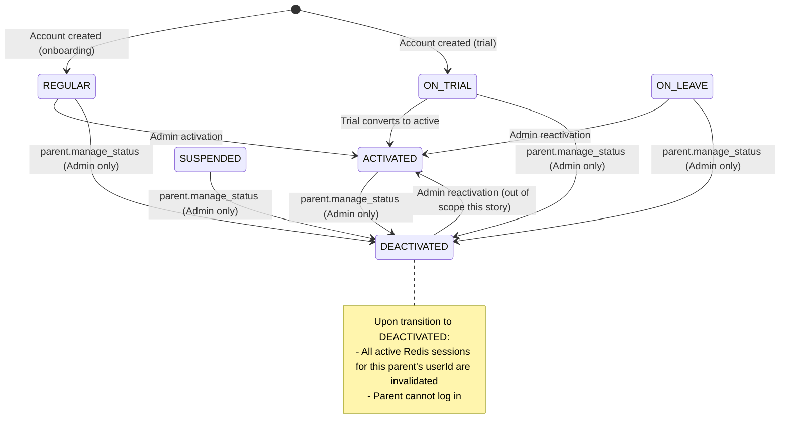
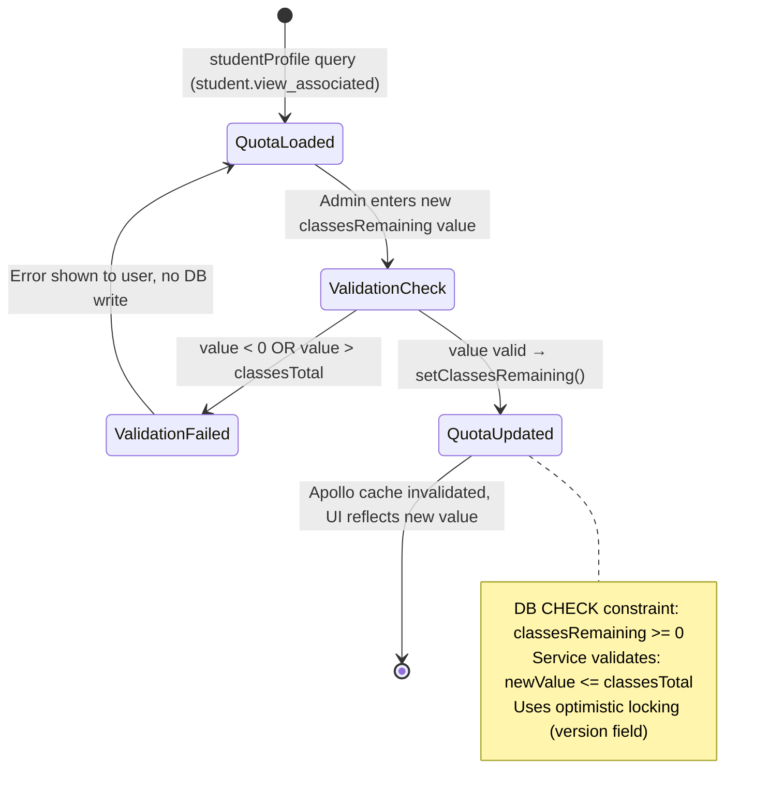
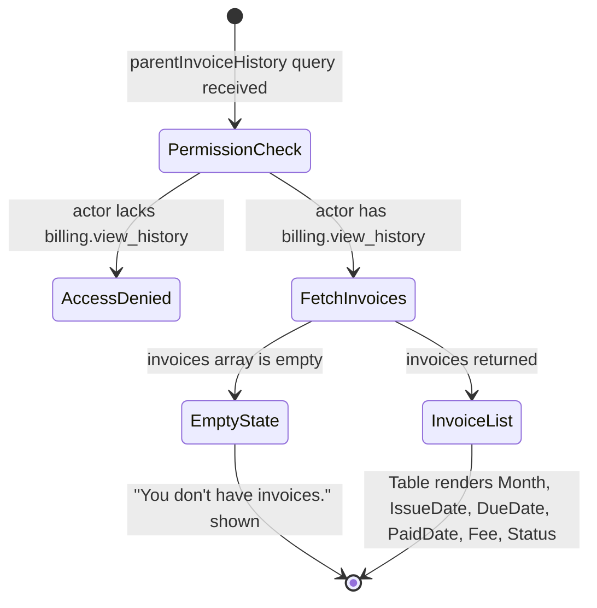
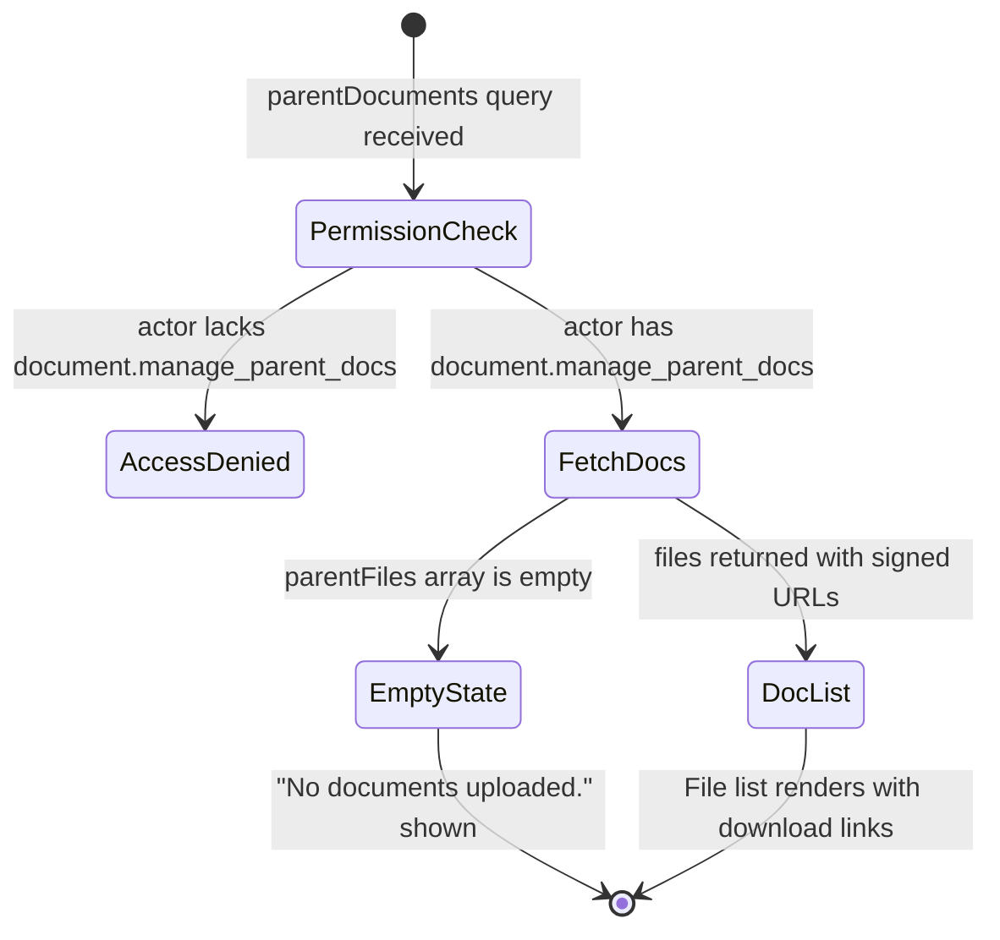

# Section 3: State Machine & Threat Alignment

## 3.1 Parent Account Status State Machine

The `parents` table has a `status` column using the `parentStatusEnum` (values: `ACTIVATED`, `DEACTIVATED`, `REGULAR`, `ON_LEAVE`, `SUSPENDED`, `ON_TRIAL`).

The `parent.manage_status` permission in this story exposes only the **deactivation** transition:

**State Transition Guards:**
- The `deactivateParent` service method:
  1. Checks `PermissionsService.hasPermission(actorUserId, AppPermission.PARENT_MANAGE_STATUS)` — throws localized `insufficientPermissions` error if not met.
  2. Fetches the parent record. Throws `parentNotFound` if missing.
  3. Rejects transition if parent is already `DEACTIVATED` (throw localized `parentAlreadyDeactivated` error).
  4. Calls `ParentRepository.deactivateParent(parentId)` inside a `db.transaction()`.
  5. After transaction success, calls session invalidation for the parent's `userId`.

---

## 3.2 Student Quota Edit Flow

The `student.edit_quota` permission exposes a **direct quota override** (not a delta add/deduct):

**Validation Rules for `setClassesRemaining`:**
- `newValue >= 0` (enforced by DB `CHECK` constraint `students_classes_remaining_chk`)
- `newValue <= student.classesTotal` (enforced in service layer — cannot give more classes than ever purchased)
- Optimistic locking: service reads current `version`, passes it to repo, repo increments `version + 1`

---

## 3.3 Billing History View Flow

---

## 3.4 Document Management Flow

