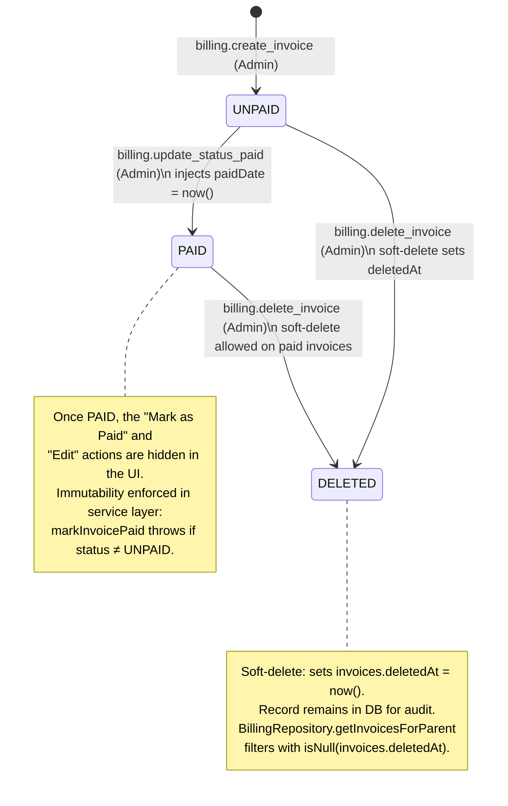
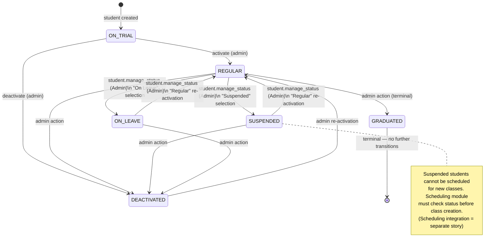
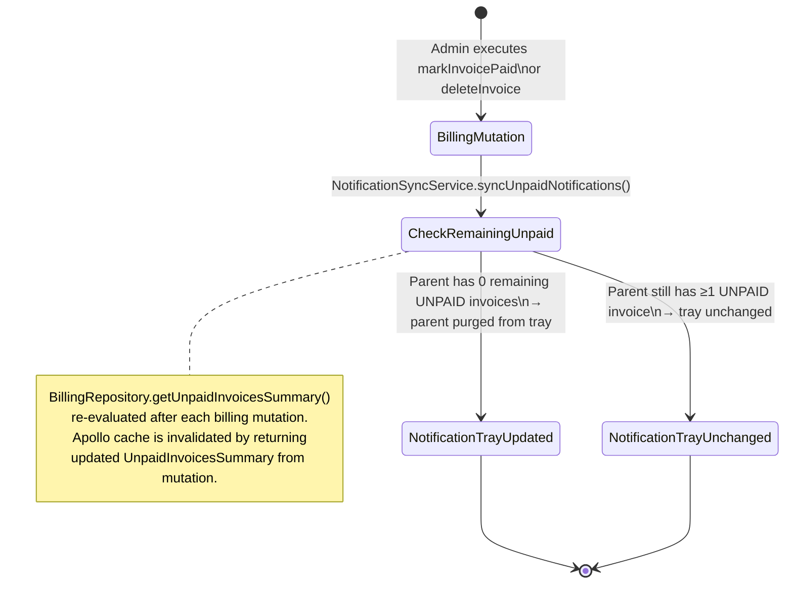

## Section 3: State Machine & Threat Alignment

See [Section 0](./section-0-metadata.md) for story scope and [Section 4](./section-4-security-threats.md) for security threat remediation.

---

### 3.1 Invoice State Machine

Invoices follow a strict lifecycle enforced at the repository and service layers. There is no DB-level trigger for invoice state transitions — enforcement is done in `BillingManagementService` with advisory locking via `BillingRepository.updateInvoiceStatus`.

**Invoice State Transition Guards:**
- `BillingManagementService.markInvoicePaid()`: Throws `billing.invoiceAlreadyPaid` if `invoice.status !== "UNPAID"`. Advisory lock (`pg_advisory_xact_lock`) prevents concurrent settlement of the same invoice.
- `BillingManagementService.deleteInvoice()`: Soft-deletes by setting `deletedAt = now()`. Does NOT check status — both UNPAID and PAID invoices can be deleted by an authorized admin. Throws not-found if invoice is already soft-deleted.

---

### 3.2 Student Status State Machine

Student status transitions are enforced by the existing DB trigger `fn_enforce_student_status_transition` (verified in `backend/db/migration/student_status_transition_trigger.sql`). Story 9 adds the `student.manage_status` permission to gate the UI action that triggers this transition.

**Student State Transition Guards:**
- DB trigger `fn_enforce_student_status_transition` (BEFORE UPDATE on `students` table) enforces the whitelist of allowed transitions shown above. Story 9 does NOT modify this trigger.
- `StudentLifecycleService.changeStudentStatus()`: Calls `StudentRepository.partiallyUpdate()` with new status. If the DB trigger rejects the transition, the Postgres exception propagates as an error returned to the GraphQL resolver.
- Allowed transitions via `student.manage_status` UI: `REGULAR → SUSPENDED`, `REGULAR → ON_LEAVE`, `SUSPENDED → REGULAR`, `ON_LEAVE → REGULAR`. The UI dropdown filters the allowed target statuses based on the student's current status.

---

### 3.3 Notification Sync Flow

The `system.sync_notifications` rule is triggered **internally** after `markInvoicePaid` or `deleteInvoice` mutations complete successfully. It is NOT directly callable via GraphQL.

**Implementation Note:** `NotificationSyncService.syncUnpaidNotifications()` calls `BillingRepository.getUnpaidInvoicesSummary()` and returns the updated summary. The GraphQL mutation resolvers for `markInvoicePaid` and `deleteInvoice` return the `UnpaidInvoicesSummary` object alongside the mutated invoice, enabling Apollo Client to automatically update the cache for the `billingUnpaidInvoices` query without a manual `refetchQueries` call.
