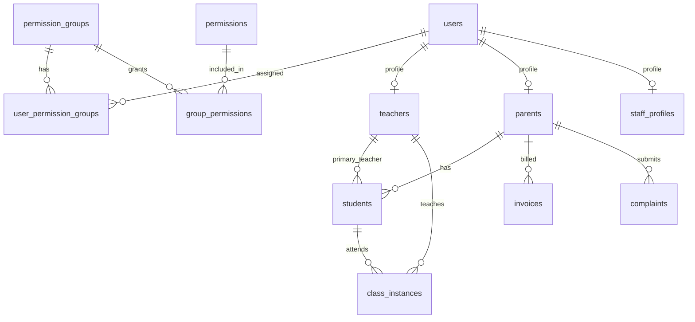

# Siraj LMS — Database Architecture Plan

## Design principles

1. **Authorization is permission-only** — No `admin`/`teacher`/`parent` role checks. A user logs in with email/password; the app loads their effective permission set from DB groups and renders UI/actions accordingly (SSR + client re-check).
2. **Profiles ≠ access control** — `teachers`, `parents`, and `staff_profiles` describe _who the user is in the business domain_ (salary, billing, Zoom, timezone). They do not gate access.
3. **Students are not users** — Children are records under a `parent_id`; no `user_id`, no login. The current [`backend/db/schema/students.ts`](backend/db/schema/students.ts) table is temporary and will be replaced.
4. **Permissions are code-defined, groups are DB-configurable** — Permission keys are seeded by migrations (stable contract for resolvers/components). Super admin creates/edits `permission_groups` and assigns permissions via the DB.
5. **Store times in UTC** — All class timestamps as `timestamptz`. Display timezone comes from `teachers.timezone` (and optionally student/parent locale later).
6. **Reuse existing storage layer** — Avatars, PDFs, and uploads link through existing [`backend/db/schema/storage.ts`](backend/db/schema/storage.ts) + `file_usage` polymorphic refs.

---

## High-level architecture



---

## Module 1 — Identity & sessions (evolve existing)

### [`users`](backend/db/schema/users.ts) — keep, extend

| Column                                        | Purpose                                                     |
| --------------------------------------------- | ----------------------------------------------------------- |
| `id`, `name`, `email`, `password`, timestamps | Existing auth core                                          |
| `email_verified_at`, `remember_token`         | Existing                                                    |
| `avatar_file_path`                            | FK-by-path to `storage_file.path` (nullable)                |
| `is_active`                                   | Account deactivation (teachers/parents/staff "deactivated") |
| `is_super_admin`                              | Bootstrap bypass; immutable for first system user           |
| `last_login_at`                               | Optional audit                                              |

### Sessions & password reset — keep, fix

- [`sessions`](backend/db/schema/users.ts): add proper FK `user_id → users.id ON DELETE CASCADE`; normalize column names to `snake_case` (`user_id`, `ip_address`, `user_agent`, `last_activity`).
- [`password_reset_tokens`](backend/db/schema/users.ts): keep as-is.

### Remove (authorization migration)

| Table        | Reason                               |
| ------------ | ------------------------------------ |
| `roles`      | Replaced by `permission_groups`      |
| `user_roles` | Replaced by `user_permission_groups` |

Context today loads `roles: string[]` in [`backend/graphql/gqlContext.ts`](backend/graphql/gqlContext.ts) — architecturally this becomes `permissions: string[]` (flat keys) plus optional `permissionGroups: string[]` for admin UI.

---

## Module 2 — Permission system (new core)

New file: [`backend/db/schema/permissions.ts`](backend/db/schema/permissions.ts)

### `permissions` — atomic action catalog (seeded, not user-created)

| Column        | Type           | Notes                                                     |
| ------------- | -------------- | --------------------------------------------------------- |
| `id`          | serial PK      |                                                           |
| `key`         | varchar UNIQUE | Stable string used in code, e.g. `classes.force_activate` |
| `resource`    | varchar        | Grouping: `classes`, `schedule`, `invoices`, …            |
| `action`      | varchar        | `view`, `create`, `edit`, `delete`, domain verbs          |
| `description` | text           | Human label for super-admin UI                            |
| `category`    | varchar        | UI section: `Scheduling`, `Billing`, `Administration`     |
| `is_system`   | boolean        | Cannot be deleted; seeded                                 |

**Key convention:** `resource.action` or `resource.scope.action` where scope encodes data visibility:

| Scope suffix    | Meaning                                         |
| --------------- | ----------------------------------------------- |
| `view`          | Generic read (context resolves row filter)      |
| `view_all`      | All records (admin-style)                       |
| `view_assigned` | Filter by user's `teachers.id`                  |
| `view_family`   | Filter by user's `parents.id` → linked students |

Examples derived from [`lms_combined.txt`](lms_combined.txt):

- **Dashboard:** `dashboard.view`, `dashboard.metrics.view_all`
- **Schedule:** `schedule.view_all`, `schedule.view_assigned`, `schedule.view_family`, `schedule.search_availability`, `schedule.manage_recurring`, `schedule.dst_migrate`
- **Classes:** `classes.view_details`, `classes.activate`, `classes.force_activate`, `classes.start`, `classes.mark_absent`, `classes.request_leave`, `classes.admin_leave`, `classes.reschedule`, `classes.revert`
- **Teachers:** `teachers.list`, `teachers.create`, `teachers.edit`, `teachers.manage_schedule`
- **Parents:** `parents.list`, `parents.create`, `parents.edit`
- **Students:** `students.list`, `students.edit`, `students.change_teacher`, `students.change_status`, `students.override_quota`
- **Invoices:** `invoices.list`, `invoices.create`, `invoices.mark_paid`, `invoices.edit`, `invoices.delete`
- **Resources:** `resources.list`, `resources.upload`, `resources.delete`
- **Reports:** `reports.generate`
- **Complaints:** `complaints.list`, `complaints.respond`, `complaints.delete`
- **Staff:** `staff.list`, `staff.create`, `staff.edit`
- **Meta:** `permission_groups.manage`, `permission_groups.assign`

Navigation visibility maps 1:1 to these keys (no separate "role" or nav table needed initially).

### `permission_groups` — admin-configurable bundles

| Column                     | Type           | Notes                                                   |
| -------------------------- | -------------- | ------------------------------------------------------- |
| `id`                       | serial PK      |                                                         |
| `name`                     | varchar UNIQUE | e.g. `Schedule Editor`, `Billing Clerk`                 |
| `description`              | text           |                                                         |
| `is_system`                | boolean        | Protected groups (`Super Admin`, provisioning defaults) |
| `slug`                     | varchar UNIQUE | Machine name for provisioning defaults                  |
| `created_by_user_id`       | FK → users     | Audit                                                   |
| `created_at`, `updated_at` | timestamp(3)   |                                                         |

**System groups (seeded):**

| Slug              | Purpose                                                     |
| ----------------- | ----------------------------------------------------------- |
| `super_admin`     | All permissions; `is_system = true`                         |
| `teacher_default` | Default bundle assigned when provisioning a teacher account |
| `parent_default`  | Default bundle for parent accounts                          |
| `staff_default`   | Base staff access                                           |

Super admin edits groups via `permission_groups.manage`; only `is_super_admin` or membership in `super_admin` group can manage groups (enforced in app layer, not DB).

### Junction tables

```
group_permissions (group_id, permission_id)  PK composite, CASCADE deletes
user_permission_groups (user_id, group_id, assigned_at, assigned_by_user_id)  PK composite
```

### Effective permissions resolution (logical, not stored)

```
effective_permissions(user) =
  IF user.is_super_admin THEN all permissions
  ELSE UNION(permissions from all assigned groups)
```

No per-user permission overrides table in v1 — keeps model simple. Custom access = create a new group.

---

## Module 3 — Business profiles (new)

Three optional 1:1 profile tables per user. A user may have zero or one of each (edge case: teacher who is also a parent gets both profiles + union of groups).

### `teachers` — new file [`backend/db/schema/teachers.ts`](backend/db/schema/teachers.ts)

| Group    | Columns                                                                                            |
| -------- | -------------------------------------------------------------------------------------------------- |
| Identity | `id`, `user_id` UNIQUE FK, `status` enum (`ACTIVATED`, `DEACTIVATED`)                              |
| Personal | `nationality` (country_code), `national_id`, `phone`, `age`, `gender`, `address`, `qualifications` |
| Comms    | `skype_id`, `zoom_link`, `zoom_username`, `zoom_password`                                          |
| Locale   | `country_code`, `timezone` (IANA varchar, e.g. `Africa/Cairo`)                                     |
| Salary   | `salary_amount` numeric, `salary_currency` varchar                                                 |
| Banking  | `beneficiary_name`, `bank_name`, `account_number`, `routing_number`, `swift_bic`, `iban`           |
| Audit    | `created_at`, `updated_at`                                                                         |

Name/email live on `users` (single source of truth).

### `parents` — new file [`backend/db/schema/parents.ts`](backend/db/schema/parents.ts)

| Group            | Columns                                                                                 |
| ---------------- | --------------------------------------------------------------------------------------- |
| Identity         | `id`, `user_id` UNIQUE FK, `status` enum                                                |
| Personal         | `phone`, `nationality`, `address`                                                       |
| Social           | `facebook`, `whatsapp`, `twitter`, `skype`, `default_zoom_link`                         |
| Billing contract | `invoice_type` enum (`PER_CLASSES`, …), `fee_amount`, `payment_method` enum, `currency` |
| Audit            | timestamps                                                                              |

**Parent status enum** (from spec): `ACTIVATED`, `DEACTIVATED`, `REGULAR`, `ON_LEAVE`, `SUSPENDED`, `ON_TRIAL`

### `staff_profiles` — new file [`backend/db/schema/staff.ts`](backend/db/schema/staff.ts)

Internal staff (former "Managers"). No "account type" column — access is purely permission groups.

| Column                    | Notes                       |
| ------------------------- | --------------------------- |
| `id`, `user_id` UNIQUE FK |                             |
| `phone`, `skype_id`       | Contact fields from spec    |
| `status`                  | `ACTIVATED` / `DEACTIVATED` |
| timestamps                |                             |

### `students` — replace existing table

New file: [`backend/db/schema/students.ts`](backend/db/schema/students.ts) (rewrite)

| Column                                      | Notes                                                         |
| ------------------------------------------- | ------------------------------------------------------------- |
| `id` serial PK                              |                                                               |
| `parent_id` FK → parents NOT NULL           | Family grouping                                               |
| `primary_teacher_id` FK → teachers nullable | Current assignment                                            |
| `name` NOT NULL                             |                                                               |
| `date_of_birth`                             |                                                               |
| `gender`, `language` (app_language enum)    |                                                               |
| `status` enum                               | `REGULAR`, `ON_LEAVE`, `SUSPENDED`, `ON_TRIAL`, `DEACTIVATED` |
| `classes_total` int                         | Package size                                                  |
| `classes_remaining` int                     | **Can go negative** (overdraft per spec)                      |
| timestamps                                  |                                                               |

Indexes: `parent_id`, `primary_teacher_id`, FTS/trigram on `name` (carry over pattern from current schema).

**Frozen schedule behavior** (`SUSPENDED` / `ON_LEAVE`): no extra table — `students.status` drives class freeze logic at query/mutation time.

---

## Module 4 — Scheduling (new, largest domain)

New file: [`backend/db/schema/scheduling.ts`](backend/db/schema/scheduling.ts)

### `recurring_schedules` — recurring booking template

| Column                                   | Notes                                 |
| ---------------------------------------- | ------------------------------------- |
| `id` serial PK                           |                                       |
| `student_id`, `teacher_id` FK            |                                       |
| `duration_minutes` int                   |                                       |
| `default_start_time` time                | Base time in teacher timezone         |
| `timezone` varchar                       | IANA; copied from teacher at creation |
| `effective_from`, `effective_until` date | Optional bounds                       |
| timestamps                               |                                       |

### `recurring_schedule_days` — day selection + per-day overrides

| Column                             | Notes                                     |
| ---------------------------------- | ----------------------------------------- |
| `id` serial PK                     |                                           |
| `recurring_schedule_id` FK CASCADE |                                           |
| `day_of_week` smallint             | 0=Mon … 6=Sun (define convention in enum) |
| `start_time` time                  | Override time for this day                |
| `is_active` boolean                | Unchecked day = not scheduled             |

UNIQUE (`recurring_schedule_id`, `day_of_week`)

### `class_instances` — every schedulable/eexecutable session

Central operational table for dashboard metrics, teacher view, parent view, billing.

| Column                                   | Notes                                                |
| ---------------------------------------- | ---------------------------------------------------- |
| `id` bigserial PK                        |                                                      |
| `student_id`, `teacher_id` FK            | Denormalized for fast filtering                      |
| `recurring_schedule_id` FK nullable      | Null = one-off                                       |
| `original_class_id` FK nullable self     | Reschedule chain                                     |
| `scheduled_start_at`, `scheduled_end_at` | timestamptz UTC                                      |
| `duration_minutes` int                   |                                                      |
| `class_type` enum                        | `REGULAR`, `TRIAL`, `ADVANCE`                        |
| `outcome` enum nullable                  | `TAKEN`, `ABSENT`, `LEAVE`, `PENDING`                |
| `execution_state` enum                   | `NOT_ACTIVATED`, `ACTIVATED`, `RUNNING`, `COMPLETED` |
| `is_rescheduled` boolean                 | Badge: "Re Scheduled"                                |
| `is_frozen` boolean                      | Student suspended/on-leave                           |
| `activated_at` timestamptz               |                                                      |
| `activated_by_user_id` FK                |                                                      |
| `force_activated` boolean                | Admin override                                       |
| `force_activated_by_user_id` FK          |                                                      |
| `actual_start_at`, `actual_end_at`       | timestamptz                                          |
| `remarks` text                           | System-generated audit text                          |
| `admin_notes` text                       | Manual notes                                         |
| timestamps                               |                                                      |

**Why decomposed status fields:** Spec labels like `Regular (Pending)`, `Suspended (Pending)`, `Regular (Re Scheduled)` are composable from `class_type` + `execution_state` + `outcome` + `is_rescheduled` + `is_frozen` — avoids a 20-value enum and supports dashboard metric queries.

**Dashboard metric queries** (12 cards from spec):

| Card                      | Query filter                                              |
| ------------------------- | --------------------------------------------------------- |
| Total                     | All instances for date                                    |
| Regular / Trial / Advance | `class_type`                                              |
| Re Scheduled              | `is_rescheduled = true`                                   |
| Suspended                 | `is_frozen = true`                                        |
| Taken / Absent / Leave    | `outcome`                                                 |
| Pending                   | `execution_state = NOT_ACTIVATED` AND `outcome = PENDING` |
| Activated / Running       | `execution_state`                                         |

### `class_status_events` — audit trail

| Column                         | Notes                                                                   |
| ------------------------------ | ----------------------------------------------------------------------- |
| `id` bigserial PK              |                                                                         |
| `class_instance_id` FK         |                                                                         |
| `event_type` varchar           | `ACTIVATED`, `STARTED`, `ABSENT`, `LEAVE`, `RESCHEDULED`, `REVERTED`, … |
| `from_state`, `to_state` jsonb | Snapshot of status fields                                               |
| `description` text             | Auto-generated message                                                  |
| `actor_user_id` FK             |                                                                         |
| `created_at`                   |                                                                         |

Powers student monthly history calendar and admin audit.

### `leave_requests`

| Column                       | Notes                                                    |
| ---------------------------- | -------------------------------------------------------- |
| `id` serial PK               |                                                          |
| `class_instance_id` FK       |                                                          |
| `requested_by_user_id` FK    |                                                          |
| `requester_type` enum        | `TEACHER`, `PARENT`, `ADMIN` (actor type, not auth role) |
| `status` enum                | `PENDING`, `APPROVED`, `RESCHEDULED`, `CANCELLED`        |
| `created_at`, `processed_at` |                                                          |
| `processed_by_user_id` FK    |                                                          |

### `leave_quota_usage` — 2-leaves-per-period rule

| Column                                 | Notes                                |
| -------------------------------------- | ------------------------------------ |
| `id` serial PK                         |                                      |
| `teacher_id` FK nullable               | XOR with student                     |
| `student_id` FK nullable               |                                      |
| `period_year`, `period_month` smallint |                                      |
| `used_count` int default 0             |                                      |
| `max_allowed` int default 2            | Configurable per row if needed later |

UNIQUE partial indexes on `(teacher_id, period_year, period_month)` and `(student_id, period_year, period_month)`.

### `dst_migration_runs` + `dst_migration_entries` — DST tool audit

| Table                   | Purpose                                                                                                   |
| ----------------------- | --------------------------------------------------------------------------------------------------------- |
| `dst_migration_runs`    | `id`, `run_by_user_id`, `offset_minutes`, `created_at`                                                    |
| `dst_migration_entries` | `run_id`, `class_instance_id`, `result` enum (`UPDATED`, `CONFLICT`, `UNCHANGED`), `conflict_detail` text |

---

## Module 5 — Billing (new)

New file: [`backend/db/schema/billing.ts`](backend/db/schema/billing.ts)

### `invoices`

| Column                                | Notes            |
| ------------------------------------- | ---------------- |
| `id` serial PK                        |                  |
| `parent_id` FK                        |                  |
| `issue_date`, `due_date`, `paid_date` | date             |
| `amount` numeric, `currency` varchar  |                  |
| `status` enum                         | `UNPAID`, `PAID` |
| `invoice_type` enum                   | `PER_CLASSES`, … |
| `created_by_user_id` FK               |                  |
| `email_sent_at` timestamptz nullable  |                  |
| timestamps                            |                  |

### `invoice_coverage_months` — multi-month checkbox selection

| Column                   | Notes |
| ------------------------ | ----- |
| `invoice_id` FK          |       |
| `year`, `month` smallint |       |

PK (`invoice_id`, `year`, `month`)

**Unpaid invoice notifications** (navbar bell): computed query `invoices WHERE status = UNPAID AND due_date < now()` — no separate notifications table in v1.

**Overdraft:** tracked on `students.classes_remaining` (negative values); billing reconciliation is application logic when invoice paid / package renewed.

---

## Module 6 — Communications & content (new)

New file: [`backend/db/schema/communications.ts`](backend/db/schema/communications.ts)

### `complaints`

| Column                        | Notes                                            |
| ----------------------------- | ------------------------------------------------ |
| `id` serial PK                |                                                  |
| `parent_id` FK                |                                                  |
| `student_id` FK nullable      | Required when category = teacher-related         |
| `category` enum               | `REGARDING_TEACHER`, `REGARDING_SYSTEM`, `OTHER` |
| `submitter_email` varchar     |                                                  |
| `body` text                   |                                                  |
| `status` enum                 | `UNANSWERED`, `ANSWERED`                         |
| `admin_response` text         |                                                  |
| `responded_by_user_id` FK     |                                                  |
| `responded_at`                |                                                  |
| `response_email_sent` boolean |                                                  |
| timestamps                    |                                                  |

### `suggestions`

| Column                   | Notes |
| ------------------------ | ----- |
| `id` serial PK           |       |
| `parent_id` FK           |       |
| `submitter_name` varchar |       |
| `body` text              |       |
| `email_sent_at`          |       |
| `created_at`             |       |

### `learning_resources`

| Column                     | Notes            |
| -------------------------- | ---------------- |
| `id` serial PK             |                  |
| `display_name` varchar     |                  |
| `file_path` varchar        | Links to storage |
| `uploaded_by_user_id` FK   |                  |
| `created_at`, `deleted_at` | Soft delete      |

Access gated by `resources.*` permissions, not a role flag.

---

## Module 7 — Keep unchanged (with minor notes)

| Module  | File                                                           | Notes                                                                                               |
| ------- | -------------------------------------------------------------- | --------------------------------------------------------------------------------------------------- |
| Storage | [`backend/db/schema/storage.ts`](backend/db/schema/storage.ts) | Directory ACL booleans remain for **storage operations** only; separate from user permission groups |
| Cache   | [`backend/db/schema/cache.ts`](backend/db/schema/cache.ts)     | Unchanged                                                                                           |
| Enums   | [`backend/db/schema/enums.ts`](backend/db/schema/enums.ts)     | Add new PG enums sourced from [`lib/enum.ts`](lib/enum.ts)                                          |

---

## New enums to add (in `lib/enum.ts` + `enums.ts`)

| Enum                  | Values                                               |
| --------------------- | ---------------------------------------------------- |
| `AccountStatus`       | `ACTIVATED`, `DEACTIVATED`                           |
| `ParentStatus`        | + `REGULAR`, `ON_LEAVE`, `SUSPENDED`, `ON_TRIAL`     |
| `StudentStatus`       | Same lifecycle set                                   |
| `ClassType`           | `REGULAR`, `TRIAL`, `ADVANCE`                        |
| `ClassOutcome`        | `PENDING`, `TAKEN`, `ABSENT`, `LEAVE`                |
| `ClassExecutionState` | `NOT_ACTIVATED`, `ACTIVATED`, `RUNNING`, `COMPLETED` |
| `InvoiceStatus`       | `UNPAID`, `PAID`                                     |
| `InvoiceType`         | `PER_CLASSES` (+ extensible)                         |
| `PaymentMethod`       | `PAYPAL`, `BANK_ACCOUNT`, …                          |
| `ComplaintCategory`   | `REGARDING_TEACHER`, `REGARDING_SYSTEM`, `OTHER`     |
| `ComplaintStatus`     | `UNANSWERED`, `ANSWERED`                             |
| `LeaveRequestStatus`  | `PENDING`, `APPROVED`, `RESCHEDULED`, `CANCELLED`    |
| `LeaveRequesterType`  | `TEACHER`, `PARENT`, `ADMIN`                         |
| `DayOfWeek`           | `MONDAY` … `SUNDAY`                                  |
| `DstMigrationResult`  | `UPDATED`, `CONFLICT`, `UNCHANGED`                   |

---

## Schema file layout (target)

```
backend/db/schema/
  index.ts           # barrel exports
  enums.ts           # PG enums
  users.ts           # users, sessions, password_reset_tokens
  permissions.ts     # permissions, permission_groups, junctions  [NEW]
  teachers.ts        [NEW]
  parents.ts         [NEW]
  staff.ts           [NEW]
  students.ts        [REWRITE]
  scheduling.ts      [NEW]
  billing.ts         [NEW]
  communications.ts  [NEW]
  storage.ts         # unchanged
  cache.ts           # unchanged
```

[`backend/db/drizzleRelations.ts`](backend/db/drizzleRelations.ts) expands to define all FK relations for Drizzle query API.

---

## Indexing strategy (critical paths)

| Table                    | Index                                                                                          | Reason                                   |
| ------------------------ | ---------------------------------------------------------------------------------------------- | ---------------------------------------- |
| `class_instances`        | `(scheduled_start_at)`, `(teacher_id, scheduled_start_at)`, `(student_id, scheduled_start_at)` | Dashboard, teacher/parent schedule views |
| `class_instances`        | `(execution_state, outcome, is_frozen, is_rescheduled, class_type)`                            | Metric card aggregation                  |
| `students`               | `(parent_id)`, `(primary_teacher_id)`                                                          | Family/teacher lookups                   |
| `invoices`               | `(parent_id)`, `(status, due_date)`                                                            | Unpaid bell + parent tab                 |
| `complaints`             | `(status)`                                                                                     | Admin queue                              |
| `user_permission_groups` | `(user_id)`                                                                                    | Permission load on every request         |
| `group_permissions`      | `(group_id)`                                                                                   | Group edit UI                            |
| `permissions`            | `(key)` UNIQUE                                                                                 | Resolver lookup                          |
| `leave_quota_usage`      | unique per teacher/student + period                                                            | Quota enforcement                        |

---

## Migration from current schema

| Current                   | Action                                                                |
| ------------------------- | --------------------------------------------------------------------- |
| `roles`, `user_roles`     | Drop after seeding `permission_groups` + migrating any test data      |
| `student` (old)           | Drop after rewrite; filter indexes pattern preserved                  |
| `users`                   | Alter add columns; no breaking change to auth                         |
| `sessions`                | Alter add FK + rename columns                                         |
| GraphQL context `roles[]` | Architecturally becomes `permissions: Set<string>` loaded from groups |

---

## What is intentionally out of scope for v1 schema

- **Per-user permission overrides** — use custom groups instead
- **Row-level security (PostgreSQL RLS)** — enforced in repository/query layer via permission scope + profile FKs
- **Notification/inbox table** — unpaid invoices and complaints are query-driven
- **Student user accounts** — not planned
- **Navigation/menu config table** — permissions map directly to nav items
- **Email queue tables** — email dispatch is service-layer; only `email_sent_at` audit columns on invoices/complaints/suggestions

---

## Open decisions (defaults assumed in this plan)

| Decision                     | Assumed default                                                                               |
| ---------------------------- | --------------------------------------------------------------------------------------------- |
| Super admin gate             | `users.is_super_admin` + `super_admin` system group (belt and suspenders)                     |
| Teacher reassignment history | Only `students.primary_teacher_id` current value; no history table in v1                      |
| Class instance generation    | Recurring template generates `class_instances` rows (materialized), not computed at read time |
| Storage directory ACLs       | Remain independent; user permissions gate API access, directory flags gate disk ops           |
