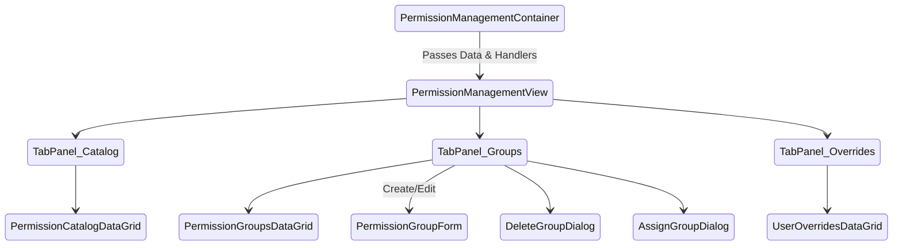

# Siraj Stories - Frontend Implementation Plan: Permission Management UI

When executing this plan, you **MUST** strictly adhere to the planning and execution protocols defined in the project guidelines (`AGENTS.md`, `COMPONENT_PATTERNS.md`, `IMPLEMENTATION_LEARNINGS.md`). 

**Context:** The backend, GraphQL layer, Zustand stores, and i18n keys for the Permission Management feature (Tasks A through F) are **ALREADY IMPLEMENTED**. Your sole focus is building the perfect, bulletproof frontend UI layer (Tasks G & H) matching the 10 provided UI design folders.

---

## Section 0: Story Metadata & Context

- **Source designs:** `.ai/plan/permission_management/ux/` (10 distinct states including shells, catalogs, groups, overrides, and modals).
- **Backend/State baseline:** Tasks A-F of `permission_management.md` are **complete**. The `usePermissionManagementStore` and Apollo `TypedDocumentNode` documents are ready.
- **Story scope:** Implement the frontend views, container, data grids, and forms for SuperAdmins to manage custom permission groups, view the catalog, and assign groups/overrides.
- **Target roles:** SuperAdmin (gated via `<RequirePermission permissions={["permission_groups.manage"]} />`).
- **Status:** Ready for UI Execution.

---

## Section 1: Core Principles & Strict Rules (Mandatory Checklist)

### 1.1 UI Architecture & Component Patterns
- [ ] **MUI v9+ Strictness** - Use `slotProps` instead of deprecated `inputProps`. Import icons correctly from `@mui/icons-material`.
- [ ] **Container/View Separation** - Store access and Apollo hooks (`useQuery`, `useMutation`) MUST reside exclusively in `PermissionManagementContainer.tsx`. The `PermissionManagementView.tsx` and child components must be pure and presentational.
- [ ] **Layout Hierarchy** - Must use shared primitives: `PageContainer` → `PageHeader` → `SectionPanel` → `AppDataGrid` (for desktop) / `*CardList` (for mobile). Do not use outer `p: 2` or `p: 3`.

### 1.2 The "Zero-Error" Mandate & Theme Adherence
- [ ] **No Hardcoded Colors** - BANNED: `#FFFFFF`, `rgb()`, `"white"`. MUST use `theme.palette.*` (e.g., `theme.palette.onPrimary`, `theme.palette.border.light`).
- [ ] **No Nested Ternaries** - BANNED: `a ? b : c ? d : e`. Extract to `if/else` variables.
- [ ] **React Compiler Compliance** - BANNED: `methods.watch()`. MUST use `useWatch` hook from `react-hook-form`.
- [ ] **Type Safety** - BANNED: `any`, `as any`. Use strict explicit typing. Use `Readonly<Props>` for component interfaces.

### 1.3 Zero Incomplete Implementation Policy
The following patterns are **strictly prohibited**:

| **Prohibited Pattern** | **Required Instead** |
|---|---|
| `// TODO`, `// FIXME`, `@todo` | Fully working implementation in the same task |
| Hardcoded Mock Data | Connect to Container props mapping to Apollo/Zustand |
| Hand-built MUI `Table` | Use `AppDataGrid` via `@mui/x-data-grid` wrapper |
| Browser `window.confirm()` | Use custom MUI `Dialog` components |

---

## Section 2: RBAC Permissions (Canonical)

| **Permission Key** | **UI Gate** | **Behavior** |
|---|---|---|
| `permission_groups.manage` | Main Route Wrapper | Grants access to the entire `PermissionsPage`. |
| `permission_groups.assign` | Assignment Dialog | Validated in UI to allow opening the "Assign to User" dialogs. |

*System groups (`isSystem === true`) must render a "System" `StatusBadge` and disable "Edit/Delete" actions in the UI.*

---

## Section 3: UI State Diagram & Component Tree



---

## Section 4: Security Threat Remediation & Error Handling

### Threat 1: Silent Mutation Failures
**Current Gap:** Failing to capture Apollo mutation errors leaves the user hanging.
**Fix implementation:** All mutations in the Container must utilize the Zustand `setError` function, combined with `logger.error` from `@/frontend/utils/logger`.

### Threat 2: Client-side IDOR via React DevTools
**Current Gap:** Malicious user unhides the "Delete" button for a system group in the DOM.
**Fix implementation:** The frontend must conditionally disable buttons for `isSystem === true`, but also expect and gracefully handle the `cannotDeleteSystem` GraphQL error boundary in the mutation `onError` callback.

---

## Section 5: Prerequisites Verification (BLOCKING)

Before starting the granular tasks, the AI agent MUST verify:
- [ ] Store exists: `frontend/stores/permissionManagementStore.ts`
- [ ] Queries exist: `frontend/graphql/sharedDocuments/permission-management.documents.ts`
- [ ] i18n keys exist: `dashboard.permissions` in `shared/messages/en.ts` and `shared/messages/ar/`.

---

## Section 6: Granular Task Breakdown

*AI Agent Directive: Execute these tasks one at a time. Each task handles specific design folders. DO NOT move to the next task until the current one compiles cleanly.*

### Task G.1 — Shell Layout & Container (Designs: `01_*_shell`)

**Objective:** Implement the root layout, Container, and base View tab structure.

**Target Files:**
- `frontend/app/[locale]/(dashboard)/permissions/page.tsx`
- `frontend/views/dashboard/permissions/PermissionManagementContainer.tsx`
- `frontend/views/dashboard/permissions/PermissionManagementView.tsx`

**Detailed Implementation Steps:**

*Step 1: Create the Page Route (`page.tsx`)*
```tsx
import { RequirePermission } from "@/frontend/components/auth/RequirePermission";
import { PermissionManagementContainer } from "@/frontend/views/dashboard/permissions/PermissionManagementContainer";
import { AppPermission } from "@/shared/lib/enum";

export default function PermissionsPage() {
  return (
    <RequirePermission permissions={[AppPermission.PERMISSION_GROUPS_MANAGE]}>
      <PermissionManagementContainer />
    </RequirePermission>
  );
}
```

*Step 2: Implement `PermissionManagementContainer`*
- Wire up `useQuery` for `permissionsQueryDocument` and `permissionGroupsQueryDocument`.
- Wire up `useMutation` for Create, Update, Delete, Assign, and Revoke.
- Sync Apollo data to `usePermissionManagementStore`.
- Pass all data, loading states, and mutation callbacks as props to `PermissionManagementView`.

*Step 3: Implement `PermissionManagementView`*
- Use `PageContainer` and `PageHeader` from `@/frontend/components/ui`.
- Implement MUI `Tabs` to switch between "Groups", "Catalog", and "Overrides".
- Render placeholders for the Grids based on the active tab.

**Success Criteria:**
- [ ] Page shell renders correctly without double-padding.
- [ ] Zustand store correctly populates from Apollo hooks.
- [ ] `bun tsgo` passes.

---

### Task G.2 — Permission Catalog DataGrid (Designs: `03_*_catalog`)

**Objective:** Implement the read-only catalog list using `AppDataGrid`.

**Target Files:**
- `frontend/views/dashboard/permissions/components/PermissionCatalogDataGrid.tsx`
- `frontend/views/dashboard/permissions/components/PermissionCatalogCardList.tsx` (Mobile)

**Detailed Implementation Steps:**

*Step 1: Desktop Grid (`PermissionCatalogDataGrid`)*
- Define `GridColDef` columns: `key`, `resource`, `action`, `category`, `description`.
- Use a custom cell renderer for the `key` to apply `theme.typography.labelUppercase`.
- Wrap in `SectionPanel` with a title.

*Step 2: Mobile List (`PermissionCatalogCardList`)*
- Implement a responsive card mapping for `< md` screens.
- Use `BaseCard` from UI primitives. Iterate through permissions and display `resource`/`action` prominently.

**Success Criteria:**
- [ ] `AppDataGrid` is correctly utilized (NO standard MUI `Table`).
- [ ] Responsive behavior switches to CardList on mobile screens.
- [ ] `emptyMessage` uses localized strings.

---

### Task G.3 — Permission Groups DataGrid (Designs: `02_*_groups`)

**Objective:** Implement the interactive Groups grid featuring system badges and action menus.

**Target Files:**
- `frontend/views/dashboard/permissions/components/PermissionGroupsDataGrid.tsx`
- `frontend/views/dashboard/permissions/components/PermissionGroupCardList.tsx`

**Detailed Implementation Steps:**

*Step 1: Desktop Grid (`PermissionGroupsDataGrid`)*
- Define columns: `name`, `slug`, `type` (StatusBadge), `permissionsCount`, `actions`.
- **System Badge:** `renderCell` must use `<StatusBadge category="session" status={row.isSystem ? 'active' : 'pending'} label={row.isSystem ? t("systemBadge") : t("customBadge")} />`.
- **Actions:** Use an action menu (Ellipsis icon). If `row.isSystem` is true, disable "Edit" and "Delete" menu items.

*Step 2: Mobile List (`PermissionGroupCardList`)*
- Wrap list items in `BaseCard`. Ensure action buttons are accessible via a mobile-friendly menu or prominent buttons.

**Success Criteria:**
- [ ] Action buttons are strictly gated by the `isSystem` boolean.
- [ ] Use `theme.palette.shadow.card` for the mobile cards.

---

### Task G.4 — Modals & Form (Designs: `07_add_permissions`, `09_action_modals`)

**Objective:** Implement the Zod-validated forms for creating/editing groups, and the confirmation dialogs.

**Target Files:**
- `frontend/views/dashboard/permissions/schemas/permissionGroupSchema.ts`
- `frontend/views/dashboard/permissions/components/PermissionGroupForm.tsx`
- `frontend/views/dashboard/permissions/components/DeleteGroupDialog.tsx`
- `frontend/views/dashboard/permissions/components/AssignGroupDialog.tsx`

**Detailed Implementation Steps:**

*Step 1: Zod Schema (`permissionGroupSchema.ts`)*
- Create `createPermissionGroupSchema` ensuring `name` is required and max 255 chars.

*Step 2: React Hook Form (`PermissionGroupForm.tsx`)*
- Implement a full-screen or large Dialog form.
- Use `useWatch` for dynamic fields if needed.
- Implement a checkbox list grouped by `category` for `permissionIds`. Add "Select All" functionality.
- Apply `standardInputSx` from `@/frontend/components/ui/form` for text fields.

*Step 3: Action Dialogs (`DeleteGroupDialog`, `AssignGroupDialog`)*
- Use MUI `<Dialog>` component. 
- The delete dialog MUST use `theme.palette.error.main` for the confirmation button.
- Ensure loading states disable the buttons during Apollo mutation execution.

**Success Criteria:**
- [ ] Form uses React Hook Form + Zod.
- [ ] No `methods.watch()`, only `useWatch()`.
- [ ] Forms handle validation errors gracefully and display `getBackendTranslations` localized messages.

---

### Task G.5 — Single Group & Overrides (Designs: `05_*_single_group`, `08_assigned_users`, `04_overrides`, `10_manage_overrides`)

**Objective:** Implement the detailed drill-down views showing users assigned to a group and granular user-level overrides.

**Target Files:**
- `frontend/views/dashboard/permissions/components/SingleGroupView.tsx`
- `frontend/views/dashboard/permissions/components/UserOverridesDataGrid.tsx`

**Detailed Implementation Steps:**
- Add a nested state/view inside `PermissionManagementView` for when a group is "selected".
- Implement `UserOverridesDataGrid` that queries `userPermissionGroupsQueryDocument` and displays assigned users.
- Add UI to "Revoke" users from a group directly from this grid.

**Success Criteria:**
- [ ] "Assigned Users" grid handles pagination and empty states correctly.
- [ ] Back button navigation returns cleanly to the main Groups tab.

---

### Task H — Navigation Integration & Quality Gate

**Objective:** Expose the feature in the sidebar and ensure 100% compliance with CI checks.

**Target Files:**
- `frontend/views/dashboard/config/navigationConfig.ts`

**Detailed Implementation Steps:**

*Step 1: Add Navigation Item*
```typescript
import { SecurityOutlined } from "@mui/icons-material";
import { AppPermission } from "@/shared/lib/enum";

// In SIDEBAR_NAV_ITEMS array:
{
  key: "permissions",
  labelKey: "dashboard.permissions.nav",
  icon: SecurityOutlined,
  href: "/permissions",
  section: "main",
  permission: AppPermission.PERMISSION_GROUPS_MANAGE,
},
```

*Step 2: Run Verifications*
The AI Agent must instruct the user to run the following:
1. `~/.bun/bin/bun tsgo`
2. `~/.bun/bin/bun lint`
3. `bun quality-gate`

**Success Criteria:**
- [ ] `navigationConfig.ts` is strictly typed.
- [ ] The `bun quality-gate` passes with ZERO CodeScene, Biome, or SonarQube errors.

---

## Section 7: Final Verification & Integrity Protocol

Once all tasks are completed, instruct the user to execute:
```bash
~/.bun/bin/bun tsgo
bun quality-gate
```
*Any TypeScript errors or quality gate failures must be resolved immediately before considering the story complete.*
