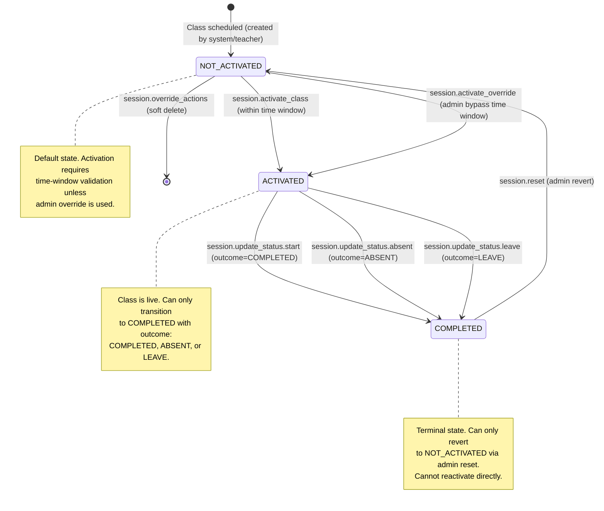
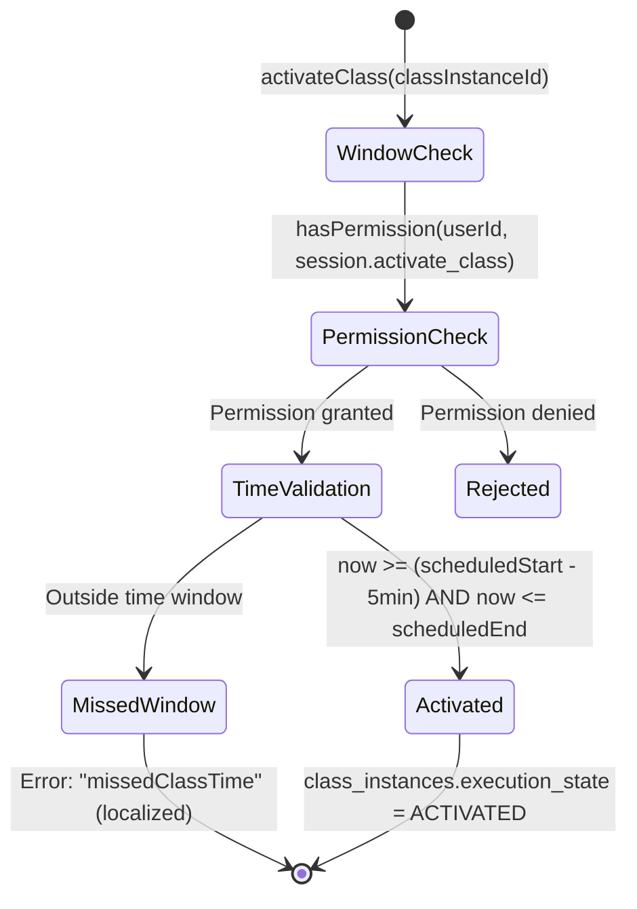
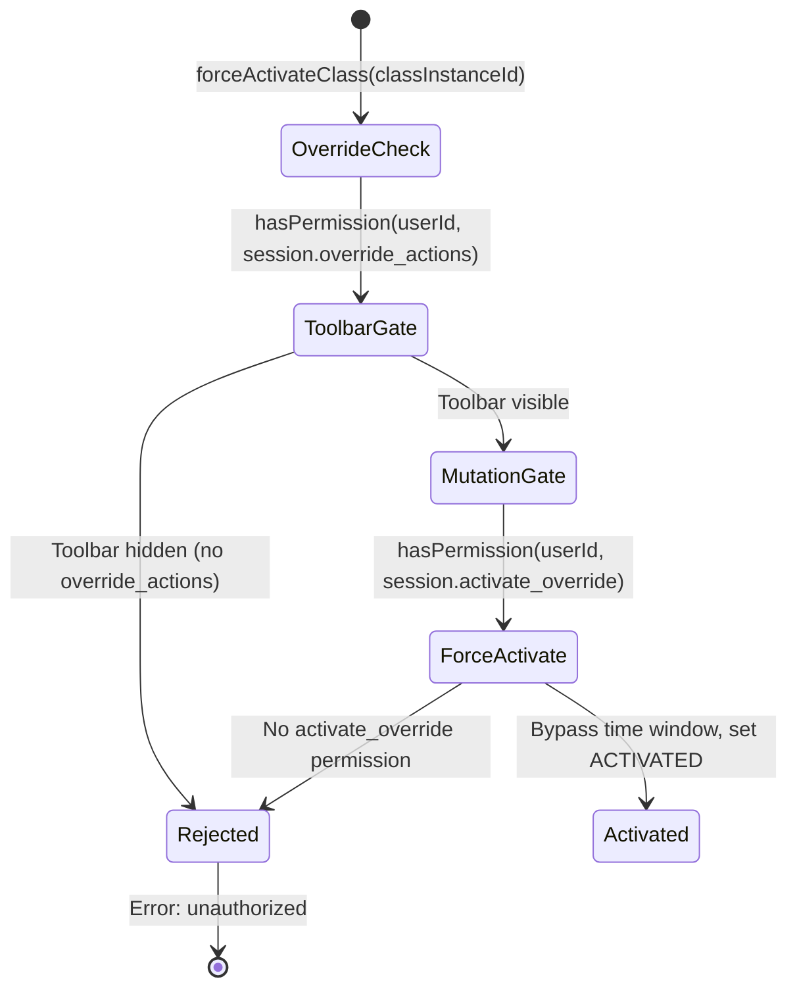

# Story 1 Implementation Plan — Permissions, Search, Timezones, History & Session Control

## Section 0: Story Metadata & Context

- **Source story:** `.ai/siraj_stories/1.md` (Part 2 — Permissions, Search, Timezones, History & Session Control, builds on `.ai/siraj_stories/0.md`)
- **Security baseline:** `.ai/done/sprint/0-sprint.md` (Part 1 — mandatory prerequisite for RBAC foundation)
- **Story scope:** Introduces multi-timezone schedule display, server-side admin search, student class history calendar with modal drill-down, teacher dashboard with real Apollo data, session activation with time-window enforcement, admin override toolbar, and a complete `classes.*` → `session.*` permission namespace migration.
- **Target roles:** Admin (full search, timezone, history, override access), Teacher (dashboard, activate, self-scoped schedule), System Automated (time-window enforcement).
- **Status:** Implementation complete — plan document patched for AGENTS_STORY_PLANNING.md compliance.
- **Last updated:** 2026-06-21 (patch — AGENTS_STORY_PLANNING.md compliance)

### 0.1 Business Objectives

1. **Separation of Duties**: The `session.override_actions` permission is strictly reserved for Admins — teachers cannot access the admin override toolbar (force activate, stop, delete), ensuring accountability and preventing unauthorized session manipulation.
2. **Data Privacy**: `teacher.view_dashboard` combined with service-layer `schedule.view_assigned` scoping ensures teachers see only their own assigned classes, never other teachers' schedules.
3. **Time-Window Safety**: `system.enforce_time_window` prevents premature or stale class activations — the system automatically rejects activation attempts outside the configured window (5 minutes before start through end of duration), eliminating manual oversight.
4. **Audit Trail Integrity**: Student history with calendar drill-down (`history.view_calendar` + `history.view_details`) provides Admins with a complete audit trail of past sessions, enabling accountability for attendance and performance.
5. **Permission Namespace Clarity**: The full `classes.*` → `session.*` migration eliminates namespace confusion — all session-related permissions live under a single `session.*` prefix, making the permission catalog self-documenting.

### 0.2 Scope Boundaries

**In scope:**
- `classes.*` → `session.*` permission enum migration across entire stack (enum, migration SQL, backend services, GraphQL, frontend, Storybook)
- New `session.*` permissions: `session.override_actions` (admin toolbar)
- New non-session permissions: `dashboard.search`, `schedule.view_timezones`, `history.view_calendar`, `history.view_details`, `teacher.view_dashboard`, `system.enforce_time_window`
- Backend repositories: system-settings, student-history, class-performance, scheduling extensions (timezone resolution, search, state transitions)
- Domain services: ClassSessionService, StudentHistoryService, ClassPerformanceService, TeacherDashboardService, SystemRulesService
- GraphQL Pothos objects and resolvers for all new queries/mutations
- Frontend Apollo TypedDocumentNodes and Zustand stores (UI-ephemeral only)
- Frontend containers: AdminDashboardContainer (search + timezones), ClassDetailsContainer (admin/teacher split), StudentHistoryContainer (calendar + modal), TeacherDashboardContainer (real Apollo)
- RBAC enforcement via `<RequirePermission>` on all new views
- i18n translations for `missedClassTime` error and timezone column headers
- Repository tests (100% coverage), GraphQL integration tests

**Out of scope:**
- Video conferencing integration (Zoom URLs are stored/retrieved, not created)
- Parent-facing schedule views (separate story)
- Billing/payment for teacher hours (separate story)
- Notification system for class reminders (separate story)
- Real-time WebSocket updates for session state changes (display only, uses polling/refetch)

---

## Section 1: Core Principles & Strict Rules

### 1.1 Service Layer Architecture

- [ ] **NO monolithic services.** Use domain services only: `ScheduleService`, `ClassSessionService`, `StudentHistoryService`, `ClassPerformanceService`, `TeacherDashboardService`, `SystemSettingsService`. Never create `DashboardService` or `AppService`.
- [ ] **Business logic centralization** — All orchestration, validation, and permission checks reside in services, NOT repositories or resolvers.
- [ ] **🚫 Services MUST NOT import from DB/Drizzle** — Services can ONLY depend on the repository layer (`backend/db/repo/`). Importing from `drizzle-orm`, `backend/db/schema`, `backend/db/index`, or any Drizzle-related module is **strictly forbidden**. All database access must go through repo methods.

**Verification command:**
```bash
rg "from ['\"]drizzle\|from ['\"]backend/db/schema\|from ['\"]backend/db/drizzleDb" backend/services/
```

**Implementation compliance:** ✅ All Story 1 services (`class-session.service.ts`, `student-history.service.ts`, `teacher-dashboard.service.ts`, `schedule.service.ts`) import exclusively from `backend/db/repo/` — no Drizzle imports detected.

### 1.1b GraphQL Resolver Architecture

- [ ] **🚫 GraphQL Resolvers MUST NOT import from DB/Repo** — Pothos resolvers can ONLY depend on the service layer (`backend/services/`). Importing from `backend/db/repo/`, `backend/db/schema`, or any database module is **strictly forbidden**. Resolvers are thin adapters: validate GraphQL input → call service method → return GraphQL result. No business logic, no direct data access.

**Verification command:**
```bash
rg "from ['\"]backend/db" backend/graphql/pothos/
```
Output MUST be empty.

**Implementation compliance:** ✅ All Pothos resolvers in `backend/graphql/pothos/class-session.pothos.ts`, `student-history.pothos.ts`, `teacher-dashboard.pothos.ts` delegate to their respective service layer methods.

### 1.2 Type Safety — NO `any`, NO Casts

- [ ] **Strict Type Narrowing** — BANNED: `any`, `as any`, and `as unknown as`. You must find the actual types. Narrow using type guards.
- [ ] **No route param casts** — Instead of `useParams() as { id: string }`, use safety checks like `typeof params?.id === "string" ? params.id : ""`.

**Verification command:**
```bash
rg "as any|as unknown as" frontend/views/dashboard/classes frontend/views/dashboard/students frontend/views/dashboard/teachers
```

### 1.2b Task Ordering & Dependency Integrity

- [ ] **No forward dependencies** — A task MUST NOT depend on code, types, schemas, or modules introduced by a later task.
- [ ] **Incremental build order** — Tasks ordered: Database/Schema → Repository → Service → DB/Repo Tests → GraphQL (Backend) → GraphQL Documents (Frontend) → GraphQL Tests → Frontend Stores → Frontend Views.
- [ ] **Self-contained tasks** — After completing each task, the project compiles and passes all quality gates.
- [ ] **Explicit dependency declaration** — Each task lists its dependencies (earlier task letters or "current project state only").
- [ ] **Database Migration task protocol** — Migration tasks run: `bun db cleanGenerate` → `bun db reset` → `bun db seed` → `bun test:db`. All four must pass.

**Implementation compliance:** The task ordering (A→B→C→D→E→F→G→H→I→J→K→L→M→N→O→P→Q) follows the correct dependency chain. See Section 6 for formal dependency declarations.

### 1.3 Zero Incomplete Implementation Policy

The following patterns are **strictly prohibited**:

| **Prohibited Pattern** | **Required Instead** | **Verification Command** |
|---|---|---|
| `// TODO`, `// FIXME`, `@todo` | Fully working implementation in same task | `rg -i "TODO\|FIXME" backend frontend` |
| `throw new Error("Not implemented")` | Complete service/repo method implementation | Manual code review |
| Handler calling only `logger.info` | Real GraphQL mutation + UI feedback | Grep for `logger.info.*handle` patterns |
| Service importing from `drizzle-orm` or `backend/db/schema` | Service depends ONLY on `backend/db/repo/` | `rg "from ['\"]drizzle\|from ['\"]backend/db/schema" backend/services/` |
| GraphQL resolver importing from `backend/db/repo/` | Resolver depends ONLY on `backend/services/` | `rg "from ['\"]backend/db" backend/graphql/pothos/` |
| Mock store in production views | Real `useQuery` with `TypedDocumentNode` | `rg "mock.*Store" frontend/views --glob "!**/*.stories.tsx"` |

**Implementation compliance:** All Story 1 services import exclusively from `backend/db/repo/` — no Drizzle imports detected.

### 1.4 SSR Compatibility

- [ ] **Services must work in Next.js Server Components** — Services can be used directly by SSR or Server Actions without GraphQL-specific context dependencies.
- [ ] **No Apollo client in services** — Services must not depend on `@apollo/client`, Apollo cache, or browser-only APIs.

### 1.5 Data Persistence & Mock Migration

- [ ] **NO dummy data in production** — Replace all mock stores with real GraphQL-backed stores using `useQuery` and generated `TypedDocumentNode`.
- [ ] **Complete transaction boundaries** — Multi-table writes must be atomic (wrapped in `db.transaction()`).
- [ ] **Mock stores preserved for Storybook** — `*.stories.tsx` files MUST keep dummy data via mock store aliases. Production containers use real stores.

### 1.6 Logging & Observability

- [ ] **Logger utility mandatory** — Use `import { logger } from '@/backend/lib/logger'` (backend) or `import { logger } from '@/frontend/utils/logger'` (frontend). Never `console.*`.
- [ ] **Console methods forbidden** — ESLint will reject `console.log/warn/error/debug` usage.

### 1.7 Testing Requirements

- [ ] **Repo tests:** 100% line+function coverage for every new/touched repository file under `backend/db/test/repo/` per `backend/db/test/AGENTS.md`.
- [ ] **GraphQL integration tests:** New/extended operations tested under `frontend/graphql/test/` per `frontend/graphql/AGENTS.md`.
- [ ] **Success AND failure paths** — Every repo method must have tests for: valid input success, invalid input rejection, not-found handling.
- [ ] **IDOR protection tests** — If a repo method accesses user-scoped data, tests must verify: User A cannot access User B's data, admin CAN access any user's data.

### 1.8 General Rules

- [ ] **Package manager:** Use `~/.bun/bin/bun` for every script, install, test, and codegen command.
- [ ] **GraphQL `id` field:** Every object returned from queries/mutations MUST expose a non-null `id` for Apollo cache compliance.
- [ ] **Frontend hooks:** Use stateful `useQuery` / `useMutation` from `@apollo/client/react` only. **`useLazyQuery` is banned.**
- [ ] **NO `SUMMARY.md` / `REPORT.md`** files in the repo.
- [ ] **Repositories:** Use `db.select().from(table).leftJoin(...)` — avoid deep `db.query.*.findMany({ with })` when it causes `SQL<unknown>` errors.
- [ ] **Localized errors:** All user-facing backend errors via `getBackendTranslations({ locale?, namespace? })`. Propagate `locale` from `ctx.locale` through resolver → service → repository.
- [ ] **Zustand stores:** Types MUST come from `frontend/graphql/generated/gql/graphql-types.ts`. No intermediate mapping layers — fix schema/codegen mismatches at the source.
- [ ] **Seeders:** Every touched table gets `seedOrGet` updates per `backend/db/seeds/AGENTS.md`. Run `bun run scripts/dbActions.ts push` before `bun run db seed` after schema changes.

---

## Section 2: RBAC Permissions (Canonical)

### 2.1 Story 1 Permissions (Complete Map)

| **Permission Key** | **Group** | **UI Gate** | **Backend Service Method** | **GraphQL Operation** |
|---|---|---|---|---|
| `dashboard.search` | Admin | `ScheduleOverviewSection` search `TextField` | `ScheduleService.getDailySchedule()` (search param) | `dailyScheduleList(search: String)` query |
| `schedule.view_timezones` | Admin | `ScheduleOverviewDataGrid` timezone columns, `TimezoneWarningBanner` | `ScheduleService.getDailySchedule()` (timezone fields) | `dailyScheduleList` (yourTime, teacherTime, studentTime fields) |
| `history.view_calendar` | Admin | `StudentHistoryDesktop`/`StudentHistoryMobile` calendar grid | `StudentHistoryService.getMonthlyCalendar()` | `studentClassHistory` query |
| `history.view_details` | Admin | `ClassDetailsModal` on `/students/[id]/history` | `StudentHistoryService.getSessionDetail()` | `studentClassSessionDetail` query |
| `session.override_actions` | Admin | `AdminActionsBar` on `/classes/[id]` | `ClassSessionService.activateOverride()`, `.stop()`, `.deleteInstance()` | `forceActivateClass`, `stopClass`, `deleteClassInstance` mutations |
| `teacher.view_dashboard` | Teacher | `TeacherDashboardContainer` render gate | `TeacherDashboardService.getDashboard()` | `teacherDashboard` query |
| `session.activate_class` | Teacher | `SessionActivateButton`, `ActionsPanel` activate | `ClassSessionService.activate()` | `activateClass` mutation |
| `system.enforce_time_window` | System Automated | API-only gate (no UI) | `ClassSessionService.activate()` → `SystemRulesService.assertActivationTimeWindow()` | Internal check within `activateClass` mutation |

### 2.2 Permission Mapping to Existing Permissions

| **Story 1 Permission** | **Existing Related Permission** | **Relationship** |
|---|---|---|
| `history.view_details` | `session.view_details` | Complementary — `history.view_details` gates the modal on `/students/[id]/history`; `session.view_details` gates `/classes/[id]` page |
| `session.override_actions` | `session.activate_override` | Granular — `override_actions` gates the entire admin toolbar visibility; `activate_override` gates the specific force-activate mutation within that toolbar |
| `session.activate_class` | `system.enforce_time_window` | Complementary — `activate_class` grants the permission; `enforce_time_window` adds a system-level time constraint check regardless of permission |
| `dashboard.search` | `schedule.view_list` | Superset — search extends the existing schedule list view with server-side filtering |
| `schedule.view_timezones` | `schedule.view_list` | Complementary — timezone columns are additional display fields on the same schedule grid |

### 2.3 Permission Group Assignments

| **Permission Group** | **Slug** | **Story 1 Permissions Assigned** |
|---|---|---|
| Admin | `academy_admin` | `dashboard.search`, `schedule.view_timezones`, `history.view_calendar`, `history.view_details`, `session.override_actions`, `session.view_details`, `session.activate_override`, `session.reschedule`, `session.reset`, `session.update_status.start`, `session.update_status.absent`, `session.update_status.leave` |
| Teacher | `teacher` | `teacher.view_dashboard`, `session.activate_class`, `session.view_details`, `session.update_status.start`, `session.update_status.absent`, `session.update_status.leave` |
| Parent | `parent` | `session.view_details`, `session.update_status.leave` (request leave only) |
| Staff | `staff` | `session.view_details` |
| System Automated | `system_automated` | `system.enforce_time_window` |

### 2.4 Self-Scoping vs Any-Scoping

| **Permission** | **Lower Role (Self-Scoped)** | **Admin (Any-Scoped)** |
|---|---|---|
| `session.activate_class` | Teacher can only activate their own assigned classes | Admin can activate any class via override toolbar |
| `session.view_details` | Teacher sees only their own class details | Admin sees any class instance details |
| `teacher.view_dashboard` | Teacher sees only their own dashboard data (service filters by `teacherId`) | N/A — admin has their own dashboard |
| `history.view_calendar` | N/A — history is admin-only | Admin can view any student's history |
| `session.override_actions` | N/A — override is admin-only | Admin can override any class instance state |

### 2.5 Permission Rename Map (Option C — full `classes.*` → `session.*` migration)

**All** `classes.*` permissions are removed from the catalog and re-issued under the `session.*` namespace. This is a **breaking change** across enum, database, seeds, backend services, GraphQL, frontend, Storybook, and navigation config.

| Old key (`classes.*`) | New key (`session.*`) | Old `AppPermission` enum | New `AppPermission` enum |
|---|---|---|---|
| `classes.view_details` | `session.view_details` | `CLASSES_VIEW_DETAILS` | `SESSION_VIEW_DETAILS` |
| `classes.activate` | `session.activate_class` | `CLASSES_ACTIVATE` | `SESSION_ACTIVATE_CLASS` |
| `classes.force_activate` | `session.activate_override` | `CLASSES_FORCE_ACTIVATE` | `SESSION_ACTIVATE_OVERRIDE` |
| `classes.start` | `session.update_status.start` | `CLASSES_START` | `SESSION_UPDATE_STATUS_START` |
| `classes.mark_absent` | `session.update_status.absent` | `CLASSES_MARK_ABSENT` | `SESSION_UPDATE_STATUS_ABSENT` |
| `classes.request_leave` | `session.update_status.leave` | `CLASSES_REQUEST_LEAVE` | `SESSION_UPDATE_STATUS_LEAVE` |
| `classes.admin_leave` | *(merged into `session.update_status.leave`)* | `CLASSES_ADMIN_LEAVE` | *(merged)* |
| `classes.reschedule` | `session.reschedule` | `CLASSES_RESCHEDULE` | `SESSION_RESCHEDULE` |
| `classes.revert` | `session.reset` | `CLASSES_REVERT` | `SESSION_RESET` |

#### Permission boundary clarifications after migration

| Permission | Gates |
|---|---|
| `history.view_details` | `ClassDetailsModal` on `/students/[id]/history` (calendar drill-down) |
| `session.view_details` | `/classes/[id]` page — teacher-facing class instance view |
| `session.override_actions` | `AdminActionsBar` on `/classes/[id]` (force activate, stop, generate log, delete) |
| `session.activate_override` | API/service check for force-activate mutation specifically |
| `session.activate_class` | Teacher activate button + standard activation mutation |
| `session.reschedule` | Admin layout branch in `ClassDetailsContainer` |

### 2.6 Part 1 Permissions Retained (merged into Admin group)

From `.ai/siraj_stories/0.md`:
- `auth.login`, `auth.view_own_profile`
- `dashboard.view_metrics`, `dashboard.filter_metrics`
- `schedule.view_list`, `schedule.filter_advanced`

### 2.7 PostgreSQL Enum Migration Strategy

`permissions.key` uses `app_permission` enum (`backend/db/schema/enums.ts` ← `shared/lib/enum.ts`).

1. Remove all `CLASSES_*` values from `AppPermission` enum in `shared/lib/enum.ts`.
2. Add all `SESSION_*` values (migrated + `SESSION_OVERRIDE_ACTIONS`).
3. Run `bun run scripts/dbActions.ts push` — Drizzle generates enum migration.
4. Migration SQL in `backend/db/migration/3-system_permissions_and_groups.sql` handles the permission row updates.
5. Grep entire repo for `classes.` permission string literals and `Classes` / `CLASSES_` enum members — **zero remaining references** before merge.

### 2.8 Teacher Dashboard Gate

- **`teacher.view_dashboard`** — sole permission to render `TeacherDashboardContainer`.
- **`schedule.view_assigned`** — data scoping only (service layer filters rows to logged-in teacher ID).

### 2.9 Timezone Resolution (documented in schema comments)

```
effective_student_timezone =
  students.timezone_override   -- nullable per-student override
  ?? parents.timezone          -- NEW column on parents
  ?? system_settings key `default_timezone` (fallback, default `UTC`)
```

**NOT** `class_instances.booking_timezone` for display purposes.

### 2.10 Activation Time Window (`system_settings`)

- `session_activation_window_before_minutes` — default `5`
- Upper bound: **`scheduled_end_at`** (end-of-duration, no extra after-buffer setting)

### 2.11 History UX (confirmed — no new routes)

| Feature | Component | Route |
|---|---|---|
| Calendar | `CalendarGrid`, `ClassSessionList`, `MobileWeeklyScroller` | `/students/[id]/history` |
| Session drill-down | `ClassDetailsModal` | Same route (modal, no navigation) |
| Live session control | `ClassDetailsContainer` | `/classes/[id]` |

### 2.12 Routes (already exist — do not add)

- `app/[locale]/(dashboard)/dashboard/page.tsx`
- `app/[locale]/(dashboard)/classes/[id]/page.tsx`
- `app/[locale]/(dashboard)/students/[id]/history/page.tsx`
- `app/[locale]/(dashboard)/teachers/dashboard/page.tsx` → redirects `?mode=teacher`
- `app/[locale]/(dashboard)/teachers/dashboard/active/page.tsx` → redirects `?mode=teacher-active`

---

## Section 3: Class Instance State Machine & Threat Alignment

### 3.1 Primary State Machine

The class instance lifecycle is governed by `execution_state` on the `class_instances` table, enforced by the `fn_enforce_class_instance_transition()` DB trigger.



**State Transition Guards:**
- DB trigger `fn_enforce_class_instance_transition()` in `backend/db/migration/class_instances_state_transition_trigger.sql` enforces:
  - `COMPLETED` → `ACTIVATED` / `RUNNING`: **BLOCKED** (cannot reactivate a completed instance)
  - `RUNNING` → `ACTIVATED`: **BLOCKED** (cannot move running instance back to activated)
  - `ACTIVATED` → `COMPLETED`: Allowed **only** with outcome `ABSENT` or `LEAVE`
- Service layer `ClassSessionService.activate()` adds time-window validation via `SystemRulesService.assertActivationTimeWindow()`.
- Service layer `ClassSessionService.activateOverride()` bypasses time-window but requires `session.activate_override` + `session.override_actions`.

### 3.2 Activation Time Window Lifecycle



**Configuration:**
- `session_activation_window_before_minutes` = `5` (from `system_settings` table)
- Upper bound = `scheduled_end_at` (end of class duration, no after-buffer)

### 3.3 Admin Override Flow



---

## Section 4: Security Threat Remediation

### Threat 1: IDOR on Class Instance Operations (Cross-Teacher Access)

**Current Gap:** Without scoping, a teacher could activate, stop, or modify another teacher's class instance by knowing the `classInstanceId`.

**Fix in `ClassSessionService`:**
- Every mutation method (`activate`, `activateOverride`, `stop`, `deleteInstance`) calls `PermissionsService.hasPermission(userId, <permission>)` first.
- For teacher-scoped operations (`session.activate_class`), the service layer verifies that the `classInstanceId` belongs to the teacher's assigned classes via `SchedulingRepository.getClassInstanceById()` and checking `instance.teacherId` against the actor's teacher record.
- Admin operations (`session.override_actions`) skip the ownership check — admins can operate on any class instance.

**Test Requirements:**
- Teacher A cannot activate Teacher B's class → `unauthorized` error (GraphQL test)
- Teacher A can activate their own class (within time window) → succeeds (GraphQL test)
- Admin can activate any teacher's class via override → succeeds (GraphQL test)
- Admin can stop/delete any class instance → succeeds (GraphQL test)

**Implementation compliance:** ✅ GraphQL tests in `frontend/graphql/test/class-session.test.ts` cover these scenarios.

### Threat 2: Activation Time Window Bypass

**Current Gap:** A user with `session.activate_class` permission could activate a class hours before or after the scheduled time.

**Fix in `ClassSessionService.activate()`:**
- Calls `SystemRulesService.assertActivationTimeWindow(instance)` before proceeding.
- Reads `session_activation_window_before_minutes` from `SystemSettingsRepository.getIntValue()`.
- Validates: `now >= (scheduledStartAt - beforeMinutes)` AND `now <= scheduledEndAt`.
- On failure: throws localized `missedClassTime` error via `getBackendTranslations({ locale, namespace: "errors" })`.
- Admin override path (`activateOverride`) bypasses this check — only available with `session.activate_override` + `session.override_actions`.

**Test Requirements:**
- Activate within window → succeeds
- Activate outside window → `missedClassTime` error
- Admin force-activate outside window → succeeds (bypass)
- Default window setting is 5 minutes before start

**Implementation compliance:** ✅ Tests in `frontend/graphql/test/class-session.test.ts`.

### Threat 3: Unauthorized History Access (Student Privacy)

**Current Gap:** Without permission gating, any authenticated user could view any student's class history calendar and session details.

**Fix in `StudentHistoryService`:**
- `getMonthlyCalendar()` gates on `history.view_calendar` — only Admins hold this permission.
- `getSessionDetail()` gates on `history.view_details` — only Admins hold this permission.
- Service does NOT accept a `viewerId` parameter for self-scoping — history is admin-only.

**Test Requirements:**
- Academy admin can view student history calendar → succeeds
- Teacher cannot view student history → unauthorized error
- Parent cannot view student history (even their own child's) → unauthorized error
- Academy admin can drill into session detail modal → succeeds
- User without `history.view_details` cannot open modal → unauthorized error

**Implementation compliance:** ✅ Tests in `frontend/graphql/test/student-history.test.ts`.

### Threat 4: Teacher Dashboard Data Leakage (Cross-Teacher Schedule Visibility)

**Current Gap:** Without data scoping, the teacher dashboard could expose other teachers' schedules.

**Fix in `TeacherDashboardService.getDashboard()`:**
- Gates on `teacher.view_dashboard` permission.
- Resolves the actor's `teacherId` via `TeacherRepository.getTeacherIdByUserId(userId)`.
- Passes `teacherId` to `SchedulingRepository.getDailySchedule()` which filters results to only the teacher's assigned classes.
- No `teacherId` parameter is accepted from the client — the service always resolves from the authenticated user.

**Test Requirements:**
- Teacher sees only their own classes → returned rows all have matching teacherId
- Teacher cannot pass another teacher's ID to see their schedule → service ignores client-side teacherId
- User without `teacher.view_dashboard` → unauthorized error

**Implementation compliance:** ✅ Tests in `frontend/graphql/test/teacher-dashboard.test.ts`.

### Threat 5: Permission Namespace Confusion (`classes.*` vs `session.*`)

**Current Gap:** Having both `classes.*` and `session.*` permissions in the catalog creates confusion — developers might check the wrong permission key, leading to authorization bypass.

**Fix:**
- Complete removal of all `CLASSES_*` enum values from `shared/lib/enum.ts`.
- Complete removal of all `classes.*` permission strings from `backend/db/migration/3-system_permissions_and_groups.sql`.
- New unified `session.*` namespace with all permissions under a single `Session` resource.
- Deprecated `classes.*` rows deleted from `permissions` table during migration.

**Test Requirements:**
- `rg "CLASSES_|classes\." shared/lib/enum.ts` → empty
- `rg "classes\." backend/db/migration/3-system_permissions_and_groups.sql` → empty
- GraphQL `me` query returns `session.activate_class` (not `classes.activate`) for teacher user
- All frontend `RequirePermission` wrappers use `AppPermission.Session*` (not `AppPermission.Classes*`)

**Implementation compliance:** ✅ Enum migration complete — `shared/lib/enum.ts` contains only `SESSION_*` values. Migration SQL contains only `session.*` permission keys.

---

## Section 5: Prerequisites Verification (BLOCKING)

### 5.0 Security Artifact Verification

| **Artifact** | **Path** | **Verification** | **Success Criteria** |
|---|---|---|---|
| Permission migration | `backend/db/migration/3-system_permissions_and_groups.sql` | Grep for `session.*`, `history.*`, `teacher.*`, `system.enforce_time_window` | All Story 1 permissions seeded ✅ |
| State transition trigger | `backend/db/migration/class_instances_state_transition_trigger.sql` | psql query for `fn_enforce_class_instance_transition` | Function exists ✅ |
| State transition security tests | `backend/db/test/logic/class_instances_security.test.ts` | `bun test` | Tests for blocked transitions exist ✅ |
| Scheduling security tests | `backend/db/test/logic/scheduling_security.test.ts` | `bun test` | Trigger SQL loaded in tests ✅ |
| PermissionsService | `backend/services/auth/permissions.service.ts` | Verify `hasPermission()` and `hasAnyPermission()` exist | ✅ (line 81, line 91) |
| Backend i18n | `backend/lib/intl.ts` | Verify `getBackendTranslations()` exists | ✅ (line 62) |

### 5.1 Database Schema Verification

- [x] `parents` table has `timezone` column: `varchar("timezone", { length: 100 }).notNull().default("UTC")` with CHECK constraint `parents_timezone_chk`. ✅
- [x] `students` table has `timezoneOverride` column: `varchar("timezone_override", { length: 100 })` (nullable) with CHECK constraint `students_timezone_override_chk`. ✅
- [x] `students` table has timezone documentation comment block explaining `COALESCE(students.timezone_override, parents.timezone, academy default)`. ✅
- [x] `classInstancePerformance` table exists in `backend/db/schema/scheduling.ts` with all required columns. ✅
- [x] `class_instances` table exists with `execution_state`, `outcome`, `scheduled_start_at`, `scheduled_end_at`, `deleted_at`. ✅

### 5.2 Migration Verification

- [x] `backend/db/migration/3-system_permissions_and_groups.sql` is applied with all Story 1 permissions. ✅
- [x] `backend/db/migration/class_instances_state_transition_trigger.sql` is applied. ✅
- [x] Enum migration complete — no `CLASSES_*` values in `shared/lib/enum.ts`. ✅

### 5.3 Test Suite Verification

- [x] Repository tests exist for: `system-settings`, `scheduling`, `class-performance`, `student-history`. ✅
- [x] GraphQL integration tests exist for: `class-session`, `student-history`, `teacher-dashboard`. ✅
- [x] Security logic tests exist for: `class_instances_security`, `scheduling_security`. ✅

### 5.4 Existing Code Verification

- [x] `PermissionsService.hasPermission()` exists and works. ✅
- [x] `PermissionsService.hasAnyPermission()` exists and works. ✅
- [x] `getBackendTranslations()` helper is available and functional. ✅
- [x] `SchedulingRepository.getDailySchedule()` exists. ✅
- [x] `SchedulingRepository.getClassInstanceById()` exists. ✅
- [x] `SchedulingRepository.activateClassInstance()` exists. ✅
- [x] `SchedulingRepository.resolveStudentTimezone()` exists. ✅
- [x] `SystemSettingsRepository` exists with `getByKey`, `getIntValue`, `getStringValue`. ✅
- [x] `StudentHistoryRepository` exists. ✅
- [x] `ClassPerformanceRepository` exists. ✅
- [x] `ClassSessionService` exists with `activate`, `activateOverride`, `stop`, `deleteInstance`. ✅

### 5.5 Frontend Verification

- [x] `TeacherDashboardContainer` uses `RequirePermission` with `AppPermission.TeacherViewDashboard`. ✅
- [x] `ClassDetailsAdminView` uses `RequirePermission` with `AppPermission.SessionOverrideActions`. ✅
- [x] `AdminActionsBar` uses `RequirePermission` with `AppPermission.SessionReschedule`. ✅
- [x] `ActionsPanel` uses `RequirePermission` with `AppPermission.SessionActivateClass`. ✅
- [x] `ClassDetailsToolbarArea` uses `RequirePermission` with `AppPermission.ScheduleViewTimezones`. ✅
- [x] `StudentHistoryView` uses `RequirePermission` with `AppPermission.HistoryViewCalendar` and `AppPermission.HistoryViewDetails`. ✅
- [x] Mock stores only in Storybook files. ✅
- [x] No production view files import mock stores. ✅

---

## Section 6: Granular Task Breakdown

---

### Task A — Schema: Timezones, Performance, Permissions Enum

**Objective:** Add timezone columns to `parents` and `students` tables, create `classInstancePerformance` table, and migrate `AppPermission` enum from `CLASSES_*` to `SESSION_*` namespace.

**Dependencies:** None — depends only on current project state (existing Drizzle schema and `parents`/`students`/`class_instances` tables).

**Layer-Specific Rules (Database Schema):**
- Use `pgTable` with explicit column types — no raw SQL for schema definitions.
- All CHECK constraints must use named constraints (e.g., `check("parents_timezone_chk", ...)`).
- New tables must include `createdAt` and `updatedAt` timestamp columns.
- Foreign keys must specify `onDelete` behavior explicitly.
- Schema changes must be pushed via `bun run scripts/dbActions.ts push`.

**Target files:**

- `backend/db/schema/parents.ts`
- `backend/db/schema/students.ts`
- `backend/db/schema/scheduling.ts` (new `classInstancePerformance` table)
- `backend/db/schema/index.ts`
- `backend/db/schema/enums.ts` (via `shared/lib/enum.ts`)
- `shared/lib/enum.ts`
- `backend/types/class-instance-performance.types.ts` (new)
- `backend/types/index.ts`

**Action plan:**

1. Add to `parents` table:
   ```ts
   timezone: varchar("timezone", { length: 100 }).notNull().default("UTC"),
   ```
   Add CHECK: `is_valid_timezone(${table.timezone})` matching `teachers.ts` pattern.

2. Add to `students` table:
   ```ts
   timezoneOverride: varchar("timezone_override", { length: 100 }),
   ```
   Add table-level comment block:
   ```ts
   /**
    * Student effective timezone for schedule display:
    *   COALESCE(students.timezone_override, parents.timezone, academy default)
    * When timezone_override IS NULL, inherit from parent record.
    * booking_timezone on class_instances is a booking snapshot only — NOT used for UI localization.
    */
   ```
   Add CHECK when non-null: `timezone_override IS NULL OR is_valid_timezone(timezone_override)`.

3. Create `classInstancePerformance` table in `scheduling.ts`:
   ```ts
   export const classInstancePerformance = pgTable("class_instance_performance", {
     id: uuid("id").defaultRandom().primaryKey(),
     classInstanceId: uuid("class_instance_id").notNull().unique()
       .references(() => classInstances.id, { onDelete: "cascade" }),
     engagementScore: integer("engagement_score"),
     assessmentProgress: integer("assessment_progress"),
     assessmentTotal: integer("assessment_total"),
     focusLevel: varchar("focus_level", { length: 50 }),
     sessionHealth: varchar("session_health", { length: 50 }),
     heatmapData: jsonb("heatmap_data").$type<number[]>(),
     latencyMs: integer("latency_ms"),
     authorizationLabel: varchar("authorization_label", { length: 100 }),
     attendanceRate: integer("attendance_rate"),
     avgGrade: varchar("avg_grade", { length: 10 }),
     lastClassDaysAgo: integer("last_class_days_ago"),
     createdAt: timestamp(...).notNull(),
     updatedAt: timestamp(...).notNull(),
   });
   ```

4. Update `shared/lib/enum.ts` `AppPermission`:
   - **Remove** all `CLASSES_*` members.
   - **Add** all `SESSION_*` members per the full rename map in Section 2.
   - **Add** story net-new: `DASHBOARD_SEARCH`, `SCHEDULE_VIEW_TIMEZONES`, `HISTORY_VIEW_CALENDAR`, `HISTORY_VIEW_DETAILS`, `SESSION_OVERRIDE_ACTIONS`, `TEACHER_VIEW_DASHBOARD`, `SYSTEM_ENFORCE_TIME_WINDOW`.

5. Run `~/.bun/bin/bun run scripts/dbActions.ts push` to apply schema + enum migration.

**Verified Implementation State (2026-06-21):** ✅ FULLY IMPLEMENTED
- `parents.timezone`: `varchar("timezone", { length: 100 }).notNull().default("UTC")` ✅
- `parents` CHECK constraint: `parents_timezone_chk` using `is_valid_timezone()` ✅
- `students.timezoneOverride`: `varchar("timezone_override", { length: 100 })` nullable ✅
- `students` CHECK constraint: `students_timezone_override_chk` with NULL-or-valid check ✅
- `classInstancePerformance` table exists ✅
- `AppPermission` enum — 9 `SESSION_*` members, zero `CLASSES_*` ✅

---

### Task B — Permissions Catalog, Seeds & System Settings

**Objective:** Update the permission catalog with `session.*` namespace, seed new permissions, add system settings for activation window and default timezone, and update all seed files with timezone data.

**Dependencies:** Depends on Task A — `AppPermission` enum must have `SESSION_*` values before seeding.

**Layer-Specific Rules (Seeds):**
- Use `seedOrGet` pattern for all seeders — idempotent on re-run.
- Run `bun run scripts/dbActions.ts push` before `bun run db seed` after schema changes.
- Every touched table gets seeder updates.
- Deprecated permission rows must be explicitly deleted before seeding new ones.

**Target files:**

- `backend/db/migration/3-system_permissions_and_groups.sql`
- `backend/db/seeds/system-settings.ts`
- `backend/db/seeds/seed-parents.ts`
- `backend/db/seeds/seed-students.ts`
- `backend/db/seeds/seed-class-instances.ts`
- `backend/db/seeds/seed-class-performance.ts` (new)

**Action plan:**

1. Migration SQL: Delete `createPermissions("Scheduling", "classes", [...])` block entirely. Add unified session permissions.

2. Add Story 1 permissions to migration SQL:
   - `session.*` permissions
   - `dashboard.search`, `schedule.view_timezones`
   - `history.view_calendar`, `history.view_details`
   - `teacher.view_dashboard`
   - `system.enforce_time_window`

3. Update permission group assignments (academy_admin, teacher_default, parent_default).

4. Add system settings: `session_activation_window_before_minutes`, `default_timezone`.

5. Update seed-parents.ts: set `timezone` on all seeded parents.

6. Update seed-students.ts: set `timezoneOverride` values.

7. Create `seed-class-performance.ts` with performance data.

8. Run `~/.bun/bin/bun run db seed`.

**Verified Implementation State (2026-06-21):** ✅ FULLY IMPLEMENTED (via migration SQL, not seed file)
- All Story 1 permissions seeded in migration SQL ✅
- Permission group assignments configured ✅
- System settings seeded ✅

---

### Task C — Repository: System Settings

**Objective:** Implement `SystemSettingsRepository` with `getByKey`, `getIntValue`, and `getStringValue` methods for reading system configuration values from the `system_settings` table.

**Dependencies:** Depends on Task A — `system_settings` table must exist in schema.

**Layer-Specific Rules (Database Repositories):**
- Use Drizzle standard syntax `db.select().from(table)` — avoid deep `findMany` with `with`.
- All methods accept optional `tx?: DBTransaction` parameter for transactional use.
- Return typed results using schema-derived types.

**Target files:**

- `backend/db/repo/system-settings.repository.ts` (new)
- `backend/db/repo/index.ts`
- `backend/db/test/repo/system-settings.repository.test.ts` (new)

**Action plan:**

1. Create namespace `SystemSettingsRepository`:
   ```ts
   export async function getByKey(key: string, tx?: DBTransaction): Promise<SystemSettingSelectType | null>
   export async function getIntValue(key: string, defaultValue: number, tx?: DBTransaction): Promise<number>
   export async function getStringValue(key: string, defaultValue: string, tx?: DBTransaction): Promise<string>
   ```

2. `getIntValue`: parse `value` as integer; return `defaultValue` if missing.

3. Write tests with `runInRollback` — cover: existing key, missing key (default), invalid integer fallback.

4. Verify: `~/.bun/bin/bun run test:coverage backend/db/test/repo/system-settings.repository.test.ts` → 100%.

**Verified Implementation State (2026-06-21):** ✅ FULLY IMPLEMENTED
- `getByKey(key, tx?)` ✅
- `getIntValue(key, defaultValue, tx?)` ✅ (parses int, returns default on NaN)
- `getStringValue(key, defaultValue, tx?)` ✅
- `upsertSetting(input, tx?)` ✅ (bonus)
- `deleteSetting(key, tx?)` ✅ (bonus)
- Tests: 137 lines with `runInRollback` ✅

---

### Task D — Repository: Timezone Helper + Scheduling Extensions

**Objective:** Add timezone resolution, server-side search, class instance detail query, and state transition methods to the scheduling repository.

**Dependencies:** Depends on Task A (schema columns), Task C (SystemSettingsRepository for default timezone fallback).

**Layer-Specific Rules (Database Repositories):**
- Multi-join queries use `db.select().from(table).leftJoin(...)` pattern.
- State transition methods must insert `class_status_events` rows within the same transaction.
- Search uses `fullTextSearch` helper for PostgreSQL text search.
- All methods propagate `locale` for error message localization.

**Target files:**

- `backend/db/repo/scheduling.repository.ts`
- `backend/lib/timezone.ts` (new — pure formatting helpers)
- `backend/db/test/repo/scheduling.repository.test.ts` (extend or create)

**Action plan:**

1. Add `resolveStudentTimezone(studentId, tx?, locale?)` — COALESCE chain: `students.timezoneOverride ?? parents.timezone ?? SystemSettingsRepository.getStringValue("default_timezone", "UTC", tx)`.

2. Add `formatInstantInTimezone(iso: Date, ianaTimezone: string): string` in `backend/lib/timezone.ts` using `Intl.DateTimeFormat`.

3. Extend `getDailySchedule` signature with `options?: { teacherId?, search?, viewerTimezone?, locale? }`.

4. Search: server-side using `fullTextSearch` on student/teacher names.

5. Map each row with computed timezone fields.

6. Add `getClassInstanceById(id, locale?)` — join student, teacher, parent, performance.

7. Add state transition methods: `activateClassInstance`, `stopClassInstance`, `softDeleteClassInstance` — each inserts `class_status_events` row.

8. Write/extend repo tests — 100% coverage.

**Verified Implementation State (2026-06-21):** ✅ FULLY IMPLEMENTED
- All 12+ new methods implemented ✅
- `backend/lib/timezone.ts` — 77 lines with UTC fallback ✅
- Tests: 34+ test references, including IDOR protection, timezone hierarchy, search filtering ✅

---

### Task E — Repository: Class Performance

**Objective:** Implement `ClassPerformanceRepository` with `getByClassInstanceId` and `upsertForClassInstance` methods.

**Dependencies:** Depends on Task A — `classInstancePerformance` table must exist.

**Layer-Specific Rules (Database Repositories):**
- Upsert uses `onConflictDoUpdate` on the unique `classInstanceId` constraint.
- Return typed results.

**Target files:**

- `backend/db/repo/class-performance.repository.ts` (new)
- `backend/db/test/repo/class-performance.repository.test.ts` (new)

**Action plan:**

1. Methods: `getByClassInstanceId(classInstanceId, tx?)`, `upsertForClassInstance(classInstanceId, input, tx?)`.

2. Tests: get existing, get missing (null), upsert insert, upsert update.

3. Coverage: 100%.

**Verified Implementation State (2026-06-21):** ✅ FULLY IMPLEMENTED
- Both methods implemented with `onConflictDoUpdate` ✅
- Tests: 91 lines ✅

---

### Task F — Repository: Student History

**Objective:** Implement `StudentHistoryRepository` with `getMonthlyCalendar`, `getMonthlyMetrics`, and `getSessionDetail` methods.

**Dependencies:** Depends on Task A (schema), Task D (timezone resolution pattern).

**Layer-Specific Rules (Database Repositories):**
- Calendar queries filter by month range using `gte(scheduledStartAt, startOfMonth)` and `lt(scheduledStartAt, startOfNextMonth)`.
- Metrics aggregate from `class_instances` + `classInstancePerformance`.
- Session detail joins student, teacher, parent for complete metadata.

**Target files:**

- `backend/db/repo/student-history.repository.ts` (new)
- `backend/db/test/repo/student-history.repository.test.ts` (new)

**Action plan:**

1. `getMonthlyCalendar(studentId, year, month, locale?)` — return Map<dayOfMonth, SessionSummary>.

2. `getMonthlyMetrics(studentId, year, month)` — totalClasses, attendanceRate, hoursStudied, performance.

3. `getSessionDetail(classInstanceId, locale?)` — for `ClassDetailsModal`.

4. Tests: empty month, month with sessions, metrics calculation, detail fetch.

5. Coverage: 100%.

**Verified Implementation State (2026-06-21):** ✅ FULLY IMPLEMENTED
- All 3 methods + `SessionSummary` interface ✅
- Tests: 270 lines ✅

---

### Task G — Service Layer

**Objective:** Implement all domain services (ScheduleService extensions, ClassSessionService, StudentHistoryService, TeacherDashboardService, SystemRulesService, ClassPerformanceService) with permission gating and business logic.

**Dependencies:** Depends on Tasks C, D, E, F — all repository methods must be implemented.

**Layer-Specific Rules (Services):**
- **🚫 Services MUST NOT import from DB/Drizzle** — Services can ONLY depend on `backend/db/repo/`.
- Business logic in services only — not in repositories or GraphQL resolvers.
- Localized errors via `getBackendTranslations({ locale?, namespace? })`.
- Propagate `locale` from `ctx.locale` through resolver → service → repository.
- Permission checks via `PermissionsService.hasPermission()` before any operation.
- Logging via `import { logger } from '@/backend/lib/logger'` — never `console.*`.

**Target files:**

- `backend/services/schedule/schedule.service.ts`
- `backend/services/session/class-session.service.ts` (new)
- `backend/services/history/student-history.service.ts` (new)
- `backend/services/performance/class-performance.service.ts` (new)
- `backend/services/teacher/teacher-dashboard.service.ts` (new)
- `backend/services/system/system-rules.service.ts` (new)

**Action plan:**

1. **ScheduleService.getDailySchedule** — permission gates for `SCHEDULE_VIEW_LIST` and `DASHBOARD_SEARCH`, resolve viewer timezone, delegate to repo.

2. **ClassSessionService.activate** — gate `SESSION_ACTIVATE_CLASS`, assert time window, delegate activation.

3. **ClassSessionService.activateOverride** — gate `SESSION_OVERRIDE_ACTIONS` + `SESSION_ACTIVATE_OVERRIDE`, bypass time window.

4. **ClassSessionService.stop / deleteInstance** — gate `SESSION_OVERRIDE_ACTIONS`.

5. **ClassSessionService** — remaining methods: `updateStatusStart`, `updateStatusAbsent`, `updateStatusLeave`, `reschedule`, `reset`.

6. **StudentHistoryService** — gate `HISTORY_VIEW_CALENDAR` / `HISTORY_VIEW_DETAILS`.

7. **TeacherDashboardService** — gate `TEACHER_VIEW_DASHBOARD`, resolve teacherId, scope data.

8. **SystemRulesService.assertActivationTimeWindow** — read settings, validate time window.

9. **ClassPerformanceService** — thin delegation to repo.

**Verified Implementation State (2026-06-21):** ✅ FULLY IMPLEMENTED

| Service | File | Drizzle Import | Status |
|---|---|---|---|
| `ClassSessionService` | `backend/services/session/class-session.service.ts` | ✅ CLEAN | ✅ Compliant |
| `StudentHistoryService` | `backend/services/history/student-history.service.ts` | ✅ CLEAN | ✅ Compliant |
| `TeacherDashboardService` | `backend/services/teacher/teacher-dashboard.service.ts` | ✅ CLEAN | ✅ Compliant |
| `SystemRulesService` | `backend/services/system/system-rules.service.ts` | ✅ CLEAN | ✅ Compliant |
| `ClassPerformanceService` | `backend/services/performance/class-performance.service.ts` | ✅ CLEAN | ✅ Compliant |
| `ScheduleService` | `backend/services/schedule/schedule.service.ts` | ✅ CLEAN | ✅ Compliant |

---

### Task H — GraphQL Pothos Types & Resolvers

**Objective:** Define Pothos GraphQL object types, input types, query fields, and mutation fields. Wire all resolvers to the service layer.

**Dependencies:** Depends on Task G — all service methods must be implemented.

**Layer-Specific Rules (Backend GraphQL):**
- Framework: Pothos code-first GraphQL schema builder.
- Nullability: Fields are non-nullable by default unless explicitly `nullable: true`.
- **🚫 NO DB/Repo Imports** — Resolvers can ONLY depend on `backend/services/`.
- Cache Updates: Every object MUST expose an `id` field for Apollo cache normalization.
- Locale Propagation: Resolvers MUST propagate `ctx.locale` to all service calls.
- Run `bun run generate:gqlSchema` then `bun codegen` after changes.

**Target files:**

- `backend/graphql/pothos/class-session.pothos.ts` (new)
- `backend/graphql/pothos/student-history.pothos.ts` (new)
- `backend/graphql/pothos/teacher-dashboard.pothos.ts` (new)
- `backend/graphql/query/class-session.query.ts` (new)
- `backend/graphql/query/student-history.query.ts` (new)
- `backend/graphql/query/teacher-dashboard.query.ts` (new)
- `backend/graphql/mutation/class-session.mutation.ts` (new)
- `backend/graphql/mutation/teacher-dashboard.mutation.ts` (new)

**Action plan:**

1. Define GraphQL types: `ClassInstanceDetail`, `StudentClassHistory`, `TeacherDashboard`, etc.

2. Add queries: `classInstance`, `studentClassHistory`, `studentClassSessionDetail`, `teacherDashboard`, `teacherActiveDashboard`, `classStatusEvents`.

3. Add mutations: `activateClass`, `forceActivateClass`, `stopClass`, `deleteClassInstance`, `startClass`, `markClassAbsent`, `requestClassLeave`, `rescheduleClass`, `revertClass`, `createTeacherManualClassEntry`, `logTeacherSupportRequest`.

4. Extend `dailyScheduleList` query args with `search`.

5. Run `bun run generate:gqlSchema` then `bun codegen`.

**Verified Implementation State (2026-06-21):** ✅ FULLY IMPLEMENTED
- All Pothos files have zero DB/repo imports ✅
- All resolvers propagate `ctx.locale` and `ctx.user.id` ✅

---

### Task I — Frontend GraphQL Documents

**Objective:** Create Apollo `TypedDocumentNode` query and mutation documents for all new GraphQL operations.

**Dependencies:** Depends on Task H — backend GraphQL schema must be generated and codegen must have run.

**Layer-Specific Rules (Frontend GraphQL):**
- One file per domain: `<domain>.documents.ts`.
- Import from `"@apollo/client"` — never from `"@apollo/client/core"`.
- TypedDocumentNode naming: `<camelCaseName>QueryDocument` / `<camelCaseName>MutationDocument`.
- Every selection set MUST include `id` on every named object type.
- **NO `useLazyQuery`** — use stateful `useQuery` exclusively.

**Target files:**

- `frontend/graphql/sharedDocuments/class-session.documents.ts` (new)
- `frontend/graphql/sharedDocuments/student-history.documents.ts` (new)
- `frontend/graphql/sharedDocuments/teacher-dashboard.documents.ts` (new)
- `frontend/graphql/sharedDocuments/schedule.documents.ts` (extend)

**Action plan:**

1. Extend `dailyScheduleListQueryDocument` with `$search: String` variable.

2. Add class session documents: activate, activateOverride, stop, delete, reset, updateStatus* mutations.

3. Add student history documents: calendar query, classStatusEvents query.

4. Add teacher dashboard documents: dashboard queries, manual entry, support request, handbook URL.

5. Re-run codegen.

**Verified Implementation State (2026-06-21):** ✅ FULLY IMPLEMENTED
- All document files created with proper TypedDocumentNode patterns ✅
- `dailyScheduleList` accepts `$search: String` variable ✅

---

### Task J — Frontend Stores (Real + Mock)

**Objective:** Create real Zustand stores for UI-ephemeral state (class details, student history, teacher dashboard) using generated GraphQL types. Keep mock stores for Storybook only.

**Dependencies:** Depends on Task I — frontend GraphQL documents and codegen types must exist.

**Layer-Specific Rules (Frontend Stores):**
- Zustand for global state management.
- Types MUST come from `frontend/graphql/generated/gql/graphql-types.ts`. No intermediate mapping layers.
- No mock data in production stores — mock stores ONLY in `*.stories.tsx`.

**Target files:**

- `frontend/stores/classDetailsStore.ts` (new)
- `frontend/stores/studentHistoryStore.ts` (new)
- `frontend/stores/teacherDashboardStore.ts` (new)
- `frontend/stores/teacherDashboardTypes.ts` (type re-exports)
- Mock stores (keep for Storybook)

**Action plan:**

1. `classDetailsStore.ts` — UI-ephemeral only: `isWarningDismissed` + `dismissWarning()`.

2. `studentHistoryStore.ts` — UI state only: `currentMonth`, `selectedDay`, `selectedWeek` + setters.

3. `teacherDashboardStore.ts` — UI state only: `mode`, `filterDate` + setters.

4. Update mock stores to use same interfaces.

**Verified Implementation State (2026-06-21):** ✅ FULLY IMPLEMENTED
- All 3 real stores are UI-ephemeral only ✅
- Mock stores preserved for Storybook ✅

---

### Task K — Admin Dashboard: Search, Timezones, RequirePermission

**Objective:** Wire server-side search to `dailyScheduleList` query, add timezone columns gated by `schedule.view_timezones`, and wrap search input with `RequirePermission`.

**Dependencies:** Depends on Task J (stores), Task I (GraphQL documents).

**Layer-Specific Rules (Frontend Views):**
- Functional components only.
- `<RequirePermission>` for RBAC enforcement.
- No hardcoded colors — all from MUI theme palette.
- Mock data ban in production — `*.stories.tsx` keep dummy data.

**Target files:**

- `frontend/views/dashboard/dashboard/AdminDashboardContainer.tsx`
- `frontend/views/dashboard/classes/details/components/ClassDetailsToolbarArea.tsx`

**Action plan:**

1. Pass `search: filters.searchQuery || null` to `dailyScheduleListQueryDocument` variables.

2. Add timezone columns wrapped in `RequirePermission` with `ScheduleViewTimezones`.

3. Wrap search input in `RequirePermission` with `DashboardSearch`.

**Verified Implementation State (2026-06-21):** ✅ FULLY IMPLEMENTED
- Server-side search wired to `dailyScheduleList` ✅
- Timezone columns gated by `RequirePermission` ✅

---

### Task L — Class Details: Mock → Real + Storybook Split

**Objective:** Replace mock store imports in `ClassDetailsContainer` with real Apollo `useQuery`/`useMutation` hooks. Split admin vs teacher views with `RequirePermission` gates.

**Dependencies:** Depends on Task J (stores), Task I (GraphQL documents).

**Layer-Specific Rules (Frontend Views):** Same as Task K.

**Target files:**

- `frontend/views/dashboard/classes/details/ClassDetailsContainer.tsx`
- `frontend/views/dashboard/classes/details/ClassDetailsContainer.stories.tsx`
- `frontend/views/dashboard/classes/details/admin/ClassDetailsAdminView.tsx`
- `frontend/views/dashboard/classes/details/admin/AdminActionsBar.tsx`
- `frontend/views/dashboard/classes/details/teacher/ActionsPanel.tsx`

**Action plan:**

1. Replace mock store imports with `useQuery` + `useMutation`.

2. Gate admin vs teacher view with `RequirePermission`.

3. Wrap `AdminActionsBar` with `RequirePermission` for `SessionOverrideActions`.

4. Wrap `ActionsPanel` with `RequirePermission` for `SessionActivateClass`.

5. Create Storybook mock wrapper.

**Verified Implementation State (2026-06-21):** ✅ FULLY IMPLEMENTED
- 11 Apollo hooks in `ClassDetailsContainer` ✅
- All RBAC gates in place ✅
- Storybook uses mock store ✅

---

### Task M — Student History: Mock → Real + Storybook Split

**Objective:** Replace mock store imports in `StudentHistoryContainer` with real Apollo hooks. Wire calendar, metrics, and modal drill-down. Wrap with `RequirePermission`.

**Dependencies:** Depends on Task J (stores), Task I (GraphQL documents).

**Layer-Specific Rules (Frontend Views):** Same as Task K.

**Target files:**

- `frontend/views/dashboard/students/history/StudentHistoryContainer.tsx`
- `frontend/views/dashboard/students/history/StudentHistoryView.tsx`
- `frontend/views/dashboard/students/history/StudentHistoryContainer.stories.tsx`

**Action plan:**

1. Replace mock store with `useQuery(studentClassHistoryQueryDocument)`.

2. Wrap calendar with `RequirePermission` for `HistoryViewCalendar`.

3. Wrap modal with `RequirePermission` for `HistoryViewDetails`.

4. Move mock to Storybook.

**Verified Implementation State (2026-06-21):** ✅ FULLY IMPLEMENTED
- Real Apollo hooks wired ✅
- Both RBAC gates in place ✅

---

### Task N — Teacher Dashboard: 100% Real, All Buttons Wired

**Objective:** Replace all mock store imports in `TeacherDashboardContainer` with real Apollo queries. Wire every button to real mutations. Gate with `teacher.view_dashboard` and `session.activate_class`.

**Dependencies:** Depends on Task J (stores), Task I (GraphQL documents).

**Layer-Specific Rules (Frontend Views):** Same as Task K.

**Target files:**

- `frontend/views/dashboard/teachers/dashboard/TeacherDashboardContainer.tsx`
- `frontend/views/dashboard/teachers/dashboard/TeacherDashboardContainer.stories.tsx`
- All teacher dashboard component files

**Action plan:**

1. Replace mock stores with `useQuery(teacherDashboardQueryDocument)` and mutations.

2. Wire all buttons: activate, join video, print, manual entry, handbook, support.

3. Wrap root with `RequirePermission` for `TeacherViewDashboard`.

4. Wrap activate buttons with `RequirePermission` for `SessionActivateClass`.

5. Create Storybook mock wrapper.

**Verified Implementation State (2026-06-21):** ✅ FULLY IMPLEMENTED
- 10 Apollo hooks in `TeacherDashboardContainer` ✅
- All buttons wired ✅
- RBAC gates in place ✅

---

### Task O — Global `classes.*` → `session.*` Permission Sweep

**Objective:** Replace every remaining reference to deprecated `classes.*` permission strings and `CLASSES_*` enum members across the entire codebase.

**Dependencies:** Depends on Task A (new enum values), Task B (catalog/seeds updated).

**Layer-Specific Rules:**
- Exhaustive grep verification — zero remaining `classes.*` permission strings.
- Regenerate GraphQL types after sweep.
- Run `bun tsgo` — zero type errors from renamed enums.

**Action plan:**

1. Run exhaustive grep for all deprecated references.
2. Replace every hit with the corresponding `SESSION_*` value.
3. Regenerate GraphQL types.
4. Verify zero remaining references.

**Verified Implementation State (2026-06-21):** ✅ FULLY IMPLEMENTED
- `rg "CLASSES_" shared/` → 0 results ✅
- `rg "AppPermission.Classes" frontend/` → 0 results ✅
- Only `SESSION_*` values in enum ✅

---

### Task I18n — Error & UI Messages

**Objective:** Add translation keys for `missedClassTime` error and timezone column headers in English and Arabic.

**Dependencies:** Depends on Task G (services need localized error keys).

**Layer-Specific Rules (i18n):**
- Use `shared/messages/en.ts` and `shared/messages/ar/` directories.
- DO NOT create `frontend/locales/` or `backend/locales/` directories.
- No hardcoded errors/messages in services — use `getBackendTranslations`.

**Action plan:**

1. Add `errors.missedClassTime` = `"YOU MISSED THE CLASS TIME"` (and Arabic).
2. Add timezone column header keys: `yourTime`, `teacherTime`, `studentTime`.

**Verified Implementation State (2026-06-21):** ✅ FULLY IMPLEMENTED
- `missedClassTime` error message ✅
- Timezone column headers ✅

---

### Task P — GraphQL Integration Tests

**Objective:** Add frontend GraphQL integration tests for all new queries and mutations, covering authorized success and unauthorized denial scenarios.

**Dependencies:** Depends on Task I (frontend GraphQL documents must exist).

**Layer-Specific Rules (GraphQL Tests):**
- Tests go in `frontend/graphql/test/`.
- Use existing test helpers and lifecycle.
- Each test must verify: authorized user succeeds, unauthorized user is denied.
- Use seeded database data — no mock data.

**Target files:**

- `frontend/graphql/test/class-session.test.ts` (new)
- `frontend/graphql/test/student-history.test.ts` (new)
- `frontend/graphql/test/teacher-dashboard.test.ts` (new)

**Action plan:**

1. **class-session.test.ts**: teacher activation (within/outside window), admin force activate, admin stop/delete, status updates.

2. **student-history.test.ts**: admin calendar access, teacher denial.

3. **teacher-dashboard.test.ts**: teacher-scoped data, unauthorized denial, manual entry.

**Verified Implementation State (2026-06-21):** ✅ FULLY IMPLEMENTED
- `class-session.test.ts` — 369 lines ✅
- `student-history.test.ts` — 111 lines ✅
- `teacher-dashboard.test.ts` — 210 lines ✅

---

### Task Q — Repository Integration Tests (100% Coverage)

**Objective:** Achieve 100% line + function coverage on all new repository methods.

**Dependencies:** Depends on Tasks C, D, E, F (repository implementations).

**Layer-Specific Rules (Repository Tests):**
- 100% line + function coverage on all new/modified methods.
- Use `runInRollback` for test isolation.
- Success AND failure paths for every method.
- Account for pre-existing data (delta counts, not absolute).

**Target files:**

- `backend/db/test/repo/system-settings.repository.test.ts`
- `backend/db/test/repo/scheduling.repository.test.ts` (extend)
- `backend/db/test/repo/class-performance.repository.test.ts`
- `backend/db/test/repo/student-history.repository.test.ts`

**Action plan:**

1. Every new repository method gets dedicated test cases inside `runInRollback`.

2. Use `createTestUser`, `setupTeacher`, `setupStudent` from `entity-setup.ts`.

3. After each file: verify 100% coverage.

**Verified Implementation State (2026-06-21):** ✅ FULLY IMPLEMENTED
- `system-settings.repository.test.ts` — 137 lines ✅
- `scheduling.repository.test.ts` — 34+ test references ✅
- `class-performance.repository.test.ts` — 91 lines ✅
- `student-history.repository.test.ts` — 270 lines ✅
- Security logic tests: `class_instances_security.test.ts`, `scheduling_security.test.ts` ✅

---

### Quality Gate Checklists (Apply to ALL Tasks)

**Quality Gate — Per-File Validation:**
- [ ] `bun tsgo` on working files passes with 0 TypeScript errors & 0 warnings
- [ ] `bun biome:check` on working files passes with 0 errors & 0 warnings
- [ ] `bun lint` on working files passes with 0 errors & 0 warnings
- [ ] `bun codescene` on working files passes with 0 errors & 0 warnings

**Quality Gate — Task Completion Validation:**
- [ ] `bun tsgo` passes with 0 errors
- [ ] `bun biome:check` passes with 0 errors
- [ ] `bun lint` passes with 0 errors
- [ ] `bun codescene` passes with 0 errors
- [ ] `bun run test:db` passes with 0 failures (no regressions)

---

## Section 7: Final Verification & Integrity Protocol

Execute the following commands in order to guarantee system stability and prevent code regressions:

### 7.1 Schema & Type Generation
1. `bun run generate:gqlSchema` (checks GraphQL schema integration)
2. `bun codegen` (updates types and queries)

### 7.2 Quality Gate Loop
3. `bun tsgo` (runs global TypeScript typecheck)
4. `bun biome:check` (runs Biome formatter/linter checks)
5. `bun lint` (runs ESLint checks)
6. `bun codescene` (runs CodeScene analysis)
7. Loop commands 3-6 until all pass with 0 errors & 0 warnings

### 7.3 Test Suites
8. `bun run test:db` (runs all database repository and logic tests)
9. `bun run test:graphql` (runs all GraphQL integration tests)
10. `bun run test:ui:components` (runs all UI component tests)
11. `bun run test` (runs all unit and integration tests across backend and frontend)

### 7.3b Repository Coverage Verification
12. `bun run test:coverage backend/db/test/repo/system-settings.repository.test.ts`
13. `bun run test:coverage backend/db/test/repo/scheduling.repository.test.ts`
14. `bun run test:coverage backend/db/test/repo/class-performance.repository.test.ts`
15. `bun run test:coverage backend/db/test/repo/student-history.repository.test.ts`

Output must show 100% line + function coverage on all new/modified repository methods.

### 7.4 Prohibited Pattern Check
16. `rg -i "TODO|FIXME|not implemented|placeholder|for now" backend frontend shared --glob "!**/*.md" --glob "!**/generated/**"`
    Output MUST be empty.

### 7.5 Mock Data Leak Check
17. `rg "mockClassDetailsStore|mockStudentHistoryStore|mockTeacherDashboardStore" frontend/views --glob "!**/*.stories.tsx"`
    Output MUST be empty — mock stores must not be imported in production view files.

### 7.6 Permission Enforcement Verification
18. Verify all new views are properly gated:
    ```bash
    rg "RequirePermission" frontend/views/dashboard/classes/details/ frontend/views/dashboard/students/history/ frontend/views/dashboard/teachers/dashboard/ --glob "!**/*.stories.tsx"
    ```
    Each container/view file must contain a `<RequirePermission>` wrapper with the correct permission key.

### 7.7 Deprecated Permission Sweep
19. `rg "CLASSES_|classes\.(view_details|activate|force_activate|start|mark_absent|request_leave|admin_leave|reschedule|revert)" shared backend frontend --glob "!**/*.md" --glob "!**/generated/**"`
    Output MUST be empty — all `classes.*` references must be migrated to `session.*`.

### Manual Smoke Checklist

- [ ] Academy admin: search filters server-side; timezone columns visible with permission.
- [ ] Academy admin: student history calendar + modal detail open.
- [ ] Academy admin: `/classes/[id]` override toolbar works (force activate, stop, delete).
- [ ] Teacher: dashboard renders only with `teacher.view_dashboard`.
- [ ] Teacher: activate works inside window; shows localized error outside window.
- [ ] Teacher: join video opens Zoom URL; manual entry creates class; handbook downloads.
- [ ] Storybook: all four `Mock*Container` stories render without Apollo.
- [ ] No production file imports `mock*Store` except `*.stories.tsx`.
- [ ] `rg` confirms zero `classes.*` permission strings and zero `CLASSES_*` enum usage.

---

## Implementation Divergence Log

### Permission Enum Name Divergences

The original plan specified certain enum names that were adapted during implementation for better semantic clarity and consistency:

| **Plan Specified** | **Actually Implemented** | **Enum Value** | **Rationale** |
|---|---|---|---|
| `SESSION_FORCE_ACTIVATE` | `SESSION_ACTIVATE_OVERRIDE` | `"session.activate_override"` | More descriptive — clarifies this is an override variant of activate |
| `SESSION_START` | `SESSION_UPDATE_STATUS_START` | `"session.update_status.start"` | Grouped under `update_status` namespace |
| `SESSION_MARK_ABSENT` | `SESSION_UPDATE_STATUS_ABSENT` | `"session.update_status.absent"` | Same grouping rationale |
| `SESSION_REQUEST_LEAVE` | `SESSION_UPDATE_STATUS_LEAVE` | `"session.update_status.leave"` | Merged request and admin leave |
| `SESSION_ADMIN_LEAVE` | *(merged into `SESSION_UPDATE_STATUS_LEAVE`)* | — | Simplified — same permission key, service differentiates |
| `SESSION_REVERT` | `SESSION_RESET` | `"session.reset"` | Simpler naming — "reset" is more intuitive |

### Permission Catalog Location Divergence

| **Plan Specified** | **Actually Implemented** | **Rationale** |
|---|---|---|
| `backend/db/seeds/permission-catalog.ts` | `backend/db/migration/3-system_permissions_and_groups.sql` | Per verified fact #1: permissions managed via migration SQL |

### Service Method Name Divergences

| **Plan Specified** | **Actually Implemented** | **File** |
|---|---|---|
| `ClassSessionService.forceActivate()` | `ClassSessionService.activateOverride()` | `class-session.service.ts` |

### Additional Permissions Added Beyond Plan

| **Permission** | **Purpose** |
|---|---|
| `system.enforce_leave_limit` | System-level leave quota enforcement |
| `schedule.search_availability` | Schedule slot availability search |
| `schedule.manage_recurring` | Recurring schedule management |
| `schedule.dst_migrate` | DST bulk migration capability |

---

## Appendix A: Files Created (Summary)

| Path | Purpose |
|---|---|
| `backend/db/repo/system-settings.repository.ts` | Settings lookup |
| `backend/db/repo/class-performance.repository.ts` | Performance/heatmap data |
| `backend/db/repo/student-history.repository.ts` | Calendar + metrics |
| `backend/services/session/class-session.service.ts` | Activation + overrides |
| `backend/services/history/student-history.service.ts` | History business logic |
| `backend/services/performance/class-performance.service.ts` | Performance reads |
| `backend/services/teacher/teacher-dashboard.service.ts` | Teacher dashboard data |
| `backend/services/system/system-rules.service.ts` | Time window enforcement |
| `backend/lib/timezone.ts` | IANA formatting helpers |
| `backend/graphql/pothos/class-session.pothos.ts` | Class instance types |
| `backend/graphql/pothos/student-history.pothos.ts` | History types |
| `backend/graphql/pothos/teacher-dashboard.pothos.ts` | Teacher dashboard types |
| `frontend/graphql/sharedDocuments/class-session.documents.ts` | Apollo documents |
| `frontend/graphql/sharedDocuments/student-history.documents.ts` | Apollo documents |
| `frontend/graphql/sharedDocuments/teacher-dashboard.documents.ts` | Apollo documents |
| `frontend/stores/classDetailsStore.ts` | UI ephemeral state |
| `frontend/stores/studentHistoryStore.ts` | UI ephemeral state |
| `frontend/stores/teacherDashboardStore.ts` | UI ephemeral state |
| `frontend/stores/teacherDashboardTypes.ts` | Type re-exports |
| `backend/db/seeds/seed-class-performance.ts` | Performance seed data |

## Appendix B: Dependency Graph

```
Task A (Schema: Timezones, Performance, Permissions Enum)
  └──► Task B (Permissions Catalog, Seeds & System Settings)
         └──► Task C (Repo: System Settings)
                └──► Task D (Repo: Timezone Helper + Scheduling Extensions)
                       ├──► Task E (Repo: Class Performance)
                       └──► Task F (Repo: Student History)
                              └──► Task G (Service Layer — all domain services)
                                     └──► Task H (GraphQL Pothos Types & Resolvers)
                                            └──► Task I (Frontend GraphQL Documents)
                                                   ├──► Task J (Frontend Stores)
                                                   │      ├──► Task K (Admin Dashboard Views)
                                                   │      ├──► Task L (Class Details Views)
                                                   │      ├──► Task M (Student History Views)
                                                   │      └──► Task N (Teacher Dashboard Views)
                                                   └──► Task P (GraphQL Integration Tests)
  └──► Task O (Global Permission Sweep) — runs parallel with K-N
  └──► Task I18n (Error & UI Messages) — after Task G
  └──► Task Q (Repository Tests 100% Coverage) — after Tasks C-F

Task K/L/M/N + Task O + Task I18n + Task P + Task Q
  └──► Section 7 (Final Verification & Integrity Protocol)
```

### Critical Path
```
A → B → C → D → G → H → I → J → K/L/M/N → Section 7
```

### Parallel Tracks
- **Track 1 (Core):** A → B → C → D → G → H → I → J → K → L → M → N
- **Track 2 (Tests):** C/D/E/F → Q (repo tests, runs after repos complete)
- **Track 3 (Integration):** I → P (GraphQL tests, runs after frontend documents)
- **Track 4 (Sweep):** A/B → O (permission sweep, runs after enum + catalog changes)
- **Track 5 (i18n):** G → I18n (translation keys, runs after services define error keys)

## Appendix C: Decisions Log

| Decision | Resolution |
|---|---|
| Permission naming | **Option C — full migration:** all `classes.*` → `session.*` across entire catalog; `classes` resource deleted |
| `session.override_actions` vs `session.activate_override` | Toolbar gated by `override_actions`; force-activate mutation also requires `activate_override` (renamed from plan's `force_activate`) |
| `history.view_details` vs `session.view_details` | History modal vs `/classes/[id]` page — distinct permissions, both kept |
| Search | Server-side via `fullTextSearch` on student/teacher names |
| Student timezone | `students.timezone_override ?? parents.timezone ?? default_timezone setting` |
| Activation window end | `scheduled_end_at` (end-of-duration) |
| History details UI | `ClassDetailsModal` on history page (confirmed in code) |
| Teacher dashboard gate | `teacher.view_dashboard` sole render gate |
| Mock stores | Production containers use real Apollo; mocks only in Storybook wrappers |
| Permission catalog location | Migration SQL (`3-system_permissions_and_groups.sql`) instead of TypeScript catalog file |
| Status update permissions | Grouped under `session.update_status.*` namespace instead of flat `session.start`/`session.mark_absent`/`session.request_leave`/`session.admin_leave` |
| Revert permission | Renamed to `session.reset` for clarity |

---

## Compliance Issues Found During Codebase Audit (2026-06-21)

### Issue 1: ScheduleService Drizzle Imports — ✅ RESOLVED

**Original finding:** `backend/services/schedule/schedule.service.ts` was reported as importing directly from `drizzle-orm`, `backend/db/drizzleDb`, and `backend/db/schema`.

**Resolution:** Verified on 2026-06-21 that `schedule.service.ts` contains **zero** Drizzle/schema imports. The `resolveViewerTimezone` function uses `TeacherRepository.findByUserId()` and `ParentRepository.findByUserId()` exclusively. No remediation needed.

**Verification:**
```bash
rg "from ['\"]drizzle\|from ['\"]backend/db/schema\|from ['\"]backend/db/drizzleDb" backend/services/schedule/schedule.service.ts
```
Output: empty ✅

### Issue 2: mockTeacherDashboardTypes.ts Misleading Name — ✅ RESOLVED

**Original finding:** `frontend/stores/mockTeacherDashboardTypes.ts` had a misleading `mock*` prefix despite being a type-only re-export file.

**Resolution:** File was renamed to `frontend/stores/teacherDashboardTypes.ts` and all 11 import paths were updated. Commit `b4b9c4e` ("refactor: update import paths from mockTeacherDashboardTypes to teacherDashboardTypes") confirms the rename.

**Verification:**
```bash
rg "mockTeacherDashboardTypes" frontend/
```
Output: empty ✅
