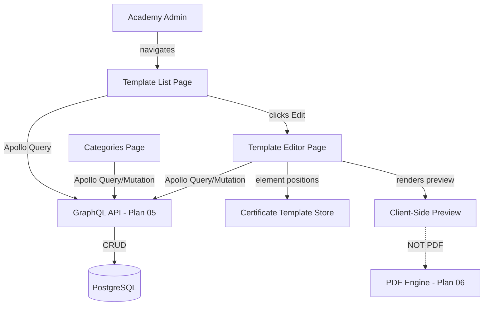
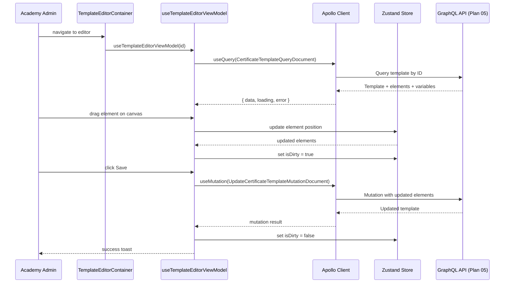

# Design: Plan 07 — Certificate Template Management UI

## Document Information

- **Feature Name**: Certificate Template Management UI
- **Target Directory**: `.ai/draft_plans/cert/plans/07-template-management-ui`
- **Outcome Directory**: `.ai/draft_plans/cert/plans/07-template-management-ui/outcome`
- **Version**: 1.0
- **Date**: 2025-08-01
- **Author**: Copilot
- **Reviewers**: Frontend team
- **Related Documents**:
  - Requirements: `requirements.md`
  - Plan 05: GraphQL API
  - Plan 06: PDF Rendering Engine

---

## Overview

This design implements the Certificate Template Management UI following Siraj's three-location frontend split architecture. The template management interface consists of a list page (paginated `AppDataGrid` on desktop, card list on mobile), a full visual canvas editor (desktop) with drag-positioned elements and a property panel, a simplified form-based editor (mobile), variable management, category tree management, client-side preview, and publish/archive workflows.

### Design Goals

- **Three-location compliance**: Server Components in `app/`, tier-neutral containers in `frontend/common/views/`, tier-specific presentation in `frontend/desktop/views/` and `frontend/mobile/views/`
- **Container + ViewModel + ResponsiveViewSwitch**: One Container per page; ViewModel encapsulates all business logic; tier views are pure presentation
- **Apollo Client v4 compliance**: Stateful `useQuery` from `@apollo/client/react`, no `useLazyQuery`, always include `id` field for cache normalization
- **MUI v9 compliance**: `sx` prop with theme callbacks, no style props, no hardcoded colors
- **i18n compliance**: `useAppTranslation(Translation.Dashboard.Certificates)` namespace handle, both `ar` and `en` locales
- **Mobile-first fallback**: Desktop gets the full visual canvas; mobile gets a simplified form-based editor with numeric position inputs

### Key Design Decisions

#### Decision 1: Pointer Events for Drag (not HTML5 Drag-and-Drop)

**Context:** The visual canvas requires draggable, resizable, rotatable elements.

**Options Considered:**
1. HTML5 Drag-and-Drop API — Pros: native, simple / Cons: poor touch support, limited customization
2. Pointer Events API — Pros: cross-device (mouse + touch), full control over rendering, snap-to-grid / Cons: more implementation code
3. Third-party library (react-dnd, react-rnd) — Pros: pre-built / Cons: dependency risk, MUI v9 compatibility unknown

**Decision:** Pointer Events API

**Rationale:** Siraj is a cross-device app (desktop + mobile). The HTML5 DnD API doesn't work on touch devices. Pointer Events works uniformly across mouse and touch, and we need fine-grained control over grid snapping, alignment guides, and resize/rotate handles.

#### Decision 2: Zustand Store for Editor State

**Context:** The element editor needs to track: selected element, element positions (during drag, before save), unsaved changes flag, grid snap toggle, element z-order, clipboard (copy/paste), and category tree expansion state.

**Options Considered:**
1. Local React state (useState/useReducer) — Pros: simple / Cons: lost on tier switch (mobile→desktop)
2. Apollo cache — Pros: automatic updates / Cons: not suited for transient UI state like "selected element" or "drag in progress"
3. Zustand store — Pros: survives tier switches (per Siraj pattern), persists to localStorage, framework-agnostic

**Decision:** Zustand store

**Rationale:** Siraj uses ~60 Zustand stores for mutable UI state precisely because they survive `ResponsiveViewSwitch` tier changes. Apollo cache is for server-state (template data); Zustand is for transient editor state (selected element, drag position, clipboard).

#### Decision 3: No PDF in Preview (Client-Side React Elements)

**Context:** The preview tab needs to show what the certificate will look like.

**Options Considered:**
1. Use Plan 06's PDF rendering via server call — Pros: exact PDF output / Cons: latency, server dependency, not real-time
2. Render positioned React elements client-side — Pros: instant, no server call, reuses element rendering logic from canvas / Cons: not pixel-perfect to PDF output

**Decision:** Render positioned React elements client-side

**Rationale:** The preview is for quick layout verification, not for final PDF output. PDF generation (Plan 06) is deferred to actual certificate generation. The preview reuses the same element rendering components as the canvas but in a read-only (non-interactive) mode.

#### Decision 4: Desktop-Only Canvas; Mobile Gets Simplified List Editor

**Context:** Drag-to-position canvas is complex and impractical on small screens.

**Options Considered:**
1. Full canvas on both — Pros: consistent / Cons: poor mobile UX, touch drag accuracy issues
2. Desktop canvas, mobile form editor — Pros: best UX per platform / Cons: two codepaths for element editing
3. No mobile editor at all — Pros: simpler / Cons: mobile users can't manage elements

**Decision:** Desktop canvas, mobile simplified list editor

**Rationale:** The canvas is fundamentally a desktop interaction pattern. On mobile, elements are shown as cards in a list with numeric position inputs and a small scaled outline preview showing the element's position marker. The Zustand store ensures changes are preserved when switching between desktop/mobile.

---

## UX/Navigation Specification (REQUIRED)

### New Routes & URLs

| Route | Purpose | Permission Required | Roles with Access |
|-------|---------|---------------------|-------------------|
| `/dashboard/certificates/templates` | Template list with search, filters, pagination | `CERTIFICATES_MANAGE_TEMPLATE` | SUPER_ADMIN, ACADEMY_ADMIN |
| `/dashboard/certificates/templates/[id]/edit` | Template editor (visual canvas on desktop, simplified on mobile) | `CERTIFICATES_MANAGE_TEMPLATE` | SUPER_ADMIN, ACADEMY_ADMIN |
| `/dashboard/certificates/categories` | Category tree management | `CERTIFICATES_MANAGE_TEMPLATE` | SUPER_ADMIN, ACADEMY_ADMIN |

### Sidebar Navigation Integration

- **New Group**: `grp_certificates` — "Certificates" group
- **Section**: `"main"` section (alongside existing groups)
- **Insertion Order**: After `grp_content` group, before `grp_finance` group
- **Icon**: `CertificateOutlined` (MUI v9 icon naming: `*Outlined` suffix)
  - Add `certificate` to `navIconKeys.ts`
  - Register in `navIconRegistry.tsx` with `CertificateOutlined` from `@mui/icons-material`
- **Children** (ordered):
  1. Templates — `nav_certificates_templates` → `/dashboard/certificates/templates`
  2. Categories — `nav_certificates_categories` → `/dashboard/certificates/categories`
  3. (Future: Certificates — Plan 08)
- **Mobile Bottom Nav**: Not included (admin-only feature, not suitable for mobile bottom nav which is student/parent-focused)
- **Permission**: `CERTIFICATES_MANAGE_TEMPLATE` (any-of array for group visibility)

### Role-Based Access Matrix

| Role | Routes Accessible | Permissions Granted | Notes |
|------|-------------------|---------------------|-------|
| SUPER_ADMIN | All routes | `CERTIFICATES_MANAGE_TEMPLATE` + all cert permissions | Full CRUD, super-admin shortcut |
| ACADEMY_ADMIN | All routes | `CERTIFICATES_MANAGE_TEMPLATE` | Full CRUD |
| TEACHER | `/dashboard/certificates/templates` (view-only) | `CERTIFICATES_VIEW_OTHER` | List visible, no create/edit/publish buttons; click-through shows read-only preview dialog |
| PARENT | N/A | N/A | No access to template management |
| STUDENT | N/A | N/A | No access to template management |

### Per-Audience Rendering

| Audience | Prominent Content / Differences |
|----------|----------------------------------|
| SUPER_ADMIN | Full CRUD interface: create, edit, publish, archive, category management, all elements |
| ACADEMY_ADMIN | Same as SUPER_ADMIN (full CRUD) |
| Teacher | View-only list: template list visible, action buttons hidden (Create, Edit, Publish, Archive), click-through shows read-only preview dialog |

### Mobile vs Desktop Variants

| Aspect | Desktop | Mobile |
|--------|---------|--------|
| Navigation | Sidebar group "Certificates" | Hamburger menu → "Certificates" group |
| Template List | `DesktopAppDataGrid` with columns: name, category, status, updatedAt, actions | `MobileCardList`: card per template with name, status badge, category chip, last updated, tap for actions |
| Template Editor | Full visual canvas with drag, resize, rotate, property panel sidebar | Accordion form sections; elements as editable cards with numeric position inputs; no drag canvas; small scaled outline showing element position |
| Category Tree | Split pane: tree on left, detail panel on right, drag-to-reorder | Full-screen tree with expand/collapse, tap to open details in bottom sheet |
| Preview | In-editor preview tab, side-by-side with canvas | Full-screen scrollable preview with pinch-to-zoom |
| Form Sections | Multi-section form with tab/section navigation | Collapsible accordions |

### Permission Mapping

| Component/Route | Required Permission | Source |
|-----------------|---------------------|--------|
| Templates List Page (Server) | `CERTIFICATES_MANAGE_TEMPLATE` | `requirePermissionForPage(userId, [AppPermission.CERTIFICATES_MANAGE_TEMPLATE], locale, context)` |
| Templates List Page (Client) | `CERTIFICATES_MANAGE_TEMPLATE` | `<RequirePermission permission={AppPermission.CERTIFICATES_MANAGE_TEMPLATE}>` |
| Template Editor Page (Server) | `CERTIFICATES_MANAGE_TEMPLATE` | Same pattern |
| Template Editor Page (Client) | `CERTIFICATES_MANAGE_TEMPLATE` | Same pattern |
| Categories Page (Server) | `CERTIFICATES_MANAGE_TEMPLATE` | Same pattern |
| Categories Page (Client) | `CERTIFICATES_MANAGE_TEMPLATE` | Same pattern |
| Teacher View-Only List | `CERTIFICATES_VIEW_OTHER` | Function-form authScope: `ctx.permissions.includes(AppPermission.CERTIFICATES_VIEW_OTHER)` |

### Outcome & Knowledge Transfer Protocol (`.ai/draft_plans/cert/plans/07-template-management-ui/outcome/`)

- **BEFORE Execution:** Executing agents MUST read ALL existing files in `.ai/draft_plans/cert/plans/07-template-management-ui/outcome/` to avoid re-analysis.
- **AFTER Execution:** Executing agents MUST write `.ai/draft_plans/cert/plans/07-template-management-ui/outcome/<task-id>-outcome.md` with research/doc findings and implementation details.
- **PROGRESS TRACKING:** Executing agents MUST update task checkboxes `[ ]` -> `[x]` in `tasks.md`.

---

## Architecture

### System Context



### High-Level Architecture

```mermaid
graph LR
    subgraph "app/ (Server Components)"
        ListPage[templates/page.tsx]
        EditPage[templates/[id]/edit/page.tsx]
        CatPage[categories/page.tsx]
    end

    subgraph "frontend/common/views/ (Tier-Neutral)"
        ListContainer[TemplateListContainer]
        EditorContainer[TemplateEditorContainer]
        CatContainer[CategoryTreeContainer]
        ListVM[useTemplateListViewModel]
        EditorVM[useTemplateEditorViewModel]
        CatVM[useCategoryTreeViewModel]
    end

    subgraph "frontend/desktop/views/ (Desktop)"
        ListDesktop[TemplateListDesktop]
        EditorDesktop[TemplateEditorDesktop]
        Canvas[TemplateElementCanvas]
        PropPanel[TemplatePropertyPanel]
        CatDesktop[CategoryTreeDesktop]
        Preview[TemplatePreview]
    end

    subgraph "frontend/mobile/views/ (Mobile)"
        ListMobile[TemplateListMobile]
        EditorMobile[TemplateEditorMobile]
        CatMobile[CategoryTreeMobile]
    end

    ListPage --> ListContainer
    EditPage --> EditorContainer
    CatPage --> CatContainer

    ListContainer --> ListVM
    ListContainer --> ListDesktop
    ListContainer --> ListMobile

    EditorContainer --> EditorVM
    EditorContainer --> EditorDesktop
    EditorContainer --> EditorMobile

    CatContainer --> CatVM
    CatContainer --> CatDesktop
    CatContainer --> CatMobile

    EditorDesktop --> Canvas
    EditorDesktop --> PropPanel
    EditorDesktop --> Preview
```

### Technology Stack

| Layer | Technology | Rationale |
|-------|------------|-----------|
| Server Components | Next.js 16 App Router + React 19 RSC | Siraj standard; auth, permissions, metadata in Server Components |
| Client Data Fetching | Apollo Client v4 (`@apollo/client/react`) | Siraj standard; stateful `useQuery`, no `useLazyQuery` |
| State Management | Zustand (`frontend/stores/certificate-template.store.ts`) | Siraj standard for mutable UI state; survives tier switches |
| UI Components | MUI v9 | Siraj standard; `sx` prop, theme callbacks, no style props |
| Data Grid | `AppDataGrid` / `DesktopAppDataGrid` | Siraj standard for desktop list tables |
| Mobile Lists | `MobileCardList` | Siraj standard for mobile list rendering |
| i18n | Custom compile-time TypeScript (`shared/locale/`) | Siraj standard; `useAppTranslation` for client components |
| Drag Interaction | Pointer Events API | Cross-device support, fine-grained control for canvas |
| GraphQL Documents | `TypedDocumentNode` from `@apollo/client` | Siraj standard; typed queries and mutations |

---

## Components and Interfaces

### Component 1: Template List Container

**Purpose**: Tier-neutral container for the template list page — fetches data via Apollo, manages search/filter/pagination state, delegates presentation to desktop/mobile views.

**Location**: `frontend/common/views/dashboard/certificates/templates/TemplateListContainer.tsx`

**Responsibilities**:
- Call `useTemplateListViewModel()` hook (ViewModel) for all business logic
- Wrap in `<RequirePermission permission={AppPermission.CERTIFICATES_MANAGE_TEMPLATE}>`
- Render `<ResponsiveViewSwitch>` to switch desktop/mobile views
- Pass ViewModel return object as props to both tier views

**ViewModel hook** (`useTemplateListViewModel`):
- `useQuery(CertificateTemplatesQueryDocument, { variables: { search, statusFilter, categoryId, page, pageSize }, fetchPolicy: "cache-and-network" })`
- State: `search` (debounced 300ms), `statusFilter`, `categoryId`, `page`
- Navigation: `useRouter().push("/dashboard/certificates/templates/[id]/edit")`
- Mutations: `useMutation(PublishCertificateTemplateMutationDocument)`, `useMutation(ArchiveCertificateTemplateMutationDocument)`

**Interface** (ViewModel return — flat plain object passed to tier views):
```typescript
interface TemplateListViewModel {
  templates: CertificateTemplateListItem[];
  loading: boolean;
  error: ApolloError | null;
  totalCount: number;
  page: number;
  pageSize: number;
  search: string;
  statusFilter: "all" | "draft" | "published" | "archived";
  categoryId: string | null;
  categories: CertificateCategory[];
  onPageChange: (page: number) => void;
  onSearchChange: (value: string) => void;
  onStatusFilterChange: (value: string) => void;
  onCategoryFilterChange: (categoryId: string | null) => void;
  onCreateTemplate: () => void;
  onEditTemplate: (id: string) => void;
  onPreviewTemplate: (id: string) => void;
  onPublishTemplate: (id: string) => void;
  onArchiveTemplate: (id: string) => void;
  canManage: boolean; // false for teachers
}
```

### Component 2: Template List Desktop View

**Purpose**: Desktop presentation of the template list using `DesktopAppDataGrid`.

**Location**: `frontend/desktop/views/dashboard/certificates/templates/TemplateListDesktop.tsx`

**Implementation Notes**:
- Use `DesktopAppDataGrid` with `buildServerPaginationOptions({ page, pageSize, totalCount, onPageChange })`
- Columns: name, category (chip from `category.name`), status (chip with color from theme), updatedAt (formatted date), actions (edit, preview, publish/archive buttons)
- `slots.pagination = GridPagination` (forced by AppDataGrid)
- No `useMediaQuery`, no `useViewport` (ESLint enforced in desktop tier)
- All text via `t.templates.list.*` from `useAppTranslation(Translation.Dashboard.Certificates)`

### Component 3: Template List Mobile View

**Purpose**: Mobile presentation of the template list using card-based layout.

**Location**: `frontend/mobile/views/dashboard/certificates/templates/TemplateListMobile.tsx`

**Implementation Notes**:
- Use `MobileCardList` (or Stack of `Card` components following Siraj mobile pattern)
- Each card: template name (titleLg variant), status badge (chip), category chip, last updated (bodyMd variant)
- Swipe/tap actions: edit, preview, publish, archive (shown as icon buttons in card action area)
- Infinite scroll or "Load More" button for pagination
- No `useMediaQuery`, no `useViewport`

### Component 4: Template Editor Container

**Purpose**: Tier-neutral container for the template editor page — fetches template by ID, orchestrates form sections, delegates to desktop/mobile views.

**Location**: `frontend/common/views/dashboard/certificates/templates/TemplateEditorContainer.tsx`

**ViewModel hook** (`useTemplateEditorViewModel`):
- `useQuery(CertificateTemplateQueryDocument, { variables: { id }, fetchPolicy: "cache-and-network" })`
- State in Zustand: `selectedElementId`, `elements` (with positions), `isDirty`, `gridSnapEnabled`, `showGuides`, `clipboard`, `expandedSections`
- Mutations: `useMutation(UpdateCertificateTemplateMutationDocument)`, `useMutation(CreateCertificateTemplateMutationDocument)`
- Navigation: `useRouter().push("/dashboard/certificates/templates")`, `useRouter().back()`
- Unsaved changes guard: router back interception + Zustand `isDirty` check

**Interface** (ViewModel return):
```typescript
interface TemplateEditorViewModel {
  template: CertificateTemplate | null;
  loading: boolean;
  error: ApolloError | null;
  elements: CertificateTemplateElement[];
  variables: CertificateTemplateVariable[];
  selectedElementId: string | null;
  selectedElement: CertificateTemplateElement | null;
  isDirty: boolean;
  isReadOnly: boolean;
  gridSnapEnabled: boolean;
  showGuides: boolean;
  expandedSections: string[];
  onElementSelect: (id: string | null) => void;
  onElementPositionChange: (id: string, x: number, y: number) => void;
  onElementResize: (id: string, width: number, height: number) => void;
  onElementRotate: (id: string, rotation: number) => void;
  onElementAdd: (type: ElementType) => void;
  onElementDelete: (id: string) => void;
  onElementDuplicate: (id: string) => void;
  onElementUpdate: (id: string, properties: Partial<CertificateTemplateElement>) => void;
  onElementReorder: (id: string, direction: "forward" | "backward" | "front" | "back") => void;
  onElementLockToggle: (id: string) => void;
  onElementVisibilityToggle: (id: string) => void;
  onSave: () => void;
  onPublish: () => void;
  onArchive: () => void;
  onGridSnapToggle: () => void;
  onGuidesToggle: () => void;
  onSectionToggle: (section: string) => void;
}
```

### Component 5: Template Editor Desktop View

**Purpose**: Full visual canvas editor for desktop.

**Location**: `frontend/desktop/views/dashboard/certificates/templates/TemplateEditorDesktop.tsx`

**Implementation Notes**:
- Layout: Section tabs at top (Basic Info, Dimensions, Background, Font, Elements, Variables, Preview)
- "Elements" section: split view — canvas (left, flexible) + property panel (right, 350px fixed)
- Toolbar above canvas: Add Element (dropdown), Grid Snap toggle, Guides toggle, Zoom controls
- Canvas area: `<TemplateElementCanvas>` with toolbar overlay
- Property panel area: `<TemplatePropertyPanel>` for selected element properties
- Published/archived banner at top when `isReadOnly === true`
- Save/Publish/Archive buttons in app bar or sticky footer
- All styling via `sx` prop with theme callbacks, no style props

### Component 6: Template Element Canvas

**Purpose**: Visual canvas where elements are rendered and can be dragged, resized, and rotated via Pointer Events.

**Location**: `frontend/desktop/views/dashboard/certificates/templates/TemplateElementCanvas.tsx`

**Implementation Notes**:
- Canvas background: renders template background (color or image) scaled to fit viewport
- Elements: absolutely positioned `div` elements with CSS `transform: translate(x, y) rotate(deg)`
- Drag: `onPointerDown` on element → `onPointerMove` (updates position in Zustand) → `onPointerUp` (snap to grid if enabled)
- Resize: 8 drag handles (corners + edges) on selected element's selection border
- Rotate: rotation handle above selection border
- Grid lines: optional overlay (SVG or CSS background) when `gridSnapEnabled`
- Alignment guides: dynamic lines shown during drag when element center aligns with canvas center or another element's edge
- Scale: canvas scaled to fit available viewport width; element coordinates stored in template coordinate system (mm), displayed in screen pixels via scale factor
- Keyboard: ArrowLeft/Right/Up/Down to nudge selected element, Delete to delete, Ctrl+C/V for copy/paste, Ctrl+D for duplicate
- Clipboard: copy/paste stores element clone in Zustand `clipboard` field; paste offsets 10px
- Element rendering: each element type (Text, Image, QR Code, Signature, Shape) has a dedicated `ElementRendererCanvas` subcomponent

### Component 7: Template Property Panel

**Purpose**: Side panel (350px fixed width) showing properties for the currently selected element, or template-level properties when no element is selected.

**Location**: `frontend/desktop/views/dashboard/certificates/templates/TemplatePropertyPanel.tsx`

**Implementation Notes**:
- Dynamic form based on `selectedElement.type`:
  - **Text**: content (TextField or variable dropdown), fontFamily, fontSize, fontWeight, color (ColorPicker), textAlign, lineHeight, letterSpacing
  - **Image**: imageURL (TextField), altText, opacity (Slider 0-100), borderRadius, objectFit (Select)
  - **QR Code**: dataSource (static text or variable dropdown), size, errorCorrectionLevel (Select: L/M/Q/H), foregroundColor, backgroundColor
  - **Signature**: signerType (Select: fixed/variable), signatureImageURL, width, height, "Draw Signature" button (opens drawing dialog)
  - **Shape**: shapeType (Select: rectangle/circle/line), fillColor, borderColor, borderWidth, borderStyle (Select: solid/dashed/dotted), borderRadius
- Z-order controls: Back, Forward, Front, Backward icon buttons at top of panel
- Lock/Visibility toggle buttons at top of panel
- No element selected: show template-level properties (background color, background image, margins, font defaults)
- All form changes call `onElementUpdate(id, properties)` from ViewModel immediately (real-time canvas update)
- Color pickers use MUI `ColorPicker` or a custom swatch row from theme palette
- All styling via `sx` prop, no style props

### Component 8: Template Editor Mobile View

**Purpose**: Simplified mobile editor with accordion form sections and element list (no visual canvas).

**Location**: `frontend/mobile/views/dashboard/certificates/templates/TemplateEditorMobile.tsx`

**Implementation Notes**:
- Accordion components (MUI `Accordion`) for: Basic Info, Dimensions, Background, Font, Elements, Variables, Preview
- "Elements" accordion: list of element cards (Stack of Card components)
  - Each card: element type icon, content preview (first 30 chars), position (x, y), size (w, h), up/down reorder buttons, edit button, delete button
  - Tap edit: opens full-screen `ElementEditForm` with same fields as desktop property panel but in form layout
  - Add element: FAB or "Add" button → opens bottom sheet `Sheet` with element type menu
  - Position editing: numeric X/Y inputs with a small scaled template outline (200px wide) showing the element's position as a dot marker
- Preview: full-screen scrollable container showing positioned elements (reuses `TemplatePreview` component)
- No drag canvas, no selection borders, no resize/rotate handles, no alignment guides
- Save/Publish buttons in a sticky bottom bar
- Published/archived banner at top when `isReadOnly === true`

### Component 9: Template Variable Management

**Purpose**: UI for listing, creating, editing, and deleting template variables with type-specific forms.

**Location**: `frontend/common/views/dashboard/certificates/templates/TemplateVariableManagement.tsx` (tier-neutral, uses responsive form layout)

**Implementation Notes**:
- Table or list of variables: name, type (chip), default value, required flag, used count, actions (edit/delete)
- "Add Variable" button → opens dialog form
- Variable form fields depend on type:
  - Common: name (TextField, required, unique), type (Select: TEXT/DATE/NAME/EMAIL/CUSTOM), required (Checkbox)
  - TEXT: defaultValue (TextField)
  - DATE: defaultValue (DatePicker), format (TextField, default `YYYY-MM-DD`)
  - NAME: defaultValue (TextField)
  - EMAIL: defaultValue (TextField with email validation)
  - CUSTOM: defaultValue (TextArea, JSON), description (TextField)
- Validation: name unique within template, alphanumeric + underscore only, min 1 max 100 chars
- Delete confirmation dialog: "Delete variable '{name}'? Elements using this variable will show placeholder text."
- "Used" badge when an element references `{{variableName}}` in its content
- All labels via `t.templates.variables.*` from translation namespace

### Component 10: Category Tree Container + Desktop/Mobile Views

**Purpose**: Hierarchical category management with tree view, CRUD operations, and reorder support.

**Locations**:
- Container: `frontend/common/views/dashboard/certificates/categories/CategoryTreeContainer.tsx`
- Desktop: `frontend/desktop/views/dashboard/certificates/categories/CategoryTreeDesktop.tsx`
- Mobile: `frontend/mobile/views/dashboard/certificates/categories/CategoryTreeMobile.tsx`

**ViewModel hook** (`useCategoryTreeViewModel`):
- `useQuery(CertificateCategoriesQueryDocument)` for category tree
- `useMutation(CreateCertificateCategoryMutationDocument)`
- `useMutation(UpdateCertificateCategoryMutationDocument)`
- `useMutation(DeleteCertificateCategoryMutationDocument)`
- `useMutation(ReorderCertificateCategoriesMutationDocument)`
- Zustand: `expandedCategoryIds` (expansion state persists across navigations)

**Desktop layout**:
- Split pane: tree (left, 300px) + detail panel (right, flexible)
- Tree uses MUI `TreeView` component with custom node rendering
- Drag-to-reorder within tree (Pointer Events, same approach as canvas)
- Node actions: Add Child, Rename (inline), Delete
- Detail panel: category name, description, template count, sub-category list, "Move Templates Here" action

**Mobile layout**:
- Full-screen tree with expand/collapse (tap chevron)
- Tap category → opens bottom sheet with details and actions
- Reorder uses up/down arrow buttons (no drag on mobile)

### Component 11: Template Preview

**Purpose**: Client-side preview rendering of certificate template with placeholder variable values. No PDF generation.

**Location**: `frontend/common/views/dashboard/certificates/templates/TemplatePreview.tsx` (tier-neutral, responsive)

**Implementation Notes**:
- Renders the template background (color or image) at the template's aspect ratio, scaled to fit container
- Renders each element at its x/y position using the same `ElementRenderer` subcomponents as the canvas
- Variable substitution: replaces `{{variableName}}` in element content with:
  - The variable's default value if set
  - The literal string `"<variableName>"` if no default (visible placeholder)
- Read-only mode: no drag, no selection, no handles, no toolbar
- Scale: same scale factor as canvas (mm → pixels)
- Loading overlay: spinner that shows while element data is being resolved
- Empty state: "No elements. Add elements to see a preview."
- Mobile: rendered in a scrollable container with pinch-to-zoom (CSS `touch-action: pinch-zoom`)

### Component 12: Custom Hook — Element Renderers

**Purpose**: Shared element rendering components used by both the canvas (interactive) and preview (read-only).

**Location**: `frontend/common/views/dashboard/certificates/templates/elements/` directory:
- `TextElementRenderer.tsx`
- `ImageElementRenderer.tsx`
- `QrCodeElementRenderer.tsx`
- `SignatureElementRenderer.tsx`
- `ShapeElementRenderer.tsx`
- `index.ts` (barrel export + `ElementRenderer` dispatcher component)

**Interface**:
```typescript
interface ElementRendererProps {
  element: CertificateTemplateElement;
  variableValues: Record<string, string>; // resolved variable values for preview
  readOnly: boolean; // true for preview mode, false for canvas
  scale: number; // mm-to-pixel scale factor
}
```

**Implementation Notes**:
- QR Code rendering: use a lightweight QR code library (e.g., `qrcode.react`) or generate a data URL server-side
- Image rendering: standard `` with object-fit styling
- Shape rendering: SVG or CSS border-radius based on shape type
- Signature rendering: `` for signature image, or canvas for "draw signature" mode
- Text rendering: `<div>` with CSS text properties, variable substitution via regex replace of `{{...}}`

---

## Data Models

### Entity: CertificateTemplate

```typescript
interface CertificateTemplate {
  id: string;
  name: string;
  description: string | null;
  categoryId: string | null;
  category: CertificateCategory | null;
  status: "draft" | "published" | "archived";
  orientation: "portrait" | "landscape";
  widthMm: number;
  heightMm: number;
  marginMm: number;
  backgroundColor: string;
  backgroundImageUrl: string | null;
  backgroundOpacity: number;
  primaryFontFamily: string;
  primaryFontSize: number;
  secondaryFontFamily: string | null;
  elements: CertificateTemplateElement[];
  variables: CertificateTemplateVariable[];
  versionNumber: number | null; // set on publish
  certificatesCount: number; // count of issued certificates using this template
  createdAt: string;
  updatedAt: string;
}
```

### Entity: CertificateTemplateElement

```typescript
interface CertificateTemplateElement {
  id: string;
  templateId: string;
  type: "text" | "image" | "qrcode" | "signature" | "shape";
  name: string;
  positionX: number; // mm from left
  positionY: number; // mm from top
  width: number; // mm
  height: number; // mm
  rotation: number; // degrees 0-360
  zIndex: number;
  isLocked: boolean;
  isVisible: boolean;
  properties: ElementProperties; // type-specific JSON
}

interface ElementProperties {
  // Text
  content?: string; // may contain {{variable}} placeholders
  fontFamily?: string;
  fontSize?: number;
  fontWeight?: string;
  color?: string;
  textAlign?: "left" | "center" | "right";
  lineHeight?: number;
  letterSpacing?: number;

  // Image
  imageUrl?: string;
  altText?: string;
  opacity?: number;
  borderRadius?: number;
  objectFit?: "cover" | "contain" | "fill";

  // QR Code
  qrDataSource?: string; // static text or {{variable}}
  qrErrorCorrectionLevel?: "L" | "M" | "Q" | "H";
  qrForegroundColor?: string;
  qrBackgroundColor?: string;

  // Signature
  signerType?: "fixed" | "variable";
  signatureImageUrl?: string;
  signerName?: string;

  // Shape
  shapeType?: "rectangle" | "circle" | "line";
  fillColor?: string;
  borderColor?: string;
  borderWidth?: number;
  borderStyle?: "solid" | "dashed" | "dotted";
  shapeBorderRadius?: number;
}
```

### Entity: CertificateTemplateVariable

```typescript
interface CertificateTemplateVariable {
  id: string;
  templateId: string;
  name: string; // unique within template, alphanumeric + underscore
  type: "TEXT" | "DATE" | "NAME" | "EMAIL" | "CUSTOM";
  defaultValue: string | null;
  isRequired: boolean;
  description: string | null;
  dateFormat: string | null; // for DATE type, default "YYYY-MM-DD"
  usedByElements: number; // count of elements referencing this variable
}
```

### Entity: CertificateCategory

```typescript
interface CertificateCategory {
  id: string;
  name: string;
  description: string | null;
  parentId: string | null;
  displayOrder: number;
  templateCount: number;
  children: CertificateCategory[]; // sub-categories
  depth: number; // 0-indexed, max 2 (3 levels total)
}
```

### Data Flow



---

## GraphQL Documents

**Location**: `frontend/common/graphql/sharedDocuments/certificates/certificates.documents.ts`

All documents follow Siraj conventions:
- Import `gql`, `TypedDocumentNode` from `@apollo/client`
- Import `Types` from generated GraphQL types
- Import `Operations` from generated operations
- Always include `id` field for Apollo cache normalization
- Use fragments for shared entity fields
- Name: `{entityName}QueryDocument` / `{entityName}MutationDocument`

### Fragment Definitions

```typescript
import { gql, TypedDocumentNode } from "@apollo/client";
import { Types } from "@/frontend/common/graphql/generated/graphql-types";
import { Operations } from "@/frontend/common/graphql/generated/operations";

const CertificateTemplateFragment = gql`
  fragment CertificateTemplateFragment on CertificateTemplate {
    id
    name
    description
    categoryId
    category {
      id
      name
    }
    status
    orientation
    widthMm
    heightMm
    marginMm
    backgroundColor
    backgroundImageUrl
    backgroundOpacity
    primaryFontFamily
    primaryFontSize
    secondaryFontFamily
    versionNumber
    certificatesCount
    createdAt
    updatedAt
  }
`;

const CertificateTemplateElementFragment = gql`
  fragment CertificateTemplateElementFragment on CertificateTemplateElement {
    id
    templateId
    type
    name
    positionX
    positionY
    width
    height
    rotation
    zIndex
    isLocked
    isVisible
    properties
  }
`;

const CertificateTemplateVariableFragment = gql`
  fragment CertificateTemplateVariableFragment on CertificateTemplateVariable {
    id
    templateId
    name
    type
    defaultValue
    isRequired
    description
    dateFormat
  }
`;

const CertificateCategoryFragment = gql`
  fragment CertificateCategoryFragment on CertificateCategory {
    id
    name
    description
    parentId
    displayOrder
    templateCount
    depth
  }
`;
```

### Query Documents

```typescript
// List templates with pagination, search, and filters
export const CertificateTemplatesQueryDocument = gql`
  ${CertificateTemplateFragment}
  query CertificateTemplates(
    $search: String
    $statusFilter: CertificateTemplateStatusFilter
    $categoryId: ID
    $page: Int!
    $pageSize: Int!
  ) {
    certificateTemplates(
      search: $search
      statusFilter: $statusFilter
      categoryId: $categoryId
      page: $page
      pageSize: $pageSize
    ) {
      id
      totalCount
      rows {
        ...CertificateTemplateFragment
      }
      pageInfo {
        count
        currentPage
        hasMorePages
        lastPage
        perPage
        total
      }
    }
  }
` as TypedDocumentNode<
  Operations.CertificateTemplatesQuery,
  Types.CertificateTemplatesQueryVariables
>;

// Single template with elements and variables
export const CertificateTemplateQueryDocument = gql`
  ${CertificateTemplateFragment}
  ${CertificateTemplateElementFragment}
  ${CertificateTemplateVariableFragment}
  query CertificateTemplate($id: ID!) {
    certificateTemplate(id: $id) {
      ...CertificateTemplateFragment
      elements {
        ...CertificateTemplateElementFragment
      }
      variables {
        ...CertificateTemplateVariableFragment
        usedByElements
      }
    }
  }
` as TypedDocumentNode<
  Operations.CertificateTemplateQuery,
  Types.CertificateTemplateQueryVariables
>;

// Category tree
export const CertificateCategoriesQueryDocument = gql`
  ${CertificateCategoryFragment}
  query CertificateCategories {
    certificateCategories {
      id
      ...CertificateCategoryFragment
      children {
        id
        ...CertificateCategoryFragment
        children {
          id
          ...CertificateCategoryFragment
        }
      }
    }
  }
` as TypedDocumentNode<
  Operations.CertificateCategoriesQuery,
  Types.CertificateCategoriesQueryVariables
>;
```

### Mutation Documents

```typescript
// Create template
export const CreateCertificateTemplateMutationDocument = gql`
  ${CertificateTemplateFragment}
  mutation CreateCertificateTemplate($input: CreateCertificateTemplateInput!) {
    createCertificateTemplate(input: $input) {
      ...CertificateTemplateFragment
    }
  }
` as TypedDocumentNode<
  Operations.CreateCertificateTemplateMutation,
  Types.CreateCertificateTemplateMutationVariables
>;

// Update template (including elements and variables)
export const UpdateCertificateTemplateMutationDocument = gql`
  ${CertificateTemplateFragment}
  mutation UpdateCertificateTemplate(
    $id: ID!
    $input: UpdateCertificateTemplateInput!
  ) {
    updateCertificateTemplate(id: $id, input: $input) {
      ...CertificateTemplateFragment
    }
  }
` as TypedDocumentNode<
  Operations.UpdateCertificateTemplateMutation,
  Types.UpdateCertificateTemplateMutationVariables
>;

// Publish template (creates version snapshot)
export const PublishCertificateTemplateMutationDocument = gql`
  ${CertificateTemplateFragment}
  mutation PublishCertificateTemplate($id: ID!) {
    publishCertificateTemplate(id: $id) {
      ...CertificateTemplateFragment
    }
  }
` as TypedDocumentNode<
  Operations.PublishCertificateTemplateMutation,
  Types.PublishCertificateTemplateMutationVariables
>;

// Archive template
export const ArchiveCertificateTemplateMutationDocument = gql`
  ${CertificateTemplateFragment}
  mutation ArchiveCertificateTemplate($id: ID!) {
    archiveCertificateTemplate(id: $id) {
      ...CertificateTemplateFragment
    }
  }
` as TypedDocumentNode<
  Operations.ArchiveCertificateTemplateMutation,
  Types.ArchiveCertificateTemplateMutationVariables
>;

// Category mutations
export const CreateCertificateCategoryMutationDocument = gql`
  ${CertificateCategoryFragment}
  mutation CreateCertificateCategory($input: CreateCertificateCategoryInput!) {
    createCertificateCategory(input: $input) {
      ...CertificateCategoryFragment
    }
  }
` as TypedDocumentNode<
  Operations.CreateCertificateCategoryMutation,
  Types.CreateCertificateCategoryMutationVariables
>;

export const UpdateCertificateCategoryMutationDocument = gql`
  ${CertificateCategoryFragment}
  mutation UpdateCertificateCategory(
    $id: ID!
    $input: UpdateCertificateCategoryInput!
  ) {
    updateCertificateCategory(id: $id, input: $input) {
      ...CertificateCategoryFragment
    }
  }
` as TypedDocumentNode<
  Operations.UpdateCertificateCategoryMutation,
  Types.UpdateCertificateCategoryMutationVariables
>;

export const DeleteCertificateCategoryMutationDocument = gql`
  mutation DeleteCertificateCategory($id: ID!) {
    deleteCertificateCategory(id: $id) {
      id
      success
    }
  }
` as TypedDocumentNode<
  Operations.DeleteCertificateCategoryMutation,
  Types.DeleteCertificateCategoryMutationVariables
>;

export const ReorderCertificateCategoriesMutationDocument = gql`
  mutation ReorderCertificateCategories($input: ReorderCategoriesInput!) {
    reorderCertificateCategories(input: $input) {
      id
      displayOrder
    }
  }
` as TypedDocumentNode<
  Operations.ReorderCertificateCategoriesMutation,
  Types.ReorderCertificateCategoriesMutationVariables
>;
```

### Post-Creation Steps

After creating the documents file:
```bash
bun run generate:gqlSchema   # Generate GraphQL schema from Pothos
bun codegen                   # Generate TypeScript types from schema
```

---

## Zustand Store

**Location**: `frontend/stores/certificate-template.store.ts`

```typescript
import { create } from "zustand";
import { persist } from "zustand/middleware";

interface CertificateTemplateStoreState {
  // Editor state
  selectedElementId: string | null;
  elements: CertificateTemplateElement[];
  isDirty: boolean;
  gridSnapEnabled: boolean;
  showGuides: boolean;
  clipboard: CertificateTemplateElement | null;
  expandedSections: string[];

  // Category tree state
  expandedCategoryIds: string[];

  // Actions
  setSelectedElementId: (id: string | null) => void;
  setElements: (elements: CertificateTemplateElement[]) => void;
  updateElementPosition: (id: string, x: number, y: number) => void;
  updateElementSize: (id: string, width: number, height: number) => void;
  updateElementRotation: (id: string, rotation: number) => void;
  updateElementProperties: (
    id: string,
    properties: Partial<CertificateTemplateElement>,
  ) => void;
  addElement: (element: CertificateTemplateElement) => void;
  deleteElement: (id: string) => void;
  duplicateElement: (id: string) => void;
  reorderElement: (
    id: string,
    direction: "forward" | "backward" | "front" | "back",
  ) => void;
  toggleElementLock: (id: string) => void;
  toggleElementVisibility: (id: string) => void;
  copyElement: (id: string) => void;
  pasteElement: () => void;
  setDirty: (dirty: boolean) => void;
  toggleGridSnap: () => void;
  toggleGuides: () => void;
  toggleSection: (section: string) => void;
  setExpandedCategoryIds: (ids: string[]) => void;
  toggleCategoryExpanded: (id: string) => void;
  reset: () => void;
}

export const useCertificateTemplateStore = create<CertificateTemplateStoreState>()(
  persist(
    (set) => ({
      // Initial state
      selectedElementId: null,
      elements: [],
      isDirty: false,
      gridSnapEnabled: true,
      showGuides: true,
      clipboard: null,
      expandedSections: ["basic"],
      expandedCategoryIds: [],

      // Actions
      setSelectedElementId: (id) => set({ selectedElementId: id }),
      setElements: (elements) => set({ elements }),
      updateElementPosition: (id, x, y) =>
        set((state) => ({
          elements: state.elements.map((el) =>
            el.id === id ? { ...el, positionX: x, positionY: y } : el,
          ),
          isDirty: true,
        })),
      // ... other action implementations
      reset: () =>
        set({
          selectedElementId: null,
          elements: [],
          isDirty: false,
          gridSnapEnabled: true,
          showGuides: true,
          clipboard: null,
          expandedSections: ["basic"],
        }),
    }),
    {
      name: "certificate-template-store",
      // Only persist non-sensitive UI state
      partialize: (state) => ({
        gridSnapEnabled: state.gridSnapEnabled,
        showGuides: state.showGuides,
        expandedSections: state.expandedSections,
        expandedCategoryIds: state.expandedCategoryIds,
      }),
    },
  ),
);
```

### Store Usage Rules (from Siraj conventions)

- All mutable UI state in Zustand (survives tier switching)
- Never store non-serializable values (File, Blob) in persist-enabled stores
- Filter/search setters reset page to 0
- Store is imported and used in ViewModel hooks, not directly in tier views
- Tier views access store state through ViewModel props, not direct store access

---

## App Router Pages

### Page 1: Template List

**Location**: `app/(dashboard)/[locale]/dashboard/certificates/templates/page.tsx`

```tsx
import { getLocale } from "next-intl/server"; // Note: Siraj uses cookie-based locale
import { getServerUserContext } from "@/backend/lib/auth";
import { redirectToLogin } from "@/backend/lib/auth";
import { requirePermissionForPage } from "@/backend/lib/permissions";
import { AppPermission } from "@/backend/enum/permissions/permission.enum";
import { TemplateListContainer } from "@/frontend/common/views/dashboard/certificates/templates/TemplateListContainer";
import { getTranslations } from "@/shared/locale/server";

export default async function TemplatesPage() {
  const locale = await getLocale();
  const { userId, context } = await getServerUserContext();
  if (!userId) {
    await redirectToLogin();
    return;
  }
  await requirePermissionForPage(
    userId,
    [AppPermission.CERTIFICATES_MANAGE_TEMPLATE],
    locale,
    context,
  );
  const t = await getTranslations(locale, "dashboard.certificates");
  return <TemplateListContainer />;
}
```

### Page 2: Template Editor

**Location**: `app/(dashboard)/[locale]/dashboard/certificates/templates/[id]/edit/page.tsx`

```tsx
import { getLocale } from "next-intl/server";
import { getServerUserContext } from "@/backend/lib/auth";
import { redirectToLogin } from "@/backend/lib/auth";
import { requirePermissionForPage } from "@/backend/lib/permissions";
import { AppPermission } from "@/backend/enum/permissions/permission.enum";
import { TemplateEditorContainer } from "@/frontend/common/views/dashboard/certificates/templates/TemplateEditorContainer";
import { getTranslations } from "@/shared/locale/server";

export default async function TemplateEditorPage({
  params,
}: {
  params: Promise<{ id: string }>;
}) {
  const { id } = await params;
  const locale = await getLocale();
  const { userId, context } = await getServerUserContext();
  if (!userId) {
    await redirectToLogin();
    return;
  }
  await requirePermissionForPage(
    userId,
    [AppPermission.CERTIFICATES_MANAGE_TEMPLATE],
    locale,
    context,
  );
  return <TemplateEditorContainer templateId={id} />;
}
```

### Page 3: Categories

**Location**: `app/(dashboard)/[locale]/dashboard/certificates/categories/page.tsx`

```tsx
import { getLocale } from "next-intl/server";
import { getServerUserContext } from "@/backend/lib/auth";
import { redirectToLogin } from "@/backend/lib/auth";
import { requirePermissionForPage } from "@/backend/lib/permissions";
import { AppPermission } from "@/backend/enum/permissions/permission.enum";
import { CategoryTreeContainer } from "@/frontend/common/views/dashboard/certificates/categories/CategoryTreeContainer";

export default async function CategoriesPage() {
  const locale = await getLocale();
  const { userId, context } = await getServerUserContext();
  if (!userId) {
    await redirectToLogin();
    return;
  }
  await requirePermissionForPage(
    userId,
    [AppPermission.CERTIFICATES_MANAGE_TEMPLATE],
    locale,
    context,
  );
  return <CategoryTreeContainer />;
}
```

---

## Navigation Config Updates

### `navigationConfig.ts` — Add Certificates Group and Items

```typescript
// Add to SIDEBAR_NAV_GROUPS (after grp_content, before grp_finance):
{
  id: "grp_certificates",
  labelKey: Translation.Dashboard.Certificates.groupLabel,
  iconKey: "certificate",
  section: "main",
  permission: [AppPermission.CERTIFICATES_MANAGE_TEMPLATE],
  separator: false,
} as const satisfies NavGroup,

// Add to SIDEBAR_NAV_ITEMS:
{
  id: "nav_certificates_templates",
  labelKey: Translation.Dashboard.Certificates.templates,
  href: "/dashboard/certificates/templates",
  groupId: "grp_certificates",
  iconKey: "certificate",
  permission: [AppPermission.CERTIFICATES_MANAGE_TEMPLATE],
  order: 1,
} as const satisfies NavItem,
{
  id: "nav_certificates_categories",
  labelKey: Translation.Dashboard.Certificates.categories,
  href: "/dashboard/certificates/categories",
  groupId: "grp_certificates",
  iconKey: "categoryTree",
  permission: [AppPermission.CERTIFICATES_MANAGE_TEMPLATE],
  order: 2,
} as const satisfies NavItem,

// Add to PAGE_PERMISSIONS:
PAGE_PERMISSIONS["/dashboard/certificates/templates"] = [
  AppPermission.CERTIFICATES_MANAGE_TEMPLATE,
];
PAGE_PERMISSIONS["/dashboard/certificates/templates/[id]/edit"] = [
  AppPermission.CERTIFICATES_MANAGE_TEMPLATE,
];
PAGE_PERMISSIONS["/dashboard/certificates/categories"] = [
  AppPermission.CERTIFICATES_MANAGE_TEMPLATE,
];
```

### Icon Registry Updates

- Add keys to `navIconKeys.ts`: `"certificate"`, `"categoryTree"`
- Register in `navIconRegistry.tsx`:
  ```tsx
  import CertificateOutlined from "@mui/icons-material/CertificateOutlined";
  import AccountTreeOutlined from "@mui/icons-material/AccountTreeOutlined";
  // ...in the registry:
  certificate: CertificateOutlined,
  categoryTree: AccountTreeOutlined,
  ```

---

## i18n Namespace Setup

### Namespace Registration

In `shared/locale/namespaces/translation.ts`:
```typescript
// Add to Translation tree:
export const Translation = {
  Dashboard: {
    // ...existing
    Certificates: defineNamespace<{
      groupLabel: string;
      templates: string;
      categories: string;
      list: {
        title: string;
        search: string;
        statusFilter: {
          all: string;
          draft: string;
          published: string;
          archived: string;
        };
        columns: {
          name: string;
          category: string;
          status: string;
          updatedAt: string;
          actions: string;
        };
        actions: {
          create: string;
          edit: string;
          preview: string;
          publish: string;
          archive: string;
        };
        empty: string;
      };
      editor: {
        title: string;
        sections: {
          basic: string;
          dimensions: string;
          background: string;
          font: string;
          elements: string;
          variables: string;
          preview: string;
        };
        basic: {
          name: string;
          description: string;
          category: string;
        };
        elements: {
          addElement: string;
          elementType: {
            text: string;
            image: string;
            qrcode: string;
            signature: string;
            shape: string;
          };
          gridSnap: string;
          showGuides: string;
          delete: string;
          duplicate: string;
        };
        properties: {
          position: string;
          size: string;
          rotation: string;
          content: string;
          variable: string;
        };
        actions: {
          save: string;
          publish: string;
          archive: string;
          createNewVersion: string;
        };
        errors: {
          templateNameRequired: string;
          elementRequired: string;
          variableNameUnique: string;
          unsavedChanges: string;
          publishedReadOnly: string;
        };
      };
      variables: {
        title: string;
        add: string;
        name: string;
        type: string;
        defaultValue: string;
        required: string;
        used: string;
        deleteConfirm: (name: string) => string;
        types: {
          TEXT: string;
          DATE: string;
          NAME: string;
          EMAIL: string;
          CUSTOM: string;
        };
      };
      categories: {
        title: string;
        add: string;
        rename: string;
        delete: string;
        deleteConfirm: (name: string) => string;
        deleteBlocked: string;
        name: string;
        description: string;
        parent: string;
        templateCount: (count: number) => string;
      };
      preview: {
        title: string;
        empty: string;
      };
    }>("dashboard.certificates", {
      load: {
        ar: () => import("./ar/dashboard/certificates"),
        en: () => import("./en/dashboard/certificates"),
      },
    }),
  },
} as const;
```

### Locale File Examples

**Arabic** (`shared/locale/namespaces/ar/dashboard/certificates.ts`):
```typescript
export default {
  groupLabel: "الشهادات",
  templates: "القوالب",
  categories: "الفئات",
  list: {
    title: "قوالب الشهادات",
    search: "بحث...",
    // ... etc
  },
  // ... etc
} as const;
```

**English** (`shared/locale/namespaces/en/dashboard/certificates.ts`):
```typescript
export default {
  groupLabel: "Certificates",
  templates: "Templates",
  categories: "Categories",
  list: {
    title: "Certificate Templates",
    search: "Search...",
    // ... etc
  },
  // ... etc
} as const;
```

---

## Component Patterns (Siraj Compliance)

### MUI v9 Compliance

```typescript
// ❌ WRONG — style props not valid in MUI v9
<Typography fontWeight={700} mb={1}>Title</Typography>
<Stack gap={2}>...</Stack>

// ✅ CORRECT — use sx prop
<Typography sx={{ fontWeight: 700, mb: 1 }}>Title</Typography>
<Stack sx={{ gap: 2 }}>...</Stack>

// ✅ CORRECT — theme callback for dynamic colors
<Box sx={(theme) => ({ backgroundColor: theme.palette.primary.main })}>
```

### Apollo Client Compliance

```typescript
// ❌ WRONG — do not import from @apollo/client
import { useQuery } from "@apollo/client";

// ✅ CORRECT — import from @apollo/client/react
import { useQuery } from "@apollo/client/react";

// ❌ WRONG — no useLazyQuery (banned in Siraj)
const [getList] = useLazyQuery(Document);

// ✅ CORRECT — stateful useQuery
const { data, loading, error } = useQuery(Document, {
  variables: { ... },
  fetchPolicy: "cache-and-network",
});
```

### ResponsiveViewSwitch Pattern

```typescript
// In Container (tier-neutral):
import { createLazyView } from "@/frontend/common/lib/lazyView";
import { ResponsiveViewSwitch } from "@/frontend/common/components/ui/ResponsiveViewSwitch";

const DesktopView = createLazyView(() =>
  import("@/frontend/desktop/views/dashboard/certificates/templates/TemplateListDesktop"),
);
const MobileView = createLazyView(() =>
  import("@/frontend/mobile/views/dashboard/certificates/templates/TemplateListMobile"),
);

export function TemplateListContainer() {
  const viewModel = useTemplateListViewModel();
  return (
    <RequirePermission permission={AppPermission.CERTIFICATES_MANAGE_TEMPLATE}>
      <ResponsiveViewSwitch
        desktop={<DesktopView {...viewModel} />}
        mobile={<MobileView {...viewModel} />}
      />
    </RequirePermission>
  );
}
```

---

## Security Considerations

### Authentication

- All pages use `getServerUserContext()` to verify the user is authenticated
- Redirect to login if `userId` is null
- Standard JWT authentication via Apollo Client headers

### Authorization

- Server-side: `requirePermissionForPage(userId, [AppPermission.CERTIFICATES_MANAGE_TEMPLATE], locale, context)` in each Server Component page
- Client-side: `<RequirePermission permission={AppPermission.CERTIFICATES_MANAGE_TEMPLATE}>` wrapping each Container
- Double permission gate ensures defense in depth (per Siraj pattern)
- Teacher view-only access uses `CERTIFICATES_VIEW_OTHER` permission — action buttons hidden based on `canManage` flag from ViewModel
- Impersonation blocking: publish/archive mutations blocked during impersonation (server-side authScope)

### Data Protection

- Template metadata is non-sensitive (no PII); standard GraphQL transport
- If templates contain recipient PII in content, use `encryptedText` custom type (Plan 05 handles this)
- No client-side storage of sensitive data beyond what Apollo cache provides

### Input Validation

- Form validation client-side (zod schemas or manual) for immediate feedback
- Server-side validation by GraphQL API (Plan 05) for security
- Variable name validation: alphanumeric + underscore only, unique within template
- Template name: required, 1-200 chars
- Dimensions: width/height 100-1000mm, margin 0-50mm

---

## Error Handling

### Error Categories

| Category | Trigger | User Action | UI |
|----------|---------|-------------|-----|
| GraphQL Query Error | Network failure, server error | Retry button | Error state in list/editor |
| GraphQL Mutation Error | Validation error, server error | Fix input or retry | Error toast |
| Permission Denied | Missing permission | N/A (redirected) | Redirect to dashboard with message |
| Element Not Found | Invalid template ID | Navigate back | 404-style page |
| Validation Error | Invalid form input | Fix highlighted fields | Inline form errors |

### Error Display

- List pages: full-page error state with retry button (using Siraj error state pattern)
- Editor pages: inline section errors + error toast for mutation failures
- All error messages via i18n `t.errors.*` — never hardcoded strings
- Apollo `onError` handled in ViewModel, surfaces as error toast via `@toolpad/core` `useNotifications`

---

## Performance Considerations

### Expected Load

- ~100 templates per academy (small dataset)
- ~50 elements per template (medium complexity)
- ~1-3 concurrent admin users editing templates (low concurrency)

### Optimization Strategies

- **Lazy loading**: desktop/mobile views loaded via `createLazyView` (code splitting)
- **Apollo cache**: `fetchPolicy: "cache-and-network"` for list, `cache-first` for individual template
- **Canvas virtualization**: if > 100 elements, virtualize off-screen elements (only render visible + buffer)
- **Drag throttling**: use `requestAnimationFrame` for drag position updates to maintain 60fps
- **Debounced search**: 300ms debounce on search input to reduce GraphQL query frequency
- **Zustand selective subscription**: tier views subscribe only to needed store slices to prevent unnecessary re-renders

### Monitoring

- Use Siraj's `logger` (from `@/frontend/utils/logger`) for client-side error logging
- No `console.*` (ESLint enforced)

---

## Testing Strategy

### Unit Testing

- **ViewModel hooks**: test business logic (search debounce, filter logic, mutation calls)
- **Zustand store**: test state transitions (element add/delete/reorder, position update, dirty flag)
- **Element renderers**: test each type renders correct output with given properties
- **Variable management**: test form validation (unique name, type-specific defaults)

### Component Testing

- Using Siraj's Happy DOM + mocked Apollo pattern (`test/ui/components/`)
- Test `TemplateListDesktop` with mock data (verify columns, pagination, action buttons)
- Test `TemplateListMobile` with mock data (verify card layout, tap actions)
- Test `TemplateEditorDesktop` with mock data (verify section tabs, canvas renders)
- Test `TemplatePropertyPanel` with each element type selected (verify type-specific fields)

### E2E Testing

- Using Playwright (`test/ui/e2e/`)
- Requires `bun run build:test` first
- Key user journeys:
  1. Create template → add elements → add variables → preview → publish → archive
  2. Navigate to list → search → filter by status → filter by category → edit
  3. Category tree → add → rename → reorder → delete

---

## Design Review Checklist

### Architecture
- [x] High-level architecture is clearly described (three-location split, Container+VM+ViewSwitch)
- [x] Component responsibilities are well-defined
- [x] Interfaces between components are specified (ViewModel interfaces)
- [x] Technology choices are justified

### Requirements Alignment
- [x] Design addresses all functional requirements (Req 0-10)
- [x] Non-functional requirements are considered (performance, security, usability)
- [x] Success criteria can be met with this design
- [x] Constraints and assumptions are addressed

### Technical Quality
- [x] Design follows established patterns (Siraj three-location split, Apollo v4, MUI v9)
- [x] Security considerations are addressed (double permission gate, impersonation blocking)
- [x] Performance requirements are considered (lazy loading, drag throttling, virtualization)
- [x] Error handling is comprehensive (GraphQL errors, validation, permission denied)

### Implementation Readiness
- [x] Design provides sufficient detail for implementation (file paths, interfaces, store shape)
- [x] Data models are complete and validated
- [x] GraphQL documents are specified with fragments and TypedDocumentNode
- [x] Testing strategy is comprehensive (unit, component, E2E)

### UX/Navigation Completeness (MANDATORY)
- [x] New routes table complete with permissions and roles
- [x] Sidebar navigation placement specified (group, parent, children, order)
- [x] Role-based access matrix for ALL user types
- [x] Per-audience rendering differences documented
- [x] Mobile vs Desktop variants defined
- [x] Permission mapping for each route/component specified