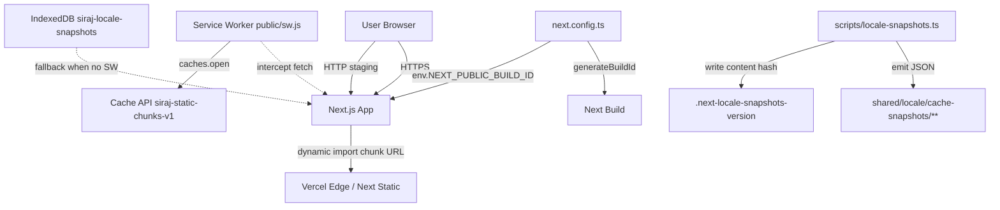
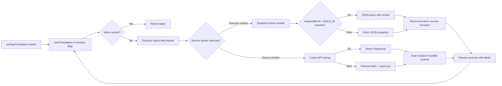

# Translation Browser Cache — Implementation Design

## Document Information

- **Feature Name**: Translation Browser Cache — Hybrid SW + IndexedDB
- **Version**: 1.0
- **Date**: 2026-07-30
- **Author**: Siraj AI
- **Related Documents**:
  - Specifications: [specs.md](./specs.md)
  - Trackable Tasks: [trackable-tasks.md](./trackable-tasks.md)
- **Process Reference**: [`.agents/spec-process-guide`](../../../.agents/spec-process-guide)

## Overview

This design translates the [specs.md](./specs.md) requirements into concrete technical decisions: file layout, public APIs, module responsibilities, and data flow. It is intentionally proportional — the requests are well-scoped, the architecture follows two standard browser primitives (Service Worker + Cache API, IndexedDB), and no exotic tooling is introduced.

### Design Goals
- Zero change to existing `useAppTranslation(Translation.*)` call sites.
- Per-namespace automatic invalidation with no manual version bump.
- Graceful degradation in private-mode Safari and non-secure contexts.
- Single fallback boundary (auto-detected from `window.isSecureContext`).

### Key Design Decisions

| # | Decision | Rationale |
|---|----------|----------|
| D1 | SW caches ALL `/_next/static/chunks/*.js`, not only locale chunks | User request; broader app reload benefit; Turbopack contenthash gives free per-namespace invalidation for the subset that is locale leaves. |
| D2 | SW cache-first, no network-race | Predictable behavior; locale chunks are immutable per URL (contenthash). |
| D3 | Auto-detect secure context at runtime; no operator config | The repo never opts into insecure production; insecure staging always benefits without a flag flip. |
| D4 | `defineNamespace(id, config)` accepts a stable string ID | Required for the IndexedDB fallback key; also future-proofs any per-namespace analytics. |
| D5 | Snapshot functions serialized via `Function.prototype.toString` + revived via `new Function` | Locale leaves are pure ES modules with simple arrow closures — verified in [docs/cache-strategies-comparison.md](../../../docs/cache-strategies-comparison.md). |
| D6 | NO new dependencies (no Workbox, no Dexie) | Adds ~150 LoC stdlib-only code per strategy; zero bundle bloat. |
| D7 | `NEXT_PUBLIC_BUILD_ID` resolves from env → snapshot content hash → random UUID | Wired in `next.config.ts#generateBuildId`; CI provider stamps the env var from `git rev-parse --short HEAD`. |
| D8 | Orphan SW cache cleanup on `activate` | `caches.keys()` sweep deletes any cache name not starting with the current `siraj-static-chunks-` prefix. |
| D9 | IndexedDB wipe is whole-DB on BUILD_ID mismatch | Per-namespace invalidation would require hashing each snapshot — overkill for the fallback path; whole-DB wipe is bounded (~140 namespaces × 2 locales). |

---

## Architecture

### System Context



### High-Level Runtime Data Flow



### Technology Stack

| Layer | Technology | Rationale |
|-------|------------|-----------|
| Primary cache | Service Worker + Cache API | Standard browser primitive for HTTPS; automatic per-URL invalidation via Turbopack contenthash. |
| Fallback cache | IndexedDB (stdlib `indexedDB.open`) | Standard browser primitive for HTTP staging; survives across reloads; larger quota than `localStorage`. |
| Snapshot codegen | Bun + custom script | Aligns with repo's existing Bun runtime; no new build tool dependence. |
| Build ID | Next.js `generateBuildId` + `NEXT_PUBLIC_BUILD_ID` env | Next-native API; CI-controlled via Vercel or any CI provider. |
| Module wiring | Plain ES modules, no React context | Cache layer is framework-agnostic; integrates at the `translation-cache-store.ts` level. |

---

## Components and Interfaces

### Component 1: Service Worker — `public/sw.js`

**Purpose**: Intercept `/_next/static/chunks/*.js` fetches; cache responses in the Cache API.

**Responsibilities**:
- Register `install` handler that calls `self.skipWaiting()`.
- Register `activate` handler that claims clients and deletes orphan caches.
- Register `fetch` handler with cache-first strategy for chunk URLs only.

**Public Surface**: None — registers itself via `app/layout.tsx`.

**Cache name**: `"siraj-static-chunks-v1"` (constant in the SW file).

**Fetch handler decision table**:

| Request | Strategy |
|---------|----------|
| `GET` + URL starts with `self.location.origin + "/_next/static/chunks/"` + ends with `.js` | Cache-first; on miss, fetch + `cache.put`. On network error, fall back to cache best-effort. |
| Anything else | Passthrough (no interception). |

**Orphan cleanup** (on `activate`):
```text
for each key in await caches.keys():
  if not key.startsWith("siraj-static-chunks-"):
    await caches.delete(key)
```

**Verification touchpoints**: `public/sw.js` is plain JS, TypeScript-unaware. Biome-format only (not linted by repo ESLint).

_Requirements: REQ-CACHE-SW_

---

### Component 2: SW Registration — `app/layout.tsx` modification

**Purpose**: Register `/sw.js` from the root scope on secure contexts only.

**Responsibilities**:
- Inject an inline `<script>` inside `<head>` after `InitColorSchemeScript`.
- Guard with `window.isSecureContext` so insecure staging never attempts registration.
- Use the existing `nonce` from `headersList.get("x-nonce")` for CSP-safety.

**Implementation shape**:
```tsx
<head>
  <InitColorSchemeScript ... />
  <script
    nonce={nonce}
    dangerouslySetInnerHTML={{
      __html: `
        if ('serviceWorker' in navigator && window.isSecureContext) {
          navigator.serviceWorker.register('/sw.js').catch(() => {});
        }
      `,
    }}
  />
  {/* ... existing <style> tag ... */}
</head>
```

**Placement rationale**: early in `<head>` so the SW is available before any dynamic `import()` fires.

_Requirements: REQ-CACHE-SW_

---

### Component 3: Snapshot Codegen Script — `scripts/locale-snapshots.ts`

**Purpose**: Generate JSON snapshots of every namespace's labels object for the insecure-context fallback.

**Responsibilities**:
1. Walk the namespace registry — enumerate `shared/locale/namespaces/**/*.namespace.ts` and read each `defineNamespace(id, config)` call's `load` map.
2. For each `(namespaceId, locale)` pair, require the leaf module (using Bun's runtime — `await import(...)`), then serialize:
   ```ts
   const snapshot = JSON.stringify(labels, (key, val) =>
     typeof val === "function"
       ? { __fn: Function.prototype.toString.call(val) }
       : val
   );
   ```
3. Emit `shared/locale/cache-snapshots/<locale>/<namespace-id>.json`.
4. Skip write if file already has identical content (mtime preservation).
5. Compute a single content hash from all emitted files and write it to `.next-locale-snapshots-version`.

**Public Surface**: invoked via `bun run locale:snapshots` (package.json script).

**Input**: The namespace registry files (stat-walked, not imported into the script — the script uses dynamic import with the same `@/shared/locale/en/...` specifiers).

**Output**: JSON snapshot files + the `.next-locale-snapshots-version` marker.

_Requirements: REQ-SNAPSHOTS_

---

### Component 4: Build ID stamping — `next.config.ts` modification

**Purpose**: Expose a stable per-build ID to both server and client.

**Responsibilities**:
- Add a top-level `resolveBuildId()` helper.
- Add `generateBuildId: resolveBuildId` to the Next.js config.
- Add `env.NEXT_PUBLIC_BUILD_ID` and `env.NEXT_PUBLIC_LOCALE_SNAPSHOT_BASE` so client-bundle `process.env.NEXT_PUBLIC_BUILD_ID` is inlined.

**Resolution order** (matches spec REQ-BUILD-ID):
1. `process.env.NEXT_PUBLIC_BUILD_ID` (CI-supplied) → use verbatim.
2. `readFileSync(".next-locale-snapshots-version", "utf8").trim()` (snapshot content hash) → use it.
3. Fallback → `crypto.randomUUID()` (dev mode; predictable cache miss).

**CI integration**: `.github/workflows/*` or Vercel project settings stamp `NEXT_PUBLIC_BUILD_ID="$(git rev-parse --short HEAD)"`.

_Requirements: REQ-BUILD-ID_

---

### Component 5: Snapshot Serving — `next.config.ts#rewrites` or `public/` static serving

**Purpose**: Serve the generated JSON snapshots at a stable URL.

**Responsibilities**:
- Option A (preferred): move the generated JSON files into `public/static/locale-snapshots/<locale>/<namespace-id>.json` so Next.js serves them as static assets (no rewrite needed).
- Option B: add a `rewrites()` rule mapping `/_next/static/locale-snapshots/:locale/:id.json` → `/static/locale-snapshots/:locale/:id.json`.

**Client URL**: `process.env.NEXT_PUBLIC_LOCALE_SNAPSHOT_BASE + "/<locale>/<id>.json"`.

**Decision**: Option A — the codegen script writes directly to `public/static/locale-snapshots/**`, and `NEXT_PUBLIC_LOCALE_SNAPSHOT_BASE` defaults to `"/static/locale-snapshots"`. Simpler than a rewrite; conventional Next public-folder behavior.

_Requirements: REQ-SERVE_

---

### Component 6: Snapshot Cache Module — `shared/locale/client/snapshot-cache.ts`

**Purpose**: IndexedDB-backed cache for the insecure-context fallback.

**Responsibilities**:
- Open IndexedDB database `siraj-locale-snapshots` (version 1) with a single object store `snapshots` keyed by `${BUILD_ID}:${namespaceId}:${locale}`.
- Implement a JSON reviver that reconstructs function members via `new Function('return (' + val.__fn + ')')()`.
- Expose:
  ```ts
  export async function readSnapshot<TLabels>(
    namespaceId: string,
    locale: AppLocale
  ): Promise<TLabels | undefined>
  export async function writeSnapshot<TLabels>(
    namespaceId: string,
    locale: AppLocale,
    labels: TLabels
  ): Promise<void>
  export async function wipeIfBuildIdChanged(buildId: string): Promise<boolean>
  export function getLocaleCacheStats(): { hits: number; misses: number; size: number }
  ```
- Wrap every `indexedDB.*` call in try/catch — failures disable the fallback gracefully (silently cold-load).
- Maintain in-memory counters (hits, misses, size) for the `getLocaleCacheStats()` diagnostic.
- On first hit and first BUILD_ID mismatch, log via `logger.info` from `@/frontend/common/utils/logger`.

**Reviver**:
```ts
function revive(_key: string, val: any): any {
  if (val && typeof val === "object" && val.__fn) {
    return new Function(`return (${val.__fn})`)();
  }
  return val;
}
```

_Requirements: REQ-FALLBACK-IDB, REQ-TELEMETRY_

---

### Component 7: Integration into `translation-cache-store.ts`

**Purpose**: Decide which cache branch to use at runtime.

**Responsibilities**:
- Compute a module-scope boolean:
  ```ts
  const useSnapshotFallback =
    typeof window !== "undefined" &&
    !window.isSecureContext &&
    "indexedDB" in window;
  ```
- In `startNamespaceLoad`:
  - If `useSnapshotFallback` and no in-memory value yet → `await readSnapshot(namespaceId, locale)`.
    - If hit → revive → set `entry.value` → return `CacheEntry` with resolved promise.
    - If miss → fall through to normal `config.load[locale]()`.
  - After `config.load[locale]()` resolves successfully, fire-and-forget `writeSnapshot(namespaceId, locale, labels)` in the background.
- Public API of `translation-cache-store.ts` (`readTranslation`, `ensureNamespaceLoading`) unchanged.

**Namespace ID resolution**: see Component 8.

_Requirements: REQ-NO-REGRESSION, REQ-FALLBACK-IDB_

---

### Component 8: Stable namespace IDs via `defineNamespace` overload — `shared/locale/namespaces/define-namespace.ts`

**Purpose**: Provide a stable string ID per namespace.

**Responsibilities**:
- Add an overload:
  ```ts
  export function defineNamespace<TLabels>(
    id: string,
    config: NamespaceLoaderConfig<TLabels>
  ): NamespaceHandle<TLabels>;
  ```
- The existing no-id overload remains for backward compatibility.
- Internally, when `id` is provided:
  - Attach a non-enumerable `__id` symbol to the handle.
  - Also store the ID in the existing `namespaceRegistry` so `getNamespaceConfig().id` is retrievable.

**Read helper**: `getNamespaceId(handle): string | undefined` — returns the attached ID or `undefined` for legacy call sites.

**Mechanical pass**: all `shared/locale/namespaces/**/*.namespace.ts` files (~109) are updated to pass a stable string ID derived from the file path / namespace export name. Example:
```ts
export const DashboardStudentDirectory = defineNamespace<StudentDirectoryLabels>(
  "dashboard.students.directory",
  { load: { en: () => import(...), ar: () => import(...) } }
);
```

_Requirements: REQ-FALLBACK-IDB_

---

### Component 9: Package.json scripts

**Purpose**: Wire the codegen step into the build pipeline.

**Responsibilities**:
- Add `"locale:snapshots": "bun run scripts/locale-snapshots.ts"`.
- Add `"prebuild": "bun run locale:snapshots"` so `bun run build` always produces fresh snapshots.
- Note: `dev` does NOT run the codegen — HMR invalidates anyway; developers can run `bun run locale:snapshots` manually when testing the fallback path.

_Requirements: REQ-SNAPSHOTS, REQ-BUILD-ID_

---

## Data Model

### Cache API Storage

| Key | Value |
|-----|-------|
| `Request` for chunk URL | `Response` (cloned, immutable) |

No explicit version column — the cache name itself encodes the version (`siraj-static-chunks-v1`).

### IndexedDB Schema

| Property | Value |
|----------|-------|
| Database name | `siraj-locale-snapshots` |
| Object store | `snapshots` (keyPath: `"key"`) |
| Record key shape | `"${BUILD_ID}:${namespaceId}:${locale}"` |
| Record value | `{ key: string, json: string, ts: number }` |
| Indexes | none for v1 |

### Filesystem artifacts

| Path | Purpose | Generated? |
|------|---------|------------|
| `public/sw.js` | Service worker source | No (authored) |
| `shared/locale/cache-snapshots/<locale>/<id>.json` | Snapshot payloads | Yes (codegen) |
| `.next-locale-snapshots-version` | Content hash marker | Yes (codegen) |
| `.next/BUILD_ID` | Next auto-generated | Yes (Next build) |

---

## Error Handling and Resilience

| Scenario | Behavior |
|----------|----------|
| Safari private mode — `indexedDB.open` throws | `snapshot-cache.ts` try/catch disables fallback; `useSnapshotFallback` becomes effectively false after first throw. Cold-load behavior. |
| Cache API disabled (some enterprise policies) | `navigator.serviceWorker.register` rejects; `.catch(() => {})` swallows; cold-load behavior. |
| Service worker fails to install | `skipWaiting` never fires; old SW (none) keeps running; cold-load behavior. |
| `new Function` blocked by CSP | Acceptable for v1 — no strict CSP today. Future: add a static reviver table that maps known function bodies → implementations. |
| Snapshot fetch 404 (codegen skipped in CI) | `snapshot-cache.ts` logs a warning; falls through to `config.load[locale]()` (regular dynamic import). |
| `NEXT_PUBLIC_BUILD_ID` empty string | `resolveBuildId()` falls through to the version-file or UUID fallback; cache misses but no crash. |
| BUILD_ID mismatch on client | Entire IndexedDB is wiped (`wipeIfBuildIdChanged` returns `true`); next read is a miss that re-populates. |

---

## Performance Considerations

- **SW path**: zero added client bundle size (`public/sw.js` is a separate file); ~80 LoC SW; fetch interception is nanosecond-cost. Cache hits save one network round trip per chunk (varies by RTT; can be 50-300ms saved per chunk on mobile).
- **IDB path**: adds ~150 LoC to the shared bundle (lazy — only when `useSnapshotFallback` true). IndexedDB reads are 1-5ms per record; negligible vs. network.
- **Build time**: `locale-snapshots.ts` walk of ~280 files + JSON.stringify adds <1s to the build. Skip-write optimization keeps churn low when no leaves changed.
- **Memory**: in-memory `translationCache` Map unchanged in size; only the IDB fallback adds a one-time Promise per namespace (resolved from IDB or network).

---

## Security Considerations

- **`new Function` reviver**: The snapshot is server-built, served same-origin, and the source is `Function.prototype.toString` of trusted project source. Risk surface is the same as the original ESM leaves. If a strict CSP blocks `new Function`, the fallback degrades to cold-load (no broken state).
- **Service worker scope**: `/sw.js` registers at root scope; only intercepts `/_next/static/chunks/*.js` GET requests. No cross-origin interception.
- **Cache poisoning**: impossible — only responses to the app's own chunk URLs are cached; URLs include contenthash so a tampered chunk URL would mismatch the trusted index.
- **Cache API eviction**: browser evicts on storage pressure automatically; no manual quota handling needed.

---

## Dependencies and Integration Points

| Internal Module | Integration Type |
|-----------------|------------------|
| `shared/locale/client/translation-cache-store.ts` | Modified — conditional snapshot branch. |
| `shared/locale/namespaces/define-namespace.ts` | Modified — overload for stable ID. |
| `shared/locale/namespaces/**/*.namespace.ts` (~109 files) | Modified — pass stable ID. |
| `app/layout.tsx` | Modified — SW registration script. |
| `next.config.ts` | Modified — `generateBuildId`, env vars. |
| `package.json` | Modified — `locale:snapshots`, `prebuild` scripts. |
| `frontend/common/utils/logger` | Reused — telemetry logging. |

**No new runtime dependencies.** One new dev-time script (`scripts/locale-snapshots.ts`) uses only stdlib + Bun APIs.

---

## Testing Strategy

| Test Layer | Coverage |
|------------|----------|
| Unit (Bun test) | `snapshot-cache.ts` read/write/wipe/reviver; `define-namespace` ID overload; `locale-snapshots.ts` JSON serialization (snapshot shape, skip-write logic). |
| Integration | `translation-cache-store.ts` with `useSnapshotFallback = true` mocked; verify snapshot hit bypasses `config.load[locale]()`. |
| E2E (Playwright, manual smoke) | HTTPS prod build — Cache Storage populates on route load, reload shows `(disk cache)`. HTTP staging — IDB populates, reload shows no network for locale chunks. BUILD_ID bump wipes IDB. |
| Regression | Full-repo `bun tsgo`, `bun biome:check`, `bun run lint` pass. Existing locale tests under `frontend/common/graphql/test/translations/translation.test.ts` unaffected. |

---

## Risks and Mitigations

| Risk | Mitigation |
|------|------------|
| `new Function` blocked by future strict CSP | Snapshot reviver can ship a static table of function names → body mapping; reviver reconstitutes by lookup. Not implemented in v1; tracked as out-of-scope future work. |
| Safari private mode throws on `indexedDB.open` | Try/catch in `snapshot-cache.ts` disables fallback gracefully → cold load behaves like today. |
| Orphan chunk URLs grow Cache API | `activate` sweep deletes caches whose names don't start with the current `siraj-static-chunks-` prefix. Bump version constant to invalidate everything. |
| Dev environment cache collisions (random UUID each `bun run dev`) | Acceptable — HMR invalidates anyway; user can clear via DevTools. |
| Snapshot drift if `locale:snapshots` step is skipped | CI must run the step via `prebuild`; `next.config.ts` `generateBuildId` falls back to random UUID when version file missing so cache simply misses (no stale data). |
| Hybrid complexity (two strategies in prod) | The fallback only activates on insecure context; prod is HTTPS → only SW path runs; staging insecurity auto-activates fallback — no operator action needed. |
| Turbopack changes chunk URL format in future Next version | `public/sw.js` URL matchers use prefix `/_next/static/chunks/` + suffix `.js` — broad enough to adapt; would require SW cache name bump to invalidate. |

---

## File Inventory (Summary)

**New:**

| File | Purpose | Approximate LoC |
|------|---------|-----------------|
| `public/sw.js` | Service worker interceptor | 80 |
| `scripts/locale-snapshots.ts` | Build-time JSON snapshot codegen | 150 |
| `shared/locale/client/snapshot-cache.ts` | IndexedDB fallback module | 150 |
| `shared/locale/cache-snapshots/<locale>/<id>.json` (280 files) | Generated snapshots | generated |
| `.next-locale-snapshots-version` | Content hash marker | generated |

**Modified:**

| File | Change |
|------|--------|
| `app/layout.tsx` | Add SW registration script in `<head>`. |
| `next.config.ts` | Add `generateBuildId`, `env.NEXT_PUBLIC_BUILD_ID`, `env.NEXT_PUBLIC_LOCALE_SNAPSHOT_BASE`. |
| `shared/locale/client/translation-cache-store.ts` | Integrate IndexedDB fallback branch. |
| `shared/locale/namespaces/define-namespace.ts` | Add optional string ID overload + `getNamespaceId` helper. |
| `shared/locale/namespaces/**/*.namespace.ts` (~109 files) | Pass stable string ID to `defineNamespace`. |
| `package.json` | Add `locale:snapshots` script and `prebuild` step. |

---

## Open Questions

None — all design decisions are resolved. See [trackable-tasks.md](./trackable-tasks.md) for execution steps.
