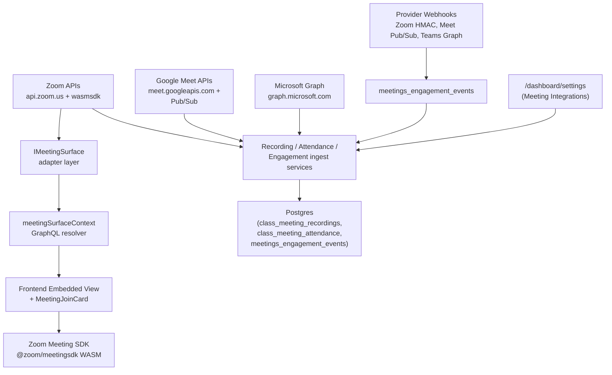
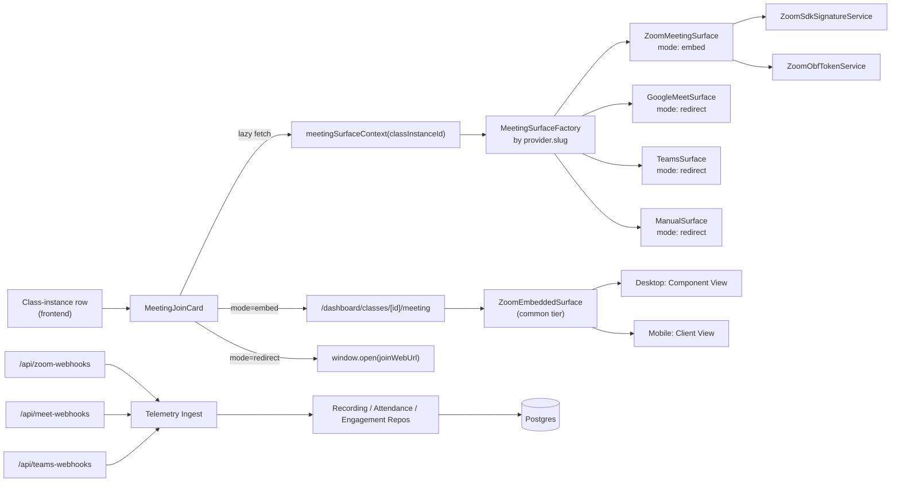
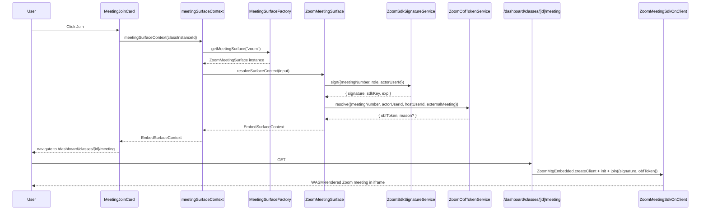
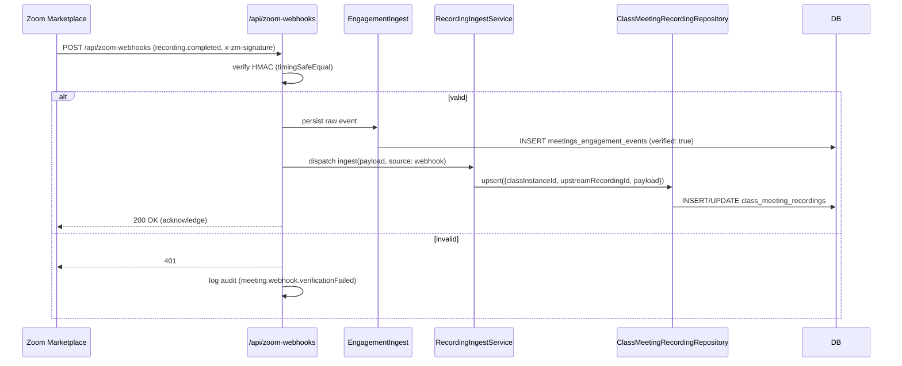
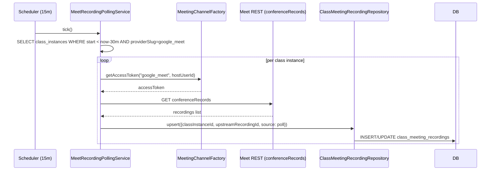

# Design — In-App Meeting View (Zoom Meeting SDK embed + recording/attendance/engagement telemetry)

## Document Information

- **Feature Name**: In-App Meeting View — Zoom Meeting SDK embed + recording/attendance/engagement telemetry
- **Target Directory**: `.ai/plans/in-app-meeting-view`
- **Version**: 1.1
- **Date**: 2026-08-01
- **Research verification**: 2026-08-01 — see §Research Verification Summary
- **Reviewers**: backend, frontend, devops
- **Related Documents**:
  - [Requirements (Specs)](./specs.md)
  - [Trackable Tasks](./trackable-tasks.md)
- **Predecessor Plan**: [auto-meeting-url design](../auto-meeting-url/design.md) — assumed complete; pattern references below point to that plan's components.

## Overview

Layer an in-app Zoom meeting surface on top of the auto-meeting-url adapter/factory architecture by introducing a new `IMeetingSurface` adapter that declares either `mode: "embed"` (Zoom) or `mode: "redirect"` (Meet / Teams / manual). A new server-side `ZoomSdkSignatureService` mints the per-join SDK JWT signature using Zoom Meeting SDK Client ID + Secret (separate from the predecessor plan's S2S OAuth credentials); a `ZoomObfTokenService` resolves external-meeting tokens after Zoom's **March 2, 2026** enforcement date (readiness deadline Feb 23, 2026). The front-end picks the right tier (Component View on desktop, Client View on mobile) via the existing `frontend/desktop/` + `frontend/mobile/` responsive-switcher convention.

Around the embed surface, add a telemetry layer across all three providers:

- `class_meeting_recordings` table populated from per-provider ingest services (Zoom `recording.completed` webhook; Meet via Google Workspace Events API + Pub/Sub push with polling fallback; Teams via Graph recording change notifications + polling fallback).
- `class_meeting_attendance` table populated from Zoom `participant.joined`/`participant.left` webhooks + Meet `conferenceRecords` + Teams Graph attendance reports.
- `meetings_engagement_events` append-only table populated by three new App Router webhook routes with provider-specific handshake verification.

The existing admin "Meeting Integrations" Settings 7th tab is extended with three sub-panels (Recordings / Attendance / Engagement) reusing the Settings tab infrastructure from the predecessor plan.

### Design Goals

- Pluggable meeting surface — add a new embeddable provider later by writing a new `IMeetingSurface` adapter that returns `mode: "embed"` (zero service-layer changes).
- Honest about provider asymmetry — Meet/Teams cannot embed; the UI surfaces that fact explicitly with a redirect affordance instead of pretending.
- Server-side SDK JWT signature flow — never ship Zoom Meeting SDK Client Secret to the browser.
- Reuse the auto-meeting-url plan's credential resolution (org-first + per-user fallback via `meeting_provider_tokens`) — recordings and attendance ingest inherit the same hybrid auth model.
- Append-only engagement audit trail — webhook events are persisted raw before any downstream ingest runs, so a telemetry backfill can reprocess from history.
- No provider-specific SDK packages on the server — `fetch` + `jose` only (consistent with predecessor plan); the ONE new heavy SDK is `@zoom/meetingsdk` on the client, because embed is impossible without it.

### Key Design Decisions

#### Decision: New `IMeetingSurface` adapter layer parallel to `IMeetingChannel`

**Context:** The predecessor plan introduced `IMeetingChannel` for URL generation. The join/embed path is a different concern — it returns rendering instructions, not meeting URLs — and providers differ in capability (Zoom embeds; Meet/Teams redirect).

**Options Considered:**
1. Extend `IMeetingChannel` with a `getMeetingSurfaceContext()` method — Cons: conflates generation with rendering; would force every manual provider to implement a method it can't satisfy.
2. New `IMeetingSurface` adapter under `backend/services/meeting/surfaces/` — Pros: clean separation, mirrors `IMeetingChannel`'s factory pattern, easy to extend.

**Decision:** Option 2.
**Rationale:** The "how do users join this meeting" question is orthogonal to the "how is this meeting URL generated" question. Some future provider (e.g. Jitsi) might generate URLs via `IMeetingChannel` (or not), but its surface adapter returns `mode: "embed"` regardless. Loose coupling keeps each layer swappable.

#### Decision: SDK JWT signature cached per `(actorUserId, meetingNumber, role)` for 30 minutes

**Context:** Zoom SDK signatures are valid up to 48h but join flows are short-lived. Re-minting on every `meetingSurfaceContext` query is wasteful.

**Options Considered:**
1. Stateless — re-mint on every call. Cons: extra `jose` signing overhead per query. ~5ms CPU per mint.
2. Cache per `(actorUserId, meetingNumber, role)` with TTL `exp - 60s`.

**Decision:** Option 2 with 30-minute TTL (`exp = iat + 1800`, the Zoom minimum).
**Rationale:** A 30-minute cache covers the typical "user opens join card then clicks join" delta (seconds) and even a "user refreshes the page after a network drop" retry (minutes). With TTL `exp - 60s` we never serve a near-expiry signature. Race-safe via a `Promise<signature>` memo (concurrent callers await the same mint).

#### Decision: OBF token resolution happens server-side, surfaced via `obfToken` in surface context

**Context:** Zoom's March 2, 2026 enforcement requires an OBF token (or ZAK fallback) for external (cross-tenant) meeting joins. The front-end cannot mint this — it requires the host's upstream OAuth token.

**Options Considered:**
1. Resolve OBF client-side via the predecessor plan's per-user tokens. Cons: would expose the host's refresh token to the browser.
2. Resolve OBF server-side, push into `meetingSurfaceContext.obfToken`.

**Decision:** Option 2.
**Rationale:** Server-side resolution keeps the host's OAuth tokens in Siraj's backend. The `obfToken` returned to the front-end is meeting-actor-bound and valid only for that join (Zoom OBF tokens are scoped to the meeting+actor pair).

#### Decision: Hybrid Credential Resolution for recordings / attendance reuses `MeetingChannelFactory`

**Context:** Recordings/attendance REST calls need per-actor OAuth tokens (Zoom `report:read:list_meeting_participants:admin` — legacy `report:read:admin` deprecated; Meet `conferenceRecords` read scopes; Teams `OnlineMeetingArtifact.Read.All` for attendance + `OnlineMeetingRecording.Read.All` for recordings). Teams application permissions also require an Application Access Policy (`New-CsApplicationAccessPolicy` + `Grant-CsApplicationAccessPolicy`).

**Options Considered:**
1. Pass an `actorUserId` through the recording/attendance services and let them resolve via `MeetingChannelFactory.getMeetingChannel(slug)`. Pros: reuses existing credential resolution + per-user fallback + admin scope elevation.
2. New credential resolution module duplicated for telemetry services.

**Decision:** Option 1.
**Rationale:** The predecessor plan's `MeetingChannelFactory` already does hybrid credential resolution. Telemetry services need only the access token (not the `generateMeeting` HTTP surface); we add a small `getAccessToken(actorUserId)` method on the factory without changing `IMeetingChannel`'s contract.

#### Decision: Engagement events are append-only with `classInstanceId` nullable

**Context:** Webhook events for meetings shared across orgs may not always map to a `classInstanceId` (orphan via shared Zoom account).

**Options Considered:**
1. Reject unmapped events. Cons: lose audit data; provider may not resend.
2. Persist with `classInstanceId = null`, mark "unmatched" badge in admin UI.

**Decision:** Option 2.
**Rationale:** Append-only ingestion is the canonical webhook pattern — persist first, reconcile later. Admins can manually link unmatched events via a future "Link to class" affordance (deferred to follow-up plan).

#### Decision: Zoom Component View on desktop, Client View on mobile — tier separation enforced at the frontend layer

**Context:** Zoom docs state Component View is desktop-only; Client View works on both. Siraj uses responsive-switcher tiers (`frontend/desktop/` + `frontend/mobile/`).

**Options Considered:**
1. Use Client View everywhere — simpler code, no tier-branching. Cons: lose Component View's modular widget layout on desktop which the design wireframe shows.
2. Desktop → Component View; Mobile → Client View.

**Decision:** Option 2.
**Rationale:** Component View on desktop gives the immersive classroom layout the wireframe needs; mobile falls back to Zoom's familiar Client View which is well-optimised for small screens. The common-tier `ZoomEmbeddedSurface` exposes a `setViewMode` API for the desktop "Switch to classic Zoom view" affordance.

#### Decision: Telemetry polling scheduler uses `Bun.cron` in-process

**Context:** Meet/Teams recording and attendance ingest need periodic polling. Next.js has no built-in cron; Vercel Cron only applies on Vercel deployments.

**Decision:** Use Bun's native `Bun.cron()` API (v1.3.12+) registered in the long-running server process. Shares DB pools, caches, and module state with the app; no overlap (next fire scheduled only after handler settles).

**Rationale:** Siraj runs on Bun (per AGENTS.md). `Bun.cron` is zero-dependency, in-process, and aligns with the self-hosted deployment model. Vercel Cron or external systemd timers are fallbacks only if not on Bun.

#### Decision: Meet recording ingest is Pub/Sub push primary, polling fallback

**Context:** The original plan assumed Meet recordings require polling only. Research disproved this — Google Workspace Events API delivers `google.workspace.meet.recording.v2.fileGenerated` via Pub/Sub.

**Decision:** The `meet-webhooks` route receives Pub/Sub push (OIDC-verified) as the primary recording signal. The 15-minute polling scheduler is a reconciliation fallback for missed events.

**Rationale:** Event-driven ingest is lower latency and respects Meet API quotas (100/min/project for `spaces.create` reduced-write bucket; 6000/min/project for reads).

#### Decision: Teams attendance is poll-only; Teams recordings support Graph change notifications

**Context:** Microsoft Graph does not expose attendance reports via change notifications. Recordings do (`communications/onlineMeetings/getAllRecordings` and meeting-level recording resources). Rich notifications for Teams meeting-call events require certificate-based decryption.

**Decision:** Teams attendance ingest runs only via the polling scheduler. Teams recording ingest accepts Graph change notifications (encrypted rich payloads) + polling fallback. Teams engagement webhooks handle `meetingCallEvents` (in-meeting signals) and recording creation events — not attendance.

**Rationale:** Matches official Graph API capabilities; avoids building a decryption pipeline for attendance data that Graph never pushes.

### Research Verification Summary (2026-08-01)

Deep online research via parallel subagents confirmed or corrected the following plan assumptions:

| Area | Original assumption | Verified fact | Source |
|------|---------------------|---------------|--------|
| Zoom SDK app type | Separate from S2S OAuth | ✅ Confirmed — distinct Client ID/Secret | [Meeting SDK auth](https://developers.zoom.us/docs/meeting-sdk/auth/) |
| JWT payload | `sdkKey` only | Include `appKey` + `sdkKey` (same value); optional `video_webrtc_mode` for web | [Signature troubleshooting](https://developers.zoom.us/blog/troubleshooting-meeting-sdk-signature-validation/) |
| OBF enforcement date | Feb 23, 2026 | ❌ Enforcement = **March 2, 2026**; Feb 23 = readiness deadline | [OBF FAQ](https://developers.zoom.us/docs/meeting-sdk/obf-faq/) |
| `client.join()` args | Pass `sdkKey`/`apiKey` | ❌ Removed in SDK v4 — embed `appKey` in JWT only; Component View uses `password` not `passWord` | [JoinOptions](https://marketplacefront.zoom.us/sdk/meeting/web/components/interfaces/JoinOptions.html) |
| Zoom url_validation | `encryptedTimestamp` | ❌ Field is `encryptedToken` = HMAC-SHA256(plainToken, secret) hex | [Using webhooks](https://developers.zoom.us/docs/api/webhooks/) |
| Zoom participants scope | `report:read:admin` | ❌ Use `report:read:list_meeting_participants:admin` (granular) | [Granular scopes](https://developers.zoom.us/docs/integrations/oauth-scopes-granular/) |
| Meet recording webhook | Poll only | ❌ `recording.v2.fileGenerated` via Workspace Events API + Pub/Sub | [Meet events](https://developers.google.com/workspace/events/guides/events-meet) |
| Meet recording shape | `playUrl` | ❌ Only `driveDestination.fileId` + `shareUri` | [recordings resource](https://developers.google.com/workspace/meet/api/reference/rest/v2/conferenceRecords.recordings) |
| Teams recording field | `downloadUrl` | ❌ Field is `recordingContentUrl` | [callRecording](https://learn.microsoft.com/en-us/graph/api/resources/callrecording?view=graph-rest-1.0) |
| Teams attendance webhook | Available | ❌ Poll-only; requires `AllowEngagementReport` policy | [Attendance reports](https://learn.microsoft.com/en-us/microsoftteams/teams-analytics-and-reports/meeting-attendance-report) |
| Teams rich notifications | Plain JSON | Encrypted `encryptedContent` — requires certificate decryption | [Rich notifications](https://learn.microsoft.com/en-us/graph/change-notifications-with-resource-data) |
| Apollo cache headers | `Cache-Control: no-store` respected | ❌ Must use `fetchPolicy: 'no-cache'` on query hook | [Apollo #7796](https://github.com/apollographql/apollo-client/issues/7796) |
| Cron scheduler | Vague "bun cron" | ✅ `Bun.cron()` in-process API (Bun 1.3.12+) | [Bun cron docs](https://bun.sh/docs/runtime/cron) |
| Firefox WebRTC | Unsupported | ✅ Falls back to WASM video (WebRTC row shows ✘) | [Browser support](https://developers.zoom.us/docs/meeting-sdk/web/browser-support/) |
| Component View | Desktop-only | ✅ Confirmed; Client View for mobile/tablet | [Browser support](https://developers.zoom.us/docs/meeting-sdk/web/browser-support/) |
| `@zoom/meetingsdk` | `/embedded` entry | ✅ Confirmed `ZoomMtgEmbedded` | [npm package](https://www.npmjs.com/package/@zoom/meetingsdk) |
| `jose` ^6.x | HS256 + importPKCS8 | ✅ Confirmed for SDK JWT + service-account JWTs | [jose on npm](https://www.npmjs.com/package/jose) |
| MUI DataGrid CSV | Pro feature | ❌ CSV export is Community-tier; Excel requires Premium | [Export docs](https://mui.com/x/react-data-grid/export/) |
| undici MockAgent | Bundled in Bun | ⚠️ Install `undici` explicitly for real MockAgent (shim is stub) | [Bun PR #36102](https://github.com/oven-sh/bun/pull/36102) |

#### Decision: Recording playback is listing + outlink, not a full in-app player (v1)

**Context:** Zoom `play_url` can be iframed but with CORS / signed-cookie complications; Meet recordings live in Drive (outlink only); Teams recordings live in OneDrive/SharePoint (outlink only).

**Options Considered:**
1. Native in-app recording player via iframe of Zoom `play_url`. Cons: auth flow per provider differs; Meet/Teams outlinks only — inconsistent UX.
2. v1: listing + "Play in Zoom/Meet/Teams" outlink. v2: native iframe for Zoom when CORS allows.

**Decision:** Option 2 for v1.
**Rationale:** An outlink that opens the provider's recording page provides a working playback experience for all three providers uniformly without fighting cross-origin / signed-cookie issues in v1. The design doc records the v2 native-player plan for the follow-up.

#### Decision: Three new webhook routes grouped under `app/(dashboard)/api/{provider}-webhooks/`

**Context:** Provider webhook handshakes differ (Zoom HMAC + endpoint validation; Meet Pub/Sub OIDC; Teams Graph validation token). One shared route with provider branch logic was considered but rejected — each route has different envelope shapes and different verification primitives.

**Decision:** Three separate routes — `/api/zoom-webhooks`, `/api/meet-webhooks`, `/api/teams-webhooks`.
**Rationale:** Single-responsibility routes keep each verification primitive isolated and testable. The OAuth callback routes from the predecessor plan follow the same one-per-provider layout.

### UX/Navigation Specification

#### New Routes & URLs

> **Codebase fact (carried from predecessor plan):** the App Router group is `app/(dashboard)/...`, NOT `app/[locale]/dashboard/...`. Locale is read server-side via `getLocale()` from `@/shared/locale/server-cookies`. The Settings page is at `app/(dashboard)/settings/page.tsx`.

| Route / Tab / Path | Purpose | Permission Required | Roles with Access |
|-------------------|---------|---------------------|-------------------|
| `/dashboard/classes/[id]/meeting` (new) | Full-screen embedded Zoom meeting view (desktop Component View / mobile Client View) OR redirect-affordance for Meet/Teams | `MEETING_VIEW` (new, REQ-7) | TEACHER, STUDENT, PARENT, SUPERVISOR, SUPER_ADMIN, ACADEMY_ADMIN |
| `/dashboard/settings` existing page — `meetingIntegrations` tab — new sub-panels `recordings` / `attendance` / `engagement` | Admin audit surface for recordings / attendance / engagement | `SETTINGS_EDIT_MEETING_INTEGRATIONS` (existing) OR `SETTINGS_VIEW` (read-only fallback) | SUPER_ADMIN, ACADEMY_ADMIN when granted |
| `app/(dashboard)/api/zoom-webhooks/route.ts` (new) | Zoom Marketplace event webhook receiver — HMAC verified | none (HMAC signature trust) | valid Zoom caller only |
| `app/(dashboard)/api/meet-webhooks/route.ts` (new) | Google Pub/Sub push endpoint — OIDC verified | none (Google Pub/Sub JWT trust) | Google Pub/Sub service account only |
| `app/(dashboard)/api/teams-webhooks/route.ts` (new) | Microsoft Graph subscription change notification receiver — validation token verified | none (Graph validation token trust) | Microsoft Graph tenant only |

#### Sidebar Navigation Integration

- **Group**: `grp_admin` (existing parent group, label `navGroupAdmin`).
- **Parent item**: inherits the existing `settings` sidebar item — NO new sidebar entry (admin sub-tabs live inside the Settings page's Meeting Integrations tab).
- The new `/dashboard/classes/[id]/meeting` route: NO new sidebar item — reached by clicking the `MeetingJoinCard` on a class-instance row. Direct entry is also supported (authenticated users with `MEETING_VIEW` hitting the URL directly).
- **Children**: none visible in the sidebar.
- **Mobile Bottom Nav**: no change. Embedded view route is reachable from class-instance rows in the existing mobile schedule grid.
- **Group permission survivor**: add `MEETING_VIEW` to the `grp_admin` group's `permission` array in `frontend/common/views/dashboard/config/navigationConfig.ts` so the group survives filter when held alone.

#### Role-Based Access Matrix

| Role | Routes Accessible | Permissions Granted |
|------|-------------------|---------------------|
| SUPER_ADMIN | All routes + new webhook routes (config only — not invoked directly) | All meeting perms + `SETTINGS_EDIT_MEETING_INTEGRATIONS` + `MEETING_VIEW` |
| ACADEMY_ADMIN | Provider catalog editor + own meeting configs + Settings 7th tab + sub-panels | `MEETING_PROVIDERS_MANAGE_CATALOG`, `MEETING_CONFIGS_MANAGE_OWN`, `SETTINGS_EDIT_MEETING_INTEGRATIONS` (when granted), `MEETING_VIEW` |
| SUPERVISOR | Class list (read-only) + admin Attendance/Engagement sub-panels (read-only) | `MEETING_VIEW` scoped |
| TEACHER | Own meeting configs + `/dashboard/classes/[id]/meeting` for own/linked classes + per-class Recordings/Attendance drawers | `MEETING_CONFIGS_MANAGE_OWN` (implies `MEETING_VIEW`) |
| PARENT | `/dashboard/classes/[id]/meeting` for enrolled child's classes + per-class Recordings drawer | `MEETING_VIEW` |
| STUDENT | `/dashboard/classes/[id]/meeting` for enrolled classes + per-class Recordings drawer | `MEETING_VIEW` |
| STAFF | `/dashboard/classes/[id]/meeting` for assigned classes | `MEETING_VIEW` |
| USER / GUEST | N/A | none |

#### Per-Audience Rendering

| Audience | Prominent Content |
|----------|-------------------|
| STUDENT | Class-instance "Join" button → embedded for zoom_oauth classes, redirect for meet/teams. Post-class: per-class "Recording" drawer on class detail. |
| PARENT | Same as STUDENT — embedded/redirect Join + per-class recording drawer. Cannot manage own meeting configs (existing role gating). |
| TEACHER | Same Join + post-class Recordings + per-class Attendance drawer (read-only; data appended by ingest services). Reuses predecessor plan's "Auto-generated" badge + "URL pending" badge. |
| SUPERVISOR | Read-only Attendance per class + Engagement sub-tab (admin scope). Cannot Join in-app (no `MEETING_VIEW`); can audit. |
| SUPER_ADMIN | Settings 7th tab extended with Recordings / Attendance / Engagement sub-panels. Full per-class drill-down. Per-provider unmatched events table. CSV exports. |
| ACADEMY_ADMIN | Same as SUPER_ADMIN when explicitly granted. |

#### Mobile vs Desktop Variants

| Aspect | Desktop | Mobile |
|--------|---------|--------|
| Embedded Zoom view (`/dashboard/classes/[id]/meeting`) | Zoom SDK **Component View** — modular widgets (gallery, chat, controls); "Switch to classic Zoom view" affordance | Zoom SDK **Client View** — full-page standard Zoom web client |
| Admin Settings sub-panels | Full accordion per provider + sortable tables (desktop-primary per Siraj convention) | Tab stack; tables become stacked card lists with horizontally-scrollable rows |
| Recording playback | Inline modal iframe for Zoom `play_url` (v2); outlink to Zoom/Meet/Teams in v1 | Outlink to provider (mobile deep link preferred) |
| Attendance drawer | Sortable table + Download CSV affordance | Card list with collapsible per-participant rows; CSV via native share sheet |
| Live Engagement feed | Sortable table with collapsible `<details>` for raw payload | Stream of cards (time + event type); raw payload collapsed by default |
| `MeetingJoinCard` | Inline button next to class-instance row; opens route in same tab | Full-width CTA below class-instance row; opens route in same tab |

#### Permission Mapping

| Component / Route / Action | Required Permission | Source Gating |
|----------------------------|---------------------|---------------|
| `/dashboard/classes/[id]/meeting` page | `MEETING_VIEW` (new, REQ-7) | `RequirePermission` in page server component |
| `meetingSurfaceContext` GraphQL query | `MEETING_VIEW` (new, REQ-7) OR implied by `MEETING_CONFIGS_MANAGE_OWN` | resolver-level `assertCanViewMeeting` helper |
| Admin Recordings / Attendance / Engagement sub-panels | `SETTINGS_EDIT_MEETING_INTEGRATIONS` (existing) OR `SETTINGS_VIEW` (read-only) | `SettingsTabPanels.tsx` per sub-panel gate + `settingsTabs.config.ts` sub-entries |
| CSV export (Recordings, Attendance) | `SETTINGS_EDIT_MEETING_INTEGRATIONS` OR `SETTINGS_VIEW` | new GraphQL mutation `exportMeetingTelemetryCsv(input)` scoped to admin/supervisor |
| All 3 webhook routes | none (HMAC/HMAC/OIDC/validation-token trust) | middleware-excluded; route handler verifies provider-specific signature |

### Admin "Meeting Integrations" tab — extended wireframe

```
┌─────────────────────────────────────────────────────────────────────────────┐
│ Settings  [General][Environment][Session][Audit][SiteContent][TZ]            │
│           [MEETING INTEGRATIONS]  ← existing 7th tab, active                   │
├─────────────────────────────────────────────────────────────────────────────┤
│ Sub-panels:  [Credentials & Tokens]  [RECORDINGS]  [ATTENDANCE]  [ENGAGEMENT] │
├─────────────────────────────────────────────────────────────────────────────┤
│ Aggregate health headers (visible on every sub-panel)                         │
│   ✅ 3/3 providers configured   2/3 org-creds healthy                        │
│   👥 12 teachers connected   ⚠️ 2 reauth-needed   🕐 last test: 2m ago         │
├─────────────────────────────────────────────────────────────────────────────┤
│ RECORDINGS sub-panel (active)                                                 │
│   Filter: [provider ▾] [date range ▾] [matched/unmatched ▾]  [Export CSV]   │
│   ┌────────────────────────────────────────────────────────────────────────┐ │
│   │ Class            Provider  Started            Duration  View  Dl  Share │ │
│   │ Quran Tafsir 7am zoom       2026-08-01 07:00   45m 12s   ▶    ⤓   🔗   │ │
│   │ Tafsir Review    google_meet 2026-08-01 06:00  62m 04s   ▶⇲   ⤓   🔗   │ │
│   │ Mutoon Sat       teams      2026-08-01 09:30   50m 00s   ▶⇲   ⤓   🔗   │ │
│   │ (unmatched)      zoom       2026-07-31 22:14   08m 02s   ▶    ⤓   🔗   │ │
│   └────────────────────────────────────────────────────────────────────────┘ │
│   ▶ click a row to expand participant attendance breakdown inline             │
├─────────────────────────────────────────────────────────────────────────────┤
│ ATTENDANCE sub-panel (collapsible when active elsewhere)                      │
│   Per-class-instance breakdown with expandable participant list               │
│   Total participants / avg duration aggregate header per class                 │
├─────────────────────────────────────────────────────────────────────────────┤
│ ENGAGEMENT sub-panel (collapsible)                                            │
│   Live feed of events filterable by { provider, eventType, time, matched }    │
│   Each row: time · provider · eventType · classInstance? · ▾ Raw payload      │
└─────────────────────────────────────────────────────────────────────────────┘
```

### Embedded view route — `/dashboard/classes/[id]/meeting` wireframe (desktop, Zoom Component View)

```
┌─ Siraj — Ibn Baz Class / Meeting ───────────────────────────────────────────┐
│ Exit (Esc) ☰                                        [Switch to classic Zoom]│
├─────────────────────────────────────────────────────────────────────────────┤
│  Zoom Meeting SDK — Component View                                          │
│  ┌───────────────────────────────┐  ┌────────────────────────────────────┐  │
│  │  gallery grid                 │  │ chat                                │  │
│  │ ┌──┐ ┌──┐ ┌──┐ ┌──┐           │  │  ────────────────────────           │  │
│  │ │👤│ │👤│ │👤│ │👤│           │  │  07:03 Student: assalam             │  │
│  │ └──┘ └──┘ └──┘ └──┘           │  │  07:04 Teacher: wa assalam         │  │
│  │  Teacher Student Student You   │  └────────────────────────────────────┘  │
│  └───────────────────────────────┘                                          │
│  [ mic on ] [ cam on ] [ share ] [ reactions ] [ participants ] [ end ]    │
└─────────────────────────────────────────────────────────────────────────────┘
```

### Outcome & Knowledge Transfer Protocol

- **Before Execution:** executing agents MUST read all files in `.ai/plans/in-app-meeting-view/outcome/`.
- **After Execution:** executing agents MUST write `.ai/plans/in-app-meeting-view/outcome/<task-id>-outcome.md`.
- **Progress Tracking:** update `[ ]` -> `[x]` in `trackable-tasks.md`.

## Architecture

### System Context



### High-Level Architecture



### Technology Stack

| Layer | Technology | Rationale |
|-------|------------|-----------|
| Frontend embedded view | React 19 + `@zoom/meetingsdk` (WASM) | Only SDK-compatible approach to embed Zoom; SDK handles WASM rendering |
| Frontend tier separation | `frontend/desktop/` + `frontend/mobile/` existing tiers | Component View desktop / Client View mobile per Zoom browser matrix |
| Frontend state | Apollo Client v4 + Zustand | Existing stack — no new framework; Apollo for queries/mutations, Zustand for ephemeral meeting-lifecycle state |
| Backend services | Bun + Pothos + Drizzle | Existing stack |
| HTTP client (telemetry / signatures) | `fetch` + `undici` (Bun-native) + `jose` | Mirrors predecessor plan adapters — no provider SDKs on server |
| Webhook verification | `crypto.timingSafeEqual` + HMAC-SHA256 (Zoom) + `jose` JWKS verification (Meet Pub/Sub) + raw string compare (Teams validation token) | Standard primitives; no new deps |
| Token encryption | `encryptedText` Drizzle custom type (predecessor plan) | Existing — reused for any stored tokens |
| Ephemeral state (SDK signature cache) | In-memory `Map` with TTL — no Redis | Single-instance cache per adapter; invalidation via `resetZoomSdkSignatureCache` |

## Components and Interfaces

### Component 1: `IMeetingSurface` & `MeetingSurfaceFactory`

**Purpose**: Stable interface + lazy Singleton factory selecting the right surface adapter per provider slug.

**Responsibilities:**
- Resolve credentials (org-first, per-user fallback) via predecessor plan's `MeetingChannelFactory.getAccessToken(slug, actorUserId)`.
- Lazy-construct and memoise adapter instances per slug.
- Expose `getMeetingSurface(slug)`, `resetMeetingSurface(slug)`.

**Interfaces** (`backend/services/meeting/surfaces/IMeetingSurface.ts`):

```typescript
export type MeetingSurfaceMode = "embed" | "redirect";

export type MeetingRole = 0 | 1; // 0 = attendee, 1 = host

export interface MeetingSurfaceContextInput {
  readonly classInstanceId: string;
  readonly actorUserId: string;
}

export interface EmbedSurfaceContext {
  readonly mode: "embed";
  readonly providerSlug: MeetingProvider;
  readonly meetingNumber: string;
  readonly password?: string;
  readonly sdkSignature: string;
  readonly sdkKey: string;
  readonly obfToken?: string;
  readonly joinWebUrl: string;
  readonly userName: string;
  readonly role: MeetingRole;
  readonly externalMeeting: boolean;
}

export interface RedirectSurfaceContext {
  readonly mode: "redirect";
  readonly providerSlug: MeetingProvider;
  readonly joinWebUrl: string;
  readonly userName: string;
}

export type MeetingSurfaceContext = EmbedSurfaceContext | RedirectSurfaceContext;

export interface IMeetingSurface {
  resolveSurfaceContext(input: MeetingSurfaceContextInput): Promise<MeetingSurfaceContext>;
  clearCache?(classInstanceId: string, actorUserId: string): void;
}
```

Factory mirrors `MeetingChannelFactory` from the predecessor plan.

**Implementation Notes:**
- Reject `providerKind = "manual"` with `ManualProviderHasNoSurfaceError` — manual providers redirect via `joinWebUrl`, no SDK surface.
- Memo per-slug, race-safe via `initializationPromise`.

### Component 2: `ZoomSdkSignatureService`

**Purpose**: Mint per-join Zoom Meeting SDK JWT signatures server-side.

**Responsibilities:**
- Persist `ZOOM_MSDK_CLIENT_ID` + `ZOOM_MSDK_CLIENT_SECRET` resolution via `resolveEnvConfigMany` from predecessor plan pattern.
- Mint JWT with payload `{ appKey: ZOOM_MSDK_CLIENT_ID, sdkKey: ZOOM_MSDK_CLIENT_ID, mn: meetingNumber, role: 0|1, iat: now-30s, exp: iat+1800, tokenExp: exp }` signed via `jose.SignJWT` using `HS256` + `ZOOM_MSDK_CLIENT_SECRET`. (`appKey` is canonical per Zoom docs; include both keys with same value.)
- Cache per `(actorUserId, meetingNumber, role)` for TTL `exp - 60s`.
- Race-safe concurrent mint memoised as `Promise<signature>`.
- `resetZoomSdkSignatureCache(meetingNumber?)` for invalidation.

**Interfaces** (`backend/services/meeting/surfaces/zoom/ZoomSdkSignatureService.ts`):

```typescript
export interface ZoomSdkSignatureInput {
  readonly meetingNumber: string;
  readonly role: MeetingRole;
  readonly actorUserId: string;
}

export interface ZoomSdkSignatureResult {
  readonly signature: string;
  readonly sdkKey: string;
  readonly exp: number; // unix seconds
}

export class ZoomSdkSignatureService {
  async sign(input: ZoomSdkSignatureInput): Promise<ZoomSdkSignatureResult>;
  resetCache(): void;
  resetForMeeting(meetingNumber: string): void;
}
```

**Implementation Notes:**
- `exp - iat` bounded to `[1800, 172800]` per Zoom docs.
- Never log the signed JWT — surface only `signature: <redacted>` in debug logs.
- Cache key: `${actorUserId}:${meetingNumber}:${role}`.
- Token-mint errors throw `MissingMeetingSdkCredentialsError` (translated `errors.meetingSdk.missingCredentials`) and never fall back to S2S OAuth creds.

### Component 3: `ZoomObfTokenService`

**Purpose**: Resolve OBF tokens (or ZAK fallback) for external-meeting Zoom SDK joins.

**Responsibilities:**
- Resolve `ZOOM_MSDK_OBF_ENABLED`; short-circuit return `null` when disabled.
- Resolve host S2S access token (via `MeetingChannelFactory.getAccessToken("zoom", hostUserId)`) OR per-actor token (when `meeting_provider_tokens` row exists).
- POST to Zoom OBF endpoint with that access token, get OBF token bound to the actor identity.
- Cache OBF token in-memory for `(meetingNumber, actorUserId)` with TTL `min(tokenTTL - 120, 1800)s`.
- Throw `ZoomObfTokenError` mapped to `errors.zoomSdk.obfFailed` on 4xx; graceful `null` return on 5xx (let the SDK itself surface the upstream error to the user).

**Interfaces** (`backend/services/meeting/surfaces/zoom/ZoomObfTokenService.ts`):

```typescript
export interface ZoomObfTokenInput {
  readonly meetingNumber: string;
  readonly actorUserId: string;
  readonly hostUserId: string;
  readonly externalMeeting: boolean;
}

export interface ZoomObfTokenResult {
  readonly obfToken: string | null;
  readonly reason?: string; // e.g. "obf_disabled" | "internal_meeting" | "obf_upstream_5xx_fallback_null"
}

export class ZoomObfTokenService {
  async resolve(input: ZoomObfTokenInput): Promise<ZoomObfTokenResult>;
  resetForMeeting(meetingNumber: string, actorUserId: string): void;
}
```

### Component 4: `ZoomMeetingSurface` adapter

**Purpose**: Compose surface-context for `zoom_oauth` provider — embed mode.

**Responsibilities:**
- Resolve class-instance + linked provider config + class context (title, start, owner).
- Determine `role` (host = linked teacher or schedule owner; attendee = everyone else).
- Determine `externalMeeting` (true if actor's user email domain does not match the host org's domain — configurable allow-list).
- Call `ZoomSdkSignatureService.sign(...)` for the SDK signature.
- Call `ZoomObfTokenService.resolve(...)` for OBF (when `externalMeeting`).
- Assemble `EmbedSurfaceContext` and return.

**Implementation Notes:**
- Credentials are NOT resolved by `ZoomMeetingSurface` itself — it delegates to `MeetingChannelFactory` per "Hybrid Credential Resolution" decision above.
- The `password` field comes from `class_instances.providerMetadata.password` (already persisted by predecessor plan's `MeetingConfigSnapshotService`).

### Component 5: `GoogleMeetSurface` / `MicrosoftTeamsSurface` / `ManualProviderSurface` adapters

**Purpose**: Surface-context adapters for non-embeddable providers — all return `mode: "redirect"`.

**Responsibilities:**
- Resolve class-instance + `joinWebUrl` (already persisted by predecessor plan).
- Return `RedirectSurfaceContext` with `providerSlug`, `joinWebUrl`, `userName`.

**Implementation Notes:**
- These adapters do NOT call any provider HTTP API at surface-resolution time — they are pure local table reads. The `joinWebUrl` was already minted at booking time by the predecessor plan.

### Component 6: `meetingSurfaceContext` GraphQL resolver

**Purpose**: Public GraphQL surface returning a `MeetingSurfaceContext` discriminated union.

**Pothos file**: `backend/graphql/pothos/meeting/meeting-surface.pothos.ts`.

**Responsibilities:**
- Resolver-level auth via new `assertCanViewMeeting(ctx, classInstanceId)` helper (REQ-7).
- Find `class_instances` row, resolve linked `MeetingProvider`, dispatch to `MeetingSurfaceFactory.getMeetingSurface(slug).resolveSurfaceContext(...)`.
- Set `cacheControl: { scope: "Private", maxAge: 0 }` on the response.

**Implementation Notes:**
- `assertCanViewMeeting` first checks `MEETING_VIEW` permission; if absent, falls back to `MEETING_CONFIGS_MANAGE_OWN` for the actor's own class instances.
- The discriminated union resolves on `mode` field — Pothos's `__resolveType` returns `"EmbedSurfaceContext"` or `"RedirectSurfaceContext"`.

### Component 7: `ZoomEmbeddedSurface` (frontend common + desktop + mobile tiers)

**Purpose**: Embed Zoom meeting UI inside Siraj.

**Files**:
- `frontend/common/views/dashboard/classes/[id]/meeting/ZoomEmbeddedSurface.tsx` — common switcher; reads `meetingSurfaceContext` from `useMeetingSurfaceContextViewModel`.
- `frontend/desktop/views/dashboard/classes/[id]/meeting/ZoomEmbeddedSurface.desktop.tsx` — Component View.
- `frontend/mobile/views/dashboard/classes/[id]/meeting/ZoomEmbeddedSurface.mobile.tsx` — Client View.

**Responsibilities:**
- Mount `ZoomMtgEmbedded.createClient()` once per surface mount; call `client.init({ zoomAppRoot: containerRef.current, language: ctx.locale })`.
- Call `client.join({ signature, meetingNumber, password, userName, obfToken? })` once context ready. Do **not** pass `sdkKey`/`apiKey` (removed in SDK v4 — Client ID is in the JWT `appKey` claim). Component View uses `password`; Client View wrapper uses `passWord`.
- Listen for SDK events: `meeting.ended`, `connection.failure`, `user_left`, `auth_failure`; dispatch to Apollo cache + Zustand.
- Render loading skeleton during WASM init; "Open in Zoom client" fallback on `WebRTCNotSupported` or persistent `connection.failure`.
- On unmount: `client.leaveMeeting()` and `client.destroy()` to release WASM memory.

**Mobile (Client View) variant:**
- Use `ZoomMtgEmbedded.createClient()` — same call shape; Client View requires no `jsZoomWithoutRtc` flag.
- Strict layout: full-viewport iframe with the SDK's built-in mobile-optimised UI.

**Desktop (Component View) variant:**
- Use `ZoomMtgEmbedded.createClient({ jsZoomWithoutRtc: false })` then mount individual `mediaMetric`, `chatMetric`, `usersMetric` etc. components into separate div placeholders.
- "Switch to classic Zoom view" affordance calls `client.destroy()` then re-inits with `jsZoomWithoutRtc: true` to fall back to Client View at runtime.

**Implementation Notes:**
- All callbacks use React 19 hooks; effects clean up via `useEffect` return.
- The "Exit meeting" affordance is `Esc` key listener + visible MUI IconButton; calls `router.push("/dashboard/classes/[id]")`.

### Component 8: `MeetingJoinCard` (common switcher)

**Purpose**: Replace the predecessor plan's existing "Join" affordance on class-instance rows with a context-aware switcher.

**Files**:
- `frontend/common/components/ui/display/meetingJoinCard/MeetingJoinCard.tsx`.
- Desktop + mobile tier partners per existing `frontend/desktop/` + `frontend/mobile/` convention.

**Responsibilities:**
- Lazy-query `meetingSurfaceContext` only on button click (not all rows eagerly — would DOS the resolution service).
- On `mode === "embed"`: route to `/dashboard/classes/[id]/meeting`.
- On `mode === "redirect"`: `window.open(joinWebUrl, "_blank", "noopener,noreferrer")` and toast `notifications.meeting.openedInNewTab`.
- On `MeetingUrlPendingError`: render the predecessor plan's "URL pending" chip + "Retry" action.
- Hide entirely when `MEETING_VIEW` permission missing.

### Component 9: Recording / Attendance / Engagement Telemetry services

**Purpose**: Per-provider ingest of recordings, attendance, and live engagement events.

**Files**:
- `backend/services/meeting/telemetry/recordings/{ZoomRecordingIngestService,GoogleMeetRecordingIngestService,MicrosoftTeamsRecordingIngestService}.ts`
- `backend/services/meeting/telemetry/attendance/{ZoomAttendanceIngestService,GoogleMeetAttendanceIngestService,MicrosoftTeamsAttendanceIngestService}.ts`
- `backend/services/meeting/telemetry/engagement/{ZoomEngagementIngestService,GoogleMeetEngagementIngestService,MicrosoftTeamsEngagementIngestService}.ts`

**Responsibilities** (per provider):
- Recordings: pull recording lists, upsert `class_meeting_recordings` rows.
- Attendance: pull participant reports, upsert `class_meeting_attendance` rows.
- Engagement: receive validated webhook payloads (already verified by the route handler), append `meetings_engagement_events` rows.

**Interfaces** (recordings example — attendance and engagement follow the same shape):

```typescript
export interface RecordingIngestInput {
  readonly classInstanceId: string | null; // null when unmatched
  readonly upstreamRecordingId: string;
  readonly providerSlug: MeetingProvider;
  readonly payload: Record<string, unknown>; // raw upstream response
  readonly source: "webhook" | "poll";
}

export interface RecordingIngestResult {
  readonly inserted: boolean;
  readonly updated: boolean;
  readonly rowId: string;
}

export interface IRecordingIngestService {
  ingest(input: RecordingIngestInput): Promise<RecordingIngestResult>;
}
```

**Implementation Notes:**
- Hybrid auth: each ingest service accepts `actorUserId` and resolves the access token via `MeetingChannelFactory.getAccessToken(slug, actorUserId)`.
- Polling cadence: `MEET_RECORDING_POLL_INTERVAL` and `TEAMS_RECORDING_POLL_INTERVAL` env keys (default 15 minutes).
- Polling is driven by `Bun.cron()` registered in the long-running server process (shares state with signature/OBF caches). Meet/Teams recordings: Pub/Sub/Graph notifications are primary; polling is reconciliation fallback. Teams attendance: poll-only (no Graph webhook).

### Component 10: Webhook routes — `app/(dashboard)/api/{zoom,meet,teams}-webhooks/route.ts`

**Purpose**: Receive provider webhooks, verify signatures, persist raw events, dispatch to ingest services.

**Zoom route responsibilities:**
- Read raw body via `await req.text()` before JSON parsing (HMAC is computed over raw bytes).
- Verify `x-zm-signature` HMAC-SHA256 of `v0:<timestamp>:<rawBody>` against `ZOOM_WEBHOOK_SECRET_TOKEN` using `crypto.timingSafeEqual`.
- Enforce ±5-minute timestamp freshness as best practice (not officially documented by Zoom).
- Handle `endpoint.url_validation` event: respond `{ plainToken, encryptedToken }` where `encryptedToken = HMAC-SHA256(plainToken, secret)` hex within 3 seconds.
- Append `meetings_engagement_events` row with `verified: true`.
- For known event types: enqueue the corresponding ingest service (`participant.joined` → attendance; `recording.completed` → recordings; etc.).
- For unknown event types: persist with `eventType: "unknown"` and log warn.

**Meet route responsibilities:**
- Verify the Google Pub/Sub OIDC JWT (signed by Pub/Sub service agent) via `jose.jwtVerify` against Google's public JWKS.
- Verify `aud` claim matches configured push endpoint audience AND `email`/`email_verified` claims match the configured service account.
- Decode Pub/Sub message envelope (base64 `message.data`), map event types (`google.workspace.meet.recording.v2.fileGenerated`, `conference.v2.ended`, etc.) to ingest services.
- Persist event + dispatch to Meet telemetry ingest.

**Teams route responsibilities:**
- Lifecycle handshake: `?validationToken=<token>` → respond 200 with URL-decoded token as plain-text body within 10 seconds.
- For change notifications: verify `validationTokens` JWT array; decrypt `encryptedContent` for rich notifications (recording + `meetingCallEvents` resources).
- Persist event + dispatch to Teams telemetry ingest. Attendance is **not** delivered via webhooks — poll-only.

**Implementation Notes:**
- All 3 routes are excluded from auth middleware via `middleware.ts` config: `export const config = { matcher: ['/api/{zoom,meet,teams}-webhooks/:path*'] }` style — actual matcher depends on existing middleware (mirror predecessor plan's OAuth callback exclusion).
- Handlers log `meeting.webhook.verificationFailed` to audit channel on signature mismatch and respond 401 WITHOUT persisting.

### Component 11: Admin Setting Sub-panel components

**Purpose**: Extend the existing Meeting Integrations tab with 3 new sub-panels.

**Files**:
- `frontend/common/views/dashboard/settings/tabs/meetingIntegrations/subpanels/RecordingsSubPanel.tsx`
- `frontend/common/views/dashboard/settings/tabs/meetingIntegrations/subpanels/AttendanceSubPanel.tsx`
- `frontend/common/views/dashboard/settings/tabs/meetingIntegrations/subpanels/EngagementSubPanel.tsx`
- tier partners in `frontend/desktop/views/dashboard/settings/tabs/meetingIntegrations/subpanels/` and `frontend/mobile/views/dashboard/settings/tabs/meetingIntegrations/subpanels/`.

**Responsibilities:**
- Reuse the existing `useMeetingIntegrationsViewModel` hook (from predecessor plan Phase 5.6); extend with `recordings`, `attendance`, `engagement` Apollo query results.
- Each sub-panel: lazy-loaded via `LazyMeetingIntegrationsRecordingsTab` etc. in `SettingsTabPanels.tsx`.
- Aggregate health headers persist across sub-panels (existing from predecessor plan).
- Per sub-panel: sortable MUI DataGrid + filters + CSV export.
- Engagement sub-panel: collapsible `<details>` for raw upstream payload (admin scope only).

## Data Models

### Entity: `class_meeting_recordings` (NEW)

```typescript
interface ClassMeetingRecording {
  id: string; // uuid pk
  classInstanceId: string | null; // fk -> class_instances.id, onDelete SET NULL (orphan events survive)
  providerSlug: MeetingProvider;
  upstreamRecordingId: string; // e.g. Zoom recording uuid, Meet conferenceRecord name
  topic: string;
  startedAt: Date;
  durationSecs: number;
  playUrl: string | null;
  downloadUrl: string | null;
  shareUrl: string | null;
  password: string | null;
  recordingFiles: Record<string, unknown>[]; // jsonb — full upstream file list with formats
  state: "available" | "expired" | "processing";
  source: "webhook" | "poll";
  createdAt: Date;
  updatedAt: Date;
}
```

**Validation Rules:**
- Unique partial index on `(providerSlug, upstreamRecordingId) WHERE state = "available"`.
- `classInstanceId` nullable — orphans kept with `null` for admin reconciliation.
- `state` enum: `processing` (transcoding on provider side), `available` (ready), `expired` (provider retention lapsed).

**Relationships:**
- One-to-many with `class_instances` (a class can have many recordings if it spans multiple sessions or a meeting is restarted).

### Entity: `class_meeting_attendance` (NEW)

```typescript
interface ClassMeetingAttendance {
  id: string; // uuid pk
  classInstanceId: string; // fk -> class_instances.id, onDelete CASCADE
  providerSlug: MeetingProvider;
  upstreamParticipantId: string;
  userId: string | null; // nullable — enrichment when upstream email matches Siraj users.email
  displayName: string;
  userEmail: string | null;
  joinAt: Date;
  leaveAt: Date | null;
  durationSecs: number;
  attentiveness: number | null; // 0-100 optional per Zoom
  source: "webhook" | "poll";
  createdAt: Date;
  updatedAt: Date;
}
```

**Validation Rules:**
- Unique partial index on `(classInstanceId, upstreamParticipantId, joinAt) WHERE state IS NULL` — a participant who rejoins creates a new row per session.
- `classInstanceId` NOT NULL — attendance always belongs to a known class instance (orphan webhooks resolve via `meetingId` mapping before insert; unmatched events skip attendance ingest).

**Relationships:**
- Many-to-one with `class_instances`.
- Many-to-one with `users` via `userId` enrichment (nullable; ignored when no match).

### Entity: `meetings_engagement_events` (NEW)

```typescript
interface MeetingsEngagementEvent {
  id: string; // uuid pk
  classInstanceId: string | null; // fk -> class_instances.id, onDelete SET NULL (orphan events survive)
  providerSlug: MeetingProvider;
  eventType: string; // e.g. "meeting.started", "participant.joined", "recording.completed", "unknown"
  eventTime: Date; // upstream-reported event time
  upstreamPayload: Record<string, unknown>; // jsonb — raw validated payload
  receivedAt: Date; // server received timestamp (default now())
  verified: boolean;
}
```

**Validation Rules:**
- Append-only — no DELETE / UPDATE operations exposed by the repository.
- Partial index on `(classInstanceId, eventTime)` for fast per-class feed queries.
- Index on `(providerSlug, eventType, receivedAt)` for admin filter queries.

**Relationships:**
- Many-to-one with `class_instances` (nullable for unmatched events).

### Entity extension: `MeetingSurfaceContext` (new GraphQL object)

Discriminated union:

```typescript
type MeetingSurfaceContext = EmbedSurfaceContext | RedirectSurfaceContext;

interface EmbedSurfaceContext {
  mode: "embed";
  providerSlug: MeetingProvider;
  meetingNumber: string;
  password?: string | null;
  sdkSignature: string;
  sdkKey: string;
  obfToken?: string | null;
  joinWebUrl: string;
  userName: string;
  role: MeetingRole;
  externalMeeting: boolean;
}

interface RedirectSurfaceContext {
  mode: "redirect";
  providerSlug: MeetingProvider;
  joinWebUrl: string;
  userName: string;
}
```

### Data Flow: Join — Embedded Zoom flow



### Data Flow: Recording — Zoom webhook ingest



### Data Flow: Recording — Meet/Teams polling ingest



## API Design

### GraphQL Queries

#### `meetingSurfaceContext(classInstanceId: UUID!)`

**Type**: Query
**Auth**: `MEETING_VIEW` (or implied by `MEETING_CONFIGS_MANAGE_OWN` for own classes)

**Request**: `{ classInstanceId: UUID }`

**Response** (Embed):
```json
{
  "data": {
    "meetingSurfaceContext": {
      "mode": "embed",
      "providerSlug": "zoom",
      "meetingNumber": "93123456789",
      "password": "abc",
      "sdkSignature": "eyJ...",
      "sdkKey": "...",
      "obfToken": null,
      "joinWebUrl": "https://zoom.us/j/93123456789?pwd=...",
      "userName": "Ahmed H.",
      "role": 0,
      "externalMeeting": false
    }
  }
}
```

**Response** (Redirect):
```json
{
  "data": {
    "meetingSurfaceContext": {
      "mode": "redirect",
      "providerSlug": "google_meet",
      "joinWebUrl": "https://meet.google.com/abc-defg-hij",
      "userName": "Ahmed H."
    }
  }
}
```

**Errors**:
- `MEETING_VIEW` required else `UNAUTHORIZED`.
- `MeetingUrlPendingError` (mapped from `errors.meeting.urlPending`) when class-instance `meetingJoinUrl` is null.
- `MissingMeetingSdkCredentialsError` (mapped from `errors.meetingSdk.missingCredentials`) when `ZOOM_MSDK_*` missing.

#### `classMeetingRecordings(classInstanceId: UUID, providerSlug: String, fromDate: Date, toDate: Date): [ClassMeetingRecording!]!`

**Type**: Query
**Auth**: `MEETING_VIEW` (scoped); admin sees all; teachers/students see only their class enrollments.

**Response**: list of recording rows per the `ClassMeetingRecording` model above.

#### `classMeetingAttendance(classInstanceId: UUID!, providerSlug: String): [ClassMeetingAttendance!]!`

**Type**: Query
**Auth**: `MEETING_VIEW` (scoped).

#### `meetingEngagementEvents(providerSlug: String, eventType: String, fromDate: Date, toDate: Date, matched: Boolean): [MeetingsEngagementEvent!]!`

**Type**: Query
**Auth**: `SETTINGS_EDIT_MEETING_INTEGRATIONS` OR `SETTINGS_VIEW` (read-only).

### GraphQL Mutations

#### `exportMeetingTelemetryCsv(input: ExportMeetingTelemetryInput!)`

**Type**: Mutation
**Auth**: `SETTINGS_EDIT_MEETING_INTEGRATIONS` OR `SETTINGS_VIEW`.

**Input**: `{ subPanel: "RECORDINGS" | "ATTENDANCE" | "ENGAGEMENT", providerSlug?, fromDate?, toDate?, matched? }`

**Output**: `{ downloadUrl: String! }` (presigned blob URL or in-memory blob ref).

### REST Routes (App Router)

#### `POST /api/zoom-webhooks`

**Purpose**: Receive Zoom Marketplace events.

**Verification**:
- HMAC-SHA256 of `v0:<timestamp>:<rawBody>` compared to `x-zm-signature` header using `ZOOM_WEBHOOK_SECRET_TOKEN`.
- `crypto.timingSafeEqual` for constant-time comparison.
- `endpoint.url_validation` event: respond `{ plainToken, encryptedToken }` per Zoom handshake (`encryptedToken = HMAC-SHA256(plainToken, ZOOM_WEBHOOK_SECRET_TOKEN)` hex).

**Response**: 200 on success; 401 on verification failure; 400 on parse failure.

#### `POST /api/meet-webhooks`

**Purpose**: Receive Google Pub/Sub push events.

**Verification**:
- `jose.jwtVerify` of the OIDC bearer token in the `Authorization` header against Google's public JWKS (`https://www.googleapis.com/oauth2/v3/certs`).
- Verify the token's `aud` claim matches Siraj's Pub/Sub push endpoint URL.

**Response**: 200 ACK on success; 401 on verification failure.

#### `POST /api/teams-webhooks`

**Purpose**: Receive Microsoft Graph change notifications.

**Verification**:
- Lifecycle handshake: `?validationToken=<token>` query param exists on first call → respond 200 with `<token>` as plain-text body.
- Subsequent calls: validate `validationTokens` array per [Graph subscription docs](https://learn.microsoft.com/en-us/graph/webhooks).

**Response**: 200 ACK on success; 401 on verification failure.

## Security Considerations

### Authentication

- `ZOOM_MSDK_CLIENT_ID`, `ZOOM_MSDK_CLIENT_SECRET`, `ZOOM_WEBHOOK_SECRET_TOKEN` stored as env-config entries (predecessor plan pattern) with `category: "meeting"`, `isSecret: true`, `displayStrategy: "db_with_mask_only"`.
- SDK JWT signatures minted only server-side; never exposed via env-config read APIs.
- Per-join signatures are bound to `(actorUserId, meetingNumber, role)` — cannot be reused across actors or meetings.

### Authorization

- `meetingSurfaceContext` gated by `MEETING_VIEW` (REQ-7) with `assertCanViewMeeting(ctx, classInstanceId)` resolver-level helper.
- Admin telemetry sub-panels gated by `SETTINGS_EDIT_MEETING_INTEGRATIONS` (existing from predecessor plan) OR `SETTINGS_VIEW`.
- Webhook routes rely on signature verification (HMAC / OIDC / validation token); no session auth.
- Impersonation: admin telemetry mutations (CSV export) refuse under `ctx.isImpersonating === true` per the predecessor plan's pattern; READ access stays allowed under impersonation.

### Data Protection

- SDK signatures: never logged; emitted only in `meetingSurfaceContext.sdkSignature` field. Front-end MUST use `fetchPolicy: 'no-cache'` (Apollo Client v4 ignores HTTP `Cache-Control` headers).
- Refresh tokens in `meeting_provider_tokens` (predecessor plan table): plain-text decryption only at ingest-service boundary; admin reads see masked values.
- Participant emails in `class_meeting_attendance.userEmail`: stored as-is (not encrypted — the encryptedText custom type's overhead outweighs PII risk for telemetry rows); access gated by `MEETING_VIEW` per-role scoping. Encryption v2 deferred (documented in `docs/services/meeting-providers.md`).
- Raw upstream payload in `meetings_engagement_events.upstreamPayload`: admin scope only; never returned to teacher/student queries.

### Input Validation

- All GraphQL inputs validated via Zod at the resolver boundary (mirrors predecessor plan pattern).
- Webhook `timestamp` field: enforce ±5-minute freshness as best practice (Zoom docs do not mandate this; Graph validation tokens have their own JWT expiry).
- Zoom `endpoint.url_validation` event surfaces only the `plainToken` — never echoes sensitive env variables.

## Error Handling

### Error Categories

| Category | Mapped Error | User Action |
|----------|--------------|------------|
| Missing Meeting SDK credentials | `MissingMeetingSdkCredentialsError` → `errors.meetingSdk.missingCredentials` | "Admin: configure ZOOM_MSDK_CLIENT_ID + SECRET in Settings" |
| Url still pending generation | `MeetingUrlPendingError` → `errors.meeting.urlPending` | "Class URL is being generated — try again in a few seconds" (auto-retry) |
| OBF token fetch failed | `ZoomObfTokenError` → `errors.zoomSdk.obfFailed` | "External meeting auth failed — opening in Zoom client instead" |
| SDK signature invalid (Zoom 3712) | `ZoomSdkSignatureInvalidError` → `errors.zoomSdk.signatureInvalid` | "Refresh meeting context and retry" |
| WebRTC unsupported (Firefox) | `WebRtcUnsupportedError` → `errors.zoomSdk.webRtcUnsupported` | "Use Chrome/Edge/Safari or open in Zoom desktop client" |
| Webhook verification failed | (logged, not surfaced) `meeting.webhook.verificationFailed` | (none — admin audit only) |
| Recording expired | (read state field) `state: "expired"` | "Recording retention period ended; contact provider to restore" |
| Ingest polling hit rate limit | (internal) backoff | (none — auto-retried) |

### Logging Strategy

- **Errors**: `logger.error({ err, providerSlug, actorUserId, classInstanceId? })` — never log raw JWT / refresh / secret tokens.
- **Audit**: webhook verifications logged to the existing `audit` channel with `category: meeting.webhook.<state>`.
- **Performance**: each surface resolution traced with `logger.debug({ dur }, "meeting.surfaceContext.trace")`.

## Performance Considerations

### Expected Load

- Per-class surface resolution: <500ms P95 warm (cached signature + cached OBF).
- WASM cold start: ~3s typical on modern Chrome; tolerated up to 5s before "taking longer" UI.
- Webhook inbound: zoom.org sends events within seconds of upstream action; route handler must ACK in <3s.

### Performance Requirements

- `meetingSurfaceContext` P95 < 500ms warm (DB lookup + cached signature).
- Webhook route P95 < 3s response time (provider retry windows).
- Recording polling batch < 30s per 100 class instances per provider.

### Optimization Strategies

- In-memory signature + OBF caches per `(actorUserId, meetingNumber, role)` with TTL.
- Race-safe promise memoisation on cache miss.
- Webhook routes never block on ingest — once persisted, route ACKs immediately; ingest dispatch is fire-and-forget with bounded retry.
- Polling services run in a single batched scheduler (not per-class-instance cron) to amortise DB queries.

### Monitoring and Metrics

- Per-route `meeting.webhook.error.count{provider}` counter.
- Per-surface `meeting.surfaceContext.latency` histogram.
- Per-adapter `meeting.adapter.error.count{provider}` (from predecessor plan — telemetry adds parallel counters).

## Testing Strategy

### Unit Testing

- `ZoomSdkSignatureService` tests: 100% coverage on mint/caching/TTL/expiry/missing-creds branches; mock `jose.SignJWT`.
- `ZoomObfTokenService` tests: branches for `OBF_ENABLED`, internal/external meeting, org vs per-user token, 4xx (throw), 5xx (graceful `null`); mock `fetch`.
- Webhook route tests: HMAC verification (valid/invalid), endpoint validation handshake (`encryptedToken`), Meet OIDC verification, Teams validation token + encrypted rich notification decryption; mock `fetch` via `undici` `MockAgent` (install `undici` explicitly — Bun's bundled shim is a stub).
- Recording/attendance ingest services: mocked `fetch`; 100% coverage on happy + 4xx + 5xx + 429 branches.

### Integration Testing

- `test/integration/meeting/in-app/zoom-sdk-signature.integration.test.ts` — env-gated `ZOOM_MSDK_*`; mint one real SDK JWT, assert shape only (no join).
- `test/integration/meeting/in-app/zoom-recording.integration.test.ts` — env-gated; complete a test meeting, await `recording.completed` webhook against an ephemeral local listener, assert recording row persisted; cleanup.
- All gated by `describeLiveWhen(hasXxxConfig, ...)`.

### End-to-End Testing

- Storybook story for `ZoomEmbeddedSurface` covering: idle, joining, joined, meeting.ended, `connection.failure`, `WebRTCNotSupported` fallback, `setViewMode` switch desktop <-> Client View.
- Storybook story for `MeetingJoinCard` covering `mode: embed`, `mode: redirect`, `MeetingUrlPendingError`, MEETING_VIEW missing (hidden card).
- Storybook story for the 3 admin sub-panels: Recordings/Attendance/Engagement with populated/empty/error states.
- Playwright E2E (deferred — can pick up in a follow-up; v1 ships with component + integration coverage).

### Performance Testing

- No dedicated perf test in v1. 500ms `meetingSurfaceContext` target validated via integration smokes (timing assertions).
- Webhook route latency validated via local eph listener in integration smokes.

## Deployment and Operations

### Deployment Strategy

- Rolling deploy of backend services first (signatures, telemetry, webhook routes).
- Then frontend (`/dashboard/classes/[id]/meeting` route, `MeetingJoinCard`, admin sub-panels).
- No data backfill needed — empty `class_meeting_*` tables at deploy time; webhooks begin populating after provider endpoints are registered post-deploy (one-time admin manual step documented in runbook).

### Configuration Management

- New env keys (all `category: "meeting"`):
  - `ZOOM_MSDK_CLIENT_ID` (`isSecret: true`)
  - `ZOOM_MSDK_CLIENT_SECRET` (`isSecret: true`)
  - `ZOOM_MSDK_OBF_ENABLED` (`isSecret: false`, default `false`)
  - `ZOOM_WEBHOOK_SECRET_TOKEN` (`isSecret: true`)
  - `MEET_RECORDING_POLL_INTERVAL` (`isSecret: false`, default `900` seconds)
  - `TEAMS_RECORDING_POLL_INTERVAL` (`isSecret: false`, default `900` seconds)
- `.env.example` + `environment.d.ts` updated.

### Monitoring and Alerting

- Per-route webhook verification failure counter; alert when >1% over a sliding window.
- Recording polling 429-rate alert per provider.
- `meetingGenerationFailed` alert (predecessor plan) extends to include `meetingIngestFailed` alert.

### Maintenance Procedures

- Zoom Meeting SDK app: rotate `ZOOM_MSDK_CLIENT_SECRET` per Zoom security best practices (90 days); invalidating the env-config entry automatically clears the signature cache via `resetZoomSdkSignatureCache`.
- Webhook secret rotation: same — update env-config, broadcast a test event, confirm verification.
- Recording retention policy: review per-provider upstream retention quarterly (default Zoom 30 days; Teams configurable).

## Migration and Compatibility

### Data Migration

- Drizzle migration: `CREATE TABLE class_meeting_recordings (...)` — additive.
- Drizzle migration: `CREATE TABLE class_meeting_attendance (...)` — additive.
- Drizzle migration: `CREATE TABLE meetings_engagement_events (...)` — additive.
- All migrations clean `bun run db push` (additive, repo policy permits push for additive changes).

### Backward Compatibility

- The predecessor plan's `EffectiveMeeting.joinUrl` GraphQL field is preserved — `MeetingJoinCard` reads from `meetingSurfaceContext` which itself reads from `EffectiveMeeting` underneath; the predecessor plan's class-instance views continue to work untouched.
- Manual providers (predecessor plan Phase 1 — seeded `providerKind = "manual"` rows) still return `mode: "redirect"` — they simply retain the existing `open joinUrl in new tab` UX.
- All existing teacher Profile Refresh (predecessor plan REQ-14) UI unchanged — the per-class-instance Recordings/Attendance drawer is additive.

### Integration Impact

- Frontend codegen handles new mutated schema automatically (`bun codegen`).
- Admin UI's existing env-config table auto-discovers new `category: "meeting"` keys — no UI change beyond the new sub-panels.
- Storybook mock stores need a new "embed"/"redirect" meeting-surface-context story variant per the task breakdown.

---

## Design Review Checklist

- [x] High-level architecture clearly described with diagrams.
- [x] Component responsibilities well-defined (11 components).
- [x] Interfaces specified (`IMeetingSurface`, `ZoomSdkSignatureService`, ingest services, webhook verification primitives).
- [x] Technology choices justified (`@zoom/meetingsdk` is the only new heavy SDK; everything else reuses predecessor plan's stack).
- [x] Design addresses all 14 requirements.
- [x] Non-functional requirements considered (perf/sec/reliability/usability).
- [x] Success criteria can be met (500ms surface context latency validated in integration smokes).
- [x] Constraints and assumptions addressed.
- [x] UX/Navigation complete: routes table, sidebar, role matrix, per-audience, mobile/desktop, permission mapping.
- [x] Data models complete (3 new tables + 1 GraphQL discriminated union).
- [x] API specifications detailed (3 REST webhook routes + 3 GraphQL queries + 1 mutation).
- [x] Testing strategy comprehensive (unit + integration smokes + Storybook).
- [x] Security considerations addressed (HMAC timing-safe, OIDC verify, validation token, encrypted token reuse, signature cache TTL).
- [x] Migration plan with backward compatibility.
