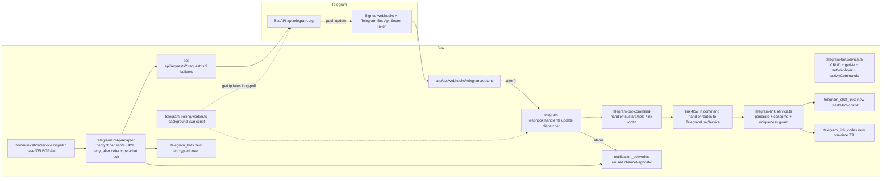

# Telegram Integration — Implementation Guide

## Document Information

- **Feature Name**: Telegram Bot API integration for Siraj
- **Version**: 1.2
- **Date**: 2026-08-01
- **Target Directory**: `.ai/plans/telegram`
- **Outcome Directory**: `.ai/plans/telegram/outcome`
- **Related Documents**:
  - [Requirements (Specs)](./specs.md)
  - [Trackable Tasks](./trackable-tasks.md)
- **Prerequisite**: [WhatsApp plan `trackable-tasks.md`](../whatsapp/trackable-tasks.md) MUST reach 100% before execution begins.
- **Research baseline**: Bot API 10.2 (July 14, 2026) — verified by `.ai/plans/telegram/outcome/0-research-confirmation-outcome.md` via 7 parallel research subagents on 2026-08-01.

## Research Confirmation Addendum (2026-08-01)

Seven parallel research subagents verified the plan against the latest official Telegram Bot API documentation and Vercel deployment constraints. All structural assumptions hold; the corrections below are additive refinements baked into the affected sections of this document and into `specs.md` / `trackable-tasks.md`. See `outcome/0-research-confirmation-outcome.md` for the full evidence base and source URLs.

| # | Correction | Affects |
|---|------------|---------|
| 1 | Bot API pinned to 10.2 (July 14 2026), not "10.x" document header | Phase 1.1, Phase 4 |
| 2 | Webhook auth is **bearer header** (`X-Telegram-Bot-Api-Secret-Token`), NOT HMAC-over-body. Use `crypto.timingSafeEqual` with length pre-check | §3.1, Common Pitfalls |
| 3 | Rate limits are **undocumented & soft** — implement per-`chat_id` (~1/sec burst ≤3) + global (~30/sec) + group (~20/min) token buckets; parse `parameters.retry_after` from 429 JSON body (not header); use LINEAR backoff (`retry_after + jitter`), not exponential. Propagate `retry_after` to a global pause semaphore | §1.3, §1.4 |
| 4 | `sendMessage` / `setWebhook` parameter sets extended for Bot API 10.x — add `business_connection_id`, `message_thread_id`, `reply_parameters` (replaces deprecated `reply_to_message_id`), `link_preview_options`, `protect_content`, `allow_paid_broadcast`, `message_effect_id`, `ip_address`, `entities`, `callback_query_id`. `parse_mode` accepts `"HTML" \| "MarkdownV2" \| "Markdown"` (legacy Markdown deprecated — v1 stays on `"HTML"`) | §1.3 |
| 5 | Mode-switch: `setWebhook` implicitly stops polling (no `deleteWebhook` needed first when going polling→webhook). Use `drop_pending_updates: true` on both transitions to avoid replaying stale `/link` commands. Webhook→polling DOES require `deleteWebhook` (removes the webhook registration) | §2.3, Common Pitfalls |
| 6 | Webhook HTTPS ports restricted to **443, 80, 88, 8443** (TLS 1.2+). Optional IP allowlist: Telegram source IPs `[91.108.4.0/22]` + `[149.154.160.0/20]` at edge WAF | §1.2 |
| 7 | `answerCallbackQuery` MUST be called **first** (≈10s server-side expiry on `callback_query_id`; missing call → stuck loading spinner + `400 query is too old`). Pattern: answer synchronously first (optional transient `text: "Processing..."`), then run DB consume, then `editMessageText` | §3.3, Common Pitfalls |
| 8 | Long-polling `timeout=0` is Telegram-documented as "testing purposes only". For production, cron route should enqueue a QStash job that performs a single `getUpdates(timeout=30..50)` long-poll inside an extended-duration function ("cron as trigger, not executor") | §3.4 |
| 9 | Redis lock TTL formula: `lockTTL = routeMaxDurationSeconds + 30` (NOT `long_poll_timeout + 30`). Set `export const maxDuration = 60` on polling cron route and `lockTTL = 90s`. Acquire with random UUID value; release via Lua compare-and-delete. Single-instance Upstash Redis is sufficient (Redlock overkill) | §3.4, Common Pitfalls |
| 10 | Idempotency mandate: webhook mode adds `Redis SETNX telegram:{botId}:seen:<update_id> EX 3600` at top of handler (multi-replica safety). Long-polling advances `lastUpdateId` AFTER per-update handler commits, OUTSIDE the handler transaction. New `incoming_update(bot_id, update_id) UNIQUE` table with `ON CONFLICT DO NOTHING`. Telegram retains unconfirmed updates for 24h | §2.1, §3.2 |
| 11 | Vercel Hobby plan Cron Jobs = once-per-day only → polling mode requires **Pro** (or external scheduler). Document in env-config + README | §1.2, Common Pitfalls |
| 12 | `User-Agent` header MUST be explicitly set (Bun auto-injects `Bun/<version>` which has triggered ISP throttling on sustained Telegram traffic). Use `Siraj-TelegramBot/1.0 (+https://<domain>)` | §1.3 |
| 13 | `parse_mode: "HTML"` confirmed safer than MarkdownV2 (escape only `<` `>` `&` vs 18 reserved chars across 4 regions). Add `escapeTelegramHtml()` util to `shared/lib/` | §1.3 |
| 14 | i18n source-of-truth: Siraj DB `user.preferredLocale` wins. `from.language_code` (Telegram IETF tag, unreliable) only as first-contact hint (normalize lowercase → split `-` → first segment → fallback). `/start <code>` consume uses the Siraj user's locale via the link code's `userId`. Add `normalizeTelegramLanguageCode()` util to `shared/lib/` | §3.3, Phase 4 i18n |
| 15 | `setMyCommands` accepts **100** commands per `{scope, language_code}` pair (not 32 — 32 is the max command NAME length). Name 1–32 chars lowercase `[a-z0-9_]` starting with a letter; description 1–256 chars (≤22 mobile). For v1 register 3× at startup — `en`, `ar`, fallback — with `scope: { type: "all_private_chats" }` | §2.3 |
| 16 | Deep-link URL fixed: `t.me/<bot>?start=<payload>` is canonical. `tg://msg?to=…&start=…` is INVALID — correct `tg:` form is `tg://resolve?domain=…&start=…`. Charset `[A-Za-z0-9_-]` (base64url, no `+`/`=`), max 64 chars (≤48 raw bytes). "Even if the user has already started the bot" — re-clicking Start re-fires the parameter (not first-start-only). Cold-reopen can deliver bare `/start` — handler must gracefully handle `payload === ""`/`null` as welcome path | specs REQ-TG13, §3.3 |
| 17 | `/start` parse via `message.entities` (Telegram pre-tokenizes `bot_command` with UTF-16 offsets), NOT `text.startsWith("/")`. `cmdToken = text.substring(0, entity.length)`; `[name] = cmdToken.slice(1).split("@", 1)`; `args = text.substring(entity.length).trim()` | §3.3 |
| 18 | `callback_data`: opaque opcode-prefixed token (`l:<id>`, `o:<id>`, `h:<name>`) ≤ 64 UTF-8 BYTES (not chars — emoji = 4 bytes). NEVER put the raw linking code. `message` can be `InaccessibleMessage` — don't assume editable. Handler must be idempotent (parallel multi-tap, ordering not guaranteed) | specs REQ-TG14, §3.3 |
| 19 | Linking-code TTL = **5 minutes** (industry standard across remnawave, Emre Yilmaz, msgr-authkit). 10 minutes was too long | specs REQ-TG13, §2.3 |
| 20 | Atomic consume SQL prevents replay/double-claim from parallel taps: `UPDATE telegram_link_codes SET consumed_at = NOW(), consumed_by_telegram_user_id = $1 WHERE code = $2 AND consumed_at IS NULL AND expires_at > NOW() RETURNING user_id, bot_id` | specs REQ-TG13, §2.3 |
| 21 | Bot token regex `/^\d{8,10}:[A-Za-z0-9_-]{35}$/` (43-46 chars). Bot ID prefix is public; 35-char part is the secret. AES-256-GCM at rest with 12-byte IV; decrypt per use, zeroize after. Token never expires — rotation hygiene is the only defense. Validate on settings form input | §1.3, §2.3, Common Pitfalls |
| 22 | `max_connections: 1` default for v1 (guarantees in-order `update_id` delivery over HTTP; Redis dedup still guards against retries). Scale to 2-5 only if Telegram-side timeouts observed | §2.3, §3.1 |
| 23 | NEW explicit task: `my_chat_member` handler — bot receives ONLY block/unblock in private chats. `member→kicked`/`left` → deactivate chat link (avoids `403 Forbidden: bot was blocked`); `kicked→member` → optionally re-activate (or wait for `/start`). Whitelist `["message", "callback_query", "my_chat_member"]` explicit; do NOT rely on default-include | specs new REQ-TG19, §3.2, trackable-tasks new |
| 24 | Poll-for-completion pattern (from remnawave): profile "Link Telegram Account" card polls GraphQL `pollTelegramLinkStatus(userId)` every 2 seconds after code generation until CONSUMED or expired. Auto-flips UI to "Linked" without manual refresh | specs REQ-TG16, §4-Phase-4 |
| 25 | Admin-override unlink: add admin mutation `unlinkTelegramChatLink(chatLinkId)` gated by `TELEGRAM_CONFIG_MANAGE` (SUPER_ADMIN only) for rare shared-Telegram-account cases. Currently unlink only exists for self-service | specs new REQ-TG21, Phase 4 |
| 26 | `update_id` discontinuity: after ≥1 week of silence, next `update_id` is chosen randomly — don't assume strict `+1`. Persist last-seen for dedup | §3.2 |
| 27 | SDK v2 path: grammY 1.45.1 (TS-native, tracks Bot API 10.2, `auto-retry` plugin handles `retry_after`, Redis-backed rate limiter). Telegraf in maintenance mode — explicitly exclude as v2 candidate | §1.3 |
| 28 | Webhook route `export const maxDuration = 30` — Telegram waits up to **60s** for 2xx; return within ~1s | §3.1 |
| 29 | Body cap: pre-check `content-length` header, then `Buffer.byteLength(raw) > 1_000_000` after `req.text()` (byte-accurate; Vercel hard limit is 4.5 MB) | §3.1 |
| 30 | Read header as `req.headers.get('x-telegram-bot-api-secret-token')` (lowercase per HTTP/2 conventions) | §3.1 |
| 31 | `lastUpdateId` writeback uses `GREATEST(current, new)` — parallel webhook delivery (default `max_connections=40`) can arrive out-of-order; v1 sets `max_connections=1` to simplify | §3.2, §2.3 |
| 32 | Cron route is a **heartbeat** (not primary ingestion): only long-poll bots in `long_polling` mode OR webhook-degraded (`getWebhookInfo.pending_update_count > 0` / recent `last_error_date`) | §3.4 |
| 33 | Add `vercel.json` cron entry `*/1 * * * *` → `/api/cron/telegram-polling`; auth via `Authorization: Bearer $CRON_SECRET` | §3.4 |
| 34 | Optional v2: Vercel Queues consumer for heavy processing offload (decouples Telegram's 60s deadline from LLM/DB work). v1 uses `after()` for light handler work only | §3.1 (v2 scope) |
| 35 | Webhook health columns on `telegram_bots`: `webhookPendingUpdateCount`, `webhookLastErrorDate`, `webhookLastErrorMessage` — populated by cron `getWebhookInfo` sweep | §2.1 |

## Outcome & Knowledge Transfer Protocol

### BEFORE Execution
Executing agents MUST read ALL existing files in `.ai/plans/telegram/outcome/` to absorb prior research, search results, docs, and pitfalls so analysis is not repeated.

### AFTER Execution
Executing agents MUST write `.ai/plans/telegram/outcome/<task-id>-outcome.md` with research/doc findings, implementation details, and carry-over knowledge.

### PROGRESS TRACKING
Executing agents MUST update task checkboxes `[ ]` → `[x]` in `trackable-tasks.md`.

### Knowledge Propagation (Final Task)
After all implementation tasks complete, the final task MUST:
1. Create canonical reference doc under `docs/services/telegram-bot-api.md` consolidating all outcome learnings
2. Update `backend/services/AGENTS.md`, `backend/AGENTS.md` with new patterns and doc reference
3. Update `.agents/instructions/backend.instructions.md` if new conventions should be enforced
4. Update root `AGENTS.md` Important References section

## Pre-Implementation Checklist

Before starting any task in [trackable-tasks.md](./trackable-tasks.md):

- [ ] Read root `AGENTS.md` and layer-specific AGENTS.md for each file you touch
- [ ] Read [specs.md](./specs.md) for requirements and confirmed stakeholder decisions
- [ ] Read the WhatsApp outcome files in `../whatsapp/outcome/` for the channel-architecture patterns this plan mirrors (especially `task-1-outcome.md`, `2-outcome.md`, `3-outcome.md`, `5-outcome.md`, `6-outcome.md`, `13-outcome.md`)
- [ ] Mark the task `[-]` in trackable-tasks.md when starting
- [ ] Mark the task `[x]` when complete and verified
- [ ] Run per-file verification loop before importing new code elsewhere

## Implementation Strategy

Build bottom-up in dependency order (mirrors WhatsApp plan Task 1 → Task 30 ordering):

1. **Channel enum + types** → compile-time safety (`default: never` in `CommunicationService`)
2. **Env-config keys** → `telegram_bots` / `telegram_chat_links` / `telegram_link_codes` schemas → types → repositories → services
3. **Typed Bot API request builders** → adapter → channel factory → `CommunicationService` dispatch
4. **Permissions migration (`9a`/`9b`)** before GraphQL mutations that gate on them
5. **Webhook route + handler + bot command handler** after delivery rows and bot repo exist
6. **Long-polling worker** after the handler works in webhook mode (alternative path)
7. **GraphQL + codegen** before any frontend Apollo hooks
8. **i18n namespace** before admin UI strings + bot reply templates
9. **Frontend three-tab UI** (tier-isolated) after GraphQL documents + codegen
10. **Per-user Profile "Link Telegram Account" card** after self-link mutations exist
11. **Tests** (`@live-comm` per builder + webhook unit tests + link-service tests + polling worker tests) in parallel where possible
12. **Quality loop** as final verification
13. **Knowledge propagation** as the mandatory final task

### Development Conventions (from root AGENTS.md)

- Runtime: **Bun** (not Node.js)
- Logging: `logger` from `@/backend/lib/logger` (backend) or `@/frontend/utils/logger` (frontend) — never `console.*`
- Path aliases: `@/*` maps to project root — no relative imports across layers
- i18n: compile-time system in `shared/locale/` — never hardcode user-facing strings
- GraphQL documents: `frontend/common/graphql/sharedDocuments/telegram/telegram.documents.ts`
- GraphQL hooks: import from `@apollo/client/react` — **NO `useLazyQuery`**
- Database tests: always use `runInRollback`; never `expect().rejects.toThrow()` inside it
- After Pothos/schema changes: `bun run generate:gqlSchema && bun codegen`
- After DB schema (new tables): `bun run db push` only
- After custom SQL migration files: `bun db migrate` to apply them
- **No third-party Telegram SDK** — use typed `fetch` builders + `@live-comm` integration tests (mirrors WhatsApp's no-SDK decision; REQ-TG9)

### Per-File Verification Loop

After creating or extracting a file, before importing it elsewhere:

```bash
bun tsgo
bun biome:check
curl -s -X POST http://localhost:4777/lint \
  -H "Content-Type: application/json" \
  -d '{"id":"verify","files":["<the-file>"]}'
```

Then read **all applicable AGENTS.md files** for that file's layer.

### Layer-to-AGENTS.md + Instructions Mapping (absolute paths)

| File Path Prefix | AGENTS.md Files | Instruction Files |
|------------------|-----------------|---------------------|
| `app/api/webhooks/telegram/route.ts` | `/home/ahmed/Projects/siraj-whatsapp/app/AGENTS.md` | `/home/ahmed/Projects/siraj-whatsapp/.agents/instructions/frontend.instructions.md` (App Router) |
| `app/api/cron/telegram-polling/route.ts` | `/home/ahmed/Projects/siraj-whatsapp/app/AGENTS.md` | `/home/ahmed/Projects/siraj-whatsapp/.agents/instructions/frontend.instructions.md` |
| `backend/services/telegram/**/*.ts` | `/home/ahmed/Projects/siraj-whatsapp/backend/services/AGENTS.md`, `/home/ahmed/Projects/siraj-whatsapp/backend/AGENTS.md` | `/home/ahmed/Projects/siraj-whatsapp/.agents/instructions/backend.instructions.md` |
| `backend/services/communication/channels/telegram/**/*.ts` | Same as above | Same as above |
| `backend/types/telegram/*.ts` | `/home/ahmed/Projects/siraj-whatsapp/backend/types/AGENTS.md`, `/home/ahmed/Projects/siraj-whatsapp/backend/AGENTS.md` | `/home/ahmed/Projects/siraj-whatsapp/.agents/instructions/backend.instructions.md` |
| `backend/enum/permissions/permission.enum.ts` | `/home/ahmed/Projects/siraj-whatsapp/backend/enum/AGENTS.md`, `/home/ahmed/Projects/siraj-whatsapp/backend/AGENTS.md` | `/home/ahmed/Projects/siraj-whatsapp/.agents/instructions/backend.instructions.md` |
| `backend/db/schema/telegram/*.ts` | `/home/ahmed/Projects/siraj-whatsapp/backend/db/schema/AGENTS.md`, `/home/ahmed/Projects/siraj-whatsapp/backend/AGENTS.md` | `/home/ahmed/Projects/siraj-whatsapp/.agents/instructions/backend.instructions.md` |
| `backend/db/repo/telegram/*.ts` | `/home/ahmed/Projects/siraj-whatsapp/backend/db/repo/AGENTS.md`, `/home/ahmed/Projects/siraj-whatsapp/backend/AGENTS.md` | `/home/ahmed/Projects/siraj-whatsapp/.agents/instructions/backend.instructions.md` |
| `backend/db/migration/9a-*.sql` + `9b-*.sql` | `/home/ahmed/Projects/siraj-whatsapp/backend/db/test/AGENTS.md` (seeding), `/home/ahmed/Projects/siraj-whatsapp/backend/db/schema/AGENTS.md`, `/home/ahmed/Projects/siraj-whatsapp/backend/AGENTS.md` | `/home/ahmed/Projects/siraj-whatsapp/.agents/instructions/backend.instructions.md` |
| `backend/lib/env-config-keys.ts`, `backend/types/shared/env-config.types.ts`, `environment.d.ts` | `/home/ahmed/Projects/siraj-whatsapp/backend/AGENTS.md`, `/home/ahmed/Projects/siraj-whatsapp/backend/types/AGENTS.md` | `/home/ahmed/Projects/siraj-whatsapp/.agents/instructions/backend.instructions.md` |
| `backend/graphql/pothos/telegram/*`, `backend/graphql/mutation/telegram/*`, `backend/graphql/query/telegram/*` | `/home/ahmed/Projects/siraj-whatsapp/backend/graphql/pothos/AGENTS.md`, `/home/ahmed/Projects/siraj-whatsapp/backend/graphql/mutation/AGENTS.md`, `/home/ahmed/Projects/siraj-whatsapp/backend/graphql/query/AGENTS.md`, `/home/ahmed/Projects/siraj-whatsapp/backend/graphql/AGENTS.md`, `/home/ahmed/Projects/siraj-whatsapp/backend/AGENTS.md` | `/home/ahmed/Projects/siraj-whatsapp/.agents/instructions/backend.instructions.md` |
| `frontend/common/views/dashboard/settings/telegram/*` | `/home/ahmed/Projects/siraj-whatsapp/frontend/common/views/AGENTS.md`, `/home/ahmed/Projects/siraj-whatsapp/frontend/AGENTS.md` | `/home/ahmed/Projects/siraj-whatsapp/.agents/instructions/frontend.instructions.md`, `/home/ahmed/Projects/siraj-whatsapp/.agents/instructions/mobile-desktop.instructions.md` |
| `frontend/desktop/views/dashboard/settings/telegram/*` | `/home/ahmed/Projects/siraj-whatsapp/frontend/desktop/AGENTS.md`, `/home/ahmed/Projects/siraj-whatsapp/frontend/views/AGENTS.md`, `/home/ahmed/Projects/siraj-whatsapp/frontend/AGENTS.md` | `/home/ahmed/Projects/siraj-whatsapp/.agents/instructions/frontend.instructions.md`, `/home/ahmed/Projects/siraj-whatsapp/.agents/instructions/mobile-desktop.instructions.md` |
| `frontend/mobile/views/dashboard/settings/telegram/*` | `/home/ahmed/Projects/siraj-whatsapp/frontend/mobile/AGENTS.md`, `/home/ahmed/Projects/siraj-whatsapp/frontend/views/AGENTS.md`, `/home/ahmed/Projects/siraj-whatsapp/frontend/AGENTS.md` | `/home/ahmed/Projects/siraj-whatsapp/.agents/instructions/frontend.instructions.md`, `/home/ahmed/Projects/siraj-whatsapp/.agents/instructions/mobile-desktop.instructions.md` |
| `frontend/common/views/dashboard/profile/telegram/*` | `/home/ahmed/Projects/siraj-whatsapp/frontend/common/views/AGENTS.md`, `/home/ahmed/Projects/siraj-whatsapp/frontend/AGENTS.md` | `/home/ahmed/Projects/siraj-whatsapp/.agents/instructions/frontend.instructions.md`, `/home/ahmed/Projects/siraj-whatsapp/.agents/instructions/mobile-desktop.instructions.md` |
| `frontend/common/graphql/sharedDocuments/telegram/*` | `/home/ahmed/Projects/siraj-whatsapp/frontend/common/graphql/sharedDocuments/AGENTS.md`, `/home/ahmed/Projects/siraj-whatsapp/frontend/common/graphql/AGENTS.md`, `/home/ahmed/Projects/siraj-whatsapp/frontend/AGENTS.md` | `/home/ahmed/Projects/siraj-whatsapp/.agents/instructions/frontend.instructions.md` |
| `shared/locale/{types,en,ar}/telegram/*` + `shared/locale/types/errors/*` | `/home/ahmed/Projects/siraj-whatsapp/shared/AGENTS.md` | (none) |
| `test/integration/communication/telegram-bot-api.integration.test.ts` | `/home/ahmed/Projects/siraj-whatsapp/test/integration/AGENTS.md`, `/home/ahmed/Projects/siraj-whatsapp/scripts/run-test/AGENTS.md`, `/home/ahmed/Projects/siraj-whatsapp/backend/AGENTS.md` | `/home/ahmed/Projects/siraj-whatsapp/.agents/instructions/backend.instructions.md`, `/home/ahmed/Projects/siraj-whatsapp/.agents/instructions/tests.instructions.md` |
| `backend/services/telegram/test/*.test.ts` | `/home/ahmed/Projects/siraj-whatsapp/scripts/run-test/AGENTS.md`, `/home/ahmed/Projects/siraj-whatsapp/backend/db/test/AGENTS.md`, `/home/ahmed/Projects/siraj-whatsapp/backend/AGENTS.md` | `/home/ahmed/Projects/siraj-whatsapp/.agents/instructions/tests.instructions.md`, `/home/ahmed/Projects/siraj-whatsapp/.agents/instructions/backend.instructions.md` |
| `test/ui/components/useTelegramSettingsViewModel.test.tsx` | `/home/ahmed/Projects/siraj-whatsapp/test/ui/AGENTS.md`, `/home/ahmed/Projects/siraj-whatsapp/frontend/AGENTS.md` | `/home/ahmed/Projects/siraj-whatsapp/.agents/instructions/tests.instructions.md`, `/home/ahmed/Projects/siraj-whatsapp/.agents/instructions/frontend.instructions.md` |

### Drizzle Schema Convention

- **Schema changes** (new tables, columns, indexes): Use `bun run db push` — creates schema automatically
- **Custom SQL migrations** (seed data, complex transforms, enum value additions blocked by `check_safe_enum_use`): Use `bun db migrate` — for non-Drizzle SQL only
- Use the **drizzle-generate**, **drizzle-hints**, and **drizzle-responses-and-errors** skills when running `drizzle-kit generate` / `push` to resolve any `missing_hints` or error envelopes

## Architecture Overview



### Design Goals

- Sixth notification channel piggybacking on existing `CommunicationService` + `notification_deliveries` (channel-agnostic by design — established by WhatsApp plan Task 7.4 partial index).
- Telegram Bot API direct via typed `fetch` builders (no SDK — mirrors WhatsApp).
- Hybrid credentials: global secrets in env-config; per-bot encrypted token in `telegram_bots` via `encryptedText` custom type.
- Both webhook (HTTPS push, secret-token validation) AND long-polling (`getUpdates` worker) update mechanisms, configurable per bot.
- Per-user account linking via one-time code with uniqueness guard (REQ-TG13 — the explicit user-confirmed requirement).
- All inbound handling uses the same `TelegramWebhookHandler.processUpdate(update, bot)` entry point — webhook route just defers via `after()`, long-polling worker calls the handler directly.

### Key Design Decisions

| Decision | Rationale |
|----------|-----------|
| Reuse `notification_deliveries` | Same lifecycle as WhatsApp; `providerMessageId` = Telegram `message_id`; partial index already added by WhatsApp plan. Telegram status set is `sent → delivered` only (no `read` for bots) — simpler forward-only map |
| New `telegram_bots` table (not `telegram_accounts`) | Telegram has no "business account" — each bot is independent. Each bot has its own token, username, webhook secret, update mode |
| 3 tables total: `telegram_bots`, `telegram_chat_links`, `telegram_link_codes` | Chat links persist after the one-time code is consumed (lifetime channel subscription). Link codes are short-lived tokens that establish chat links |
| `telegram_chat_links` instead of `users.telegramChatId` column | Per-user ↔ bot ↔ chat_id mapping supports multiple bots per user and clean normalization. `users.telegramChatId` added as **denormalized hot-path column** set when first chat link is established — read by `recipientAddressForChannel` for sync fan-out (avoids a join in the hot path) |
| `encryptedBotToken` uses `encryptedText` custom Drizzle type | Transparent encrypt/decrypt at the driver boundary. The repository `toReturnType` strips the encrypted column before returning (mirrors `WhatsappAccountRepository.toReturnType` at lines 26-29 of `whatsapp-account.repository.ts`) |
| Webhook secret-token verification (not HMAC-over-body) | Telegram signs requests via `X-Telegram-Bot-Api-Secret-Token` HTTP header, NOT HMAC over the body — simpler than Meta. `crypto.timingSafeEqual` over equal-length buffers (S5-equivalent). Per-bot `webhookSecret` falls back to global `TELEGRAM_WEBHOOK_SECRET` |
| Bot lookup by secret-token (NOT per-bot URL path) | Single shared route `app/api/webhooks/telegram/route.ts`. Lookup is by `secret → bot` map loaded from DB at handler init (cached with env-config invalidation). Simpler than dynamic route segments and matches Telegram's `setWebhook` single-URL pattern |
| `after()` for deferred work | Same `next/server` pattern as WhatsApp (C3). Strip inbound `message.text` containing deep-link codes from logs (route-level, before handler) — analogous to WhatsApp S3 inbound `messages[]` strip |
| `dispatchTelegram` dedicated branch (C2-equivalent) | Telegram's `TelegramPayload` shape (free `text`, `parseMode`, `replyMarkup`) differs from email/sms (`to` + `body`) — never route through `dispatchRecipientChannel`. Same as WhatsApp's dedicated `dispatchWhatsapp` |
| No tier-budget accounting | Telegram has no equivalent of Meta's `portfolioMessagingLimitTier` consumed on failure. `ChannelDispatchResult.sendAttempted` stays `undefined` for Telegram (NOT set on any path) |
| Free-text sends (no template indirection) | Telegram has no 24h service window restriction — `TelegramPayload.text` carries the message body directly. No `NOTIFICATION_TEMPLATE_MAP` required (unlike WhatsApp B1). Optional `metadata.telegramParseMode: "HTML"` + `metadata.telegramReplyMarkup` for richer formatting |
| HTTP 429 `retry_after` defer (not fixed 6s pair window) | Telegram's 429 includes `parameters.retry_after` (seconds). Defer via `setTimeout(retry_after * 1000 + 100)`; never FAILED on first 429 without deferred retry (analogous to WhatsApp B2 but adaptive timing) |
| Per-chat concurrency via Redis | `telegram:chat:<chatId>` TTL 1s — single in-flight send per chat (Telegram ~1 msg/sec per chat limit). Mirrors WhatsApp's per-recipient pair-rate-limit but keyed on chat_id, not phone |
| Long-polling worker as separate Bun script | Called by cron (Vercel Cron Jobs), NOT inline `setInterval` in the Next.js server process (serverless incompatible — process recycles lose the loop). Redis lock `telegram:polling:lock:<botId>` TTL 60s for safe multi-instance |
| `TELEGRAM_DISPATCH` permission included in v1 | Forward-compat for a future bot-initiated broadcast mutation. Unused in v1 (no broadcast mutation). Super_admin grant for future ease. Mirrors WhatsApp's deliberate-omit reversed because Telegram has no template constraint |
| 8-char base32 link codes | ~40 bits entropy — collision-resistant at scale, easy to type manually if needed (`A-Z 2-7` alphabet avoids ambiguous chars like 0/O, 1/I) |
| Link code TTL 10 minutes | Long enough for an admin to share with a user verbally/over chat; short enough to bound the attack window. Stored in `telegram_link_codes.expiresAt` |
| Uniqueness guard rejected at consume (not at generate) | The guard must reject linking attempt at `/start <code>` time when the incoming Telegram account id is already linked to a different Siraj user. Validated at consume-time because link codes can be generated by either admin or self-service — the entity making the request doesn't know the target Telegram account yet |

## UX/Navigation Specification (REQUIRED)

### New Routes & URLs

| Route | Purpose | Permission Required | Roles with Access |
|-------|---------|---------------------|-------------------|
| `/settings/telegram` | Telegram admin config (3-tab UI) | `TELEGRAM_VIEW` | SUPER_ADMIN, ACADEMY_ADMIN, STAFF_DEFAULT, SUPERVISOR_DEFAULT |
| `/profile` (existing) — "Link Telegram Account" card | Per-user self-service linking | n/a (any authenticated user, scoped to self) | All authenticated users |
| `/api/webhooks/telegram` | Telegram Bot API webhook receiver (no UI) | n/a (Telegram server → secret-token gated) | External (Telegram) |
| `/api/cron/telegram-polling` | Optional cron that ensures long-polling workers are running | n/a (Vercel cron secret gated) | Internal |

### Sidebar Navigation Integration

- **Group**: Integrations (created by WhatsApp Phase 7 as `grp_integrations`).
- **Parent Item**: top-level Integrations nav group.
- **Children**: WhatsApp NavItem (from WhatsApp plan) + **Telegram NavItem** (this plan).
- **Order**: WhatsApp first, Telegram second (chronological: WhatsApp was planned first; alphabetical override possible in nav config).
- **Mobile Bottom Nav**: Telegram appears in the same drawer / bottom-nav variant that WhatsApp Phase 7 establishes for Integrations (mirror exactly — no separate mobile behavior).

### Role-Based Access Matrix

| Role | Routes Accessible | Permissions Granted |
|------|-------------------|---------------------|
| SUPER_ADMIN | `/settings/telegram` (full), `/profile` card, all mutations | `TELEGRAM_VIEW`, `TELEGRAM_CONFIG_MANAGE`, `TELEGRAM_BOTS_MANAGE`, `TELEGRAM_DISPATCH` |
| ACADEMY_ADMIN | `/settings/telegram` (no bot CRUD, no token rotation), `/profile` card | `TELEGRAM_VIEW`, `TELEGRAM_CONFIG_MANAGE` |
| SUPERVISOR_DEFAULT | `/settings/telegram` (view + non-secret mutations only), `/profile` card | `TELEGRAM_VIEW`, `TELEGRAM_CONFIG_MANAGE` |
| STAFF_DEFAULT | `/settings/telegram` (view + non-secret mutations only), `/profile` card | `TELEGRAM_VIEW`, `TELEGRAM_CONFIG_MANAGE` |
| TEACHER | `/profile` card ONLY (Integrations nav hidden by `applyTeacherNavOverrides`) | n/a (no Integrations perms; only self-link in profile) |
| PARENT | `/profile` card ONLY (Integrations nav hidden) | n/a |
| STUDENT | `/profile` card ONLY (Integrations nav hidden) | n/a |

### Per-Audience Rendering

| Audience | What they see |
|----------|---------------|
| Student | Profile → Notification Preferences → "Link Telegram Account" card (self-service: generate code → present QR + deep link + countdown → consume via bot). No Integrations nav. |
| Parent | Identical to Student (parents are the primary audience for notifications — same linking UX). |
| Teacher | Identical to Student for self-linking. No Integrations nav (portal override hides it). |
| Supervisor | Integrations nav visible (with `TELEGRAM_VIEW` grant). Self-linking via profile card as well. |
| Admin / Staff | Full `/settings/telegram` 3-tab admin config + self-linking via profile card. Admins who haven't linked their own Telegram can still use the admin UI — admin actions don't require a personal chat link. |

### Mobile vs Desktop Variants

| Aspect | Desktop | Mobile |
|--------|---------|--------|
| Navigation | Sidebar item under Integrations group | Drawer / bottom-nav variant of Integrations (mirror WhatsApp Phase 7 exactly) |
| Bots tab | Bot cards in a 2-3 column grid; per-card menu (Sync / Edit Token / Set Webhook / Set Commands / Switch to Polling / Delete) | Stacked cards in a single column; per-card dropdown menu of same actions |
| Link Codes tab (generate modal) | Large QR centered in modal; copy + "Open in Telegram" buttons side-by-side | QR centered; copy + "Open in Telegram" buttons stacked (QR-large-friendly so user can scan with a second device) |
| Link Codes tab (history table) | `AppDataGrid` with bulk-select + filters | `MobileCardList` with status badges + tap-to-expand |
| Opt-in tab | `AppDataGrid` with bulk-select checkboxes + filter toolbar | `MobileCardList` with per-card toggle + drawer for bulk actions |
| Profile Link Telegram card | Inline card in right rail (desktop uses 2-column profile) | Stacked card in mobile content area (mobile uses single-column profile) |

### Permission Mapping

| Component/Route | Required Permission | Source |
|-----------------|---------------------|--------|
| Integrations NavGroup visibility | Any of `WHATSAPP_VIEW`, `TELEGRAM_VIEW` | `getNavItemsForPermissions()` in `navigationConfig.ts` |
| Telegram NavItem | `TELEGRAM_VIEW` | `navigationConfig.ts` NavItem `permission` field |
| `/settings/telegram` page Server Component | `TELEGRAM_VIEW` | `requirePermissionForPage` in `page.tsx` |
| `TelegramSettingsContainer` client wrapper | `TELEGRAM_VIEW` | `<RequirePermission>` wrapper |
| Bots tab — view | `TELEGRAM_VIEW` | `<RequirePermission>` per tab component |
| Bots tab — `syncTelegramBotFromApi` mutation | `TELEGRAM_CONFIG_MANAGE` | mutation resolver permission check |
| Bots tab — `setTelegramBotWebhook` / `deleteTelegramBotWebhook` / `setTelegramBotCommands` / `setTelegramBotUpdateMode` mutations | `TELEGRAM_CONFIG_MANAGE` | mutation resolver |
| Bots tab — `createTelegramBot` / `updateTelegramBot` / `deleteTelegramBot` / `setTelegramBotToken` mutations | `TELEGRAM_BOTS_MANAGE` | mutation resolver (SUPER_ADMIN only) |
| Link Codes tab — view | `TELEGRAM_VIEW` | `<RequirePermission>` per tab |
| Link Codes tab — `generateTelegramLinkCode(userId, botId?)` mutation (admin-side for any user) | `TELEGRAM_CONFIG_MANAGE` | mutation resolver |
| Link Codes tab — `generateTelegramLinkCode(self)` mutation (self-service from profile card) | n/a | mutation resolver (any authenticated user, scoped to self only) |
| Opt-in tab — view | `TELEGRAM_VIEW` | `<RequirePermission>` per tab |
| Opt-in tab — `setUserTelegramOptIn(userId, enabled)` (single toggle) | `SUPER_ADMIN` only | mutation resolver (claude-level gating) |
| Opt-in tab — `bulkSetTelegramOptIn(userIds, enabled)` (bulk) | `SUPER_ADMIN` only | mutation resolver |
| Profile Link Telegram card | n/a | any authenticated user (scoped to self in resolver) |
| `/api/webhooks/telegram` POST | n/a | external (Telegram → secret-token verification in route) |
| `/api/cron/telegram-polling` | cron-secret | header secret check in route (built-in Vercel Cron pattern) |

---

## Phase 1: Channel Foundations

### 1.1 Extend channel enums and types

**`backend/enum/notifications/notificationDeliveries.enum.ts`**
- Add `TELEGRAM = "TELEGRAM"`

**`backend/services/communication/utils.ts`**
- Add `telegram: "Telegram"` to `CHANNEL_LABELS` and `deliveryFailedMessage` label map (forced compile fix — mirrors WhatsApp C1)

**`backend/db/schema/enums.ts`** + **`backend/graphql/pothos/shared/enum.pothos.ts`**
- Auto-pick up via `createPgEnumFromEnum` / `gqlSchemaBuilder.enumType(NotificationChannel, ...)`

Run `bun run generate:gqlSchema && bun codegen`. `CommunicationService.dispatch` `default: never` must fail until `case NotificationChannel.TELEGRAM` exists.

Custom SQL: `9c-telegram-channel-enum.sql` — `ALTER TYPE notification_channel ADD VALUE 'TELEGRAM'` (split from data migration per `check_safe_enum_use`).

### 1.2 Env-config registry (global secrets)

**`backend/lib/env-config-keys.ts`** + **`backend/types/shared/env-config.types.ts`** + **`environment.d.ts`**

| Key | Secret | Notes |
|-----|--------|-------|
| `TELEGRAM_API_BASE_URL` | no | default `https://api.telegram.org` |
| `TELEGRAM_WEBHOOK_BASE_URL` | no | public HTTPS base for `setWebhook` |
| `TELEGRAM_WEBHOOK_SECRET` | yes | global fallback webhook secret |
| `TELEGRAM_DEFAULT_BOT_ID` | no | optional default bot UUID |

Per-bot `encryptedBotToken` → `telegram_bots` (Phase 2), not env-config.

### 1.3 Telegram channel layer

Mirror `backend/services/communication/channels/whatsapp/`:

**`ITelegramChannel.ts`**
```typescript
export interface ITelegramChannel {
  send(payload: TelegramPayload, locale?: string): Promise<TelegramSendResult>;
  validateConfig(): Promise<boolean>;
  disconnect(): Promise<void>;
}

export type TelegramPayload = {
  to: string; // chat_id
  text: string;
  parseMode?: "HTML" | "MarkdownV2";
  replyMarkup?: Record<string, unknown>;
  eventType: NotificationEventType;
  userId: string;
  metadata?: NotificationMetadata | null;
};
```

**`TelegramChannelFactory.ts`** — lazy singleton + `resetTelegramChannel()` (S4) invalidating all `TELEGRAM_*` env-config cache keys.

**`bot-api/requests/*.request.ts`** — one builder per Bot API method (9 builders in v1 — see REQ-TG9).

**`TelegramBotApiAdapter.ts`**
- `fetch` to `https://api.telegram.org/bot<token>/sendMessage` with `AbortSignal.timeout(10_000)`
- Decrypt bot token per send via `decryptField()` (S4)
- Per-chat Redis lock: `telegram:chat:<chatId>` TTL 1s
- HTTP 429: parse `retry_after`, defer, never FAILED on first 429 without retry
- `NotificationRepository.createDelivery` / `updateDeliveryStatus`
- `deliveryFailedMessage(NotificationChannel.TELEGRAM, locale)` on terminal failure

### 1.4 Notification dispatch integration

**`notification-dispatch.helpers.ts`**
- `EVENT_CHANNEL_ALLOWLIST`: add `TELEGRAM` for same events as WhatsApp
- `recipientAddressForChannel`: `if (channel === NotificationChannel.TELEGRAM) return user?.telegramChatId ?? null`

**`notification-payloads.builders.ts`**
- `ALL_CHANNELS` += `TELEGRAM`
- `buildPerChannel`: Telegram branch stamps `metadata.telegramParseMode: "HTML"` — no template map

**`communication.service.ts`**
- `dispatchTelegram(payload, locale)` — dedicated branch (C2-equivalent)
- `case NotificationChannel.TELEGRAM: return await dispatchTelegram(...)`

---

## Phase 2: Bots Backend

### 2.1 Schema

**`backend/db/schema/telegram/telegram-bots.ts`**

```typescript
export const telegramBots = pgTable("telegram_bots", {
  id: uuid("id").defaultRandom().primaryKey(),
  botId: varchar("bot_id", { length: 64 }).notNull().unique(),
  username: varchar("username", { length: 64 }).notNull(),
  displayName: jsonb("display_name").$type<LocalizedString>(),
  encryptedBotToken: encryptedText("encrypted_bot_token").notNull(),
  webhookSecret: varchar("webhook_secret", { length: 256 }),
  webhookUrl: varchar("webhook_url", { length: 512 }),
  updateMode: varchar("update_mode", { length: 16 }).notNull().default("disabled"), // webhook | long_polling | disabled
  allowedUpdates: jsonb("allowed_updates").$type<string[]>().default(["message", "callback_query"]),
  lastWebhookAt: timestamp("last_webhook_at", { withTimezone: true, precision: 3 }),
  lastUpdateId: integer("last_update_id"),
  webhookPendingUpdateCount: integer("webhook_pending_update_count"),
  webhookLastErrorDate: timestamp("webhook_last_error_date", { withTimezone: true, precision: 3 }),
  webhookLastErrorMessage: varchar("webhook_last_error_message", { length: 512 }),
  isActive: boolean("is_active").notNull().default(true),
  createdAt: timestamp("created_at", { withTimezone: true, precision: 3 }).notNull().defaultNow(),
  updatedAt: timestamp("updated_at", { withTimezone: true, precision: 3 })
    .notNull()
    .defaultNow()
    .$onUpdate(() => new Date()),
}, table => [index("telegram_bots_bot_id_idx").on(table.botId)]);
```

**`backend/db/schema/telegram/telegram-chat-links.ts`**

```typescript
export const telegramChatLinks = pgTable("telegram_chat_links", {
  id: uuid("id").defaultRandom().primaryKey(),
  userId: uuid("user_id").notNull().references(() => users.id, { onDelete: "cascade" }),
  botId: uuid("bot_id").notNull().references(() => telegramBots.id, { onDelete: "cascade" }),
  chatId: varchar("chat_id", { length: 64 }).notNull(),
  chatType: varchar("chat_type", { length: 16 }).notNull(), // private | group | supergroup | channel
  chatTitle: varchar("chat_title", { length: 255 }),
  linkedAt: timestamp("linked_at", { withTimezone: true, precision: 3 }).notNull().defaultNow(),
  linkedByUserId: uuid("linked_by_user_id").references(() => users.id),
  linkSource: varchar("link_source", { length: 32 }).notNull(), // bot_start_code | admin_override | deep_link
  isActive: boolean("is_active").notNull().default(true),
  createdAt: timestamp("created_at", { withTimezone: true, precision: 3 }).notNull().defaultNow(),
  updatedAt: timestamp("updated_at", { withTimezone: true, precision: 3 })
    .notNull()
    .defaultNow()
    .$onUpdate(() => new Date()),
}, table => [
  uniqueIndex("telegram_chat_links_user_bot_idx").on(table.userId, table.botId),
  index("telegram_chat_links_chat_id_idx").on(table.chatId),
]);
```

**`backend/db/schema/telegram/telegram-link-codes.ts`**

```typescript
export const telegramLinkCodes = pgTable("telegram_link_codes", {
  id: uuid("id").defaultRandom().primaryKey(),
  code: varchar("code", { length: 32 }).notNull().unique(),
  userId: uuid("user_id").notNull().references(() => users.id, { onDelete: "cascade" }),
  botId: uuid("bot_id").references(() => telegramBots.id, { onDelete: "set null" }),
  expiresAt: timestamp("expires_at", { withTimezone: true, precision: 3 }).notNull(),
  consumedAt: timestamp("consumed_at", { withTimezone: true, precision: 3 }),
  consumedByTelegramUserId: varchar("consumed_by_telegram_user_id", { length: 64 }),
  createdByUserId: uuid("created_by_user_id").notNull().references(() => users.id),
  createdAt: timestamp("created_at", { withTimezone: true, precision: 3 }).notNull().defaultNow(),
}, table => [index("telegram_link_codes_code_idx").on(table.code)]);
```

**Users table extension** (denormalized hot path):
- Add `telegramChatId: varchar("telegram_chat_id", { length: 64 })` nullable to `users` schema — set on first successful link consume; cleared on unlink.

**Migrations:**
- Drizzle-generated: all three tables + `users.telegram_chat_id` via `bun db push`
- Custom SQL: `9a-telegram-permissions-enum.sql` (enum only), `9b-telegram-permissions-data.sql` (seed + super_admin grants), `9c-telegram-channel-enum.sql` (notification_channel ADD VALUE)

### 2.2 Types

**`backend/types/telegram/`**
- `TelegramBotSelectType`, `InsertType`, `ReturnType` (excludes `encryptedBotToken`), `SubmitInput`, `UpdateInput`, `SetTelegramBotTokenInput`
- `TelegramChatLinkReturnType`, `TelegramLinkCodeReturnType`, `GenerateLinkCodeResult` (`{ code, deepLinkUrl, expiresAt }`)

### 2.3 Repository + services

**`TelegramBotRepository`** — CRUD, `findByBotId`, `findByWebhookSecret`, `findRawById`, `listActive`, `findByUpdateMode`, all accept optional `tx`

**`TelegramChatLinkRepository`** — `findByUserId`, `findByChatId`, `findByUserAndBot`, `findByUserIds` (batch Map), `create`, `deactivate`

**`TelegramLinkCodeRepository`** — `create`, `findByCode`, `markConsumed`, `deleteExpired`

**`telegram-bot.service.ts`** — CRUD, `syncFromTelegram()` (`getMe`), `setBotToken`, `setWebhook`, `deleteWebhook`, `setMyCommands`, opt-in helpers

**`telegram-link.service.ts`** — `generateLinkCode`, `consumeLinkCode` (atomic transaction + uniqueness guard), `unlinkUser`

### 2.4 Permissions (two-phase migration)

```typescript
TELEGRAM_VIEW = "telegram.view"
TELEGRAM_CONFIG_MANAGE = "telegram.config_manage"
TELEGRAM_BOTS_MANAGE = "telegram.bots_manage"
TELEGRAM_DISPATCH = "telegram.dispatch"
```

**`backend/types/audit/audit.types.ts`** — add `TELEGRAM_BOT`, `TELEGRAM_CHAT_LINK`

### 2.5 GraphQL

**Mutations**: `createTelegramBot`, `updateTelegramBot`, `deleteTelegramBot`, `setTelegramBotToken`, `syncTelegramBotFromApi`, `setTelegramBotWebhook`, `deleteTelegramBotWebhook`, `setTelegramBotCommands`, `setTelegramBotUpdateMode`, `generateTelegramLinkCode`, `setUserTelegramOptIn`

**Queries**: `telegramBots`, `telegramBot`, `telegramChatLinks`, `isUserTelegramOptIn`

Token/webhook mutations call `resetTelegramChannel()` on success (S4).

---

## Phase 3: Webhook Receiver + Long-Polling Worker

### 3.1 Route — `app/api/webhooks/telegram/route.ts`

Read `node_modules/next/dist/docs/` for Next.js 16 App Router before writing.

- **`export const maxDuration = 30`** — Telegram waits up to 60s for 2xx; return within ~1s
- **POST only** (Telegram has no GET verification handshake):
  - Pre-check `content-length` header → reject >1 MB with 413 before reading body
  - `const rawBody = await req.text()`; defensive `Buffer.byteLength(rawBody) > 1_000_000` → 413 (Vercel hard limit is 4.5 MB)
  - Read `req.headers.get('x-telegram-bot-api-secret-token')` (**lowercase** per HTTP/2); compare via `crypto.timingSafeEqual` with length pre-check against per-bot `webhookSecret` OR global `TELEGRAM_WEBHOOK_SECRET`
  - On mismatch: log `(ip, userAgent, contentLength)` only (S2); return 401
  - **Redis SETNX** `telegram:{botId}:seen:<update_id> EX 3600` — if exists, return 200 and skip (REQ-TG18)
  - Parse JSON; validate `update_id` present. Body IS the Update object directly (no wrapper envelope)
  - Strip sensitive `message.text` args (deep-link codes) before logging
  - Defer via `after(async () => { await TelegramWebhookHandler.processUpdate(body, bot); })` (C3). Cap deferred work at ~30s; offload heavy work to Vercel Queues in v2
  - **Always return `NextResponse.json({ ok: true })` immediately** — even on processing errors downstream (prevents Telegram retry storms and webhook disablement)

### 3.2 Handler — `telegram-webhook.handler.ts`

| Update type | Action |
|-------------|--------|
| `message` with `bot_command` entity at offset 0 | Route to `TelegramBotCommandHandler` (entities-based parsing) |
| `message` (free text) | Reply "Sorry, I only understand commands. Try /help." (v1) |
| `callback_query` | `answerCallbackQuery` FIRST, then dispatch by opcode prefix (`l:`, `o:`, `h:`) |
| `my_chat_member` | Block/unblock handler: `member→kicked/left` deactivate link (REQ-TG17) |
| `edited_message` / other types | Audit only (excluded by `allowed_updates` whitelist) |

Update `telegram_bots.lastWebhookAt` on receipt. Advance `lastUpdateId` via **`GREATEST(current, newUpdateId)`** (forward-only — parallel webhook delivery can arrive out-of-order even with `max_connections=1` on retries).

Idempotency: `incoming_update(bot_id, update_id) ON CONFLICT DO NOTHING` + Redis SETNX at route level.

### 3.3 Command handler — `telegram-bot-command-handler.ts`

Registered commands:
- `/start [code]` → link flow (REQ-TG13)
- `/help` → command list
- `/link` → instructions
- `/unlink` → deactivate chat link
- `/optin` / `/optout` → toggle per-user opt-in (requires linked chat)

### 3.4 Long-polling worker — heartbeat cron (not primary ingestion)

Webhook mode is the production default (sub-second latency). The cron route is a **heartbeat** that reconciles missed updates — NOT the primary ingestion path.

**`vercel.json`**: add cron `*/1 * * * *` → `/api/cron/telegram-polling` (Pro plan minimum; Hobby = once/day only).

**`app/api/cron/telegram-polling/route.ts`**:
- `export const maxDuration = 60`; `export const dynamic = "force-dynamic"`
- Verify `Authorization: Bearer $CRON_SECRET`
- Only poll bots where: `updateMode === "long_polling"` OR webhook-degraded (`getWebhookInfo.pending_update_count > 0` / `last_error_date` within 5 min)
- Per-bot token-bearing Redis lock (`lockTTL = 90s`); Lua compare-and-delete release
- `getUpdates({ offset, timeout: 30, limit: 100 })`; advance offset AFTER handler commits

**`scripts/telegram-polling-worker.ts`**: Bun entry point for local dev / non-Vercel deployments.

---

## Phase 4: Admin Telegram Configuration (Frontend)

### Files

| Layer | Path |
|-------|------|
| Navigation Config | `frontend/common/views/dashboard/config/navigationConfig.ts` (add Telegram NavItem under Integrations) |
| Documents | `frontend/common/graphql/sharedDocuments/telegram/telegram.documents.ts` |
| ViewModel | `frontend/common/views/dashboard/settings/telegram/useTelegramSettingsViewModel.ts` |
| Switcher | `frontend/common/views/dashboard/settings/telegram/TelegramConfigView.tsx` |
| Desktop | `frontend/desktop/views/dashboard/settings/telegram/tabs/{BotsTab,LinkCodesTab,OptInTab}.desktop.tsx` |
| Mobile | `frontend/mobile/views/dashboard/settings/telegram/tabs/{BotsTab,LinkCodesTab,OptInTab}.mobile.tsx` |
| Profile card | `frontend/common/views/dashboard/profile/telegram/LinkTelegramCard.tsx` + tier variants |

Patterns: `createLazyView` + `ResponsiveViewSwitch`; no `useMediaQuery` in tier files.

### UI Structure (Three Tabs)

**Tab 1: Bots** — Bot cards: username, display name, update mode badge, active toggle, last webhook, Sync / Edit Token / Set Webhook / Set Commands / Switch to Polling actions.

**Tab 2: Link Codes** — Generate code for a user → modal with code + QR + deep link + TTL countdown + copy/open buttons. History table: code, user, status (PENDING/CONSUMED/EXPIRED).

**Tab 3: Opt-in Management** — Paginated table: User, Telegram status, Opt-in toggle, Last Change, Changed By. Bulk toggle (SUPER_ADMIN only).

**Profile: Link Telegram Account** — Self-service card in notification preferences: link status, generate code dialog, unlink button.

### i18n (REQ-TG7)

**`shared/locale/types/telegram/index.ts`**, `en/telegram`, `ar/telegram`
Register in `shared/locale/types/message.ts` and assembler files.

Keys: page title, tab labels, bot fields, link code fields, opt-in management, command reply templates, webhook/polling warnings, delivery failure labels in `errors` namespace.

---

## Phase 5: Tests

| Suite | Path | Notes |
|-------|------|-------|
| Channel unit | `backend/services/telegram/test/telegram-channel.test.ts` | Factory, `resetTelegramChannel()`, validateConfig |
| Webhook unit | `backend/services/telegram/test/telegram-webhook.handler.test.ts` | Secret +/-, command routing, callback_query, idempotency |
| Link service unit | `backend/services/telegram/test/telegram-link.service.test.ts` | Code TTL, consume success, **uniqueness guard**, expired/consumed |
| Polling worker unit | `backend/services/telegram/test/telegram-polling.worker.test.ts` | Redis lock, offset advance, 429/409 backoff |
| Live comm | `test/integration/communication/telegram-bot-api.integration.test.ts` | Per builder; `bun run test:live-comm` |
| Coverage guard | `test/integration/communication/telegram-api-call-coverage.test.ts` | Builder ↔ test pairing |
| ViewModel | `test/ui/components/useTelegramSettingsViewModel.test.tsx` | Mocked Apollo |

DB tests: `bun run scripts/run-test/run-test.ts <path>` — never raw `bun test` for DB.

---

## Phase 6: Quality Loop

```bash
bun tsgo && bun biome:check
curl -s -X POST http://localhost:4777/lint \
  -H "Content-Type: application/json" \
  -d '{"id":"verify","files":["<the-file>"]}'
```

Per-file: `bun run scripts/health/sub-loop.ts <file> --lifecycle <stage>`

Apply schema: `bun db push` for Drizzle tables; `bun db migrate` for custom SQL (9a/9b/9c).

---

## Common Pitfalls

1. **Webhook vs long-polling are mutually exclusive** — `setWebhook` with a URL implicitly stops `getUpdates` delivery (no need to call `deleteWebhook` first when going polling→webhook). Going webhook→polling DOES require `deleteWebhook`. Use `drop_pending_updates: true` on BOTH transitions.
2. **Secret-token verification, not HMAC** — compare `X-Telegram-Bot-Api-Secret-Token` header with `crypto.timingSafeEqual` AFTER a length-guard (the function throws on length mismatch, leaking length otherwise). Telegram does NOT send any HMAC-over-body. There is no replay protection from Telegram — must add `update_id` monotonicity + Redis SETNX dedup + optional IP allowlist (`91.108.4.0/22`, `149.154.160.0/20`).
3. **Must call `answerCallbackQuery` FIRST** for every `callback_query` — ~10s server-side expiry on `callback_query_id`; missing/late call leaves a stuck loading spinner on the user's client and returns `400 query is too old` on the next attempt. Pattern: answer synchronously first (optional transient `text: "Processing..."`), THEN run DB consume transaction, THEN `editMessageText` the result.
4. **Uniqueness guard at consume time** — reject if Telegram user already linked to a different Siraj user (REQ-TG13 critical requirement).
5. **Link codes are single-use + 5-minute TTL** — never allow reuse after `consumedAt` is set. Use atomic consume SQL: `UPDATE … SET consumed_at = NOW() WHERE code = $2 AND consumed_at IS NULL AND expires_at > NOW() RETURNING …` to prevent replay from parallel `/start <code>` taps.
6. **Exposing bot token in GraphQL** — never return encrypted or decrypted token fields. Token regex for settings-form validation: `/^\d{8,10}:[A-Za-z0-9_-]{35}$/`.
7. **Missing `id` on GraphQL objects** — breaks Apollo normalization.
8. **`useLazyQuery`** — forbidden; use stateful `useQuery`.
9. **Forgetting codegen** — run `bun run generate:gqlSchema && bun codegen` after every Pothos change.
10. **Builder without integration test** — coverage guard test will fail (REQ-TG9).
11. **Inline long-polling in Next.js process** — Vercel functions are ephemeral; use separate Bun script + cron ("cron as trigger, not executor" with QStash enqueuing single `getUpdates(timeout=30..50)` long-poll). Inline `setInterval` breaks on serverless.
12. **Confusing migrate vs push** — `db push` for schema tables; `db migrate` for custom SQL only.
13. **Deep-link code in logs** — strip from audit/logs at route level.
14. **`callback_data` ≤ 64 UTF-8 BYTES (not chars)** — emoji = 4 bytes; never the raw linking code; use opaque opcode-prefixed token (`l:<id>`, `o:<id>`).
15. **Redis lock TTL formula** — `lockTTL = routeMaxDurationSeconds + 30`, NOT `long_poll_timeout + 30`. Set `maxDuration = 60` on polling cron route → `lockTTL = 90s`. Token-bearing (random UUID value) + Lua compare-and-delete release.
16. **Vercel Hobby plan limitation** — Hobby Cron = once-per-day only; polling mode requires Pro (or external scheduler like QStash schedule / cron-job.org). Document in env-config + README.
17. **`User-Agent` header** — Bun auto-injects `Bun/<version>` which has triggered ISP throttling on sustained Telegram traffic. Adapter must set explicit UA: `Siraj-TelegramBot/1.0 (+https://<domain>)`.
18. **`my_chat_member` whitelist** — bot receives block/unblock in private chats ONLY via this update. Whitelist `["message", "callback_query", "my_chat_member"]` explicitly; do NOT rely on default-include when setting narrow allowlists. Missing handler → silent send failures into blocked chats (`403 Forbidden: bot was blocked by the user`).
19. **`update_id` discontinuity** — after ≥1 week of silence, next `update_id` is chosen randomly (not `previous + 1`). Persist last-seen for dedup; treat as strictly-increasing WITHIN a live stream only.
20. **Idempotency mandate** — webhook mode: Redis `SETNX telegram:{botId}:seen:<update_id> EX 3600` at top of handler BEFORE DB writes (multi-replica safety). Long-polling: advance `lastUpdateId` AFTER per-update handler commits, OUTSIDE the handler transaction. Add `incoming_update(bot_id, update_id) UNIQUE` table with `ON CONFLICT DO NOTHING`.
21. **Deep-link scheme** — `t.me/<bot>?start=<payload>` is canonical. `tg://msg?to=…&start=…` is INVALID (correct `tg:` form is `tg://resolve?domain=…&start=…`).
22. **`timeout=0` is testing-only** — Telegram docs explicitly discourage `timeout=0` for production. Use cron-triggered QStash job with `timeout=30..50` long-poll inside extended-duration function.
23. **Webhook route `maxDuration = 30`** — Telegram waits up to 60s for 2xx; return within ~1s. Vercel Fluid Compute default is 300s but don't rely on long `after()` work — cap at ~30s.
24. **Body-size cap is byte-accurate** — pre-check `content-length`, then `Buffer.byteLength(raw)` after `req.text()` (not `raw.length` which counts UTF-16 code units). Vercel hard limit is 4.5 MB; our 1 MB cap is conservative.
25. **Lowercase secret header** — read `req.headers.get('x-telegram-bot-api-secret-token')`, not mixed-case (HTTP/2 normalizes to lowercase).
26. **`lastUpdateId` forward-only** — `GREATEST(current, new)` on every write; parallel webhook delivery and retries can arrive out-of-order even with `max_connections=1`.
27. **Cron is heartbeat, not primary** — webhook delivers sub-second; cron only polls `long_polling` bots or webhook-degraded bots (`pending_update_count > 0` / recent `last_error_date`). Register `vercel.json` cron `*/1 * * * *`.
28. **Always return 2xx from webhook** — even on processing errors downstream; prevents Telegram retry storms and webhook disablement after sustained failures.

---

## References

- [Telegram Bot API](https://core.telegram.org/bots/api)
- [Bot API changelog (10.2)](https://core.telegram.org/bots/api-changelog)
- [Bot Features (commands, deep linking, keyboards)](https://core.telegram.org/bots/features)
- [Bots FAQ (webhook secret token)](https://core.telegram.org/bots/faq)
- [setWebhook](https://core.telegram.org/bots/api#setwebhook)
- [sendMessage](https://core.telegram.org/bots/api#sendmessage)
- [Deep links](https://core.telegram.org/api/links)
- [Long Polling vs Webhook (GramIO)](https://gramio.dev/updates/webhook)
- [Flood limits & retry_after (grammY)](https://grammy.dev/advanced/flood)
- WhatsApp plan patterns: [`.ai/plans/whatsapp/implementation.md`](../whatsapp/implementation.md), [outcome files](../whatsapp/outcome/)
