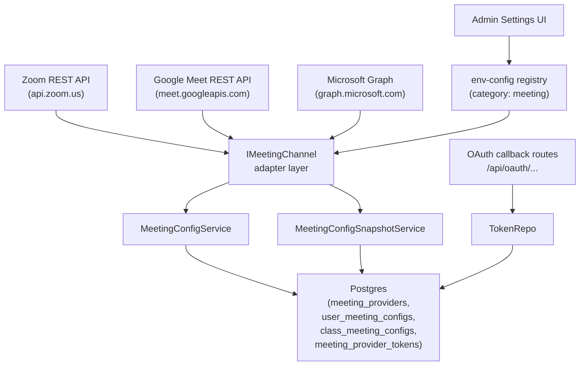
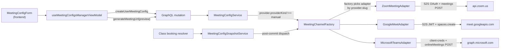
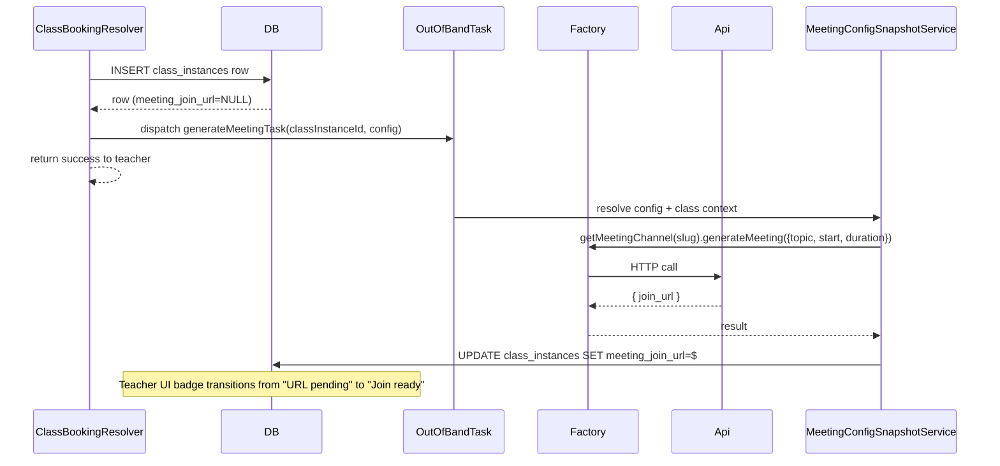
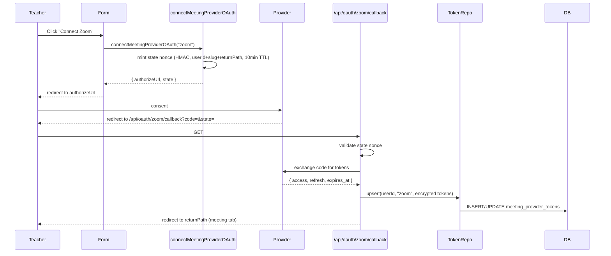

# Design — Automatic Zoom / Google Meet / Microsoft Teams URL Generation

## Document Information

- **Feature Name**: Automatic meeting URL generation (Zoom, Google Meet, Microsoft Teams)
- **Target Directory**: `.ai/plans/auto-meeting-url`
- **Version**: 1.0
- **Date**: 2026-07-31
- **Reviewers**: backend, frontend, devops
- **Related Documents**:
  - [Requirements (Specs)](./specs.md)
  - [Trackable Tasks](./trackable-tasks.md)
- **Reference research**: `.ai/plans/auto-meeting-url/outcome/research-outcome.md`

## Overview

Add automatic URL generation by introducing a new `IMeetingChannel` adapter/factory layer that mirrors the existing `backend/services/communication/channels/` pattern. A new `providerKind` discriminator on `meeting_providers` distinguishes manual providers from auto-generating ones. Three adapters (Zoom S2S, Google Meet service-account + DWD, Microsoft Teams Graph) implement the interface. Hybrid auth resolves org credentials first, falling back to per-teacher OAuth tokens stored in a new `meeting_provider_tokens` table. Three generation entry-points exist: silent on-save, explicit "Generate" preview, and at-class-booking-time.

### Design Goals

- Pluggable providers — add a 4th provider later without touching `MeetingConfigService`.
- Mirror the existing `communication/channels/` structure so future agents recognise the pattern.
- Preserve the manual-URL experience (`providerKind = "manual"`) verbatim.
- Booking-time generation is non-blocking — a class booking must never fail because a provider API is down.
- Zero heavy SDK additions (`fetch` + `jose` + existing infra only).

### Key Design Decisions

#### Decision: Adapter layer mirrors `communication/channels/`

**Context:** Need to abstract provider HTTP details behind a stable interface.
**Options Considered:**
1. Inline provider switch-case in `MeetingConfigService` — Cons: hard to add providers, hard to test.
2. New `IMeetingChannel` mirroring `IEmailChannel` — Pros: consistent with existing pattern, agents familiar, easy to test, lazy import.
**Decision:** Option 2.
**Rationale:** The `backend/services/communication/channels/` pattern is the canonical abstraction in this codebase. The factory resolves env via `resolveEnvConfigMany`, lazy-imports the adapter, memoises the instance with a race-safe `initializationPromise`, and exposes `resetXxxChannel()`. Reusing this shape reduces cognitive load and inherits the proven race-safe singleton design.

#### Decision: `providerKind` enum column on `meeting_providers` + `supportsAutoGeneration` flag on `fieldSchema`

**Context:** Need to distinguish manual vs auto providers without breaking the existing `fieldSchema` shape.
**Options Considered:**
1. Replace `fieldSchema.requiresMeetingUrl` with `providerKind` union — breaking change for existing client logic.
2. Add `providerKind` column + `supportsAutoGeneration` flag on `fieldSchema` — additive, backward compatible.
**Decision:** Option 2.
**Rationale:** Existing `requiresMeetingUrl` flags behave correctly for manual providers. Auto providers set `requiresMeetingUrl: false` + `supportsAutoGeneration: true` + `providerKind: "zoom_oauth"` (etc.). Manual vs auto branch decisions look at `providerKind`; form show/hide uses `fieldSchema` flags. No existing client breaks.

#### Decision: `meetingUrl` becomes optional; `providerMetadata` JSONB captures upstream returns

**Context:** Auto-generated configs need somewhere to stash `meetingId`, `start_url` (Zoom host URL), `accessType` (Meet), etc.
**Options Considered:**
1. Add explicit columns `meetingId`, `startUrl`, etc. — schema bloat per provider.
2. Reuse `details` JSONB for everything — overloads the user-input shape.
3. New `providerMetadata` JSONB column typed as `Record<string, unknown>` per provider — flexible, structured.
**Decision:** Option 3.
**Rationale:** Each adapter returns different metadata; a per-row JSONB column keeps schema clean and types are sealed via `MeetingProviderMetadata<Kind>` discriminated unions in `backend/types/meeting/`.

#### Decision: Hybrid auth — org creds first, per-user OAuth fallback, single adapter

**Context:** Some deployments can do Workspace DWD (Meet) / Entra app access policy (Teams); others cannot and need per-teacher OAuth.
**Options Considered:**
1. Two adapter classes per provider (OrgAdapter + UserOAuthAdapter) — factory picks one.
2. Single adapter with credential-source switch inside — internal `resolveCredentials()` returns either `{kind:"org",...}` or `{kind:"user",token}` and the adapter hides the difference.
**Decision:** Option 2.
**Rationale:** The HTTP generation call (POST to Zoom/Meet/Graph) is the same regardless of where the token came from; only the token-mint step differs. Keeping it in one adapter avoids duplicate business logic and is the smaller, less error-prone surface.

#### Decision: Booking-time generation is non-blocking / out-of-band

**Context:** Calling an external API inside the class-booking transaction is unacceptable — provider lag would block teachers and provider outages would block bookings.
**Options Considered:**
1. Synchronous generation inside the booking resolver (rejected).
2. Out-of-band generation after the `class_instances` row commits (accepted).
**Decision:** Option 2.
**Rationale:** A `class_instance` with `meetingJoinUrl = null` is a recoverable state (UI badge + manual regenerate). A blocked booking is not. The booking resolver commits, then dispatches a generation task that updates `meetingJoinUrl` after the fact. Same pattern the notification-dispatch path uses (commit then fire).

#### Decision: Use `fetch`/`undici` + `jose`, no provider SDKs

**Context:** Available SDKs (`@google-apps/meet`, `@microsoft/microsoft-graph-client`, `zoomus`) are heavy and opinionated.
**Decision:** Raw HTTP via `fetch` (already used by Resend/Twilio/FCM adapters) + `jose` for Google service-account JWT.
**Rationale:** Keeps the dependency surface flat, matches existing adapters, and avoids version-lock to SDK majors. The HTTP calls are simple (1-2 endpoints per adapter).

### UX/Navigation Specification

#### New Routes & URLs

> **Codebase fact (via discovery):** the App Router group is `app/(dashboard)/...`, NOT `app/[locale]/dashboard/...`. Locale is read server-side via `getLocale()` from `@/shared/locale/server-cookies`. The Settings page is the canonical example: `app/(dashboard)/settings/page.tsx` — a 6-tabbed page whose tabs live in `SettingsTabPanels.tsx` + `settingsTabs.config.ts`. Our "Meeting Integrations" tab follows that exact pattern (no new top-level route, no new sidebar item).

| Route / Tab / Path | Purpose | Permission Required | Roles with Access |
|-------------------|---------|---------------------|-------------------|
| `/dashboard/settings` existing page — new tab `meetingIntegrations` (URL `?tab=meetingIntegrations`) | Admin meeting-integration credentials + live Test Connection + per-teacher OAuth audit | `SETTINGS_EDIT_MEETING_INTEGRATIONS` (new enum entry) OR `SETTINGS_VIEW` (read-only fallback) | SUPER_ADMIN (primary); ACADEMY_ADMIN when explicitly granted |
| `/dashboard/profile/teacher/meeting` existing | Teacher meeting configs + auto-generation affordances + per-teacher OAuth connect/disconnect (REQ-14) | `MEETING_CONFIGS_MANAGE_OWN` | TEACHER + admins acting on themselves |
| `/dashboard/payment-catalogs?tab=meetingProviders` existing | Admin provider catalog editor — gains `providerKind` dropdown | `MEETING_PROVIDERS_MANAGE_CATALOG` | SUPER_ADMIN, ACADEMY_ADMIN |
| `app/(dashboard)/api/oauth/zoom/callback` (new) | Per-teacher OAuth callback — state-validated, middleware excluded | none (state nonce) | any authenticated user |
| `app/(dashboard)/api/oauth/google-meet/callback` (new) | same | same | same |
| `app/(dashboard)/api/oauth/microsoft-teams/callback` (new) | same | same | same |

#### Sidebar Navigation Integration

- **Group**: `grp_admin` (existing parent group, label `navGroupAdmin: "Administration"`).
- **Parent item**: inherits the existing `settings` sidebar item (`href: /settings`, `groupId: grp_admin`) — NO new sidebar entry.
- **Children**: none visible in the sidebar (the tab navigation lives inside the Settings page's `<SettingsTabPanels>` consumer).
- **Mobile Bottom Nav**: no new mobile bottom-nav item (admin Settings surfaces are desktop-primary on Siraj).
- **Group permission survivor**: add `SETTINGS_EDIT_MEETING_INTEGRATIONS` to the `grp_admin` group's `permission` array in `frontend/common/views/dashboard/config/navigationConfig.ts` so the group survives permission filtering when held alone.

#### Role-Based Access Matrix

| Role | Routes Accessible | Permissions Granted |
|------|-------------------|---------------------|
| SUPER_ADMIN | All routes + new OAuth callbacks | All meeting perms + `SYSTEM_SETTINGS_MANAGE` |
| ACADEMY_ADMIN | Provider catalog editor + own meeting configs | `MEETING_PROVIDERS_MANAGE_CATALOG`, `MEETING_CONFIGS_MANAGE_OWN` |
| SUPERVISOR | Class list (read-only) | `MEETING_CONFIGS_MANAGE_CLASS` scoped |
| TEACHER | Own meeting configs + own OAuth callbacks | `MEETING_CONFIGS_MANAGE_OWN` |
| PARENT | Class join button only | none (sees `effectiveMeeting.joinUrl`) |
| STUDENT | Class join button only | none |
| STAFF | Class join button only | none |

#### Per-Audience Rendering

| Audience | Prominent Content |
|----------|-------------------|
| STUDENT | Class "Join" button — no change |
| PARENT | Class "Join" button — no change |
| TEACHER | Profile Meeting Configs refresh per REQ-14: auto-generation callout, "Auto-generated" badge, per-OAuth Connect/Disconnect chips, "Reauth needed" banner, "URL pending" badge on bookings |
| SUPERVISOR | Class list — sees "URL pending" badge when `meetingJoinUrl` is `null` after booking |
| SUPER_ADMIN | Settings page 7th tab "Meeting Integrations" — per-provider credential accordions + Test Connection buttons + endpoint-list + per-teacher token audit table + admin-revoke; aggregate health headers at page top. Provider catalog form gains `providerKind` dropdown. |
| ACADEMY_ADMIN | Same as SUPERADMIN when explicitly granted (admin-only — no academy-scoping in v1) |

#### Mobile vs Desktop Variants

| Aspect | Desktop | Mobile |
|--------|---------|--------|
| Admin Meeting Integrations tab | Full accordion per provider with embedded tables (primary surface — admin features are desktop-first on Siraj) | Tab is responsive-switcher-friendly; accordions stack vertically with horizontally-scrollable tables; full functionality preserved |
| Test Connection results | Inline collapsible `<details>` showing latency + raw upstream payload | Same, with copy-to-clipboard share-sheet instead of desktop copy chip |
| Per-teacher token audit table | Sortable, filterable table with per-row kebab menu | Stacked card list with collapsible per-row actions |
| Generate button (teacher flow) | inline next to URL field | full-width CTA below provider selector |
| Connect OAuth entry (teacher flow) | button in dialog header | floating action above form |
| Generated URL display (teacher flow) | read-only text + copy icon | tap-to-copy with native share sheet |
| "URL pending" badge | chip in schedule grid | banner on class detail |

#### Permission Mapping

| Component / Route / Action | Required Permission | Source Gating |
|---------------------------|---------------------|---------------|
| MeetingConfigsTab (teacher profile) | `MEETING_CONFIGS_MANAGE_OWN` | existing `<RequirePermission>` |
| MeetingProviders admin tab (provider catalog) | `MEETING_PROVIDERS_MANAGE_CATALOG` | existing |
| Meeting Integrations tab (Settings 7th tab) | `SETTINGS_EDIT_MEETING_INTEGRATIONS` (new) OR `SETTINGS_VIEW` (read) | new `settingsTabs.config.ts` entry + per-tab `<RequirePermission>` in `SettingsTabPanels.tsx` |
| Update org credentials (Zoom/Meet/Teams) | `SETTINGS_EDIT_ENV` (existing) — reuses `upsertEnvConfigEntry` mutation | `environment-config.pothos.ts:165` existing authScopes |
| `testMeetingProviderConnection(mode)` mutation | `SETTINGS_EDIT_MEETING_INTEGRATIONS`, notImpersonating | new Pothos mutation authScopes |
| `adminRevokeMeetingProviderToken` mutation | `SETTINGS_EDIT_MEETING_INTEGRATIONS`, notImpersonating | new Pothos mutation authScopes |
| `meetingIntegrationProviders` query (read) | `SETTINGS_EDIT_MEETING_INTEGRATIONS` OR `SETTINGS_VIEW` | new query, resolver-level `assertCanViewMeetingIntegrations` |
| `meetingIntegrationConnectedAccounts` query (read) | `SETTINGS_EDIT_MEETING_INTEGRATIONS` OR `SETTINGS_VIEW` | new query, resolver-level assert |
| `generateMeetingUrl` mutation (preview — REQ-7) | `MEETING_CONFIGS_MANAGE_OWN` | existing user-scoped resolver auth |
| `connectMeetingProviderOAuth` / `disconnectMeetingProviderOAuth` mutations (REQ-10) | `MEETING_CONFIGS_MANAGE_OWN` | existing user-scoped resolver auth |
| OAuth callback routes | none — HMAC state nonce validates identity | middleware-excluded + route handler validates state |

### Admin "Meeting Integrations" tab — wireframe

ASCII wireframe (final styling subject to MUI v9 + theme palette):

```
┌─────────────────────────────────────────────────────────────────────────────┐
│ Settings  [General][Environment][Session][Audit][SiteContent][TZ]            │
│           [MEETING INTEGRATIONS]  ← new 7th tab, active                       │
├─────────────────────────────────────────────────────────────────────────────┤
│ Aggregate health headers                                                     │
│   ✅ 3/3 providers configured   2/3 org-creds healthy                      │
│   👥 12 teachers connected   ⚠️ 2 reauth-needed   🕐 last test: 2m ago       │
├─────────────────────────────────────────────────────────────────────────────┤
│ ▼ ZOOM                                                                       │
│   Endpoints (read-only info, sourced from adapter static config):           │
│     Auth  : https://zoom.us/oauth/token  (account_credentials)              │
│     API   : https://api.zoom.us/v2/users/me/meetings                         │
│   Org credentials (env-config "category: meeting" rows, editable):          │
│     [ZOOM_ACCOUNT_ID    ] [********masked]  source: db  [Revert][Save]      │
│     [ZOOM_CLIENT_ID     ] [********masked]  source: env [Revert][Save]      │
│     [ZOOM_CLIENT_SECRET ] [********masked]  source: db  [👁][Revert][Save]   │
│     Required scopes : meeting:write:admin, meeting:write                    │
│     Granted scopes   : meeting:write:admin, user:read:admin                 │
│   [✓ Check credentials (validateConfig)] [➤ Test create meeting + delete]   │
│   Last result: ✓ ok · 427ms · scopes match                                   │
│   ┌── Connected teacher accounts (5) ─────────────────────────────────────┐  │
│   │ Name     Email          Connected   Expires    Status       Actions    │  │
│   │ Ahmed H. ahmed@…        2026-07-12  2026-10-10 connected    ⋮           │  │
│   │ Sara M.  sara@…         2026-07-15  2026-08-02 ⚠ reauth      ⋮           │  │
│   │   └ view metadata → scopes + expiry (encrypted tokens never shown)     │  │
│   │   └ revoke token → adapter.disconnect + DELETE row + audit log         │  │
│   └─────────────────────────────────────────────────────────────────────────┘  │
├─────────────────────────────────────────────────────────────────────────────┤
│ ▶ GOOGLE MEET            [collapsed]                                         │
│ ▶ MICROSOFT TEAMS       [collapsed]                                          │
└─────────────────────────────────────────────────────────────────────────────┘
```

Per-teacher status chips: `connected` (success), `expiring soon` (warning, <7d), `reauth needed` (error, refresh failed), `revoked` (neutral, post-admin-revoke).

Test-Connection success panel (under each test button, after click):

```
┌─ Test Connection result ──────────────────────────────────────────────┐
│ ✓ ok   · latency 427ms                                               │
│ mode: GENERATE_AND_DELETE                                            │
│ testJoinUrl: https://zoom.us/j/123?pwd=xxx  [copy]                   │
│ deleted: ✓   (Meet: deleted: n/a — spaces auto-expire)              │
│ upstream response summary: { id: 123, topic: "[Test]", ... }        │
│ ▾ Raw upstream payload (admin scope only)                            │
│   { ...full JSON body, authorization masked... }                     │
└──────────────────────────────────────────────────────────────────────┘
```

Test-Connection error panel (when test fails):

```
┌─ Test Connection result ──────────────────────────────────────────────┐
│ ✗ failed                                                             │
│ mode: VALIDATE_CONFIG · latency 318ms                                │
│ error code: InsufficientScopesError                                  │
│ user-facing: "Your Zoom app is missing required scopes."             │
│ ▾ Raw upstream error (admin scope only)                              │
│   { "code": 124, "message": "Invalid access token.", ... }           │
│ action: open Zoom App Marketplace → app scopes → add meeting:write:admin │
└──────────────────────────────────────────────────────────────────────┘
```

### Teacher Profile — Meeting Configs section refresh (REQ-14) — wireframe

```
┌─ Profile → Meeting Configs tab ────────────────────────────────────────────┐
│                                                                            │
│  ┌─ Auto-generation support ─────────────────────────────────────────────┐ │
│  │ Some providers can generate your meeting URL automatically.          │ │
│  │  • On Save — URL generated when you save a config                    │ │
│  │  • Preview button — see the URL before committing                    │ │
│  │  • At booking time — each class gets its own fresh link             │ │
│  │  → Learn more in admin docs                                         │ │
│  └──────────────────────────────────────────────────────────────────────┘ │
│                                                                            │
│  ┌─ ⚠ Reauth needed ───────────────────────────────────────────────────┐  │
│  │ Your Zoom connection expires in 4 days. [Reconnect your Zoom account]│  │
│  └──────────────────────────────────────────────────────────────────────┘ │
│                                                                            │
│  Your meeting configs:                                                     │
│  ┌─ Zoom — Quran Class Room ──────────────────────────────────────────┐    │
│  │ [Auto-generated] ⓘ  meeting ID: 93123456789 · provider: zoom      │    │
│  │ https://zoom.us/j/93123456789?pwd=...   [Join] [Copy] [⋮ Re-gen]   │    │
│  │ [Connected as ahmed@… · expires 2026-10-10]                         │    │
│  │ [↗ View bookings using this URL (12 class instances)]                │    │
│  └────────────────────────────────────────────────────────────────────┘    │
│  ┌─ Google Meet — default ───────────────────────────────────────────┐     │
│  │ (manual provider, unchanged form)                                │     │
│  └───────────────────────────────────────────────────────────────────┘     │
└────────────────────────────────────────────────────────────────────────────┘
```

### Outcome & Knowledge Transfer Protocol

- **Before Execution:** executing agents MUST read all files in `.ai/plans/auto-meeting-url/outcome/`.
- **After Execution:** executing agents MUST write `.ai/plans/auto-meeting-url/outcome/<task-id>-outcome.md`.
- **Progress Tracking:** update `[ ]` -> `[x]` in `trackable-tasks.md`.

## Architecture

### System Context



### High-Level Architecture



### Technology Stack

| Layer | Technology | Rationale |
|-------|------------|-----------|
| Frontend | React 19, MUI v9, Apollo Client v4 | existing stack — no new framework |
| Backend services | Bun + Pothos + Drizzle | existing stack |
| HTTP client | `fetch` / `undici` (Bun-native) | matches Resend/Twilio/FCM adapters — no new SDK |
| JWT minting | `jose ^6.2.5` (already installed) | Google service-account JWT, future Zoom SDK JWT if needed |
| Token encryption | `encryptedText` custom Drizzle type (already exists) | used by `encryptedSecret`, reused for refresh tokens |
| OAuth state | HMAC nonce with 10-min TTL (existing pattern in `backend/lib/auth/` if any, else new) | simple, no DB needed |

## Components and Interfaces

### Component 1: `IMeetingChannel` & `MeetingChannelFactory`

**Purpose**: Stable interface + lazy Singleton factory selecting the right adapter per provider slug.

**Responsibilities:**
- Resolve credentials (org-first, per-user fallback).
- Lazy-construct and memoise adapter instances per slug.
- Expose `getMeetingChannel(slug)`, `resetMeetingChannel(slug)`, and a convenience `meetingChannel` delegating object.

**Interfaces** (`backend/services/meeting/channels/IMeetingChannel.ts`):

```typescript
export type MeetingProvider = "zoom" | "google_meet" | "microsoft_teams";

export interface GenerateMeetingInput {
  readonly topic: string;
  readonly startDateTime?: string; // ISO
  readonly durationMinutes?: number;
  readonly actorUserId?: string; // for per-user OAuth fallback
  readonly providerUserId?: string; // user to create on behalf of (Teams userId, Meet sub, Zoom "me")
}

export interface GenerateMeetingResult {
  readonly joinUrl: string;
  readonly meetingId?: string;
  readonly password?: string;
  readonly hostUrl?: string;
  readonly providerMetadata: Record<string, unknown>;
}

export interface IMeetingChannel {
  generateMeeting(input: GenerateMeetingInput): Promise<GenerateMeetingResult>;
  deleteMeeting?(meetingId: string): Promise<void>;
  validateConfig(): Promise<boolean>;
  disconnect(): Promise<void>;
}
```

Factory mirrors `EmailChannelFactory`. DB-first env via `resolveEnvConfigMany`, lazy `await import()` of the adapter, race-safe `initializationPromise`, `resetMeetingChannel(slug)` + `invalidateEnvConfigCache`.

**Implementation Notes:**
- Reject `providerKind = "manual"` with `UnsupportedProviderKindError`.
- Memo is per-slug, not per-repo.

### Component 2: `ZoomMeetingAdapter`

**Purpose**: Generate Zoom meetings via Server-to-Server OAuth.

**Responsibilities:**
- Mint access token via `POST https://zoom.us/oauth/token` (grant_type=`account_credentials`) using Basic auth.
- Cache token until `exp - 60s`; re-mint thereafter.
- `POST https://api.zoom.us/v2/users/me/meetings` with `{topic, type:2, start_time?, duration?, settings: {host_video, participant_video, join_before_host}}`.
- Return `{joinUrl: join_url, meetingId: id, password}`.

**Interfaces**: implements `IMeetingChannel`.

**Implementation Notes:**
- Scopes required: `meeting:write:admin`, `meeting:write` — validate at construction, fail fast with `InsufficientScopesError` (typed error, not raw env error).
- Hybrid: if env creds missing AND `actorUserId` provided with a `meeting_provider_tokens` row for `"zoom"`, exchange refresh token instead.

### Component 3: `GoogleMeetAdapter`

**Purpose**: Generate Meet spaces via service-account + Domain-Wide Delegation.

**Responsibilities:**
- Mint service-account JWT with `jose` asserting `client_email`, scope `https://www.googleapis.com/auth/meetings.space.created`, `sub` = impersonated user.
- Exchange at `https://oauth2.googleapis.com/token` (grant `urn:ietf:params:oauth:grant-type:jwt-bearer`).
- `POST https://meet.googleapis.com/v2/spaces` with `{config: {accessType: 1}}`.
- Return `{joinUrl: meetingUri, meetingId: name}`.

**Interfaces**: implements `IMeetingChannel`.

**Implementation Notes:**
- Service-account JSON stored as env var `GOOGLE_MEET_SERVICE_ACCOUNT_JSON` (multi-line), value masked in logs.
- `GOOGLE_MEET_IMPERSONATE_SUBJECT` is the Workspace user email to impersonate.
- Per-user OAuth fallback skips the `sub` claim (user token grants scope directly) and skips DWD.
- Quota: 100/min per project, 10/min per user — surface `429` with `Retry-After`.

### Component 4: `MicrosoftTeamsAdapter`

**Purpose**: Generate Teams meetings via Microsoft Graph application permissions.

**Responsibilities:**
- Mint app-only token via client-credentials: `POST https://login.microsoftonline.com/{tenantId}/oauth2/v2.0/token` with scope `https://graph.microsoft.com/.default` → `{access_token}`.
- `POST https://graph.microsoft.com/v1.0/users/{userId}/onlineMeetings` with `{subject, startDateTime, endDateTime}`.
- Return `{joinUrl: joinWebUrl, meetingId: id}`.

**Interfaces**: implements `IMeetingChannel`.

**Implementation Notes:**
- App must have `OnlineMeetings.ReadWrite.All` and an application access policy assigned to the organiser user (documented in `docs/services/meeting-providers.md` and the deployment runbook).
- `MS_TEAMS_ORGANIZER_USER_ID` env key holds the Entra userObjectId the app impersonates.
- Per-user OAuth fallback uses delegated `OnlineMeetings.ReadWrite` scope and `/me/onlineMeetings` path instead.

### Component 5: `MeetingConfigService` (extended)

**Purpose**: Hook point where manual vs auto branch is taken.

**Responsibilities:**
- `createUserMeetingConfig` / `createClassMeetingConfig`: detect `providerKind !== "manual"`, branch to adapter, persist returned URL + metadata, skip URL-allowlist validation.
- `updateUserMeetingConfig` / `updateClassMeetingConfig`: handle `meetingUrl: null` as "regenerate" trigger.
- Preserve all existing manual-path semantics when `providerKind = "manual"`.

**Interfaces**: unchanged signatures; new internal helper `maybeGenerateUrl(provider, input, actorUserId)`.

**Implementation Notes:**
- Wrap adapter calls in try/catch — surface typed errors (`ZoomApiError`, `PermissionDeniedError`) never raw upstream messages.
- Persist `providerMetadata` JSONB + `providerKind` (already denormalised on config rows for fast filtering).

### Component 6: `MeetingConfigSnapshotService` (extended)

**Purpose**: Booking-time generation.

**Responsibilities:**
- After `class_instances` row commits, dispatch a generation task.
- Task calls `MeetingChannelFactory.getMeetingChannel(slug).generateMeeting({ topic: classTitle, startDateTime, durationMinutes })`.
- On success: `UPDATE class_instances SET meeting_join_url = $ WHERE id = $`.
- On failure: log `meetingGenerationFailed`, leave `meeting_join_url NULL`.
- Bounded retry (3 attempts, exp backoff).
- On class cancel: best-effort `deleteMeeting` call to provider.

**Interfaces**: internal hook, no GraphQL surface change.

**Implementation Notes:**
- Use the existing out-of-band dispatch pattern (see `backend/services/notification/notification-dispatch.helpers.ts`).
- Idempotent: re-running with same class id overwrites the URL — acceptable for v1.

### Component 7: `meeting_provider_tokens` table + token repository

**Purpose**: Store per-teacher OAuth refresh tokens (hybrid fallback).

**Responsibilities:**
- `(userId, providerSlug)` unique partial index.
- `encryptedSecret`-style `encryptedText` column for refresh token.
- `accessToken` (also encrypted), `expiresAt`, `scopes`.

**Interfaces**: `MeetingProviderTokenRepository` with `getByUserAndProvider`, `upsert`, `delete`.

**Implementation Notes:**
- Row-level permission: only the owning user (or admin scope) can read plaintext.

### Component 8: OAuth Consent UI + Callback Routes

**Purpose:** Per-teacher OAuth flow.

**Responsibilities:**
- Frontend "Connect your <Provider> account" button calls `connectMeetingProviderOAuth(providerSlug)` mutation returning `{ authorizeUrl, state }`.
- Mutation mints state nonce (HMAC, 10-min TTL, stores `userId + providerSlug + returnPath`), constructs provider authorize URL with `redirect_uri=app/[locale]/api/oauth/<provider>/callback`.
- Callback route exchanges code, persists tokens via token repo, redirects to `returnPath`.
- "Disconnect" mutation calls provider revocation endpoint then deletes the row.

**Implementation Notes:**
- Middleware must exclude `/api/oauth/**` from auth role check (state nonce validates instead).
- New `connectMeetingProviderOAuth`/`disconnectMeetingProviderOAuth` GraphQL mutations + 3 Next.js App Router callback routes.

### Component 9: Admin "Meeting Integrations" Tab (Settings 7th tab)

**Purpose**: Super-admin dashboard for per-provider credentials, live Test Connection probes, endpoint listing, and per-teacher OAuth token audit.

**Responsibilities**:**
- Render as the 7th tab inside `/dashboard/settings` (no new top-level route, no new sidebar item — inherits `grp_admin` → `/settings`).
- Per-provider accordion (Zoom, Google Meet, Microsoft Teams) showing: endpoint URLs, org-credential form bound to existing `category: "meeting"` env keys (DB-first/env-fallback via `ENV_CONFIG_KEYS` registry), two Test-Connection buttons per provider, results panel.
- Aggregate health headers at page top: providers-configured count, org-creds-healthy count, per-teacher connected count, reauth-needed count, last-successful-test-timestamp.
- Per-teacher token audit table per provider: teacher name + email, connected-at, token-expiresAt (status colour-coded), per-row admin "Revoke" + "View metadata" kebab-menu actions.
- Lazy load via `SettingsTabPanels.tsx` + `settingsTabs.config.ts` per the existing convention.

**Interfaces**:
- New GraphQL query `meetingIntegrationProviders: [MeetingIntegrationProvider!]!` returning resolved provider status (slug, kind, credentialsHealthy, lastTestedAt?, connectedTeacherCount, reauthNeededCount).
- New GraphQL query `meetingIntegrationConnectedAccounts(providerSlug: String!): [MeetingIntegrationConnectedAccount!]!` returning per-teacher token audit rows.
- New GraphQL mutations:
  - `testMeetingProviderConnection(input: TestMeetingConnectionInput!): TestMeetingConnectionResult!` with `mode: VALIDATE_CONFIG | GENERATE_AND_DELETE`.
  - `adminRevokeMeetingProviderToken(input: AdminRevokeTokenInput!): AdminRevokeTokenResult!`.
- New Pothos file `backend/graphql/pothos/system/meeting-integrations.pothos.ts` mirroring `environment-config.pothos.ts` `authScopes` patterns.

**Implementation Notes:**
- The credential form reuses the existing `upsertEnvConfigEntry` / `deleteEnvConfigEntry` mutations — only richer UI scaffolding around the same env-config service.
- New `testMeetingConnection` service helper `backend/services/meeting/integrations/meeting-integrations.service.ts` calling `MeetingChannelFactory.getMeetingChannel(slug).validateConfig()` (already implemented in adapters per the existing `IEmailChannel.validateConfig()` pattern — current adapters have it but no UI surfaces it; we wire it here).
- `MODE_GENERATE_AND_DELETE` calls `generateMeeting({topic:"[Test] Siraj integration probe - safe to delete", durationMinutes:15})` then `deleteMeeting(meetingId)` for Zoom / Teams; for Google Meet it tolerates missing `spaces.delete` and returns `deleted: false` with a translated note.
- Per-teacher table is read via `MeetingProviderTokenRepository.listByProvider(slug)` (extend the repository from task 1.10).
- Revoke mutation calls `adapter.disconnect(token)` if exposed, else makes the provider-specific revocation HTTP call (documented in the adapter), then `tokenRepo.delete(userId, slug)`, then writes an audit-log entry under category `meeting_provider_token.revoked`.

### Component 10: Teacher Profile "Meeting Configs" Section Refresh

**Purpose**: Refresh the existing teacher meeting-config surface (Profile → Meeting Configs) to align with auto-generation UX per REQ-14.

**Responsibilities:**
- Auto-generation support callout at top of section (3 working modes explained with link-icons to admin docs).
- Per-teacher OAuth Connect/Disconnect chips integrated into `MeetingConfigFormDialogContent.tsx` per REQ-10.
- "Reauth needed" warning banner when any per-user token is within 7 days of expiry or in `reauth_needed` state.
- "Auto-generated" chip on config rows with upstream `meetingId` + provider in hover-tooltip + "Re-generate" overflow action.
- "View bookings using this URL" link scrolling to the linked class-instance list with "URL pending" badges per row.

**Interfaces**: extends existing `useMeetingConfigsManagerViewModel.ts` (task 4.5) — no new GraphQL surface beyond what Phase 4+5 added.

**Implementation Notes:**
- New shared sub-components under `frontend/common/views/dashboard/profile/shared/meeting-configs/`:
  - `AutoGenerationSupportCallout.tsx` (static explanatory card).
  - `ConnectedAccountChip.tsx` (reused by Phase 5 Connect UI).
  - `ReauthNeededBanner.tsx` (per-user token expiry warning).
  - `AutoGeneratedBadge.tsx` (chip + tooltip + overflow menu).
  - `LinkedClassInstancesList.tsx` (filtered scrollable list with "URL pending" badges).
- The Profile `MeetingConfigsTab` orchestration delegates to a refreshed `MeetingConfigsManager.tsx` view-model wiring.
- The refresh is purely additive — manual-provider flow unchanged (REQ-14 AC6 no-regression).

## Data Models

### Entity: `meeting_providers` (extended)

```typescript
interface MeetingProvider {
  id: string;
  slug: string;                       // existing
  name: LocalizedString;              // existing
  // ...
  fieldSchema: MeetingProviderFieldSchema;  // existing + new supportsAutoGeneration flag
  providerKind: MeetingProviderKind;  // NEW column
  isActive: boolean;                  // existing
}

type MeetingProviderKind = "manual" | "zoom_oauth" | "google_meet_oauth" | "microsoft_teams_oauth";

interface MeetingProviderFieldSchema {
  requiresMeetingUrl: boolean;
  supportsUsername?: boolean;
  supportsPassword?: boolean;
  supportsTenantId?: boolean;
  supportsAutoGeneration?: boolean; // NEW
}
```

**Validation Rules:**
- `providerKind` ∈ allowed union (Zod).
- If `providerKind !== "manual"` then `fieldSchema.supportsAutoGeneration = true`.
- `providerKind` is unique per slug once seeded (no per-row variation — it's a catalog property).

### Entity: `user_meeting_configs` / `class_meeting_configs` (extended)

```typescript
interface MeetingConfigDetails {
  readonly meetingUrl?: string;       // NOW optional
  readonly username?: string;
  readonly tenantId?: string;
}

interface MeetingConfigRow {
  // existing columns from meetingConfigSharedColumns()
  // + new:
  readonly providerMetadata?: Record<string, unknown>;  // NEW JSONB; upstream-returned metadata
}
```

**Validation Rules:**
- If `provider.providerKind = "manual"` then `details.meetingUrl` is required (existing validation).
- If `provider.providerKind !== "manual"` then `details.meetingUrl` may be `null` (adapter fills it).
- `providerMetadata` is opaque to the repository layer; typed via `MeetingProviderMetadata<Kind>` discriminated unions in `backend/types/meeting/meeting-provider.types.ts`.

### Entity: `meeting_provider_tokens` (NEW)

```typescript
interface MeetingProviderToken {
  id: string;
  userId: string;
  providerSlug: string;             // references meeting_providers.slug (not FK on slug; soft ref)
  accessToken: string;              // encryptedText
  refreshToken: string;             // encryptedText
  expiresAt: Date;
  scopes: readonly string[];
  createdAt: Date;
  updatedAt: Date;
}
```

**Validation Rules:**
- `(userId, providerSlug)` unique partial index — one row per user+provider.
- `providerSlug` validated against known union at insert.
- Plaintext decryption only at service boundary (mask for read responses).

### Entity: `class_instances` (extended)

```typescript
interface ClassInstance {
  // existing columns
  meetingJoinUrl: string | null;    // existing, made nullable/meaningful
  // ...
}
```

No new column; `meetingJoinUrl` already exists. We change its semantics: it may be `null` transiently after booking until the out-of-band task completes.

### Data Flow: On-Save Silent Generation

```mermaid
sequenceDiagram
    participant Teacher
    participant Form
    participant VM
    participant GraphQL
    participant MCS as MeetingConfigService
    participant Factory as MeetingChannelFactory
    participant Api as ProviderREST
    participant Repo as UserMeetingConfigRepository
    participant DB

    Teacher->>Form: Pick provider "Zoom (auto)", blank URL, Save
    Form->>VM: submit()
    VM->>GraphQL: createUserMeetingConfig(input)
    GraphQL->>MCS: createUserMeetingConfig(actor, input)
    MCS->>MCS: detect providerKind !== "manual"
    MCS->>Factory: getMeetingChannel("zoom")
    Factory->>Api: S2S token + meetings.POST
    Api-->>Factory: { join_url, id, password }
    Factory-->>MCS: GenerateMeetingResult
    MCS->>MCS: details.meetingUrl = joinUrl; encryptedSecret = password
    MCS->>Repo: insert(row with providerMetadata)
    Repo->>DB: INSERT
    Repo-->>MCS: row
    MCS-->>GraphQL: UserMeetingConfigReturnType
    GraphQL-->>VM: data
    VM-->>Form: show generated URL (read-only)
```

### Data Flow: Booking-Time Generation



### Data Flow: Per-Teacher OAuth Connect



## API Design

### GraphQL Mutations

#### `generateMeetingUrl` (preview — non-persisting)

**Type**: Mutation
**Path**: GraphQL `mutation.generateMeetingUrl(input: GenerateMeetingUrlInput!): GenerateMeetingUrlPayload!`

**Request**:
```json
{
  "input": {
    "providerId": "uuid",
    "topic": "Class title",
    "startDateTime": "2026-08-15T10:00:00Z",
    "durationMinutes": 60,
    "previewClassInstanceId": "uuid (optional)"
  }
}
```

**Response**:
```json
{
  "data": {
    "generateMeetingUrl": {
      "joinUrl": "https://zoom.us/j/123?pwd=...",
      "meetingId": "123",
      "expiresAt": null
    }
  }
}
```

**Errors**:
- `MEETING_CONFIGS_MANAGE_OWN` required else `UNAUTHORIZED`.
- `UnsupportedProviderKindError` if provider is manual.
- `InsufficientScopesError` / `MissingImpersonationSubjectError` / `NoOrgCredentialsNoUserTokenError` mapped to typed GraphQL errors.

#### `connectMeetingProviderOAuth` / `disconnectMeetingProviderOAuth`

**Type**: Mutations.
**Inputs**: `{ providerSlug: String! }`.
**Outputs**:
- `connect`: `{ authorizeUrl: String!, state: String! }`.
- `disconnect`: `Boolean!`.

**Errors**: `MEETING_CONFIGS_MANAGE_OWN` required.

#### Existing `createUserMeetingConfig` / `createClassMeetingConfig`

Unchanged signatures. Internal behavioural change only: when `providerKind !== "manual"` and `details.meetingUrl` is null/blank, the resolver generates the URL. When `providerKind = "manual"` and `meetingUrl` is blank, the existing validation fires.

### REST Routes (App Router)

#### `POST /api/oauth/{provider}/callback`

**Purpose:** Handle per-teacher OAuth redirects.

**Request**: query params `code`, `state`.
**Response**: 302 redirect to `returnPath` extracted from validated state. On state failure: `400 Bad Request` with plain-text error message.

**Errors**:
- `400 InvalidState` — state missing/expired/replayed.
- `400 ProviderError` — upstream token exchange failed (logs carry full upstream `error_description`).

## Security Considerations

### Authentication

- Org credentials stored as `backend/lib/env-config-keys.ts` entries with `isSecret: true` + `displayStrategy: "db_with_mask_only"` — same approach as `RESEND_API_KEY`.
- Per-user tokens stored as `encryptedText` (Drizzle custom type already used for `encryptedSecret`).
- Token-mint errors never leak env-key names in user-facing strings (translated generic messages).

### Authorization

- `generateMeetingUrl`, `connectMeetingProviderOAuth`, `disconnectMeetingProviderOAuth` require `MEETING_CONFIGS_MANAGE_OWN` (resolver-level).
- Token rows are row-owned by `userId`; reads outside of admin scope mask plaintext automatically (existing `meeting-config-mask.ts` pattern extended).
- OAuth callback routes are not authenticated at middleware level — the HMAC state nonce validates authenticity.

### Data Protection

- Refresh tokens + access tokens: `encryptedText` at rest.
- Adapter HTTP logs mask `Authorization` headers (reuse `redactSecrets` pattern).
- Generated URLs containing `?pwd=...` (Zoom) are stored unmasked (they ARE the meeting join URL — masked storage defeats the purpose); access is gated by `MEETING_CONFIGS_MANAGE_OWN` at the resolver level.

### Input Validation

- `topic` length ≤ 300 chars (Zoom limit) — Zod at service entry.
- `startDateTime` must beparsable ISO + not in the past.
- `durationMinutes` ∈ [1, 1440] (Zoom hard limit per meeting) — Zod.

## Error Handling

### Error Categories

| Category | Mapped Error | User Action |
|----------|--------------|------------|
| Org creds missing + no user token | `NoOrgCredentialsNoUserTokenError` | "Ask admin to configure org credentials, or connect your own account" |
| User refresh token invalid | `ProviderReauthRequiredError` | "Reconnect your <Provider> account" |
| Provider insufficient scopes | `InsufficientScopesError` | "Contact admin — scopes X required" (admin-only detail) |
| Provider missing impersonation subject (Meet only) | `MissingImpersonationSubjectError` | "Admin: configure GOOGLE_MEET_IMPERSONATE_SUBJECT" |
| Meet DWD not enabled | `PermissionDeniedError(meet.dwdNotEnabled)` | Admin: enable DWD in Workspace Console |
| Teams no app access policy | `NoAppAccessPolicyError` | Admin: run PowerShell cmdlets per docs |
| Upstream rate limited | `RateLimitedError(retryAfter)` | UI surfaces "Provider is busy, retry in Xs" |
| Upstream 5xx | `ProviderUnavailableError` | "Provider temporarily unavailable" with auto-retry |
| Zoom/Meet/Teams API semantic error | `XxxApiError(code)` | Generic translated message (fallback map for known codes) |

### Error Response Format

All adapter errors implement a typed error with `code`, `userMessageKey` (i18n key), optional `developerMessage` (English dev-only). Pothos resolvers map them to typed GraphQL errors via the existing error-presentation pattern (see `backend/graphql/` shared error envelope).

### Logging Strategy

- **Errors**: `logger.error({err, providerSlug, actorUserId}` — never log raw token / refresh token / authorization header.
- **Audit**: token table writes recorded as `meeting_provider_tokens.connect/disconnect` events.
- **Performance**: each adapter call traced with start/end dur (`logger.debug`) — under a `meeting.adapter.trace` channel to keep noise out of prod logs.

## Performance Considerations

### Expected Load

- Single tenant: ~50 teacher configs created/week, ~50 class bookings/day across the academy.
- Peak: ~5 generations/min during morning booking rush.

### Performance Requirements

- <1500ms P95 warm generation.
- <3000ms P95 cold (token mint).
- Booking path: generation is async; booking resolver itself unchanged in latency.

### Optimization Strategies

- In-memory token cache per adapter instance (TTL `exp - 60s` for Zoom/Meet, `exp - 120s` for Teams).
- Singleton adapter per slug memoised by `MeetingChannelFactory`.
- Booking-time generation dispatched after DB commit (not blocking).
- Idempotent retry with bounded backoff on transient failures.

## Testing Strategy

### Unit Testing

- Adapter unit tests with mocked `fetch` (use `undici`'s `MockAgent` or hand-rolled `globalThis.fetch = jest.fn`-equivalent via Bun test). 100% coverage on token-mint, meeting POST, error mapping per adapter.
- Service unit tests: `maybeGenerateUrl` branch coverage for manual vs auto, success vs failure.
- Factory unit tests: race-safe initialisation, cache invalidation.

### Integration Testing

- `test/integration/meeting/zoom.integration.test.ts` — one real create + delete via `describeLiveWhen(hasZoomConfig, ...)`.
- `test/integration/meeting/google-meet.integration.test.ts` — one real create (no delete endpoint).
- `test/integration/meeting/microsoft-teams.integration.test.ts` — one real create + delete.
- All gated by env presence; skip cleanly when absent.

### End-to-End Testing

- Storybook story for the new "auto" variant of `MeetingConfigTypeFields`.
- Storybook story for "Connect your account" button states (idle/connecting/connected/reauth-needed).
- Playwright E2E (deferred — can pick up in a follow-up; v1 ships with component + integration coverage).

### Performance Testing

No dedicated perf test in v1. The 1500ms target validated via integration smokes (timing assertions).

## Deployment and Operations

### Deployment Strategy

- Rolling deploy (zero special migration downtime).
- New env keys picked up by Settings UI on next app boot (DB-first resolver already hot-reloadable).

### Configuration Management

- New env keys (all `category: "meeting"`, all `isSecret: true`):
  - `ZOOM_ACCOUNT_ID`, `ZOOM_CLIENT_ID`, `ZOOM_CLIENT_SECRET`
  - `GOOGLE_MEET_SERVICE_ACCOUNT_JSON`, `GOOGLE_MEET_IMPERSONATE_SUBJECT`
  - `MS_TEAMS_TENANT_ID`, `MS_TEAMS_CLIENT_ID`, `MS_TEAMS_CLIENT_SECRET`, `MS_TEAMS_ORGANIZER_USER_ID`
  - `OAUTH_REDIRECT_BASE_URL` (base for callback URLs — already partly used by auth flow if any)
- `.env.example` + `environment.d.ts` updated.

### Monitoring and Alerting

- Per-adapter error counter (`meeting.adapter.error.count` with `provider` label).
- Booking-time generation failure rate alerts (>1% triggers investigation).
- Per-adapter token-refresh lag (>5s triggers warning).

### Maintenance Procedures

- Refresh-token rotation: leaderboards of stale tokens (>$expiresAt + 7 days) flagged for reauth via in-app banner.
- Zoom S2S app scopes: admin must keep the marketplace app's scopes in sync with our `InsufficientScopesError` expectations — documented in `docs/services/meeting-providers.md`.

## Migration and Compatibility

### Data Migration

- Drizzle migration: `ALTER TABLE meeting_providers ADD COLUMN provider_kind varchar(50) NOT NULL DEFAULT 'manual'` (backfill safe — all existing rows are manual).
- Drizzle migration: `ALTER TABLE user_meeting_configs ADD COLUMN provider_metadata jsonb`; same for `class_meeting_configs`.
- Drizzle migration: create `meeting_provider_tokens` table + unique partial index on `(user_id, provider_slug) WHERE deleted_at IS NULL`.
- Seed update: set `providerKind` for `zoom`, `google_meet`, `microsoft_teams` via `upsertManyProviders` (existing seed path).

### Backward Compatibility

- `MeetingConfigDetails.meetingUrl` becomes optional — manual-provider clients still populate it; existing rows are unaffected (column is JSONB, nullable constraint lives in validation not DB).
- All existing manual-provider flows untouched.
- `EffectiveMeeting` GraphQL object unchanged.

### Integration Impact

- Frontend codegen handles new mutated schema automatically (`bun codegen`).
- Admin UI's env-config table auto-discovers new keys — no UI change needed.
- Storybook mock stores need new "auto" variant (carried in trackable tasks).

---

## Design Review Checklist

- [x] High-level architecture clearly described with diagrams.
- [x] Component responsibilities well-defined (8 components).
- [x] Interfaces specified (`IMeetingChannel`, factories, repositories).
- [x] Technology choices justified (fetch+jose, no heavy SDKs).
- [x] Design addresses all 12 requirements.
- [x] Non-functional requirements considered (perf/sec/reliability).
- [x] Success criteria can be met (latency targets validated in integration smokes).
- [x] Constraints and assumptions addressed.
- [x] UX/Navigation complete: routes table, sidebar, role matrix, per-audience, mobile/desktop, permission mapping.
- [x] Data models complete (3 entities + 1 new table).
- [x] API specifications detailed (4 mutations + 3 callback routes).
- [x] Testing strategy comprehensive (unit + integration + Storybook).
- [x] Security considerations addressed (encryption, authz, OAuth state, scope validation).
- [x] Migration plan with backward compatibility.
