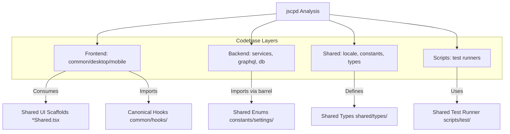
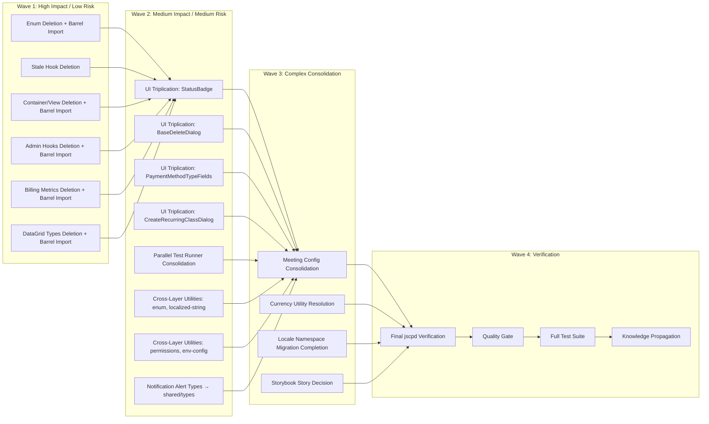
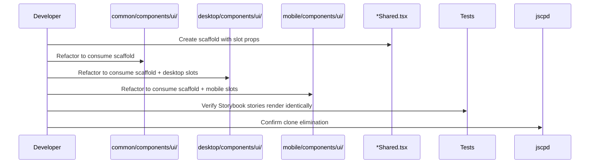
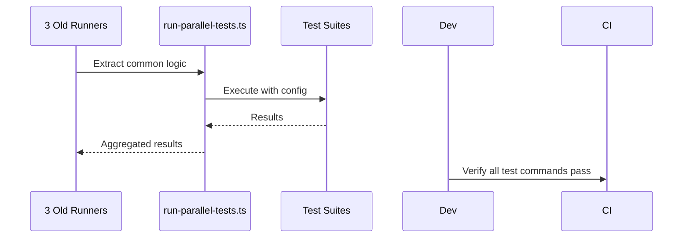

# Design Document: Code Duplication Elimination

## Document Information

- **Feature Name**: Code Duplication Elimination (jscpd 1021 clones)
- **Target Directory**: `.ai/plans/duplications`
- **Outcome Directory**: `.ai/plans/duplications/outcome`
- **Version**: 1.0
- **Date**: 2026-08-08
- **Author**: Kilo Agent
- **Reviewers**: Backend Team, Frontend Team, QA Team
- **Related Documents**: [Requirements Document](./requirements.md)

## Overview

This design addresses the systematic elimination of 1,021 code clones detected by jscpd across 8 major categories. The approach follows a phased wave strategy, prioritizing high-impact, low-risk eliminations first, then progressing to more complex consolidations. Each wave uses established patterns in the codebase (e.g., `*Shared.tsx` scaffolds, direct deletion with barrel imports, canonical module selection) to ensure consistency and maintainability.

**CRITICAL POLICY: NO RE-EXPORTS.** All duplicate files are deleted entirely. All importers are updated to use canonical sources via barrel file imports (e.g., `@/constants/settings`, `@/shared/types`, `@/common/lib`).

### Design Goals

1. **Zero Regressions**: All existing tests pass; no runtime behavior changes
2. **Canonical Sources**: Every duplicated concept has exactly one authoritative implementation
3. **Established Patterns**: Use existing abstraction patterns (`*Shared.tsx` scaffolds, barrel imports, canonical hooks)
4. **Direct Deletion**: NO re-exports — all duplicate files are deleted entirely and all importers updated to canonical sources via barrel files
5. **Phased Execution**: Waves ordered by impact/risk ratio for safe incremental progress
6. **Quality Gates**: Per-file verification + global quality gate at each phase boundary
7. **Knowledge Capture**: Outcome documents + propagated docs for future prevention

### Key Design Decisions

| Decision | Rationale |
|----------|-----------|
| `*Shared.tsx` scaffold with slot props for UI triplication | Matches existing `baseDeleteDialogShared.tsx` precedent; preserves tier-specific customization via composition |
| **NO RE-EXPORTS: Direct deletion with barrel imports** | Clean architecture; prevents stale re-export files; forces importers to use canonical sources via barrel files (e.g., `@/constants/settings`, `@/shared/types`, `@/common/lib`) |
| Canonical module selection based on layer conventions | `common/hooks/` for hooks, `common/lib/` for shared utilities, `constants/settings/` for enums, `backend/services/` for service utilities |
| Locale migration completion over abstraction | Migration is already in-flight; deleting monolithic files is the intended end state |
| Shared test runner utility module | Extracts ~199 duplicated lines into configurable function; all three runners become thin wrappers |
| Cross-layer utility deduplication via shared/types | Prevents frontend↔backend import violations; shared layer is the correct home for shared types |
| Storybook stories: evaluate factory vs jscpd ignore | Stories are test artifacts; factory approach preferred but ignore is acceptable fallback |

### UX/Navigation Specification (REQUIRED)

This is an internal refactoring feature with no user-facing routes, navigation, or UI changes.

#### New Routes & URLs
| Route | Purpose | Permission Required | Roles with Access |
|-------|---------|---------------------|-------------------|
| N/A | Internal refactoring only | N/A | N/A |

#### Sidebar Navigation Integration
- **Group**: N/A
- **Parent Item**: N/A
- **Children**: N/A
- **Mobile Bottom Nav**: N/A

#### Role-Based Access Matrix
| Role | Routes Accessible | Permissions Granted |
|------|-------------------|---------------------|
| All | N/A | N/A |

#### Per-Audience Rendering
| Audience | Prominent Content / Differences |
|----------|----------------------------------|
| All | No user-facing changes |

#### Mobile vs Desktop Variants
| Aspect | Desktop | Mobile |
|--------|---------|--------|
| Refactoring Impact | Identical — both consume `*Shared.tsx` scaffolds | Identical — both consume `*Shared.tsx` scaffolds |

#### Permission Mapping
| Component/Route | Required Permission | Source |
|-----------------|---------------------|--------|
| N/A | N/A | N/A |

### Translation System Requirements (CRITICAL)

All locale file modifications during the locale namespace migration (Requirement 3) MUST comply with the compile-time TypeScript i18n system:

**Client Components:**
```typescript
import { useAppTranslation } from "@/shared/locale/client";
import { Translation } from "@/shared/locale";

const t = useAppTranslation(Translation.Dashboard.Profile);
const label = t.propertyName;  // ✅ Property access
```

**Server Components:**
```typescript
import { getTranslations } from "@/shared/locale/server";

const t = await getTranslations(locale);  // ✅ Single arg
const labels = t.Dashboard.Profile;
const label = labels.propertyName;  // ✅ Property access
```

**GraphQL Resolvers:**
```typescript
const t = ctx.t("Dashboard.Profile");  // ✅ String key, bound to ctx.locale
```

**Forbidden Patterns:**
- ❌ `useAppTranslation("stringLiteral")`
- ❌ `t('functionCall')` or `t("functionCall")`
- ❌ `getTranslations(locale, "twoArgs")`
- ❌ Hardcoded strings in UI components
- ❌ `next-intl` imports

### Concurrency & Race Condition Assessment

This feature does not involve shared mutable state, concurrent actors, or transaction-isolation-dependent correctness. No SELECT FOR UPDATE or advisory locks needed.

### Drizzle SQL Template Anti-Patterns

No Drizzle schema changes are planned for this feature. If any schema changes become necessary during implementation:
- NEVER use inline `--` comments inside `sql`` templates
- Use block comments outside the template or no comments

### Outcome & Knowledge Transfer Protocol

- **BEFORE Execution:** Executing agents MUST read ALL existing files in `.ai/plans/duplications/outcome/`
- **AFTER Execution:** Executing agents MUST write `.ai/plans/duplications/outcome/<task-id>-outcome.md` with research, implementation details, cross-file dependencies, and carry-over points
- **PROGRESS TRACKING:** Executing agents MUST update task checkboxes `[ ]` -> `[x]` in `tasks.md`

## Architecture

### System Context



### High-Level Architecture



### Technology Stack

| Layer | Technology | Rationale |
|-------|------------|-----------|
| Frontend | React 19, MUI v9, Next.js 16 | Existing stack |
| Backend | Pothos GraphQL, Drizzle ORM, PostgreSQL | Existing stack |
| Shared | TypeScript, Custom i18n | Existing stack |
| Testing | Bun test, Vitest, Playwright | Existing stack |
| Quality | oxlint, Biome, TypeScript (tsgo), CodeScene, SonarQube | Existing stack |

## Components and Interfaces

### Component 1: UI Shared Scaffolds (`*Shared.tsx`)

**Purpose**: Provide canonical implementation for UI components with tier-specific customization via slot props.

**Responsibilities**:
- Render core component structure and logic
- Accept slot props for tier-specific variations (e.g., `CancelActionButton`, `ConfirmActionButton`)
- Provide sensible defaults for optional variations
- Export TypeScript interfaces for slot prop types

**Interfaces**:
- **Input**: Base props + optional slot props (ReactNode or render props)
- **Output**: ReactElement
- **Dependencies**: MUI v9 components, theme, i18n (via `useAppTranslation`)

**Implementation Notes**:
- Follow `baseDeleteDialogShared.tsx` pattern exactly
- Slot props typed as `ReactNode | ((props: SlotProps) => ReactNode)`
- Default slots provided for common cases
- Tier variants become thin wrappers: `<BaseDeleteDialogShared ConfirmActionButton={<DesktopConfirmButton />} />`

### Component 2: Shared Test Runner (`scripts/test/run-parallel-tests.ts`)

**Purpose**: Single configurable function for parallel test execution across all test suites.

**Responsibilities**:
- Discover test files matching a pattern
- Execute tests in parallel with configurable concurrency
- Capture and aggregate results
- Handle timeouts and retries
- Provide structured output for CI/logging

**Interfaces**:
- **Input**: `RunParallelTestsConfig { pattern: string; concurrency: number; timeout: number; label: string; env?: Record<string, string> }`
- **Output**: `Promise<TestRunResult { passed: number; failed: number; duration: number; errors: Error[] }>`
- **Dependencies**: Bun test runner, file system, worker threads

**Implementation Notes**:
- Extract common logic from `run-db-tests-parallel.ts`, `run-services-tests-parallel.ts`, `run-integration-tests-parallel.ts`
- Each existing runner becomes: `await runParallelTests({ pattern: "**/db/**/*.test.ts", concurrency: 4, timeout: 120000, label: "db" })`

### Component 3: Shared Types Module (`shared/types/notification-alerts.types.ts`)

**Purpose**: Single source of truth for notification alert metadata types consumed by both backend and frontend.

**Responsibilities**:
- Define shared TypeScript interfaces for notification alerts
- Export types for backend (GraphQL resolvers) and frontend (notification drawer)
- Maintain version compatibility

**Interfaces**:
- **Input**: N/A (type definitions only)
- **Output**: TypeScript interfaces
- **Dependencies**: None (pure types)

**Implementation Notes**:
- Extract 65 shared lines from `types/notifications/notification-alerts.metadata.types.ts` and `common/views/dashboard/components/navbar/notifications/types/notificationDrawer.types.ts`
- Both files import from `@/shared/types/notification-alerts.types`

### Component 4: Canonical Hooks (`common/hooks/`)

**Purpose**: Single authoritative implementation for reusable React hooks.

**Responsibilities**:
- `usePhoneInput.ts`: Phone input formatting, validation, masking
- `useTagInputEditing.ts`: Tag input editing state, add/remove/validation

**Interfaces**:
- **Input**: Hook-specific configuration objects
- **Output**: Hook return types (state, handlers, helpers)
- **Dependencies**: React, MUI, i18n (if needed)

**Implementation Notes**:
- Already canonical; task is deleting stale copies in `common/components/ui/input/*/`

### Component 5: Meeting Config Consolidation (`common/lib/meeting-config.ts`)

**Purpose**: Single module for meeting configuration validation, parsing, and URL generation.

**Responsibilities**:
- Validation functions (from `lib/meeting-config.validation.ts`)
- URL parsing functions (from `services/meeting/meeting-url-parser.ts`)
- URL generation functions (existing in `common/lib/meeting-config.ts`)
- Clear separation of concerns via named exports

**Interfaces**:
- **Input**: Meeting config objects, URLs, provider identifiers
- **Output**: Validation results, parsed config, generated URLs
- **Dependencies**: Drizzle types, provider enums, URL utilities

**Implementation Notes**:
- Three overlapping modules → one canonical module
- Export groups: `validate*`, `parse*`, `generate*`

## Data Models

### Shared Type: NotificationAlertMetadata

```typescript
// shared/types/notification-alerts.types.ts
export interface NotificationAlertMetadata {
  id: string;
  type: NotificationAlertType;
  title: string;
  message: string;
  priority: 'low' | 'medium' | 'high' | 'critical';
  entityType: string;
  entityId: string;
  actionUrl?: string;
  actionLabel?: string;
  metadata?: Record<string, unknown>;
  createdAt: Date;
  readAt?: Date;
  dismissedAt?: Date;
}

export type NotificationAlertType = 
  | 'meeting_reminder'
  | 'payment_due'
  | 'class_cancelled'
  | 'grade_posted'
  | 'announcement'
  | 'system_alert';
```

### Test Runner Config

```typescript
// scripts/test/run-parallel-tests.ts
export interface RunParallelTestsConfig {
  pattern: string;
  concurrency: number;
  timeout: number;
  label: string;
  env?: Record<string, string>;
}

export interface TestRunResult {
  passed: number;
  failed: number;
  duration: number;
  errors: Error[];
}
```

### UI Scaffold Slot Props (Generic Pattern)

```typescript
// common/components/ui/dialog/baseDeleteDialogShared.tsx (reference)
interface BaseDeleteDialogSharedProps {
  // Core props
  open: boolean;
  onClose: () => void;
  onConfirm: () => void;
  title: string;
  description: string;
  
  // Slot props for tier customization
  CancelActionButton?: ReactNode | ((props: { onClick: () => void; disabled: boolean }) => ReactNode);
  ConfirmActionButton?: ReactNode | ((props: { onClick: () => void; disabled: boolean; loading: boolean }) => ReactNode);
  Content?: ReactNode | ((props: { title: string; description: string }) => ReactNode);
}
```

## Data Flow

### UI Triplication Refactoring Flow



### Test Runner Consolidation Flow



## API Design

No new API endpoints. This is an internal refactoring.

## Security Considerations

### Authentication
- No changes to authentication logic
- Permission utilities (`lib/auth/permissions.ts` deleted; `services/auth/permissions.service.ts` canonical) — runtime behavior preserved exactly via direct imports using `@/backend/services/auth` barrel

### Authorization
- No changes to authorization logic
- Direct deletion + barrel import pattern ensures zero behavioral change

### Data Protection
- No PII handling changes
- Locale migration only reorganizes translation keys — no data changes

### Input Validation
- Meeting config validation functions consolidated — same validation logic, single source
- No validation behavior changes

## Error Handling

### Error Categories
| Category | Handling |
|----------|----------|
| Refactoring Regression | Caught by existing test suites + quality gate |
| Import Resolution | TypeScript compilation (tsgo) catches broken imports |
| Runtime Behavior Change | Integration tests + E2E tests catch divergences |
| Locale Key Missing | Compile-time i18n system catches missing translations |

### Error Response Format
N/A — no API changes.

### Logging Strategy
- **Error Logs**: Existing logger (`@/backend/lib/logger`, `@/frontend/utils/logger`) — no changes
- **Audit Logs**: N/A
- **Performance Logs**: N/A

## Performance Considerations

### Expected Load
- No runtime performance impact expected
- Build time may improve slightly due to reduced duplication
- jscpd analysis time may decrease

### Performance Requirements
- `bun check:duplicates` < 60 seconds (maintain current baseline)
- `bun quality-gate` < 10 minutes (maintain current baseline)
- All test suites pass within current time budgets

### Optimization Strategies
- `*Shared.tsx` scaffolds: Zero runtime overhead (composition)
- Direct barrel imports: Zero runtime overhead (bundler resolves to canonical source)
- Shared test runner: Potential parallel execution improvements

### Monitoring and Metrics
- jscpd clone count (target: 0)
- Quality gate pass rate (target: 100%)
- Test suite pass rate (target: 100%)
- Baseline error delta (target: 0 new errors)

## Testing Strategy

### Unit Testing
- **Coverage Target**: Maintain existing coverage (no new code requiring coverage)
- **Testing Framework**: Bun test (backend), Vitest (Storybook), Playwright (E2E)
- **Key Test Areas**: 
  - All existing tests must pass without modification
  - `*Shared.tsx` scaffolds tested via tier variant tests
  - Shared test runner tested via existing test suite runs

### Integration Testing
- **API Testing**: Existing GraphQL integration tests (`bun run test:graphql`)
- **Database Testing**: Existing repo tests (`bun run test:db`)
- **External Service Testing**: Existing integration tests (`bun run test:integration`)

### End-to-End Testing
- **User Scenarios**: Existing E2E tests (`bun run test:ui:e2e`)
- **Testing Tools**: Playwright
- **Test Environment**: Production build (`bun run build:test` required first)

### Performance Testing
- **Load Testing**: N/A
- **Stress Testing**: N/A
- **Monitoring**: Quality gate metrics

## Deployment and Operations

### Deployment Strategy
- **Approach**: Standard rolling deployment (backward compatible changes only)
- **Environment Progression**: Dev → Staging → Production
- **Rollback Procedures**: Standard git revert — all changes are reversible

### Configuration Management
- No new configuration
- `.jscpd.json` may be updated for story ignore globs (if chosen)

### Monitoring and Alerting
- Quality gate in CI/CD pipeline
- jscpd as quality metric

### Maintenance Procedures
- Periodic `bun check:duplicates` in CI
- New code reviews should check for duplication patterns

## Migration and Compatibility

### Data Migration
- No database migration required
- Locale namespace migration is file reorganization only (translation keys unchanged)

### Backward Compatibility
- Import paths updated to canonical sources via barrel files (e.g., `@/constants/settings`, `@/common/lib`, `@/backend/services/auth`)
- All component props preserved via scaffold slot props
- All hook APIs preserved (canonical hooks unchanged)

### Integration Impact
- **Impact on Existing Systems**: Minimal — internal refactoring only
- **Required Changes to Dependent Systems**: None
- **Communication Plan**: Standard PR review process

---

## Design Review Checklist

### Architecture
- [x] High-level architecture is clearly described
- [x] Component responsibilities are well-defined
- [x] Interfaces between components are specified
- [x] Technology choices are justified

### Requirements Alignment
- [x] Design addresses all functional requirements (15 requirements)
- [x] Non-functional requirements are considered
- [x] Success criteria can be met with this design
- [x] Constraints and assumptions are addressed

### Technical Quality
- [x] Design follows established patterns and principles (scaffolds, direct deletion + barrel imports, canonical modules)
- [x] Security considerations are addressed (no auth/permission behavior changes)
- [x] Performance requirements are considered (zero overhead patterns)
- [x] Error handling is comprehensive (test-based regression detection)

### Implementation Readiness
- [x] Design provides sufficient detail for implementation
- [x] Data models are complete and validated
- [x] API specifications are detailed (N/A — no API changes)
- [x] Testing strategy is comprehensive (reuse existing suites)

### Maintainability
- [x] Design supports future extensibility (scaffold pattern reusable)
- [x] Components are loosely coupled (re-exports, shared types)
- [x] Configuration is externalized (test runner config)
- [x] Monitoring and observability are included (quality gate metrics)

### UX/Navigation Completeness (MANDATORY)
- [x] New routes table complete with permissions and roles (N/A)
- [x] Sidebar navigation placement specified (N/A)
- [x] Role-based access matrix for ALL user types (N/A)
- [x] Per-audience rendering differences documented (N/A)
- [x] Mobile vs Desktop variants defined (N/A — both consume scaffolds)
- [x] Permission mapping for each route/component specified (N/A)