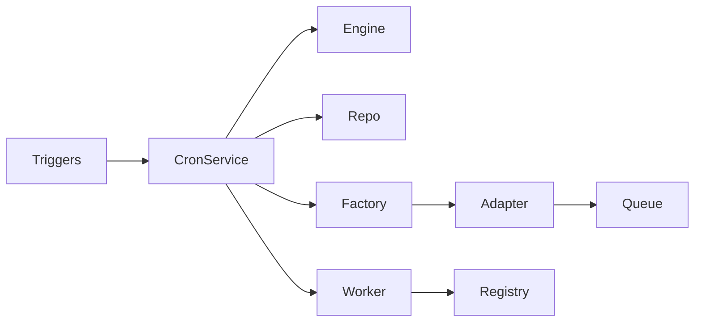
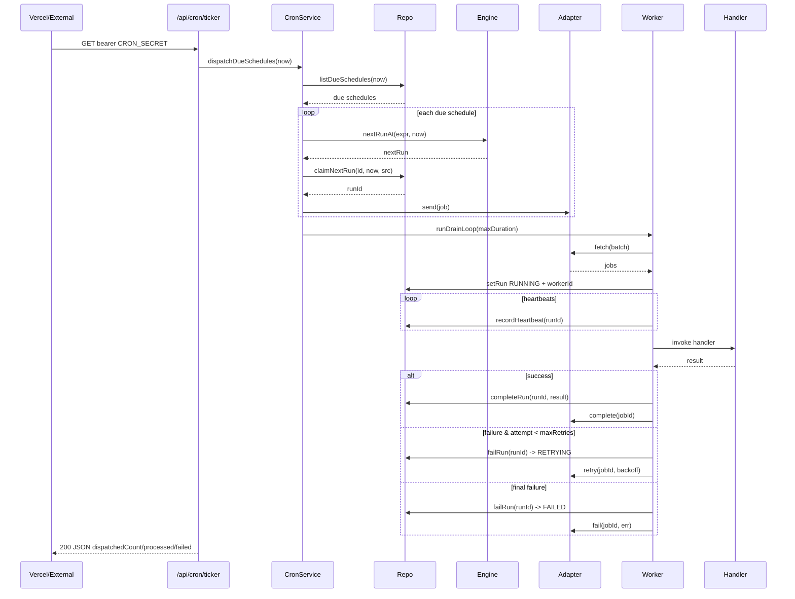

# Cron Service — Implementation Guide (Design)

**Feature**: Portable Cron Service with queue-backend agnostic dispatch and a full Admin Management UI
**Version**: 1.0
**Date**: 2026-07-31
**Related Documents**:
- [Requirements (Specs)](./specs.md)
- [Trackable Tasks](./trackable-tasks.md)
**Outcome Directory**: `.ai/plans/cron/outcome/`

## Outcome & Knowledge Transfer Protocol

### BEFORE Execution
Executing agents MUST read ALL existing files in `.ai/plans/cron/outcome/` to absorb prior research, search results, docs, and pitfalls.

### AFTER Execution
Executing agents MUST write `.ai/plans/cron/outcome/<task-id>-outcome.md` with research/doc findings, implementation details, and carry-over knowledge.

### PROGRESS TRACKING
Executing agents MUST update task checkboxes `[ ]` → `[x]` in `trackable-tasks.md`.

### Knowledge Propagation (Final Task)
After all tasks complete, the final task MUST:
1. Create canonical reference doc under `docs/services/cron-service.md` consolidating all outcome learnings
2. Update `backend/services/AGENTS.md`, `backend/AGENTS.md` with new patterns and doc reference
3. Update `.agents/instructions/backend.instructions.md` if new conventions should be enforced
4. Update root `AGENTS.md` Important References section

## Pre-Implementation Checklist

Before starting any task:
- [ ] Read root `AGENTS.md` at `/home/ahmed/Projects/siraj-cron/AGENTS.md`
- [ ] Read layer-specific AGENTS.md for each touched file (see Task-to-Instructions Mapping below)
- [ ] Read applicable `.agents/instructions/*.instructions.md` files (see mapping)
- [ ] Read [specs.md](./specs.md) for the design decisions that govern the task
- [ ] Read ALL existing files in `.ai/plans/cron/outcome/`
- [ ] Mark task `[-]` when starting; `[x]` when complete and verified

## Task-to-Instructions Mapping (Absolute Paths)

All paths are in `/home/ahmed/Projects/siraj-cron/`.

| Layer | AGENTS.md Files | .agents/instructions Files |
|-------|-----------------|-----------------------------|
| Root | `AGENTS.md`, `CLAUDE.md` (`@AGENTS.md`) | — |
| Backend Schema | `backend/db/schema/AGENTS.md`, `backend/AGENTS.md` | `.agents/instructions/backend.instructions.md` |
| Backend Repos | `backend/db/repo/AGENTS.md`, `backend/AGENTS.md` | `.agents/instructions/backend.instructions.md` |
| Backend Tests | `backend/db/test/AGENTS.md` (if present), `backend/AGENTS.md` | `.agents/instructions/backend.instructions.md`, `.agents/instructions/tests.instructions.md` |
| Backend Services | `backend/services/AGENTS.md`, `backend/AGENTS.md` | `.agents/instructions/backend.instructions.md` |
| Backend GraphQL | `backend/graphql/AGENTS.md`, `backend/graphql/pothos/AGENTS.md` (if present), `backend/AGENTS.md` | `.agents/instructions/backend.instructions.md` |
| Backend Types | `backend/types/AGENTS.md`, `backend/AGENTS.md` | `.agents/instructions/backend.instructions.md` |
| Backend Enums | `backend/enum/AGENTS.md`, `backend/AGENTS.md` | `.agents/instructions/backend.instructions.md` |
| Scripts | `scripts/run-test/AGENTS.md` (if present) | `.agents/instructions/backend.instructions.md`, `.agents/instructions/tests.instructions.md` |
| Shared Locale | `shared/AGENTS.md` | (none) |
| App Router | `app/AGENTS.md` | `.agents/instructions/frontend.instructions.md` |
| Frontend Common | `frontend/common/views/AGENTS.md`, `frontend/common/graphql/AGENTS.md`, `frontend/common/stores/AGENTS.md` (if present), `frontend/AGENTS.md` | `.agents/instructions/frontend.instructions.md` |
| Frontend Desktop | `frontend/desktop/AGENTS.md`, `frontend/views/AGENTS.md`, `frontend/AGENTS.md` | `.agents/instructions/frontend.instructions.md`, `.agents/instructions/mobile-desktop.instructions.md` |
| Frontend Mobile | `frontend/mobile/AGENTS.md`, `frontend/views/AGENTS.md`, `frontend/AGENTS.md` | `.agents/instructions/frontend.instructions.md`, `.agents/instructions/mobile-desktop.instructions.md` |
| Test UI | `test/ui/AGENTS.md` (if present) | `.agents/instructions/tests.instructions.md` |

---

## Overview

A portable, queue-backend-agnostic **Cron Service** for Siraj. The service owns schedule definitions (Postgres-backed), computes `nextRunAt` via a cron-expression engine, dispatches due schedules through a runtime-selected queue adapter, executes registered handlers in a worker runtime, and audits every dispatch + execution as `cron_runs` + `cron_heartbeats`. A new `/cron` admin route surfaces full CRUD on schedules, run inspection, queue stats, and a manual trigger.

The dispatch is **trigger-mode agnostic** — any of three modes (Vercel ticker cron, Vercel explicit per-schedule crons, external-scheduler pings) can fire the same endpoints; all paths are idempotent via atomic `claimNextRun`. This phase deliberately does NOT migrate the two existing cron routes (`/api/cron/class-reminders`, `/api/fx/refresh`) — they stay untouched; the new service ships with only a `NOOP` handler to validate the pipeline end-to-end without coupling to real domains.

### Design Goals

- Schedule registry editable in seconds (DB-backed) — no `vercel.json` redeploy for cadence changes
- One pipeline supports every platform from Vercel Hobby (1/day) through Enterprise (per-minute) to self-hosted (standalone worker script)
- Idempotent everywhere: ticker race, manual-trigger double-click, worker crash, webhook duplicate-ping — all are safe
- Queue backend swappable at runtime (env + DB override), pg-boss default ships zero new infra, BullMQ-Postgres/Redis + custom-SQL selectable post-pg-boss-validation
- Admin UI built on the existing MUI + Apollo + Zustand stack with full mobile/desktop tier isolation per the project's `frontend/common/views/AGENTS.md` rules

### Key Design Decisions

1. **Service factory for queue backend** — resolution order matches the existing `env-config-resolver.ts`: `system_settings.env::CRON_QUEUE_BACKEND` (cached 5min) → `process.env.CRON_QUEUE_BACKEND` → default `PG_BOSS`. Adapter is `await import(...)`-ed lazily so non-selected backends don't bloat serverless bundles; server boot never crashes on a missing optional dep.
2. **Hybrid trigger modes simultaneously** — single ticker cron drains due jobs (recommended path); explicit Vercel crons can also fire any schedule by id (useful for per-minute precision on a specific schedule); external pings use the same bearer. Idempotency comes from `claimNextRun`'s atomic `UPDATE … WHERE nextRunAt <= now AND status = ACTIVE … RETURNING …` wrapped in tx + advisory lock.
3. **In-process worker runtime now** (Fluid Compute reuses instance); same code path supports a future standalone `bun scripts/cron-worker.ts` — only the harness changes.
4. **Concurrency policy** (`ALLOW` / `SKIP` / `REPLACE`) governs manual-trigger conflicts. All three explicit so behavior never surprises an admin.
5. **Phased backlog**: pg-boss adapter fully implemented this phase; BullMQ-Postgres, BullMQ-Redis, custom-SQL adapters ship as `throw NotImplemented` stubs and get fully implemented in follow-up task 15 once pg-boss is validated in prod.
6. **`NOOP` handler only** — pipeline validated end-to-end without coupling to real notification domains. Future plans register domain handlers (`CLASS_REMINDER`, `FX_REFRESH`, etc.) into the same registry.
7. **`/cron` route** as solo child of `grp_admin` — matches the `settings` / `permissions` siblings; no separate `/cron/new` or `/cron/[id]` routes (create/edit and run inspection are in-page dialogs, mirroring `paymentCatalogs`).

### UX/Navigation Specification

#### New Routes & URLs

| Route | Purpose | Permission Required | Roles with Access |
|-------|---------|---------------------|-------------------|
| `/cron` | List schedules (with create/edit/pause/resume/delete dialogs and run-history dialog) | `CRON_MANAGE` | `SUPER_ADMIN`, `ACADEMY_ADMIN` |

This phase ships a single Server Component page at `app/(dashboard)/cron/page.tsx` that renders `CronManagementView`. All flows (create, edit, view runs, manual trigger) are in-page MUI Dialogs — no additional routes.

#### Sidebar Navigation Integration

- **Group**: `grp_admin` (existing — labelled "Admin" with `security` icon)
- **Parent Item**: None — `cron` is a direct sibling of `permissions`, `settings`, `dst-migration`
- **Children**: None (no nested routes in this phase)
- **Order**: insert `cron` item between `dst-migration` and `permissions` in `SIDEBAR_NAV_ITEMS` (so the visible order in the sidebar group is: `dst-migration`, `cron`, `permissions`, `settings`)
- **Mobile Bottom Nav**: NOT added — admin-only surfaces are kept off `BOTTOM_NAV_ITEMS`. The mobile user accesses `/cron` via the mobile sidebar drawer (existing flow).

#### Role-Based Access Matrix

| Role | Routes Accessible | Permissions Granted |
|------|-------------------|---------------------|
| SUPER_ADMIN | `/cron` | `CRON_MANAGE` (auto via `super_admin` group) |
| ACADEMY_ADMIN | `/cron` | `CRON_MANAGE` (granted by seed) |
| SUPERVISOR | N/A — item hidden via `applySupervisorNavOverrides`'s `hiddenKeys` set | — |
| TEACHER | N/A | — |
| PARENT | N/A | — |
| STUDENT | N/A | — |
| STAFF | Optional — only if `STAFF_DEFAULT` group grants `CRON_MANAGE` (left to seed config) | conditional |

#### Per-Audience Rendering

| Audience | Prominent Content / Differences |
|----------|----------------------------------|
| Student | N/A — page hidden |
| Parent | N/A — page hidden |
| Teacher | N/A — page hidden |
| Supervisor | N/A — page hidden (existing supervisor portal nav already drops `permissions` / `settings` / `dst-migration`; the new `cron` key is added to the same `hiddenKeys` set so a non-admin supervisor never sees the sidebar entry) |
| Admin/Staff | Full UI (list / create / edit / pause / resume / delete / trigger / inspect runs / queue stats) |

#### Mobile vs Desktop Variants

| Aspect | Desktop | Mobile |
|--------|---------|--------|
| Sidebar entry | `cron` item under `grp_admin` | Same item in drawer (mobile sidebar); NOT in `BOTTOM_NAV_ITEMS` |
| Schedule list | `AppDataGrid`/`DesktopAppDataGrid` with server-side paginationOptions | `MobileCardList` + `MobileCardListItem` with server-side paginationOptions (tier-paired variant) |
| Create/edit | `ScheduleCreateEditDialog` (MUI `Dialog`) | Same dialog component (auto responsive) — forms use `mobileContentGutterSx` per mobile rules |
| Run history | `RunsDialog` containing `RunsDataGrid` | `RunsDialog` containing `MobileCardList` of runs |
| Queue stats | `QueueStatsCard` in `Grid` next to data grid | `QueueStatsCard` stacked above the card list |
| View files | `frontend/desktop/views/dashboard/admin/cron/cronManagement.desktop.tsx` | `frontend/mobile/views/dashboard/admin/cron/cronManagement.mobile.tsx` |

#### Permission Mapping

| Component/Route | Required Permission | Source |
|-----------------|---------------------|--------|
| `/cron` page | `CRON_MANAGE` | `requirePermissionForPage([AppPermission.CRON_MANAGE])` in `app/(dashboard)/cron/page.tsx` |
| `CronManagementView` (client) | `CRON_MANAGE` | Server-side enforcement via Pothos; client defense-in-depth via `<RequirePermission permission={[AppPermission.CRON_MANAGE]}>` wrapper |
| `cronScheduleCreate` / `Update` / `Delete` / `Pause` / `Resume` mutations | `CRON_MANAGE` | Pothos scope-auth `requirePermission` (matches existing `permissions.pothos.ts` pattern) |
| `cronRunTrigger` mutation | `CRON_MANAGE` | Same |
| `cronSchedules`, `cronRuns`, `cronQueueStats` queries | `CRON_MANAGE` | Same |

---

## Architecture

### System Context

```mermaid
graph TB
    VercelCron[Vercel Ticker Cron<br/>cron.json schedule entry]
    ExplicitCron[Vercel Explicit Cron<br/>one per schedule, optional]
    ExtScheduler[External Scheduler<br/>Crontap / GH Actions / cron-job.org]
    ManualTrigger[Manual Trigger<br/>from Admin UI GraphQL mutation]
    AdminUI[Admin UI /cron<br/>Apollo Client]
    GQL[GraphQL via Pothos<br/>CRON_MANAGE-gated]

    VercelCron --> TickerRoute
    ExplicitCron --> ExecuteRoute
    ExtScheduler --> TickerRoute
    ManualTrigger --> GQL
    AdminUI --> GQL

    TickerRoute[/api/cron/ticker] --> CronService
    ExecuteRoute[/api/cron/execute] --> CronService
    GQL --> CronService

    CronService --> Repo[cron.repository]
    Repo --> DB[(Postgres<br/>cron_schedules<br/>cron_runs<br/>cron_heartbeats)]
    CronService --> Engine[cron-scheduler.engine]
    CronService --> Factory[queue-adapter.factory]
    Factory --> Adapter[active CronQueueAdapter]
    Adapter --> Queue[(queue backing store<br/>pg-boss tables / Redis / custom SQL)]
    CronService --> Worker[worker runtime<br/>drains queue in-process]
    Worker --> Registry[JobHandlerRegistry]
    Registry --> NOOP[NOOP handler]
```

### High-Level Architecture



### Technology Stack

| Layer | Technology | Rationale |
|-------|------------|-----------|
| Runtime | Bun (Next.js 16 App Router) | existing project standard; pg-boss confirmed compatible on modern Bun |
| Queue backend (default) | pg-boss v12, on existing Postgres | zero new infra; same DB as `cron_schedules` — transactional enqueue possible |
| Queue backend (optional) | BullMQ with Postgres backend OR BullMQ with `@upstash/redis` | selectable per deployment; needs optional deps |
| Queue backend (optional, no library) | hand-rolled `SELECT … FOR UPDATE SKIP LOCKED` on the same Postgres | zero new deps for the most minimal deployment |
| Cron expression engine | cron-parser v5 | standard, well-tested, supports timezone strings |
| DB schema | Drizzle ORM (existing) | project standard — `db push` only, no migration files |
| GraphQL | Pothos (existing) + scope-auth | project standard; matches `permissions.pothos.ts` shape |
| Frontend | React 19 + MUI v9 + Apollo v4 + Zustand | project standard |
| i18n | shared/locale compile-time system | project standard — `useAppTranslation("cron")` |
| Logging | `@/backend/lib/logger` (never `console.*`) | AGENTS.md hard rule |
| Path aliases | `@/*` everywhere | AGENTS.md hard rule |
| Lint / format / type-check | tsgo + Biome + lint-queue (via quality-gate) | existing workflow |

---

## Components and Interfaces

### Component 1: `CronService` (orchestration)

**Purpose**: Single orchestration layer for cron schedules + dispatch + history.

**Responsibilities**:
- `createSchedule(input)` — validate cron + timezone, compute `nextRunAt`, persist
- `updateSchedule(id, input)` — same; recompute `nextRunAt` if expression/timezone changed
- `pauseSchedule(id)` / `resumeSchedule(id)` — status transition + `nextRunAt` recompute
- `deleteSchedule({ id, hard })` — soft (status DISABLED) or hard delete
- `getSchedule(id)` / `getSchedules(input)` / `getRuns(input)` / `getRun(id)` — read paths
- `dispatchDueSchedules({ now, source })` — list due → for each → `claimNextRun` → `adapter.send(job)` (queue-internal job wraps `cron_run.id`)
- `dispatchScheduleById(id, { source, payload })` — manual / explicit / external; applies `concurrencyPolicy`
- `completeRun(runId, result)` / `failRun(runId, error)` — called by worker runtime after handler returns/throws
- `recordHeartbeat(runId, workerId, progress)` — called by worker mid-job
- `reconcileStuckRuns({ now, batch })` — ticker calls on every tick; marks runs whose last heartbeat exceeds `timeoutSeconds` as `TIMEOUT`

**Interfaces**:
- **Input**: `CronScheduleSubmitInput`, `CronScheduleUpdateInput`, `CronRunListInput`, `CronTriggerNowInput`, dispatch options (now/source/payload)
- **Output**: `CronScheduleReturnType`, `CronRunReturnType`, `CronQueueStats`, dispatch summaries
- **Dependencies**: `CronSchedulerEngine`, `CronRepository`, `CronQueueAdapter` (via factory), `JobHandlerRegistry`

**Implementation Notes**:
- All DB access via the repo — service never touches Drizzle directly (per `backend/AGENTS.md`)
- All mutations wrap in a tx + advisory lock when atomicity matters (`claimNextRun`, concurrency-policy resolution)
- Locale messages via `ctx.t` / `getServerTranslations` — never hardcoded strings (this service is called from GraphQL resolvers and API routes)
- Logging: structured — `logger.info("cron.dispatch.due.start", { source })`, etc.

### Component 2: `queue-adapter.factory`

**Purpose**: Resolve the active queue adapter from env / `system_settings`.

**Responsibilities**:
- Read `resolveEnvConfig("CRON_QUEUE_BACKEND")` once on first access (cached via existing 5min TTL module cache)
- Map to enum `CronQueueBackend` (case-insensitive string)
- `await import(...)` the matching adapter module lazily
- Memoize the singleton adapter in a module-scoped `let activeAdapter`
- Throw `CronQueueBackendUnknown` for unknown values; `CronQueueBackendNotAvailable` for missing library
- For the pg-boss adapter: fetch a raw `pg.Pool` from the project's existing `createPool()` (`@/backend/db`'s `createPool` exported from `backend/db/factory.ts`) — NOT the Drizzle `db`, NOT the Neon HTTP `neon()` client

**Interfaces**:
- **Input**: none (reads env + DB)
- **Output**: `CronQueueAdapter`
- **Dependencies**: `@/backend/lib/env-config-resolver` (`resolveEnvConfig`), `@/backend/lib/env-config-keys` (registered new key), `@/backend/db` `createPool`

**Implementation Notes**:
- Add `CRON_QUEUE_BACKEND`, `CRON_QUEUE_MAX_BATCH`, `CRON_QUEUE_WORKER_CONCURRENCY` to `ENV_CONFIG_KEYS` with `excludeFromDb: false` (DB-overridable), category `cron`
- The factory's lazy import paths MUST be static strings so the bundler can analyze them: `() => import("./queue-adapters/pgboss.adapter")` etc.
- Active backend's `init()` is called ONCE on first boot — pg-boss requires `await boss.start()` before use; the adapter's `send` / `fetch` calls receive the started instance
- **Neon constraint**: pg-boss's `LISTEN/NOTIFY` mechanism (`useListenNotify: true`, the default) requires a direct (`-pooler` removed) connection string. If `createPool()` returns a `@neondatabase/serverless` `Pool` (the `neon-serverless` strategy branch in `backend/db/factory.ts` — used when `DB_PROVIDER=neon` and `DB_CONNECTION_MODE != pg`), AND the URL hostname contains `-pooler`, the adapter MUST call `PgBoss` with `useListenNotify: false` (poller-only mode) AND log a warning recommending the deployer switch to a direct `DATABASE_URL`. This is a documented Neon limitation (session-level features like LISTEN/NOTIFY + advisory locks break under PgBouncer transaction-mode pooling). Alternatively, when `DB_CONNECTION_MODE=pg`, `createPgPool()` returns a TCP `pg.Pool` and `useListenNotify: true` works perfectly — this is the **recommended** deployment mode for cron-heavy workloads

### Component 3: `cron-scheduler.engine`

**Purpose**: Pure cron-expression → `Date` calculator.

**Responsibilities**:
- `validateCronExpression(expr)` — bool
- `nextRunAt(cronExpression, from, timezone?)` — `Date` in UTC
- `nextRuns(cronExpression, from, count, timezone?)` — `Date[]` (used by the create/edit dialog preview)

**Interfaces**:
- **Input**: cron string, `Date` baseline, optional tz
- **Output**: `Date`
- **Dependencies**: `cron-parser` v5

**Implementation Notes**:
- Wrap `cron-parser.parseExpression` in try/catch and throw a typed `InvalidCronExpression`
- Timezone handling: pg-boss / cron-parser accept IANA tz strings; the engine doesn't validate them — `is_valid_timezone()` DB function does at insert time
- Pure functions — no I/O — easy unit tests

### Component 4: `JobHandlerRegistry`

**Purpose**: Map `CronJobKind` → handler at boot.

**Responsibilities**:
- `register(kind, handler)` — handlers are `async (job: CronJobPayload) => CronJobResult`
- `getHandler(kind)` — returns handler or `null`
- Register `CronJobKind.NOOP` → `noop.handler` automatically on construction

**Interfaces**:
- **Input**: `CronJobKind`, handler function
- **Output**: handler or `undefined`
- **Dependencies**: none (handlers receive the queue-internal job payload)

**Implementation Notes**:
- Handlers are stateless; the registry is a module-scoped singleton
- Top-of-file comment block MUST document the **idempotency contract** (handlers may run more than once under at-least-once delivery) — future plan implementers rely on this

### Component 5: `cron-worker.runtime`

**Purpose**: Drain the queue, dispatch each job to its handler, update `cron_runs`.

**Responsibilities**:
- `runDrainLoop({ maxDurationMs, batchSize })` — `fetch` batches → dispatch → `complete`/`fail` → repeat until queue empty or time-out
- Catch all handler errors — no unhandled rejection escapes
- Write a `cron_heartbeats` row periodically (every `Math.min(60_000, timeoutSeconds / 4)`)

**Interfaces**:
- **Input**: `maxDurationMs` (Vercel function deadline minus 30s safety), `batchSize`
- **Output**: `{ processed: number, failed: number, retried: number }`
- **Dependencies**: `CronQueueAdapter` (active), `JobHandlerRegistry`, `CronService` (for `completeRun` / `failRun` / `recordHeartbeat`)

**Implementation Notes**:
- Clock: a `Date.now()` deadline computed up-front; loop exits when `Date.now() >= deadlineNanos`
- Heartbeat interval computed per job's `timeoutSeconds` from `cron_schedules` (looked up by `job.scheduleId`); fallback 60s if unknown
- Designed for **in-process** use inside the `ticker` route (default); same code supports a future `bun scripts/cron-worker.ts` — only the harness differs

### Component 6: `cron.repository`

**Purpose**: All DB access — repository layer per `backend/AGENTS.md`.

**Responsibilities**:
- `createSchedule`, `updateSchedule`, `getScheduleById`, `getScheduleByName`
- `listSchedules({ status?, jobKind?, pagination })`
- `listDueSchedules({ now, limit })` — selects rows where `status = ACTIVE AND nextRunAt <= now` AND (no in-flight run with `PENDING/RUNNING/RETRYING` for `concurrencyPolicy = SKIP` schedules)
- `claimNextRun({ scheduleId, now, triggerSource, tx? })` — atomic; advisory-lock; recompute `nextRunAt`; insert `cron_runs` PENDING; return `runId | null`
- `updateRunStatus(runId, status)`, `appendRunError(runId, error, stack?)`, `recordHeartbeat(runId, workerId, progress?)`
- `reconcileStuckRuns({ now, batch })` — UPDATE runs SET `status = TIMEOUT` WHERE last heartbeat < `now - timeoutSeconds`
- `listRuns`, `listRunsBySchedule`, `deleteScheduleById({ hard? })`
- All non-transactional reads use `queryDb(tx)` per the Neon HTTP Client rule

**Interfaces**:
- **Input**: typed inputs from `backend/types/cron/`
- **Output**: typed select / return types
- **Dependencies**: Drizzle schema (tables from `backend/db/schema/cron/`), `cron-scheduler.engine`, `@/backend/db` (`db`, `queryDb`, `runInRollback` for tests)

### Component 7: pg-boss adapter (`backend/services/cron/queue-adapters/pgboss.adapter.ts`)

**Purpose**: Implement `CronQueueAdapter` against the pg-boss v12.26 API.

**Responsibilities**:
- Lazy `boss.start()` on first `send` / `fetch` invocation (NOT at server boot — so boot never crashes on missing DATABASE_URL)
- For each `cron_schedules.jobKind`, lazily `createQueue(name, { retryLimit, retryDelay, retryBackoff, expireInSeconds, heartbeatSeconds, deadLetter })` — defaults align with schedule-level options:
  - `retryLimit` from `cron_schedules.maxRetries` (default 3 — overrides pg-boss's default of 2)
  - `retryDelay` from `cron_schedules.retryBackoffSeconds` (default 60)
  - `retryBackoff: true` (matches our spec's exponential-backoff formula)
  - `expireInSeconds` from `cron_schedules.timeoutSeconds` (default 300)
  - `heartbeatSeconds` set to `Math.min(60, timeoutSeconds / 4)` — pg-boss auto-sends heartbeats from a `work()` handler running in our process
  - `deadLetter`: `<name>__dlq` (created on first failure)
- `send(job)` → `await boss.send(name, data, options)` — `data` carries `{ runId, scheduleId, payload }` from `CronService.dispatchDueSchedules`; returns the pg-boss job id
- `fetch({ count })` → `await boss.fetch(name, { batchSize: count, includeAllQueues: true })` — used by the worker runtime's drain loop in poller-only mode; the recommended path is `boss.work(name, handler)` which auto-manages state, but `fetch` is preserved for explicit pull semantics (used by the `CUSTOM_SQL` adapter's mental model)
- `complete(jobId)` → `await boss.complete(name, [jobId])` — passes `name` from the stored `cron_runs.jobKind`
- `fail(jobId, error)` → `await boss.fail(name, [jobId], { data: { message, stack } })`
- `retry(jobId, delaySeconds)` — pg-boss has no direct "retry" call; instead, set `retryLimit`/`retryDelay` on the queue and let the auto-retry machinery handle it. For an explicit re-enqueue (used by the worker's explicit-retry path), `await boss.sendThrottled` or `await boss.send(name, data, { startAfter: delaySeconds })` (delayed re-send)
- `getQueueStats()` — iterate over all known queue names (one per `cron_schedules.jobKind`) and call `await boss.getQueueStats(name)` per the v12 API (returns `{ queuedCount, deferredCount, readyCount, activeCount, failedCount, totalCount }` per queue)
- `boss.work(name, handler)` — the worker runtime registers a worker via this canonical API; pg-boss:
  - Auto-fetures jobs from the queue (`SKIP LOCKED` behind the scenes)
  - Auto-moves the job through `created → active → completed/retry/failed`
  - Auto-retries based on queue-level `retryLimit`/`retryDelay`/`retryBackoff`
  - Auto-updates `expireInSeconds` job timeout
  - Auto-fails on missed `heartbeatSeconds`
- Heartbeats: pg-boss auto-sends from inside the work handler — the worker runtime does NOT need to call a separate heartbeat API; the `cron_heartbeats` table is left for the `CUSTOM_SQL` adapter only

**Interfaces**:
- **Input**: jobs (`CronJobPayload`), `CronQueueStats`-shaped queries
- **Output**: `CronQueueStats` (mapped from pg-boss's `getQueueStats` shape)
- **Dependencies**: `pg-boss` v12.26+, raw `pg.Pool` from `createPool()` (NOT Neon HTTP)

**Implementation Notes**:
- Per pg-boss v12 README: requires Node 22.12+ for `require(esm)`; ran on Bun (issue #472 was resolved by upgrading Bun — verified)
- `boss.on('error', ...)` MUST be wired so unhandled queue errors log to `@/backend/lib/logger` (matches AGENTS.md)
- `boss.stop({ close: false })` on graceful shutdown — keep the pool alive for `send`/`fetch` after workers stop
- For the BullMQ-Postgres adapter (task 15.2): use the v6 `upsertJobScheduler({ pattern: cronExpr, tz: 'UTC' })` (REMOVED legacy `repeat` option on `Queue.add` was removed in v6; was deprecated in v5.16). Use `createPostgresBackend` factory passed as the last constructor argument per `docs.bullmq.io/guide/postgresql`
- For the BullMQ-Redis adapter (task 15.3): reuse the existing `@upstash/redis` connection (already a project dependency). Pass `IRedisClient`/connection to BullMQ constructors. BullMQ uses `cron-parser` internally — the same lib that drives `cron-scheduler.engine.ts`, so cron expression handling stays consistent

### Component 8: Pothos GraphQL

**Purpose**: Expose `CRON_MANAGE`-gated queries + mutations to the admin UI.

**Responsibilities**:
- Types: `CronSchedule`, `CronRun`, `CronQueueStats`, `CronPaginatedSchedules`, `CronPaginatedRuns`, input types
- Queries: `cronSchedules(input)`, `cronSchedule(id)`, `cronRuns(input)`, `cronRun(id)`, `cronQueueStats`
- Mutations: `cronScheduleCreate`, `cronScheduleUpdate`, `cronSchedulePause`, `cronScheduleResume`, `cronScheduleDelete`, `cronRunTrigger`
- All resolvers require `AppPermission.CRON_MANAGE` via the same scope-auth pattern as `permissions.pothos.ts`

---

## Data Models

### Entity 1: `cron_schedules`

```typescript
interface CronScheduleSelectType {
  id: string; // uuid pk
  name: string; // text, unique
  description: string | null; // text
  cronExpression: string; // text
  jobKind: CronJobKind; // enum
  payload: Record<string, unknown> | null; // jsonb
  status: CronScheduleStatus; // enum, default ACTIVE
  timezone: string; // text, default "UTC"
  nextRunAt: Date | null; // timestamptz
  lastRunAt: Date | null; // timestamptz
  concurrencyPolicy: CronConcurrencyPolicy; // enum, default ALLOW
  maxRetries: number; // int, default 3
  retryBackoffSeconds: number; // int, default 60
  timeoutSeconds: number; // int, default 300
  createdAt: Date;
  updatedAt: Date;
  createdByUserId: string; // fk users.id
  updatedByUserId: string | null; // fk users.id
}
```

**Validation Rules**:
- `name` unique across `ACTIVE` + `PAUSED` (DB unique index)
- `cronExpression` validated by `cron-scheduler.engine`
- `timezone` validated by `is_valid_timezone()` DB function
- `maxRetries >= 0`, `retryBackoffSeconds >= 1`, `timeoutSeconds >= 10`

**Relationships**: one-to-many → `cron_runs` (cascade-historically-preserve on hard delete)

### Entity 2: `cron_runs`

```typescript
interface CronRunSelectType {
  id: string; // uuid pk
  scheduleId: string; // fk cron_schedules
  jobKind: CronJobKind; // enum denormalized from schedule (immutable snapshot)
  status: CronRunStatus; // enum
  triggerSource: CronTriggerSource; // enum
  payload: Record<string, unknown> | null; // jsonb
  attempt: number; // int, default 1
  startedAt: Date; // timestamptz
  completedAt: Date | null; // timestamptz
  durationMs: number | null; // int
  errorMessage: string | null;
  errorStack: string | null;
  workerId: string | null;
  createdAt: Date;
  updatedAt: Date;
}
```

**Validation Rules**:
- Forward-only status transitions enforced in `updateRunStatus` (like `notification.repository.updateDeliveryStatus`)
- `(scheduleId, status, startedAt)` composite index for "in-flight run for schedule" lookup

### Entity 3: `cron_heartbeats`

```typescript
interface CronHeartbeatSelectType {
  id: string; // uuid pk
  runId: string; // fk cron_runs
  workerId: string; // text
  lastBeatAt: Date; // timestamptz
  progress: Record<string, unknown> | null; // jsonb
  createdAt: Date;
}
```

### Data Flow



---

## API Design

### Route 1: `GET /api/cron/ticker`

**Auth**: `verifyCronSecretAuth(request)` — `CRON_SECRET` bearer, constant-time compare, GET-only.
**Route segment config**: `export const maxDuration = 300;` (Next.js 16 — `dynamic = force-dynamic` is REMOVED per the cache-components migration; the existing cron routes already follow this pattern).
**Response 200**:
```json
{
  "dispatchedCount": 3,
  "processedCount": 12,
  "failedCount": 0,
  "retriedCount": 1,
  "stuckRunsReconciled": 0,
  "nextTickInMs": 60000
}
```
**Errors**: 401 (bad bearer), 405 (non-GET), 500 (server error or missing secret in prod)

### Route 2: `GET /api/cron/execute?scheduleId=<uuid>`

**Auth**: same `CRON_SECRET` bearer via `verifyCronSecretAuth`.
**Route segment config**: same `maxDuration = 300`.
**Response 200**: same shape (with `dispatchedCount = 1`).
**Errors**: same + 404 (schedule not found), 400 (bad/missing `scheduleId`)

### GraphQL (Pothos)

- `Query.cronSchedules(input: CronScheduleListInput!): CronPaginatedSchedules!`
- `Query.cronSchedule(id: ID!): CronSchedule`
- `Query.cronRuns(input: CronRunListInput!): CronPaginatedRuns!`
- `Query.cronRun(id: ID!): CronRun`
- `Query.cronQueueStats: CronQueueStats!`
- `Mutation.cronScheduleCreate(input: CronScheduleSubmitInput!): CronSchedule!`
- `Mutation.cronScheduleUpdate(id: ID!, input: CronScheduleUpdateInput!): CronSchedule!`
- `Mutation.cronSchedulePause(id: ID!): CronSchedule!`
- `Mutation.cronScheduleResume(id: ID!): CronSchedule!`
- `Mutation.cronScheduleDelete(input: { id: ID!, hard: Boolean }): Boolean!`
- `Mutation.cronRunTrigger(input: { id: ID!, payload: JSON }): CronRun!`

All resolvers throw `permissionDenied` for non-`CRON_MANAGE` users (existing Pothos scope-auth).

---

## Security Considerations

### Authentication

- API routes: reuse existing `verifyCronSecretAuth` unchanged. External schedulers must set the same `Authorization: Bearer ${CRON_SECRET}` header (documented in `backend/lib/cron-auth.ts`).
- GraphQL: relies on the existing authenticated context (`ctx.userId`) — `CRON_MANAGE` enforced via scope-auth.

### Authorization

- Every resolver + every mutation gated by `AppPermission.CRON_MANAGE` — no read-without-manage in this surface.
- Defense-in-depth: client `<RequirePermission>` wrapper on `CronManagementView` hides the page if the `me` query returns no `CRON_MANAGE`.

### Data Protection

- `cron_runs.errorStack` contains stack traces — exposed only to `CRON_MANAGE` viewers (this phase gates anyway; documented for future per-run redaction).
- `cron_runs.payload` is whatever the schedule's payload was — admins authoring schedules must NOT put secrets in `payload`; enforce at admin UI validation (warn if `payload` looks like it contains `password`, `secret`, `token`, `key`).

### Input Validation

- `cronExpression` validated via `cron-scheduler.engine.validateCronExpression` before persisting (no raw regex).
- `timezone` validated via DB `is_valid_timezone()` constraint on insert.
- `payload` JSON max size 16KB (DB check; service warns at 8KB).

### Rate limiting

- The ticker is externally rate-limited by Vercel's cron limit (per-minute on Pro+, per-day on Hobby).
- Manual trigger: surfaced via GraphQL — no special rate limit beyond the existing GraphQL throttle (this phase; future may add a per-schedule manual-trigger cooldown).

---

## Error Handling

### Error Categories

| Category | Where handled | User/admin action |
|----------|--------------|-------------------|
| Invalid cron expression | Pothos resolver → typed error `invalidCronExpression` (localized) | fix the expression in the dialog |
| Invalid timezone | DB constraint → resolver maps to `invalidTimezone` | pick a valid IANA tz |
| Schedule name taken | DB unique violation → `scheduleNameTaken` | choose a different name |
| Permission denied | Pothos scope-auth → `permissionDenied` | contact admin for `CRON_MANAGE` |
| Queue backend unknown | `CronQueueBackendUnknown` thrown at first dispatch → ticker logs ERROR | fix `CRON_QUEUE_BACKEND` env or DB override |
| Queue library missing | `CronQueueBackendNotAvailable` thrown at first dispatch → ticker logs ERROR | install the missing dep |
| Run failure | worker → `failRun` → `cron_runs.status = RETRYING or FAILED`, `errorMessage`, `errorStack` | inspect the run in the dialog |
| Stuck run (no heartbeat) | ticker reconciliation → `TIMEOUT` | re-runs next tick per `concurrencyPolicy` |

### Logging

- **Error**: `logger.error("cron.dispatch.failed", { scheduleId, error })`, `logger.error("cron.queue.backend.unknown", { value })`
- **Audit**: `logger.info("cron.run.created", { runId, scheduleId, triggerSource })`, `cron.run.completed`, `cron.run.failed`, `cron.schedule.created/paused/resumed/deleted`, `cron.schedule.triggered.manually`
- **Performance**: `logger.info("cron.tick.summary", { dispatched, processed, failed, stuck, durationMs })`

---

## Performance Considerations

### Expected Load

- Default cadence ~1 ticker tick per minute → at most 60 ticks/hour; the ticker is cheap (atomic claim + drain loop)
- Concurrent active schedules: tens in v1, capped at Vercel's 100-cron-per-project limit anyway for explicit mode
- Concurrent runs per worker: up to `CRON_QUEUE_WORKER_CONCURRENCY` (default: 1 — sequential in-process for Vercel safety; v2 may bump)

### Performance Requirements

- `claimNextRun` path: < 50ms per schedule (target in unit tests)
- Admin UI first paint < 1s with the default 25-row page

### Optimization Strategies

- Indexes on `(cron_schedules.status, nextRunAt)` and `(cron_runs.scheduleId, status, startedAt)` cover the hot paths
- Queue adapter is lazy-loaded + memoized — second-and-onward calls hit the singleton
- The env-config lookup is cached 5min (existing `env-config-resolver`)

### Monitoring and Metrics

- `cronQueueStats` query surfaces pending / in-flight / failed counts in the admin UI
- Per-schedule `lastRunAt` visible in the list DataGrid — at-risk schedules show stale `lastRunAt`
- Future: ship to the existing `MetricCard` infrastructure (out of scope this phase)

---

## Testing Strategy

### Unit Testing

- `cron-scheduler.engine.test.ts` — pure tests for `nextRunAt`, validation, timezone handling
- `queue-adapter.factory.test.ts` — verify backend selection order, `CronQueueBackendUnknown` throw, missing-library throw
- `cron.service.test.ts` — mocked repo + mocked adapter; cover `dispatchDueSchedules`, manual trigger with all three concurrency policies, `reconcileStuckRuns`
- `job-handler.registry.test.ts` — register / lookup / missing-handler-not-eaten

### Integration Testing (DB)

- `backend/db/test/repo/cron.repository.test.ts` — `runInRollback`; `claimNextRun` race; `reconcileStuckRuns`; never `expect().rejects.toThrow()` inside the rollback
- Run via `bun run scripts/run-test/run-test.ts backend/db/test/repo/cron.repository.test.ts` (log capture mandatory for DB tests)

### Integration Testing (API route)

- `app/api/cron/ticker/route.test.ts` — auth failure (401, 405, 500), happy-path dispatch with a `NOOP` schedule, idempotency under 2 concurrent invocations
- `app/api/cron/execute/route.test.ts` — `?scheduleId=...` happy path + missing + bad uuid
- Mirror `app/api/cron/class-reminders/route.test.ts` patterns

### Testing (Component)

- `frontend/.../dashboard/admin/cron/components/*` — mocked Apollo, verify create dialog submission, manual trigger confirms queue — no server, Happy DOM

### E2E (out of scope this phase)

- v2 will add `test/ui/e2e/cron.e2e.ts` (requires `bun run build:test` first per AGENTS.md)

### Test data

- DB tests create their own `cron_schedules` row inside the rollback (no seed data reliance per AGENTS.md)

---

## Deployment and Operations

### Deployment Strategy

- Same Vercel deployment — add the new `/api/cron/ticker` and `/api/cron/execute` routes (Codemod not needed; route handlers ship with the app)
- Add the `*/1 * * * *` ticker entry to `vercel.json` (works on all plans; Hobby restricts to per-day — the ticker still runs once a day, draining due jobs)
- DB schema: `bun run db push` (NOT migrate) — `cron_schedules` / `cron_runs` / `cron_heartbeats` tables created; pg-boss's own table schema (`pgboss.*`) is created by `boss.start()` on first adapter init

### Configuration Management

- New env keys (registered in `backend/lib/env-config-keys.ts`):
  - `CRON_QUEUE_BACKEND` (default `PG_BOSS`) — DB-overridable via `system_settings.env::CRON_QUEUE_BACKEND`
  - `CRON_QUEUE_MAX_BATCH` (default 25)
  - `CRON_QUEUE_WORKER_CONCURRENCY` (default 1)
- `CRON_SECRET` already exists — reused
- pg-boss uses the existing `DATABASE_URL` (no new infra)

### Monitoring and Alerting

- Ticker returns `{ dispatchedCount, processedCount, failedCount, stuckRunsReconciled, nextTickInMs }` — surface in Vercel logs / cron dashboard
- Future: integrate with the existing `MetricCard` grid for ops-side observability (this phase ships the admin UI only)

### Maintenance Procedures

- Pause a misbehaving schedule from the admin UI (`cronSchedulePause` mutation) — its `nextRunAt` freezes; the ticker won't claim it
- Bulk-pause: future (out of scope this phase)
- Backfill `nextRunAt` after a deploy that changes timezone rules: a v2 maintenance script (out of scope)

---

## Migration and Compatibility

### Data Migration

- No data to migrate — `cron_schedules` starts empty
- Tickers' pg-boss tables: created by `boss.start()` on first adapter init; safe to drop on backend change

### Backward Compatibility

- Existing `/api/cron/class-reminders` and `/api/fx/refresh` are untouched this phase — they continue to run via their existing vercel.json entries
- Future plans may migrate them by registering `cron_schedules` rows with `jobKind = CLASS_REMINDER` / `FX_REFRESH` and registering handlers in `JobHandlerRegistry`

### Integration Impact

- No impact on the in-flight WhatsApp plan (`/api/webhooks/whatsapp`) — that workstream ships separate routes + a Redis-backed pair-rate-limiter
- Both plans share `@upstash/redis` for their respective Redis usage — no contention (different keys)

---

## Drizzle Schema Push Notes (per AGENTS.md)

- After the schema file (`backend/db/schema/cron/cron.ts`) is finalized, run `bun run db push` (NEVER `bun db migrate` for new tables — repo policy)
- Verify enums are in `backend/db/schema/enums.ts` BEFORE `db push` — missing enum registration causes a `createPgEnumFromEnum` runtime error
- Verify `system_settings` permission-group seeds — add `CRON_MANAGE` to `super_admin` and `academy_admin` groups via the existing seed flow (`backend/db/seeds/permissions.seed.ts` — verify path at impl time)

---

## Frontend Mobile/Desktop Isolation (per AGENTS.md)

The cron UI MUST follow the mobile/desktop isolation pattern in `frontend/common/views/AGENTS.md`:

- The switcher (`frontend/common/views/dashboard/admin/cron/CronManagementView.tsx`) calls `createLazyView()` + `<ResponsiveViewSwitch>` — both tier views lazy-loaded
- The mobile variant (`frontend/mobile/views/dashboard/admin/cron/cronManagement.mobile.tsx`) uses only `MobileCardList` + `MobileCardListItem` (never `AppDataGrid`)
- The desktop variant (`frontend/desktop/views/dashboard/admin/cron/cronManagement.desktop.tsx`) uses `AppDataGrid` / `DesktopAppDataGrid` with required `paginationOptions`
- Shared ViewModel: `useCronManagementViewModel.ts` — flat handlers + `labelsBySection` per Rule 7 of `frontend/common/views/AGENTS.md`
- All translation copy loaded once in the ViewModel; tier views receive `labels: CronLabels` via props and do NOT call `useAppTranslation`
- NEVER use `useLazyQuery` — use stateful `useQuery`; import hooks from `@apollo/client/react`

---

## Documentation Updates (per Knowledge Propagation)

Final task 16 MUST:
1. Create `docs/services/cron-service.md` consolidating all outcome learnings from `.ai/plans/cron/outcome/`
2. Update `backend/services/AGENTS.md` — add a "Cron Service" section with key rules + doc reference
3. Update `backend/AGENTS.md` — add the cron service to the services index
4. Update `.agents/instructions/backend.instructions.md` if the cron-service conventions warrant enforcement
5. Update root `AGENTS.md` Important References section with the new doc
6. Run global `bun tsgo`, `bun biome:check`, `bun run lint` (zero errors/warnings)

---

## Design Review Checklist

- [x] High-level architecture is clearly described (system context + sequence diagrams)
- [x] Component responsibilities well-defined (7 components enumerated)
- [x] Interfaces between components specified (each component Input/Output/Dependencies)
- [x] Technology choices justified (rationale table) — pg-boss v12.26, BullMQ v6, cron-parser v5 verified against official docs 2026-07-31
- [x] **API research verified**: pg-boss `boss.work()` canonical pattern, Neon HTTP/PgBouncer LISTEN/NOTIFY incompatibility, BullMQ v6 `upsertJobScheduler` (legacy `repeat` removed), cron-parser `CronExpressionParser.parse()` API — all confirmed against the official documentation
- [x] Design addresses all functional requirements (REQ-1..REQ-15 traceable)
- [x] Non-functional requirements are considered (Performance / Security / Usability / Reliability)
- [x] Design follows established patterns and principles (factory, repository, scope-auth)
- [x] Error handling is comprehensive (error categories + logging levels)
- [x] Design provides sufficient detail for implementation (file paths + column lists)
- [x] Data models are complete and validated
- [x] API specifications are detailed (route shapes + GraphQL signatures)
- [x] Testing strategy is comprehensive (unit / DB / API / component)
- [x] UX/Navigation completeness: routes table (single route + reasoning), sidebar placement, role matrix, per-audience rendering (supervisor hidden), mobile/desktop variants, permission mapping all specified
