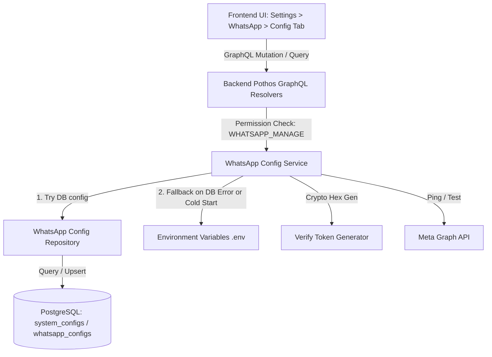

# Implementation Contract: WhatsApp Settings Configuration Tab

**Target Plan Directory**: `.ai/plans/whatsapp_page_config_tab/`  
**File**: `plan.md`  
**Status**: Contract Drafted  
**Author**: Antigravity  

---

## 1. Executive Summary & Objective

Currently, WhatsApp Cloud API credentials (`WHATSAPP_APP_ID`, `WHATSAPP_APP_SECRET`, `WHATSAPP_VERIFY_TOKEN`, `WHATSAPP_PHONE_NUMBER_ID`, `WHATSAPP_WABA_ID`, `WHATSAPP_ACCESS_TOKEN`, `WHATSAPP_ES_CONFIG_ID`) are read statically from `.env`.

This feature adds a dedicated **Configuration Tab** (`?tab=config`) to the WhatsApp Settings page (`/settings/whatsapp`), enabling authorized administrators to:
1. View, update, and manage all WhatsApp Cloud API credentials directly from the UI.
2. Fast-generate cryptographically secure `WHATSAPP_VERIFY_TOKEN` strings with one click.
3. View the live Webhook Callback URL (`https://<domain>/api/webhooks/whatsapp`) with copy-to-clipboard.
4. Test the live connection against Meta Graph API directly from the UI.
5. Provide resilient credential resolution: Database configuration takes precedence over `.env`, but during database outages, connection errors, or cold starts, the system safely gates and falls back to `.env` variables without crashing or leaking credentials.

---

## 2. Architecture & Layered Contract



---

## 3. Detailed Specifications by Phase

### Phase 1: Database Schema, Migration & Seeding
1. **Schema Definition**:
   - Model a dedicated table or record in `system_configs` / `whatsapp_system_credentials`:
     - `id`: UUID primary key.
     - `app_id`: String, nullable.
     - `app_secret`: Encrypted string or masked string, nullable.
     - `verify_token`: String, nullable.
     - `phone_number_id`: String, nullable.
     - `waba_id`: String, nullable.
     - `access_token`: Encrypted string, nullable.
     - `es_config_id`: String, nullable.
     - `updated_by_user_id`: UUID foreign key to users.
     - `created_at` & `updated_at`: Timestamps with time zone.
2. **Migrations**:
   - Run `bun run db:generate` (or `drizzle-kit generate`).
   - Run `bun run db` / migration command (`bun db migrate` / `scripts/dbActions/migrate.ts`).
3. **Seeding**:
   - Update `backend/db/seeds/` to seed initial values from existing `.env` variables if present.
   - Run `bun run db seed`.

---

### Phase 2: Database Repository & Repository Tests
1. **Repository Implementation (`backend/db/repo/whatsapp/`)**:
   - `getWhatsappConfig(tx?: DBQueryExecutor)`: Retrieves the active credentials.
   - `upsertWhatsappConfig(input: WhatsappConfigInput, tx?: DBQueryExecutor)`: Safely creates or updates credentials within a transaction.
   - Ensure all repository methods accept `tx` and adhere to `DBTransaction` / `DBQueryExecutor` standards.
2. **Repository Unit & Integration Tests**:
   - File: `backend/db/test/whatsapp-config.repo.test.ts`.
   - Wrap all tests in `runInRollback`.
   - Pass `tx` to all repository methods.
   - Run and verify:
     ```bash
     bun run test:db
     ```

---

### Phase 3: Service Layer, Resiliency & Env Gating
1. **Service Implementation (`backend/services/whatsapp/`)**:
   - **Resolution Priority**:
     1. Query active config from DB repository.
     2. If present in DB, use DB values.
     3. If DB row does not exist, fall back to `process.env` / `resolveEnvConfig`.
   - **Outage / Cold Start Resiliency (Gating)**:
     - Wrap DB access in a resilient try/catch block.
     - If DB query fails (network timeout, connection pool exhaustion, database cold start), log warning using `logger.warn` (or `logger.logDomainError`) and transparently fall back to environment variables.
     - Gate writes: Mutations must fail gracefully with a localized user-friendly error if the DB is read-only or unreachable.
   - **Fast Verify Token Generator**:
     - Cryptographically secure hex generation using `node:crypto` (`randomBytes(24).toString("hex")` or 32-char alphanumeric).
   - **Meta Graph API Connection Test**:
     - Routine that makes a lightweight `GET /v21.0/{phone_number_id}` request with the active access token to verify credentials and return health status.
2. **Service Layer Tests**:
   - File: `test/services/whatsapp-config.service.test.ts`.
   - Mock DB success, DB outage (resilient fallback to `.env`), and token generation.
   - Run and verify:
     ```bash
     bun run test:services
     ```

---

### Phase 4: Backend GraphQL (Pothos) & Code Generation
1. **Pothos Types & Resolvers (`backend/graphql/`)**:
   - **Query `whatsappConfiguration`**:
     - Requires permission: `AppPermission.WHATSAPP_VIEW` or `WHATSAPP_MANAGE`.
     - Returns masked view (e.g. `appSecret` masked as `••••••••1234`, `accessToken` masked, `verifyToken` visible, `webhookUrl` dynamically derived).
   - **Mutation `updateWhatsappConfiguration`**:
     - Requires permission: `AppPermission.WHATSAPP_MANAGE` (Super Admin).
     - Accepts optional updates for each credential field.
   - **Mutation / Query `generateWhatsappVerifyToken`**:
     - Generates a new secure verify token candidate.
   - **Query `testWhatsappConnection`**:
     - Triggers live check against Meta API and returns `{ success: boolean, message: string, phoneNumber?: string }`.
2. **GraphQL Schema & Type Generation**:
   - Run schema generation and codegen:
     ```bash
     bun run generate:gqlSchema
     bun codegen
     ```

---

### Phase 5: Frontend GraphQL Documents & Integration Tests
1. **Documents**:
   - File: `frontend/common/graphql/sharedDocuments/whatsappConfig.documents.ts`.
   - Define:
     - `whatsappConfigurationQueryDocument`
     - `updateWhatsappConfigurationMutationDocument`
     - `testWhatsappConnectionQueryDocument`
     - `generateWhatsappVerifyTokenQueryDocument`
2. **GraphQL Integration Tests**:
   - Add test cases verifying query masking, permission enforcement, and mutation persistence.
   - Run and verify:
     ```bash
     bun run test:graphql
     ```

---

### Phase 6: Frontend UI (Settings > WhatsApp > Config Tab)
1. **Tab Integration**:
   - Update `WhatsappConfigTab` type in `frontend/common/views/dashboard/settings/whatsapp/WhatsappConfigView.tsx` to include `"config"`.
   - Update `whatsappTabUrl.ts`, `WhatsappTabNav.tsx`, and `WhatsappTabPanels.tsx`.
2. **UI Component Architecture**:
   - Create container and view: `WhatsappConfigTabPanel.tsx`.
   - Form fields:
     - **Meta App ID**: Text input.
     - **Meta App Secret**: Password input with visibility toggle.
     - **Verify Token**:
       - Input field.
       - "Fast Generate" button with icon.
       - "Copy" button.
     - **Webhook Callback URL (Read-only)**:
       - Displays `https://<current-origin>/api/webhooks/whatsapp`.
       - "Copy URL" button.
       - Direct setup guidance instructions for Meta Developer Console.
     - **Phone Number ID**: Text input.
     - **WhatsApp Business Account (WABA) ID**: Text input.
     - **Permanent Access Token**: Multiline / password masked input with toggle.
     - **Embedded Signup Config ID**: Optional text input.
   - **Actions**:
     - "Test Connection": Calls connection test query and shows success/error alert.
     - "Save Changes": Submits update mutation with snackbar notification.
3. **Mobile & Desktop Responsive Shells**:
   - Separate / responsive layout handling conforming to MUI v9 and project responsive patterns.
4. **i18n Localization**:
   - Add translation schema and keys to `shared/locale/en/` and `shared/locale/ar/` for all form labels, tooltips, validation messages, and button texts.

---

## 4. Verification & Quality Gates

Before finalizing implementation, the following automated quality checks must pass:
1. `bun tsgo` — Clean compile-time TypeScript check.
2. `bun run test:db` — Database repository tests pass.
3. `bun run test:services` — Service resilience and logic tests pass.
4. `bun run test:graphql` — GraphQL API authorization and resolver tests pass.
5. `bun quality-gate` — Full static analysis (tsgo, oxlint, biome, lint, duplicates, codescene).

---

## 5. File Manifest Summary

| Layer | Files to Create / Modify |
| :--- | :--- |
| **Database** | `backend/db/schema/whatsapp-config.schema.ts`<br>`backend/db/seeds/whatsapp-config.seed.ts` |
| **Repository** | `backend/db/repo/whatsapp/whatsapp-config.repo.ts`<br>`backend/db/test/whatsapp-config.repo.test.ts` |
| **Service** | `backend/services/whatsapp/whatsapp-config.service.ts`<br>`test/services/whatsapp-config.service.test.ts` |
| **GraphQL API** | `backend/graphql/types/whatsappConfig.pothos.ts`<br>`backend/graphql/mutations/whatsappConfig.mutation.ts`<br>`backend/graphql/queries/whatsappConfig.query.ts` |
| **GraphQL Documents** | `frontend/common/graphql/sharedDocuments/whatsappConfig.documents.ts` |
| **Frontend UI** | `frontend/common/views/dashboard/settings/whatsapp/tabs/WhatsappConfigTabPanel.tsx`<br>`frontend/common/views/dashboard/settings/whatsapp/WhatsappTabNav.tsx`<br>`frontend/common/views/dashboard/settings/whatsapp/WhatsappTabPanels.tsx`<br>`frontend/common/views/dashboard/settings/whatsapp/types/whatsappSettingsTypes.ts` |
| **Translations** | `shared/locale/en/` & `shared/locale/ar/` |
