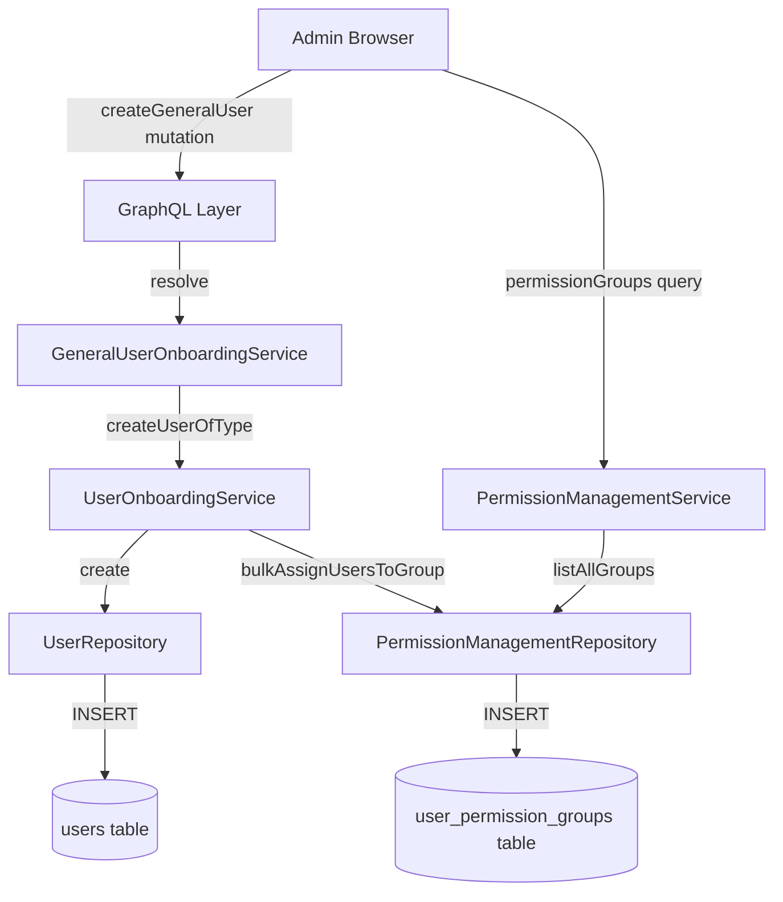
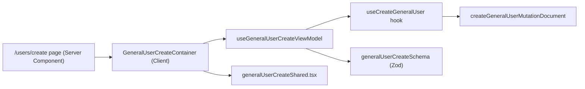
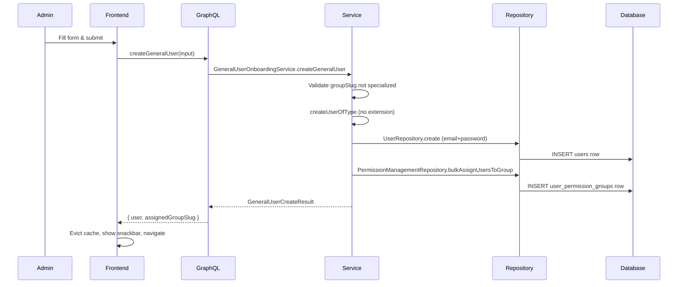

# Design Document: General User Creation View

## Document Information

- **Feature Name**: general-user-creation
- **Target Directory**: `.ai/plans/general-user-creation`
- **Outcome Directory**: `.ai/plans/general-user-creation/outcome`
- **Version**: 1.0
- **Date**: 2026-08-14
- **Author**: Copilot (spec-driven-development)
- **Related Documents**: [Requirements](./specs.md) | [Tasks](./tasks.md)

## Overview

This feature implements a General User Creation Page at `/users/create` that enables administrators to create new platform users and dynamically assign a non-specialized permission group. The design reuses the existing `UserOnboardingService.createUserOfType` pipeline (with no extension row) for the backend, adds a new `createGeneralUser` GraphQL mutation, and follows the established onboarding form architecture (Container → ViewModel → Shared form body with mobile/desktop variants) for the frontend.

The key design decision is to reuse `createUserOfType` with a `null` extension — the pipeline already handles user row creation, email uniqueness checking, password validation/hashing, timezone validation, and permission group assignment. We simply skip the `createExtension` callback and the `afterExtension` callback.

### Design Goals
- Reuse the existing `createUserOfType` pipeline without duplicating user creation logic
- Dynamically filter permission groups (no code changes needed when new groups are created)
- Follow the established onboarding form architecture (teacher/parent/student/manager patterns)
- No new database tables or migrations — uses existing `users` + `user_permission_groups` junction table
- Full Arabic/English i18n support via the compile-time TypeScript system

### Key Design Decisions

#### Decision 1: Reuse `createUserOfType` with null extension
**Context**: `UserOnboardingService.createUserOfType<TExtension>` is a generic pipeline that handles permission checks, email uniqueness, password validation, user row creation, optional profile fields, extension row creation (`createExtension` callback), permission group assignment, and post-extension hooks (`afterExtension`).
**Options Considered**:
1. Reuse `createUserOfType` with `void` extension and empty callbacks — Pros: zero duplication, inherits all validation / Cons: slightly awkward generic typing with `void`
2. Create a new `createGeneralUser` method in `UserRepository` — Pros: independent / Cons: duplicates all the email/password/group logic
**Decision**: Option 1 — Reuse `createUserOfType` with `void` extension
**Rationale**: The pipeline already handles every requirement. The generic typing allows `TExtension = void` and `createExtension: () => undefined, afterExtension: () => {}`. This is the DRY choice and matches how the existing Manager onboarding service works.

#### Decision 2: Filter specialized groups on the frontend, not in GraphQL
**Context**: The `permissionGroups` GraphQL query returns all permission groups. We need to exclude `student_default`, `teacher_default`, `parent_default`.
**Options Considered**:
1. Frontend filter — Pros: simpler backend, no new query complexity / Cons: groups still fetched over the wire
2. Backend filter in GraphQL — Pros: smaller payload / Cons: adds filter complexity to the query
**Decision**: Option 1 — Frontend filter using a `SPECIALIZED_GROUP_SLUGS` constant
**Rationale**: The permission groups list is small (<20 system + any custom groups). Filtering client-side is simpler, avoids backend changes to the query, and the list of specialized slugs is a small constant. A shared constant also serves as documentation of which groups are specialized.

#### Decision 3: New `GeneralUserCreateInput` type in `backend/types/users/`
**Context**: The issue requires a `createUser` GraphQL mutation accepting `groupId`/`groupSlug`. We need a new input type.
**Options Considered**:
1. Define `GeneralUserCreateInput` in `backend/types/users/user.types.ts` — Pros: co-located with `UserCreateCoreInput`, `UserCreateProfileFieldsInput` / Cons: slightly expands the types file
2. Define it inline in the Pothos file — Pros: no new file / Cons: violates the "no local type definitions in Pothos files" rule
**Decision**: Option 1 — Define `GeneralUserCreateInput` in `backend/types/users/user.types.ts`
**Rationale**: Follows the project's Type Definition Pattern (CRITICAL): all types in `backend/types/`, never in Pothos files.

### UX/Navigation Specification (REQUIRED)

#### New Routes & URLs
| Route | Purpose | Permission Required | Roles with Access |
|-------|---------|---------------------|-------------------|
| `/users/create` | General user creation form page | `AppPermission.STAFF_CREATE` | SUPER_ADMIN, ACADEMY_ADMIN (via `academy_admin` group) |

#### Sidebar Navigation Integration
- **Group**: `grp_users` (Users group)
- **Parent Item**: `/users` directory page (the "Create User" button is a header action on the directory page, not a sidebar item)
- **Children**: `/users/create` is not a sidebar nav item — it's only accessible via the action button on `/users` directory or direct URL
- **Mobile Bottom Nav**: Not included

#### Role-Based Access Matrix
| Role | Routes Accessible | Permissions Granted |
|------|-------------------|---------------------|
| SUPER_ADMIN | `/users/create` | All permissions (bypasses check) |
| ACADEMY_ADMIN | `/users/create` | `STAFF_CREATE` if granted by `academy_admin` group |
| SUPERVISOR | N/A | No `STAFF_CREATE` |
| TEACHER | N/A | No `STAFF_CREATE` |
| PARENT | N/A | No `STAFF_CREATE` |
| STUDENT | N/A | No `STAFF_CREATE` |
| STAFF | `/users/create` | `STAFF_CREATE` if granted by `staff_default` group |
| CUSTOM groups | `/users/create` | `STAFF_CREATE` if granted by their custom group |

#### Per-Audience Rendering
| Audience | Prominent Content / Differences |
|----------|----------------------------------|
| Student | N/A — no access |
| Parent | N/A — no access |
| Teacher | N/A — no access |
| Supervisor | N/A — no access |
| Admin/Staff | Full form: Name, Email, Phone, Password, Permission Group dropdown, Account Status |

#### Mobile vs Desktop Variants
| Aspect | Desktop | Mobile |
|--------|---------|--------|
| Navigation | Action button on `/users` directory page header | Same action button |
| Form Layout | `DesktopPageContainer` + `DesktopSectionPanel` + `DesktopPageHeader` | `MobilePageContainer` + `MobileSectionPanel` + `MobilePageHeader` |
| View Switch | `ResponsiveViewSwitch` passes desktop variants | `ResponsiveViewSwitch` passes mobile variants |
| Form Body | `generalUserCreateShared.tsx` (shared, viewport-agnostic) | Same `generalUserCreateShared.tsx` (shared) |

#### Permission Mapping
| Component/Route | Required Permission | Source |
|-----------------|---------------------|--------|
| `/users/create` page | `AppPermission.STAFF_CREATE` | `withPageAuth([AppPermission.STAFF_CREATE])` in server page component |
| `createGeneralUser` mutation | `AppPermission.STAFF_CREATE` + `notImpersonating` | `authScopes: { permission: AppPermission.STAFF_CREATE, notImpersonating: true }` on Pothos mutation field |

### Translation System Requirements (CRITICAL)

All user-facing strings use the compile-time TypeScript i18n system:

**Client Components:**
```typescript
import { useAppTranslation } from "@/shared/locale/client";
import { Translation } from "@/shared/locale";

const t = useAppTranslation(Translation.Dashboard.Users.CreateUser);
const label = t.formTitle;
```

**Server Components:**
```typescript
import { getTranslations } from "@/shared/locale/server";

const t = getTranslations(locale);
const labels = t.dashboardTranslations.createUser;
```

**GraphQL Resolvers:**
```typescript
const tErrors = ctx.t("errors");
throw new Error(tErrors.userEmailExists);
```

### Outcome & Knowledge Transfer Protocol (`.ai/plans/general-user-creation/outcome/`)
- **BEFORE Execution:** Executing agents MUST read ALL existing files in `.ai/plans/general-user-creation/outcome/` to avoid re-analysis.
- **AFTER Execution:** Executing agents MUST write `.ai/plans/general-user-creation/outcome/<task-id>-outcome.md` with research/doc findings and implementation details.
- **PROGRESS TRACKING:** Executing agents MUST update task checkboxes `[ ]` -> `[x]` in `tasks.md`.

## Architecture

### System Context

The general user creation feature sits within the existing user management domain. It reuses the `UserOnboardingService.createUserOfType` pipeline, the `PermissionManagementRepository.bulkAssignUsersToGroup` for group assignment, and the existing `permissionGroups` GraphQL query for the dropdown.



### High-Level Architecture



### Technology Stack
| Layer | Technology | Rationale |
|-------|------------|-----------|
| Frontend Form | React Hook Form + Zod | Project standard for all onboarding forms |
| Frontend State | Zustand (onboarding store) | Project standard for submission lifecycle |
| GraphQL Client | Apollo Client `useMutation` | Project standard |
| Backend GraphQL | Pothos + existing `gqlSchemaBuilder` | Project standard |
| Backend Service | Existing `UserOnboardingService.createUserOfType` | DRY — reuse validated pipeline |
| Backend Repository | Existing `UserRepository.create` + `PermissionManagementRepository` | No new repository methods needed |
| i18n | Compile-time TypeScript system in `shared/locale/` | Project standard |

## Components and Interfaces

### Component 1: SPECIALIZED_GROUP_SLUGS Constant

**Purpose**: Defines the set of specialized permission group slugs excluded from the general user creation form.

**Responsibilities**:
- Export a `readonly` tuple `SPECIALIZED_GROUP_SLUGS` containing `student_default`, `teacher_default`, `parent_default`
- Provide a `isSpecializedGroup(slug: string): boolean` helper for filtering

**Interfaces**:
- **Output**: `readonly string[]` tuple and a boolean helper
- **File**: `shared/constants/specialized-groups.constants.ts`

**Implementation Notes**:
- Lives in `shared/constants/` because both frontend and backend need it (frontend filter + backend rejection in Requirement 2, AC 3)
- Defines as `export const SPECIALIZED_GROUP_SLUGS = ["student_default", "teacher_default", "parent_default"] as const`
- Also exports `SPECIALIZED_GROUP_SLUG_SET = new Set(SPECIALIZED_GROUP_SLUGS)` for O(1) lookup

### Component 2: `GeneralUserCreateInput` Type

**Purpose**: Defines the input type for the `createGeneralUser` mutation.

**Responsibilities**:
- Define the canonical input type in `backend/types/users/user.types.ts`
- Contains: `name`, `email`, `password`, `phone?`, `groupSlug` (the permission group to assign), `status?` (defaults to ACTIVATED)

**Interfaces**:
- **File**: `backend/types/users/user.types.ts`
- ```typescript
  export interface GeneralUserCreateInput {
    readonly name: string;
    readonly email: string;
    readonly password: string;
    readonly phone?: string | null;
    readonly groupSlug: string;
    readonly status?: AccountStatus;
  }
  ```

**Implementation Notes**:
- Reuses existing types: `AccountStatus` from `backend/enum/auth/auth.enum.ts`
- `groupSlug` is a string (not an enum) because custom groups can be created at runtime — we validate existence in the service layer

### Component 3: `GeneralUserCreateResult` Type

**Purpose**: Defines the return type for the `createGeneralUser` mutation.

**Implementation**:
- ```typescript
  export interface GeneralUserCreateResult {
    readonly user: UserReturnType;
    readonly assignedGroupSlug: string;
  }
  ```
- **File**: `backend/types/users/user.types.ts`

### Component 4: `GeneralUserOnboardingService`

**Purpose**: Thin service layer that wraps `UserOnboardingService.createUserOfType` for general user creation.

**File**: `backend/services/user/general-user-onboarding.service.ts`

**Responsibilities**:
- Validate that the requested `groupSlug` is not specialized (reject with localized error if it is)
- Validate that the requested `groupSlug` exists in the system
- Call `createUserOfType` with no extension and the specified group slug
- Return `GeneralUserCreateResult`

**Interfaces**:
- ```typescript
  namespace GeneralUserOnboardingService {
    function createGeneralUser(
      actorUserId: string,
      input: GeneralUserCreateInput,
      tErrors: ErrorsLabels,
      locale?: string,
      tx?: DBTransaction
    ): Promise<GeneralUserCreateResult>;
  }
  ```

**Implementation Notes**:
- Permission check (`STAFF_CREATE`) is done at the GraphQL `authScopes` level + in `createUserOfType` (defense-in-depth)
- Reuses `UserOnboardingService.createUserOfType<void>` with:
  - `groupSlug: input.groupSlug` (string, not a function — no extension to derive from)
  - `createExtension: () => undefined` (no extension row)
  - `afterExtension: () => {}` (no post-extension hook)
  - `validatePassword: true`

### Component 5: GraphQL Pothos Types

**Purpose**: Defines Pothos input and result types for the `createGeneralUser` mutation.

**File**: `backend/graphql/pothos/users/general-user-create.pothos.ts`

**Responsibilities**:
- Define `GeneralUserCreateInputPothosObject` (`inputRef<GeneralUserCreateInput>`)
- Define `GeneralUserCreateResultPothosObject` (`objectRef<GeneralUserCreateResult>`)
- `GeneralUserCreateResultPothosObject` exposes `user` (ref to `UserPothosObject`) and `assignedGroupSlug` (string)

**Implementation Notes**:
- Follows the pattern from `teacher-onboarding.pothos.ts` and `manager-onboarding.pothos.ts`
- Import types from `@/backend/types`
- Uses `gqlSchemaBuilder.inputRef<GeneralUserCreateInput>("GeneralUserCreateInput")`

### Component 6: GraphQL Mutation Registration

**Purpose**: Registers the `createGeneralUser` mutation on `gqlSchemaBuilder`.

**File**: `backend/graphql/mutation/shared/general-user-create.mutation.ts`

**Responsibilities**:
- Register `createGeneralUser(input: GeneralUserCreateInput!): GeneralUserCreateResult!`
- `authScopes: { permission: AppPermission.STAFF_CREATE, notImpersonating: true }`
- Resolver: `requireAuth(ctx)` → `GeneralUserOnboardingService.createGeneralUser(userId, args.input, ctx.t("errors"), ctx.locale)`

**Implementation Notes**:
- Add `import "./general-user-create.mutation";` to `backend/graphql/mutation/shared/index.ts`
- Follows the pattern from `onboarding.mutation.ts`

### Component 7: Frontend GraphQL Documents

**Purpose**: Defines the mutation document and any query fragments for the frontend.

**File**: `frontend/common/graphql/sharedDocuments/users/general-user-create.documents.ts`

**Responsibilities**:
- Export `createGeneralUserMutationDocument` — a `gql` mutation that includes the `UserFields` fragment on the returned `user`
- Reuse `UserFields` fragment from existing `users/userFields.documents.ts`
- Already-imported `permissionGroupsQueryDocument` from `permissions/permission-management.documents.ts`

**Implementation Notes**:
- Documents file naming: `general-user-create.documents.ts` (kebab-case, domain folder)
- Add barrel export in `frontend/common/graphql/sharedDocuments/users/index.ts`

### Component 8: Zod Schema

**Purpose**: Form validation schema for the general user creation form.

**File**: `frontend/common/views/dashboard/users/createUser/schemas/generalUserCreateSchema.ts`

**Responsibilities**:
- Define Zod schema factory taking `validationLabels` (localized error messages)
- Fields: `name` (min 2 chars), `email` (valid email format), `password` (min 8, strength check), `phone` (optional), `groupSlug` (required), `status` (enum `ACTIVATED`/`DEACTIVATED`)

**Implementation Notes**:
- Follows the pattern from `managerOnboardingSchema.ts` — factory function taking labels for localized validation messages
- Password strength matching the existing `validatePasswordStrength` regex

### Component 9: `useCreateGeneralUser` Hook

**Purpose**: Apollo `useMutation` wrapper for the `createGeneralUser` mutation.

**File**: `frontend/common/hooks/useCreateGeneralUser.ts`

**Responsibilities**:
- Call `useMutation(createGeneralUserMutationDocument)`
- Build GraphQL input from form values (`buildGeneralUserInput`)
- On success: evict `users` query from Apollo cache, `cache.gc()`, set zustand store
- Return `{ execute, loading, error }`

**Implementation Notes**:
- Follows pattern from `useCreateManagerOnboarding.ts`
- Cache eviction: `cache.evict({ id: "ROOT_QUERY", fieldName: "users" })` — evicts the users directory list

### Component 10: Zustand Store

**Purpose**: Submission lifecycle state for the general user creation form.

**File**: `frontend/common/stores/generalUserOnboardingStore.ts`

**Implementation**:
- Shape: `{ isSubmitting, error, result, reset() }` — matching `staffOnboardingStore.ts`

### Component 11: ViewModel Hook

**Purpose**: Wires `useForm` (React Hook Form + Zod) to the `useCreateGeneralUser` mutation hook via `useOnboardingSubmit`.

**File**: `frontend/common/views/dashboard/users/createUser/useGeneralUserCreateViewModel.ts`

**Implementation Notes**:
- Follows pattern from `useManagerOnboardingViewModel.ts`
- Uses `useOnboardingSubmit` for success/error/auto-dismiss/navigation
- On success: navigate to `/users` directory (or `/users/[id]/profile`)

### Component 12: Container Component

**Purpose**: Client component that renders the form via `ResponsiveViewSwitch`.

**File**: `frontend/common/views/dashboard/users/createUser/GeneralUserCreateContainer.tsx`

**Implementation Notes**:
- Follows pattern from `ManagerOnboardingContainer.tsx`
- Passes `generalUserCreateShared.tsx` to `ResponsiveViewSwitch` with desktop/mobile `options`

### Component 13: Shared Form Body

**Purpose**: Viewport-agnostic form body with all fields.

**File**: `frontend/common/views/dashboard/users/createUser/__shared__/generalUserCreateShared.tsx`

**Implementation Notes**:
- Follows pattern from `teacherOnboardingShared.tsx`
- Sections: `UserEntityFieldsSection` (name, email, phone, password), `PermissionGroupSection` (dropdown), `StatusSection` (account status toggle)
- Uses `FormProvider`, `Box component="form"`, `SectionPanel`, `FormActions`
- Renders `<FormSuccessSnackbar />` and `<FormErrorSnackbar />`

### Component 14: Mobile/Desktop Views

**Purpose**: Tier-specific wrappers that inject desktop/mobile variants of `PageContainer`, `PageHeader`, `SectionPanel`.

**Files**:
- `frontend/mobile/views/dashboard/users/createUser/generalUserCreate.mobile.tsx`
- `frontend/desktop/views/dashboard/users/createUser/generalUserCreate.desktop.tsx`

**Implementation Notes**:
- Follows pattern from `managerOnboarding.mobile.tsx` / `managerOnboarding.desktop.tsx`

### Component 15: App Router Page

**Purpose**: Server component page at `/users/create`.

**File**: `app/(dashboard)/users/create/page.tsx`

**Implementation**:
```typescript
import { withPageAuth } from "@/backend/lib/auth/withPageAuth";
import { AppPermission } from "@/backend/enum";
import { GeneralUserCreateContainer } from "@/frontend/views/dashboard/users/createUser";

export default withPageAuth([AppPermission.STAFF_CREATE], async ({ locale }) => {
  return <GeneralUserCreateContainer />;
});
```

**Implementation Notes**:
- Uses `withPageAuth` with `AppPermission.STAFF_CREATE` — follows pattern from existing pages like `/staff/create/page.tsx`
- `generateMetadata` uses `getTranslations(locale).dashboardTranslations.createUser`

### Component 16: i18n Translations

**Purpose**: Arabic/English translation support for all form labels.

**Files** (4-way parallel tree):
- `shared/locale/types/dashboard/users/createUser.ts` — `CreateUserLabels` interface
- `shared/locale/ar/dashboard/users/createUser.ts` — Arabic messages
- `shared/locale/en/dashboard/users/createUser.ts` — English messages
- `shared/locale/namespaces/dashboard/users/createUser.namespace.ts` — namespace handle

**Labels needed**:
- `pageTitle`, `pageSubtitle`
- `formTitle`, `formDescription`
- `name`, `namePlaceholder`, `nameRequired`
- `email`, `emailPlaceholder`, `emailRequired`, `emailInvalid`, `emailExists`
- `phone`, `phonePlaceholder`
- `password`, `passwordPlaceholder`, `passwordRequired`, `passwordWeak`
- `permissionGroup`, `permissionGroupPlaceholder`, `permissionGroupRequired`
- `accountStatus`, `statusActivated`, `statusDeactivated`
- `createButton`, `cancelButton`, `resetButton`
- `createSuccess`, `createError`
- `sections`: `{ userDetails, permissions }`

**Namespace handle**: `"dashboard.users.createUser"`

## Data Models

### GeneralUserCreateInput
```typescript
interface GeneralUserCreateInput {
  readonly name: string;
  readonly email: string;
  readonly password: string;
  readonly phone?: string | null;
  readonly groupSlug: string;
  readonly status?: AccountStatus;
}
```

**Validation Rules**:
- `name`: non-empty, min 2 chars (validated by `AuthUtils.validateUserName`)
- `email`: valid email format, unique (validated by `UserRepository.existsByEmail`)
- `password`: min 8 chars, meets strength requirements (validated by `validatePasswordStrength`)
- `groupSlug`: must exist in `permission_groups` table, must not be a specialized group slug

### GeneralUserCreateResult
```typescript
interface GeneralUserCreateResult {
  readonly user: UserReturnType;
  readonly assignedGroupSlug: string;
}
```

### Data Flow


## Error Handling

### Error Categories
| Category | Error Code | User Action |
|----------|-----------|-------------|
| Validation | `userEmailExists` | Use a different email |
| Validation | `passwordWeak` | Use a stronger password |
| Validation | `nameRequired` | Enter a name |
| Authorization | `FORBIDDEN` | Contact a super-admin |
| Authentication | `UNAUTHENTICATED` | Log in |
| Business Rule | `specializedGroupNotAllowed` | Use a non-specialized group |
| Business Rule | `permissionGroupNotFound` | Select a valid group |

## Testing Strategy

### Unit Testing (Service Layer)
- **File**: `backend/services/user/test/general-user-onboarding.service.test.ts`
- **Framework**: `bun:test`
- **Pattern**: `runInRollback` for DB-touching tests; `spyOn` for pure-logic paths
- **Coverage**: Successful creation, duplicate email, invalid group slug, specialized group rejection, permission check failure, password validation

### Integration Testing (GraphQL)
- **File**: `frontend/common/graphql/test/users/general-user-create.test.ts`
- **Framework**: Apollo Client against dev server
- **Pattern**: `authenticatedRequest` + `loginDemoUser("super_admin")`
- **Coverage**: Successful mutation, auth failure, authorization failure, impersonation rejection, input validation

### Component Testing (UI)
- **File**: `test/ui/components/GeneralUserCreateForm.test.tsx`
- **Framework**: `@testing-library/react` with Happy DOM
- **Pattern**: Mock Apollo providers via `TestWrapper.tsx`
- **Coverage**: Form rendering, validation errors, submission flow

## Deployment and Operations

No special deployment requirements. No new env variables needed. No migrations needed. Standard `bun run build` deploy process.

## Migration and Compatibility

### Backward Compatibility
- No changes to existing onboarding flows (Teacher, Parent, Student, Manager)
- No database schema changes
- No existing API changes
- The new mutation is purely additive

### Integration Impact
- New GraphQL mutation added to schema (requires `bun run generate:gqlSchema` + `bun codegen`)
- New app router page added (no impact on existing routes)
- New translation namespace added (no impact on existing namespaces)
