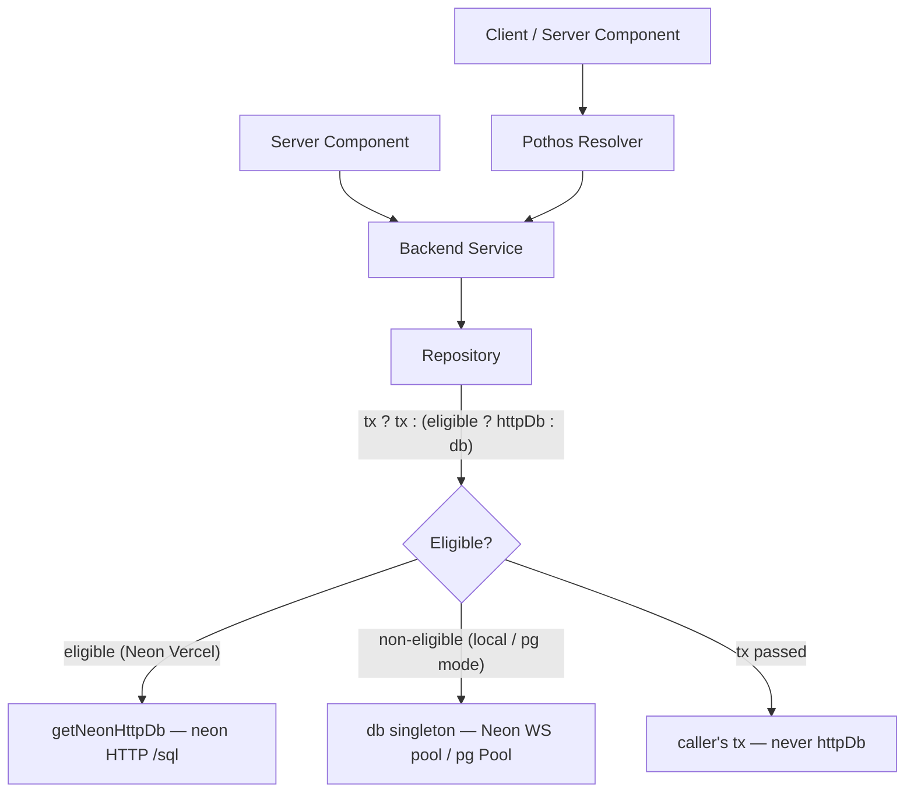
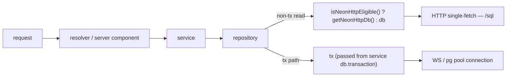
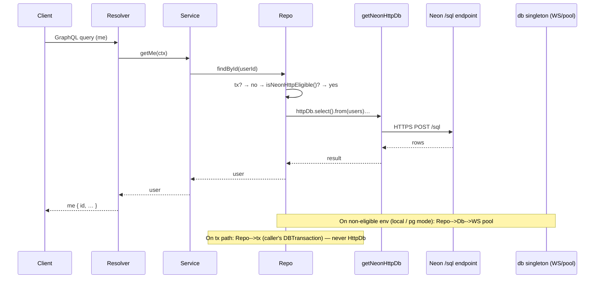

# Technical Design: Neon HTTP Single-Fetch Client Rollout

**Target Directory:** `.ai/plans/neon-http-rollout`
**Outcome Directory:** `.ai/plans/neon-http-rollout/outcome`
**Parent Plan:** `.ai/plans/neon/` (Task 1.2 — Neon HTTP Single-Fetch Helper)
**Supersedes:** `.ai/plans/neon/neon_http/tasks_deepseek4pro.md`
**Phase:** 2 — Technical Design Document
**Related Spec:** [spec.md](spec.md)

---

## 1. Overview

This design details the rollout of the HTTP single-fetch client to the **repository layer** via a provider-agnostic `queryDb(tx)` factory handle (exported from `backend/db/drizzleDb.ts`). It encapsulates runtime eligibility (`getActiveHttpProvider()`, `isNeonHttpEligible()`), lazy singleton resolution (`getStatelessHttpDb()`), and `tx` prioritization. It is applied across ~52 repository files in a single batch wave after a single pilot file.

The design addresses R1–R5 of the spec: it gates construction on provider + host + connection-mode + kill-switch checks; it migrates only the repository query execution seam (not services — those never import `db` directly per `backend/AGENTS.md`); it preserves `tx` passthrough end-to-end so transactions never route through an HTTP driver (which throws on `.transaction()`); and it converts prepared-statement non-tx branches to plain queries (the HTTP drivers do not support `.prepare()`).

### Design Goals
- **Safety first:** the HTTP helpers refuse construction against a non-eligible `DATABASE_URL` so local dev,
  forced `pg-pooled` mode, and the kill-switch all short-circuit with a clear error.
- **Provider-agnostic & flexible:** repository methods call `queryDb(tx)` instead of referencing vendor-specific helpers directly. Swapping or adding HTTP providers (e.g. Supabase, Turso) requires zero repository changes.
- **Zero-allocation O(1) performance:** resolved HTTP database handles are cached via global singletons (`getGlobalSingleton`).
- **Transaction-safety by construction:** `queryDb(tx)` prioritizes `tx` first, ensuring transactions NEVER reach HTTP drivers, eliminating runtime-throw risks on `.transaction()`.
- **Architecture-conforming seam:** only the repository layer changes. Services, resolvers, and Server Components are untouched (they delegate to repositories).
- **One wave, maximum parallelism:** a dynamic 16-worker parent orchestrator processes the full ~52-file
  batch concurrently, with one subagent per file restricted to that file.

### Key Design Decisions

- **Decision 1 — Guard inside helpers (belt-and-suspenders):** the eligibility check lives INSIDE
  `getNeonHttpDb()` and `getNeonHttpClient()` (they throw on ineligible) AND is exported as
  `isNeonHttpEligible()` for tests/call-site branching. Rationale: protects every call site at once — no
  unguarded `getNeonHttpDb()` can slip through and silently POST to `https://localhost/sql`. The user
  explicitly chose this over call-site-only gating.
- **Decision 2 — Orthogonal helper, not a new `DbConnectionStrategy` enum value:** the guard is a
  separate predicate, not added to `DbConnectionStrategy` (`pg-pooled` / `neon-serverless`). Rationale:
  no existing `connection-strategy.test.ts` cases need to change; HTTP remains opt-in via `queryDb(tx)`, not a global strategy switch.
- **Decision 3 — Repository-layer seam only:** per `backend/AGENTS.md`, services delegate to repositories
  and do not import `db` directly. The prior draft's service-file targets were skating on thin
  architecture ice. Only `backend/db/repo/**/*.ts` files change. (User explicitly chose repo-only.)
- **Decision 4 — Defer the session/auth path entirely:** `shared/session.repository.ts` (and the
  `validateSession` chain) mixes reads with conditional writes (DELETE expired + UPDATE lastActivity).
  Migrating leaf reads in isolation is too risky for this plan. Deferred to a dedicated session-rewrite
  follow-up.
- **Decision 5 — `DB_NEON_HTTP_ENABLED` kill-switch:** an env var (default unset = follow the gating
  logic) that, when set to `"false"`, forces `isNeonHttpEligible()` to return `false` without code
  changes — fast rollback. Mirrors the existing `IS_DEMO` / `DISABLE_RATE_LIMITING` env-var style
  (`backend/lib/env.ts:353-358`).
- **Decision 6 — Replace non-tx prepared-statement branches with plain queries:** `drizzle-orm/neon-http`
  does not support module-level `.prepare()` statements (HTTP fetch has no session-bound plan). The
  non-tx branch of any repo using prepared statements is replaced with a plain query over `queryDb(tx)`; the prepared-statement module that is reused only inside `tx` paths stays untouched.
- **Decision 7 — Exported `queryDb(tx)` factory handle with singleton caching:** encapsulates provider resolution, singleton handle retrieval, and `tx` precedence. Decouples 52+ repository files from vendor specifics and ensures zero allocation cost on every query invocation.

### UX/Navigation Specification (REQUIRED)

**This is a backend-only database-layer optimization.** No new routes, sidebar items, tabs, or
permissions are introduced. The user-facing surface is unchanged — only query latency improves.

#### New Routes & URLs
| Route | Purpose | Permission Required | Roles with Access |
|-------|---------|---------------------|-------------------|
| _(none)_ | No new routes | N/A | N/A |

#### Sidebar Navigation Integration
N/A — no navigation changes.

#### Role-Based Access Matrix
| Role | Routes Accessible | Permissions Granted |
|------|-------------------|---------------------|
| All (SUPER_ADMIN, ACADEMY_ADMIN, SUPERVISOR, TEACHER, PARENT, STUDENT, STAFF, USER, GUEST) | (unchanged) | (unchanged) |

#### Per-Audience Rendering
| Audience | Prominent Content / Differences |
|----------|----------------------------------|
| Student / Parent / Teacher / Supervisor / Admin / Staff | No UI change; faster query latency only |

#### Mobile vs Desktop Variants
| Aspect | Desktop | Mobile |
|--------|---------|--------|
| All | No change | No change |

#### Permission Mapping
N/A — no new permission-gated surfaces.

### Outcome & Knowledge Transfer Protocol (`.ai/plans/neon-http-rollout/outcome/`)
- **BEFORE Execution:** Executing agents MUST read ALL existing files in `outcome/` to avoid re-analysis.
- **AFTER Execution:** Executing agents MUST write `outcome/<task-id>-outcome.md` with findings and
  implementation details.
- **PROGRESS TRACKING:** Executing agents MUST update task checkboxes `[ ]` -> `[x]` in `tasks.md`.

---

## 2. Architecture

### System Context



### High-Level Architecture



### Technology Stack

| Layer | Technology | Rationale |
|-------|------------|-----------|
| HTTP fetch | `@neondatabase/serverless` `neon(url)` | Zero-pool, ~15-30 ms latency saving on Vercel |
| ORM | `drizzle-orm/neon-http` (`drizzleNeonHttp({client, relations})`) | Drizzle query builder over HTTP fetch |
| Gating | env vars (`DB_PROVIDER`, `DB_CONNECTION_MODE`, `DATABASE_URL` hostname, `DB_NEON_HTTP_ENABLED`) + `backend/lib/runtime.ts` | Reuses existing connection-strategy signals |
| Fallback | `backend/db/drizzleDb.ts` `db` singleton (stateful) | Same query surface; zero behavior change on non-eligible envs |

---

## 3. Components and Interfaces

### Component 1: `isNeonHttpEligible()` (NEW)

**Purpose:** Pure runtime predicate answering "is the HTTP single-fetch client safe to construct in this
environment?"

**Location:** `backend/db/connection-strategy.ts` (alongside `resolveConnectionStrategy`). Re-exported
from `backend/db/drizzleDb.ts` next to the existing `getNeonHttpDb` re-export (`drizzleDb.ts:71`).

### Component 1: `getActiveHttpProvider()` & `isNeonHttpEligible()` (NEW)

**Purpose:** Pure runtime predicates answering "which HTTP / stateless database provider is active, and is it eligible in this environment?"

**Location:** `backend/db/connection-strategy.ts` (alongside `resolveConnectionStrategy`). Re-exported
from `backend/db/drizzleDb.ts`.

**Interface:** 
- `function isNeonHttpEligible(): boolean` — checks if Neon HTTP single-fetch is safe to construct.
- `function getActiveHttpProvider(): "neon" | "supabase" | "none"` — returns the active stateless HTTP DB provider.

**Logic for `isNeonHttpEligible()`:**
1. If `process.env.DB_NEON_HTTP_ENABLED === "false"` → return `false` (kill-switch).
2. If `getStringEnv("DB_PROVIDER", "neon").toLowerCase() !== "neon"` → return `false`.
3. If `getConnectionMode() === "pg"` → return `false` (explicit pg-pooled override wins).
4. If `parseUrl(getEnvironmentConfig().databaseUrl).hostname` does not match `/\.neon\.tech$/` →
   return `false` (prevents `https://localhost/sql` failure).
5. Otherwise → return `true`.

**Logic for `getActiveHttpProvider()`:**
1. If `isNeonHttpEligible()` → return `"neon"`.
2. Otherwise → return `"none"`.

### Component 2: Factory Singleton `getStatelessHttpDb()` & `queryDb(tx)` (NEW / MODIFY)

**Purpose:** Provide a provider-agnostic, zero-allocation database query handle for repositories that transparently routes reads to the active HTTP database singleton when eligible, while preserving `tx` and falling back to default `db`.

**Location:** `backend/db/drizzleDb.ts`.

**Implementation:**
```typescript
const HTTP_DB_KEY = Symbol.for("siraj.httpDb");

/**
 * Lazily resolves and caches the active HTTP database singleton instance via getGlobalSingleton.
 */
function getStatelessHttpDb() {
  return getGlobalSingleton(HTTP_DB_KEY, () => {
    const provider = getActiveHttpProvider();
    if (provider === "neon") return getNeonHttpDb();
    // Future expansion: if (provider === "supabase") return getSupabaseHttpDb();
    return null;
  });
}

/**
 * Canonical query handle for repository read operations.
 * - If tx is passed, returns tx (transaction safety guaranteed).
 * - Otherwise, returns the cached HTTP database singleton if eligible.
 * - Falls back to default pooled db instance.
 */
export function queryDb(tx?: DBTransaction) {
  if (tx) return tx;
  return getStatelessHttpDb() ?? db;
}
```

### Component 3: Internal guards in `http-client.ts` (MODIFY)

**Purpose:** Belt-and-suspenders — even if a future caller invokes `getNeonHttpDb()` directly, the helper refuses to construct a Neon HTTP client against a non-Neon `DATABASE_URL`.

**Change:** In `getNeonHttpClient()` (`http-client.ts:47-52`) and `getNeonHttpDb()` (`:60-65`), add:
```typescript
if (!isNeonHttpEligible()) {
  throw new Error(
    `Neon HTTP client is not eligible for the current environment. ` +
    `Set DB_PROVIDER=neon, ensure DATABASE_URL hostname matches *.neon.tech, ` +
    `DB_CONNECTION_MODE != "pg", and DB_NEON_HTTP_ENABLED != "false".`
  );
}
```

### Component 4: Migration pattern applied to each repository (MODIFY ~52 files)

**Purpose:** Convert each non-tx read branch from `tx ?? db` to `queryDb(tx)`, replace non-tx prepared statements with plain queries.

**Per-method pattern:**
```typescript
// BEFORE
export async function findById(id: string, tx?: DBTransaction) {
  const queryDb = tx ?? db;
  return queryDb.select().from(users).where(eq(users.id, id)).limit(1);
}

// AFTER
import { queryDb } from "@/backend/db";

export async function findById(id: string, tx?: DBTransaction) {
  const q = queryDb(tx);
  return q.select().from(users).where(eq(users.id, id)).limit(1);
}
```

**Implementation Notes:**
- The `queryDb(tx)` evaluation order is mandatory: `tx` wins first, then eligible HTTP singleton, then `db`.
- For methods whose non-tx branch is a **prepared statement**, the migration replaces that non-tx branch
  with a plain `queryDb(tx).select(...)` (no `.prepare()` / `.execute()`). The prepared-statement module
  remains in the file ONLY if it is still used inside `tx` branches; if it was used only on the non-tx
  branch and is now unused, the subagent removes it (dead code).
- Each subagent handles ONE file. Each subagent reads all `outcome/` first, applies the pattern to every
  eligible method of that file, leaves writes / multi-query pipelines / always-tx methods untouched, and
  runs the per-file quality loop.

### Data Models

No schema or type changes. `NeonHttpDatabase<typeof relations>` is already the return type of
`getNeonHttpDb()` (`http-client.ts:60`); consumers branching tx vs bare use the ternary rather than a
shared base type (the two Drizzle driver types are unrelated — see Decision in §5 risk).

### Data Flow



---

## 4. Security Considerations

### Authentication
No authentication changes. The HTTP client reuses the same `DATABASE_URL` already validated by
`backend/lib/env.ts` (`validateDatabaseUrlForVercel` enforces `sslmode=verify-full` on Vercel at
`env.ts:140`).

### Authorization
No authorization changes. Repository-level access control (RLS / permission guards) is unchanged.

### Data Protection
Same TLS path as the existing WebSocket driver (Neon HTTPS uses the same `sslmode=verify-full`).

### Input Validation
No new user input. The guard reads trusted env vars only.

---

## 5. Error Handling

### Error Categories

| Category | Trigger | Behavior |
|----------|---------|----------|
| Ineligible env | `getNeonHttpDb()`/`getNeonHttpClient()` called when `!isNeonHttpEligible()` | Throw clear `Error` from the helper BEFORE any query (fail fast). |
| Transaction misuse | Some future caller invokes `httpDb.transaction(...)` | `drizzle-orm/neon-http` throws `Error("No transactions support in neon-http driver")` at runtime — mitigated by `tx ? tx : …` ordering; the `tx` branch never reaches `httpDb`. |
| HTTP 5xx from Neon | Neon `/sql` endpoint returns 5xx | Existing service error-handling path applies (no new retry logic in this plan). |

### Logging Strategy
- **Error logs:** the eligibility-throw message is descriptive enough for operator diagnosis.
- No new performance logs in this plan (deferred to a future observability plan).

---

## 6. Performance Considerations

### Expected Load
- Per authenticated request: 1-N bare reads (depending on resolver fan-out) — each routing via
  `isNeonHttpEligible() ? httpDb : db` on eligible envs.
- The `neon()` HTTP client is a module-level singleton (`http-client.ts:36`), constructed once.

### Performance Requirements
- On an eligible (Vercel/Neon) environment, each migrated bare read saves ~15-30 ms of WebSocket/pool
  connection overhead (per `backend/db/http-client.ts:9-12` and Neon docs).
- HTTP single-fetch does not consume `max_connections` pool slots.

### Optimization Strategies
- Lazy singleton (already in `http-client.ts`) — zero cost until first eligible call.
- Eligibility check is cheap (4 env reads + 1 URL parse); still cheaper than a WebSocket handshake.

### Monitoring and Metrics
Out of scope for this plan (deferred to observability follow-up). The kill-switch
(`DB_NEON_HTTP_ENABLED=false`) is the rollback mechanism.

---

## 7. Testing Strategy

### Unit Testing
- **`backend/db/test/connection-strategy.test.ts`** — extend with `isNeonHttpEligible()` matrix tests:
  returns `true` for `DB_PROVIDER=neon` + `*.neon.tech` host; returns `false` for `DB_PROVIDER=postgres`;
  `false` for `DB_CONNECTION_MODE=pg`; `false` for `localhost`/non-Neon hostname; `false` for
  `DB_NEON_HTTP_ENABLED=false`. Add `DB_NEON_HTTP_ENABLED` to the `ENV_KEYS` snapshot list.
- **NEW `backend/db/test/http-client.test.ts`** — assert `getNeonHttpDb()`/`getNeonHttpClient()` throw
  `Error` matching `/Neon HTTP client is not eligible/` when fed a non-Neon `DATABASE_URL` even with
  `DB_PROVIDER=neon` (proves the belt-and-suspenders guard).

### Integration Testing
- **Early Stage Provider Smoke (`test/integration/db/query-db.integration.test.ts`):** Created immediately in Phase 1 directly after `queryDb(tx)` foundation creation. Conforms strictly to `test/integration/AGENTS.md`:
  - Placed at `test/integration/db/query-db.integration.test.ts`.
  - Reads `process.env.NEON_TEST_DATABASE_URL`; if missing or containing `"ep-example"`, skips via `describeLiveWhen(hasNeonTestUrl, ...)` (does not fail).
  - When `NEON_TEST_DATABASE_URL` is set, executes a single live HTTP query (`queryDb().execute(sql`SELECT 1 as test`)`).
  - Uses `testLogger` from `@/shared/lib/logger/testlogger` (no `console.log`).
  - Command: `bun run test:integration` (or `bun --env-file=.env.test test test/integration/db/query-db.integration.test.ts`).
  - Verifies live HTTP connectivity and provider setup before any repository files are migrated.
- **Pilot:** `bun run scripts/run-test/run-test.ts backend/db/test/repo/users/user.repository.test.ts`
  and `bun run test:graphql` exercising the `me` query.

### End-to-End / Full Suite Verification
- After the batch rollout: `bun test:db` (all repo tests), `bun test:services` (service integration),
  `bun test:graphql` (GraphQL integration). All MUST exit 0 failures.

### Performance Testing
Out of scope (no harness in repo). Latency gains are documented from Neon's published characteristics
and the helper's JSDoc.

---

## 8. Migration and Compatibility

### Backward Compatibility
- On non-eligible environments (local dev, `DB_PROVIDER=postgres`, `DB_CONNECTION_MODE=pg`, kill-switch
  on), behavior is byte-identical to pre-migration (the ternary falls back to `db`).
- Repository method signatures are unchanged (`tx?` params preserved).
- Prepared-statement removal on the non-tx branch produces byte-identical results (same `.where`/`.from`).

### Rollout Strategy
- Single wave, dynamic 16-worker pool (one subagent per file).
- The kill-switch `DB_NEON_HTTP_ENABLED=false` is the runtime rollback (no redeploy needed if env is
  mutable; otherwise a redeploy with the env var flip).

### Migration Impact
- ~52 repository files modified. Zero service / resolver / Server Component / schema changes.
- No new dependencies. No new env vars beyond the optional `DB_NEON_HTTP_ENABLED` kill-switch.

---

## 9. Decision Log

### Decision 1: Guard inside helpers (belt-and-suspenders)
- **Context:** The Neon HTTP client POSTs to a Neon-only `/sql` endpoint; on a non-Neon `DATABASE_URL`
  it would fail with a confusing 404/TLS error.
- **Options Considered:**
  1. Call-site-only — each consumer writes `isNeonHttpEligible() ? getNeonHttpDb() : db`.
     Pros: explicit. Cons: an unguarded `getNeonHttpDb()` call could slip through.
  2. Inside helpers (chosen) — helpers throw on ineligible, AND export `isNeonHttpEligible()`.
     Pros: protects every call site at once. Cons: tiny per-call overhead (env reads).
- **Decision:** Inside helpers.
- **Rationale:** User explicitly chose this; maximizes safety for an org-wide rollout.

### Decision 2: Orthogonal helper, not a new `DbConnectionStrategy` enum value
- **Context:** Should `"neon-http"` be a third strategy alongside `"pg-pooled"` / `"neon-serverless"`?
- **Options Considered:**
  1. New strategy enum value. Cons: every `connection-strategy.test.ts` case needs updating; would force
     a global strategy switch (HTTP becomes the only client).
  2. Orthogonal predicate (chosen). Pros: no strategy test changes; HTTP remains opt-in via the
     `tx ? tx : …` branch; fallback to `db` on non-eligible envs is automatic.
- **Decision:** Orthogonal predicate.

### Decision 3: Repository-layer seam only
- **Context:** The prior draft migrated 8 service files; per `backend/AGENTS.md`, services delegate to
  repositories and should not import `db` directly.
- **Options Considered:**
  1. Service + repo. Cons: violates architecture; risks silent `tx` breakage when services that already
     wrap in `db.transaction` pass `tx` into a service-level `httpDb`.
  2. Repo only (chosen). Pros: architecture-conforming; the `tx` contract is preserved end-to-end.
- **Decision:** Repo only. User explicitly chose this.

### Decision 4: Defer session path
- **Context:** `shared/session.repository.ts` mixes reads with conditional writes (DELETE expired +
  UPDATE lastActivity in `validate`).
- **Options Considered:**
  1. Migrate leaf reads (`findByHmacHash` non-Redis branch, `findByLegacyHash`) now. Cons: subtle behavior
     changes risk; the session path is the most security-sensitive flow.
  2. Defer entirely (chosen). Pros: this plan stays focused and low-risk.
- **Decision:** Defer to a dedicated session-rewrite follow-up plan.

### Decision 5: `DB_NEON_HTTP_ENABLED` kill-switch
- **Context:** Need a fast rollback if the rollout surfaces issues in production.
- **Options Considered:**
  1. Env var kill-switch (chosen). Mirrors `IS_DEMO` / `DISABLE_RATE_LIMITING` style.
  2. Code-only rollback (revert commit). Cons: requires redeploy.
- **Decision:** Env var `DB_NEON_HTTP_ENABLED` (default unset = follow gating logic).

---

## 10. Risks

1. **`drizzle-orm/neon-http` `.transaction()` throws at runtime (type-checks fine)** — mitigated by the
   `tx ? tx : (eligible ? httpDb : db)` ordering; transactions always take the `tx` branch and never
   reach `httpDb`. Subagents MUST preserve this ordering exactly.
2. **Multi-driver mixing in one request** (some reads on `httpDb`, others on `db`): safe for reads. Write
   paths are never touched by this plan; transactional paths never reach `httpDb`.
3. **`DB_PROVIDER` default inconsistency** — `connection-strategy.ts:27` defaults to `"neon"` while
   `factory.ts:70` and `drizzleDb.ts:29` log `"postgres"`. The guard lowercases and checks `=== "neon"`,
   so the log-lines-only inconsistency does not affect eligibility. Flagged as out-of-scope drift.
4. **Prepared-statement removal on non-tx branch changes query shape** — verified byte-identical
   (same `.where`/`.from`/`.limit`/`.orderBy`); only the plan cache disappears, which is the whole point.
5. **Subagent over-reach** — a subagent might touch a write method or multi-query pipeline. Mitigated by:
   strict single-file scoping, the migration-pattern docstring, and the reviewer checking each subagent's
   diff against the file's eligible-method list (in `tasks.md` Phase 3 table).
6. **No GraphQL resolver coverage of the `me` query on HTTP path** — mitigated by running
   `bun test:graphql` after the pilot (the `me` query exercises `user.repository.findById`).
7. **Eligibility guard false-negative on a custom `fetchEndpoint`** — out of scope: the helpers use the
   default `neon(url)` constructor (no `fetchEndpoint` override). If a future plan customizes the
   endpoint, the hostname check would need to revisit.

---

## 11. Domain-to-Artifacts Mapping (Knowledge Propagation)

| Plan Domain | Docs Subdir | AGENTS.md to Update | Skills to Update | Instructions to Update |
|---|---|---|---|---|
| Drizzle / DB patterns (HTTP client rollout) | `docs/drizzle/` | `backend/db/repo/AGENTS.md`, `backend/db/schema/AGENTS.md`, `backend/AGENTS.md` | `.agents/skills/drizzle/SKILL.md` (if exists) | `.agents/instructions/backend.instructions.md` |

Final knowledge-propagation task (Task 5.1 in `tasks.md`) follows the Spec-Driven Development skill's
Knowledge Propagation from Plan Outcomes protocol:

1. Create `docs/drizzle/neon-http-client.md` (Why → Pattern → Rules → Anti-patterns → Rollout Summary →
   Related).
2. Update `backend/db/repo/AGENTS.md` — add "Neon HTTP Client for Bare Reads" rule.
3. Update `backend/db/schema/AGENTS.md` — note that HTTP client is orthogonal to schema (no action needed
   for schema files, but listed for completeness).
4. Update `backend/AGENTS.md` — add HTTP-client bullet to Repository Layer section.
5. Update `.agents/instructions/backend.instructions.md` — add `docs/drizzle/neon-http-client.md` as
   required reading for backend files.
6. Update root `AGENTS.md` Important References with `docs/drizzle/neon-http-client.md`.

---

## Design Review Checklist

### Architecture
- [x] High-level architecture clearly described (mermaid diagrams).
- [x] Component responsibilities well-defined (guard, helpers, per-repo migration pattern).
- [x] Interfaces between components specified.
- [x] Technology choices justified.

### Requirements Alignment
- [x] R1 (env-gating) → §3 Components 1 & 2.
- [x] R2 (pilot) → §3 Component 3 + tasks.md Phase 2.
- [x] R3 (batch) → §3 Component 3 + tasks.md Phase 3.
- [x] R4 (transaction safety) → §3 Component 3 (ternary ordering) + §5 Error Handling.
- [x] R5 (prepared-statement compat) → §3 Component 3 (plain-query replacement).
- [x] R6 (quality + knowledge propagation) → §11.

### Technical Quality
- [x] Design follows the existing `tx ?? db` repo convention (minimal disruption).
- [x] Security considerations addressed (reuses validated `DATABASE_URL`).
- [x] Performance requirements considered.
- [x] Error handling comprehensive (fail-fast eligibility throw).

### Implementation Readiness
- [x] Migration pattern is concrete (BEFORE/AFTER code sample).
- [x] Per-method eligibility rules crisp (single-read, no tx, no multi-query).
- [x] Testing strategy comprehensive (unit matrix, pilot integration, full suite).

### Maintainability
- [x] Kill-switch (`DB_NEON_HTTP_ENABLED`) enables runtime rollback.
- [x] Guard is pure/idempotent (no stale-cache risk on `clearDbConnectionSingleton()`).
- [x] Knowledge propagation task captures the pattern in a canonical doc.

### UX/Navigation Completeness (MANDATORY)
- [x] New routes table — N/A (documented).
- [x] Sidebar navigation placement — N/A.
- [x] Role-based access matrix — all roles unchanged.
- [x] Per-audience rendering differences — none.
- [x] Mobile vs Desktop variants — none.
- [x] Permission mapping — N/A.
