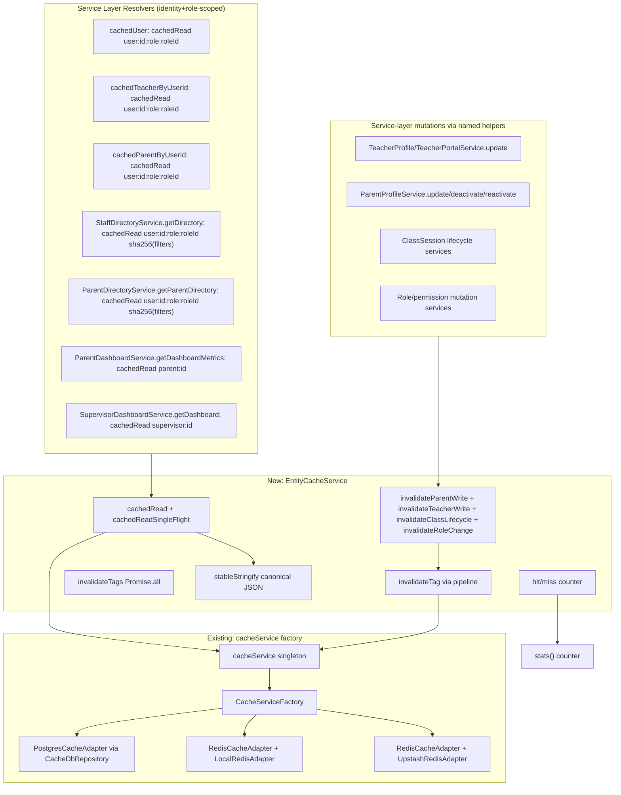
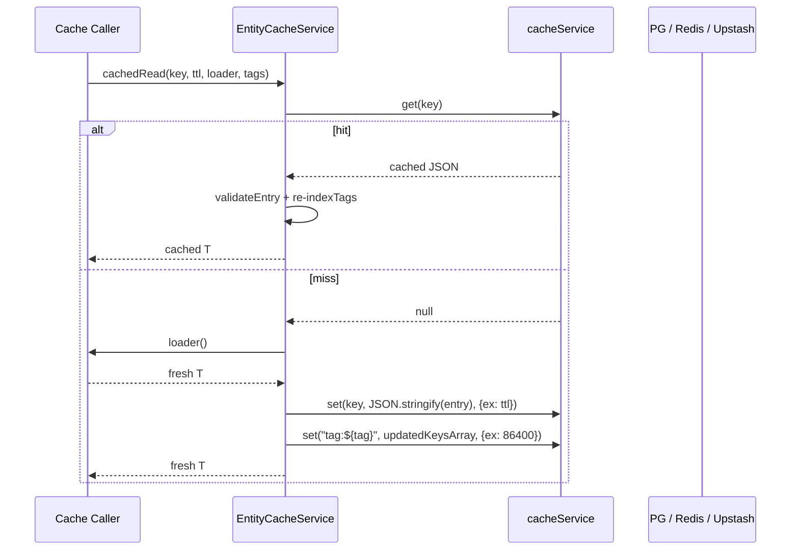

# Redis Caching Layer — Implementation Plan

> Plan group: `.ai/plan/redis/`
> Companion docs: [specs.md](./specs.md), [trackable-tasks.md](./trackable-tasks.md)
> Source plan: v2 hardened plan.
> Standards followed: `.agents/spec-process-guide/templates/design-template.md` + `process/tasks-phase.md`.

## Document Information

- **Feature Name**: Provider-Agnostic Caching Layer with Tag-Based Invalidation
- **Target Directory**: `.ai/plans/redis`
- **Outcome Directory**: `.ai/plans/redis/outcome`
- **Version**: 1.0
- **Date**: 2026-07-30
- **Status**: Ready for execution
- **Related Documents**: [specs.md](./specs.md) (requirements), [trackable-tasks.md](./trackable-tasks.md) (trackable tasks)
- **Reviewers**: (assign before execution)

---

## 1. Overview

This implementation plan takes the v2 hardened cache plan and breaks it into ordered, code-level deliverables. Every task traces back to a spec requirement and produces working, testable code. The plan was already hardened against the bug/security/performance review — those mitigations are baked in (identity+role-scoped keys, pipelined invalidation, single-flight, canonical JSON, TTL guard, SQL-level expiry filter, internal-only `stats()`).

### Design Goals

- Make the cache layer provider-agnostic by construction (PG-UNLOGGED, local Redis, Upstash free-tier all share one code path through `cacheService`).
- Eliminate cross-user cache poisoning by encoding `userId` + `roleId` in every cache key.
- Bounded staleness via TTL + tag invalidation; cache failures fail open.
- Maximum round-trip efficiency for invalidation via `cacheService.pipeline`.

### Key Design Decisions

- **Identity+role scope every cache key** (not just user scope) → structurally prevents leakage when resolvers return different results per role.
- **Pipelined invalidation fan-out** — single `pipeline([{del: [keys...]}, {del: [tagKey]}])` instead of N `del`s → saves 500ms-6s per dashboard mutation on Upstash REST.
- **`cacheService` only primitives** — the new layer uses only `get/set/del/pipeline` calls so PG/Redis/Upstash all share the same code path (no per-provider branches).
- **Tag index reset to `[]`** instead of `del`-leted → concurrent writes re-register and self-heal desync.
- **Canonical JSON via `stableStringify`** → all cache keys hash identically regardless of property order.
- **TTL upper-bound guard** → `cachedRead` throws if `ttlSeconds > 86400` so no payload outlives the tag index.

### UX/Navigation Specification (REQUIRED)

This feature is a **backend-only caching layer** with no new routes, pages, sidebar items, or user-facing UI changes. The cache layer is transparent to end users — it optimizes existing resolver performance without altering any user-observable contract.

#### New Routes & URLs

| Route | Purpose | Permission Required | Roles with Access |
|-------|---------|---------------------|-------------------|
| N/A | No new routes introduced | N/A | N/A |

#### Sidebar Navigation Integration

No new sidebar items. The feature is purely backend infrastructure.

#### Role-Based Access Matrix

No new roles or permissions. Existing permission checks remain outside the cache wrapper per Requirement 1.2.

#### Per-Audience Rendering

No per-audience rendering differences. The cache layer is transparent — all audiences experience the same resolver behavior with improved performance.

#### Mobile vs Desktop Variants

No differences. The cache layer operates server-side only.

#### Permission Mapping

No new permissions. Existing permission checks remain outside the cache wrapper.

### Outcome & Knowledge Transfer Protocol (`.ai/plans/redis/outcome/`)

- **BEFORE Execution:** Executing agents MUST read ALL existing files in `.ai/plans/redis/outcome/` to avoid re-analysis.
- **AFTER Execution:** Executing agents MUST write `.ai/plans/redis/outcome/<task-id>-outcome.md` with research/doc findings and implementation details.
- **PROGRESS TRACKING:** Executing agents MUST update task checkboxes `[ ]` -> `[x]` in `trackable-tasks.md`.

---

## 2. Architecture

### Target Architecture (mermaid)



### High-Level Data Flow



### Technology Stack

| Layer | Technology | Rationale |
|-------|------------|-----------|
| Cache abstraction | Existing `cacheService` (`backend/services/cache/`) | Adapter already supports all three backends; new layer is a thin domain wrapper. |
| Adapter interface | `ICacheService` (existing) | Only `get/set/del/pipeline` are needed; no new interface contracts except `stats()`. |
| Backing stores | PG-UNLOGGED `session_cache` / `rate_limit_cache`; Redis (local + Upstash) | Existing setup — no infra change. |
| Invalid. fan-out | `cacheService.pipeline` | One round-trip per adapter (PG: single `db.transaction`, Redis/Upstash: one HTTPS batch). |
| Frontend cache (out of scope) | Apollo Client normalized cache | Untouched by this plan. |

---

## 3. Components and Interfaces

### 3.1 Component: `EntityCacheService` (new)

**Purpose**: Domain-aware caching helper above raw `cacheService`. Owns the tag→keys index, named invalidation helpers, canonical JSON derivation, hit/miss counter.

**File**: `backend/services/cache/EntityCacheService.ts`

**Responsibilities**:
- `cachedRead<T>(key, ttlSeconds, loader, tags?)` — get → validate → return; miss → loader → write-back → index tags.
- `cachedReadSingleFlight<T>(...)` — same as above but write-back uses `insertIfNotExists` (PG) or `SET NX EX` (Redis) to dedupe concurrent misses.
- `invalidateTag(tag)` — pipeline one `del` of all keys + tag key, then reset tag key to `"[]"`.
- `invalidateTags(tags)` — `Promise.all` over `invalidateTag`.
- `invalidateParentWrite`, `invalidateTeacherWrite`, `invalidateClassLifecycle`, `invalidateRoleChange` — see code contract below.
- `stableStringify(value)` — canonical JSON.
- `stats()` data source — in-memory `Map<prefix, {hits, misses}>` counter.

**Dependencies**: `cacheService`, `logger`.

**Implementation Notes**:
- Every `cacheService.*` call wrapped in `try/catch`; cache outage fails open to the loader (read) or silenty logs (invalidation). Never throws to caller.
- TTL invariant: `cachedRead(..., ttlSeconds, ...)` with `ttlSeconds > CACHE_TAG_INDEX_TTL` throws.

### 3.2 Component: PG Adapter/Repository Tightening (modified)

**Purpose**: Eliminate race windows + reduce round-trips + ugly at-the-query-level expiry filtering.

**Files modified**:
- `backend/db/repo/shared/cache.repository.ts` — single-statement `incr`, new `setExpiry`, `get` with SQL `gte(expiresAt, now)`, extended `getTable` for `ec:`/`tag:`.
- `backend/services/cache/PostgresCacheAdapter.ts` — atomic `expire` via `CacheDbRepository.setExpiry`.

### 3.3 Component: `stats()` (added to ICacheServiceBase + adapter impls)

**Purpose**: Internal observability.

**Files modified**:
- `backend/services/cache/ICacheService.ts` — add `stats(): Promise<CacheStats>`.
- `backend/services/cache/PostgresCacheAdapter.ts` — PG `SELECT count(*) FROM session_cache`.
- `backend/services/cache/RedisCacheAdapter.ts` — `redisService.dbsize()`.

**Exposure**: NOT exposed on any HTTP route (review finding 3 — was unauthenticated). Internal-only.

---

## 4. Code Contracts (binding on implementers)

### 4.1 Named invalidation helpers

```typescript
// EntityCacheService.ts — the only place tag sets are defined.

export async function invalidateParentWrite(parentId: string, userId: string): Promise<void> {
  await invalidateTags([
    `parent:${parentId}`,
    `parent:byUserId:${userId}`,
    "parentDirectory",
    "dashboard:parent",
    `parent:dash:metrics:${parentId}`,
  ]);
}

export async function invalidateTeacherWrite(teacherId: string, userId: string): Promise<void> {
  await invalidateTags([
    `teacher:${teacherId}`,
    `teacher:byUserId:${userId}`,
    "teacherDirectory",
    "dashboard:supervisor",
  ]);
}

export async function invalidateClassLifecycle(
  teacherId: string | undefined,
  parentId: string | undefined,
): Promise<void> {
  const tags: string[] = ["dashboard:parent", "dashboard:supervisor", "teacherDirectory", "parentDirectory"];
  if (teacherId) tags.push(`teacher:${teacherId}`);
  if (parentId) tags.push(`parent:${parentId}`, `parent:dash:metrics:${parentId}`);
  await invalidateTags(tags);
}

export async function invalidateRoleChange(userId: string): Promise<void> {
  await invalidateTags([
    `user:${userId}`,
    "teacherDirectory",
    "parentDirectory",
    "dashboard:supervisor",
  ]);
}
```

### 4.2 Identity-and-role-scoped cache keys

```typescript
// Phase 1: entity lookups
const ecUserKey = (userId: string, roleId: string) => `ec:user:${userId}:${roleId}`;
const ecTeacherByUserIdKey = (userId: string, roleId: string) => `ec:teacher:byUserId:${userId}:${roleId}`;
const ecParentByUserIdKey = (userId: string, roleId: string) => `ec:parent:byUserId:${userId}:${roleId}`;

// Phase 2: directories — permission-aware scoping
const ecTeacherDirKey = (roleId: string, filters: unknown) =>
  `ec:teacher:dir:${roleId}:${stableStringify(filters)}`;
const ecParentDirKey = (roleId: string, filters: unknown) =>
  `ec:parent:dir:${roleId}:${stableStringify(filters)}`;

// Phase 3: dashboards — actor-scoped
const ecParentDashMetricsKey = (parentId: string) => `ec:parent:dash:metrics:${parentId}`;
const ecSupervisorDashKey = (actorUserId: string) => `ec:supervisor:dash:${actorUserId}`;
```

### 4.3 `stableStringify` (canonical JSON)

```typescript
function stableStringify(value: unknown): string {
  if (value === null || typeof value !== "object") return JSON.stringify(value);
  if (Array.isArray(value)) return `[${value.map(stableStringify).join(",")}]`;
  const keys = Object.keys(value as Record<string, unknown>).sort();
  return `{${keys.map(k => `${JSON.stringify(k)}:${stableStringify((value as Record<string, unknown>)[k])}`).join(",")}}`;
}
```

### 4.4 `cachedRead` shape + guards

```typescript
interface CacheEntry<T> { version: number; data: T; cachedAt: number; }
const CACHE_VERSION = 1;
const CACHE_TAG_INDEX_TTL = 86400; // 24h
const CACHE_KEY_PREFIX_ENTITY = "ec:";
const CACHE_KEY_PREFIX_TAG = "tag:";

function validateEntry(entry: unknown): entry is CacheEntry<unknown> {
  return typeof entry === "object" && entry !== null && !Array.isArray(entry)
    && (entry as CacheEntry<unknown>).version === CACHE_VERSION;
}

// Pseudocode — see trackable-tasks for full implementation sub-steps.
async function cachedRead<T>(key: string, ttlSeconds: number, loader: () => Promise<T>, tags: string[] = []): Promise<T> {
  if (ttlSeconds > CACHE_TAG_INDEX_TTL) throw new Error("cache TTL exceeds tag index TTL");
  try {
    const raw = await cacheService.get(key);
    if (raw) {
      const parsed = JSON.parse(raw);
      if (validateEntry(parsed)) {
        // Re-index on hit (desync self-heal)
        if (tags.length > 0) await safeIndexTags(key, tags);
        recordHit(prefixOf(key));
        return parsed.data as T;
      }
    }
  } catch (err) { logger.error("cachedRead cache get failed", err); /* fall through to loader */ }

  const data = await loader();
  const entry: CacheEntry<T> = { version: CACHE_VERSION, data, cachedAt: Date.now() };
  try {
    await cacheService.set(key, JSON.stringify(entry), { ex: ttlSeconds });
    if (tags.length > 0) await safeIndexTags(key, tags);
    recordMiss(prefixOf(key));
  } catch (err) { logger.error("cachedRead cache set failed", err); }
  return data;
}

async function safeIndexTags(key: string, tags: string[]): Promise<void> {
  // For each tag: read tag key → append key if not present → write back with TTL 86400s.
  // Wrapped in try/catch — index failure is non-fatal.
}
```

### 4.5 Tag index key routing (`CacheDbRepository.getTable`)

```typescript
// backend/db/repo/shared/cache.repository.ts (extended)
const getTable = (key: string) => {
  // Explicit: ec:* and tag:* always route to sessionCache — protect against future prefix drift.
  if (key.startsWith("ec:") || key.startsWith("tag:")) return sessionCache;
  if (key.startsWith("ratelimit:") || key.startsWith("auth:")) return rateLimitCache;
  return sessionCache;
};
```

### 4.6 PG adapter atomic `incr`

```sql
-- Single statement; eliminates update-then-fallback-to-insert race.
INSERT INTO {rate_limit_cache|session_cache} (key, value, expires_at)
VALUES ($1, '1', $2)
ON CONFLICT (key) DO UPDATE
SET value = ({table}.value::int + 1)::text,
    expires_at = excluded.expires_at
RETURNING value;
```

### 4.7 PG adapter atomic `setExpiry`

```sql
UPDATE {table}
SET expires_at = $2
WHERE key = $1;
```

### 4.8 PG adapter SQL-level expiry filter on `get`

```sql
SELECT key, value, expires_at
FROM {table}
WHERE key = $1 AND expires_at >= now()
LIMIT 1;
```

## 5. Errors and Logging

| Category | Behavior | Log level |
|----------|----------|-----------|
| `cacheService.get` throws | swallowed; loader called | `logger.error("cachedRead cache get failed", err)` |
| `cacheService.set` throws | swallowed; loader result returned | `logger.error("cachedRead cache set failed", err)` |
| `cacheService.pipeline` (invalidation) throws | swallowed (caller's mutation still succeeds) | `logger.error("invalidateTag failed", err)` |
| `JSON.parse` of a cache hit fails (malformed) | treated as miss; loader called | `logger.warn` |
| Shape guard marks entry invalid (version mismatch) | treated as miss | (no log — silent rolling-deploy self-heal) |
| TTL guard violated (>86400s) | throws synchronously to caller | `logger.error` (defensive) |

## 6. Testing Strategy

### 6.1 Unit (`backend/services/cache/test/EntityCacheService.test.ts`)
- Mock `cacheService.get/set/del/pipeline` with stubs.
- Tests:
  - cache miss → loader called → result written with expected key + TTL + tag pipeline called.
  - cache hit → loader NOT called → `indexTags` re-registered on hit (desync self-heal).
  - `invalidateTag` issues a single `cacheService.pipeline([{command:"del",args:[...keys]}, {command:"del",args:["tag:"+tag]}])` — assert the args array shape.
  - `invalidateTag` with malformed JSON tag index: returns successfully, zero `del`s issued; no exception to caller.
  - `cachedRead` with malformed entry value: loader called as fallback; no exception to caller.
  - `indexTags` dedupes — adding same key twice does not duplicate the array.
  - `stableStringify` key-order stability: identical strings for `{a:1,b:2}` and `{b:2,a:1}`.
  - `CACHE_VERSION` bump: write entry with version 1; assert `cachedRead` with mock matching shape but version 2 re-runs loader.
  - Concurrent-miss single-flight: two callers race on same key; assert only one write via `INSERT ... ON CONFLICT DO NOTHING` (PG) or `SET NX EX` (Redis pipeline arg shape).
  - TTL guard test: `cachedRead(..., 90000, loader)` throws TTL guard error (internally caught and re-thrown instead of swallowing).
  - Tag key TTL assertion: when re-registering, TTL is 86400s (matching tag index invariant).

### 6.2 PG Integration (`backend/db/test/logic/shared/cache_tag_invalidation.test.ts`)
- Real PG via `runInRollback` per `backend/db/test/AGENTS.md`.
- Pre-create entries via `cacheService.set`, index tags via `safeIndexTags`.
- `invalidateTag("teacher:42")` → assert via `tx.select(sessionCache)` that the entries are gone.
- No `expect().rejects.toThrow()` — use try/catch helper.
- Run via `bun run scripts/run-test/run-test.ts backend/db/test/logic/shared/cache_tag_invalidation.test.ts`.

### 6.3 Redis Provider Integration (`test/integration/redis/`)

Live provider smokes live under **`test/integration/redis/`** only (not `backend/db/test/` or `backend/services/`). One `*.integration.test.ts` per provider, **one smoke test each** (single round-trip — avoids rate limits / quota burn):

| File | Env keys | Smoke |
|------|----------|-------|
| `upstash.integration.test.ts` | `UPSTASH_TEST_REDIS_REST_URL`, `UPSTASH_TEST_REDIS_REST_TOKEN` | SET + GET (or PING) via `RedisCacheAdapter` |
| `redis-cloud.integration.test.ts` | `REDIS_CLOUD_TEST_REDIS_URL` | SET + GET via `RedisCacheAdapter` |
| `local-redis.integration.test.ts` | `REDIS_URL` (when `REDIS_PROVIDER=local`) | SET + GET via `RedisCacheAdapter` |

- Gate each suite with `describeLiveWhen` from `test/integration/helpers/describe-live.ts`; skip when keys are absent or empty.
- Run via `bun run test:integration` (or `bun run test:integration test/integration/redis/`).
- Confirm the adapter reaches the live provider — **not** full `EntityCacheService` / tag-invalidation behaviour (that is covered by unit tests + the PG integration test in §6.2).

---


## 7. Files Touched

### 7.1 New files (8)

- `backend/services/cache/EntityCacheService.ts`
- `backend/services/cache/test/EntityCacheService.test.ts`
- `backend/lib/auth/cached-teacher-by-user-id.ts`
- `backend/lib/auth/cached-parent-by-user-id.ts`
- `backend/db/test/logic/shared/cache_tag_invalidation.test.ts`
- `test/integration/redis/upstash.integration.test.ts`
- `test/integration/redis/redis-cloud.integration.test.ts`
- `test/integration/redis/local-redis.integration.test.ts`

### 7.2 Modified files (12+)

- `.env.test` — add `UPSTASH_TEST_REDIS_REST_URL`, `UPSTASH_TEST_REDIS_REST_TOKEN`, and `REDIS_CLOUD_TEST_REDIS_URL`.
- `.env.example` — add example commented keys for Upstash and Redis Cloud integration tests.
- `environment.d.ts` — extend `ProcessEnv` with Upstash and Redis Cloud integration test variables.
- `backend/services/cache/index.ts` — re-export new helpers.
- `backend/services/cache/ICacheService.ts` — add `stats()` + `CacheStats`.

- `backend/services/cache/PostgresCacheAdapter.ts` — atomic `expire` via `setExpiry`; `stats()` impl; PG `gte(expiresAt)` filter passthrough.
- `backend/services/cache/RedisCacheAdapter.ts` — `stats()` impl via `dbsize`.
- `backend/db/repo/shared/cache.repository.ts` — single-statement `incr`; new `setExpiry`; SQL-level `gte(expiresAt)` on `get`; extended `getTable` for `ec:`/`tag:`.
- `backend/lib/auth/cached-user.ts` — wrap inner call with `cachedRead` (300s TTL cap).
- `backend/lib/index.ts` — barrel for new cached-by-user-id modules.
- `backend/services/teacher/staff-directory.service.ts` — wrap `getDirectory` with identity+role-scoped key.
- `backend/services/parent/parent-directory.service.ts` — wrap `getParentDirectory` with identity+role-scoped key.
- `backend/services/parent/parent-dashboard.service.ts` — wrap `getDashboardMetrics`.
- `backend/services/supervisor/supervisor-dashboard.service.ts` — wrap `getDashboard`.
- `backend/services/parent/parent-profile.service.ts` — `invalidateParentWrite` after writes.
- `backend/services/teacher/teacher-portal.service.ts` (+ any teacher profile mutation service) — `invalidateTeacherWrite` after writes.
- `backend/services/teacher/teacher-due.service.ts` — `invalidateClassLifecycle(undefined, parentId)` after dues writes.
- Class-lifecycle services: `backend/services/session/class-session.service.ts` and `backend/services/session/class-instance-expiry.service.ts`, plus `backend/services/schedule/schedule.service.ts` for class lifecycle mutations — `invalidateClassLifecycle(teacherId, parentId)` on each lifecycle mutation.
- Role mutation services under `backend/services/auth/` (`permissions.service.ts`, `permission-management.service.ts`) — `invalidateRoleChange(userId)` on role/permission writes.
- `backend/services/AGENTS.md` — "Hot-resolver caching" subsection (≤10 lines).
- `package.json` + `bun.lock` — drop `@upstash/ratelimit`.

---

## 8. What this does NOT change

- `CACHE_PROVIDER` default stays `postgres` in `.env.example:110`. Local Redis and Upstash free-tier keep working transparently — no provider splits.
- Sessions, APQ, and the existing rate limiter stay untouched — they already use `cacheService` correctly.
- Teacher daily-schedule and anything inside `db.transaction` is NOT cached — wrong shape, would invalidate too often, risk stale transactional state.
- No new DB schema file, no migration — the tag index uses the existing `cacheService` primitives exclusively.
- `stats()` is internal-only — never exposed on an unauthenticated HTTP endpoint.
- Apollo Client cache (frontend) untouched.
- Next.js `use cache` / `revalidateTag` — out of scope for this plan, separate post-task.
- `@upstash/redis` upgrade from `^1.38.0` to 2.x — out of scope.

---

## 9. Verification per file (root AGENTS.md loop)

For every new file:

1. `bun tsgo` (read-only type check — safe in parallel).
2. `bun biome:check` (lightweight — safe in parallel).
3. POST the file to the lint queue:
   ```bash
   curl -s -X POST http://localhost:${LINT_QUEUE_PORT}/lint \
     -H "Content-Type: application/json" \
     -d '{"id":"verify","files":["<path>"]}'
   ```
4. Only once a file passes all three, import it elsewhere.

For the `backend/db/test/logic/shared/cache_tag_invalidation.test.ts` PG integration test file, run `bun run scripts/run-test/run-test.ts <path>` (mandatory per `backend/db/test/AGENTS.md` to capture transaction-evaluation deadlocks).

For the `backend/services/cache/test/EntityCacheService.test.ts` unit test file, run `bun test <path>` (mocked cacheService — no real DB).

For Redis provider smokes under `test/integration/redis/`, run `bun run test:integration test/integration/redis/` (loads `.env.test`; one API round-trip per provider file).

---

## 10. Rollout Order (sequential; each step verified before next)

1. **Tighten PG adapter + repository** (lowest risk, no behavior change).
2. **Add `EntityCacheService` + `stableStringify` + tag index + named helpers + TTL guard + hit/miss counter** + unit tests — no integrations yet.
3. **Add `stats()`** and wire hit-miss counter out.
4. **Phase 1 entity lookups** (`backend/lib/auth/cached-user.ts`, `backend/lib/auth/cached-teacher-by-user-id.ts`, `backend/lib/auth/cached-parent-by-user-id.ts`) + run unit tests.
5. **Phase 2 directories** (`StaffDirectoryService.getDirectory`, `ParentDirectoryService.getParentDirectory`) with identity+role-scoped keys.
6. **Phase 3 dashboards** (`ParentDashboardService.getDashboardMetrics`, `SupervisorDashboardService.getDashboard`).
7. **Wire mutations** — one service at a time, in lockstep with the corresponding wired resolver so cache freshness can be validated. Includes `invalidateRoleChange` wiring.
8. **PG integration test** for tag invalidation (`backend/db/test/logic/shared/cache_tag_invalidation.test.ts`).
8b. **Redis provider smokes** in `test/integration/redis/` (one test per provider).
9. **AGENTS.md "Hot-resolver caching" subsection**.
10. **Drop `@upstash/ratelimit`** + `bun install` + `bun tsgo`.
11. **Final `bun quality-gate` run**.
12. **Knowledge Propagation & Documentation** — create canonical reference doc under `docs/services/`, update layer AGENTS.md files, update root `AGENTS.md` Important References, write outcome file.

The sequence above mirrors the [trackable-tasks.md](./trackable-tasks.md) parent-task ordering so task status updates parallel the rollout.

---

## 11. Implementation Review Checklist

### Architecture
- [x] High-level architecture clearly described (§2 mermaid diagrams).
- [x] Component responsibilities well-defined (§3).
- [x] Interfaces between components specified (§4 code contracts).
- [x] Technology choices justified (§2 technology stack).

### Requirements Alignment
- [x] Design addresses all functional requirements (req 1-8 mapped to components).
- [x] Non-functional requirements considered.
- [x] Success criteria measurable (see [specs.md §5](./specs.md)).
- [x] Constraints and assumptions addressed (see [specs.md §4](./specs.md)).

### Technical Quality
- [x] Design follows established patterns (adapter on existing `cacheService`).
- [x] Security considered (identity+role scope, internal-only `stats()`).
- [x] Performance considered (pipelined invalidation, TTL cap, SQL-level expiry filter).
- [x] Error handling comprehensive (fail-open, try/catch, version guard).

### Implementation Readiness
- [x] Sufficient detail for implementation (code contracts for all helpers — §4).
- [x] Data models complete (`CacheEntry` shape, key shapes — §4.4, §4.2).
- [x] API specifications detailed (cache keys, tag-set maps — §4.1, §4.2).
- [x] Testing strategy comprehensive (§6).

### Maintainability
- [x] Supports future extension (named helpers + central `CACHE_VERSION`).
- [x] Components loosely coupled (EntityCacheService depends only on `cacheService` and `logger`).
- [x] Configuration externalized (constants — `CACHE_TAG_INDEX_TTL`, key prefixes).
- [x] Observability included (`stats()` with hit/miss — internal only).

### UX/Navigation Completeness (MANDATORY)
- [x] New routes table complete with permissions and roles (N/A — backend-only feature).
- [x] Sidebar navigation placement specified (N/A — no new UI).
- [x] Role-based access matrix for ALL user types (N/A — transparent cache layer).
- [x] Per-audience rendering differences documented (N/A — no UI changes).
- [x] Mobile vs Desktop variants defined (N/A — server-side only).
- [x] Permission mapping for each route/component specified (N/A — no new permissions).
