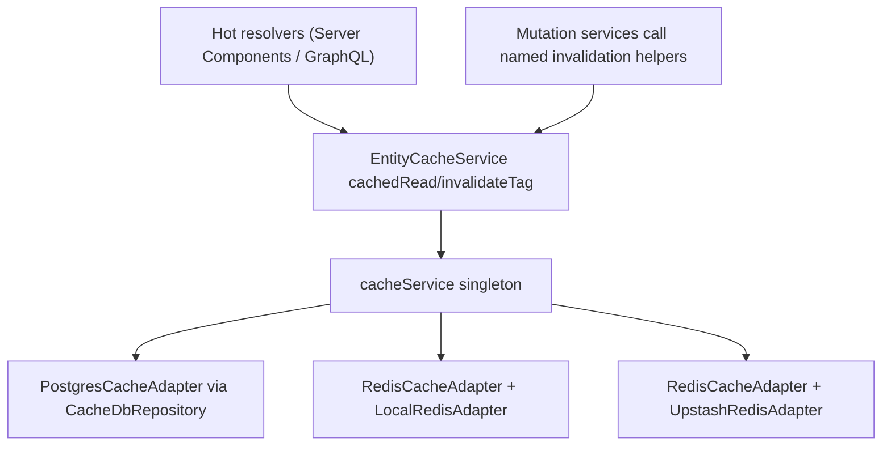

# Redis Caching Layer — Specification

> Plan group: `.ai/plans/redis/`
> Companion docs: [implementation.md](./implementation.md), [trackable-tasks.md](./trackable-tasks.md)
> Source plan: v2 hardened plan (permission-scoped, pipelined invalidation, canonical JSON, TTL guards).
> Standards followed: `.agents/spec-process-guide/` — Requirements (EARS) + Design templates.

## Document Information

- **Feature Name**: Provider-Agnostic Caching Layer with Tag-Based Invalidation
- **Target Directory**: `.ai/plans/redis`
- **Outcome Directory**: `.ai/plans/redis/outcome`
- **Version**: 1.0
- **Date**: 2026-07-30
- **Status**: Ready for execution
- **Related Documents**: [implementation.md](./implementation.md), [trackable-tasks.md](./trackable-tasks.md)
- **Codebase anchors**: `backend/services/cache/`, `backend/services/redis/`, `.env.example:110`

---

## 1. Introduction

### Feature Summary

Add a domain-aware caching layer on top of Siraj's existing provider-agnostic `cacheService` (PG-UNLOGGED / local Redis / Upstash), with identity-and-role-scoped cache keys, explicit tag-set contracts, pipelined tag invalidation, and a single-flight write path. Wire it to the hot read paths (entity lookups, directories, dashboards) and the matching mutations.

### Business Value

- Increase cache hits on resolver outputs that today fetch from PostgreSQL on every request.
- Make the caching decision provider-agnostic — works on PG-UNLOGGED (today's default), local Redis, and Upstash free-tier without code path splits.
- Eliminate cross-user cache-poisoning risk by design (identity+role scoped keys).
- Bounded staleness via TTL + tag invalidation; cache outages fail open to the loader.

### Scope

**In scope**:
- New `EntityCacheService` (cachedRead, cachedReadSingleFlight, invalidateTag(s), named invalidation helpers, stableStringify, hit/miss counter).
- Identity+role-scoped cache keys for `getCurrentUser`, `TeacherRepository.findByUserId`, `ParentRepository.findByUserId`, `StaffDirectoryService.getDirectory`, `ParentDirectoryService.getParentDirectory`, `ParentDashboardService.getDashboardMetrics`, `SupervisorDashboardService.getDashboard`.
- Named invalidation helpers wired to parent/teacher profile, dues, class-lifecycle, and role-change mutation services.
- PG adapter + repository atomicity tightening (single-statement incr, atomic setExpiry, SQL-level `gte(expiresAt)` on `get`).
- Internal-only `stats()` observability (never exposed on unauthenticated HTTP).
- Unit tests + PG integration test for tag invalidation (`backend/db/test/logic/shared/cache_tag_invalidation.test.ts`), plus **one smoke test per Redis provider** under `test/integration/redis/` (Upstash REST, Redis Cloud, local `REDIS_URL`) when configured in `.env.test`. Provider smokes run via `bun run test:integration` — see `backend/db/test/AGENTS.md` and `backend/services/AGENTS.md` (no live provider tests under `backend/db/test/` or `backend/services/`).
- `backend/services/AGENTS.md` "Hot-resolver caching" subsection.
- Drop unused `@upstash/ratelimit` dependency.


**Out of scope**:
- Flipping `CACHE_PROVIDER` to `redis` (default stays `postgres` in `.env.example:110`).
- Caching the teacher daily-schedule / anything inside `db.transaction`.
- Upgrading `@upstash/redis` from `^1.38.0` to 2.x (separate post-task).
- New DB schema/migration (tag index reuses `cacheService` primitives).
- Next.js `use cache` / `revalidateTag` (separate post-task).

---

## 2. Requirements (EARS)

### Requirement 0: Execution Outcome Protocol & Task Progress Tracking

**User Story:** As an AI agent or developer, I want persistent task outcome tracking and progress updates, so that subsequent tasks do not repeat past research or analysis.

#### Acceptance Criteria

1. WHEN an executing agent starts any task THEN system SHALL read ALL existing outcome files in `.ai/plans/redis/outcome/` to absorb prior research, search results, and pitfalls.
2. WHEN an executing agent completes any task THEN system SHALL write a new outcome document under `.ai/plans/redis/outcome/<task-id>-outcome.md` detailing research findings, docs/web search results, implementation details, and carry-over points.
3. WHEN an executing agent completes any subtask THEN system SHALL update the corresponding task checkbox `[ ]` -> `[x]` in `trackable-tasks.md`.
4. WHEN any file is modified THEN system SHALL execute per-file verification (`tsgo` + `biome` + `lint-queue`) on that specific file.
5. WHEN any subtask is completed THEN system SHALL execute `bun tsgo`, `bun biome:check`, and `bun run lint` globally, exiting with zero errors and zero warnings.

**Priority**: High
**Complexity**: Low — protocol enforcement, no code changes.
**Dependencies**: None.

### Requirement 1: Identity-and-Role-Scoped Cache Reads

**User Story:** As a resolver caller, I want each cache key to encode the requester's `userId` and role fingerprint, so that two callers with different permissions never share a cached payload.

#### Acceptance Criteria

1. WHEN a resolver caches a read path THEN the EntityCacheService SHALL derive the cache key as `ec:{scope}:{userId}:{roleId}:{canonicalArgsHash}` where `roleId` is the resolved role string or `"anonymous"` if `permissionContext` is null.
2. WHEN a permission check passes outside the cache wrapper THEN the cache SHALL never re-authorize; the entry written is assumed to be the result the same caller-key would return on a re-read.
3. WHEN the role of a user changes THEN role mutation services SHALL call `invalidateRoleChange(userId)` within the same request, which invalidates `tag:user:${userId}` plus directory/supervisor dashboard tags.
4. IF `permissionContext` is null THEN the EntityCacheService SHALL still operate but key the entry under `roleId="anonymous"` so the cache never bypasses auth (the cache only stores what a notional anonymous caller could already see).

**Priority**: High
**Complexity**: Medium — adds `roleId` parameter to every cached resolver call site.
**Dependencies**: `permissions.service.ts` for resolving role, role mutation services.

### Requirement 2: Tag-Based Invalidation With Fixed Tag Sets

**User Story:** As a service that mutates cached data, I want one named helper per mutation category that invalidates an exact tag set, so that tag-set drift is impossible.

#### Acceptance Criteria

1. WHEN a mutation service calls a named invalidation helper THEN the EntityCacheService SHALL invalidate exactly the tag set mapped to that helper (no per-mutation drift).
2. WHEN `invalidateTag(tag)` runs THEN it SHALL issue a single `cacheService.pipeline([{command:"del", args:[...keys]}, {command:"del", args:["tag:"+tag]}])` (one round-trip per adapter) — never N parallel `del` calls.
3. WHEN `invalidateTag(tag)` finishes THEN it SHALL reset the tag key to `"[]"` instead of `del`-ing it, so concurrent writes re-register on the next `cachedRead`.
4. WHEN invalidation throws (cache outage, malformed tag index) THEN the caller's mutation SHALL still succeed (try/catch + `logger.error`); the failed invalidation will be cleaned up by TTL.
5. WHILE a tag index entry exists THEN its TTL SHALL be 86400 seconds (24h) and cached payload TTL SHALL NOT exceed this value (the EntityCacheService throws on `ttlSeconds > 86400`).

**Priority**: High
**Complexity**: Medium — fan-out is one pipeline call but contract must be enforced.
**Dependencies**: `cacheService.pipeline` already implemented on all three adapters.

### Requirement 3: Cache Safety (Shape Guard, Single-Flight, Fail-Open)

**User Story:** As a caller of `cachedRead`, I want cache failures to never affect behavior, so the cache is purely an optimization.

#### Acceptance Criteria

1. WHEN `cacheService.get(key)` returns malformed/non-CacheEntry JSON THEN `cachedRead` SHALL fall back to the loader, never throw.
2. WHEN an entry's `version` field does not equal the current `CACHE_VERSION` THEN `cachedRead` SHALL treat it as a miss and re-fetch (rolling-deploy safety).
3. WHEN two callers race on the same key on a cache miss THEN `cachedReadSingleFlight` SHALL write back via `INSERT ... ON CONFLICT DO NOTHING` (PG) or `SET NX EX <ttl>` (Redis/Upstash) such that only one writer populates the key.
4. WHEN `cacheService.get/set/del/pipeline` itself throws THEN `cachedRead` SHALL swallow the error, call the loader, log via `logger.error`, and return the loader result.
5. WHEN `cachedRead(..., ttlSeconds, ...)` is called with `ttlSeconds > 86400` THEN it SHALL throw a TTL-guard error (defensive invariant).

**Priority**: High
**Complexity**: Medium — single-flight write path differs between PG and Redis.
**Dependencies**: Existing `insertIfNotExists` in `CacheDbRepository`; `pipeline` Redis support for `SET NX EX`.

### Requirement 4: Canonical Cache Key Derivation

**User Story:** As a developer adding a new cached resolver, I want the cache key hash to be canonical so the same logical query hits the same cache entry regardless of object property ordering.

#### Acceptance Criteria

1. WHEN a resolver passes a filter object to `cachedRead` as the args-hash source THEN EntityCacheService SHALL hash `stableStringify(obj)` (recursive key sort) — never `JSON.stringify(obj)` directly.
2. WHEN the same logical object is built in two different orders THEN `stableStringify` SHALL produce identical output.
3. WHEN the args-hash source is a primitive THEN `stableStringify` SHALL return the standard `JSON.stringify` of that primitive.

**Priority**: Medium
**Complexity**: Low — one small helper.
**Dependencies**: None.

### Requirement 5: PostgreSQL Adapter Atomicity Tightening

**User Story:** As a runtime caller of `cacheService.incr/expire/get`, I want each to be a single round-trip, so cache operations are fast and race-free.

#### Acceptance Criteria

1. WHEN `CacheDbRepository.incr(key)` is called THEN it SHALL be a single `INSERT ... ON CONFLICT (key) DO UPDATE SET value = (table.value::int + 1)::text, expiresAt = excluded.expiresAt RETURNING value` — no read-then-update loop.
2. WHEN `PostgresCacheAdapter.expire(key, seconds)` is called THEN it SHALL delegate to a new `CacheDbRepository.setExpiry(key, expiresAt)` that performs a single atomic `UPDATE ... SET expiresAt = ? WHERE key = ?`.
3. WHEN `CacheDbRepository.get(key)` is called THEN the underlying SELECT SHALL filter on `expiresAt >= now()` at the SQL level so expired rows are invisible at the query layer (drop the JS-side expiry check and the inline `await del(key)`); dead rows are reclaimed only by the existing 5-minute sweep.
4. WHEN the adapter runs concurrently THEN no race window shall exist between update-then-insert or read-then-write for `incr`/`expire`.

**Priority**: Medium
**Complexity**: Low — small Drizzle query rewrites.
**Dependencies**: Existing `CacheDbRepository` namespace, `PostgresCacheAdapter`.

### Requirement 6: Internal-Only Observability (No Unauthenticated Exposure)

**User Story:** As an operator, I want to inspect the cache's hit ratio and provider, but cache metadata must not leak to unauthenticated callers.

#### Acceptance Criteria

1. WHEN `stats()` is implemented on the adapter interface THEN it SHALL return `{provider, size, hitsByPrefix}` where `hitsByPrefix` is an in-memory counter keyed by cache key prefix.
2. WHERE `stats()` is exposed for runtime inspection THEN it SHALL NOT be wired into the `HEAD /api/graphql` handler or any unauthenticated HTTP route (finding: stats endpoint was unauthenticated).
3. WHEN `stats()` is invoked from a unit/integration test THEN it SHALL return data without side effects.

**Priority**: Low
**Complexity**: Low — single method per adapter + one in-memory counter.
**Dependencies**: None.

### Requirement 7: Tag Prefix Hardening

**User Story:** As a cache contributor, I want entity-cache and tag keys explicitly routed to the right PG table, so prefix-broadening mistakes cannot redirect them to the rate-limit table.

#### Acceptance Criteria

1. WHEN a cache key starts with `ec:` or `tag:` THEN `CacheDbRepository.getTable` SHALL explicitly route it to `sessionCache` (regardless of any future prefix widening).
2. WHEN `EntityCacheService` writes key prefixes THEN it SHALL exclusively use the `CACHE_KEY_PREFIX_ENTITY="ec:"` and `CACHE_KEY_PREFIX_TAG="tag:"` constants — never raw string literals.

**Priority**: Medium
**Complexity**: Low.
**Dependencies**: Existing `getTable` dispatcher.

### Requirement 8: Cleanup of Unused Dependencies

**User Story:** As a maintainer, I want the unused `@upstash/ratelimit` dependency dropped so the lockfile reflects reality.

#### Acceptance Criteria

1. WHEN `package.json` no longer declares `@upstash/ratelimit` AND `bun install` is re-run THEN `bun.lock` SHALL no longer contain it.
2. WHEN `grep -r "@upstash/ratelimit" backend/ frontend/ shared/ app/ scripts/` is run THEN it SHALL return no matches.
3. WHEN `bun tsgo` is run THEN there SHALL be no new type errors introduced by the removal.

**Priority**: Low
**Complexity**: Trivial.
**Dependencies**: None.

---

## 3. UX/Navigation Requirements (MANDATORY)

This feature is a **backend-only caching layer** with no new routes, pages, sidebar items, or user-facing UI changes. The cache layer is transparent to end users — it optimizes existing resolver performance without altering any user-observable contract.

### New Routes & Role-Based Access

| Route | Purpose | Permission | Roles with Access |
|-------|---------|------------|-------------------|
| N/A | No new routes introduced | N/A | N/A |

### Sidebar Navigation Placement

No new sidebar items. The feature is purely backend infrastructure.

### Per-Audience Rendering

No per-audience rendering differences. The cache layer is transparent — all audiences experience the same resolver behavior with improved performance.

### Mobile vs Desktop

No differences. The cache layer operates server-side only.

### Permission Mapping

No new permissions. Existing permission checks remain outside the cache wrapper per Requirement 1.2.

---

## 4. Non-Functional Requirements

### Performance Requirements

- WHEN a `cachedRead` hits the cache THEN the round-trip overhead SHALL be a single `cacheService.get` (~3-5ms PG-UNLOGGED warm pooled, ~15-30ms Upstash REST).
- WHEN `invalidateTag(tag)` runs against a tag with up to 200 keys THEN it SHALL complete in ≤1 `cacheService.pipeline` call (not N parallel `del` calls).
- WHEN `stableStringify(obj)` runs THEN it SHALL add <5% latency over `JSON.stringify(obj)` for typical filter objects (<10KB).

### Security Requirements

- WHEN any cached read path is invoked THEN the requester's identity+role SHALL be part of the cache key (no shared payload across permission contexts).
- WHEN a role or permission is revoked THEN `invalidateRoleChange(userId)` SHALL be called by the mutation service to drop the stale user-cache entry within the same request.
- WHEN `stats()` is invoked from an unauthenticated source THEN it SHALL not be reachable.

### Reliability Requirements

- WHEN the cache backend is unreachable THEN the EntityCacheService SHALL fail-open to the loader; no exception propagates to callers (read or mutation path).
- WHEN tag index data is corrupt/not-an-array THEN `invalidateTag` SHALL catch and log without throwing to the mutation caller.
- WHEN a single-flight loser reads the cache after a winner has populated it THEN it SHALL return the cached value (no extra loader calls).

---

## 5. Constraints and Assumptions

### Technical Constraints

- Must work on all three cache providers from `CacheServiceFactory` (`postgres`, `redis` + `local`, `redis` + `upstash`) without code-path splits.
- Integration tests support live Redis provider verification using `UPSTASH_TEST_REDIS_REST_URL` / `UPSTASH_TEST_REDIS_REST_TOKEN` (Upstash REST) and `REDIS_CLOUD_TEST_REDIS_URL` (Redis Cloud) loaded from `.env.test`.
- Must not touch `backend/services/redis/`, sessions/APQ/rate-limit/FX (already correct).

- Must not introduce a new DB schema file or migration.
- Must respect `backend/services/AGENTS.md` (services own mutations/invalidation, repositories don't).
- Must respect `backend/db/test/AGENTS.md` (`runInRollback`, no `expect().rejects.toThrow()`).

### Business Constraints

- Cache layer must not change the user-observable contract of any resolver behavior; it is purely an optimization.
- No new managed service dependencies (Upstash free-tier is already wired and optional).

### Assumptions

- Caller services can compute `roleId` from `permissionContext` (or pass `"anonymous"`) without circular dependency on EntityCacheService.
- Resolvers in `backend/lib/auth/cached-*.ts` remain wrapped in `React.cache` per-request; EntityCacheService sits inside the `React.cache` wrapper, not outside it.
- Tag invalidation occurring slightly later than the mutation commit is acceptable (read-after-write is allowed to be briefly cached per TTL — non violated by PG writes).

---

## 6. Success Criteria

### Definition of Done

- [ ] All acceptance criteria are met for requirements 0-8.
- [ ] All new files pass `bun tsgo` + `bun biome:check` + lint queue client.
- [ ] The PG integration test (`cache_tag_invalidation.test.ts`) passes via `bun run scripts/run-test/run-test.ts`.
- [ ] Unit tests (`EntityCacheService.test.ts`) pass against mocked `cacheService`.
- [ ] `bun quality-gate` passes through tsgo + biome + lint + codescene + sonar stages.
- [ ] Knowledge propagation complete: canonical doc created under `docs/services/`, layer AGENTS.md files updated, root `AGENTS.md` Important References updated, outcome file written to `.ai/plans/redis/outcome/12.1-knowledge-propagation-outcome.md`.

### Acceptance Metrics (qualitative)

- Cache hit path observed at minimum on previously-uncached `getCurrentUser`, `TeacherRepository.findByUserId`, `ParentRepository.findByUserId`, `StaffDirectoryService.getDirectory`, `ParentDirectoryService.getParentDirectory`, `ParentDashboardService.getDashboardMetrics`, `SupervisorDashboardService.getDashboard`.
- Invalidation fires on at least one mutation of each wired category (profile, class lifecycle, dues, role change).

---

## 7. Design

### 7.1 Architecture Context



### 7.2 Target Architecture (mermaid in implementation.md for fuller picture)

See [implementation.md § Target Architecture](./implementation.md) for the full component diagram.

### 7.3 Components and Interfaces

#### Component 1: `EntityCacheService` (new file: `backend/services/cache/EntityCacheService.ts`)

**Purpose**: Domain-aware caching helper above raw `cacheService`.

**Responsibilities**:
- `cachedRead<T>(key, ttlSeconds, loader, tags?)`: get → parse → shape guard → return; else `loader()` → write-back via `set` → `indexTags(key, tags)`.
- `cachedReadSingleFlight<T>(...)`: same as above but write-back via `insertIfNotExists` (PG) or `SET NX EX` (Redis) pipeline.
- `invalidateTag(tag)`: read JSON array at `tag:${tag}` → `cacheService.pipeline([{command:"del", args:[...keys]}, {command:"del", args:["tag:"+tag]}])` → on success reset tag key to `"[]"`.
- `invalidateTags(tags)`: `Promise.all` over `invalidateTag`.
- Named invalidation helpers (`invalidateParentWrite`, `invalidateTeacherWrite`, `invalidateClassLifecycle`, `invalidateRoleChange`) → fixed tag-set mappings (§6.4).
- `stableStringify(value)`: recursive key-sort for canonical JSON.
- Hit/miss counter: `Map<prefix, {hits:number, misses:number}>`, exposed via `stats()`.

**Input**: cache key string, ttl, loader callback, optional tags array.

**Output**: cached / fresh `T`; never throws to caller.

**Dependencies**: `cacheService`, `logger`.

**Implementation notes**:
- All `cacheService` calls wrapped in `try/catch + logger.error`; cache outage fails open.
- TTL guard: throws if `ttlSeconds > CACHE_TAG_INDEX_TTL (86400)`.
- Tag index key shape: `tag:${tag}` → JSON string array of cached keys; TTL 86400s.
- Re-index on every cache hit to self-heal desync races.

#### Component 2: PG Adapter/Repository Tightening (modified files)

See implementation.md § PG adapter tightening for the full contract.

#### Component 3: `stats()` (added to ICacheServiceBase)

**Purpose**: Internal observability only.

**Responsibilities**:
- Each adapter implements `stats(): Promise<{provider:string, size:number, hitsByPrefix:Record<string,{hits:number,misses:number}>}>`.
- Postgres: `SELECT count(*) FROM session_cache` via Drizzle.
- Redis/Upstash: `DBSIZE`.
- `hitsByPrefix` sourced from `EntityCacheService`'s in-memory counter.

**Notes**:
- NOT exposed on any HTTP route. Reserved for unit tests and internal tooling.

### 7.4 Code Contracts

#### Named invalidation helpers — fixed tag-set map

```typescript
// EntityCacheService.ts — the only place tag sets are defined.

export async function invalidateParentWrite(parentId: string, userId: string): Promise<void> {
  await invalidateTags([
    `parent:${parentId}`,
    `parent:byUserId:${userId}`,
    "parentDirectory",
    "dashboard:parent",
    `parent:dash:metrics:${parentId}`,
  ]);
}

export async function invalidateTeacherWrite(teacherId: string, userId: string): Promise<void> {
  await invalidateTags([
    `teacher:${teacherId}`,
    `teacher:byUserId:${userId}`,
    "teacherDirectory",
    "dashboard:supervisor",
  ]);
}

export async function invalidateClassLifecycle(
  teacherId: string | undefined,
  parentId: string | undefined,
): Promise<void> {
  const tags: string[] = ["dashboard:parent", "dashboard:supervisor", "teacherDirectory", "parentDirectory"];
  if (teacherId) tags.push(`teacher:${teacherId}`);
  if (parentId) tags.push(`parent:${parentId}`, `parent:dash:metrics:${parentId}`);
  await invalidateTags(tags);
}

export async function invalidateRoleChange(userId: string): Promise<void> {
  await invalidateTags([
    `user:${userId}`,
    "teacherDirectory",
    "parentDirectory",
    "dashboard:supervisor",
  ]);
}
```

#### Identity-and-role-scoped cache keys

```typescript
// Phase 1: entity lookups
`ec:user:${userId}:${roleId}`                     // 300s TTL
`ec:teacher:byUserId:${userId}:${roleId}`         // 300s TTL
`ec:parent:byUserId:${userId}:${roleId}`           // 300s TTL

// Phase 2: directories — permission-aware scoping
`ec:teacher:dir:${roleId}:${stableStringify({ search, paginationArgs })}`   // 30s TTL
`ec:parent:dir:${roleId}:${stableStringify({ search, pagination, lifecycleStatus })}` // 30s TTL

// Phase 3: dashboards — actor-scoped
`ec:parent:dash:metrics:${parent.id}`             // 60s TTL
`ec:supervisor:dash:${actorUserId}`               // 30s TTL
```

#### `stableStringify` (canonical JSON)

```typescript
function stableStringify(value: unknown): string {
  if (value === null || typeof value !== "object") return JSON.stringify(value);
  if (Array.isArray(value)) return `[${value.map(stableStringify).join(",")}]`;
  const keys = Object.keys(value as Record<string, unknown>).sort();
  return `{${keys.map(k => `${JSON.stringify(k)}:${stableStringify((value as Record<string, unknown>)[k])}`).join(",")}}`;
}
```

#### `cachedRead` shape + guards

```typescript
interface CacheEntry<T> { version: number; data: T; cachedAt: number; }
const CACHE_VERSION = 1;
const CACHE_TAG_INDEX_TTL = 86400;
const CACHE_KEY_PREFIX_ENTITY = "ec:";
const CACHE_KEY_PREFIX_TAG = "tag:";

function validateEntry(entry: unknown): entry is CacheEntry<unknown> {
  return typeof entry === "object" && entry !== null && !Array.isArray(entry)
    && (entry as CacheEntry<unknown>).version === CACHE_VERSION;
}

async function cachedRead<T>(
  key: string,
  ttlSeconds: number,
  loader: () => Promise<T>,
  tags: string[] = [],
): Promise<T> {
  if (ttlSeconds > CACHE_TAG_INDEX_TTL) throw new Error("cache TTL exceeds tag index TTL");
  // try → get → parse → guard → return; catch → loader → set → indexTags; never throw
}
```

### 7.5 Tag index key routing

```typescript
// backend/db/repo/shared/cache.repository.ts (extended getTable)
const getTable = (key: string) => {
  // Explicit: ec:* and tag:* always go to sessionCache — protect against future prefix drift.
  if (key.startsWith("ec:") || key.startsWith("tag:")) return sessionCache;
  if (key.startsWith("ratelimit:") || key.startsWith("auth:")) return rateLimitCache;
  return sessionCache;
};
```

### 7.6 Verification Loop

See [implementation.md § Verification per file](./implementation.md) for the per-file `tsgo` + `biome:check` + lint queue client loop (root AGENTS.md alignment).

### 7.7 Testing Strategy

**Unit** (`backend/services/cache/test/EntityCacheService.test.ts`):
- Mock `cacheService.get/set/del/pipeline`.
- Hit, miss, malformed fallback, pipelined invalidation, single-flight race, schema-version bump, stableStringify stability, TTL guard.

**PG integration** (`backend/db/test/logic/shared/cache_tag_invalidation.test.ts`):
- Real PG via `runInRollback`.
- Writes cache entries + indexes tags → `invalidateTag("teacher:42")` → asserts entries are gone from `session_cache` via `tx.select`.
- No `expect().rejects.toThrow()` — use try/catch helper.

**Run via**: `bun run scripts/run-test/run-test.ts <path>` (mandatory for PG integration to capture transaction deadlocks).

**Provider integration** (`test/integration/redis/` — one file per provider, **one smoke test each**):
- `upstash.integration.test.ts` — single SET/GET (or PING) via `RedisCacheAdapter` / `cacheService` when `UPSTASH_TEST_REDIS_REST_URL` + `UPSTASH_TEST_REDIS_REST_TOKEN` are set.
- `redis-cloud.integration.test.ts` — same when `REDIS_CLOUD_TEST_REDIS_URL` is set.
- `local-redis.integration.test.ts` — same against `REDIS_URL` when `REDIS_PROVIDER=local` (optional; skips when unset).
- Gate with `describeLiveWhen` from `test/integration/helpers/describe-live.ts`; skip cleanly when env keys are absent.
- **Do not** add `*.integration.test.ts` under `backend/db/test/` or `backend/services/` for these providers.

**Run via**: `bun run test:integration` (all provider smokes) or `bun run test:integration test/integration/redis/`.

---

## 8. Glossary

| Term | Definition |
|------|------------|
| `cacheService` | The singleton `cachedRead` `get`/`set`/`del`/`pipeline` facade returned by `CacheServiceFactory` (`backend/services/cache/CacheServiceFactory.ts`). |
| `ICacheService` | Adapter contract (`backend/services/cache/ICacheService.ts`) all three adapter types implement. |
| Provider | One of `postgres` (PG-UNLOGGED) or `redis` (`local` ioredis or `upstash` REST). Selected by `CACHE_PROVIDER` / `REDIS_PROVIDER`. |
| Tag | String label attached to a cached key via `indexTags`; a single tag's `invalidateTag` call removes all its associated keys. |
| `categoryId`/`roleId` | Caller's role string (or `"anonymous"` when `permissionContext` is null) — part of every cache key to prevent cross-permission payload sharing. |
| Single-flight | Write-back race protection: only one of N concurrent callers populates the cache after a miss. |
| `stableStringify` | Recursive-key-sorted JSON serialization — guarantees the same logical query hashes identically. |
| `CACHE_VERSION` | Schema-version guard inside `CacheEntry`; bump to invalidate stale-shape entries on rolling deploys. |

---

## 9. Design Review Checklist (filled)

### Architecture
- [x] High-level architecture clearly described (§6.1, §6.2, plus mermaid in implementation.md).
- [x] Component responsibilities well-defined (§6.3).
- [x] Interfaces between components specified (§6.4 code contracts).
- [x] Technology choices justified (existing `cacheService` factory is reused).

### Requirements Alignment
- [x] Design addresses all functional requirements (req 1-8 mapped to components).
- [x] Non-functional requirements considered (§4).
- [x] Success criteria measurable (§6).
- [x] Constraints and assumptions addressed (§5).

### Technical Quality
- [x] Design follows established patterns (adapter on existing `cacheService`).
- [x] Security considered (identity+role scope, internal-only `stats()`).
- [x] Performance considered (pipelined invalidation, TTL cap).
- [x] Error handling comprehensive (fail-open, try/catch, version guard).

### Implementation Readiness
- [x] Sufficient detail for implementation (code contracts for all helpers).
- [x] Data models complete (`CacheEntry` shape, key shapes).
- [x] API specifications detailed (cache keys, tag-set maps).
- [x] Testing strategy comprehensive (unit + PG integration + `test/integration/redis/` provider smokes).

### Maintainability
- [x] Supports future extension (named helpers + central `CACHE_VERSION`).
- [x] Components loosely coupled (EntityCacheService depends only on `cacheService` and `logger`).
- [x] Configuration externalized (constants — `CACHE_TAG_INDEX_TTL`, key prefixes).
- [x] Observability included (`stats()` with hit/miss — internal only).
