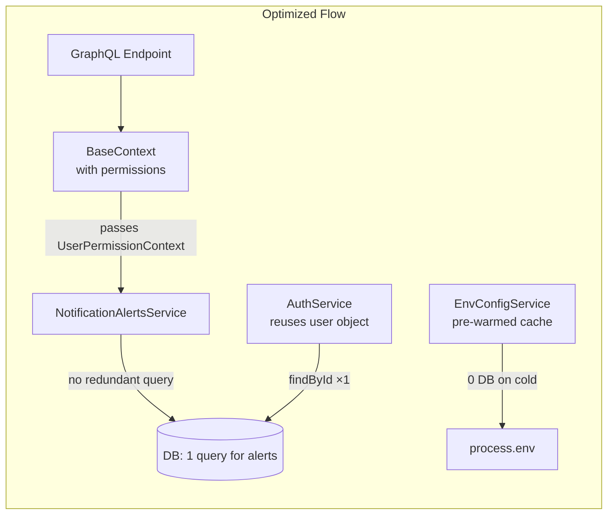
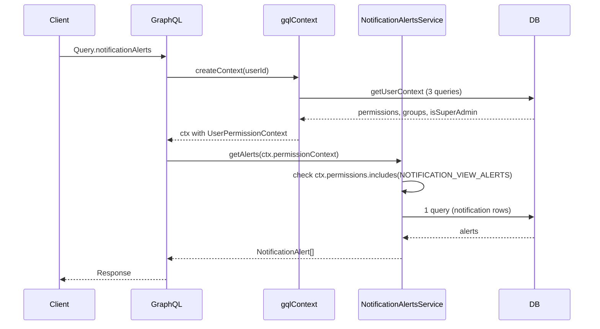
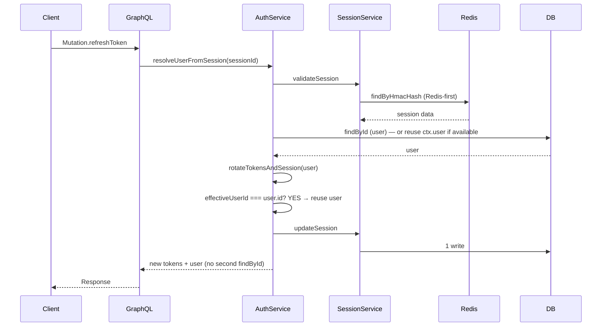

# Vercel Logs Performance Fix — Design Document

## Document Information

- **Feature Name**: vercel-logs-performance-fix
- **Target Directory**: `.ai/plans/vercel-logs-performance-fix`
- **Outcome Directory**: `.ai/plans/vercel-logs-performance-fix/outcome`
- **Version**: 1.0
- **Date**: 2026-08-18
- **Author**: AI Agent (spec-driven-development)
- **Related Documents**: [Requirements](specs.md) | [Initial Analysis](../../todo/logs-analysis-and-fix-plan.md)

## Overview

This design addresses eight performance and log-noise issues identified in Vercel production logs from 2026-08-12. The core theme is **eliminating redundant work**: the GraphQL context already computes permission data but downstream services re-query it; the `refreshToken` mutation re-fetches a user that was just loaded; the `Query.me` resolver re-fetches a user already loaded as `ctx.user`; the env-config system queries the DB for keys that always resolve to `process.env`; scopeAuth re-invokes `getUserContext` for permission-scoped resolvers; and the client sends 8 concurrent log POSTs per navigation that could be batched.

> **R3 corrections applied:** 10 findings (R3-1 through R3-9) from the reality-check audit have been incorporated:
> - **R3-1**: Apollo Server 4 (not Pothos/Yoga) — Component 9 added for `allowBatchedHttpRequests: true`
> - **R3-3**: Session lookups are Redis-first in production — Component 4 cost model corrected
> - **R3-5**: Cold-start singletons already in place — Requirement 8 downgraded to verification
> - **R3-6**: `validateSession` has redundant `findSafeById` — Component 4 expanded
> - **R3-8**: `Query.me` redundant `UserService.findById` — Component 10 added
> - **R3-9**: `Query.users` also affected by scopeAuth — noted in Component 1/Req 1.5

The design preserves all existing behavior while optimizing data flow. No new routes, pages, or database schema changes are introduced. All changes are localized to backend service files, the GraphQL context, a client component, and the client logger.

### Design Goals

1. **Eliminate redundant DB queries** — Permission data computed by the GraphQL context should be passed to services, not re-queried.
2. **Minimize cold-start overhead** — Pre-warm env-config cache before any first request; ensure singletons persist across warm invocations.
3. **Reduce client→server traffic** — Increase poll and batch intervals; suppress noise logs.
4. **Preserve backward compatibility** — All existing callers of refactored methods must continue to work (via overloads or optional parameters).

### Key Design Decisions

| # | Decision | Rationale |
|---|----------|-----------|
| 1 | Add `UserPermissionContext`-accepting overloads to `PermissionsService` and `NotificationAlertsService` instead of changing existing signatures | Backward compatibility — existing callers (Pothos authScopes, other services) continue to work without modification |
| 2 | Pre-warm env-config cache at module load for DB-eligible keys that have no DB override | Eliminates 4 DB queries per cold start; preserves DB override capability if a row is added later (cache invalidation on Settings write) |
| 3 | Reuse `user` object in `rotateTokensAndSession()` when `effectiveUserId === user.id` | Eliminates 1 DB query per `refreshToken` call; the user was already loaded at `resolveUserFromSession` |
| 4 | Increase `me` poll to 120s + idle pause (5 min) | Halves invocations; idle pause eliminates them entirely when user is away; `markAlertsRead` triggers immediate refetch for responsiveness |
| 5 | Remove `RequirePermission` DEBUG log by default; gate behind `NEXT_PUBLIC_DEBUG_PERMISSIONS` | Eliminates log noise without removing the capability entirely |
| 6 | Increase client logger `batchInterval` from 2s to 30s + `beforeunload` flush | Reduces `/api/logs` POSTs by ~15×; `beforeunload` ensures no log loss |
| 7 | `url.parse()` warning: investigation-only (no code fix) | The warning originates from a transitive dependency; upgrading may break compatibility and is deferred |
| 8 | Verify singleton persistence for DB/cache without architectural change | **R3-5**: `getGlobalSingleton` is already used for env (`env.ts:484`), DB client (`drizzleDb.ts:38`), DB pool (`drizzleDb.ts:68`), and cache (`CacheServiceFactory.ts:16`). The 3-4s cold-start is irreducible without provisioned concurrency — this is a verification task, not an implementation task. |
| 9 (NEW) | Enable Apollo Server 4 HTTP batching (`allowBatchedHttpRequests: true`) + adopt `BatchHttpLink` client-side | **R3-1**: Apollo Server 4 disables batching by default (unlike Pothos/Yoga). Required for consolidating 8 concurrent POSTs into 1. Option B: if `BatchHttpLink` proves risky, rely on source-level aggregation only. |
| 10 (NEW) | Return `ctx.user` directly in `Query.me` resolver instead of re-fetching via `UserService.findById` | **R3-8**: `createContext` already loaded the user (`gqlContext.ts:80`). Eliminates 16 redundant DB queries/hour. Type caveat: verify `AuthUtils.toUserReturnType` accepts `SafeUser` shape. |

### UX/Navigation Specification (REQUIRED)

This plan adds NO new routes, sidebar items, or pages. All changes are performance optimizations to existing backend services and client behavior.

#### New Routes & URLs

None. All existing routes remain unchanged.

#### Sidebar Navigation Integration

No changes. No sidebar items added, removed, or repositioned.

#### Role-Based Access Matrix

No changes. All existing role-based access is preserved. The performance optimizations do not alter any permission checks or authorization logic — they only change HOW permission data is obtained (from ctx vs re-querying DB).

#### Per-Audience Rendering

No rendering changes. All audiences (SUPER_ADMIN, ACADEMY_ADMIN, SUPERVISOR, TEACHER, PARENT, STUDENT, STAFF) see the same UI as before — just faster.

#### Mobile vs Desktop Variants

| Aspect | Desktop | Mobile |
|--------|---------|--------|
| `me` poll interval | 120s + idle pause | 120s + idle pause (same) |
| Log POST batching | 30s + beforeunload | 30s + beforeunload (same) |
| `RequirePermission` log | Suppressed | Suppressed (same) |

#### Permission Mapping

No changes. All existing permission checks (`requirePermissionForPage`, `<RequirePermission>`, Pothos `authScopes`) remain in place. The `NotificationAlertsService` still checks `NOTIFICATION_VIEW_ALERTS` and `COMPLAINTS_LIST` permissions — it just uses the pre-fetched context instead of re-querying.

### Translation System Requirements (CRITICAL)

This plan does NOT introduce any new user-facing strings. All existing i18n translations remain unchanged. No new translation namespaces or keys are added.

### Concurrency & Race Condition Assessment

#### env-config cache pre-warm (Requirement 2)

**Concurrency Model:** The pre-warm runs synchronously at module load time (before any async request handling). No concurrent access is possible during pre-warm.

**Race Condition Scenarios:**
| Scenario | Actors | Risk | Mitigation |
|----------|--------|------|------------|
| DB override written while pre-warm reads env | Settings write + module load | Stale env value in cache | Cache entry has TTL (existing behavior) + invalidation function (`resetEnvConfigCache`) called on Settings write |

**TOCTOU Windows:** None. The pre-warm is a best-effort optimization. If a DB override exists, the first `resolveEnvConfig()` call will still hit the DB, discover the override, and update the cache. The pre-warm only populates env-fallback values; DB overrides take precedence.

#### `refreshToken` token rotation skip (Requirement 3)

**Concurrency Model:** The `refreshToken` mutation is per-session. No concurrent rotation for the same session token.

**Race Condition Scenarios:**
| Scenario | Actors | Risk | Mitigation |
|----------|--------|------|------------|
| Two concurrent `refreshToken` calls with same refresh token | Two browser tabs | Double rotation | Existing session-based locking in `SessionService.updateSession()` handles this; the optimization (skip rotation when access token valid) is idempotent — both calls see the same valid token and both skip |

### Drizzle SQL Template Anti-Patterns (CRITICAL)

Not applicable. This plan does NOT modify any Drizzle SQL templates or repository methods. All database queries remain in existing repository files untouched.

### Outcome & Knowledge Transfer Protocol (`.ai/plans/vercel-logs-performance-fix/outcome/`)

- **BEFORE Execution:** Executing agents MUST read ALL existing files in `.ai/plans/vercel-logs-performance-fix/outcome/`.
- **AFTER Execution:** Executing agents MUST write `.ai/plans/vercel-logs-performance-fix/outcome/<task-id>-outcome.md`.
- **PROGRESS TRACKING:** Executing agents MUST update task checkboxes `[ ]` -> `[x]` in `trackable-tasks.md`.

## Architecture

### System Context

```mermaid
graph TB
    subgraph "Client"
        BR[DashboardClientBridge<br/>me poll 60s → 120s]
        RP[RequirePermission<br/>DEBUG log → suppressed]
        CL[ClientLogger<br/>2s batch → 30s batch]
    end

    subgraph "API Layer"
        LG[/api/logs<br/>POST handler/]
        GL[GraphQL Endpoint]
    end

    subgraph "GraphQL Context"
        CTX[BaseContext<br/>permissions[], permissionGroups[],<br/>isSuperAdmin, role]
    end

    subgraph "Services"
        PS[PermissionsService<br/>getUserContext → 3 DB queries]
        NAS[NotificationAlertsService<br/>hasPermission → getUserContext]
        AS[AuthService<br/>refreshToken → rotateTokensAndSession]
        ECS[EnvironmentConfigService<br/>resolveEnvConfig → DB miss on cold]
    end

    subgraph "Infrastructure"
        DB[(PostgreSQL/Neon)]
        RC[Redis/Cache Adapter]
    end

    BR -->|polls me| GL
    CL -->|POSTs every 30s| LG
    GL -->|builds context| CTX
    CTX -->|currently ignored| NAS
    NAS -->|redundant call| PS
    PS -->|3 queries| DB
    AS -->|findById ×2| DB
    ECS -->|4 queries on cold| DB
```

### High-Level Architecture (Target)



### Technology Stack

| Layer | Technology | Rationale |
|-------|------------|-----------|
| GraphQL | Pothos | Existing schema builder; context passes to resolvers |
| ORM | Drizzle | Existing repository layer; untouched by this plan |
| Database | PostgreSQL (Neon serverless) | Existing; cold-start optimization target |
| Cache | Redis (Upstash) | Existing; `CacheServiceFactory` already uses `getGlobalSingleton` |
| Client | Apollo Client v4 | `useQuery` with `pollInterval` for `me` query |
| Frontend | React 19, MUI v9 | Existing; `RequirePermission` is a shared component |

## Components and Interfaces

### Component 1: PermissionsService Permission Context Overload

**Purpose**: Add an overload to `hasPermission()` and `hasAnyPermission()` that accepts a pre-fetched `UserPermissionContext`, eliminating the need to call `getUserContext()` when the context is already available.

**Responsibilities**:
- Accept `UserPermissionContext` parameter (optional, for backward compat)
- Check `context.isSuperAdmin` first (fast path)
- Check `context.permissions.includes(permissionKey)` (no DB query)
- Fall back to `getUserContext(userId)` only when no context is provided (existing behavior)

**Interfaces**:
- **Input**: `userId: string, permissionKey: AppPermission` (existing) OR `context: UserPermissionContext, permissionKey: AppPermission` (new overload)
- **Output**: `boolean`
- **Dependencies**: `UserPermissionContext` type from `backend/types`

**Implementation Notes**:
- File: `backend/services/auth/permissions.service.ts`
- Lines 59-62 (`hasPermission`): add overload accepting `UserPermissionContext`
- Lines 64-69 (`hasAnyPermission`): add overload accepting `UserPermissionContext`
- The `UserPermissionContext` type must match the shape already stored on `BaseContext` (`permissions`, `permissionGroups`, `isSuperAdmin`, `role`)

### Component 2: NotificationAlertsService Context-Aware Methods

**Purpose**: Add overloads to `getAlerts()`, `markAlertsRead()`, and `markOneAlertRead()` that accept `UserPermissionContext` instead of `userId`, using the pre-fetched context for permission checks.

**Responsibilities**:
- Accept `UserPermissionContext` parameter for permission checks
- Use `context.isSuperAdmin || context.permissions.includes(NOTIFICATION_VIEW_ALERTS)` instead of calling `hasPermission(userId, ...)`
- Use `context.isSuperAdmin || context.permissions.includes(COMPLAINTS_LIST)` for filtering complaints
- Fall back to existing `userId`-based methods for backward compatibility

**Interfaces**:
- **Input (new overload)**: `userId: string, context: UserPermissionContext, locale: string`
- **Input (existing signature)**: `userId: string, locale: string` — `locale` is the existing second parameter, NOT `context`; must be preserved
- **Output**: `NotificationAlert[]` (getAlerts), `boolean` (markAlertsRead, markOneAlertRead)
- **Dependencies**: `UserPermissionContext` from `@/backend/types/permissions/permission.types.ts`, `AppPermission` enum, existing `NotificationAlertsRepository`

**Implementation Notes**:
- File: `backend/services/notification/notification-alerts.service.ts`
- The **existing** `getAlerts` signature is `getAlerts(userId: string, locale: string)` — confirmed via source file review
- New overload: `getAlerts(userId: string, context: UserPermissionContext, locale: string)`
- Lines 210, 217 (getAlerts): use `context.isSuperAdmin || context.permissions.includes(NOTIFICATION_VIEW_ALERTS)` instead of `PermissionsService.hasPermission(userId, ...)`
- Line 258 (markAlertsRead): same context-based check
- Line 298 (markOneAlertRead): same context-based check
- The `locale` parameter is preserved for i18n error messages per `backend/services/AGENTS.md` rule on localized error messages
- The GraphQL resolver must pass `UserPermissionContext` from `ctx` — not just `ctx.user.id`

### Component 3: GraphQL Resolver Wiring (notificationAlerts + Batching)

**Purpose**: Update the `notificationAlerts` resolver to pass the permission context from `ctx` to `NotificationAlertsService`.

> **R3-1 correction:** This design originally assumed Pothos + `@graphql-yoga/me` handle batched POSTs natively. In reality, the GraphQL runtime is **Apollo Server 4** (`@apollo/server` v5.5.1), wired via `@as-integrations/next` v4.1.0 in `app/api/graphql/route.ts`. Apollo Server 4 **disables HTTP batching by default**. If `BatchHttpLink` is adopted client-side (Req 3.5), the server MUST set `allowBatchedHttpRequests: true` on the `ApolloServer` constructor. The `@as-integrations/next` integration transparently forwards array request bodies (verified in `getBody.js`), so no integration-layer change is needed.

**Responsibilities**:
- Extract `UserPermissionContext` from `ctx` (already available as `ctx.permissions`, `ctx.permissionGroups`, `ctx.isSuperAdmin`, `ctx.role`)
- Pass it to `NotificationAlertsService.getAlerts()`

**Interfaces**:
- **Input**: `ctx` (BaseContext with permissions)
- **Output**: `NotificationAlert[]`
- **Dependencies**: `NotificationAlertsService`, `BaseContext`

**Implementation Notes**:
- File: `backend/graphql/query/notifications/notification-alerts.query.ts` (confirmed — line 7 defines the `notificationAlerts` resolver)
- Construct `UserPermissionContext` from `ctx` fields (`ctx.permissions`, `ctx.permissionGroups`, `ctx.isSuperAdmin`, `ctx.role`) and pass to service
- Current resolver call: `NotificationAlertsService.getAlerts(ctx.user.id, ctx.locale)` — must become `NotificationAlertsService.getAlerts(ctx.user.id, permissionContext, ctx.locale)`
- Verify the `UserPermissionContext` type shape matches `ctx` fields (confirmed: type has `permissions`, `permissionGroups`, `isSuperAdmin`, `role`)

### Component 4: refreshToken Redundant User Fetch Elimination

**Purpose**: Eliminate the redundant `UserService.findById()` call in `rotateTokensAndSession()` when the effective user is the same as the loaded user.

> **R3-3 correction:** The `validateSession` call within `refreshToken` invokes `SessionRepository.findByHmacHash` + `SessionRepository.validate`. In production (Redis enabled), these are **Redis-first** lookups (~1-5ms each), NOT DB queries. The redundant `findSafeById` at `session.service.ts` line 68, however, is an **uncached DB query** (R3-6). The cost model should reflect: validateSession = 2 Redis reads + 1 DB query (the redundant `findSafeById`). After Req 3 deduplication (eliminating the line 68 `findSafeById`), this drops to 2 Redis reads + 0 DB.

**Responsibilities**:
- Check if `effectiveUserId === user.id` before calling `UserService.findById(effectiveUserId)`
- If equal, reuse the `user` object passed as parameter
- If not equal (impersonation/simulation), fetch the effective user (existing behavior)
- **R3-6**: Also eliminate the redundant `findSafeById` call in `validateSession` (`session.service.ts` line 68) — `createContext` already loads the user via `findSafeById` at `gqlContext.ts` line 80. The `validateSession` call should return session data without re-fetching the user.

**Interfaces**:
- **Input**: `user` (already loaded User), `effectiveUserId` (string)
- **Output**: `effectiveUser` (User — either reused or newly fetched)
- **Dependencies**: Existing `UserService`

**Implementation Notes**:
- File: `backend/graphql/mutation/auth/auth.mutation.ts`
- Line 172: `const effectiveUser = effectiveUserId === user.id ? user : await UserService.findById(effectiveUserId)`
- This is a 1-line change with significant performance impact
- **R3-6**: File `backend/services/session/session.service.ts` line 68 — remove or skip the `findSafeById` call; `createContext` already provides the user object

### Component 5: env-config Cache Pre-Warm

**Purpose**: Pre-populate the in-memory `Map` cache with `process.env` values for DB-eligible keys on module load, eliminating cold-start DB queries for keys that have no DB override.

**Responsibilities**:
- At module load, iterate through `env-config-keys.ts` registry
- For each key with `excludeFromDb: false`, check if `process.env` has a value
- If env value exists, populate the cache with `{ value: processEnvValue, source: "env" }`
- If env value does NOT exist, skip (the key will resolve to undefined on first access, same as current behavior)

**Interfaces**:
- **Input**: `envConfigKeys` registry (from `env-config-keys.ts`)
- **Output**: Populated in-memory `Map<string, CacheEntry>`
- **Dependencies**: `env-config-keys.ts` registry, `process.env`

**Implementation Notes**:
- File: `backend/services/system/environment-config.service.ts`
- After line 139 (cache Map declaration), add pre-warm function
- Call pre-warm function at bottom of module (after all functions defined)
- Pre-warm sets `source: "env"` so that if a DB override is added later, the `resetEnvConfigCache()` function clears the entry and the next `resolveEnvConfig()` call hits the DB

### Component 6: DashboardClientBridge Poll Interval Optimization

**Purpose**: Increase the `me` poll interval from 60s to 120s and add idle pause/resume.

**Responsibilities**:
- Set `NOTIFICATION_COUNT_POLL_INTERVAL_MS` to `120_000`
- Track user activity (mouse, keyboard, visibility change)
- After 5 minutes of inactivity, pause polling (`skipPoll` or `pollInterval: 0`)
- On activity resume, refetch immediately and resume polling

**Interfaces**:
- **Input**: User activity events
- **Output**: `pollInterval` prop for `useQuery`
- **Dependencies**: Apollo Client `useQuery`, React hooks

**Implementation Notes**:
- File: `frontend/common/views/dashboard/components/DashboardClientBridge.tsx`
- Line 33: change `60_000` to `120_000`
- Add `useIdleDetection` hook (custom or from library)
- Use `pollInterval` dynamic value: active → 120s, idle → 0 (paused)
- `markAlertsRead` mutation should trigger `refetch` via `onCompleted` callback

### Component 7: RequirePermission Debug Log Suppression

**Purpose**: Remove the default DEBUG log from `RequirePermission` component and gate it behind an explicit debug flag.

**Responsibilities**:
- Remove `logger.debug()` call at line 39
- Optionally add a conditional check: `if (import.meta.env.NEXT_PUBLIC_DEBUG_PERMISSIONS === "true") { logger.debug(...) }`
- If flag not set, render fallback silently

**Interfaces**:
- **Input**: Permission check result (boolean)
- **Output**: Children or fallback (no log output by default)
- **Dependencies**: Existing `logger`

**Implementation Notes**:
- File: `frontend/common/components/auth/RequirePermission.tsx`
- Line 39: remove or gate the `logger.debug()` call

### Component 8: Client Logger Batch Interval Increase

**Purpose**: Increase the `batchInterval` from 2s to 30s and add `beforeunload` flush.

**Responsibilities**:
- Change `batchInterval` from `2000` to `30000`
- Add `window.addEventListener("beforeunload", flushLogs)` on init
- Remove listener on cleanup
- Add minimum batch size check: don't POST if fewer than 5 entries AND timer hasn't elapsed

**Interfaces**:
- **Input**: Log entries queued by `logger.debug/info/warn/error`
- **Output**: Batched POST to `/api/logs` every 30s (or on `beforeunload`)
- **Dependencies**: `fetch`, `/api/logs` route

**Implementation Notes**:
- File: `frontend/common/lib/logger/index.ts`
- Line 39: change `batchInterval: 2000` to `batchInterval: 30000`
- Add `beforeunload` listener in constructor/`init()`
- Add minimum batch size guard in `flushLogs()` (optional — depends on urgency of error logs)
- For `beforeunload` flush: use `fetch(url, { method: "POST", body: JSON.stringify(batch), keepalive: true })` — NOT `navigator.sendBeacon` (which defaults to `text/plain` content-type and would break the JSON parser in `/api/logs`)

### Component 9: Apollo Server HTTP Batching Enablement (Req 3.5) — NEW (R3-1)

**Purpose**: Enable Apollo Server 4 to accept batched HTTP POST requests so 8 concurrent client POSTs are consolidated into 1.

> **R3-1 finding:** The server runtime is Apollo Server 4 (`@apollo/server` v5.5.1) via `@as-integrations/next` v4.1.0, NOT Pothos/Yoga. Apollo Server 4 disables HTTP batching by default — `allowBatchedHttpRequests: true` must be set on the `ApolloServer` constructor. The `@as-integrations/next` integration transparently forwards array bodies (verified in `getBody.js`), so no integration-side change is needed.

**Responsibilities**:
- Add `allowBatchedHttpRequests: true` to the `ApolloServer` constructor options in `app/api/graphql/route.ts`
- Adopt `BatchHttpLink` on the client side (`frontend/common/providers/apollo/AppApolloProvider.tsx`) — replace `HttpLink` with `BatchHttpLink` configured with the same URI and credentials
- Verify APQ (persisted queries) continues to work with `BatchHttpLink` — `PersistedQueryLink` chains before `BatchHttpLink`

**Interfaces**:
- **Input**: Array of GraphQL operations `[ { query, variables }, ... ]`
- **Output**: Array of GraphQL responses `[ { data, errors }, ... ]`
- **Dependencies**: `@apollo/server` (server), `@apollo/client/link/batch` (client)

**Implementation Notes**:
- Server file: `app/api/graphql/route.ts` — add `allowBatchedHttpRequests: true` to the `ApolloServer` constructor (around line 44)
- Client file: `frontend/common/providers/apollo/AppApolloProvider.tsx` — replace `HttpLink` (line 58) with `BatchHttpLink` from `@apollo/client/link/batch`
- **Option B (safer)**: If `BatchHttpLink` introduces APQ or cache issues, keep `HttpLink` and instead rely on Req 3.5 AC#4 (source-level aggregation merging the 3 permissions-page queries into 1, reducing 8 → 6 POSTs). Adding `allowBatchedHttpRequests: true` is still recommended as it costs nothing and future-proofs.
- Verify `@apollo/client/link/batch` is available in `@apollo/client` v4.2.12 (it is — `BatchHttpLink` has been bundled since Apollo Client v3)

### Component 10: Query.me Redundant User Fetch Elimination (Req 1.6) — NEW (R3-8)

**Purpose**: Eliminate the redundant `UserService.findById(ctx.user.id)` call in the `Query.me` resolver — `createContext` already loaded the user as `ctx.user`.

> **R3-8 finding:** `auth.query.ts` line 17 calls `UserService.findById(ctx.user.id)` to re-fetch a user that was already loaded by `createContext` at `gqlContext.ts` line 80 (`findSafeById`). This fires 16×/hour (60s poll) — 16 redundant DB queries/hour. The `me` resolver uses `authScopes: { loggedIn: true }`, so this is NOT a scopeAuth issue (Req 1.5 does not apply here).

**Responsibilities**:
- **R4-31 critical correction:** `ctx.user` is typed as `{ id: string; displayCurrency: CurrencyCode | null }` (gqlContext.ts lines 8–13) — a 2-field minimal object, NOT `UserSelectType`. The previous plan direction ("return `ctx.user`") is NOT viable. The fix MUST use one of:
  - **Option (a) — preferred (0 DB):** Add `safeUser: UserSelectType | null` to `BaseContext`, populate it in `createContext` at line 80 (already calls `findSafeById` — just store the result on context), then use `AuthUtils.toUserReturnType(ctx.safeUser, { role: ctx.role })` in the resolver. Zero additional DB queries.
  - **Option (b) — fallback (1 DB, narrower):** Replace `findById` with `findSafeById` in the resolver — same DB cost but narrower column subset (`SAFE_USER_SELECT`).
- **R4-28:** "SafeUser" is NOT a named TypeScript type — both `findById` and `findSafeById` return `UserSelectType`. `AuthUtils.toUserReturnType` accepts `UserSelectType` (auth.utils.ts line 14).
- **R4-34 security note:** `SAFE_USER_SELECT` includes `password` and `rememberTokenHash` — if option (a), strip these from the stored object before storing on context.

**Interfaces**:
- **Input**: `ctx.safeUser` (`UserSelectType` from `findSafeById`, stored on `BaseContext`) — option (a); OR `findSafeById(ctx.user.id)` result — option (b)
- **Output**: `UserReturnType` (via `AuthUtils.toUserReturnType`)
- **Dependencies**: `AuthUtils`, `BaseContext` (modified — add `safeUser` field if option a)

**Implementation Notes**:
- File: `backend/graphql/query/auth/auth.query.ts`
- Line 17: `const user = await UserService.findById(ctx.user.id);` → option (a): `const user = AuthUtils.toUserReturnType(ctx.safeUser, { role: ctx.role });` OR option (b): `const user = AuthUtils.toUserReturnType(await UserService.findSafeById(ctx.user.id), { role: ctx.role });`
- If option (a): also modify `backend/graphql/gqlContext.ts` — add `safeUser: UserSelectType | null` to `BaseContext` type and set `safeUser` = the result of `findSafeById` at line 80. Strip `password`/`rememberTokenHash` before storing.

## Data Models

### UserPermissionContext (Existing Type)

```typescript
// Confirmed: backend/types/permissions/permission.types.ts lines 5-10
export type UserPermissionContext = {
  readonly permissions: AppPermission[];
  readonly permissionGroups: string[];
  readonly isSuperAdmin: boolean;
  readonly role: UserRole;
};
```

**Validation Rules**:
- `permissions` is a non-null array (may be empty)
- `isSuperAdmin` is a boolean
- When `isSuperAdmin === true`, `permissions` may be empty (all permissions implied)

**Relationships**:
- Stored on `BaseContext` in `gqlContext.ts` (lines 82-93)
- Must match the shape used by `PermissionsService.getUserContext()` return value

### Data Flow: Optimized notificationAlerts Query



**Before (current):** 10 DB queries (4 from context + 2×3 from NotificationAlertsService `hasPermission`)
**After (optimized):** 5 DB queries (4 from context + 1 from NotificationAlertsService — notification rows only)

### Data Flow: Optimized refreshToken Mutation

> **R3-3/R3-6 correction:** In production (Redis enabled), `validateSession` uses Redis-first lookups for session data (~1-5ms each), NOT DB queries. The redundant `findSafeById` at `session.service.ts:68` is the only true DB query in this path (uncached). After R3-6 fix (removing that redundant `findSafeById`), this path becomes 2 Redis reads + 1 DB query (session update write).



**Before (current):** 5-6 DB queries (4 context + 1–2 body: redundant findSafeById in validateSession + findById(effective) + updateSession) + 5 Redis reads (4 context + 1 body: findByHmacHash)
**After (optimized):** 2 DB queries (findById + update — no redundant findSafeById, no second findById) + 1 Redis read (session hash lookup; the 4 context Redis reads are eliminated by Req 3.5 batching and Req 3.6 session dedup)

## Security Considerations

### Authentication

- `refreshToken` mutation: The token rotation skip (when access token still valid) MUST verify JWT `exp` claim. The verification uses existing `verifyToken()` function — no new crypto.
- Session validation flow is unchanged.

### Authorization

- `NotificationAlertsService` permission checks: The `UserPermissionContext` passed from `ctx` was built by the authenticated GraphQL context builder (`gqlContext.ts` line 78). It is trusted — no re-verification from DB.
- This is the SAME trust model as existing Pothos `authScopes` which reads from `ctx.permissions`.

### Data Protection

- No PII changes. No new data stored or transmitted.
- Client logger changes do not affect what data is logged — only WHEN it is POSTed.

### Input Validation

- `UserPermissionContext` parameter: Must be a valid object with `permissions` array, `isSuperAdmin` boolean. If undefined/null, fall back to existing `userId`-based behavior (backward compat).

## Error Handling

### Error Categories

| Category | Affected Component | Handling |
|----------|-------------------|----------|
| `UserPermissionContext` is undefined | NotificationAlertsService | Fall back to `userId`-based `hasPermission(userId, ...)` |
| env-config pre-warm fails | EnvironmentConfigService | Skip pre-warm; normal `resolveEnvConfig()` path handles it |
| `beforeunload` flush fails | ClientLogger | Silent failure — use `fetch(..., { keepalive: true })` for the final flush (supports JSON `Content-Type`, unlike `navigator.sendBeacon` which defaults to `text/plain` and would break the `/api/logs` JSON parser) |
| Idle detection not supported | DashboardClientBridge | Default to 120s polling without idle pause |

### Logging Strategy

- **Error Logs**: Unchanged — all error-level logs continue to bypass the `config.enabled` gate via `force: true`
- **Debug Logs**: `RequirePermission` debug log suppressed by default; client logger batches debug logs at 30s intervals
- **Performance Logs**: No new performance logging added (Vercel provides resolver timing automatically)

## Performance Considerations

### Expected Load (Current vs Target)

| Metric | Current | Target |
|--------|---------|--------|
| `Query.notificationAlerts` cold start | ~8000ms | <2000ms |
| `Query.notificationAlerts` warm | ~2900ms (avg) / ~7900ms (max) | <500ms |
| `Mutation.refreshToken` warm | ~2300ms | <500ms |
| `me` poll frequency | 1/min | 1/2min + idle pause |
| `/api/logs` POST frequency | 1/2s | 1/30s |
| Cold-start DB queries (env-config) | 4 | 0 |
| Redundant `getUserContext()` calls | 3+/request | 0 |
| DB queries per /permissions navigation | ~49-50 (R3 revised + refinement-corrected) | ~5-6 (Option A: BatchHttpLink) / ~25-26 (Option B: source-aggregation) |
| Redis reads per /permissions navigation | ~33 (R3 revised) | ~7 (Option A) / ~26 (Option B) |
| Concurrent HTTP POSTs per /permissions navigation | 8 | 1 (BatchHttpLink) or 6 (source-aggregation) |
| `Query.me` redundant DB fetches/hour | 16 | 0 |
| `Query.users` redundant getUserContext calls | 3/request | 0 |

### Optimization Strategies

- **Caching (permission context)**: Reuse the context already computed by GraphQL context builder. No new cache infrastructure.
- **Caching (env-config pre-warm)**: Populates module-scoped Map at module load. No external cache needed.
- **DB query elimination**: Reuse loaded user object in `rotateTokensAndSession`. No new queries needed.
- **Client traffic reduction**: Increase intervals + idle detection + batch minimums.

### Monitoring and Metrics

- Vercel function timing: Vercel automatically logs resolver duration
- `/api/logs` POST count: Decrease should be visible in Vercel invocation logs
- `me` poll count: Monitor via Apollo Client devtools or network tab

## Testing Strategy

### Unit Testing

- **Coverage Target**: 100% for modified methods (existing standard for services)
- **Testing Framework**: Bun test runner
- **Key Test Areas**:
  - `PermissionsService.hasPermission(UserPermissionContext, ...)` overload — test superadmin fast path, permission present, permission absent
  - `NotificationAlertsService.getAlerts(UserPermissionContext, ...)` overload — test permission filtering with context
  - `refreshToken` resolver — test `effectiveUserId === user.id` reuse path, test impersonation path (different effectiveUserId)

### Integration Testing

- **GraphQL Integration**: Test `Query.notificationAlerts` via `testClient` with mocked context — verify only 1 DB query (notification rows), not 10 (4 context + 6 from `hasPermission` × 2 × 3)
- **AuthService Integration**: Test `refreshToken` mutation end-to-end — verify `UserService.findById` called once, not twice
- **env-config Integration**: Test cold-start scenario — verify no DB query for env-fallback keys (mock `SystemSettingsRepository.getByKey` and assert it's not called for CACHE_PROVIDER, REDIS_PROVIDER, etc.)

### End-to-End Testing

- **Dashboard Load**: Playwright E2E test for dashboard initial load — verify `notificationAlerts` query completes in <2s
- **Navigation**: Playwright test for page navigation — verify `refreshToken` completes in <500ms
- **Log Suppression**: Playwright test — verify no `/api/logs` POST within first 30 seconds of page load (unless error-level log)
- **Idle Poll Pause**: Playwright test — verify `me` poll pauses after 5 min inactivity (simulate via `page.waitForTimeout`)

### Performance Testing

- **Cold-Start Timing**: Compare Vercel function logs before and after deployment — measure `Query.notificationAlerts` and `Mutation.refreshToken` durations
- **Baseline**: 2026-08-12 Vercel logs (`.ai/todo/logs_to_fix.md`) serve as the before-baseline

## Deployment and Operations

### Deployment Strategy

- Standard Vercel deployment (rolling). Changes are backward-compatible — no migration step needed.
- No environment variable changes required (existing `ENABLE_LOGGING`, `NEXT_PUBLIC_ENABLE_LOGGING` gates reused).
- Optional new env var: `NEXT_PUBLIC_DEBUG_PERMISSIONS` (for Requirement 5 verbose mode) — defaults to absent (debug off).

### Configuration Management

- No new server-side env vars required.
- Optional: `NEXT_PUBLIC_DEBUG_PERMISSIONS=true` to re-enable `RequirePermission` debug logs (for development).

### Monitoring and Alerting

- Monitor Vercel function duration for `/api/graphql` — should decrease significantly
- Monitor `/api/logs` invocation count — should decrease by ~15×
- Monitor Neon DB query count — should decrease (fewer redundant queries)

### Maintenance Procedures

- No special maintenance required. All changes are self-contained.

## Migration and Compatibility

### Data Migration

None. No database schema changes.

### Backward Compatibility

- **`PermissionsService.hasPermission()`**: Existing signature `(userId, permissionKey)` preserved. New overload `(UserPermissionContext, permissionKey)` added. Existing callers unaffected.
- **`NotificationAlertsService.getAlerts()`**: Existing signature preserved. New overload added. Existing callers unaffected.
- **`refreshToken` resolver**: Internal change — no API surface change.
- **Client logger**: `batchInterval` change is internal — no API change.
- **`DashboardClientBridge`**: `pollInterval` change is internal — no API change.

### Integration Impact

- No impact on dependent systems. All optimizations are internal to backend services and client components.
- No communication plan needed for external teams.

---

## Non-Goals (Out of Scope)

- **`gqlContext.ts` line 80 `UserService.findSafeById(userId)`**: This is a security-filtered user fetch (strips sensitive fields for context), NOT a duplicate of `findById`. It serves a different purpose than the `findById` redundancy in `refreshToken`. Changing it risks exposing sensitive fields in `ctx.user`. Excluded from this plan.
- **Pothos authScope re-query**: If `authScopes: { loggedIn: true }` triggers a DB query (needs investigation), it's a Pothos framework concern, not application code. Excluded.
- **DEP0169 `url.parse()` warning**: Transitive dependency (likely `@neondatabase/serverless` or `ws`). No code fix — investigation only (Phase G).

---

## Design Review Checklist

### Architecture
- [x] High-level architecture is clearly described
- [x] Component responsibilities are well-defined
- [x] Interfaces between components are specified
- [x] Technology choices are justified

### Requirements Alignment
- [x] Design addresses all functional requirements (Requirements 1-8 map to Components 1-10; Req 3.5 → Component 9, Req 1.6 → Component 10; Req 1.5 → inline edit in `gqlSchemaBuilder.ts` scopeAuth evaluator — single-file change, no separate design component needed; Req 3.6 → inline edit in `gqlContext.ts`/`gqlContextFactory.ts` — single location, no separate component needed)
- [x] Non-functional requirements are considered (performance targets defined)
- [x] Success criteria can be met with this design
- [x] Constraints and assumptions are addressed

### Technical Quality
- [x] Design follows established patterns (overloads for backward compat, `getGlobalSingleton` for serverless)
- [x] Security considerations are addressed (JWT exp verification, trusted context)
- [x] Performance requirements are considered (explicit targets)
- [x] Error handling is comprehensive (fallback paths for all new code)

### Implementation Readiness
- [x] Design provides sufficient detail for implementation
- [x] Data models are complete and validated (`UserPermissionContext`)
- [x] Testing strategy is comprehensive (unit, integration, E2E, performance)

### UX/Navigation Completeness (MANDATORY)
- [x] New routes table: N/A (none added) — documented
- [x] Sidebar navigation placement: N/A — documented
- [x] Role-based access matrix: N/A — documented (no changes)
- [x] Per-audience rendering: N/A — documented (no changes)
- [x] Mobile vs Desktop variants: documented (same optimization)
- [x] Permission mapping: N/A — documented (no changes to permission checks)
