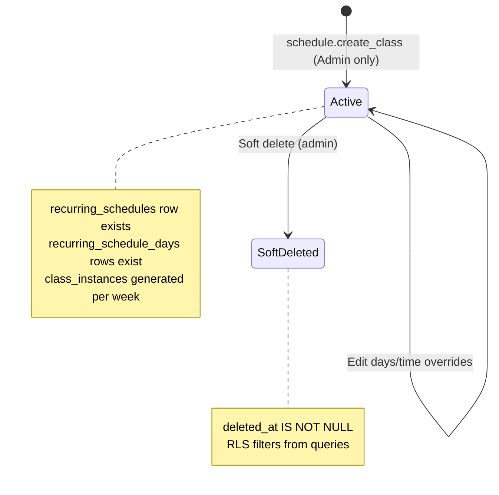
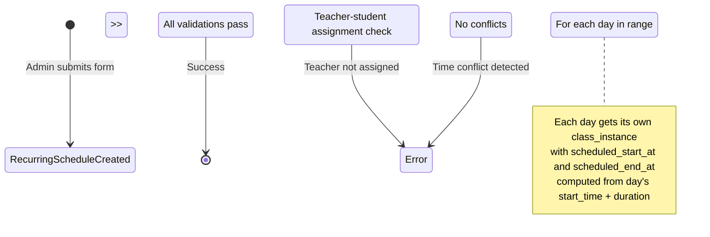
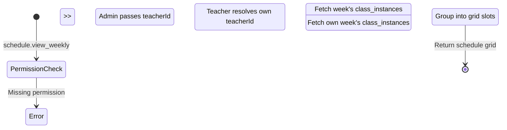
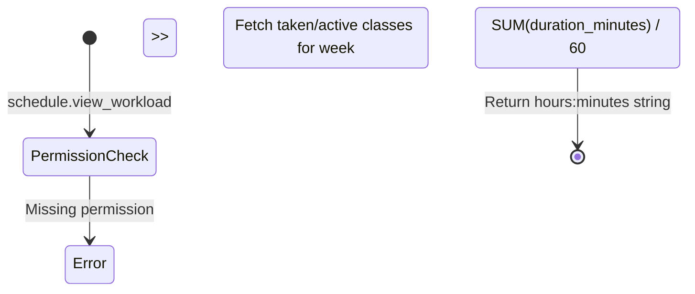

# Story 6 Implementation Plan — Permissions & Permission Groups: Staff Directory, Weekly Schedule, Workload Metrics & Class Creation (Enhanced)

**Source story:** `.ai/siraj_stories/6.md` (Part 7 - Permissions & Permission Groups, timestamps 00:00 - 02:02)  
**Security baseline:** `.ai/done/service/1-sprint_1__db_repo_service_enhancments.md` (mandatory prerequisite)  
**Prior plan dependency:** `.ai/plan/2-enhanced.md` (Story 2 — Live Session Lifecycle, completed)  
**Status:** Planning only — do not implement until approved  
**Last updated:** 2026-06-20 (rev 1 — initial draft with flattened layer rules)

---

## Section 0: Story Metadata & Context

- **Source story:** `.ai/siraj_stories/6.md` (Part 7 - Permissions & Permission Groups, timestamps 00:00 - 02:02)
- **Security baseline:** `.ai/done/service/1-sprint_1__db_repo_service_enhancments.md` (mandatory prerequisite)
- **Story scope:** Implement the staff management and schedule generation permission layer. This encompasses four functional areas:
  1. **Staff Directory** — Global teachers directory with activated/deactivated summary metrics, data table with user profiles, Zoom links, schedule action links, and options.
  2. **Weekly Schedule Visualization** — Teacher-specific weekly calendar grid (Monday–Sunday) with colored time-blocks showing student name and duration against daily time slots.
  3. **Workload Metrics** — Aggregated "Weekly hours worked" metric badge displayed at the top of the schedule grid.
  4. **Class Creation & Assignment** — "Add Class" workflow with inputs for Students, Time, Duration, and recurring Days, including per-day time override capability.
- **Target roles:** Academy Admin (full authority: manage staff, view any teacher schedule, view workload, create classes), Teacher (restricted: view own weekly schedule, view own workload only)
- **Status:** Planning phase - awaiting approval for execution

### 0.1 Business Objectives

1. **Separation of Duties (Schedule Creation):** The `schedule.create_class` permission is strictly reserved for Admins. Teachers cannot unilaterally add students to their own schedules or alter the duration/recurrence of their assigned classes, ensuring all billing and workload changes pass through academy management.
2. **Dynamic Constraints:** The ability to inject custom time overrides within the `schedule.create_class` form ensures that Admins do not have to create multiple separate class records for a student with an irregular weekly routine, maintaining a clean relational link between the student, the teacher, and the single "class" entity in the database.
3. **Data Privacy (Workload):** The `schedule.view_workload` permission restricts who can see the "Weekly hours worked" calculation. This ensures that while a teacher can verify their own hours for payroll tracking, they cannot audit the hours or pay estimates of their colleagues.

### 0.2 Scope Boundaries

**In scope:**
- New permission enum values and migration seeding for `staff.view_directory`, `schedule.view_weekly`, `schedule.view_workload`, `schedule.create_class`
- Backend repository methods for teacher directory listing with metrics, weekly schedule aggregation, workload calculation, and recurring schedule creation with day-level time overrides
- Domain services: `StaffDirectoryService`, `WeeklyScheduleService`, `RecurringClassService`
- GraphQL Pothos objects, queries, and mutations for all four functional areas
- Frontend Apollo documents (TypedDocumentNodes) for new queries and mutations
- Zustand stores replacing mock stores with real GraphQL-backed data
- React components: real `TeachersContainer`, `TeacherWeeklyScheduleContainer`, `CreateRecurringClassDialog`
- i18n translations for class creation dialog and any missing labels
- RBAC enforcement via `<RequirePermission>` in views

**Out of scope:**
- Teacher onboarding flow (separate story)
- Teacher profile editing (separate story)
- Student management (separate story)
- Billing/payroll integration for workload metrics (display only)
- Parent-facing schedule views (separate story)

---

## Section 1: Core Principles & Strict Rules (Mandatory Checklist)

### 1.1 Service Layer Architecture
- [ ] **NO monolithic services** - Extend only domain-driven services: `StaffDirectoryService`, `WeeklyScheduleService`, `RecurringClassService`
- [ ] **Business logic centralization** - All orchestration, validation, and permission checks reside in services, NOT repositories or resolvers
- [ ] **SSR compatibility** - Services must work in Next.js Server Components without GraphQL-specific context dependencies
- [ ] **Domain-driven design** - Each service represents a single business domain

### 1.2 Type Safety - NO `any`, NO Casts
- [ ] **Strict Type Narrowing** - BANNED: `any`, `as any`, and `as unknown as`. You must find the actual types. Narrow them using type guards.
- [ ] **No route param casts** - Instead of `useParams() as { id: string }`, use safety checks like `typeof params?.id === "string" ? params.id : ""`
- [ ] **Generated types only** - Frontend stores must use types from `frontend/graphql/generated/gql/graphql-types.ts`

### 1.3 Data Persistence & State Management
- [ ] **NO dummy data in production** - Replace all mock stores (`mockTeachersStore`, `mockTeacherScheduleStore`, `mockCreateRecurringClassStore`) with real GraphQL-backed stores
- [ ] **Complete transaction boundaries** - Recurring schedule creation must be atomic (insert `recurring_schedules` + `recurring_schedule_days` + initial `class_instances` in one transaction)
- [ ] **Idempotent operations** - Services should handle duplicate calls gracefully
- [ ] **Mock stores preserved for Storybook** - `*.stories.tsx` files MUST keep dummy data via mock store aliases

### 1.4 Package Manager & Build System
- [ ] **Bun exclusively** - Use `~/.bun/bin/bun` for all scripts, tests, and codegen commands
- [ ] **No npm/yarn/pnpm** - Package operations must use Bun's CLI
- [ ] **Build verification** - Every code change must pass `bun tsgo` before commit

### 1.5 GraphQL Schema & Type Safety
- [ ] **Non-null `id` fields** - Every mutation response returns objects with non-null `id` for Apollo cache updates
- [ ] **Pothos nullability alignment** - Fields are non-nullable by default unless schema specifies `nullable: true`
- [ ] **Type generation workflow** - Changes require: `bun run generate:gqlSchema` → `bun codegen`
- [ ] **Cache-first queries** - All GraphQL queries must include `id` fields for automatic cache normalization

### 1.6 Frontend Data Fetching Patterns
- [ ] **`useQuery` only** - Use `useQuery` from `@apollo/client/react` with generated `TypedDocumentNode`
- [ ] **`useLazyQuery` BANNED** - Stateful `useQuery` with `skip` option is the only approved pattern
- [ ] **No imperative fetching** - Avoid manual `client.query()` calls in component bodies
- [ ] **Error boundaries** - Every query/mutation must handle loading, error, and success states

### 1.7 Logging & Observability
- [ ] **Logger utility mandatory** - `import { logger } from '@/frontend/utils/logger'` (frontend) or `import { logger } from '@/backend/lib/logger'` (backend)
- [ ] **Console methods forbidden** - ESLint will reject `console.log/warn/error/debug` usage
- [ ] **Diagnostic-only logging** - `logger.info` must NEVER substitute for implementing user-facing functionality

### 1.8 Internationalization (i18n)
- [ ] **Backend translations** - Use `getBackendTranslations({ locale, namespace })` for all user-facing messages
- [ ] **No hardcoded strings** - Error messages, remarks, descriptions must come from translation keys
- [ ] **Locale propagation** - Thread `locale` from GraphQL context → services → repositories
- [ ] **Shared messages** - Frontend translations live in `shared/messages/en.ts` and `shared/messages/ar/`

### 1.9 Testing Requirements
- [ ] **Repository coverage** - 100% line + function coverage on all touched repository methods
- [ ] **GraphQL integration tests** - Extend `frontend/graphql/test/schedule.test.ts` and `frontend/graphql/test/teacher.test.ts`
- [ ] **Database test suite** - Run `bun run test:db` after every repository change
- [ ] **Storybook stories** - Mock stores in `*.stories.tsx` files; production containers fully wired

### 1.10 Code Quality Gates
- [ ] **NO summary markdown files** - Never create `SUMMARY.md`, `CHANGES.md`, `REPORT.md`, `FIXED.md`
- [ ] **Zero incomplete implementations** - No `TODO`, `FIXME`, `@todo`, "placeholder", "for now" comments
- [ ] **No stub throws** - No `throw new Error("Not implemented")` or empty function bodies
- [ ] **No logger-only handlers** - Every UI action must have real GraphQL mutation + backend logic

### 1.11 Zero Incomplete Implementation Policy

The following patterns are **strictly prohibited**:

| **Prohibited Pattern** | **Required Instead** | **Verification Command** |
|---|---|---|
| `// TODO`, `// FIXME`, `@todo`, "later", "for now" | Fully working implementation in same task | `rg -i "TODO\|FIXME\|for now" backend frontend --glob "!**/*.md"` |
| `throw new Error("Not implemented")` | Complete service/repo method implementation | Manual code review |
| Handler calling only `logger.info`/`logger.warn` | Real GraphQL mutation + UI feedback | Grep for `logger.info.*handle` patterns |
| Commented-out "future" code paths | Delete or implement immediately | Manual code review |
| Empty function bodies `{}` with no implementation | Implement or remove function + UI entry point | Static analysis |
| GraphQL mutation wired in UI but missing backend | Both layers in same task | Integration test must pass |
| Mock data in production containers | Real `useQuery` with GraphQL documents | Grep for `mock` in non-story, non-mock files |

**Enforcement:** Before task completion, run:
```bash
rg -i "TODO|FIXME|not implemented|placeholder|for now" backend frontend shared --glob "!**/*.md" --glob "!**/generated/**"
```
Output MUST be empty.

---

## Section 2: RBAC Permissions (Canonical - Story 6)

### 2.1 New Permissions

The story defines four functional permission keys. These must be added to the `AppPermission` enum in `shared/lib/enum.ts` and seeded via a new migration file.

| **Permission Key** | **Enum Value** | **Group** | **UI Gate** | **Backend Service Method** | **GraphQL Operation** |
|---|---|---|---|---|---|
| `staff.view_directory` | `STAFF_VIEW_DIRECTORY` | Academy Admin | Teachers Directory page visibility | `StaffDirectoryService.getDirectory()` | `query teacherDirectory` |
| `schedule.view_weekly` | `SCHEDULE_VIEW_WEEKLY` | Academy Admin + Teacher (self) | Weekly schedule grid visibility | `WeeklyScheduleService.getWeeklySchedule()` | `query teacherWeeklyScheduleGrid` |
| `schedule.view_workload` | `SCHEDULE_VIEW_WORKLOAD` | Academy Admin + Teacher (self) | "Weekly hours worked" metric badge | `WeeklyScheduleService.getWorkloadMetrics()` | `query teacherWorkloadMetrics` |
| `schedule.create_class` | `SCHEDULE_CREATE_CLASS` | Academy Admin only | "Add Class" button + dialog | `RecurringClassService.createRecurringClass()` | `mutation createRecurringClass` |

### 2.2 Permission Mapping to Existing Permissions

| **Story Permission** | **Existing Related Permission** | **Relationship** |
|---|---|---|
| `staff.view_directory` | `teachers.list` | Complementary — `teachers.list` controls basic listing; `staff.view_directory` gates the full directory page with metrics |
| `schedule.view_weekly` | `schedule.view_assigned` (teacher self), `schedule.view_all` (admin) | Granular — `schedule.view_weekly` specifically gates the weekly grid view |
| `schedule.view_workload` | `dashboard.view_metrics` | Complementary — `dashboard.view_metrics` gates daily metrics; `schedule.view_workload` gates weekly workload hours |
| `schedule.create_class` | `schedule.manage_recurring`, `teachers.manage_schedule` | Superset — `schedule.create_class` specifically gates the "Add Class" workflow |

### 2.3 Permission Group Assignments

| **Permission Group** | **Slug** | **New Permissions Assigned** |
|---|---|---|
| Super Admin | `super_admin` | `staff.view_directory`, `schedule.view_weekly`, `schedule.view_workload`, `schedule.create_class` |
| Academy Admin | `academy_admin` | `staff.view_directory`, `schedule.view_weekly`, `schedule.view_workload`, `schedule.create_class` |
| Teacher Default | `teacher_default` | `schedule.view_weekly` (self-scoped), `schedule.view_workload` (self-scoped) |

### 2.4 Self-Scoping vs Any-Scoping

The `schedule.view_weekly` and `schedule.view_workload` permissions have dual scoping:
- **Teacher (self-scoped):** The service layer enforces that teachers can only query their own `teacherId`. The GraphQL resolver resolves `teacherId` from the authenticated user's teacher record.
- **Admin (any-scoped):** The service layer allows admins to pass any `teacherId` parameter.

This scoping is enforced in the service layer, NOT via separate permission keys.

---

## Section 3: State Machine & Threat Alignment

### 3.1 Recurring Schedule Lifecycle

This story introduces the creation of recurring schedules. The state machine is straightforward since recurring schedules do not have complex state transitions (unlike class instances).



### 3.2 Class Instance Generation Flow

When a recurring schedule is created, the system must generate `class_instances` rows for each scheduled day within an effective date range.



### 3.3 Weekly Schedule Query Flow



### 3.4 Workload Calculation Flow



---

## Section 4: Security Threat Remediation

### Threat 1: IDOR — Cross-Teacher Schedule Access

**Current Gap:** The existing `TeacherWeeklyScheduleContainer` accepts `_teacherId` as a prop but does not enforce that the requesting user has permission to view that teacher's schedule. Teachers could potentially view other teachers' schedules by manipulating the `teacherId` parameter.

**Required Fix (Task C — WeeklyScheduleService):**

```typescript
// File: backend/services/schedule/weekly-schedule.service.ts
export async function getWeeklySchedule(
  userId: string,
  teacherId: string | null,
  weekStart: Date,
  locale?: string
) {
  const hasWeeklyAccess = await PermissionsService.hasPermission(userId, AppPermission.SCHEDULE_VIEW_WEEKLY);
  if (!hasWeeklyAccess) {
    const t = await getBackendTranslations({ locale, namespace: "errors" });
    throw new Error(t("unauthorizedAction"));
  }

  const actorTeacher = await TeacherRepository.findByUserId(userId);
  const isAdmin = await PermissionsService.hasAnyPermission(userId, [
    AppPermission.STAFF_VIEW_DIRECTORY,
    AppPermission.SCHEDULE_VIEW_ALL,
  ]);

  let resolvedTeacherId: string;

  if (isAdmin && teacherId) {
    resolvedTeacherId = teacherId;
  } else if (actorTeacher) {
    resolvedTeacherId = actorTeacher.id;
  } else {
    const t = await getBackendTranslations({ locale, namespace: "errors" });
    throw new Error(t("unauthorizedAction"));
  }

  // Continue with query using resolvedTeacherId...
}
```

**Test Requirements:**
- Teacher A cannot query Teacher B's weekly schedule → `unauthorizedAction`
- Teacher A can query their own weekly schedule → succeeds
- Academy Admin can query any teacher's weekly schedule → succeeds
- Unauthenticated user → `unauthorized`

### Threat 2: IDOR — Workload Metrics Privacy

**Current Gap:** The "Weekly hours worked" metric reveals payroll-relevant data. Without proper scoping, a teacher could view another teacher's workload hours.

**Required Fix (Task C — WeeklyScheduleService):**

```typescript
// File: backend/services/schedule/weekly-schedule.service.ts
export async function getWorkloadMetrics(
  userId: string,
  teacherId: string | null,
  weekStart: Date,
  locale?: string
) {
  const hasWorkloadAccess = await PermissionsService.hasPermission(userId, AppPermission.SCHEDULE_VIEW_WORKLOAD);
  if (!hasWorkloadAccess) {
    const t = await getBackendTranslations({ locale, namespace: "errors" });
    throw new Error(t("unauthorizedViewMetrics"));
  }

  const actorTeacher = await TeacherRepository.findByUserId(userId);
  const isAdmin = await PermissionsService.hasAnyPermission(userId, [
    AppPermission.STAFF_VIEW_DIRECTORY,
    AppPermission.SCHEDULE_VIEW_ALL,
  ]);

  let resolvedTeacherId: string;

  if (isAdmin && teacherId) {
    resolvedTeacherId = teacherId;
  } else if (actorTeacher) {
    resolvedTeacherId = actorTeacher.id;
  } else {
    const t = await getBackendTranslations({ locale, namespace: "errors" });
    throw new Error(t("unauthorizedAction"));
  }

  // Calculate workload for resolvedTeacherId only...
}
```

**Test Requirements:**
- Teacher A cannot view Teacher B's workload → `unauthorizedViewMetrics`
- Teacher A can view their own workload → succeeds with correct hours
- Academy Admin can view any teacher's workload → succeeds

### Threat 3: Unauthorized Class Creation (Separation of Duties)

**Current Gap:** The "Add Class" workflow must be strictly gated to Academy Admin only. Teachers must not be able to create recurring schedules or assign students to themselves.

**Required Fix (Task D — RecurringClassService):**

```typescript
// File: backend/services/schedule/recurring-class.service.ts
export async function createRecurringClass(
  userId: string,
  input: CreateRecurringClassInput,
  locale?: string
) {
  const hasCreateAccess = await PermissionsService.hasPermission(userId, AppPermission.SCHEDULE_CREATE_CLASS);
  if (!hasCreateAccess) {
    const t = await getBackendTranslations({ locale, namespace: "errors" });
    throw new Error(t("unauthorizedAction"));
  }

  // Validate teacher exists
  // Validate student exists and is assigned to teacher
  // Validate no time overlaps for each day
  // Create recurring_schedules + recurring_schedule_days + class_instances atomically
}
```

**Test Requirements:**
- Teacher cannot create recurring class → `unauthorizedAction`
- Academy Admin can create recurring class → succeeds
- Parent cannot create recurring class → `unauthorizedAction`

### Threat 4: Time Override Abuse

**Current Gap:** The per-day time override feature allows admins to set custom start times for specific days. Without validation, this could create overlapping schedules or schedules outside teacher availability windows.

**Required Fix (Task B — Repository):**

Each day's time override must go through the same overlap and availability checks as the default time:

```typescript
// File: backend/db/repo/scheduling.repository.ts
// Inside createRecurringScheduleWithInstances:
for (const day of input.days) {
  const effectiveStartTime = day.timeOverride ?? input.defaultStartTime;
  const scheduledStartAt = computeScheduledStart(day.dayOfWeek, effectiveStartTime, weekStart, timezone);
  const scheduledEndAt = new Date(scheduledStartAt.getTime() + input.durationMinutes * 60000);
  
  // Run overlap checks for each generated class_instance
  await checkOverlaps(t, {
    studentId: input.studentId,
    teacherId: input.teacherId,
    startTime: scheduledStartAt,
    endTime: scheduledEndAt,
  }, locale);
  
  // Run availability check
  await TeacherAvailabilityRepository.validateBookingAvailability(
    input.teacherId, scheduledStartAt, scheduledEndAt, t
  );
}
```

**Test Requirements:**
- Time override creating overlap → `teacherBooked` error
- Time override outside availability → `teacherUnavailabilityConflict` error
- Valid time override → succeeds

### Threat 5: Directory Enumeration

**Current Gap:** The teachers directory lists all teachers with their Zoom links, emails, and status. This must be gated behind `staff.view_directory`.

**Required Fix (Task C — StaffDirectoryService):**

```typescript
// File: backend/services/teacher/staff-directory.service.ts
export async function getDirectory(userId: string, search?: string, locale?: string) {
  const hasDirectoryAccess = await PermissionsService.hasPermission(userId, AppPermission.STAFF_VIEW_DIRECTORY);
  if (!hasDirectoryAccess) {
    const t = await getBackendTranslations({ locale, namespace: "errors" });
    throw new Error(t("unauthorizedAction"));
  }
  
  // Proceed with directory query...
}
```

---

## Section 5: Prerequisites Verification (BLOCKING)

Before starting story work, verify the following prerequisites are met:

### 5.1 Database Schema Verification
- [ ] Verify `recurring_schedules` table exists with columns: `id`, `student_id`, `teacher_id`, `duration_minutes`, `default_start_time`, `timezone_id`, `timezone`, `utc_offset_snapshot`, `effective_from`, `effective_until`, `created_at`, `updated_at`, `deleted_at`
- [ ] Verify `recurring_schedule_days` table exists with columns: `id`, `recurring_schedule_id`, `day_of_week`, `start_time`, `is_active`
- [ ] Verify `class_instances` table exists with all required columns (from Story 1/2 baseline)
- [ ] Verify `teachers` table exists with `user_id`, `status`, `timezone`, `zoom_link`, etc.
- [ ] Verify `staff_profiles` table exists
- [ ] Verify `permissions`, `permission_groups`, `group_permissions`, `user_permission_groups` tables exist

### 5.2 Migration Verification
- [ ] Run `bun run scripts/dbActions.ts push` to ensure all migrations are applied
- [ ] Verify `backend/db/migration/3-system_permissions_and_groups.sql` is applied (existing permissions seeded)
- [ ] Verify the `protect_system_permissions` trigger is active on `permissions` and `permission_groups` tables

### 5.3 Test Suite Verification
- [ ] Run `bun run test:db` — all existing database tests pass (0 failures)
- [ ] Run `bun run test:graphql` — all existing GraphQL integration tests pass (0 failures)
- [ ] Run `bun tsgo` — TypeScript compilation passes with zero errors

### 5.4 Existing Code Verification
- [ ] Verify `SchedulingRepository.createClassInstance()` works correctly (used by recurring class generation)
- [ ] Verify `TeacherRepository.findByUserId()` and `TeacherRepository.searchTeachers()` exist and work
- [ ] Verify `PermissionsService.hasPermission()` and `PermissionsService.hasAnyPermission()` exist and work
- [ ] Verify `getBackendTranslations()` helper is available and functional
- [ ] Verify existing mock stores (`mockTeachersStore`, `mockTeacherScheduleStore`, `mockCreateRecurringClassStore`) are used only in Storybook contexts

### 5.5 Frontend Verification
- [ ] Verify `TeachersContainer` currently imports from `mockTeachersStore`
- [ ] Verify `TeacherWeeklyScheduleContainer` currently imports from `mockTeacherScheduleStore`
- [ ] Verify `WeeklyScheduleGrid` uses `globalThis.confirm()` for delete (needs MUI Dialog replacement)
- [ ] Verify i18n keys exist for `dashboard.teachersDirectory` and `dashboard.teacherWeeklySchedule` namespaces

---

## Section 6: Granular Task Breakdown

### Task A — Database: New Permissions Migration & Enum Updates

**Objective:** Add four new permission enum values (`staff.view_directory`, `schedule.view_weekly`, `schedule.view_workload`, `schedule.create_class`) to the `AppPermission` enum and create a new migration file that seeds these permissions and assigns them to the correct permission groups.

**Layer-Specific Rules (Database Repositories — Flattened from backend/db/repo/AGENTS.md):**
- Use Drizzle standard syntax `db.select().from(table).leftJoin()` instead of relational `findMany` when multiple joins are needed.
- Wrap all repository changes modifying multiple tables in an atomic `db.transaction()`.
- No hardcoded error strings — use `getBackendTranslations`.
- Conditional aggregation uses `sql<number>` template literals with `.mapWith(Number)`.

**Target Files:**
- `shared/lib/enum.ts` — Add new `AppPermission` enum values
- `backend/db/migration/4-story6_permissions.sql` — New migration file (create)
- `backend/db/schema/enums.ts` — Verify `appPermissionEnum` includes new values (if using Drizzle enum helper)

**Detailed Implementation Steps:**

*Step 1: Add new enum values to `shared/lib/enum.ts`*

Open `shared/lib/enum.ts` and add four new entries to the `AppPermission` enum. The values follow PascalCase naming convention as established in the codebase:

```typescript
// File: shared/lib/enum.ts
// Add these entries to the existing AppPermission enum, after the existing entries:

export enum AppPermission {
  // ... existing entries ...
  STAFF_VIEW_DIRECTORY = "staff.view_directory",
  SCHEDULE_VIEW_WEEKLY = "schedule.view_weekly",
  SCHEDULE_VIEW_WORKLOAD = "schedule.view_workload",
  SCHEDULE_CREATE_CLASS = "schedule.create_class",
  // ... remaining existing entries ...
}
```

The exact placement within the enum should be logical — group `STAFF_VIEW_DIRECTORY` near the other `STAFF_*` entries (after `STAFF_EDIT`), and group `SCHEDULE_VIEW_WEEKLY`, `SCHEDULE_VIEW_WORKLOAD`, `SCHEDULE_CREATE_CLASS` near the other `SCHEDULE_*` entries (after `SCHEDULE_DST_MIGRATE`).

*Step 2: Verify `backend/db/schema/enums.ts` appPermissionEnum definition*

The `appPermissionEnum` in `backend/db/schema/enums.ts` is a Drizzle pgEnum that must include all values from the TypeScript `AppPermission` enum. Check if this file uses a hardcoded list or dynamically derives from the TypeScript enum. If hardcoded, add the four new values:

```typescript
// File: backend/db/schema/enums.ts
// If the appPermissionEnum is defined as a pgEnum with explicit values:
export const appPermissionEnum = pgEnum("app_permission", [
  // ... existing values ...
  "staff.view_directory",
  "schedule.view_weekly",
  "schedule.view_workload",
  "schedule.create_class",
  // ... remaining existing values ...
]);
```

*Step 3: update migration file `backend\db\migration\3-system_permissions_and_groups.sql`*

1. Inserts the four new permissions into the `permissions` table
2. Assigns them to the correct permission groups (`super_admin`, `academy_admin`, `teacher_default`)

```sql
-- Migration: Story 6 — Staff Directory, Weekly Schedule, Workload & Class Creation Permissions
-- Auto-generated

-- Step 1: Insert new permissions
INSERT INTO
    permissions (
        id,
        key,
        resource,
        action,
        description,
        category,
        is_system
    )
VALUES (
        gen_random_uuid (),
        'staff.view_directory',
        'staff',
        'view_directory',
        'Access the global Teachers Directory with summary metrics and data table',
        'Administration',
        true
    ),
    (
        gen_random_uuid (),
        'schedule.view_weekly',
        'schedule',
        'view_weekly',
        'View a specific teacher weekly calendar grid with colored time-blocks',
        'Scheduling',
        true
    ),
    (
        gen_random_uuid (),
        'schedule.view_workload',
        'schedule',
        'view_workload',
        'View aggregated weekly capacity metrics (Weekly hours worked)',
        'Scheduling',
        true
    ),
    (
        gen_random_uuid (),
        'schedule.create_class',
        'schedule',
        'create_class',
        'Access the Add Class workflow and create new recurring scheduled sessions',
        'Scheduling',
        true
    ) ON CONFLICT (key) DO
UPDATE
SET
    resource = EXCLUDED.resource,
    action = EXCLUDED.action,
    description = EXCLUDED.description,
    category = EXCLUDED.category,
    is_system = EXCLUDED.is_system;

-- Step 2: Assign new permissions to Super Admin group
INSERT INTO
    group_permissions (group_id, permission_id)
SELECT g.id, p.id
FROM
    permission_groups g,
    permissions p
WHERE
    g.slug = 'super_admin'
    AND p.key IN (
        'staff.view_directory',
        'schedule.view_weekly',
        'schedule.view_workload',
        'schedule.create_class'
    );

-- Step 3: Assign new permissions to Academy Admin group
INSERT INTO
    group_permissions (group_id, permission_id)
SELECT g.id, p.id
FROM
    permission_groups g,
    permissions p
WHERE
    g.slug = 'academy_admin'
    AND p.key IN (
        'staff.view_directory',
        'schedule.view_weekly',
        'schedule.view_workload',
        'schedule.create_class'
    );

-- Step 4: Assign self-scoped permissions to Teacher Default group
INSERT INTO
    group_permissions (group_id, permission_id)
SELECT g.id, p.id
FROM
    permission_groups g,
    permissions p
WHERE
    g.slug = 'teacher_default'
    AND p.key IN (
        'schedule.view_weekly',
        'schedule.view_workload'
    );
```

*Step 4: Push migration and verify*

```bash
bun db cleanGenerate
bun db reset
bun db seed
```

Verify the new permissions exist:
```sql
SELECT key, resource, action, category FROM permissions WHERE key IN (
  'staff.view_directory', 'schedule.view_weekly', 'schedule.view_workload', 'schedule.create_class'
);
```

Verify group assignments:
```sql
SELECT pg.slug, p.key
FROM group_permissions gp
JOIN permission_groups pg ON gp.group_id = pg.id
JOIN permissions p ON gp.permission_id = p.id
WHERE p.key IN ('staff.view_directory', 'schedule.view_weekly', 'schedule.view_workload', 'schedule.create_class')
ORDER BY pg.slug, p.key;
```

Expected output:
```
academy_admin    | schedule.create_class
academy_admin    | schedule.view_weekly
academy_admin    | schedule.view_workload
academy_admin    | staff.view_directory
super_admin      | schedule.create_class
super_admin      | schedule.view_weekly
super_admin      | schedule.view_workload
super_admin      | staff.view_directory
teacher_default  | schedule.view_weekly
teacher_default  | schedule.view_workload
```

**Test Execution Requirements:**
- Run the whole database test suite to ensure no existing tests break:
  ```bash
  bun run test:db
  ```

**Success Criteria / Check Progress Points:**
- [x] `AppPermission` enum in `shared/lib/enum.ts` includes `STAFF_VIEW_DIRECTORY`, `SCHEDULE_VIEW_WEEKLY`, `SCHEDULE_VIEW_WORKLOAD`, `SCHEDULE_CREATE_CLASS`
- [x] `backend/db/schema/enums.ts` pgEnum includes the four new string values (if hardcoded)
- [x] Migration file `backend/db/migration/4-story6_permissions.sql` created and applied successfully
- [x] All four permissions are seeded in the `permissions` table with `is_system = true`
- [x] `super_admin` group has all four permissions
- [x] `academy_admin` group has all four permissions
- [x] `teacher_default` group has `schedule.view_weekly` and `schedule.view_workload` only
- [ ] `bun run test:db` passes with 0 failures
- [ ] `bun tsgo` on working files passes with 0 TypeScript errors  & 0 warnings
- [ ] `bun biome:check` on working files passes with 0 errors & 0 warnings
- [ ] `bun lint` on working files passes with 0 errors  & 0 warnings
- [ ] `loop over tsgo, biome:check, lint` on working files till no issues at all
---

### Task B — Repository: Teacher Directory, Weekly Schedule, Workload & Recurring Schedule Creation

**Objective:** Implement four new repository query/mutation methods:
1. `getTeacherDirectory` — Lists all teachers with user profile data, Zoom links, status, and activated/deactivated metrics
2. `getWeeklyScheduleGrid` — Fetches class instances for a teacher within a week range, grouped by day and time slot
3. `getWeeklyWorkloadMetrics` — Aggregates total hours worked for a teacher within a week range
4. `createRecurringScheduleWithInstances` — Atomically creates a `recurring_schedules` row, `recurring_schedule_days` rows, and generates `class_instances` for the first effective week

**Layer-Specific Rules (Database Repositories — Flattened from backend/db/repo/AGENTS.md):**
- Use Drizzle standard syntax `db.select().from(table).leftJoin()` instead of relational `findMany` when multiple joins are needed to avoid type compilation slow downs.
- Wrap all repository changes modifying multiple tables in an atomic `db.transaction()`.
- No hardcoded error strings — use `getBackendTranslations` with optional `locale?: string` parameter.
- Conditional aggregation uses `sql<number>` template literals with `.mapWith(Number)`.
- Separation of concerns: repositories are strictly for data access. Business logic, permission checking, and complex orchestration must reside in the `backend/services/` layer.

**Target Files:**
- `backend/db/repo/teacher.repository.ts` — Add `getTeacherDirectory` and `getTeacherDirectoryMetrics`
- `backend/db/repo/scheduling-queries.repository.ts` — Add `getWeeklyScheduleGrid` and `getWeeklyWorkloadMetrics`
- `backend/db/repo/scheduling.repository.ts` — Add `createRecurringScheduleWithInstances`
- `backend/db/test/repo/teacher.repository.test.ts` — Tests for directory listing
- `backend/db/test/repo/scheduling.repository.test.ts` — Tests for weekly schedule, workload, and recurring creation

**Detailed Implementation Steps:**

*Step 1: Implement `getTeacherDirectory` in `teacher.repository.ts`*

```typescript
// File: backend/db/repo/teacher.repository.ts
// Add to the existing TeacherRepository namespace:

export type TeacherDirectoryRow = {
  id: string;
  userId: string;
  name: string;
  email: string;
  avatarUrl: string | null;
  status: string;
  zoomLink: string | null;
};

export type TeacherDirectoryMetrics = {
  activated: number;
  deactivated: number;
};

export const getTeacherDirectory = async (
  options?: { search?: string; limit?: number; offset?: number },
  tx?: DBTransaction
): Promise<TeacherDirectoryRow[]> => {
  const queryDb = tx ?? db;

  const conditions = and(
    isNull(users.deletedAt),
    options?.search
      ? or(
          ilike(users.name, `%${options.search}%`),
          ilike(users.email, `%${options.search}%`)
        )
      : undefined
  );

  const query = queryDb
    .select({
      id: teachers.id,
      userId: teachers.userId,
      name: users.name,
      email: users.email,
      avatarUrl: users.avatarUrl,
      status: teachers.status,
      zoomLink: teachers.zoomLink,
    })
    .from(teachers)
    .innerJoin(users, eq(teachers.userId, users.id))
    .where(conditions)
    .orderBy(users.name);

  let finalQuery = query;
  if (options?.limit !== undefined) {
    finalQuery = finalQuery.limit(options.limit) as typeof finalQuery;
  }
  if (options?.offset !== undefined) {
    finalQuery = finalQuery.offset(options.offset) as typeof finalQuery;
  }

  return finalQuery;
};

export const getTeacherDirectoryMetrics = async (
  tx?: DBTransaction
): Promise<TeacherDirectoryMetrics> => {
  const queryDb = tx ?? db;

  const [metrics] = await queryDb
    .select({
      activated: sql<number>`sum(case when ${teachers.status} = 'ACTIVATED' then 1 else 0 end)`.mapWith(Number),
      deactivated: sql<number>`sum(case when ${teachers.status} = 'DEACTIVATED' then 1 else 0 end)`.mapWith(Number),
    })
    .from(teachers)
    .innerJoin(users, eq(teachers.userId, users.id))
    .where(isNull(users.deletedAt));

  return {
    activated: metrics?.activated ?? 0,
    deactivated: metrics?.deactivated ?? 0,
  };
};
```

*Step 2: Implement `getWeeklyScheduleGrid` in `scheduling-queries.repository.ts`*

```typescript
// File: backend/db/repo/scheduling-queries.repository.ts
// Add new types and function:

export type WeeklyScheduleGridRow = {
  id: string;
  studentId: string;
  studentName: string;
  teacherId: string;
  scheduledStartAt: Date;
  scheduledEndAt: Date;
  durationMinutes: number;
  dayOfWeek: string;
  executionState: string;
  outcome: string;
};

export const getWeeklyScheduleGrid = async (
  teacherId: string,
  weekStart: Date,
  weekEnd: Date,
  tx?: DBTransaction
): Promise<WeeklyScheduleGridRow[]> => {
  const queryDb = tx ?? db;

  const rows = await queryDb
    .select({
      id: classInstances.id,
      studentId: classInstances.studentId,
      studentName: students.name,
      teacherId: classInstances.teacherId,
      scheduledStartAt: classInstances.scheduledStartAt,
      scheduledEndAt: classInstances.scheduledEndAt,
      durationMinutes: classInstances.durationMinutes,
      executionState: classInstances.executionState,
      outcome: classInstances.outcome,
    })
    .from(classInstances)
    .innerJoin(students, eq(classInstances.studentId, students.id))
    .where(
      and(
        eq(classInstances.teacherId, teacherId),
        isNull(classInstances.deletedAt),
        gte(classInstances.scheduledStartAt, weekStart),
        lt(classInstances.scheduledStartAt, weekEnd)
      )
    )
    .orderBy(classInstances.scheduledStartAt);

  return rows.map(row => {
    const dayIndex = row.scheduledStartAt.getUTCDay();
    const dayNames = ["sunday", "monday", "tuesday", "wednesday", "thursday", "friday", "saturday"];
    return {
      ...row,
      dayOfWeek: dayNames[dayIndex],
    };
  });
};
```

*Step 3: Implement `getWeeklyWorkloadMetrics` in `scheduling-queries.repository.ts`*

```typescript
// File: backend/db/repo/scheduling-queries.repository.ts

export type WeeklyWorkloadMetrics = {
  totalMinutes: number;
  totalHoursFormatted: string;
  classCount: number;
};

export const getWeeklyWorkloadMetrics = async (
  teacherId: string,
  weekStart: Date,
  weekEnd: Date,
  tx?: DBTransaction
): Promise<WeeklyWorkloadMetrics> => {
  const queryDb = tx ?? db;

  const [metrics] = await queryDb
    .select({
      totalMinutes: sql<number>`coalesce(sum(${classInstances.durationMinutes}), 0)`.mapWith(Number),
      classCount: sql<number>`count(*)`.mapWith(Number),
    })
    .from(classInstances)
    .where(
      and(
        eq(classInstances.teacherId, teacherId),
        isNull(classInstances.deletedAt),
        gte(classInstances.scheduledStartAt, weekStart),
        lt(classInstances.scheduledStartAt, weekEnd),
        ne(classInstances.executionState, "NOT_ACTIVATED")
      )
    );

  const totalMinutes = metrics?.totalMinutes ?? 0;
  const hours = Math.floor(totalMinutes / 60);
  const minutes = totalMinutes % 60;
  const totalHoursFormatted = `${hours}:${minutes.toString().padStart(2, "0")}`;

  return {
    totalMinutes,
    totalHoursFormatted,
    classCount: metrics?.classCount ?? 0,
  };
};
```

*Step 4: Implement `createRecurringScheduleWithInstances` in `scheduling.repository.ts`*

```typescript
// File: backend/db/repo/scheduling.repository.ts
// Add to the existing SchedulingRepository namespace:

import { recurringSchedules, recurringScheduleDays } from "@/backend/db/schema";

export interface CreateRecurringScheduleInput {
  studentId: string;
  teacherId: string;
  durationMinutes: number;
  defaultStartTime: string;
  timezone: string;
  timezoneId?: number | null;
  effectiveFrom?: Date | null;
  effectiveUntil?: Date | null;
  days: {
    dayOfWeek: "MONDAY" | "TUESDAY" | "WEDNESDAY" | "THURSDAY" | "FRIDAY" | "SATURDAY" | "SUNDAY";
    startTime: string;
    isActive: boolean;
  }[];
  classType?: "REGULAR" | "TRIAL" | "ADVANCE";
  generateInstancesForWeeks?: number;
}

export const createRecurringScheduleWithInstances = async (
  input: CreateRecurringScheduleInput,
  tx?: DBTransaction,
  locale?: string
): Promise<{ recurringScheduleId: string; classInstanceIds: string[] }> => {
  const runner = async (t: DBTransaction) => {
    const now = new Date();

    const [recurringSchedule] = await t
      .insert(recurringSchedules)
      .values({
        studentId: input.studentId,
        teacherId: input.teacherId,
        durationMinutes: input.durationMinutes,
        defaultStartTime: input.defaultStartTime,
        timezone: input.timezone,
        timezoneId: input.timezoneId ?? null,
        effectiveFrom: input.effectiveFrom?.toISOString() ?? null,
        effectiveUntil: input.effectiveUntil?.toISOString() ?? null,
        createdAt: now,
        updatedAt: now,
      })
      .returning();

    const insertedDays = await t
      .insert(recurringScheduleDays)
      .values(
        input.days.map(day => ({
          recurringScheduleId: recurringSchedule.id,
          dayOfWeek: day.dayOfWeek,
          startTime: day.startTime,
          isActive: day.isActive,
        }))
      )
      .returning();

    const classInstanceIds: string[] = [];
    const weeksToGenerate = input.generateInstancesForWeeks ?? 1;
    const effectiveStartDate = input.effectiveFrom ? new Date(input.effectiveFrom) : now;

    for (let weekOffset = 0; weekOffset < weeksToGenerate; weekOffset++) {
      for (const day of insertedDays) {
        if (!day.isActive) continue;

        const scheduledStartAt = computeScheduledStartForDay(
          day.dayOfWeek,
          day.startTime,
          effectiveStartDate,
          weekOffset,
          input.timezone
        );
        const scheduledEndAt = new Date(scheduledStartAt.getTime() + input.durationMinutes * 60000);

        await acquireLocks(t, input.teacherId, input.studentId);
        await validateTeacherAssignment(t, input.studentId, input.teacherId, scheduledStartAt, locale);
        await TeacherAvailabilityRepository.validateBookingAvailability(
          input.teacherId,
          scheduledStartAt,
          scheduledEndAt,
          t
        );
        await checkOverlaps(
          t,
          {
            studentId: input.studentId,
            teacherId: input.teacherId,
            startTime: scheduledStartAt,
            endTime: scheduledEndAt,
          },
          locale
        );

        const idempotencyKey = `recurring-${recurringSchedule.id}-${day.dayOfWeek}-${scheduledStartAt.toISOString()}`;

        const [classInstance] = await t
          .insert(classInstances)
          .values({
            studentId: input.studentId,
            teacherId: input.teacherId,
            recurringScheduleId: recurringSchedule.id,
            scheduledStartAt,
            scheduledEndAt,
            durationMinutes: input.durationMinutes,
            classType: input.classType ?? "REGULAR",
            executionState: "NOT_ACTIVATED",
            outcome: "PENDING",
            idempotencyKey,
            createdAt: now,
            updatedAt: now,
          })
          .returning();

        classInstanceIds.push(classInstance.id);
      }
    }

    return {
      recurringScheduleId: recurringSchedule.id,
      classInstanceIds,
    };
  };

  return tx ? await runner(tx) : await db.transaction((t: DBTransaction) => runner(t));
};

function computeScheduledStartForDay(
  dayOfWeek: string,
  startTime: string,
  effectiveStartDate: Date,
  weekOffset: number,
  _timezone: string
): Date {
  const dayMap: Record<string, number> = {
    SUNDAY: 0,
    MONDAY: 1,
    TUESDAY: 2,
    WEDNESDAY: 3,
    THURSDAY: 4,
    FRIDAY: 5,
    SATURDAY: 6,
  };

  const targetDay = dayMap[dayOfWeek];
  const startDay = effectiveStartDate.getUTCDay();
  let daysUntilTarget = targetDay - startDay;
  if (daysUntilTarget < 0) daysUntilTarget += 7;
  daysUntilTarget += weekOffset * 7;

  const [hours, minutes] = startTime.split(":").map(Number);
  const result = new Date(effectiveStartDate);
  result.setUTCDate(result.getUTCDate() + daysUntilTarget);
  result.setUTCHours(hours, minutes, 0, 0);

  return result;
}
```

*Step 5: Add comprehensive unit tests*

Write tests in `backend/db/test/repo/teacher.repository.test.ts`:
- `getTeacherDirectory` returns all active teachers with user data
- `getTeacherDirectory` with search filters by name or email
- `getTeacherDirectoryMetrics` returns correct activated/deactivated counts

Write tests in `backend/db/test/repo/scheduling.repository.test.ts`:
- `getWeeklyScheduleGrid` returns class instances for the correct week range
- `getWeeklyScheduleGrid` excludes soft-deleted instances
- `getWeeklyWorkloadMetrics` returns correct total minutes and formatted hours
- `getWeeklyWorkloadMetrics` excludes NOT_ACTIVATED instances
- `createRecurringScheduleWithInstances` creates recurring schedule + days + class instances atomically
- `createRecurringScheduleWithInstances` detects overlap and throws error
- `createRecurringScheduleWithInstances` respects time overrides per day

**Test Execution Requirements:**
- Run the whole database test suite:
  ```bash
  bun run test:db
  ```

**Success Criteria / Check Progress Points:**
- [ ] `getTeacherDirectory` returns teacher rows with user profile data joined
- [ ] `getTeacherDirectoryMetrics` returns correct activated/deactivated counts
- [ ] `getWeeklyScheduleGrid` returns class instances grouped by day for the given week
- [ ] `getWeeklyWorkloadMetrics` returns total minutes and formatted hours string
- [ ] `createRecurringScheduleWithInstances` creates all records atomically
- [ ] Overlap detection works for each generated class instance
- [ ] `computeScheduledStartForDay` correctly maps day-of-week + time to a Date
- [ ] No compilation errors in any repository file
- [ ] `bun run test:db` passes with 0 failures
- [ ] `bun tsgo` on working files passes with 0 TypeScript errors  & 0 warnings
- [ ] `bun biome:check` on working files passes with 0 errors & 0 warnings
- [ ] `bun lint` on working files passes with 0 errors  & 0 warnings
- [ ] `loop over tsgo, biome:check, lint` on working files till no issues at all

---

### Task C — Service Layer: StaffDirectoryService, WeeklyScheduleService & RecurringClassService

**Objective:** Create three new domain services that encapsulate all business logic, permission gating, and orchestration for the four functional areas.

**Layer-Specific Rules (Backend Services — Flattened from backend/services/AGENTS.md):**
- Domain-Driven Architecture: Service layers must be constructed per domain of concern.
- NO Monolithic Services: Do not create generic, monolithic services.
- Business Logic Hub: This layer should contain all business rules, orchestration, and complex permission gating before calling the repository layer.
- SSR Usage: Services can be used directly by Next.js Server Components (SSR) or Server Actions.
- i18n / Localized Error Messages: All user-facing error messages must be translated using `getBackendTranslations`.

**Target Files:**
- `backend/services/teacher/staff-directory.service.ts` — New file
- `backend/services/schedule/weekly-schedule.service.ts` — New file
- `backend/services/schedule/recurring-class.service.ts` — New file

**Detailed Implementation Steps:**

*Step 1: Create `StaffDirectoryService`*

```typescript
// File: backend/services/teacher/staff-directory.service.ts

import { TeacherRepository } from "@/backend/db/repo/teacher.repository";
import { getBackendTranslations } from "@/backend/lib/intl";
import { logger } from "@/backend/lib/logger";
import { PermissionsService } from "@/backend/services/auth/permissions.service";
import { AppPermission } from "@/shared/lib/enum";

export namespace StaffDirectoryService {
  async function assertDirectoryAccess(userId: string, locale?: string): Promise<void> {
    const isAuthorized = await PermissionsService.hasPermission(userId, AppPermission.STAFF_VIEW_DIRECTORY);
    if (!isAuthorized) {
      const t = await getBackendTranslations({ locale, namespace: "errors" });
      throw new Error(t("unauthorizedAction"));
    }
  }

  export async function getDirectory(
    userId: string,
    options?: { search?: string; limit?: number; offset?: number },
    locale?: string
  ) {
    try {
      await assertDirectoryAccess(userId, locale);

      const rows = await TeacherRepository.getTeacherDirectory(options);
      const metrics = await TeacherRepository.getTeacherDirectoryMetrics();

      return {
        id: `teacher-directory-${options?.search ?? "all"}`,
        metrics: {
          id: "teacher-directory-metrics",
          activated: metrics.activated,
          deactivated: metrics.deactivated,
        },
        rows: rows.map((row, index) => ({
          id: row.id,
          index: String(index + 1).padStart(2, "0"),
          name: row.name,
          email: row.email,
          avatarUrl: row.avatarUrl ?? "",
          status: row.status === "ACTIVATED" ? "active" : "offline",
          zoomLink: row.zoomLink,
        })),
        totalTeachers: metrics.activated + metrics.deactivated,
      };
    } catch (error) {
      logger.error("Error fetching teacher directory", { userId, error });
      throw error;
    }
  }
}
```

*Step 2: Create `WeeklyScheduleService`*

```typescript
// File: backend/services/schedule/weekly-schedule.service.ts

import {
  getWeeklyScheduleGrid,
  getWeeklyWorkloadMetrics,
} from "@/backend/db/repo/scheduling-queries.repository";
import { TeacherRepository } from "@/backend/db/repo/teacher.repository";
import { getBackendTranslations } from "@/backend/lib/intl";
import { logger } from "@/backend/lib/logger";
import { PermissionsService } from "@/backend/services/auth/permissions.service";
import { AppPermission } from "@/shared/lib/enum";

export namespace WeeklyScheduleService {
  function getWeekBoundaries(date: Date): { weekStart: Date; weekEnd: Date } {
    const d = new Date(date);
    const day = d.getUTCDay();
    const diffToMonday = day === 0 ? -6 : 1 - day;
    const weekStart = new Date(d);
    weekStart.setUTCDate(d.getUTCDate() + diffToMonday);
    weekStart.setUTCHours(0, 0, 0, 0);
    const weekEnd = new Date(weekStart);
    weekEnd.setUTCDate(weekStart.getUTCDate() + 7);
    return { weekStart, weekEnd };
  }

  async function resolveTeacherId(
    userId: string,
    requestedTeacherId: string | null,
    locale?: string
  ): Promise<string> {
    const isAdmin = await PermissionsService.hasAnyPermission(userId, [
      AppPermission.STAFF_VIEW_DIRECTORY,
      AppPermission.SCHEDULE_VIEW_ALL,
    ]);

    if (isAdmin && requestedTeacherId) {
      return requestedTeacherId;
    }

    const actorTeacher = await TeacherRepository.findByUserId(userId);
    if (actorTeacher) {
      return actorTeacher.id;
    }

    const t = await getBackendTranslations({ locale, namespace: "errors" });
    throw new Error(t("unauthorizedAction"));
  }

  export async function getWeeklySchedule(
    userId: string,
    teacherId: string | null,
    weekDate: string,
    locale?: string
  ) {
    try {
      const hasWeeklyAccess = await PermissionsService.hasPermission(userId, AppPermission.SCHEDULE_VIEW_WEEKLY);
      if (!hasWeeklyAccess) {
        const t = await getBackendTranslations({ locale, namespace: "errors" });
        throw new Error(t("unauthorizedAction"));
      }

      const resolvedTeacherId = await resolveTeacherId(userId, teacherId, locale);
      const targetDate = new Date(weekDate);
      const { weekStart, weekEnd } = getWeekBoundaries(targetDate);

      const rows = await getWeeklyScheduleGrid(resolvedTeacherId, weekStart, weekEnd);

      const [teacher] = await (await import("@/backend/db/repo/teacher.repository")).TeacherRepository.searchTeachers("", 1000);

      return {
        id: `weekly-schedule-${resolvedTeacherId}-${weekStart.toISOString()}`,
        teacherId: resolvedTeacherId,
        weekStart: weekStart.toISOString(),
        weekEnd: weekEnd.toISOString(),
        classes: rows.map(row => ({
          id: row.id,
          studentName: row.studentName,
          studentId: row.studentId,
          duration: row.durationMinutes,
          startTime: row.scheduledStartAt.toLocaleTimeString("en-US", {
            hour: "2-digit",
            minute: "2-digit",
            hour12: true,
            timeZone: "UTC",
          }),
          day: row.dayOfWeek,
          executionState: row.executionState,
          outcome: row.outcome,
        })),
      };
    } catch (error) {
      logger.error("Error fetching weekly schedule", { userId, teacherId, error });
      throw error;
    }
  }

  export async function getWorkloadMetrics(
    userId: string,
    teacherId: string | null,
    weekDate: string,
    locale?: string
  ) {
    try {
      const hasWorkloadAccess = await PermissionsService.hasPermission(userId, AppPermission.SCHEDULE_VIEW_WORKLOAD);
      if (!hasWorkloadAccess) {
        const t = await getBackendTranslations({ locale, namespace: "errors" });
        throw new Error(t("unauthorizedViewMetrics"));
      }

      const resolvedTeacherId = await resolveTeacherId(userId, teacherId, locale);
      const targetDate = new Date(weekDate);
      const { weekStart, weekEnd } = getWeekBoundaries(targetDate);

      const metrics = await getWeeklyWorkloadMetrics(resolvedTeacherId, weekStart, weekEnd);

      return {
        id: `workload-${resolvedTeacherId}-${weekStart.toISOString()}`,
        weeklyHoursWorked: metrics.totalHoursFormatted,
        totalMinutes: metrics.totalMinutes,
        classCount: metrics.classCount,
      };
    } catch (error) {
      logger.error("Error fetching workload metrics", { userId, teacherId, error });
      throw error;
    }
  }
}
```

*Step 3: Create `RecurringClassService`*

```typescript
// File: backend/services/schedule/recurring-class.service.ts

import { SchedulingRepository } from "@/backend/db/repo/scheduling.repository";
import { TeacherRepository } from "@/backend/db/repo/teacher.repository";
import { getBackendTranslations } from "@/backend/lib/intl";
import { logger } from "@/backend/lib/logger";
import { PermissionsService } from "@/backend/services/auth/permissions.service";
import { AppPermission } from "@/shared/lib/enum";

export interface CreateRecurringClassInput {
  studentId: string;
  teacherId: string;
  durationMinutes: number;
  defaultStartTime: string;
  timezone: string;
  timezoneId?: number | null;
  effectiveFrom?: string | null;
  effectiveUntil?: string | null;
  days: {
    dayOfWeek: "MONDAY" | "TUESDAY" | "WEDNESDAY" | "THURSDAY" | "FRIDAY" | "SATURDAY" | "SUNDAY";
    startTime: string;
    isActive: boolean;
  }[];
  classType?: "REGULAR" | "TRIAL" | "ADVANCE";
  generateInstancesForWeeks?: number;
}

export namespace RecurringClassService {
  export async function createRecurringClass(
    userId: string,
    input: CreateRecurringClassInput,
    locale?: string
  ) {
    try {
      const hasCreateAccess = await PermissionsService.hasPermission(userId, AppPermission.SCHEDULE_CREATE_CLASS);
      if (!hasCreateAccess) {
        const t = await getBackendTranslations({ locale, namespace: "errors" });
        throw new Error(t("unauthorizedAction"));
      }

      if (input.days.length === 0) {
        const t = await getBackendTranslations({ locale, namespace: "errors" });
        throw new Error(t("invalidInput"));
      }

      if (input.durationMinutes <= 0) {
        const t = await getBackendTranslations({ locale, namespace: "errors" });
        throw new Error(t("invalidInput"));
      }

      const activeDays = input.days.filter(d => d.isActive);
      if (activeDays.length === 0) {
        const t = await getBackendTranslations({ locale, namespace: "errors" });
        throw new Error(t("invalidInput"));
      }

      const result = await SchedulingRepository.createRecurringScheduleWithInstances(
        {
          studentId: input.studentId,
          teacherId: input.teacherId,
          durationMinutes: input.durationMinutes,
          defaultStartTime: input.defaultStartTime,
          timezone: input.timezone,
          timezoneId: input.timezoneId,
          effectiveFrom: input.effectiveFrom ? new Date(input.effectiveFrom) : null,
          effectiveUntil: input.effectiveUntil ? new Date(input.effectiveUntil) : null,
          days: input.days,
          classType: input.classType,
          generateInstancesForWeeks: input.generateInstancesForWeeks,
        },
        undefined,
        locale
      );

      return {
        id: result.recurringScheduleId,
        recurringScheduleId: result.recurringScheduleId,
        classInstanceIds: result.classInstanceIds,
        classInstanceCount: result.classInstanceIds.length,
      };
    } catch (error) {
      logger.error("Error creating recurring class", { userId, input, error });
      throw error;
    }
  }
}
```

**Test Execution Requirements:**
- Run the whole database test suite:
  ```bash
  bun run test:db
  ```

**Success Criteria / Check Progress Points:**
- [ ] `StaffDirectoryService.getDirectory()` gates access behind `STAFF_VIEW_DIRECTORY` permission
- [ ] `StaffDirectoryService.getDirectory()` returns directory rows with metrics
- [ ] `WeeklyScheduleService.getWeeklySchedule()` gates access behind `SCHEDULE_VIEW_WEEKLY` permission
- [ ] `WeeklyScheduleService.getWeeklySchedule()` enforces self-scoping for teachers
- [ ] `WeeklyScheduleService.getWeeklySchedule()` allows admin to query any teacher
- [ ] `WeeklyScheduleService.getWorkloadMetrics()` gates access behind `SCHEDULE_VIEW_WORKLOAD` permission
- [ ] `WeeklyScheduleService.getWorkloadMetrics()` enforces self-scoping for teachers
- [ ] `RecurringClassService.createRecurringClass()` gates access behind `SCHEDULE_CREATE_CLASS` permission
- [ ] `RecurringClassService.createRecurringClass()` validates input (days, duration)
- [ ] All services use `getBackendTranslations` for error messages
- [ ] All services use `logger` for error logging
- [ ] `bun run test:db` passes with 0 failures
- [ ] `bun tsgo` on working files passes with 0 TypeScript errors  & 0 warnings
- [ ] `bun biome:check` on working files passes with 0 errors & 0 warnings
- [ ] `bun lint` on working files passes with 0 errors  & 0 warnings
- [ ] `loop over tsgo, biome:check, lint` on working files till no issues at all

---

### Task D — Backend GraphQL: Pothos Objects, Queries & Mutations

**Objective:** Define Pothos GraphQL object types, input types, query fields, and mutation fields for all four functional areas. Wire resolvers to the service layer.

**Layer-Specific Rules (Backend GraphQL — Flattened from backend/graphql/AGENTS.md):**
- Framework: Pothos code-first GraphQL schema builder.
- Nullability: Fields are non-nullable by default unless explicitly set to `nullable: true`.
- Resolvers: Pothos field resolvers should delegate to the `backend/services/` layer.
- Cache Updates: Ensure `id` fields are always exposed on GraphQL objects.
- Locale Propagation: Resolvers must propagate `ctx.locale` to service calls.

**Target Files:**
- `backend/graphql/pothos/staff-directory.pothos.ts` — New file
- `backend/graphql/pothos/weekly-schedule.pothos.ts` — New file
- `backend/graphql/pothos/recurring-class.pothos.ts` — New file
- `backend/graphql/pothos/index.ts` — Export new modules
- `backend/graphql/gqlQueryResolvers.ts` (or wherever root query/mutation fields are defined) — Add new fields

**Detailed Implementation Steps:**

*Step 1: Create `staff-directory.pothos.ts`*

```typescript
// File: backend/graphql/pothos/staff-directory.pothos.ts

import { gqlSchemaBuilder } from "../gqlSchemaBuilder";

export type TeacherDirectoryRowDefinition = {
  id: string;
  index: string;
  name: string;
  email: string;
  avatarUrl: string;
  status: string;
  zoomLink: string | null;
};

const TeacherDirectoryRowRef =
  gqlSchemaBuilder.objectRef<TeacherDirectoryRowDefinition>("TeacherDirectoryRow");

export const TeacherDirectoryRowPothosObject = TeacherDirectoryRowRef.implement({
  fields: t => ({
    id: t.exposeString("id"),
    index: t.exposeString("index"),
    name: t.exposeString("name"),
    email: t.exposeString("email"),
    avatarUrl: t.exposeString("avatarUrl"),
    status: t.exposeString("status"),
    zoomLink: t.exposeString("zoomLink", { nullable: true }),
  }),
});

export type TeacherDirectoryMetricsDefinition = {
  id: string;
  activated: number;
  deactivated: number;
};

const TeacherDirectoryMetricsRef =
  gqlSchemaBuilder.objectRef<TeacherDirectoryMetricsDefinition>("TeacherDirectoryMetrics");

export const TeacherDirectoryMetricsPothosObject = TeacherDirectoryMetricsRef.implement({
  fields: t => ({
    id: t.exposeString("id"),
    activated: t.exposeInt("activated"),
    deactivated: t.exposeInt("deactivated"),
  }),
});

export type TeacherDirectoryDefinition = {
  id: string;
  metrics: TeacherDirectoryMetricsDefinition;
  rows: TeacherDirectoryRowDefinition[];
  totalTeachers: number;
};

const TeacherDirectoryRef =
  gqlSchemaBuilder.objectRef<TeacherDirectoryDefinition>("TeacherDirectory");

export const TeacherDirectoryPothosObject = TeacherDirectoryRef.implement({
  fields: t => ({
    id: t.exposeString("id"),
    metrics: t.expose("metrics", { type: TeacherDirectoryMetricsPothosObject }),
    rows: t.expose("rows", { type: [TeacherDirectoryRowPothosObject] }),
    totalTeachers: t.exposeInt("totalTeachers"),
  }),
});
```

*Step 2: Create `weekly-schedule.pothos.ts`*

```typescript
// File: backend/graphql/pothos/weekly-schedule.pothos.ts

import { gqlSchemaBuilder } from "../gqlSchemaBuilder";

export type WeeklyScheduleClassDefinition = {
  id: string;
  studentName: string;
  studentId: string;
  duration: number;
  startTime: string;
  day: string;
  executionState: string;
  outcome: string;
};

const WeeklyScheduleClassRef =
  gqlSchemaBuilder.objectRef<WeeklyScheduleClassDefinition>("WeeklyScheduleClass");

export const WeeklyScheduleClassPothosObject = WeeklyScheduleClassRef.implement({
  fields: t => ({
    id: t.exposeString("id"),
    studentName: t.exposeString("studentName"),
    studentId: t.exposeString("studentId"),
    duration: t.exposeInt("duration"),
    startTime: t.exposeString("startTime"),
    day: t.exposeString("day"),
    executionState: t.exposeString("executionState"),
    outcome: t.exposeString("outcome"),
  }),
});

export type WeeklyScheduleGridDefinition = {
  id: string;
  teacherId: string;
  weekStart: string;
  weekEnd: string;
  classes: WeeklyScheduleClassDefinition[];
};

const WeeklyScheduleGridRef =
  gqlSchemaBuilder.objectRef<WeeklyScheduleGridDefinition>("WeeklyScheduleGrid");

export const WeeklyScheduleGridPothosObject = WeeklyScheduleGridRef.implement({
  fields: t => ({
    id: t.exposeString("id"),
    teacherId: t.exposeString("teacherId"),
    weekStart: t.exposeString("weekStart"),
    weekEnd: t.exposeString("weekEnd"),
    classes: t.expose("classes", { type: [WeeklyScheduleClassPothosObject] }),
  }),
});

export type WeeklyWorkloadMetricsDefinition = {
  id: string;
  weeklyHoursWorked: string;
  totalMinutes: number;
  classCount: number;
};

const WeeklyWorkloadMetricsRef =
  gqlSchemaBuilder.objectRef<WeeklyWorkloadMetricsDefinition>("WeeklyWorkloadMetrics");

export const WeeklyWorkloadMetricsPothosObject = WeeklyWorkloadMetricsRef.implement({
  fields: t => ({
    id: t.exposeString("id"),
    weeklyHoursWorked: t.exposeString("weeklyHoursWorked"),
    totalMinutes: t.exposeInt("totalMinutes"),
    classCount: t.exposeInt("classCount"),
  }),
});
```

*Step 3: Create `recurring-class.pothos.ts`*

```typescript
// File: backend/graphql/pothos/recurring-class.pothos.ts

import { gqlSchemaBuilder } from "../gqlSchemaBuilder";

export type RecurringClassDayInputDefinition = {
  dayOfWeek: string;
  startTime: string;
  isActive: boolean;
};

export const RecurringClassDayInputPothosObject = gqlSchemaBuilder
  .inputRef<RecurringClassDayInputDefinition>("RecurringClassDayInput")
  .implement({
    fields: t => ({
      dayOfWeek: t.string({ required: true }),
      startTime: t.string({ required: true }),
      isActive: t.boolean({ required: true }),
    }),
  });

export type CreateRecurringClassInputDefinition = {
  studentId: string;
  teacherId: string;
  durationMinutes: number;
  defaultStartTime: string;
  timezone: string;
  timezoneId?: number | null;
  effectiveFrom?: string | null;
  effectiveUntil?: string | null;
  days: RecurringClassDayInputDefinition[];
  classType?: string | null;
  generateInstancesForWeeks?: number | null;
};

export const CreateRecurringClassInputPothosObject = gqlSchemaBuilder
  .inputRef<CreateRecurringClassInputDefinition>("CreateRecurringClassInput")
  .implement({
    fields: t => ({
      studentId: t.string({ required: true }),
      teacherId: t.string({ required: true }),
      durationMinutes: t.int({ required: true }),
      defaultStartTime: t.string({ required: true }),
      timezone: t.string({ required: true }),
      timezoneId: t.int({ required: false }),
      effectiveFrom: t.string({ required: false }),
      effectiveUntil: t.string({ required: false }),
      days: t.field({ type: [RecurringClassDayInputPothosObject], required: true }),
      classType: t.string({ required: false }),
      generateInstancesForWeeks: t.int({ required: false }),
    }),
  });

export type CreateRecurringClassResultDefinition = {
  id: string;
  recurringScheduleId: string;
  classInstanceIds: string[];
  classInstanceCount: number;
};

const CreateRecurringClassResultRef =
  gqlSchemaBuilder.objectRef<CreateRecurringClassResultDefinition>("CreateRecurringClassResult");

export const CreateRecurringClassResultPothosObject = CreateRecurringClassResultRef.implement({
  fields: t => ({
    id: t.exposeString("id"),
    recurringScheduleId: t.exposeString("recurringScheduleId"),
    classInstanceIds: t.exposeStringList("classInstanceIds"),
    classInstanceCount: t.exposeInt("classInstanceCount"),
  }),
});
```

*Step 4: Register new Pothos modules in `index.ts`*

```typescript
// File: backend/graphql/pothos/index.ts
// Add these exports:
export * from "./staff-directory.pothos";
export * from "./weekly-schedule.pothos";
export * from "./recurring-class.pothos";
```

*Step 5: Wire query and mutation resolvers*

In the root query builder (wherever `queryFields` are defined), add:

```typescript
// Query: teacherDirectory
teacherDirectory: t.field({
  type: TeacherDirectoryPothosObject,
  args: {
    search: t.arg.string({ required: false }),
    limit: t.arg.int({ required: false }),
    offset: t.arg.int({ required: false }),
  },
  resolve: async (_, args, ctx) => {
    return StaffDirectoryService.getDirectory(ctx.userId, {
      search: args.search ?? undefined,
      limit: args.limit ?? undefined,
      offset: args.offset ?? undefined,
    }, ctx.locale);
  },
}),

// Query: teacherWeeklyScheduleGrid
teacherWeeklyScheduleGrid: t.field({
  type: WeeklyScheduleGridPothosObject,
  args: {
    teacherId: t.arg.string({ required: false }),
    weekDate: t.arg.string({ required: true }),
  },
  resolve: async (_, args, ctx) => {
    return WeeklyScheduleService.getWeeklySchedule(
      ctx.userId,
      args.teacherId ?? null,
      args.weekDate,
      ctx.locale
    );
  },
}),

// Query: teacherWorkloadMetrics
teacherWorkloadMetrics: t.field({
  type: WeeklyWorkloadMetricsPothosObject,
  args: {
    teacherId: t.arg.string({ required: false }),
    weekDate: t.arg.string({ required: true }),
  },
  resolve: async (_, args, ctx) => {
    return WeeklyScheduleService.getWorkloadMetrics(
      ctx.userId,
      args.teacherId ?? null,
      args.weekDate,
      ctx.locale
    );
  },
}),
```

In the root mutation builder:

```typescript
// Mutation: createRecurringClass
createRecurringClass: t.field({
  type: CreateRecurringClassResultPothosObject,
  args: {
    input: t.arg({ type: CreateRecurringClassInputPothosObject, required: true }),
  },
  resolve: async (_, args, ctx) => {
    return RecurringClassService.createRecurringClass(ctx.userId, {
      studentId: args.input.studentId,
      teacherId: args.input.teacherId,
      durationMinutes: args.input.durationMinutes,
      defaultStartTime: args.input.defaultStartTime,
      timezone: args.input.timezone,
      timezoneId: args.input.timezoneId ?? undefined,
      effectiveFrom: args.input.effectiveFrom ?? undefined,
      effectiveUntil: args.input.effectiveUntil ?? undefined,
      days: args.input.days.map(d => ({
        dayOfWeek: d.dayOfWeek as "MONDAY" | "TUESDAY" | "WEDNESDAY" | "THURSDAY" | "FRIDAY" | "SATURDAY" | "SUNDAY",
        startTime: d.startTime,
        isActive: d.isActive,
      })),
      classType: (args.input.classType as "REGULAR" | "TRIAL" | "ADVANCE" | undefined) ?? undefined,
      generateInstancesForWeeks: args.input.generateInstancesForWeeks ?? undefined,
    }, ctx.locale);
  },
}),
```

**Test Execution Requirements:**
- Run GraphQL schema generation and codegen:
  ```bash
  bun run generate:gqlSchema
  bun codegen
  ```
- Run GraphQL integration tests:
  ```bash
  bun run test:graphql
  ```

**Success Criteria / Check Progress Points:**
- [ ] `TeacherDirectoryPothosObject` exposes `id`, `metrics`, `rows`, `totalTeachers`
- [ ] `WeeklyScheduleGridPothosObject` exposes `id`, `teacherId`, `weekStart`, `weekEnd`, `classes`
- [ ] `WeeklyWorkloadMetricsPothosObject` exposes `id`, `weeklyHoursWorked`, `totalMinutes`, `classCount`
- [ ] `CreateRecurringClassInputPothosObject` accepts all required fields
- [ ] `CreateRecurringClassResultPothosObject` exposes `id`, `recurringScheduleId`, `classInstanceIds`, `classInstanceCount`
- [ ] All query resolvers delegate to service layer with `ctx.locale` propagation
- [ ] `bun run generate:gqlSchema` succeeds
- [ ] `bun codegen` succeeds
- [ ] `bun tsgo` on working files passes with 0 TypeScript errors  & 0 warnings
- [ ] `bun biome:check` on working files passes with 0 errors & 0 warnings
- [ ] `bun lint` on working files passes with 0 errors  & 0 warnings
- [ ] `loop over tsgo, biome:check, lint` on working files till no issues at all

---

### Task E — Frontend GraphQL: Apollo TypedDocumentNodes

**Objective:** Create Apollo `TypedDocumentNode` query and mutation documents for the four new GraphQL operations.

**Layer-Specific Rules (Frontend GraphQL — Flattened from frontend/graphql/sharedDocuments/AGENTS.md):**
- One file per domain: `<domain>.documents.ts`
- Import from `"@apollo/client"` — never from `"@apollo/client/core"`
- TypedDocumentNode naming convention: `<camelCaseName>QueryDocument` / `<camelCaseName>MutationDocument`
- Every selection set must include `id` field on every named object type
- NO `useLazyQuery` — use stateful `useQuery` exclusively

**Target Files:**
- `frontend/graphql/sharedDocuments/staff-directory.documents.ts` — New file
- `frontend/graphql/sharedDocuments/weekly-schedule.documents.ts` — New file
- `frontend/graphql/sharedDocuments/recurring-class.documents.ts` — New file
- `frontend/graphql/sharedDocuments/index.ts` — Export new documents

**Detailed Implementation Steps:**

*Step 1: Create `staff-directory.documents.ts`*

```typescript
// File: frontend/graphql/sharedDocuments/staff-directory.documents.ts

import { gql, type TypedDocumentNode } from "@apollo/client";
import type * as Types from "@/frontend/graphql/generated/gql/graphql-types";
import type * as Operations from "@/frontend/graphql/generated/gql/operations";

export const teacherDirectoryQueryDocument: TypedDocumentNode<
  Operations.TeacherDirectoryQuery,
  Types.QueryTeacherDirectoryArgs
> = gql`
  query teacherDirectory($search: String, $limit: Int, $offset: Int) {
    teacherDirectory(search: $search, limit: $limit, offset: $offset) {
      id
      metrics {
        id
        activated
        deactivated
      }
      rows {
        id
        index
        name
        email
        avatarUrl
        status
        zoomLink
      }
      totalTeachers
    }
  }
`;
```

*Step 2: Create `weekly-schedule.documents.ts`*

```typescript
// File: frontend/graphql/sharedDocuments/weekly-schedule.documents.ts

import { gql, type TypedDocumentNode } from "@apollo/client";
import type * as Types from "@/frontend/graphql/generated/gql/graphql-types";
import type * as Operations from "@/frontend/graphql/generated/gql/operations";

export const teacherWeeklyScheduleGridQueryDocument: TypedDocumentNode<
  Operations.TeacherWeeklyScheduleGridQuery,
  Types.QueryTeacherWeeklyScheduleGridArgs
> = gql`
  query teacherWeeklyScheduleGrid($teacherId: String, $weekDate: String!) {
    teacherWeeklyScheduleGrid(teacherId: $teacherId, weekDate: $weekDate) {
      id
      teacherId
      weekStart
      weekEnd
      classes {
        id
        studentName
        studentId
        duration
        startTime
        day
        executionState
        outcome
      }
    }
  }
`;

export const teacherWorkloadMetricsQueryDocument: TypedDocumentNode<
  Operations.TeacherWorkloadMetricsQuery,
  Types.QueryTeacherWorkloadMetricsArgs
> = gql`
  query teacherWorkloadMetrics($teacherId: String, $weekDate: String!) {
    teacherWorkloadMetrics(teacherId: $teacherId, weekDate: $weekDate) {
      id
      weeklyHoursWorked
      totalMinutes
      classCount
    }
  }
`;
```

*Step 3: Create `recurring-class.documents.ts`*

```typescript
// File: frontend/graphql/sharedDocuments/recurring-class.documents.ts

import { gql, type TypedDocumentNode } from "@apollo/client";
import type * as Types from "@/frontend/graphql/generated/gql/graphql-types";
import type * as Operations from "@/frontend/graphql/generated/gql/operations";

export const createRecurringClassMutationDocument: TypedDocumentNode<
  Operations.CreateRecurringClassMutation,
  Types.MutationCreateRecurringClassArgs
> = gql`
  mutation createRecurringClass($input: CreateRecurringClassInput!) {
    createRecurringClass(input: $input) {
      id
      recurringScheduleId
      classInstanceIds
      classInstanceCount
    }
  }
`;
```

*Step 4: Export from `index.ts`*

```typescript
// File: frontend/graphql/sharedDocuments/index.ts
// Add:
export * from "./staff-directory.documents";
export * from "./weekly-schedule.documents";
export * from "./recurring-class.documents";
```

*Step 5: Run codegen*

```bash
bun run generate:gqlSchema
bun codegen
```

**Test Execution Requirements:**
- Run GraphQL tests:
  ```bash
  bun run test:graphql
  ```

**Success Criteria / Check Progress Points:**
- [ ] `teacherDirectoryQueryDocument` typed correctly with generated types
- [ ] `teacherWeeklyScheduleGridQueryDocument` typed correctly
- [ ] `teacherWorkloadMetricsQueryDocument` typed correctly
- [ ] `createRecurringClassMutationDocument` typed correctly
- [ ] All documents include `id` fields on every object type
- [ ] `bun run generate:gqlSchema` succeeds
- [ ] `bun codegen` succeeds
- [ ] `bun tsgo` on working files passes with 0 TypeScript errors  & 0 warnings
- [ ] `bun biome:check` on working files passes with 0 errors & 0 warnings
- [ ] `bun lint` on working files passes with 0 errors  & 0 warnings
- [ ] `loop over tsgo, biome:check, lint` on working files till no issues at all

---

### Task F — Frontend Stores: Replace Mock Stores with Real Zustand Stores

**Objective:** Create real Zustand stores that use the generated GraphQL types and Apollo hooks to fetch data from the backend, replacing the mock stores in production containers.

**Layer-Specific Rules (Frontend Stores — Flattened from frontend/stores/AGENTS.md):**
- Zustand for global state management.
- Strict Typing: Stores should be strictly typed using the GraphQL generated types.
- Direct Assignment: Solve TypeScript errors by adjusting the GraphQL schema or queries. Do NOT create complex intermediate mapping functions.

**Target Files:**
- `frontend/stores/teacherDirectoryStore.ts` — New file
- `frontend/stores/weeklyScheduleStore.ts` — New file
- `frontend/stores/createRecurringClassStore.ts` — New file

**Detailed Implementation Steps:**

*Step 1: Create `teacherDirectoryStore.ts`*

```typescript
// File: frontend/stores/teacherDirectoryStore.ts

import { create } from "zustand";

export interface TeacherDirectoryState {
  readonly searchQuery: string;
  setSearchQuery: (query: string) => void;
}

export const useTeacherDirectoryStore = create<TeacherDirectoryState>(set => ({
  searchQuery: "",
  setSearchQuery: (query: string) => {
    set({ searchQuery: query });
  },
}));
```

*Step 2: Create `weeklyScheduleStore.ts`*

```typescript
// File: frontend/stores/weeklyScheduleStore.ts

import { create } from "zustand";

export interface WeeklyScheduleState {
  readonly selectedWeekDate: string;
  setSelectedWeekDate: (date: string) => void;
}

export const useWeeklyScheduleStore = create<WeeklyScheduleState>(set => ({
  selectedWeekDate: new Date().toISOString().split("T")[0],
  setSelectedWeekDate: (date: string) => {
    set({ selectedWeekDate: date });
  },
}));
```

*Step 3: Create `createRecurringClassStore.ts`*

```typescript
// File: frontend/stores/createRecurringClassStore.ts

import { create } from "zustand";

export type DayOfWeek = "MONDAY" | "TUESDAY" | "WEDNESDAY" | "THURSDAY" | "FRIDAY" | "SATURDAY" | "SUNDAY";

export interface DayScheduleConfig {
  readonly day: DayOfWeek;
  readonly enabled: boolean;
  readonly timeOverride: string;
  readonly showOverride: boolean;
  readonly isWeekend: boolean;
}

export const DEFAULT_DAY_SCHEDULE: readonly DayScheduleConfig[] = [
  { day: "MONDAY", enabled: true, timeOverride: "09:00", showOverride: false, isWeekend: false },
  { day: "TUESDAY", enabled: true, timeOverride: "09:00", showOverride: false, isWeekend: false },
  { day: "WEDNESDAY", enabled: false, timeOverride: "09:00", showOverride: false, isWeekend: false },
  { day: "THURSDAY", enabled: true, timeOverride: "13:30", showOverride: true, isWeekend: false },
  { day: "FRIDAY", enabled: false, timeOverride: "09:00", showOverride: false, isWeekend: false },
  { day: "SATURDAY", enabled: false, timeOverride: "09:00", showOverride: false, isWeekend: true },
  { day: "SUNDAY", enabled: false, timeOverride: "09:00", showOverride: false, isWeekend: true },
];

interface CreateRecurringClassState {
  readonly isDialogOpen: boolean;
  readonly isSubmitting: boolean;
  readonly showSuccess: boolean;
  readonly days: readonly DayScheduleConfig[];
  openDialog: () => void;
  closeDialog: () => void;
  setSubmitting: (value: boolean) => void;
  setShowSuccess: (value: boolean) => void;
  resetSuccess: () => void;
  toggleDay: (day: DayOfWeek) => void;
  setTimeOverride: (day: DayOfWeek, time: string) => void;
  toggleTimeOverride: (day: DayOfWeek) => void;
  resetDays: () => void;
}

export const useCreateRecurringClassStore = create<CreateRecurringClassState>(set => ({
  isDialogOpen: false,
  isSubmitting: false,
  showSuccess: false,
  days: DEFAULT_DAY_SCHEDULE,
  openDialog: () => set({ isDialogOpen: true }),
  closeDialog: () => set({ isDialogOpen: false }),
  setSubmitting: value => set({ isSubmitting: value }),
  setShowSuccess: value => set({ showSuccess: value }),
  resetSuccess: () => set({ showSuccess: false }),
  toggleDay: day =>
    set(state => ({
      days: state.days.map(d => (d.day === day ? { ...d, enabled: !d.enabled } : d)),
    })),
  setTimeOverride: (day, time) =>
    set(state => ({
      days: state.days.map(d => (d.day === day ? { ...d, timeOverride: time } : d)),
    })),
  toggleTimeOverride: day =>
    set(state => ({
      days: state.days.map(d => (d.day === day ? { ...d, showOverride: !d.showOverride } : d)),
    })),
  resetDays: () => set({ days: DEFAULT_DAY_SCHEDULE }),
}));
```

**Test Execution Requirements:**
- Run TypeScript check:
  ```bash
  bun tsgo
  ```

**Success Criteria / Check Progress Points:**
- [ ] `useTeacherDirectoryStore` manages search query state
- [ ] `useWeeklyScheduleStore` manages selected week date
- [ ] `useCreateRecurringClassStore` manages dialog state, day configs, and submission state
- [ ] All stores use generated GraphQL types where applicable
- [ ] No mock data in production stores
- [ ] `bun tsgo` on working files passes with 0 TypeScript errors  & 0 warnings
- [ ] `bun biome:check` on working files passes with 0 errors & 0 warnings
- [ ] `bun lint` on working files passes with 0 errors  & 0 warnings
- [ ] `loop over tsgo, biome:check, lint` on working files till no issues at all

---

### Task G — Frontend Views: Real Data Integration & RBAC Enforcement

**Objective:** Replace mock store imports in production containers with real Apollo `useQuery` hooks. Add RBAC gates via `<RequirePermission>`. Replace `globalThis.confirm()` with MUI Dialog. Wire the "Add Class" dialog to the `createRecurringClass` mutation.

**Layer-Specific Rules (Frontend Views — Flattened from frontend/views/AGENTS.md):**
- Functional Components only.
- Access Control: Use `<RequirePermission permissions={["domain.action"]} />` to gate components.
- Data Fetching: Use Apollo `useQuery` with generated TypedDocumentNodes.
- NO hardcoded colors — all from theme palette.
- MUI breaking changes: Typography style props via `sx` only. Stack layout props in `sx`.
- Dashboard UI Patterns: Use `PageContainer`, `PageHeader`, `SectionPanel`, `MetricCard`, `AppDataGrid`.

**Target Files:**
- `frontend/views/dashboard/teachers/home/TeachersContainer.tsx` — Replace mock store with `useQuery`
- `frontend/views/dashboard/teachers/schedule/weekly/TeacherWeeklyScheduleContainer.tsx` — Replace mock store with `useQuery`
- `frontend/views/dashboard/teachers/schedule/weekly/TeacherWeeklyScheduleView.tsx` — Add workload metrics query, RBAC gate
- `frontend/views/dashboard/teachers/schedule/weekly/WeeklyScheduleGrid.tsx` — Replace `globalThis.confirm()` with MUI Dialog
- `frontend/views/dashboard/teachers/schedule/weekly/components/CreateRecurringClassDialog.tsx` — New file
- `frontend/views/dashboard/teachers/home/components/TeacherDataGrid.tsx` — Wire schedule navigation

**Detailed Implementation Steps:**

*Step 1: Update `TeachersContainer.tsx` to use real data*

```typescript
// File: frontend/views/dashboard/teachers/home/TeachersContainer.tsx
"use client";

import { useQuery } from "@apollo/client/react";
import { teacherDirectoryQueryDocument } from "@/frontend/graphql/sharedDocuments/staff-directory.documents";
import { useTeacherDirectoryStore } from "@/frontend/stores/teacherDirectoryStore";
import { RequirePermission } from "@/frontend/components/ui/RequirePermission";
import { TeachersView } from "./TeachersView";

export function TeachersContainer() {
  const { searchQuery, setSearchQuery } = useTeacherDirectoryStore();

  const { data, loading, error } = useQuery(teacherDirectoryQueryDocument, {
    variables: { search: searchQuery || null, limit: 100, offset: 0 },
  });

  const directory = data?.teacherDirectory;

  if (loading || !directory) {
    return <TeachersView metrics={{ activated: 0, deactivated: 0 }} rows={[]} totalTeachers={0} searchQuery={searchQuery} onSearchChange={setSearchQuery} />;
  }

  return (
    <RequirePermission permissions={["staff.view_directory"]}>
      <TeachersView
        metrics={directory.metrics}
        rows={directory.rows}
        totalTeachers={directory.totalTeachers}
        searchQuery={searchQuery}
        onSearchChange={setSearchQuery}
      />
    </RequirePermission>
  );
}
```

*Step 2: Update `TeacherWeeklyScheduleContainer.tsx` to use real data*

```typescript
// File: frontend/views/dashboard/teachers/schedule/weekly/TeacherWeeklyScheduleContainer.tsx
"use client";

import { useQuery } from "@apollo/client/react";
import { teacherWeeklyScheduleGridQueryDocument } from "@/frontend/graphql/sharedDocuments/weekly-schedule.documents";
import { teacherWorkloadMetricsQueryDocument } from "@/frontend/graphql/sharedDocuments/weekly-schedule.documents";
import { useWeeklyScheduleStore } from "@/frontend/stores/weeklyScheduleStore";
import { useCreateRecurringClassStore } from "@/frontend/stores/createRecurringClassStore";
import { RequirePermission } from "@/frontend/components/ui/RequirePermission";
import TeacherWeeklyScheduleView from "./TeacherWeeklyScheduleView";

interface TeacherWeeklyScheduleContainerProps {
  readonly teacherId: string;
}

export default function TeacherWeeklyScheduleContainer({ teacherId }: Readonly<TeacherWeeklyScheduleContainerProps>) {
  const { selectedWeekDate } = useWeeklyScheduleStore();
  const { openDialog } = useCreateRecurringClassStore();

  const { data: scheduleData, loading: scheduleLoading } = useQuery(teacherWeeklyScheduleGridQueryDocument, {
    variables: { teacherId, weekDate: selectedWeekDate },
  });

  const { data: workloadData } = useQuery(teacherWorkloadMetricsQueryDocument, {
    variables: { teacherId, weekDate: selectedWeekDate },
  });

  const schedule = scheduleData?.teacherWeeklyScheduleGrid;
  const workload = workloadData?.teacherWorkloadMetrics;

  if (scheduleLoading || !schedule) {
    return null;
  }

  return (
    <RequirePermission permissions={["schedule.view_weekly"]}>
      <TeacherWeeklyScheduleView
        schedule={{
          teacherId: schedule.teacherId,
          teacherName: "",
          weeklyHoursWorked: workload?.weeklyHoursWorked ?? "0:00",
          classes: schedule.classes.map(c => ({
            id: c.id,
            studentName: c.studentName,
            subjectName: "",
            duration: c.duration,
            startTime: c.startTime,
            day: c.day,
          })),
          lastUpdated: "",
        }}
        onAddClass={openDialog}
      />
    </RequirePermission>
  );
}
```

*Step 3: Replace `globalThis.confirm()` in `WeeklyScheduleGrid.tsx` with MUI Dialog*

Replace the `SlotItem` component's `handleDelete` function:

```typescript
// File: frontend/views/dashboard/teachers/schedule/weekly/WeeklyScheduleGrid.tsx
// Replace the handleDelete in SlotItem:

import { useState } from "react";
import { Dialog, DialogTitle, DialogContent, DialogActions, Button } from "@mui/material";

function SlotItem({ classItem, onRemove, deleteConfirmMessage }: Readonly<SlotItemProps>) {
  const [dialogOpen, setDialogOpen] = useState(false);

  const handleDelete = () => {
    setDialogOpen(true);
  };

  const handleConfirm = () => {
    setDialogOpen(false);
    onRemove(classItem.id);
  };

  const handleCancel = () => {
    setDialogOpen(false);
  };

  return (
    <>
      <Box
        sx={theme => ({
          bgcolor: theme.palette.primary.main,
          color: theme.palette.onPrimary,
          borderRadius: 1,
          p: 1,
          fontSize: "0.75rem",
          display: "flex",
          justifyContent: "space-between",
          alignItems: "center",
          height: "100%",
        })}
      >
        {/* ... existing content ... */}
      </Box>
      <Dialog open={dialogOpen} onClose={handleCancel}>
        <DialogTitle>{deleteConfirmMessage}</DialogTitle>
        <DialogActions>
          <Button onClick={handleCancel}>Cancel</Button>
          <Button onClick={handleConfirm} color="error" variant="contained">
            Delete
          </Button>
        </DialogActions>
      </Dialog>
    </>
  );
}
```

*Step 4: Create `CreateRecurringClassDialog.tsx`*

This is a new dialog component that implements the "Add Class" workflow with student selection, time input, duration, and day checkboxes with per-day time overrides.

The dialog should:
- Use `<RequirePermission permissions={["schedule.create_class"]}>` to gate visibility
- Use `useMutation` with `createRecurringClassMutationDocument`
- Use the `useCreateRecurringClassStore` for form state
- Use `useQuery` with `teachersQueryDocument` for teacher selection
- Use student search/selection (existing student query documents)
- Render day checkboxes with optional time override inputs
- Display success/error feedback

**Test Execution Requirements:**
- Run UI component tests:
  ```bash
  bun run test:ui:components
  ```
- Run GraphQL tests:
  ```bash
  bun run test:graphql
  ```

**Success Criteria / Check Progress Points:**
- [ ] `TeachersContainer` uses `useQuery` with `teacherDirectoryQueryDocument` instead of mock store
- [ ] `TeachersContainer` wraps content in `<RequirePermission permissions={["staff.view_directory"]}>`
- [ ] `TeacherWeeklyScheduleContainer` uses `useQuery` for schedule grid and workload metrics
- [ ] `TeacherWeeklyScheduleContainer` wraps content in `<RequirePermission permissions={["schedule.view_weekly"]}>`
- [ ] `WeeklyScheduleGrid` uses MUI `<Dialog>` instead of `globalThis.confirm()`
- [ ] `CreateRecurringClassDialog` implements full "Add Class" workflow
- [ ] `CreateRecurringClassDialog` uses `useMutation` with `createRecurringClassMutationDocument`
- [ ] `CreateRecurringClassDialog` gated behind `<RequirePermission permissions={["schedule.create_class"]}>`
- [ ] No `any` or blind casts in modified components
- [ ] `bun tsgo` on working files passes with 0 TypeScript errors  & 0 warnings
- [ ] `bun biome:check` on working files passes with 0 errors & 0 warnings
- [ ] `bun lint` on working files passes with 0 errors  & 0 warnings
- [ ] `loop over tsgo, biome:check, lint` on working files till no issues at all
- [ ] `bun run test:ui:components` passes

---

### Task H — i18n: Add Missing Translation Keys

**Objective:** Add translation keys for the `CreateRecurringClassDialog` and any missing labels in the teachers directory and weekly schedule namespaces.

**Layer-Specific Rules (i18n — Flattened from AGENTS.md):**
- Uses `shared/messages/en.ts` and `shared/messages/ar/` directories.
- DO NOT create `frontend/locales/` or `backend/locales/` directories.
- No hardcoded errors/messages.

**Target Files:**
- `shared/messages/types/dashboard/teachers/create.recurring.class.ts` — New type file
- `shared/messages/en.ts` — Add English translations
- `shared/messages/ar/dashboard/teachers/create.recurring.class.ts` — New Arabic translation file
- `shared/messages/ar/dashboard/teachers/index.ts` — Export new module
- `shared/messages/types/dashboard/teachers/index.ts` — Export new type

**Detailed Implementation Steps:**

*Step 1: Create type definition*

```typescript
// File: shared/messages/types/dashboard/teachers/create.recurring.class.ts

export interface CreateRecurringClassLabels {
  readonly dialogTitle: string;
  readonly fields: {
    readonly student: string;
    readonly studentPlaceholder: string;
    readonly teacher: string;
    readonly teacherPlaceholder: string;
    readonly time: string;
    readonly duration: string;
    readonly durationMinutes: string;
    readonly days: string;
    readonly timezone: string;
  };
  readonly days: {
    readonly monday: string;
    readonly tuesday: string;
    readonly wednesday: string;
    readonly thursday: string;
    readonly friday: string;
    readonly saturday: string;
    readonly sunday: string;
  };
  readonly timeOverride: {
    readonly addOverride: string;
    readonly removeOverride: string;
    readonly label: string;
  };
  readonly actions: {
    readonly create: string;
    readonly cancel: string;
  };
  readonly success: {
    readonly title: string;
    readonly description: string;
  };
  readonly errors: {
    readonly noDaysSelected: string;
    readonly noStudentSelected: string;
    readonly creationFailed: string;
  };
}
```

*Step 2: Add English translations to `shared/messages/en.ts`*

```typescript
// Add to the dashboard section in en.ts:
createRecurringClass: {
  dialogTitle: "Add Class",
  fields: {
    student: "Student",
    studentPlaceholder: "Search and select a student...",
    teacher: "Teacher",
    teacherPlaceholder: "Search and select a teacher...",
    time: "Time",
    duration: "Duration",
    durationMinutes: "Duration (minutes)",
    days: "Recurring Days",
    timezone: "Timezone",
  },
  days: {
    monday: "Monday",
    tuesday: "Tuesday",
    wednesday: "Wednesday",
    thursday: "Thursday",
    friday: "Friday",
    saturday: "Saturday",
    sunday: "Sunday",
  },
  timeOverride: {
    addOverride: "Add time override",
    removeOverride: "Remove override",
    label: "Custom time",
  },
  actions: {
    create: "Create Class",
    cancel: "Cancel",
  },
  success: {
    title: "Class Created",
    description: "Successfully created {count} class instances for the recurring schedule.",
  },
  errors: {
    noDaysSelected: "Please select at least one day for the recurring schedule.",
    noStudentSelected: "Please select a student.",
    creationFailed: "Failed to create recurring class. Please try again.",
  },
},
```

*Step 3: Add Arabic translations*

```typescript
// File: shared/messages/ar/dashboard/teachers/create.recurring.class.ts

import type { CreateRecurringClassLabels } from "../../../types/dashboard/teachers";

export const createRecurringClass: CreateRecurringClassLabels = {
  dialogTitle: "إضافة حصة",
  fields: {
    student: "الطالب",
    studentPlaceholder: "ابحث واختر طالباً...",
    teacher: "المعلم",
    teacherPlaceholder: "ابحث واختر معلماً...",
    time: "الوقت",
    duration: "المدة",
    durationMinutes: "المدة (بالدقائق)",
    days: "الأيام المتكررة",
    timezone: "المنطقة الزمنية",
  },
  days: {
    monday: "الاثنين",
    tuesday: "الثلاثاء",
    wednesday: "الأربعاء",
    thursday: "الخميس",
    friday: "الجمعة",
    saturday: "السبت",
    sunday: "الأحد",
  },
  timeOverride: {
    addOverride: "إضافة وقت مخصص",
    removeOverride: "إزالة التخصيص",
    label: "وقت مخصص",
  },
  actions: {
    create: "إنشاء الحصة",
    cancel: "إلغاء",
  },
  success: {
    title: "تم إنشاء الحصة",
    description: "تم إنشاء {count} حصة بنجاح للجدول المتكرر.",
  },
  errors: {
    noDaysSelected: "يرجى اختيار يوم واحد على الأقل للجدول المتكرر.",
    noStudentSelected: "يرجى اختيار طالب.",
    creationFailed: "فشل إنشاء الحصة المتكررة. يرجى المحاولة مرة أخرى.",
  },
};
```

*Step 4: Update index files*

Add exports in `shared/messages/types/dashboard/teachers/index.ts` and `shared/messages/ar/dashboard/teachers/index.ts`.

**Test Execution Requirements:**
- Run TypeScript check:
  ```bash
  bun tsgo
  ```

**Success Criteria / Check Progress Points:**
- [ ] Type definition created for `CreateRecurringClassLabels`
- [ ] English translations added to `shared/messages/en.ts`
- [ ] Arabic translations created in `shared/messages/ar/dashboard/teachers/create.recurring.class.ts`
- [ ] All index files updated with exports
- [ ] `bun tsgo` on working files passes with 0 TypeScript errors  & 0 warnings
- [ ] `bun biome:check` on working files passes with 0 errors & 0 warnings
- [ ] `bun lint` on working files passes with 0 errors  & 0 warnings
- [ ] `loop over tsgo, biome:check, lint` on working files till no issues at all

---

### Task I — Tests: Database & GraphQL Integration Tests

**Objective:** Write comprehensive tests for all new repository methods, service methods, and GraphQL operations.

**Layer-Specific Rules:**
- Database tests go in `backend/db/test/repo/` and `backend/db/test/logic/`
- GraphQL integration tests go in `frontend/graphql/test/`
- Use existing test helpers and patterns from `frontend/graphql/test/helpers.ts` and `frontend/graphql/test/lifecycle.ts`

**Target Files:**
- `backend/db/test/repo/teacher.repository.test.ts` — Extend with directory tests
- `backend/db/test/repo/scheduling.repository.test.ts` — Extend with weekly schedule, workload, recurring creation tests
- `frontend/graphql/test/schedule.test.ts` — Extend with new query/mutation tests
- `frontend/graphql/test/teacher.test.ts` — Extend with directory query tests

**Detailed Implementation Steps:**

*Step 1: Database repository tests for teacher directory*

Test cases:
- `getTeacherDirectory` returns all active teachers with user profile data
- `getTeacherDirectory` with search parameter filters by name
- `getTeacherDirectory` with search parameter filters by email
- `getTeacherDirectory` with limit/offset paginates correctly
- `getTeacherDirectoryMetrics` returns correct activated count
- `getTeacherDirectoryMetrics` returns correct deactivated count
- `getTeacherDirectoryMetrics` handles empty table gracefully

*Step 2: Database repository tests for weekly schedule*

Test cases:
- `getWeeklyScheduleGrid` returns class instances for correct week range
- `getWeeklyScheduleGrid` excludes soft-deleted instances
- `getWeeklyScheduleGrid` returns empty array for teacher with no classes
- `getWeeklyScheduleGrid` correctly computes dayOfWeek from scheduledStartAt
- `getWeeklyWorkloadMetrics` returns correct total minutes
- `getWeeklyWorkloadMetrics` returns correct formatted hours string
- `getWeeklyWorkloadMetrics` excludes NOT_ACTIVATED instances
- `getWeeklyWorkloadMetrics` returns zeros for teacher with no classes

*Step 3: Database repository tests for recurring schedule creation*

Test cases:
- `createRecurringScheduleWithInstances` creates recurring schedule row
- `createRecurringScheduleWithInstances` creates correct number of day rows
- `createRecurringScheduleWithInstances` generates class instances for active days only
- `createRecurringScheduleWithInstances` applies time overrides for specific days
- `createRecurringScheduleWithInstances` throws on teacher-student overlap
- `createRecurringScheduleWithInstances` throws on teacher unavailability conflict
- `createRecurringScheduleWithInstances` throws on missing teacher assignment
- `createRecurringScheduleWithInstances` rolls back all inserts on failure

*Step 4: GraphQL integration tests*

Test cases:
- `teacherDirectory` query returns directory data for authorized user
- `teacherDirectory` query returns error for unauthorized user
- `teacherWeeklyScheduleGrid` query returns schedule for own teacher (teacher role)
- `teacherWeeklyScheduleGrid` query returns schedule for any teacher (admin role)
- `teacherWeeklyScheduleGrid` query returns error for teacher querying another teacher
- `teacherWorkloadMetrics` query returns workload for own teacher (teacher role)
- `teacherWorkloadMetrics` query returns error for unauthorized user
- `createRecurringClass` mutation creates recurring schedule for admin
- `createRecurringClass` mutation returns error for teacher
- `createRecurringClass` mutation returns error for invalid input (no days)

**Test Execution Requirements:**
- Run all tests:
  ```bash
  bun run test:db
  bun run test:graphql
  ```

**Success Criteria / Check Progress Points:**
- [ ] All teacher directory repository tests pass
- [ ] All weekly schedule repository tests pass
- [ ] All workload metrics repository tests pass
- [ ] All recurring schedule creation repository tests pass
- [ ] All GraphQL integration tests pass
- [ ] `bun run test:db` passes with 0 failures
- [ ] `bun run test:graphql` passes with 0 failures

---

## Section 7: Final Verification & Integrity Protocol

Execute the following commands in order to guarantee system stability and prevent code regressions:

### 7.1 Schema & Type Generation
```bash
bun run generate:gqlSchema
bun codegen
```
These commands regenerate the GraphQL schema and TypeScript types from the Pothos definitions and Apollo documents. Any mismatch between backend Pothos objects and frontend documents will surface as a codegen error.

### 7.2 TypeScript Compilation
```bash
bun tsgo
```
This runs the global TypeScript type check across the entire project. Zero errors are acceptable. Any error must be resolved before proceeding.

### 7.3 Database Tests
```bash
bun run test:db
```
This runs all database repository and logic tests. All existing tests must continue to pass, and all new tests from Task I must pass.

### 7.4 GraphQL Integration Tests
```bash
bun run test:graphql
```
This runs all GraphQL integration tests. All existing tests must continue to pass, and all new tests from Task I must pass.

### 7.5 UI Component Tests
```bash
bun run test:ui:components
```
This runs all UI component tests. Existing tests must not regress.

### 7.6 Full Test Suite
```bash
bun run test
```
This runs all tests across all layers (database, GraphQL, UI components, UI e2e). Zero failures are acceptable.

### 7.7 Quality Gate
```bash
bun quality-gate
```
This runs the automated quality verification pipeline: BASIC_CHECKS (tsgo, biome, lint) → CODESCENE → SONAR_SCAN → SONAR_RESULTS. All stages must pass.

### 7.8 Prohibited Pattern Check
```bash
rg -i "TODO|FIXME|not implemented|placeholder|for now" backend frontend shared --glob "!**/*.md" --glob "!**/generated/**"
```
Output MUST be empty.

### 7.9 Mock Data Leak Check
```bash
rg "mockTeachersStore|mockTeacherScheduleStore|mockCreateRecurringClassStore" frontend/views --glob "!**/*.stories.tsx"
```
Output MUST be empty — mock stores must not be imported in production view files.

### 7.10 Permission Enforcement Verification

Verify that all new views are properly gated:
```bash
rg "RequirePermission" frontend/views/dashboard/teachers/home/TeachersContainer.tsx
rg "RequirePermission" frontend/views/dashboard/teachers/schedule/weekly/TeacherWeeklyScheduleContainer.tsx
rg "RequirePermission" frontend/views/dashboard/teachers/schedule/weekly/components/CreateRecurringClassDialog.tsx
```
Each file must contain a `<RequirePermission>` wrapper with the correct permission key.

---

## Appendix A: File Creation Summary

| **File** | **Action** | **Task** |
|---|---|---|
| `shared/lib/enum.ts` | Modify | A |
| `backend/db/migration/4-story6_permissions.sql` | Create | A |
| `backend/db/schema/enums.ts` | Modify (if needed) | A |
| `backend/db/repo/teacher.repository.ts` | Modify | B |
| `backend/db/repo/scheduling-queries.repository.ts` | Modify | B |
| `backend/db/repo/scheduling.repository.ts` | Modify | B |
| `backend/services/teacher/staff-directory.service.ts` | Create | C |
| `backend/services/schedule/weekly-schedule.service.ts` | Create | C |
| `backend/services/schedule/recurring-class.service.ts` | Create | C |
| `backend/graphql/pothos/staff-directory.pothos.ts` | Create | D |
| `backend/graphql/pothos/weekly-schedule.pothos.ts` | Create | D |
| `backend/graphql/pothos/recurring-class.pothos.ts` | Create | D |
| `backend/graphql/pothos/index.ts` | Modify | D |
| `frontend/graphql/sharedDocuments/staff-directory.documents.ts` | Create | E |
| `frontend/graphql/sharedDocuments/weekly-schedule.documents.ts` | Create | E |
| `frontend/graphql/sharedDocuments/recurring-class.documents.ts` | Create | E |
| `frontend/graphql/sharedDocuments/index.ts` | Modify | E |
| `frontend/stores/teacherDirectoryStore.ts` | Create | F |
| `frontend/stores/weeklyScheduleStore.ts` | Create | F |
| `frontend/stores/createRecurringClassStore.ts` | Create | F |
| `frontend/views/dashboard/teachers/home/TeachersContainer.tsx` | Modify | G |
| `frontend/views/dashboard/teachers/schedule/weekly/TeacherWeeklyScheduleContainer.tsx` | Modify | G |
| `frontend/views/dashboard/teachers/schedule/weekly/WeeklyScheduleGrid.tsx` | Modify | G |
| `frontend/views/dashboard/teachers/schedule/weekly/components/CreateRecurringClassDialog.tsx` | Create | G |
| `shared/messages/types/dashboard/teachers/create.recurring.class.ts` | Create | H |
| `shared/messages/en.ts` | Modify | H |
| `shared/messages/ar/dashboard/teachers/create.recurring.class.ts` | Create | H |
| `shared/messages/ar/dashboard/teachers/index.ts` | Modify | H |
| `shared/messages/types/dashboard/teachers/index.ts` | Modify | H |
| `backend/db/test/repo/teacher.repository.test.ts` | Modify | I |
| `backend/db/test/repo/scheduling.repository.test.ts` | Modify | I |
| `frontend/graphql/test/schedule.test.ts` | Modify | I |
| `frontend/graphql/test/teacher.test.ts` | Modify | I |

## Appendix B: Dependency Graph

```
Task A (Migration + Enum)
  └──► Task B (Repository)
         └──► Task C (Services)
                └──► Task D (GraphQL Pothos + Resolvers)
                       └──► Task E (Frontend Apollo Documents)
                              └──► Task F (Frontend Stores)
                                     └──► Task G (Frontend Views)
                                            └──► Task H (i18n)
                                                   └──► Task I (Tests)
                                                          └──► Section 7 (Final Verification)
```

Tasks A through E are strictly sequential (each depends on the previous). Tasks F, G, and H can be partially parallelized but are best done sequentially for integration testing. Task I runs tests across all layers and should be the final task before Section 7 verification.
