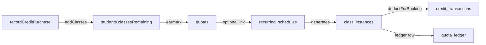
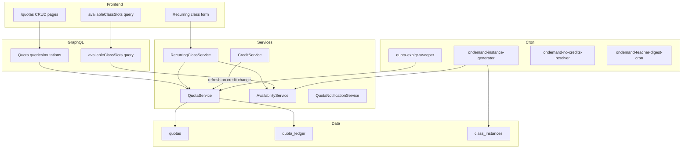

# Quota System — Design Specifications

## Document Information

- **Feature Name**: Quota Entity + Recurring-Class Integration
- **Version**: 1.0
- **Date**: 2026-07-30
- **Related Documents**:
  - [Implementation Guide](./implementation.md)
  - [Trackable Tasks](./trackable-tasks.md)

## Overview

Introduce a **quota** entity that lets administrators earmark a portion of a student's existing credit balance for a purpose and/or time window (e.g. "Summer package — 20 classes, Jun 1 – Aug 31", "Monthly — 16 classes/month", "Custom 3-month — 50 classes"). Quotas are **layered on top of** the existing `credit_transactions` ledger and `students.classesRemaining` balance — they are NOT a parallel credit source.

The recurring-class create form exposes **three parent scheduling modes**:

| Mode | Description |
|------|-------------|
| **Number of classes** | Existing mode — pre-generates N instances. Optional quota link (pool or earmark). |
| **On-demand** | Cron generates instances on a rolling horizon regardless of credit balance. Status flips when credits become available. |
| **Quota** | Explicit quota selection; consumes from that quota (pool or earmark). |

### Design Goals

- Layer quotas on existing student credits without replacing the credit ledger
- Provide append-only ledger accounting for concurrency-safe quota operations
- Support three scheduling modes with backward-compatible defaults
- Prevent double-booking for students and teachers across all scheduling paths
- Deliver progressive notifications for quota expiry and on-demand credit gaps

### Key Design Decisions

1. **Single polymorphic `quotas` table** with `kind` discriminator (PACKAGE / PERIODIC) + `periodType` (WEEKLY / MONTHLY / CUSTOM)
2. **Append-only `quota_ledger` as source of truth** — `quotas.remaining` etc. are denormalized caches synced in-transaction
3. **Hybrid ledger granularity** — pool mode writes per-instance REDEEM rows; earmark mode writes one RESERVE up front + partial RELEASE on cancellation
4. **FIFO auto-selection** — when no quota is explicitly selected, consume soonest-expiring open quota first
5. **On-demand deduction at session-start** — credits are not deducted when instance flips to AVAILABLE
6. **Dual status for on-demand** — `executionState` for rendering + `ondemandStatus` for on-demand lifecycle
7. **Scheduling conflict prevention everywhere** — shared `AvailabilityService` called by create/update/one-off booking/on-demand generator

## Architecture

### System Context

### High-Level Component Architecture

## Data Models

### Entity: `quotas`

| Column | Type | Notes |
|--------|------|-------|
| `id` | UUID PK | |
| `studentId` | UUID FK → students | cascade |
| `kind` | enum | `PACKAGE` \| `PERIODIC` |
| `name` | varchar | e.g. "Summer package" |
| `totalClasses` | int | |
| `remaining` | int | cached from ledger SUM |
| `reservedClasses` | int | cached earmark count |
| `usedThisPeriod` | int | cached, for periodic kinds |
| `periodType` | enum | `WEEKLY` \| `MONTHLY` \| `CUSTOM` |
| `periodDays` | int | 7 / 30 / 90 / 180 / 365 |
| `periodAnchor` | timestamptz | start of current cycle |
| `validFrom` | date nullable | |
| `validUntil` | date nullable | |
| `status` | enum | `ACTIVE` \| `EXPIRED` \| `ARCHIVED` |
| `priority` | int default 0 | FIFO burn-down ordering |
| `rolloverPolicy` | jsonb nullable | `{ maxRolloverPercent, accumulationCap }` |
| `version` | int | optimistic lock |
| `idempotencyKey` | varchar unique | |
| `createdAt`, `updatedAt`, `deletedAt` | timestamptz | soft-delete |

**Quota type matrix:**

| `kind` | `periodType` | `periodDays` | Behavior |
|--------|--------------|--------------|----------|
| `PACKAGE` | null | null | Named bundle, optional validity window, no recurring refresh |
| `PERIODIC` | `WEEKLY` | 7 | Refreshes every Monday |
| `PERIODIC` | `MONTHLY` | 30 | Refreshes on 1st of month |
| `PERIODIC` | `CUSTOM` | 90/180/365 | Custom window fenced by `validFrom`/`validUntil` |

### Entity: `quota_ledger` (append-only, source of truth)

| Column | Type | Notes |
|--------|------|-------|
| `id` | UUID PK | |
| `quotaId` | UUID FK → quotas | cascade |
| `studentId` | UUID FK → students | restrict |
| `recurringScheduleId` | UUID FK nullable | |
| `classInstanceId` | UUID FK nullable | set null |
| `delta` | int | +/- amount |
| `reason` | enum | `GRANT` \| `RESERVE` \| `REDEEM` \| `RELEASE` \| `EXPIRE` \| `ADJUST` |
| `reasonNote` | text nullable | |
| `idempotencyKey` | varchar 255 unique | at-most-once guarantee |
| `actorUserId` | UUID FK nullable | |
| `createdAt`, `updatedAt` | timestamptz | |

**Indexes:** `(quotaId, createdAt)`, `unique(idempotencyKey)`, `(studentId)`, `(classInstanceId)`, `(recurringScheduleId)`

### Schema extensions: `recurring_schedules`

| Column | Type | Notes |
|--------|------|-------|
| `quotaId` | UUID FK nullable | → quotas.id |
| `earmarkedClasses` | int nullable | earmark mode cap |
| `schedulingMode` | enum NOT NULL DEFAULT `NUMBER_OF_CLASSES` | `NUMBER_OF_CLASSES` \| `ON_DEMAND` \| `QUOTA` |
| `generationHorizonWeeks` | int nullable | ON_DEMAND only |
| `ondemandNoCreditsOutcome` | enum nullable | per-schedule override |

### Schema extensions: `class_instances`

**New `executionState` values:**
- `ON_DEMAND_PENDING_CREDITS`
- `ON_DEMAND_CONFLICT_HELD`
- `ON_DEMAND_NO_CREDITS_CANCELLED`
- `ON_DEMAND_NO_CREDITS_ABSENT`

**New column `ondemandStatus` (enum, nullable):**
`PENDING_CREDIT` \| `AVAILABLE` \| `CONVERTED` \| `NO_CREDITS_CANCELLED` \| `NO_CREDITS_ABSENT` \| `CANCELLED`

NULL for non-on-demand instances (backward-compatible).

### System Settings (new keys)

| Key | Default | Purpose |
|-----|---------|---------|
| `default_ondemand_horizon_weeks` | 2 | Rolling generation window |
| `default_ondemand_no_credits_outcome` | `AUTO_CANCEL` | Global no-credits behavior |
| `ondemand_teacher_digest_hour` | 9 | Local hour for teacher digest |
| `ondemand_no_credits_resolution_lead_minutes` | 240 | Resolver lead time before session |
| `quota_low_balance_threshold_percent` | 20 | Low-balance notification threshold |

## Scheduling Modes — Detailed Behavior

### Number of Classes (existing, refined)

- Admin specifies `generateInstancesForWeeks`; system pre-generates instances
- Optional `quotaId` + `earmarkedClasses` for quota consumption
- Pool mode: per-instance REDEEM ledger rows
- Earmark mode: RESERVE up front, RELEASE on cancellation of unused instances

### On-Demand

- Cron (`ondemand-instance-generator.ts`) materializes instances on rolling `generationHorizonWeeks` horizon
- Generates regardless of credit balance:
  - `classesRemaining > 0` → `executionState=AVAILABLE`
  - `classesRemaining == 0` → `executionState=ON_DEMAND_PENDING_CREDITS`
  - Slot conflict → `executionState=ON_DEMAND_CONFLICT_HELD` + admin notification
- Status refresh dual-triggered:
  1. Cron re-evaluates PENDING_CREDIT instances each run
  2. Any credit change calls `QuotaService.refreshStudentOndemandInstances(studentId, tx)` (FIFO flip)
- Credit deduction happens at **session-start**, not at availability flip
- No-credits outcome configurable per schedule (override) or system default:
  - `AUTO_CANCEL` — cancel instance
  - `AUTO_ABSENT_NO_CREDITS` — mark absent
  - `REMIND_ONLY` — notify only

### Quota Mode

- Admin explicitly selects an open quota via `quotaId`
- Consumes from that quota (pool or earmark)
- Bypasses global credit drawdown for the quota's portion

## Credit Interaction

- `recordCreditPurchase` unchanged — still bumps `students.classesRemaining`
- Creating a quota does NOT touch `students.classesRemaining`
- Creates `quotas` row + `quota_ledger` GRANT row in same transaction
- Invariant enforced at service layer: `SUM(active quotas.totalClasses) <= students.classesTotal`
- `credit_transactions` ledger is NOT modified — quota ledger sits beside it
- Periodic refresh: sweeper writes new GRANT + EXPIRE rows per rollover policy

## Availability & Conflict Prevention

`AvailabilityService` methods:

| Method | Purpose |
|--------|---------|
| `assertSlotAvailable(studentId, teacherId, startAt, endAt, ignoreInstanceIds?)` | Throws translated `slot.conflict` on overlap |
| `assertSchedulePatternAvailable(...)` | Validates entire recurring pattern before creation |
| `findAvailableSlots(studentId, teacherId, dateRange, durationMinutes)` | Returns free slots for frontend picker |
| `isSlotAvailable(...)` | Boolean check |

**Called by:** RecurringClassService create/update, TeacherDashboardService one-off booking, on-demand generator.

**Frontend:** `availableClassSlots` GraphQL query drives greyed-out time slots; server rejects on submit if race occurs.

## Notifications

### New Events (7 total)

| Event | Category | Audience | Trigger |
|-------|----------|----------|---------|
| `QUOTA_EXPIRING_SOON` | reminder | student/parent | T-30 and T-7 days before `validUntil` |
| `QUOTA_EXPIRED` | info | student/parent | Sweeper EXPIRE action |
| `QUOTA_LOW_BALANCE` | reminder | student/parent | `remaining` below threshold (default 20%) |
| `ON_DEMAND_INSTANCE_PENDING_CREDIT` | urgent | student (+ parent if linked) | Instance created PENDING_CREDIT |
| `ON_DEMAND_INSTANCE_REMINDER_T3` | reminder | student (+ parent if linked) | T-3 days before class |
| `ON_DEMAND_INSTANCE_REMINDER_T1` | urgent | student (+ parent if linked) | T-1 day before class |
| `ON_DEMAND_TEACHER_DAILY_DIGEST` | digest | teacher | Daily at `ondemand_teacher_digest_hour` in teacher's local TZ |

**Parent handling:** Check `student.parentId` before parent delivery; student-only fallback when no parent linked.

**Notification prefs:** Category-level mute toggle (`info`/`reminder`/`urgent`/`digest`) alongside per-event toggles.

## Permissions

| Permission | Value | Scope |
|------------|-------|-------|
| `QUOTAS_VIEW` | `quotas.view` | Read quotas, ledger, balance |
| `QUOTAS_MANAGE` | `quotas.manage` | Create, update, delete quotas |

## API Design (GraphQL)

### Queries

- `quota(id)` — single quota
- `quotas(filter, pagination)` — admin list
- `studentQuotas(studentId)` — all quotas for student
- `studentOpenQuotas(studentId)` — active quotas with remaining > 0
- `quotaBalance(studentId)` — computed balance with `breakdownByExpiration`
- `quotaLedger(quotaId, pagination)` — ledger history
- `availableClassSlots(studentId, teacherId, date, durationMinutes)` — slot picker

### Mutations

- `createQuota(input)` — creates quota + GRANT ledger row
- `updateQuota(id, input)` — optimistic lock via version
- `deleteQuota(id)` — soft-delete

### Extended Recurring Class Input

New fields on `CreateRecurringClassInput`:
- `quotaId`, `earmarkedClasses`, `schedulingMode`, `generationHorizonWeeks`, `ondemandNoCreditsOutcome`

## Mode Switch Behavior

When admin edits a recurring schedule to switch `schedulingMode` away from `NUMBER_OF_CLASSES`:

1. Archive all un-taken future instances with `cancelled-mode-switch` state
2. For archived instances with unrefunded credit deductions:
   - Call `CreditService.refundOnCancel`
   - Call `QuotaService.releaseForRecurringSchedule`
3. New mode takes over (cron for ON_DEMAND, quota link for QUOTA)

## Industry Research Patterns Applied

1. **Append-only ledger** — balance is SUM over ledger, not a mutating column (Vevee, Lago, Chargebee)
2. **FIFO expiry** — soonest-expiring quota consumed first (QuotaStack, NEXTDEVKIT)
3. **Reserve / commit / release** — canonical transactional primitive for earmarks
4. **Expiry sweeper** — negative EXPIRE ledger rows, not balance filtering
5. **Credit batches** — single polymorphic table with kind discriminator
6. **Idempotency keys + optimistic locking** — mirrors existing `students.version` pattern
7. **Visibility + notifications** — expiry reminders drive utilization (Tutorbase, Lago)

## Backward Compatibility

- Existing `recurring_schedules` default to `schedulingMode=NUMBER_OF_CLASSES`
- `quotaId=null` preserves existing per-instance global credit deduction
- `ondemandStatus` NULL for non-on-demand instances
- Soft-delete for expired/zero-remaining quotas (preserves audit history)

## Open Questions (resolve during implementation)

- **Expired/zero-remaining quotas** — soft-delete only (recommended default)
- **Low-balance threshold** — `system_settings.quota_low_balance_threshold_percent` (default 20%)
