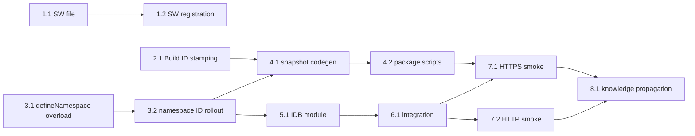

# Trackable Tasks: Translation Browser Cache — Hybrid SW + IndexedDB

**Target Directory:** `.ai/plans/clientCache`
**Outcome Directory:** `.ai/plans/clientCache/outcome`
**Plan Files Tracker:** `.ai/plans/clientCache/cache-rollout-tracker.json`
**Phase:** 3 — Actionable Task Breakdown
**Related Spec:** [specs.md](./specs.md)
**Related Design:** [implementation.md](./implementation.md)

---

## Non-Negotiable Execution Protocol for All Tasks

1. **Pre-Execution Outcome Knowledge Read:**
   Before executing ANY task, the executing agent MUST read ALL existing files in `.ai/plans/clientCache/outcome/` to absorb prior research, search results, docs, and pitfalls so analysis is not repeated.
2. **Per-File Quality Verification Loop (Immediate post-edit):**
   Whenever a file is modified, execute per-file verification BEFORE moving to another file or subtask:
   ```bash
   bun tsgo
   bun biome:check
   curl -s -X POST http://localhost:4777/lint \
     -H "Content-Type: application/json" \
     -d '{"id":"verify","files":["<the-file>"]}'
   ```
   Fix all errors before proceeding.
3. **Instruction Verification Per Subtask:**
   After quality loop passes, validate the file against ALL applicable instruction files:
   - **Layer AGENTS.md**: Absolute paths to each layer's AGENTS.md (see `_Applicable AGENTS.md:` in each task)
   - **.agents/instructions/*.md**: Absolute paths to all matching instruction files (see `_Applicable Instructions:` in each task)
4. **Global Health Check (Completion Gate):**
   Before marking any subtask as complete, run full global checks: `bun tsgo`, `bun biome:check`, and `bun run lint` globally. All MUST exit with **zero errors and zero warnings**.
5. **Post-Execution Outcome File Creation:**
   Upon completing the task implementation and quality checks, write a new outcome document under `.ai/plans/clientCache/outcome/<task-id>-outcome.md` summarizing research, analysis, changes, and carry-over knowledge.
6. **Task Progress Tracking:**
   The executing agent MUST update the task checkbox `[ ]` -> `[-]` (in progress) -> `[x]` (complete) in this `trackable-tasks.md` file upon starting and completing each task.

---

## Task List

- [ ] 1. **Foundation — Service Worker (Primary Cache, Secure Contexts)**
  - [ ] 1.1 Create `public/sw.js`
    - _Applicable AGENTS.md:_ `app/AGENTS.md`, `shared/AGENTS.md`
    - _Applicable Instructions:_ `.github/instructions/frontend.instructions.md`
    - Read all existing files in `.ai/plans/clientCache/outcome/`.
    - Create `public/sw.js` implementing:
      - `install` handler calling `self.skipWaiting()`.
      - `activate` handler that calls `clients.claim()` and deletes orphan caches (any cache whose name does NOT start with `siraj-static-chunks-`).
      - `fetch` handler with cache-first strategy for GET requests matching `self.location.origin + "/_next/static/chunks/"` and ending with `.js`.
      - Cache name constant `"siraj-static-chunks-v1"`.
      - On network failure, best-effort fall back to cache.
    - **Quality Loop (per-file):**
      ```bash
      bun tsgo
      bun biome:check
      ```
      (SW file is not linted by repo ESLint — SW scope.)
    - **Instruction Verification:** Validate against `app/AGENTS.md`, `shared/AGENTS.md`, `.github/instructions/frontend.instructions.md`.
    - Run global check: `bun tsgo`, `bun biome:check`, `bun run lint` (0 errors, 0 warnings).
    - Write outcome file: `.ai/plans/clientCache/outcome/1.1-sw-file-outcome.md`.
    - Update progress: Mark task 1.1 as `[x]` in `trackable-tasks.md`.
    - _Requirements: Spec REQ-CACHE-SW_
  - [ ] 1.2 Register Service Worker in `app/layout.tsx`
    - _Applicable AGENTS.md:_ `app/AGENTS.md`, `shared/AGENTS.md`
    - _Applicable Instructions:_ `.github/instructions/frontend.instructions.md`
    - Read all existing files in `.ai/plans/clientCache/outcome/`.
    - Modify `app/layout.tsx` `RootLayout`:
      - Add an inline `<script>` inside `<head>` immediately after `InitColorSchemeScript` and before the existing `<style>` tag.
      - Guard with `window.isSecureContext` and `'serviceWorker' in navigator`.
      - Use the existing `nonce` from `headersList.get("x-nonce")` for CSP-safety.
      - `.catch(() => {})` on `register()` to swallow any registration failure silently.
    - **Quality Loop (per-file):**
      ```bash
      bun tsgo
      bun biome:check
      curl -s -X POST http://localhost:4777/lint \
        -H "Content-Type: application/json" \
        -d '{"id":"verify","files":["app/layout.tsx"]}'
      ```
    - **Instruction Verification:** Validate against `app/AGENTS.md`, `shared/AGENTS.md`, `.github/instructions/frontend.instructions.md`.
    - Run global check: `bun tsgo`, `bun biome:check`, `bun run lint` (0 errors, 0 warnings).
    - Write outcome file: `.ai/plans/clientCache/outcome/1.2-sw-registration-outcome.md`.
    - Update progress: Mark task 1.2 as `[x]` in `trackable-tasks.md`.
    - _Requirements: Spec REQ-CACHE-SW, REQ-NO-REGRESSION_

- [ ] 2. **Build ID Stamping — `next.config.ts`**
  - [ ] 2.1 Add `resolveBuildId` + `generateBuildId` + env vars to `next.config.ts`
    - _Applicable AGENTS.md:_ `app/AGENTS.md`
    - _Applicable Instructions:_ `.github/instructions/frontend.instructions.md`
    - Read all existing files in `.ai/plans/clientCache/outcome/`.
    - Modify `next.config.ts`:
      - Add a top-level `resolveBuildId()` helper following the resolution order from Spec REQ-BUILD-ID:
        1. `process.env.NEXT_PUBLIC_BUILD_ID` (verbatim).
        2. `readFileSync(".next-locale-snapshots-version", "utf8").trim()` (snapshot content hash).
        3. `crypto.randomUUID()` (dev fallback).
      - Add `generateBuildId: resolveBuildId` to the Next.js config object.
      - Add `env: { NEXT_PUBLIC_BUILD_ID: resolveBuildId(), NEXT_PUBLIC_LOCALE_SNAPSHOT_BASE: "/static/locale-snapshots" }`.
    - **Quality Loop (per-file):**
      ```bash
      bun tsgo
      bun biome:check
      curl -s -X POST http://localhost:4777/lint \
        -H "Content-Type: application/json" \
        -d '{"id":"verify","files":["next.config.ts"]}'
      ```
    - **Instruction Verification:** Validate against `app/AGENTS.md`, `.github/instructions/frontend.instructions.md`.
    - Run global check: `bun tsgo`, `bun biome:check`, `bun run lint` (0 errors, 0 warnings).
    - Write outcome file: `.ai/plans/clientCache/outcome/2.1-build-id-stamping-outcome.md`.
    - Update progress: Mark task 2.1 as `[x]` in `trackable-tasks.md`.
    - _Requirements: Spec REQ-BUILD-ID_

- [ ] 3. **Stable Namespace IDs — `defineNamespace` Overload**
  - [ ] 3.1 Add ID overload to `shared/locale/namespaces/define-namespace.ts`
    - _Applicable AGENTS.md:_ `shared/AGENTS.md`
    - _Applicable Instructions:_ `.github/instructions/frontend.instructions.md`
    - Read all existing files in `.ai/plans/clientCache/outcome/`.
    - Modify `shared/locale/namespaces/define-namespace.ts`:
      - Add an overload: `defineNamespace<TLabels>(id: string, config: NamespaceLoaderConfig<TLabels>): NamespaceHandle<TLabels>`.
      - Keep the existing no-id overload for backward compatibility.
      - When `id` is provided, attach a non-enumerable `__id` symbol property to the handle and store the ID in the existing `namespaceRegistry` so `getNamespaceConfig(handle).id` is retrievable.
      - Add a `getNamespaceId(handle: NamespaceHandle<unknown>): string | undefined` helper exported from the same module.
    - **Quality Loop (per-file):**
      ```bash
      bun tsgo
      bun biome:check
      curl -s -X POST http://localhost:4777/lint \
        -H "Content-Type: application/json" \
        -d '{"id":"verify","files":["shared/locale/namespaces/define-namespace.ts"]}'
      ```
    - **Instruction Verification:** Validate against `shared/AGENTS.md`, `.github/instructions/frontend.instructions.md`.
    - Run global check: `bun tsgo`, `bun biome:check`, `bun run lint` (0 errors, 0 warnings).
    - Write outcome file: `.ai/plans/clientCache/outcome/3.1-define-namespace-id-overload-outcome.md`.
    - Update progress: Mark task 3.1 as `[x]` in `trackable-tasks.md`.
    - _Requirements: Spec REQ-FALLBACK-IDB, REQ-NO-REGRESSION_
  - [ ] 3.2 Pass stable string IDs to all `*.namespace.ts` files (mechanical rollout)
    - _Applicable AGENTS.md:_ `shared/AGENTS.md`
    - _Applicable Instructions:_ `.github/instructions/frontend.instructions.md`
    - Read all existing files in `.ai/plans/clientCache/outcome/`.
    - Spawn **Parent Orchestration Subagent** to manage the mechanical rollout across `shared/locale/namespaces/**/*.namespace.ts` (~109 files).
    - Parent Orchestrator creates and manages tracking state file `.ai/plans/clientCache/cache-rollout-tracker.json`.
    - Parent Orchestrator maintains a **continuous watcher loop** to maximize concurrency at **exactly 4 running subagents** (per user policy — NOT 16):
      - Monitors running subagent status and immediately spawns a new subagent whenever a worker completes or a slot opens up.
      - Each nested subagent is assigned a **single namespace file** (or small batch of ≤5 related namespaces) from `shared/locale/namespaces/`.
      - Each nested subagent receives full absolute plan file paths (`specs.md`, `implementation.md`, `trackable-tasks.md`), parent task context, and relevant `AGENTS.md` / instruction rules.
      - Each nested subagent is strictly restricted to its assigned namespace file(s) (MUST NOT modify any other file in the codebase).
      - Each nested subagent reads all existing files in `.ai/plans/clientCache/outcome/` before starting.
      - Each nested subagent updates its assigned `defineNamespace(config)` call to `defineNamespace("<stable-id>", config)` where `<stable-id>` is derived from the file path under `shared/locale/namespaces/` (e.g., `dashboard.students.directory`).
      - Each nested subagent runs per-file quality verification (`tsgo` + `biome` + `lint-queue`) on its assigned file(s).
      - Each nested subagent writes its batch outcome document `.ai/plans/clientCache/outcome/3.2-<namespace-group>-outcome.md`.
      - Parent Orchestrator updates `.ai/plans/clientCache/cache-rollout-tracker.json` with completed file status and subagent IDs.
    - Upon completion of all nested worker subagents, run global check: `bun tsgo`, `bun biome:check`, `bun run lint` (0 errors, 0 warnings).
    - Write rollout summary outcome file: `.ai/plans/clientCache/outcome/3.2-namespace-id-rollout-outcome.md`.
    - Update progress: Mark task 3.2 as `[x]` in `trackable-tasks.md`.
    - _Requirements: Spec REQ-FALLBACK-IDB_

- [ ] 4. **Build-Time Snapshot Codegen — `scripts/locale-snapshots.ts`**
  - [ ] 4.1 Create `scripts/locale-snapshots.ts`
    - _Applicable AGENTS.md:_ `shared/AGENTS.md`, `backend/AGENTS.md`
    - _Applicable Instructions:_ `.github/instructions/backend.instructions.md`
    - Read all existing files in `.ai/plans/clientCache/outcome/`.
    - Create `scripts/locale-snapshots.ts` that:
      - Walks `shared/locale/namespaces/**/*.namespace.ts` to enumerate every `(namespaceId, locale)` pair (using the stable IDs from task 3.x).
      - For each pair, dynamically `import()` the leaf module (`@/shared/locale/<locale>/...`) using Bun's runtime.
      - Serializes the labels object via a JSON replacer that captures function source: `typeof val === "function" ? { __fn: Function.prototype.toString.call(val) } : val`.
      - Emits `shared/locale/cache-snapshots/<locale>/<namespace-id>.json` (or `public/static/locale-snapshots/<locale>/<namespace-id>.json` per Component 5 in `implementation.md`).
      - Skips write if the existing file already has identical content (mtime preservation).
      - Computes a single content hash from all emitted files and writes it to `.next-locale-snapshots-version`.
    - **Quality Loop (per-file):**
      ```bash
      bun tsgo
      bun biome:check
      curl -s -X POST http://localhost:4777/lint \
        -H "Content-Type: application/json" \
        -d '{"id":"verify","files":["scripts/locale-snapshots.ts"]}'
      ```
    - **Instruction Verification:** Validate against `shared/AGENTS.md`, `backend/AGENTS.md`, `.github/instructions/backend.instructions.md`.
    - Run the script manually: `bun run scripts/locale-snapshots.ts` and verify `.next-locale-snapshots-version` + snapshot files are created.
    - Run global check: `bun tsgo`, `bun biome:check`, `bun run lint` (0 errors, 0 warnings).
    - Write outcome file: `.ai/plans/clientCache/outcome/4.1-snapshot-codegen-outcome.md`.
    - Update progress: Mark task 4.1 as `[x]` in `trackable-tasks.md`.
    - _Requirements: Spec REQ-SNAPSHOTS_
  - [ ] 4.2 Wire `locale:snapshots` + `prebuild` scripts into `package.json`
    - _Applicable AGENTS.md:_ (root `AGENTS.md` only — `package.json` is project-level config)
    - _Applicable Instructions:_ `.github/instructions/frontend.instructions.md`
    - Read all existing files in `.ai/plans/clientCache/outcome/`.
    - Modify `package.json`:
      - Add `"locale:snapshots": "bun run scripts/locale-snapshots.ts"` to `scripts`.
      - Add `"prebuild": "bun run locale:snapshots"` to `scripts` (so it runs before `next build`).
    - **Quality Loop (per-file):**
      ```bash
      bun biome:check
      ```
      (`package.json` is not linted by ESLint.)
    - **Instruction Verification:** Validate against `.github/instructions/frontend.instructions.md`.
    - Run global check: `bun tsgo`, `bun biome:check`, `bun run lint` (0 errors, 0 warnings).
    - Write outcome file: `.ai/plans/clientCache/outcome/4.2-script-wiring-outcome.md`.
    - Update progress: Mark task 4.2 as `[x]` in `trackable-tasks.md`.
    - _Requirements: Spec REQ-SNAPSHOTS, REQ-BUILD-ID_

- [ ] 5. **IndexedDB Fallback Module — `shared/locale/client/snapshot-cache.ts`**
  - [ ] 5.1 Create the snapshot cache module
    - _Applicable AGENTS.md:_ `shared/AGENTS.md`, `frontend/AGENTS.md`
    - _Applicable Instructions:_ `.github/instructions/frontend.instructions.md`
    - Read all existing files in `.ai/plans/clientCache/outcome/`.
    - Create `shared/locale/client/snapshot-cache.ts` implementing:
      - Open IndexedDB database `siraj-locale-snapshots` (version 1) with object store `snapshots` keyed by `${BUILD_ID}:${namespaceId}:${locale}`.
      - JSON reviver that reconstructs function members via `new Function("return (" + val.__fn + ")")()`.
      - Public exports:
        - `readSnapshot<TLabels>(namespaceId: string, locale: AppLocale): Promise<TLabels | undefined>`
        - `writeSnapshot<TLabels>(namespaceId: string, locale: AppLocale, labels: TLabels): Promise<void>`
        - `wipeIfBuildIdChanged(buildId: string): Promise<boolean>`
        - `getLocaleCacheStats(): { hits: number; misses: number; size: number }`
      - Wrap every `indexedDB.*` call in try/catch — failures disable the fallback gracefully (silently cold-load).
      - Maintain in-memory counters (hits, misses, size).
      - On first hit and first BUILD_ID mismatch, log via `logger.info` from `@/frontend/utils/logger` (no spam — one-time events only).
    - **Quality Loop (per-file):**
      ```bash
      bun tsgo
      bun biome:check
      curl -s -X POST http://localhost:4777/lint \
        -H "Content-Type: application/json" \
        -d '{"id":"verify","files":["shared/locale/client/snapshot-cache.ts"]}'
      ```
    - **Instruction Verification:** Validate against `shared/AGENTS.md`, `frontend/AGENTS.md`, `.github/instructions/frontend.instructions.md`.
    - Write unit tests for the reviver, read/write/wipe logic, and the try/catch fallback (mock `indexedDB`).
    - Run global check: `bun tsgo`, `bun biome:check`, `bun run lint` (0 errors, 0 warnings).
    - Write outcome file: `.ai/plans/clientCache/outcome/5.1-snapshot-cache-module-outcome.md`.
    - Update progress: Mark task 5.1 as `[x]` in `trackable-tasks.md`.
    - _Requirements: Spec REQ-FALLBACK-IDB, REQ-TELEMETRY_

- [ ] 6. **Integration — Wire fallback into `translation-cache-store.ts`**
  - [ ] 6.1 Integrate the IndexedDB snapshot branch into `startNamespaceLoad`
    - _Applicable AGENTS.md:_ `shared/AGENTS.md`, `frontend/AGENTS.md`
    - _Applicable Instructions:_ `.github/instructions/frontend.instructions.md`
    - Read all existing files in `.ai/plans/clientCache/outcome/`.
    - Modify `shared/locale/client/translation-cache-store.ts`:
      - Compute a module-scope boolean:
        ```ts
        const useSnapshotFallback =
          typeof window !== "undefined" &&
          !window.isSecureContext &&
          "indexedDB" in window;
        ```
      - In `startNamespaceLoad`:
        - If `useSnapshotFallback` and no in-memory `value` yet → `await readSnapshot(namespaceId, locale)`.
          - `namespaceId` retrieved via the `getNamespaceId(handle)` helper added in task 3.1.
          - If hit → revive → set `entry.value` → return `CacheEntry` with resolved promise.
          - If miss → fall through to normal `config.load[locale]()`.
        - After `config.load[locale]()` resolves successfully, fire-and-forget `writeSnapshot(namespaceId, locale, labels)` in the background (no `await` on the write — don't block Suspense).
      - Keep the public API of `translation-cache-store.ts` (`readTranslation`, `ensureNamespaceLoading`) unchanged.
      - On first call, fire `wipeIfBuildIdChanged(process.env.NEXT_PUBLIC_BUILD_ID ?? "")` to detect BUILD_ID change.
    - **Quality Loop (per-file):**
      ```bash
      bun tsgo
      bun biome:check
      curl -s -X POST http://localhost:4777/lint \
        -H "Content-Type: application/json" \
        -d '{"id":"verify","files":["shared/locale/client/translation-cache-store.ts"]}'
      ```
    - **Instruction Verification:** Validate against `shared/AGENTS.md`, `frontend/AGENTS.md`, `.github/instructions/frontend.instructions.md`.
    - Write integration test: mock `useSnapshotFallback = true`, verify snapshot hit bypasses `config.load[locale]()`; verify miss falls through; verify writeSnapshot is called after `config.load` resolves.
    - Run global check: `bun tsgo`, `bun biome:check`, `bun run lint` (0 errors, 0 warnings).
    - Write outcome file: `.ai/plans/clientCache/outcome/6.1-integration-outcome.md`.
    - Update progress: Mark task 6.1 as `[x]` in `trackable-tasks.md`.
    - _Requirements: Spec REQ-NO-REGRESSION, REQ-FALLBACK-IDB_

- [ ] 7. **End-to-End Smoke Verification**
  - [ ] 7.1 HTTPS Smoke — Service Worker Cache Path
    - _Applicable AGENTS.md:_ `app/AGENTS.md`, `shared/AGENTS.md`
    - _Applicable Instructions:_ `.github/instructions/frontend.instructions.md`
    - Read all existing files in `.ai/plans/clientCache/outcome/`.
    - Run `bun run build` — confirm `.next-locale-snapshots-version` generated, `NEXT_PUBLIC_BUILD_ID` stamped, and snapshot JSON files emitted.
    - Start production server (`bun start` or `vercel preview`).
    - Open DevTools → Application → Service Workers → confirm `/sw.js` registers.
    - Navigate to a route → confirm Cache Storage `siraj-static-chunks-v1` populates with chunk URLs as routes load.
    - Reload page → confirm Network panel shows `(disk cache)` for locale chunks.
    - Change a translation leaf → rebuild → confirm changed locale chunk refetches (new URL) while unchanged chunks stay cached.
    - Run global check: `bun tsgo`, `bun biome:check`, `bun run lint` (0 errors, 0 warnings).
    - Write outcome file: `.ai/plans/clientCache/outcome/7.1-https-smoke-outcome.md`.
    - Update progress: Mark task 7.1 as `[x]` in `trackable-tasks.md`.
    - _Requirements: Spec REQ-CACHE-SW_
  - [ ] 7.2 HTTP Staging Smoke — IndexedDB Fallback Path
    - _Applicable AGENTS.md:_ `shared/AGENTS.md`, `frontend/AGENTS.md`
    - _Applicable Instructions:_ `.github/instructions/frontend.instructions.md`
    - Read all existing files in `.ai/plans/clientCache/outcome/`.
    - Build with `NODE_ENV=production bun run build` and serve on plain HTTP: `bun start -- -H 0.0.0.0` (or `next start -H 0.0.0.0`).
    - Open DevTools → Application → Service Workers → confirm NO service worker registers (`window.isSecureContext === false`).
    - Confirm IndexedDB (Application → Storage → IndexedDB → `siraj-locale-snapshots`) fills under the `snapshots` object store as routes load.
    - Reload page → confirm snapshot hit (no network request for the corresponding locale chunk).
    - Change `NEXT_PUBLIC_BUILD_ID` env var → rebuild → reload → confirm IndexedDB is wiped on first read and re-populates.
    - Run global check: `bun tsgo`, `bun biome:check`, `bun run lint` (0 errors, 0 warnings).
    - Write outcome file: `.ai/plans/clientCache/outcome/7.2-http-staging-smoke-outcome.md`.
    - Update progress: Mark task 7.2 as `[x]` in `trackable-tasks.md`.
    - _Requirements: Spec REQ-FALLBACK-IDB, REQ-BUILD-ID_

- [ ] 8. **Knowledge Propagation & Documentation (MANDATORY Final Task)**
  - _Applicable AGENTS.md:_ `shared/AGENTS.md`, `app/AGENTS.md`
  - _Applicable Instructions:_ `.github/instructions/frontend.instructions.md`
  - Read all outcome files in `.ai/plans/clientCache/outcome/` to synthesize all learnings from the plan.
  - Update [shared/AGENTS.md](../../../shared/AGENTS.md) with a new "Browser translation cache" section explaining:
    - SW caches all static chunks including locale leaves via `caches.open("siraj-static-chunks-v1")`.
    - Insecure-context staging auto-falls back to IndexedDB JSON snapshots keyed by `NEXT_PUBLIC_BUILD_ID`.
    - Build ID format/stamping: `NEXT_PUBLIC_BUILD_ID` env → `.next-locale-snapshots-version` content hash → random UUID fallback.
    - Which files must be touched when adding a new namespace (the `namespaceId` string).
  - Update [docs/cache-strategies-comparison.md](../../../docs/cache-strategies-comparison.md) with a "Decision and Implementation Outcomes" section:
    - Chosen: Hybrid (SW primary + IndexedDB fallback auto-detected via `window.isSecureContext`).
    - Implementation status: link to outcome files.
    - Production behavior summary.
    - Staging behavior summary.
  - Optionally add a defensive ESLint rule in `eslint.config.mjs` banning direct `caches.open("siraj-static-chunks-v1")` use outside `public/sw.js` (prevents future code from bypassing the SW pattern).
  - Run global check: `bun tsgo`, `bun biome:check`, `bun run lint` (0 errors, 0 warnings).
  - Write outcome file: `.ai/plans/clientCache/outcome/8.1-knowledge-propagation-outcome.md`.
  - Update progress: Mark task 8.1 as `[x]` in `trackable-tasks.md`.
  - _Requirements: Knowledge propagation protocol (Spec-Driven Development SKILL.md § Knowledge Propagation from Plan Outcomes)_

---

## Dependency Graph



### Parallelizable waves

| Wave | Tasks | Notes |
|------|-------|-------|
| Wave 1 | 1.1 + 1.2; 2.1; 3.1 | Independent — no file overlap. |
| Wave 2 | 3.2 (depends on 3.1); 4.1 (depends on 3.2 + 2.1); 5.1 (depends on 3.1) | 3.2 is the bottleneck prerequisite for 4.1. |
| Wave 3 | 4.2 (depends on 4.1); 6.1 (depends on 5.1 + 3.2) | |
| Wave 4 | 7.1 + 7.2 (depend on 6.1 + 4.2) | |
| Wave 5 | 8.1 (depends on 7.1 + 7.2 outcome docs) | |

---

## Status Legend

| Marker | Meaning |
|--------|---------|
| `[ ]` | Not started |
| `[-]` | In progress |
| `[x]` | Complete (global checks pass, outcome file written) |
