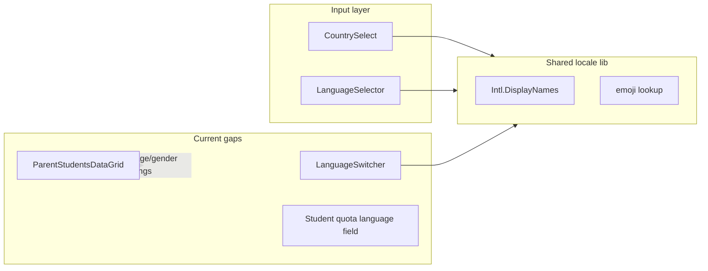

# Locale Display Components Plan

## Context

Input components already exist and share the same data layer:

- [`frontend/components/ui/input/CountrySelect.tsx`](frontend/components/ui/input/CountrySelect.tsx)
- [`frontend/components/ui/input/LanguageSelector.tsx`](frontend/components/ui/input/LanguageSelector.tsx)
- Locale helpers in [`frontend/lib/locale/`](frontend/lib/locale/) (`getCountryDisplayName`, `getCountryEmoji`, `getLanguageDisplayName`, `getLanguageEmoji`, lookup by code)

Today, **read-only surfaces duplicate this logic** or show raw codes:



There is **no `frontend/components/ui/display/` layer yet** (unlike [`StatusBadge`](frontend/components/ui/badge/StatusBadge.tsx) for status rendering).

---

## Proposed Components

Create a new display folder parallel to `input/`:

```
frontend/components/ui/display/
  LocaleEmoji.tsx          # shared emoji span (DRY)
  CountryDisplay.tsx
  LanguageDisplay.tsx
  CountryDisplay.stories.tsx
  LanguageDisplay.stories.tsx
  index.ts
```

Export from [`frontend/components/ui/index.ts`](frontend/components/ui/index.ts).

### Shared primitive: `LocaleEmoji`

Extract the repeated emoji span currently duplicated in:

- `CountrySelect` (`CountryEmoji`)
- `LanguageSelector` (`LanguageEmoji`)
- [`LanguageSwitcher`](frontend/views/dashboard/components/navbar/LanguageSwitcher.tsx)

Single styled `Box component="span" aria-hidden` with `flexShrink: 0`.

### `CountryDisplay`

Read-only inline renderer for a country **code**.

```tsx
type CountryDisplayProps = {
  readonly code?: string | null;
  readonly country?: CountryType;        // optional pre-resolved entry
  readonly showEmoji?: boolean;          // default true
  readonly showLabel?: boolean;          // default true
  readonly fallback?: string;            // no default; caller or common.notSet
  readonly typographyVariant?: TypographyProps["variant"];
  readonly sx?: SxProps<Theme>;
};
```

Behavior:
- Resolve name via `useLocale()` + `getCountryDisplayName(code, locale)`
- Resolve emoji via `country?.emoji ?? getCountryEmoji(code)`
- Render `Stack direction="row"` with emoji + `Typography`
- If `code` is null/empty and no `country`, render `fallback` or `null` (no hardcoded English default in the component)

### `LanguageDisplay`

Same shape for `AppLanguage` / language code:

```tsx
type LanguageDisplayProps = {
  readonly code?: string | null;
  readonly language?: LanguageType;
  readonly showEmoji?: boolean;
  readonly showLabel?: boolean;
  readonly fallback?: string;
  readonly typographyVariant?: TypographyProps["variant"];
  readonly sx?: SxProps<Theme>;
};
```

Uses `getLanguageDisplayName` / `getLanguageEmoji` from [`frontend/lib/locale`](frontend/lib/locale/index.ts).

**No new next-intl message keys required** for names (same as inputs: `Intl.DisplayNames`). Optional `fallback` can come from caller (`t("notSet")` from domain namespace).

### Refactor inputs (small, in same PR)

Update `CountrySelect` and `LanguageSelector` to import `LocaleEmoji` instead of local duplicates — keeps input and display visually consistent.

---

## Storybook

Follow existing input story pattern ([`CountrySelect.stories.tsx`](frontend/components/ui/input/CountrySelect.stories.tsx)):

| Story | Purpose |
|-------|---------|
| Default | SA / `ar` with emoji + label |
| EmojiOnly | `showLabel={false}` |
| LabelOnly | `showEmoji={false}` |
| UnknownCode | invalid code + custom fallback |
| Arabic | `globals.locale: "ar"` |

Title: `UI/Display/CountryDisplay` and `UI/Display/LanguageDisplay`.

---

## Adoption Targets (where to use them)

### Tier 1 — Immediate, clear fit (read-only code display)

| Location | Current behavior | Change |
|----------|------------------|--------|
| [`ParentStudentsDataGrid.tsx`](frontend/views/dashboard/parent/profile/ParentStudentsDataGrid.tsx) | `language` / `gender` columns render raw strings (`"ar"`, `"MALE"`) | Add `renderCell` with `LanguageDisplay code={row.language}`; gender stays separate (future `GenderDisplay` out of scope) |
| [`LanguageSwitcher.tsx`](frontend/views/dashboard/components/navbar/LanguageSwitcher.tsx) | Inline emoji + `getLanguageDisplayName` | Compose `LanguageDisplay` inside menu item layout (keeps popover styling local) |

### Tier 2 — Read-only form surfaces

| Location | Current behavior | Change |
|----------|------------------|--------|
| [`StudentInformationSection.tsx`](frontend/views/dashboard/students/quota/components/StudentInformationSection.tsx) `LanguageField` | Disabled `Select` with hardcoded `arabic`/`english` label keys | Replace disabled select UI with `LanguageDisplay code={field.value}` inside `QuotaFormField` (form value unchanged) |

### Tier 3 — Future / when data or UI expands

| Location | Notes |
|----------|-------|
| Student directory filter chips / future grid columns | [`StudentsContainer.tsx`](frontend/views/dashboard/admin/parents/students/StudentsContainer.tsx) filters by `language`/`gender` but grid has no language column yet — use `LanguageDisplay` when columns or active-filter chips are added |
| Teacher onboarding review/summary step | If a read-only confirmation step is added, show `CountryDisplay code={countryCode}` |
| Profile `InfoField` / `DetailItem` wrappers | Only if fields migrate from free-text nationality (`"Saudi Arabia"`) to `CountryCode` — **not applicable today** ([`ParentProfileDetails.tsx`](frontend/views/dashboard/parent/profile/ParentProfileDetails.tsx), [`IdentitySection.tsx`](frontend/views/profile/parent/sections/IdentitySection.tsx)) |
| DataGrid `valueFormatter` helpers | Reusable pattern for any future grid exposing `language` or `countryCode` |

### Related but out of scope (input migration, not display)

| Location | Note |
|----------|------|
| [`OfficialDetailsSection.tsx`](frontend/views/dashboard/teachers/onboarding/components/OfficialDetailsSection.tsx) | Hardcoded 5-country `Select` — should migrate to `CountrySelect`, not `CountryDisplay` |
| Auth [`ThemeLanguageControls`](frontend/views/auth/login/components/ThemeLanguageControls.tsx) | Uses `LanguageSwitcher` — benefits indirectly from Tier 1 |

---

## Implementation Order

1. Add `LocaleEmoji`, `CountryDisplay`, `LanguageDisplay` + stories + barrel exports
2. Refactor `CountrySelect` / `LanguageSelector` to use `LocaleEmoji`
3. Adopt Tier 1 (`ParentStudentsDataGrid`, `LanguageSwitcher`)
4. Adopt Tier 2 (`StudentInformationSection` read-only language)
5. Run per-file verification: `tsgo`, `biome:check`, lint queue on touched files

---

## API Convention (aligns with your input pattern)

- **No default prop values** for user-facing text (`fallback` is optional; when absent and code is missing, render nothing or pass caller-provided `t("notSet")`)
- Accept **code string** from GraphQL/domain types; optional pre-resolved `country` / `language` object for performance in lists
- Display components are **`"use client"`** (need `useLocale()`)
