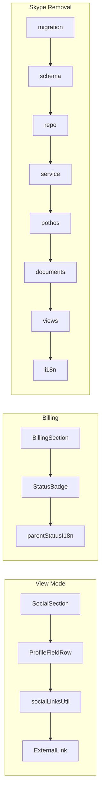

# Parent Profile Icons, Links, Spacing, and Skype Removal

## Current gaps

- [`SocialSection.tsx`](frontend/views/profile/parent/sections/SocialSection.tsx) renders Facebook/WhatsApp/Twitter/Zoom as plain `InfoField` text — no icons, no links.
- [`BillingSection.tsx`](frontend/views/profile/parent/sections/BillingSection.tsx) already uses `StatusBadge`, but passes raw enum values (`REGULAR`) without lowercasing or translated labels, so colors/labels are wrong.
- [`InfoField.tsx`](frontend/views/profile/parent/sections/InfoField.tsx) uses `spacing={0.25}` between label and value, which matches the tight spacing in your screenshot.
- Skype is wired across ~75 production files (`parents.skype`, `teachers.skype_id`, `staff_profiles.skype_id`).

## Architecture



---

## Phase 1 — Shared building blocks (profile UI)

### 1. Social URL helpers

Add [`shared/lib/social-links.ts`](shared/lib/social-links.ts) with pure functions (unit-testable):

| Platform | Input examples | Output |
|----------|----------------|--------|
| WhatsApp | `+966501234567`, `966501234567` | `https://wa.me/966501234567` (digits only) |
| Facebook | `facebook.com/foo`, `https://facebook.com/foo` | normalized `https://` URL |
| Twitter/X | `@handle`, `twitter.com/handle` | `https://twitter.com/{handle}` |
| Zoom | full URL | pass through `isSafeUrl` from [`frontend/lib/safeRedirect.ts`](frontend/lib/safeRedirect.ts) |

Return `{ href, displayText } | null` when value is empty; fall back to plain text for non-linkable values.

### 2. Reusable profile field row

Add [`frontend/views/profile/shared/ProfileFieldRow.tsx`](frontend/views/profile/shared/ProfileFieldRow.tsx):

- Row layout aligned with stitch mock: icon in 32px `surfaceContainer` circle + label + value
- View mode: value is external `Link` (`target="_blank"`, `rel="noopener noreferrer"`) when `href` exists; otherwise plain text / `notSet`
- Optional `hover` row background (`surfaceContainerLow`)
- MUI icons (match existing onboarding convention in [`SocialCommsSection.tsx`](frontend/views/dashboard/admin/parents/onboarding/SocialCommsSection.tsx)):
  - WhatsApp → `ChatOutlined`
  - Facebook → `GroupsOutlined`
  - Twitter → `AlternateEmailOutlined`
  - Zoom → `MeetingRoomOutlined`

### 3. Improve `InfoField` spacing

Update [`InfoField.tsx`](frontend/views/profile/parent/sections/InfoField.tsx):

- Label/value gap: `0.25` → `0.5`
- Used by Account, Contact, Identity, Billing text fields

---

## Phase 2 — Parent profile section updates

### Social section (view + edit)

Update [`SocialSection.tsx`](frontend/views/profile/parent/sections/SocialSection.tsx):

**View mode**
- Replace per-field `InfoField` with `ProfileFieldRow` + `buildSocialLink(...)`
- Remove Skype row entirely
- Stack row spacing: `2` → `2.5` (or `3` for social rows)

**Edit mode**
- Remove Skype `TextField`
- Add `InputAdornment` icons on remaining fields (same icons as onboarding `SocialCommsSection`)

### Billing status badge

Update [`BillingSection.tsx`](frontend/views/profile/parent/sections/BillingSection.tsx):

- Add i18n keys under `profile.parent.status.*` (regular, on_trial, on_leave, suspended, deactivated, activated) in [`shared/messages/types/profile.ts`](shared/messages/types/profile.ts), [`en.ts`](shared/messages/en.ts), [`ar/profile.ts`](shared/messages/ar/profile.ts)
- Render status as `InfoField`-style row: label on top, `StatusBadge` as value
- Fix badge props to match [`ParentProfileHeader.tsx`](frontend/views/dashboard/parent/profile/ParentProfileHeader.tsx) pattern:

```tsx
<StatusBadge
  category="studentAccount"
  status={(adminData.status ?? "REGULAR").toLowerCase()}
  label={t(`status.${(adminData.status ?? "REGULAR").toLowerCase()}`)}
/>
```

(`studentAccount` palette already covers parent statuses: regular, on_trial, on_leave, suspended, deactivated.)

### Section spacing hierarchy

Apply consistently across parent profile sections:

| Layer | Current | Target |
|-------|---------|--------|
| `ParentProfileView` grid gap | `3` | keep `3` |
| Section body `Stack` spacing | `2` | `2.5` |
| `InfoField` label/value | `0.25` | `0.5` |
| Social rows | flat list | `ProfileFieldRow` with `gap: 1.5`, row `py: 1` |
| Account avatar → fields | `spacing={2}` | add explicit `spacing={2.5}` after avatar |

Also align [`ParentProfileEditForm.tsx`](frontend/views/profile/parent/ParentProfileEditForm.tsx) section spacing with view mode (currently single column `spacing={3}` only).

### Container / stories / form schema

- [`ParentProfileContainer.tsx`](frontend/views/profile/parent/ParentProfileContainer.tsx): drop `skype` from mutation mapping
- [`parentProfileFormTypes.ts`](frontend/views/profile/parent/parentProfileFormTypes.ts): remove `skype` from Zod schema
- [`ParentProfileView.stories.tsx`](frontend/views/profile/parent/ParentProfileView.stories.tsx): remove Skype mock data; optionally add sample avatar URLs for visual check

---

## Phase 3 — Full Skype removal (confirmed scope)

### Database

1. Remove columns from Drizzle schema:
   - [`backend/db/schema/parents.ts`](backend/db/schema/parents.ts) — `skype`
   - [`backend/db/schema/teachers.ts`](backend/db/schema/teachers.ts) — `skypeId`
   - [`backend/db/schema/staff.ts`](backend/db/schema/staff.ts) — `skypeId`
2. Generate migration: `bun run db` (drop `parents.skype`, `teachers.skype_id`, `staff_profiles.skype_id`)

### Backend layers

- **Types:** [`parent.types.ts`](backend/types/parent.types.ts), [`profile.types.ts`](backend/types/profile.types.ts), [`staff-profile.types.ts`](backend/types/staff-profile.types.ts), [`teacher-notes.types.ts`](backend/types/teacher-notes.types.ts)
- **Repos:** [`parent.repository.ts`](backend/db/repo/parent.repository.ts), [`teacher.repository.ts`](backend/db/repo/teacher.repository.ts), [`staff-profile.repository.ts`](backend/db/repo/staff-profile.repository.ts) (including `skypeIdIsSet` flag)
- **Services:** parent profile/portal/onboarding, teacher onboarding, manager onboarding/profile, [`profile.service.ts`](backend/services/profile/profile.service.ts), [`schedule.service.ts`](backend/services/schedule/schedule.service.ts) (support contact)
- **Pothos:** all files exposing `skype` / `skypeId` inputs and fields (parent-profile, parent-portal, parent-onboarding, profile, staff-profile, staff-directory, manager-onboarding, teacher-onboarding, teacher-notes)

### GraphQL + codegen

- Remove fields from source documents:
  - [`profile.documents.ts`](frontend/graphql/sharedDocuments/profile.documents.ts)
  - [`parent-profile.documents.ts`](frontend/graphql/sharedDocuments/parent-profile.documents.ts)
  - [`parent-portal.documents.ts`](frontend/graphql/sharedDocuments/parent-portal.documents.ts)
  - [`staff-profile.documents.ts`](frontend/graphql/sharedDocuments/staff-profile.documents.ts)
  - [`staff-directory.documents.ts`](frontend/graphql/sharedDocuments/staff-directory.documents.ts)
  - [`teacher-dashboard.documents.ts`](frontend/graphql/sharedDocuments/teacher-dashboard.documents.ts)
- Run: `bun run generate:gqlSchema && bun codegen`

### Frontend cleanup (~30 view/hook files)

Key areas:
- Parent: profile page, dashboard profile/social/edit, onboarding `SocialCommsSection`
- Staff: profile `ContactSection`, manager directory grid/cards, manager onboarding
- Teacher: onboarding `OfficialDetailsSection`, profile container, future schedule support contact
- Hooks: `useCreateParentOnboarding`, `useCreateManagerOnboarding`, `useCreateTeacherOnboarding`

### i18n

Remove `skype` / `skypeId` keys from:
- [`shared/messages/types/profile.ts`](shared/messages/types/profile.ts) and all dashboard onboarding/directory type files
- [`en.ts`](shared/messages/en.ts) and all [`shared/messages/ar/**`](shared/messages/ar/) counterparts

### Tests

Update fixtures in:
- [`profile.service.test.ts`](backend/services/profile/profile.service.test.ts)
- [`manager-profile.service.test.ts`](backend/services/staff/manager-profile.service.test.ts)
- [`StaffProfileView.test.tsx`](frontend/views/profile/staff/StaffProfileView.test.tsx)
- Add unit tests for [`shared/lib/social-links.ts`](shared/lib/social-links.ts)

---

## Phase 4 — Verification

Per profile-pages scope:

1. `bun tsgo`
2. `bun biome:check` on touched files
3. Lint queue on touched files
4. Update Storybook: parent profile stories reflect icons + links + no Skype
5. Manual check: social links open correctly (especially WhatsApp `wa.me`), billing badge shows translated colored status

---

## Out of scope (unless you want them next)

- Contact phone icon / `tel:` link (stitch mock shows phone icon; not explicitly requested)
- Dashboard `ParentStudentsDataGrid` avatar/link alignment (separate from unified profile page)
- Adding `parentAccount` StatusBadge category (existing `studentAccount` palette is sufficient)
