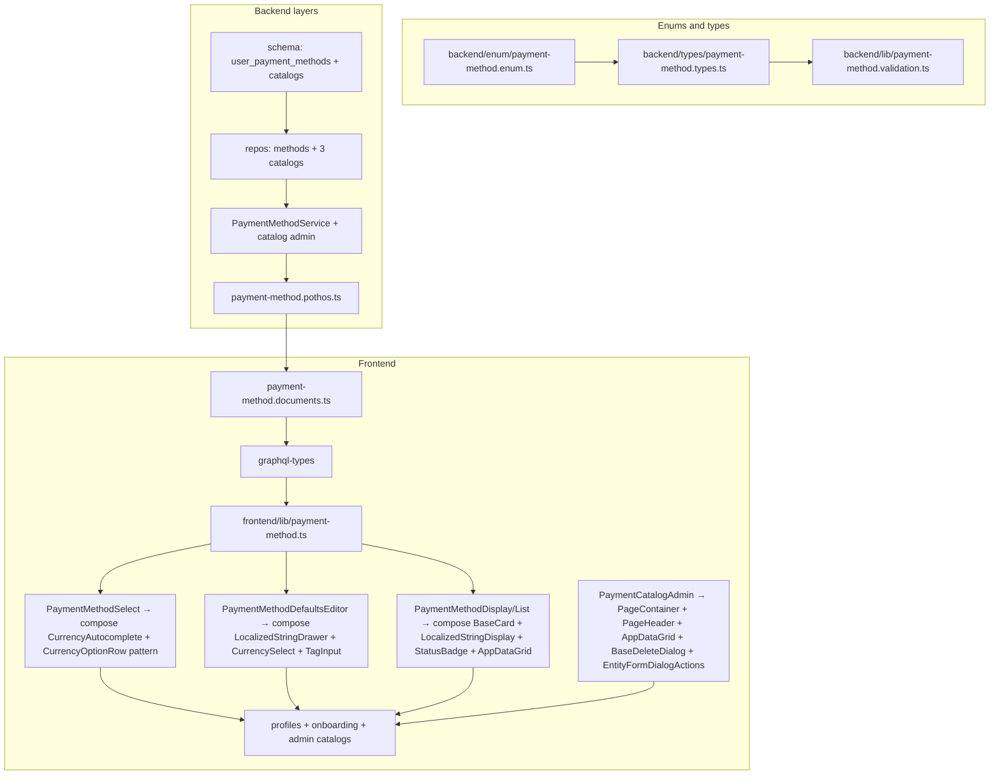

# Payment Methods Enhancement — Plan

See [spec.md](./spec.md) for requirements.

## Architecture



## Phase pipeline

| Phase | Work | Gate |
|-------|------|------|
| 0 | Planning docs | — |
| 1 | Enums + types + Zod validation libs | `bun tsgo` |
| 2 | Drizzle schema + 8C migration + seeds | db tests |
| 3 | Repositories (methods + catalogs) | `test:db` |
| 4 | Services (CRUD, defaults, masking, verify, billing wire-up) | service tests + `tsgo` |
| 5 | Pothos + mutations + `generate:gqlSchema` + `codegen` | `test:graphql` |
| 6 | Frontend GraphQL documents | codegen |
| 7 | Shared UI components (composite of existing `components/ui`) + i18n + Storybook | Vitest Storybook |
| 8 | Replace view usages + admin catalog UI | manual + component tests |
| 9 | `bun quality-gate` | full gate |

## Migration (8C — clean generate, no deprecations)

Early dev: **delete** legacy surfaces in schema files, then regenerate a fresh migration set. No `@deprecated`, no dual-read, no backfill scripts.

1. Add schema files: `user-payment-methods.ts`, `supported-mobile-wallets.ts`, `supported-payment-links.ts`, `supported-online-accounts.ts`
2. Add PG enums: `paymentMethodTypeEnum`, `paymentDirectionEnum`, `identifierKindEnum` in `backend/db/schema/enums.ts`
3. **Delete** `paymentMethodEnum` from `enums.ts` (old `PAYPAL` \| `BANK_ACCOUNT`)
4. **Delete** `teachers.payment_method`, `parents.payment_method` columns
5. **Delete** `teacher-banking.ts` schema file (`teacher_banking_details_history` table)
6. Update `teacher_payments`: delete `banking_details_history_id` → add `user_payment_method_id` + `payment_method_snapshot` JSONB
7. Update `payments`: delete `payment_method` column → add `user_payment_method_id` + `payment_method_type` + `payment_method_snapshot` JSONB
8. Add partial unique indexes for default slots on `user_payment_methods`
9. Edit Drizzle schema to final shape → drop local DB → `drizzle-kit generate` (clean migration set)
10. Apply migrations + reseed catalogs + demo user methods

## Masking and verification

Port `backend/services/profile/banking-summary.ts` → `backend/services/payment-method/payment-method-mask.ts`:

- `buildMaskedPaymentMethod(method, scope)` — per-type field masking
- `loadUserPaymentMethodsSummary(actorUserId, scope, userId)` — replaces `loadTeacherBankingSummary`
- Verification: `PaymentMethodService.verifyBankTransfer(id, adminUserId)` — sets `verifiedAt` / `verifiedByUserId`

Notification: **delete** `BANKING_DETAILS_CHANGED`; add `PAYMENT_METHOD_CHANGED` in `backend/enum/notificationDeliveries.enum.ts`. Update all references (no alias).

## Default slot logic (1bA)

Direction on a method is **In** (`PAYIN`), **Out** (`PAYOUT`), or **Both** (`BOTH`). In `PaymentMethodService.setDefault` / `create` / `update`:

1. Determine affected slots from `direction` (`PAYIN`, `PAYOUT`, or both for `BOTH`)
2. Within same transaction, unset `isDefault` on competing rows in those slots
3. Set target row `isDefault = true`
4. Repo provides `clearDefaultsInSlot(userId, slot, tx)` — no business logic in repo

## Transaction snapshots (Option C)

Every pay-in and pay-out stores a **frozen** `payment_method_snapshot` at insert time. Replaces temporal `teacher_banking_details_history` for audit — no method version table.

```
recordPayment / createTeacherPayment
        │
        ▼
PaymentMethodService.buildTransactionSnapshot(methodId, direction)
        │  resolve catalog display names
        │  copy type + label + details (encrypt bank fields)
        ▼
INSERT payments | teacher_payments
  user_payment_method_id  (nullable FK — traceability)
  payment_method_type     (denormalized for queries)
  payment_method_snapshot (NOT NULL — audit source of truth)
```

Rules:

- Snapshot is **immutable** after insert — no updates to snapshot column
- UI/history for past transactions reads snapshot only, never re-fetches live method
- `user_payment_methods` may be edited/deleted freely; transactions remain auditable
- Ad-hoc pay-in without saved method: build snapshot from inline input; `user_payment_method_id` null

Helper location: `backend/services/payment-method/payment-method-snapshot.ts`

## JSONB typesafety (Drizzle + runtime validation)

Drizzle `jsonb()` columns are **untyped at the database** — `.$type<T>()` is compile-time only. Full spec in [spec.md § JSONB columns & typesafety](./spec.md#jsonb-columns--typesafety).

### Repo precedent

Follow `backend/db/schema/permissions.ts`:

```ts
import type { LocalizedString } from "@/backend/types/localized-string.types";
import type { PaymentMethodDetails } from "@/backend/types/payment-method.types";

name: jsonb("name").$type<LocalizedString>().notNull(),
details: jsonb("details").$type<PaymentMethodDetails>().notNull(),
```

Import `T` from `@/backend/types/*` — never inline shapes in schema files.

### Three-layer contract

| Layer | Responsibility |
|-------|----------------|
| `backend/types/payment-method.types.ts` | Canonical TS unions (`PaymentMethodDetails`, `PaymentMethodTransactionSnapshot`) |
| `backend/lib/payment-method.validation.ts` | Zod schemas; `parsePaymentMethodDetails(type, details)` discriminated on row `type` |
| `backend/db/schema/*.ts` | `jsonb(...).$type<T>()` wired to types file |

Services validate → encrypt bank fields → pass typed objects to repos. Repos never run Zod.

### Bank encryption inside JSONB

`encryptedText` custom type cannot wrap nested JSON keys. Refactor:

1. **Create** `backend/lib/field-encryption.ts` — export `encryptField` / `decryptField` (AES-256-GCM from `custom-types.ts`)
2. **Update** `backend/db/schema/custom-types.ts` — delegate to `field-encryption.ts`
3. **Create** `backend/lib/payment-method-jsonb.ts` — `encryptBankTransferDetails` / `decryptBankTransferDetails` for `BankTransferDetails` string fields before persist / after authorized read
4. Apply same encryption in `buildTransactionSnapshot` so snapshots store ciphertext at rest

### Drizzle MCP workflow (Phase 2 gate)

Use `project-0-siraj-drizzle` MCP tools (same JSON envelope as CLI):

1. After all schema files have `.$type<>` on every JSONB column → `check` (expect `ok`)
2. Drop local DB → `generate` (8C clean migration set)
3. On `missing_hints` → `drizzle-hints` skill, re-call `generate`
4. Apply via normal migration path + reseed

Skills revision **12** matches installed `drizzle-kit` (verified). `check` returns `{ status: "ok", dialect: "postgresql" }` on current schema.

### JSONB column checklist (Phase 2 review gate)

Before `generate`, confirm each file:

| Schema file | JSONB columns with `.$type<>` |
|-------------|-------------------------------|
| `user-payment-methods.ts` | `details` → `PaymentMethodDetails` |
| `billing.ts` | `payment_method_snapshot` → `PaymentMethodTransactionSnapshot` |
| `teacher-payments.ts` | `payment_method_snapshot` → `PaymentMethodTransactionSnapshot` |
| `supported-mobile-wallets.ts` | `name`, `description`, `instructions` → `LocalizedString` |
| `supported-payment-links.ts` | `name`, `description`, `instructions` → `LocalizedString`; `url_allowlist` → `readonly string[]` |
| `supported-online-accounts.ts` | `name`, `description`, `instructions`, `identifier_label` → `LocalizedString` |


## Billing integration

`billing.repository.recordPayment` / `PaymentMethodService.recordPayin`:

- Accept `userPaymentMethodId` (optional) or inline method input
- Call `buildTransactionSnapshot` with `direction=PAYIN`
- Persist snapshot + type + FK on `payments` row
- Validate method belongs to invoice parent user and supports `PAYIN` when FK provided

`PaymentMethodService.recordPayout` (replaces `TeacherBankingRepository.createTeacherPayment`):

- Accept `userPaymentMethodId`
- Require verified method for real payouts; test payouts may skip verify
- Call `buildTransactionSnapshot` with `direction=PAYOUT`
- Persist snapshot + type + FK on `teacher_payments` row

## Catalog admin

New permissions in `backend/enum/permission.enum.ts`:

- `PAYMENT_METHODS_MANAGE_CATALOGS = "payment_methods.manage_catalogs"`
- `PAYMENT_METHODS_VERIFY_BANK_TRANSFER = "payment_methods.verify_bank_transfer"`

Seed permissions + assign to admin group. Admin UI at `frontend/views/dashboard/admin/payment-catalogs/`.

## Risks

| Risk | Mitigation |
|------|------------|
| GraphQL union/input complexity for `details` | Typed inputs per `PaymentMethodType`; Pothos input objects mirror Zod |
| ~90 files touch payment/banking | Shared UI components; phased replacement in tasks.md |
| Mutable method + stale audit on payouts | **Option C:** immutable `payment_method_snapshot` on every transaction row |
| Encrypted bank fields in snapshots | Encrypt in snapshot `details` same as live methods; re-seed under 8C |
| Catalog deactivation with existing user methods | Allow read/display; block new creates referencing inactive catalog |
| Old `PaymentMethod` enum (`PAYPAL` \| `BANK_ACCOUNT`) | **Delete** from TS/PG/GraphQL; replace with `PaymentMethodType` everywhere |

## Layer compliance matrix

Read before editing each path prefix:

| Path prefix | AGENTS.md / instructions |
|-------------|--------------------------|
| `backend/types/` | `backend/types/AGENTS.md`, `.agents/instructions/backend.instructions.md` |
| `backend/enum/` | `backend/enum/AGENTS.md` |
| `backend/db/schema/` | `backend/AGENTS.md` |
| `backend/db/repo/` | `backend/db/repo/AGENTS.md`, `backend/AGENTS.md` |
| `backend/db/seeds/` | `backend/db/seeds/AGENTS.md` |
| `backend/services/` | `backend/services/AGENTS.md` |
| `backend/graphql/` | `backend/graphql/AGENTS.md` |
| `frontend/graphql/` | `frontend/graphql/AGENTS.md`, `frontend/graphql/sharedDocuments/AGENTS.md` |
| `frontend/components/ui/` | `frontend/AGENTS.md`, `frontend/COMPONENT_PATTERNS.md` |
| `frontend/views/` | `frontend/views/AGENTS.md`, `frontend/AGENTS.md` |
| `**/*.test.ts` | `.agents/instructions/tests.instructions.md` |

**Cross-cutting:** `@/` imports only; no `console.*`; MUI `sx`; Apollo from `@apollo/client/react`; **no deprecations** — delete legacy code outright; **every JSONB column** uses `.$type<T>()` + Zod on writes.

## Component reuse map

Phase 7 + 8 build payment-method UI as **compositions of existing `frontend/components/ui/**` primitives** — no new top-level primitives are invented where an existing one fits. The new code is restricted to (a) thin per-domain wrappers that mirror existing catalog/autocomplete/tree patterns, (b) one `StatusBadge` category extension (~10 lines), and (c) per-catalog admin views that mirror existing admin views that already compose `AppDataGrid` + `LocalizedStringDisplay` + `BaseDeleteDialog` + `react-hook-form` dialogs.

### Plan-proposed component → existing primitive(s) to reuse

| Plan-proposed (Phase 7/8) | Reused existing primitive(s) | Why this primitive | Net-new code |
|---------------------------|--------------------------------|--------------------|--------------|
| `PaymentMethodSelect` | `CurrencySelect.tsx` + `CurrencyAutocomplete.tsx` + `CurrencyOptionRow.tsx` + `currencyAutocompletePopper.ts` | Already demonstrates searchable Autocomplete + option row + `allowedCodes` subset filter + `listAttached`/`disablePortal` popper plumbing over a catalog. `frontend/lib/currency.ts` is the option-builder template. | `PaymentMethodSelect.tsx` (thin wrapper), `PaymentMethodAutocomplete.tsx`, `PaymentMethodOptionRow.tsx`, `paymentMethodAutocompletePopper.ts`, `frontend/lib/payment-method.ts` (catalog option builders) |
| `PaymentMethodTypeFields` (method type picker) | `GenderSelector.tsx` | `ButtonGroup` over a small codegen enum with `allowEmpty` + `labels` override — exactly the shape of a `PaymentMethodType` picker. | `PaymentMethodTypeSelector.tsx` (mirror `GenderSelector` body, swap enum) |
| `PaymentMethodTypeFields` (per-type fields) | `PhoneFormField.tsx` (phone + `react-hook-form` `Controller`), `CurrencySelect.tsx` / `CountryAutocomplete.tsx` (country/currency filter), `TagInput.tsx` (`url_allowlist`), `LocalizedStringFormField.tsx` (per-locale `instructions` / `name`) | Each field type already has a form-field wrapper. `PhoneCountryPicker` shows the composite (Autocomplete embedded inside a field). | `PaymentMethodTypeFields.tsx` — glue that switches on `PaymentMethodType` and renders the right existing field component per type |
| `PaymentMethodDefaultsEditor` | `LocalizedStringDrawer.tsx` (per-locale multi-locale edit with Save/Cancel/autosave), `CurrencySelect.tsx` (`allowedCodes`), `FieldWrapper.tsx`, `FormSuccessSnackbar.tsx` | The drawer already solves "edit per-locale multi-field value with Save/Cancel and autosave"; `FormSuccessSnackbar` is the save toast. | `PaymentMethodDefaultsEditor.tsx` — composition glue; no new drawer/field/snackbar primitive |
| `PaymentMethodDisplay` | `LocalizedStringDisplay.tsx` (catalog name), `CurrencyDisplay.tsx` / `CountryDisplay.tsx`, `PhoneDisplay.tsx` (MOBILE_WALLET phone), `StatusBadge` (with new `"paymentMethod"` category) | The display family already covers per-attribute masked rendering. | `PaymentMethodDisplay.tsx` — per-method masked card composing the above; `StatusBadge` extension (~10 lines) |
| `PaymentMethodList` | `BaseCard.tsx` (header) + `AppDataGrid<R>` (rows + default-badge column + edit/delete row actions) | `AppDataGrid` already supports custom no-rows overlay (`AppDataGridNoRowsOverlay`), loading overlay (`AppDataGridLoadingOverlay`), column defs, row ID, pagination. `BaseCard` is the section header. | `PaymentMethodList.tsx` — column defs + row type only; no new list/grid primitive |
| `PaymentCatalogAdminView` shell | `PageContainer.tsx` + `PageHeader.tsx` + MUI `Tabs` | `PageContainer` is the dashboard layout shell (per `frontend/AGENTS.md`: "Use `PageContainer` inside views — never add outer `p:`"); `PageHeader` is the title block. | `PaymentCatalogAdminView.tsx` — Tabs composition only |
| Per-catalog `*CatalogGrid` (×3) | `AppDataGrid<R>` (rows + columns) + `LocalizedStringDisplay.tsx` (name column) + `CurrencyDisplay.tsx` / `CountryDisplay.tsx` + `StatusBadge.tsx` (active/inactive column) + `TagInput.tsx` (read-only `url_allowlist` chips) | `frontend/views/dashboard/permissions/components/PermissionCatalogDataGrid.tsx` is the canonical precedent — composes `AppDataGrid` + `LocalizedStringDisplay` for a catalog grid. | 3 thin files: column defs + row type + `emptyMessage` per catalog. No new grid primitive. |
| `CatalogEditDialog` | MUI `Dialog` + `react-hook-form` + `LocalizedStringFormField.tsx` (name/description/instructions) + `CurrencySelect.tsx` / `CountryAutocomplete.tsx` + `TagInput.tsx` (url allowlist) + `EntityFormDialogActions` (from `frontend/views/dashboard/subjects/home/components/__shared__/`) + `CatalogImageUpload.tsx` (logo) | `frontend/views/dashboard/subjects/home/components/{Create,Edit}SubjectDialog.tsx` + `__shared__/{LabeledTextField,EntityFormDialogActions,ActiveToggleField,CategorySelectField}.tsx` is the full CRUD-dialog precedent (`react-hook-form` + Zod + permission-aware actions). | `CatalogEditDialog.tsx` — per-catalog field set only; actions footer + `Controller` pattern reused from subjects |
| `CatalogDeleteDialog` | `BaseDeleteDialog.tsx` | The shared dialog already does confirmation + mutation. | `CatalogDeleteDialog.tsx` — thin wrapper mirroring `frontend/views/dashboard/subjects/home/components/DeleteSubjectDialog.tsx` |
| `PaymentCatalogAdminContainer` | `frontend/views/dashboard/subjects/home/SubjectsContainer.tsx` (Apollo query + mutation hook + dialog state) | The subjects container already wires Apollo queries/mutations + dialog state + Storybook mock-store pattern. | `PaymentCatalogAdminContainer.tsx` — same shape, swap queries/mutations |
| Catalog logo upload | `CatalogImageUpload.tsx` (currently NOT exported from `input/index.ts`) | Already supports file upload + URL fallback + `next/image` preview + max-size validation + error state. | Add export to `input/index.ts` (Phase 7) — no new upload component |

### Canonical reference files (read before implementing each)

| Reference | Demonstrates |
|-----------|--------------|
| `frontend/components/ui/input/currencySelect/CurrencyAutocomplete.tsx` | Searchable Autocomplete + option-row + `allowedCodes` filter + popper plumbing over a catalog |
| `frontend/components/ui/input/currencySelect/CurrencySelect.tsx` | Thin wrapper over the autocomplete (the `PaymentMethodSelect` template) |
| `frontend/lib/currency.ts` | Catalog option builders (`getCurrencyOptions`, `getCurrencyDisplayName`, `getCurrencySymbol`) — the `frontend/lib/payment-method.ts` template |
| `frontend/components/ui/input/genderSelector/GenderSelector.tsx` | `ButtonGroup` over a small codegen enum — the `PaymentMethodTypeSelector` template |
| `frontend/components/ui/input/phoneInput/PhoneFormField.tsx` | `react-hook-form` `Controller` wrap pattern — the per-type field form-field template |
| `frontend/components/ui/input/localizedString/LocalizedStringFormField.tsx` | `react-hook-form` `Controller` for `LocalizedStringInput` — the per-locale field form-field template |
| `frontend/components/ui/input/localizedString/LocalizedStringDrawer.tsx` | Per-locale drawer with Save/Cancel + autosave + mobile bottom-sheet |
| `frontend/components/ui/input/catalogImageUpload/CatalogImageUpload.tsx` | File upload + URL fallback + preview (for catalog logos) |
| `frontend/components/ui/display/localizedStringDisplay/LocalizedStringDisplay.tsx` | Resolved-string-only display for JSONB `LocalizedString` — the catalog-name cell template |
| `frontend/components/ui/dataGrid/AppDataGrid.tsx` | Generic DataGrid with custom no-rows / loading overlays + server pagination |
| `frontend/components/ui/badge/StatusBadge.tsx` | Status chip with per-category palette resolver — extend `StatusBadgeCategory` with `"paymentMethod"` (~10 lines) |
| `frontend/views/dashboard/permissions/components/PermissionCatalogDataGrid.tsx` | Canonical catalog-grid view: `AppDataGrid` + `LocalizedStringDisplay` columns |
| `frontend/views/dashboard/subjects/home/SubjectsContainer.tsx` + `SubjectsView.tsx` + `SubjectDialogs.tsx` | Canonical admin CRUD: Apollo queries/mutations + dialog state + view layout |
| `frontend/views/dashboard/subjects/home/components/{Create,Edit}SubjectDialog.tsx` + `__shared__/{LabeledTextField,EntityFormDialogActions,ActiveToggleField,CategorySelectField}.tsx` | Canonical CRUD dialog: MUI `Dialog` + `react-hook-form` + `Controller` + shared footer |

## Rollback

Early dev only: reset DB and revert schema branch. No production rollback path.

## Verification

Per-file: `bun run scripts/health/sub-loop.ts <file> --lifecycle lint`  
DB tests: `bun run scripts/run-test/run-test.ts <path>`  
Final: `bun quality-gate`

---

## File inventory appendix

Grouped by phase. Paths are relative to repo root.

### Phase 1 — Enums + types

| File | Action |
|------|--------|
| `backend/enum/payment-method.enum.ts` | **Create** — `PaymentMethodType`, `PaymentDirection`, `IdentifierKind` |
| `backend/enum/billing.enum.ts` | **Update** — **delete** `PaymentMethod` enum; keep `InvoiceStatus`, `InvoiceType` |
| `backend/enum/permission.enum.ts` | **Update** — catalog + verify permissions |
| `backend/enum/index.ts` | **Update** — export new enum file |
| `backend/types/payment-method.types.ts` | **Create** — Select/Insert/Return/Submit + details union + `PaymentMethodTransactionSnapshot` |
| `backend/types/billing.types.ts` | **Update** — `PaymentRecordInput` + snapshot on payment rows |
| `backend/types/teacher.types.ts` | **Update** — **delete** banking history types; add payout input with snapshot |
| `backend/types/parent.types.ts` | **Update** — remove `paymentMethod` scalar |
| `backend/types/profile.types.ts` | **Update** — replace `bankingSummary` with payment methods |
| `backend/types/teacher-onboarding.types.ts` | **Update** — payment method input |
| `backend/types/index.ts` | **Update** — export payment-method types |
| `backend/lib/payment-method.validation.ts` | **Create** — discriminated Zod schemas + `localizedStringSchema` + snapshot schema |
| `backend/lib/field-encryption.ts` | **Create** — extract `encryptField` / `decryptField` from `custom-types.ts` |
| `backend/lib/payment-method-jsonb.ts` | **Create** — encrypt/decrypt `BankTransferDetails` fields inside JSONB |
| `backend/db/schema/custom-types.ts` | **Update** — delegate to `field-encryption.ts` |
| `frontend/lib/payment-method.ts` | **Create** — label helpers, mask display, catalog option builders |

### Phase 2 — Schema + migration + seeds

| File | Action |
|------|--------|
| `backend/db/schema/user-payment-methods.ts` | **Create** — `details` jsonb `.$type<PaymentMethodDetails>()` |
| `backend/db/schema/supported-mobile-wallets.ts` | **Create** — `LocalizedString` jsonb columns |
| `backend/db/schema/supported-payment-links.ts` | **Create** — `LocalizedString` + `url_allowlist` `.$type<readonly string[]>()` |
| `backend/db/schema/supported-online-accounts.ts` | **Create** — `LocalizedString` jsonb columns |
| `backend/db/schema/enums.ts` | **Update** — add new PG enums; **delete** `paymentMethodEnum` |
| `backend/db/schema/teachers.ts` | **Update** — drop `payment_method` |
| `backend/db/schema/parents.ts` | **Update** — drop `payment_method` |
| `backend/db/schema/teacher-banking.ts` | **Delete** — replace with payment methods |
| `backend/db/schema/billing.ts` | **Update** — delete `payment_method`; add FK + `payment_method_snapshot` `.$type<PaymentMethodTransactionSnapshot>()` |
| `backend/db/schema/teacher-payments.ts` | **Create** — `payment_method_snapshot` `.$type<PaymentMethodTransactionSnapshot>()` |
| `backend/db/schema/index.ts` | **Update** |
| `backend/db/drizzleRelations.ts` | **Update** |
| `backend/db/seeds/*` | **Update** — catalog seeds + demo user methods |

### Phase 3 — Repositories

| File | Action |
|------|--------|
| `backend/db/repo/user-payment-method.repository.ts` | **Create** |
| `backend/db/repo/supported-mobile-wallet.repository.ts` | **Create** |
| `backend/db/repo/supported-payment-link.repository.ts` | **Create** |
| `backend/db/repo/supported-online-account.repository.ts` | **Create** |
| `backend/db/repo/teacher-banking.repository.ts` | **Delete** |
| `backend/db/repo/teacher.repository.ts` | **Update** — remove paymentMethod |
| `backend/db/repo/parent.repository.ts` | **Update** — remove paymentMethod |
| `backend/db/repo/billing.repository.ts` | **Update** — recordPayment FK |
| `backend/db/repo/index.ts` | **Update** |
| `backend/db/test/repo/user-payment-method.repository.test.ts` | **Create** |
| `backend/db/test/repo/supported-*-repository.test.ts` | **Create** (×3) |

### Phase 4 — Services

| File | Action |
|------|--------|
| `backend/services/payment-method/payment-method-snapshot.ts` | **Create** — `buildTransactionSnapshot` |
| `backend/services/payment-method/payment-method.service.ts` | **Create** — includes `recordPayin` / `recordPayout` |
| `backend/services/payment-method/payment-method-mask.ts` | **Create** |
| `backend/services/payment-method/payment-catalog.service.ts` | **Create** |
| `backend/services/payment-method/index.ts` | **Create** |
| `backend/services/profile/banking-summary.ts` | **Delete** — replaced by mask module |
| `backend/services/profile/banking-summary.test.ts` | **Rewrite** → payment-method-mask tests |
| `backend/services/profile/profile.service.ts` | **Update** |
| `backend/services/profile/profile.service.test.ts` | **Update** |
| `backend/services/profile/parent-profile.service.ts` | **Update** |
| `backend/services/profile/parent-profile.service.test.ts` | **Update** |
| `backend/services/profile/teacher-profile.service.test.ts` | **Update** |
| `backend/services/parent/parent-onboarding.service.ts` | **Update** |
| `backend/services/teacher/teacher-onboarding.service.ts` | **Update** |
| `backend/services/teacher/teacher-portal.service.ts` | **Update** |
| `backend/services/staff/staff-profile.service.ts` | **Update** |

### Phase 5 — Pothos + GraphQL

| File | Action |
|------|--------|
| `backend/graphql/pothos/payment-method.pothos.ts` | **Create** |
| `backend/graphql/pothos/enum.pothos.ts` | **Update** — add new enums; **delete** `PaymentMethodPothosObject` |
| `backend/graphql/pothos/profile.pothos.ts` | **Update** — remove TeacherBankingSummary |
| `backend/graphql/pothos/staff-profile.pothos.ts` | **Update** |
| `backend/graphql/pothos/parent-profile.pothos.ts` | **Update** |
| `backend/graphql/pothos/parent-onboarding.pothos.ts` | **Update** |
| `backend/graphql/pothos/teacher-portal.pothos.ts` | **Update** |
| `backend/graphql/pothos/teacher-onboarding.pothos.ts` | **Update** — replace banking fields |
| `backend/graphql/mutation/payment-method.mutation.ts` | **Create** |
| `frontend/graphql/test/payment-method.test.ts` | **Create** |
| `backend/graphql/mutation/onboarding.mutation.ts` | **Update** |
| `backend/graphql/mutation/staff-profile.mutation.ts` | **Update** |

### Phase 6 — Frontend documents

| File | Action |
|------|--------|
| `frontend/graphql/sharedDocuments/payment-method.documents.ts` | **Create** |
| `frontend/graphql/sharedDocuments/profile.documents.ts` | **Update** |
| `frontend/graphql/sharedDocuments/parent-profile.documents.ts` | **Update** |
| `frontend/graphql/sharedDocuments/staff-profile.documents.ts` | **Update** |
| `frontend/graphql/sharedDocuments/teacher-portal.documents.ts` | **Update** |
| `frontend/graphql/sharedDocuments/parent-onboarding.documents.ts` | **Update** |
| `frontend/graphql/sharedDocuments/teacher-onboarding.documents.ts` | **Update** |
| `frontend/graphql/sharedDocuments/profile.documents.test.ts` | **Update** |
| `frontend/graphql/sharedDocuments/index.ts` | **Update** |

### Phase 7 — UI composables + i18n

Existing `frontend/components/ui/**` primitives are **reused**, not duplicated. Net-new components are thin composables over `CurrencyAutocomplete` / `LocalizedStringInput` / `AppDataGrid` / `BaseCard` / `StatusBadge`. Reference patterns: `PermissionCatalogDataGrid.tsx` (`AppDataGrid` + `LocalizedStringDisplay`), `subjects/home/components/{Create,Edit,Delete}SubjectDialog.tsx` + `__shared__/{LabeledTextField,EntityFormDialogActions}.tsx` (CRUD dialog + `react-hook-form` `Controller`).

See [Component reuse map](#component-reuse-map) below for the full reuse table.

| File | Action |
|------|--------|
| `frontend/lib/payment-method.ts` | **Create** — catalog option builders (mirror `frontend/lib/currency.ts`: `getCurrencyOptions`, `getCurrencyDisplayName`, `getCurrencySymbol`) |
| `frontend/components/ui/input/paymentMethodSelect/index.ts` | **Create** — barrel |
| `frontend/components/ui/input/paymentMethodSelect/PaymentMethodSelect.tsx` | **Create** — thin wrapper mirroring `CurrencySelect.tsx` (10-29) | 
| `frontend/components/ui/input/paymentMethodSelect/PaymentMethodAutocomplete.tsx` | **Create** — mirror `CurrencyAutocomplete.tsx` (searchable Autocomplete + `allowedCodes`-style subset filter + popper plumbing) |
| `frontend/components/ui/input/paymentMethodSelect/PaymentMethodOptionRow.tsx` | **Create** — mirror `CurrencyOptionRow.tsx`; type icon + localized name + catalog slug |
| `frontend/components/ui/input/paymentMethodSelect/paymentMethodAutocompletePopper.ts` | **Create** — mirror `currencyAutocompletePopper.ts` |
| `frontend/components/ui/input/paymentMethodSelect/PaymentMethodSelect.stories.tsx` | **Create** — mirror `CurrencySelect.stories.tsx` |
| `frontend/components/ui/input/paymentMethodTypeFields/index.ts` | **Create** — barrel |
| `frontend/components/ui/input/paymentMethodTypeFields/PaymentMethodTypeSelector.tsx` | **Create** — mirror `GenderSelector.tsx` (`ButtonGroup` over `PaymentMethodType` codegen enum with `allowEmpty` + `labels` override) |
| `frontend/components/ui/input/paymentMethodTypeFields/PaymentMethodTypeFields.tsx` | **Create** — per-type dynamic fields; composing `PhoneFormField` (MOBILE_WALLET phone), `CurrencySelect`/`CountryAutocomplete` (.catalog country/currency filter), `TagInput` (`url_allowlist`), `LocalizedStringFormField` (`instructions` / `name`), `react-hook-form` `Controller` (mirror `PhoneFormField` + `LocalizedStringFormField`) |
| `frontend/components/ui/input/paymentMethodDefaultsEditor/index.ts` | **Create** — barrel |
| `frontend/components/ui/input/paymentMethodDefaultsEditor/PaymentMethodDefaultsEditor.tsx` | **Create** — compose `LocalizedStringDrawer` (per-locale instructions), `CurrencySelect` (`allowedCodes`), `FieldWrapper`, `FormSuccessSnackbar` |
| `frontend/components/ui/input/index.ts` | **Update** — export the three new folders; **add `export * from "@/frontend/components/ui/input/catalogImageUpload/CatalogImageUpload"`** (currently un-barreled, needed for catalog icons) |
| `frontend/components/ui/display/paymentMethod/index.ts` | **Create** — barrel |
| `frontend/components/ui/display/paymentMethod/PaymentMethodDisplay.tsx` | **Create** — compose `LocalizedStringDisplay` (catalog name) + `CurrencyDisplay` / `CountryDisplay` + `PhoneDisplay` (MOBILE_WALLET) + `StatusBadge(category="paymentMethod")` (per-method masked card — not a `LocalizedStringDisplay` duplicate) |
| `frontend/components/ui/display/paymentMethod/PaymentMethodList.tsx` | **Create** — compose `BaseCard` + `AppDataGrid<PaymentMethodRow>` (mirror `PermissionCatalogDataGrid`); no new list primitive |
| `frontend/components/ui/display/paymentMethod/PaymentMethodDisplay.stories.tsx` | **Create** |
| `frontend/components/ui/display/index.ts` | **Update** — re-export `paymentMethod/` |
| `frontend/components/ui/badge/StatusBadge.tsx` | **Update** — extend `StatusBadgeCategory` union with `"paymentMethod"`; add `case "paymentMethod":` in `resolveStatusPaletteKey` mapping `verified`/`unverified`/`active`/`inactive` to existing `confirmed`/`pending`/`active`/`cancelled` palette keys (~10 lines, self-contained) |
| `shared/messages/types/ui/payment-method.ts` | **Create** |
| `shared/messages/ar/ui/payment-method.ts` | **Create** |
| `shared/messages/en.ts` | **Update** |
| `shared/messages/types/ui/index.ts` | **Update** |
| `shared/messages/ar/ui/index.ts` | **Update** |

**Explicitly NOT created (reused as-is):** `CurrencyAutocomplete`, `CurrencyOptionRow`, `CurrencySelect`, `CountryAutocomplete`, `CountryOptionRow`, `CountrySelect`, `LanguageSelector`, `GenderSelector` (template only), `TimezoneSelect`, `TagInput`, `PhoneInput`, `PhoneFormField`, `PhoneCountryPicker`, `LocalizedStringInput`, `LocalizedStringDrawer`, `LocalizedStringFormField`, `LocaleAdornmentSwitch`, `EditableTypography`, `CatalogImageUpload`, `LocalizedStringDisplay`, `CurrencyDisplay`, `CountryDisplay`, `PhoneDisplay`, `LanguageDisplay`, `TimezoneDisplay`, `StatusBadge` (extended only — no new badge primitive), `BaseCard`, `MetricCard`, `AppDataGrid` (+ `AppDataGridNoRowsOverlay` / `AppDataGridLoadingOverlay`), `BaseDeleteDialog`, `ActionButtons`, `ActionIconLink`, `PageContainer`, `PageHeader`, `SectionPanel`, `HorizontalScrollRow`, `FieldWrapper`, `FormSuccessSnackbar`, `StoryBookPageContainer`, `ErrorState`, `LoadingState`.

### Phase 8 — View usages

**Teacher banking (replace tab):**

- `frontend/views/dashboard/profile/teacher/banking/TeacherBankingTab.tsx` → **Replace** with `PaymentMethodsTab`
- `frontend/views/dashboard/profile/teacher/banking/TeacherBankingView.tsx` — **Delete**
- `frontend/views/dashboard/profile/teacher/banking/TeacherBankingEmptyState.tsx` — **Delete**
- `frontend/views/dashboard/profile/teacher/banking/TeacherBanking.stories.tsx` — **Delete**
- `frontend/views/dashboard/profile/core/profileTabs.ts` — delete `banking` tab; add `paymentMethods` tab

**Profile views:**

- `frontend/views/dashboard/profile/teacher/sections/CompensationSection.tsx`
- `frontend/views/dashboard/profile/teacher/TeacherAdminEditForm.tsx`
- `frontend/views/dashboard/profile/teacher/TeacherProfileContainer.tsx`
- `frontend/views/dashboard/profile/teacher/teacherProfileFormTypes.ts`
- `frontend/views/dashboard/profile/parent/sections/BillingSection.tsx`
- `frontend/views/dashboard/profile/parent/ParentProfileEditForm.tsx`
- `frontend/views/dashboard/profile/parent/ParentProfileContainer.tsx`
- `frontend/views/dashboard/profile/parent/parentProfileFormTypes.ts`

**Teacher surfaces:**

- `frontend/views/dashboard/teachers/onboarding/components/BankingLedgerSection.tsx` — **delete**; create `PaymentMethodSection.tsx`
- `frontend/views/dashboard/teachers/onboarding/TeacherOnboardingView.tsx`
- `frontend/views/dashboard/teachers/profile/components/SalaryDetailsSection.tsx`
- `frontend/views/dashboard/teachers/profile/TeacherProfileContainer.tsx`
- `frontend/views/dashboard/teachers/profile/schemas/teacherProfileSchema.ts`
- `frontend/views/dashboard/teachers/own-profile/TeacherOwnProfileContainer.tsx`

**Parent surfaces:**

- `frontend/views/dashboard/admin/parents/onboarding/FeesContractSection.tsx`
- `frontend/views/dashboard/admin/parents/onboarding/schemas/parentOnboardingSchema.ts`
- `frontend/views/dashboard/admin/parents/onboarding/ParentOnboardingContainer.tsx`
- `frontend/views/dashboard/parent/profile/edit/ParentProfileEditContainer.tsx`
- `frontend/views/dashboard/parent/profile/edit/parentProfileEditSchema.ts`
- `frontend/views/dashboard/parent/profile/ParentProfileDetails.tsx`
- `frontend/views/dashboard/parent/profile/ParentProfileContainer.tsx`

**Hooks + types:**

- `frontend/hooks/useCreateParentOnboarding.ts`
- `frontend/types/shared.types.ts`

**Admin catalog (new — composed from existing primitives):**

- `frontend/views/dashboard/admin/payment-catalogs/PaymentCatalogAdminContainer.tsx` — mirror `frontend/views/dashboard/subjects/home/SubjectsContainer.tsx` (Apollo query + mutation hook + dialog state)
- `frontend/views/dashboard/admin/payment-catalogs/PaymentCatalogAdminView.tsx` — compose `PageContainer` + `PageHeader` + MUI `Tabs` over the three per-catalog `*CatalogGrid` components
- `frontend/views/dashboard/admin/payment-catalogs/components/MobileWalletCatalogGrid.tsx` — thin `AppDataGrid<SupportedMobileWallet>` wrapper mirroring `PermissionCatalogDataGrid.tsx`; columns: `LocalizedStringDisplay` (name) + `CountryDisplay` + `CurrencyDisplay` + `StatusBadge(category="paymentMethod", status="active"|"inactive")` + edit/delete row actions
- `frontend/views/dashboard/admin/payment-catalogs/components/PaymentLinkCatalogGrid.tsx` — same pattern; `url_allowlist` renders as read-only `TagInput` chips
- `frontend/views/dashboard/admin/payment-catalogs/components/OnlineAccountCatalogGrid.tsx` — same pattern; `identifier_kind` renders as `StatusBadge`
- `frontend/views/dashboard/admin/payment-catalogs/components/CatalogEditDialog.tsx` — compose MUI `Dialog` + `react-hook-form` + `LocalizedStringFormField` (name/description/instructions) + `CurrencySelect` / `CountryAutocomplete` + `TagInput` (url allowlist) + `EntityFormDialogActions` (lift from `subjects/home/components/__shared__/` or import per-catalog); reuse `CatalogImageUpload` for logo fields (now barrel-exported — see Phase 7)
- `frontend/views/dashboard/admin/payment-catalogs/components/CatalogDeleteDialog.tsx` — thin wrapper over `BaseDeleteDialog` mirroring `DeleteSubjectDialog.tsx`
- `frontend/views/dashboard/admin/payment-catalogs/PaymentCatalogAdmin.stories.tsx` — mirror `SubjectsContainer.stories.tsx`

**Stories/tests to update:**

- `frontend/views/dashboard/profile/teacher/TeacherProfileView.test.tsx`
- `frontend/views/dashboard/profile/parent/ParentProfileView.test.tsx`
- `frontend/views/dashboard/profile/teacher/TeacherProfileView.stories.tsx`
- `frontend/views/dashboard/profile/parent/ParentProfileView.stories.tsx`
- `frontend/views/dashboard/admin/parents/onboarding/ParentOnboardingView.stories.tsx`
- `frontend/views/dashboard/teachers/onboarding/TeacherOnboardingView.stories.tsx`

**i18n cleanup (remove PayPal/Bank hardcodes):**

- `shared/messages/types/profile.ts`, `shared/messages/profile.ts`
- `shared/messages/types/dashboard/parents/onboarding.ts`
- `shared/messages/ar/dashboard/parents/onboarding.ts`
- `shared/messages/types/dashboard/teachers/onboarding.ts`
- `shared/messages/types/errors/main.ts`, `shared/messages/en/errors.ts`, `shared/messages/ar/errors.ts`
