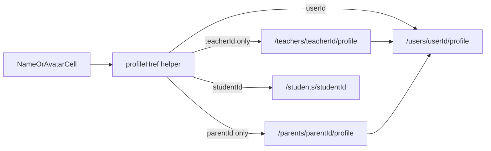

# Sitewide Profile Links

## Goal

After finishing profile-page modules, make profiles reachable from **everywhere** people appear: AppDataGrid columns, card lists, class/entity chips, directories, reports, and leftover old routes.

## Chosen routing rules

| Person type | Preferred href | Fallback when userId missing |
|-------------|----------------|------------------------------|
| Own profile | `/profile` | — |
| Teacher / parent / staff (other) | `/users/{userId}/profile` | `/teachers/{teacherId}/profile` or `/parents/{parentId}/profile` (existing redirects) |
| Student | `/students/{studentId}` | — (students are not on unified profile) |

Staff has no entity redirect route — only link when `userId` is available.

## Phase 1 — Shared helpers + link cells

Create shared utilities (today URLs are ad hoc; class-details [`EntityLinks.tsx`](frontend/views/dashboard/classes/details/components/EntityLinks.tsx) is the only reusable link, and it is teacher/student-only).

1. **`frontend/utils/profileHref.ts`** (or `shared/utils/profileHref.ts` if used outside frontend)
   - `profileHrefForUser(userId)` → `/users/${userId}/profile`
   - `profileHrefForTeacher({ userId?, teacherId? })` → prefer userId, else teacher redirect
   - `profileHrefForParent({ userId?, parentId? })` → prefer userId, else parent redirect
   - `profileHrefForStaff({ userId })` → `/users/...` or `undefined`
   - `studentHref(studentId)` → `/students/${studentId}`
   - `ownProfileHref()` → `/profile`

2. **Reusable UI cells** under `frontend/components/ui/` (extracted from [`AssociatedStudentsDataGrid.tsx`](frontend/views/profile/parent/sections/AssociatedStudentsDataGrid.tsx) `ProfileLinkCell` pattern):
   - `PersonProfileLink` — name text (optional avatar) wrapping `@/shared/i18n/routing` `Link`
   - `PersonProfileLinkCell` — DataGrid-friendly wrapper for column `renderCell`

3. Move/generalize [`TeacherEntityLink` / `StudentEntityLink`](frontend/views/dashboard/classes/details/components/EntityLinks.tsx) to use the helpers so class-details and the rest of the site share one URL story. Prefer `userId` when callers can pass it later.

## Phase 2 — Data grids (name/avatar columns become links)

Wire `PersonProfileLinkCell` into every grid that shows a person. Prefer linking the **name** (and avatar when combined); keep existing action buttons, but migrate their hrefs to the helpers too.

### Directories (high priority)

| File | Column | ID to use |
|------|--------|-----------|
| [`TeacherDataGrid.tsx`](frontend/views/dashboard/teachers/home/components/TeacherDataGrid.tsx) | name/avatar | `userId` preferred, else `id` (teacherId) |
| [`TeacherCardList.tsx`](frontend/views/dashboard/teachers/home/components/TeacherCardList.tsx) | name / settings | same |
| [`ParentsDataGrid.tsx`](frontend/views/dashboard/admin/parents/home/ParentsDataGrid.tsx) | name/avatar | `userId` preferred, else `id` (parentId) |
| [`ParentsContainer.tsx`](frontend/views/dashboard/admin/parents/home/ParentsContainer.tsx) | settings / row nav | same helper |
| [`ManagersDataGrid.tsx`](frontend/views/dashboard/managers/home/ManagersDataGrid.tsx) | manager name/avatar | `userId` → unified profile (new deep-link; today none) |
| [`StudentDirectoryDataGrid.tsx`](frontend/views/dashboard/admin/parents/students/components/StudentDirectoryDataGrid.tsx) | name | `id` → `/students/{id}` |

### Profile module grids

| File | Columns |
|------|---------|
| [`AssignedStudentsDataGrid.tsx`](frontend/views/profile/teacher/students/AssignedStudentsDataGrid.tsx) | student → `/students/{id}`; parent → only if GraphQL can expose `parentUserId`/`parentId` (extend query if missing) |
| [`AssociatedStudentsDataGrid.tsx`](frontend/views/profile/parent/sections/AssociatedStudentsDataGrid.tsx) / CardList | already linked — switch to shared helper |
| [`ParentStudentsDataGrid.tsx`](frontend/views/dashboard/parent/profile/ParentStudentsDataGrid.tsx) | student linked via info today; make name a link; teacher only if ID available |

### Schedule / tracking / class

| File | Notes |
|------|-------|
| [`useScheduleColumns.tsx`](frontend/views/dashboard/admin/dashboard/components/useScheduleColumns.tsx) + [`ScheduleOverviewCardList.tsx`](frontend/views/dashboard/admin/dashboard/components/ScheduleOverviewCardList.tsx) | migrate teacher/student hrefs to helpers |
| [`TeacherScheduleDataGrid.tsx`](frontend/views/dashboard/teachers/dashboard/components/TeacherScheduleDataGrid.tsx) | pass `studentId` into cell and link |
| [`ParentScheduleDataGrid.tsx`](frontend/views/dashboard/parent/dashboard/components/ParentScheduleDataGrid.tsx) | restore `studentId`/`teacherId` on row mapping, then link |
| [`StatusTrackingDataGrid.tsx`](frontend/views/dashboard/classes/status/tracking/StatusTrackingDataGrid.tsx) | link student + teacher using existing IDs |
| [`RescheduleTrackingDataGrid.tsx`](frontend/views/dashboard/reschedule/tracking/RescheduleTrackingDataGrid.tsx) | same |
| [`AcademicScheduleDataGrid.tsx`](frontend/views/dashboard/schedule/alerts/AcademicScheduleDataGrid.tsx) | restore nested ids in mapping, then link instructor |
| [`RegisteredStudentsSection.tsx`](frontend/views/dashboard/classes/audit/RegisteredStudentsSection.tsx) | name → student href |
| [`UpcomingClassesTable.tsx`](frontend/views/dashboard/students/status/components/UpcomingClassesTable.tsx) | instructor link only if teacherId can be added to row |

### Billing / reports / permissions / tools

| File | Notes |
|------|-------|
| [`AdminInvoicesDataGrid.tsx`](frontend/views/dashboard/billing/components/AdminInvoicesDataGrid.tsx) | keep `studentId` on row mapping; name → student |
| [`StudentCreditDataGrid.tsx`](frontend/views/dashboard/billing/components/StudentCreditDataGrid.tsx) | name → `/students/{id}` |
| [`ReportsDataGrid.tsx`](frontend/views/dashboard/reports/components/ReportsDataGrid.tsx) / [`ReportsContainer.tsx`](frontend/views/dashboard/reports/ReportsContainer.tsx) | name cell Link + keep row click; teacher via helper |
| [`UserOverridesDataGrid.tsx`](frontend/views/dashboard/permissions/components/UserOverridesDataGrid.tsx) | name → `/users/{userId}/profile` |
| [`AssignedUsersTab.tsx`](frontend/views/dashboard/permissions/components/AssignedUsersTab.tsx) | same |
| [`SuggestionsDataGrid.tsx`](frontend/views/dashboard/suggestions/components/SuggestionsDataGrid.tsx) | link parent only if GraphQL can expose parent user/parent id; otherwise leave plain until backend adds ID |
| [`UpdatedSessionsDataGrid.tsx`](frontend/views/dashboard/tools/dst-migration/components/UpdatedSessionsDataGrid.tsx) | link only after IDs exist on row; do not invent IDs |

**Hard rule (DATA_POLICY style):** if a row lacks a stable ID, do **not** fake a link. Extend GraphQL selection + row mapping first; only then link.

## Phase 3 — Non-grid surfaces

- Class details: [`ClassInfoCard.tsx`](frontend/views/dashboard/classes/details/admin/ClassInfoCard.tsx), [`StudentProfileCard.tsx`](frontend/views/dashboard/classes/details/teacher/StudentProfileCard.tsx), [`ClassInstanceDetailsCard.tsx`](frontend/views/dashboard/classes/details/teacher/ClassInstanceDetailsCard.tsx) — already use EntityLinks; switch to shared helpers (prefer userId when present in props).
- Navbar: [`UserMenuButton.tsx`](frontend/views/dashboard/components/navbar/UserMenuButton.tsx) already → `/profile`; keep via helper.
- Sidebar [`navigationConfig.ts`](frontend/views/dashboard/config/navigationConfig.ts): own `/profile` stays; no change needed for “other users” (directories are the discovery path).
- Fix leftover old parent dashboard edit flow: [`ParentProfileActions.tsx`](frontend/views/dashboard/parent/profile/ParentProfileActions.tsx) / [`ParentProfileEditContainer.tsx`](frontend/views/dashboard/parent/profile/edit/ParentProfileEditContainer.tsx) still use `/parents/{id}/profile/...` — migrate navigations to unified `/users/...` or `/profile` for own-scope where applicable (entity redirects remain acceptable interim).

## Phase 4 — Consistency / redirects sweep

- Grep for `/teachers/${...}/profile`, `/parents/${...}/profile`, `/users/${...}/profile` and replace call sites with helpers (keep redirect pages; they remain the fallback).
- Confirm teacher/parent redirect pages still resolve entity → userId (already implemented).
- Managers: add profile access from name link (and optionally actions menu) using `userId`.
- Mock nav [`mockNavigationConfig.ts`](frontend/views/dashboard/config/mockNavigationConfig.ts): update sample hrefs to match helpers.

## Phase 5 — Verify

- `bun tsgo` + `bun biome:check` + lint-queue on touched files (no codescene/sonar for this pass unless requested).
- Spot-check: Teacher directory name → profile; Parents/Managers name → profile; schedule teacher/student links; AssignedStudents student → student page; permissions user → `/users/.../profile`.
- Do not invent data — GraphQL gaps (AssignedStudents parent IDs, suggestions parent IDs, academic schedule dropped IDs) get a small document/query + mapping fix before linking.

## Out of scope

- Redesigning profile pages themselves.
- Changing student destination to unified profile (students stay `/students/[id]`).
- Billing-profile (`/users/.../billing-profile`) — leave as billing-only.
