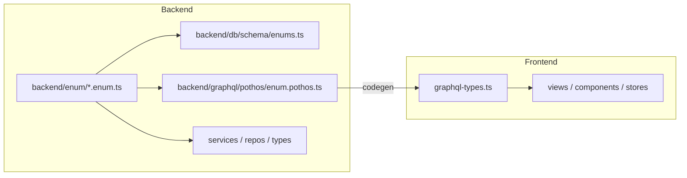

# Split `shared/lib/enum.ts` into `backend/enum/`

## Goal

Replace the 621-line monolith at [`shared/lib/enum.ts`](shared/lib/enum.ts) with maintainable domain files under `backend/enum/`, using the same `{domain}.enum.ts` naming convention as [`backend/types/`](backend/types/). Frontend code must stop importing shared/backend enums and use [`frontend/graphql/generated/gql/graphql-types.ts`](frontend/graphql/generated/gql/graphql-types.ts) instead.

## Target structure

Create `backend/enum/` with one file per domain (enum placement follows the matching `backend/types/*.types.ts` file):

| File | Contents |
|------|----------|
| [`auth.enum.ts`](backend/enum/auth.enum.ts) | `AppLanguage`, `AccountStatus`, `UserRole` |
| [`permission.enum.ts`](backend/enum/permission.enum.ts) | `AppPermission` |
| [`permission-group.enum.ts`](backend/enum/permission-group.enum.ts) | `SystemPermissionGroupSlug` |
| [`permission-management.enum.ts`](backend/enum/permission-management.enum.ts) | `OverrideState` |
| [`pagination.enum.ts`](backend/enum/pagination.enum.ts) | `OrderSortDirection` |
| [`user.enum.ts`](backend/enum/user.enum.ts) | `Gender` |
| [`country.enum.ts`](backend/enum/country.enum.ts) | `CountryCode` |
| [`parent.enum.ts`](backend/enum/parent.enum.ts) | `ParentStatus`, `BookingStatus` |
| [`student-lifecycle.enum.ts`](backend/enum/student-lifecycle.enum.ts) | `StudentStatus`, `ALLOWED_STATUS_TRANSITIONS` |
| [`class-instance-detail.enum.ts`](backend/enum/class-instance-detail.enum.ts) | `ClassType`, `ClassOutcome`, `ClassExecutionState` |
| [`schedule.enum.ts`](backend/enum/schedule.enum.ts) | `AttendanceStatus` |
| [`billing.enum.ts`](backend/enum/billing.enum.ts) | `InvoiceStatus`, `InvoiceType`, `PaymentMethod` |
| [`complaint.enum.ts`](backend/enum/complaint.enum.ts) | `ComplaintCategory`, `ComplaintStatus` |
| [`suggestions.enum.ts`](backend/enum/suggestions.enum.ts) | `SuggestionStatus` |
| [`scheduling.enum.ts`](backend/enum/scheduling.enum.ts) | `LeaveRequestStatus`, `LeaveRequesterType`, `VacationRequestStatus`, `RescheduleDateLabel` |
| [`teacher-availability.enum.ts`](backend/enum/teacher-availability.enum.ts) | `DayOfWeek`, `AvailabilitySearchSortBy` |
| [`dst-migration.enum.ts`](backend/enum/dst-migration.enum.ts) | `DstMigrationResult`, `MigrationStatus` |
| [`notificationDeliveries.enum.ts`](backend/enum/notificationDeliveries.enum.ts) | `NotificationChannel`, `NotificationDeliveryStatus`, `NotificationEventType` |
| [`userDeviceTokens.enum.ts`](backend/enum/userDeviceTokens.enum.ts) | `DevicePlatform` |
| [`book.enum.ts`](backend/enum/book.enum.ts) | `AvailabilityStatus` |
| [`group-class.enum.ts`](backend/enum/group-class.enum.ts) | `GroupClassAttendanceStatus` |
| [`index.ts`](backend/enum/index.ts) | Barrel re-export (optional convenience; prefer deep imports like types layer) |

**Not moved to backend** (frontend-only, not in GraphQL schema):
- `SessionStatus` — only used in [`frontend/views/dashboard/classes/status/tracking/`](frontend/views/dashboard/classes/status/tracking/); define locally in `status-tracking.types.ts`

## Architecture after migration



## Implementation steps

### 1. Create enum files

- Move each enum/const verbatim from [`shared/lib/enum.ts`](shared/lib/enum.ts) into its domain file.
- Add [`backend/enum/index.ts`](backend/enum/index.ts) re-exporting all enums (mirror [`backend/types/index.ts`](backend/types/index.ts) pattern).
- Add [`backend/enum/AGENTS.md`](backend/enum/AGENTS.md) documenting: enums are backend-only; frontend must use GraphQL codegen enums.

### 2. Update backend + app imports (~120 files)

Replace `@/shared/lib/enum` and `@/shared/lib` enum imports with deep imports from `@/backend/enum/{domain}.enum`.

Key hotspots:
- [`backend/db/schema/enums.ts`](backend/db/schema/enums.ts) — Drizzle `pgEnum` definitions
- [`backend/graphql/pothos/enum.pothos.ts`](backend/graphql/pothos/enum.pothos.ts) — GraphQL enum registration
- [`backend/types/*.types.ts`](backend/types/) — 26 type files currently importing shared enums
- [`backend/lib/enum.ts`](backend/lib/enum.ts) — update `parseCountryCode` / `parseGender` to import from `@/backend/enum/country.enum` and `@/backend/enum/user.enum`
- [`app/[locale]/(dashboard)/students/page.tsx`](app/[locale]/(dashboard)/students/page.tsx) — use `@/backend/enum/permission.enum` (server component, backend import is correct)

`student-lifecycle.types.ts` re-export:

```ts
export { ALLOWED_STATUS_TRANSITIONS } from "@/backend/enum/student-lifecycle.enum";
```

### 3. Fix shared-layer imports (4 files)

Shared code is used by both frontend and backend, so it cannot depend on `backend/enum`:

| File | Strategy |
|------|----------|
| [`shared/lib/schedule-instance-dashboard-status.ts`](shared/lib/schedule-instance-dashboard-status.ts) | Replace `ClassOutcome` / `ClassExecutionState` enum refs with `as const` string literals (`"PENDING"`, `"TAKEN"`, etc.) |
| [`shared/lib/teacher-schedule-session-actions.ts`](shared/lib/teacher-schedule-session-actions.ts) | Same string-literal approach |
| [`shared/messages/types/dashboard/billing/main.ts`](shared/messages/types/dashboard/billing/main.ts) | Import `InvoiceStatus` from `@/frontend/graphql/generated/gql/graphql-types` (file already imports from frontend) |
| [`shared/lib/index.ts`](shared/lib/index.ts) | Remove `export * from "./enum"` |

### 4. Migrate frontend imports (~40 files)

Replace `@/shared/lib/enum` with `@/frontend/graphql/generated/gql/graphql-types` for enums exposed in GraphQL:

- `AppPermission`, `StudentStatus`, `InvoiceStatus`, `AttendanceStatus`, `ClassType`, `ClassExecutionState`, `ClassOutcome`, `AvailabilityStatus`, `AppLanguage`, `Gender`, `PaymentMethod`, etc.

**Special frontend cases (not in GraphQL):**

| Enum | Action |
|------|--------|
| `UserRole` | Compare against string literal `"SUPER_ADMIN"` (GraphQL exposes `role` as `String`, not enum) in [`ViewAsUserButton.tsx`](frontend/components/auth/ViewAsUserButton.tsx), [`ProfileAdministrationPanel.tsx`](frontend/components/auth/ProfileAdministrationPanel.tsx), stories |
| `MigrationStatus` | Define local enum in [`dst-migration.types.ts`](frontend/views/dashboard/tools/dst-migration/dst-migration.types.ts) (`idle` / `running` / `complete`) |
| `SessionStatus` | Define local enum in [`status-tracking.types.ts`](frontend/views/dashboard/classes/status/tracking/status-tracking.types.ts) |
| `ALLOWED_STATUS_TRANSITIONS` | Inline transition map in [`frontend/utils/student-status-transitions.ts`](frontend/utils/student-status-transitions.ts) using GraphQL `StudentStatus` |
| `DashboardClientBridge` / `UserStoreInitializer` | Remove `BackendAppPermission` bridge; use GraphQL `AppPermission` only |

### 5. Cleanup

- Delete [`shared/lib/enum.ts`](shared/lib/enum.ts)
- Grep for any remaining `shared/lib/enum` references (skip `.ai/` docs unless desired)
- Optionally add ESLint `no-restricted-imports` for `frontend/**` and `shared/**` blocking `@/backend/enum` and `@/shared/lib/enum`

### 6. Verification

```bash
bun tsgo
bun run test:graphql   # enum/pothos wiring
bun run scripts/run-test/run-test.ts shared/lib/schedule-instance-dashboard-status.test.ts
bun run scripts/run-test/run-test.ts shared/lib/teacher-schedule-session-actions.test.ts
bun quality-gate
```

No GraphQL schema regeneration needed (enum values unchanged; only import paths move).

## Scope notes

- **Skip `.ai/` story docs** — historical references to `@/shared/lib/enum` in `.ai/siraj_stories/` are not runtime code.
- **No enum value changes** — pure file move + import path update; Drizzle/GraphQL values stay identical.
- **`backend/lib/enum.ts`** — keep as parser helpers, only update its enum imports (do not confuse with new `backend/enum/` directory).
