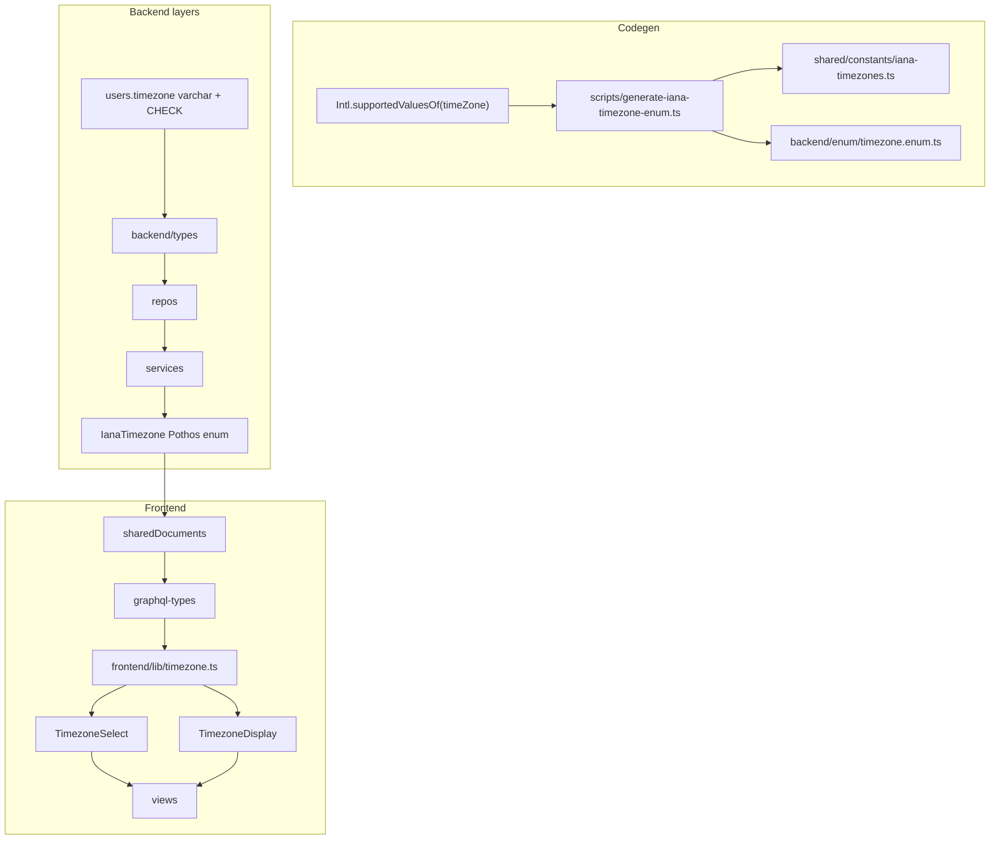

# Timezone Enhancement — Plan

See [spec.md](./spec.md) for requirements.

## Architecture

## Phase pipeline

| Phase | Work | Gate |
|-------|------|------|
| 0 | Planning docs | — |
| 1 | Codegen + shared constants + types + libs | `bun tsgo` |
| 2 | Schema + DST SQL + Drizzle generate + seeds | db tests |
| 3 | Repositories | `test:db` |
| 4 | Services | service tests + `tsgo` |
| 5 | Pothos + `generate:gqlSchema` + `codegen` | `test:graphql` |
| 6 | Frontend documents | codegen |
| 7 | TimezoneSelect + TimezoneDisplay + i18n | Storybook |
| 8 | Replace all view usages | manual + tests |
| 9 | quality-gate | full gate |

## Codegen

`scripts/generate-iana-timezone-enum.ts` writes:

- `shared/constants/iana-timezones.ts` — `IANA_TIMEZONE_IDS`, `IanaTimezoneId`
- `backend/enum/timezone.enum.ts` — `export enum IanaTimezone`

Run via `bun run generate:iana-timezones`. CI can fail if stale.

Enum key transform: `Africa/Cairo` → `Africa_Cairo`.

## Migration (8C)

1. Edit Drizzle schema files to final shape
2. Update `timezone_dst_logic.sql`
3. Drizzle MCP `generate` for fresh migration SQL
4. Drop/recreate local DB, apply migrations, reseed
5. No incremental backfill scripts

## Risks

- Large GraphQL enum (~400+ values) — acceptable per decision
- GraphQL schema size — monitor codegen performance
- Many view files to update — use shared components to limit drift

## Rollback

Early dev only: reset DB and revert schema branch. No production rollback path.

## Verification

Per-file: `bun run scripts/health/sub-loop.ts <file> --lifecycle lint`  
DB tests: `bun run scripts/run-test/run-test.ts <path>`  
Final: `bun quality-gate`
