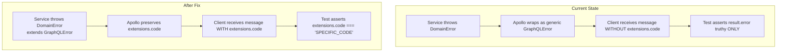
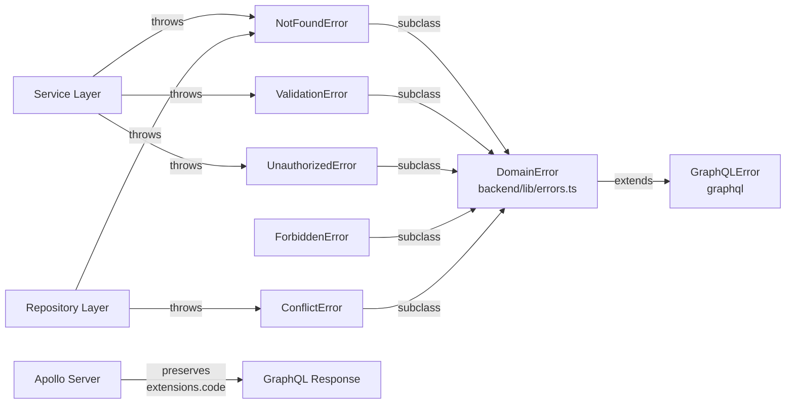
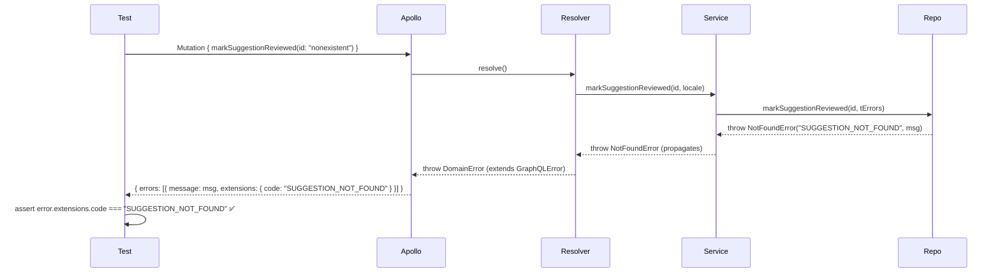

# Design: GraphQL Dev-Log Error Catching

## Document Information

- **Feature Name**: graphql-devlog-catch-errors
- **Target Directory**: `.ai/plans/graphql-devlog-catch-errors`
- **Outcome Directory**: `.ai/plans/graphql-devlog-catch-errors/outcome`
- **Version**: 1.0
- **Date**: 2026-08-19
- **Related Documents**: [Requirements](specs.md), [Research](plan.md)

## Overview

This design makes `DomainError` subclasses propagate `extensions.code` through GraphQL responses by refactoring `DomainError` to extend `GraphQLError`. This matches Siraj's existing proven pattern (`scopeAuth.unauthorizedError` throws `new GraphQLError(msg, { extensions: { code } })`, verified by `auth.test.ts:184`). No schema-shape change is required — the Pothos `errorUnion`/`errorUnionField` union migration path is explicitly rejected.

### Design Goals

- Make every `DomainError` subclass automatically surface `extensions.code` through Apollo Server 4
- Replace all raw `new Error(...)` throws in affected services/repositories with typed `DomainError` subclasses
- Split collapsed validation errors into distinct translated codes per failure mode
- Fix FK RESTRICT ordering in test-helper cleanup to prevent test data leaks
- Make silent skips (quota release, meeting URL) observable in GraphQL responses
- Upgrade GraphQL test assertions from `result.error` truthiness to `extensions.code` assertions

### Key Design Decisions

#### Decision: DomainError extends GraphQLError (not Pothos errorUnion)

**Context:** The `@pothos/plugin-errors` v4.9.1 plugin wraps fields in union types (`errorUnion`/`errorUnionField`). Siraj has `errors: { defaultTypes: [] }` and zero `errorUnion` usage. `DomainError` subclasses are thrown from services/repositories but surface as generic `GraphQLError` without `extensions.code`.

**Options Considered:**
1. **Strategy A — Pothos `errorUnion`/`errorUnionField` schema migration** — Register each `DomainError` subclass as a Pothos object type implementing an `Error` interface, add to `defaultTypes`, add `errors: { types: [...] }` to affected resolvers. Tests query with `__typename` + `... on NotFoundError { message }` fragments.
   - Pros: Plugin's designed path; exposes extra fields on error objects.
   - Cons: Schema-shape change for every affected mutation; Apollo cache normalization impact; rewriting all consumers (stories, Apollo hooks, codegen output); breaking change with no incremental path.
2. **Strategy B — `DomainError` extends `GraphQLError`** — Refactor `DomainError` in `backend/lib/errors.ts` to extend `GraphQLError` with `extensions: { code }` in the constructor.
   - Pros: Zero schema-shape change; matches Siraj's existing `UNAUTHENTICATED`/`BAD_USER_INPUT` pattern; additive to existing tests; minimal blast radius.
   - Cons: Doesn't expose extra error fields beyond `message` + `extensions.code` (but Siraj doesn't need them).

**Decision:** Strategy B.

**Rationale:** Siraj already uses `new GraphQLError(msg, { extensions: { code } })` in `gqlSchemaBuilder.ts:156` (scopeAuth) and `meeting.mutation.ts:129-215`. The `auth.test.ts:184` test proves this pattern works with Apollo Server 4. Strategy B makes every existing `throw new NotFoundError(...)` immediately surface `extensions.code` with zero schema change, zero new files, and zero per-resolver wiring.

#### Decision: Keep `errors.defaultTypes: []` as-is

**Context:** The Pothos errors plugin's `defaultTypes` only adds members to fields that opt in via `errors: {...}`. Since we're not using the union path, `defaultTypes` is irrelevant.

**Decision:** Leave `defaultTypes: []` and `onResolvedError` logger unchanged. They're harmless no-ops.

### Pothos Errors Plugin Investigation (CRITICAL)

Confirmed against installed `node_modules/@pothos/plugin-errors/` v4.9.1:

- **`src/types.ts`** — `ErrorsPluginOptions` interface: `defaultTypes`, `directResult`, `onResolvedError`, `unsafelyHandleInputErrors`, `defaultResultOptions`, `defaultUnionOptions`.
- **`src/schema-builder.ts`** — `errorUnion` implementation: merges field `types` with `defaultTypes`, builds a `union` type, attaches `pothosErrorTypes` extension.
- **`esm/index.js`** — `PothosErrorsPlugin.wrapIsTypeOf` & `onOutputFieldConfig` confirm the plugin only engages on fields with `errors: { types: [...] }` or `errorUnionField`.
- **Indexed Pothos docs** (via `docs-search_docs`): "`defaultTypes`: An array of Error classes to include in every field **with error handling**." — NOT every field globally.
- **Siraj grep**: `grep -rn "errorUnion" backend/graphql/` → zero matches. Siraj has zero fields opted into the union-wrapping path.

### UX/Navigation Specification

N/A — this is a backend-only feature. No new routes, sidebar items, or UI components. Error messages are already rendered by existing UI components; the change is that messages now carry `extensions.code` and new validation failures use distinct translated strings.

### Translation System Requirements

**New i18n keys** to add to `SchedulingErrors` in `shared/locale/types/errors/index.ts`:

| Key | English | Arabic |
|-----|---------|--------|
| `recurringClassDaysRequired` | "At least one day is required." | "يوم واحد على الأقل مطلوب." |
| `invalidDuration` | "Duration must be greater than zero." | "يجب أن تكون المدة أكبر من صفر." |
| `subjectRequired` | "Subject is required." | "المادة مطلوبة." |

**Existing keys reused:**
- `recordNotFound({ tableName, entityId })` — for suggestion not found (REQ-2)
- `unauthorizedViewMetrics` — for unauthorized daily metrics (REQ-3)

### Concurrency & Race Condition Assessment

N/A — no shared mutable state changes. The `DomainError` refactor is a class-hierarchy change; FK cleanup ordering is a delete-sequence fix within a single transaction.

### Drizzle SQL Template Anti-Patterns

N/A — no inline SQL templates in this feature. The FK cleanup uses standard Drizzle query builders (`tx.delete(...).where(...)`).

### Outcome & Knowledge Transfer Protocol

- **BEFORE Execution:** Read ALL existing files in `.ai/plans/graphql-devlog-catch-errors/outcome/`
- **AFTER Execution:** Write `<task-id>-outcome.md` with research findings, implementation details, cross-file dependencies, and carry-over points
- **PROGRESS TRACKING:** Update task checkboxes `[ ]` -> `[x]` in `tasks.md`

## Architecture

### System Context



### High-Level Architecture



### Technology Stack

| Layer | Technology | Rationale |
|-------|------------|-----------|
| Error classes | `GraphQLError` (from `graphql` package) | Apollo Server 4 preserves `extensions` on `GraphQLError` instances |
| i18n | Compile-time TypeScript system in `shared/locale/` | Project standard — no `next-intl` |
| Testing | Bun test runner + Apollo `CombinedGraphQLErrors` | Existing pattern from `auth.test.ts:184` |
| Dev server verification | Next.js devtools MCP server (port 3000) | `compile_route`, `get_errors`, `get_logs`, `get_compilation_issues` for per-phase verification |

## Components and Interfaces

### Component 1: `DomainError` (modified)

**Purpose**: Base class for all siraj-specific errors, now extending `GraphQLError` to carry `extensions.code`.

**Responsibilities**:
- Extend `GraphQLError` with `extensions: { code }` in constructor
- Preserve `instanceof Error` (GraphQLError already extends Error)
- Preserve `err.message` and `err.code` properties
- Ensure subclass prototype chain is restored (ES5 `Object.setPrototypeOf`)

**Interfaces**:
- **Input**: `message: string`, `code: string`
- **Output**: `GraphQLError` instance with `extensions.code`
- **Dependencies**: `graphql` package (`GraphQLError`)

**Implementation Notes**:
```typescript
// backend/lib/errors.ts
import { GraphQLError } from "graphql";

export class DomainError extends GraphQLError {
  constructor(
    message: string,
    public readonly code: string,
  ) {
    super(message, { extensions: { code } });
    this.name = new.target.name;
    Object.setPrototypeOf(this, new.target.prototype);
  }
}
```

### Component 2: Repository layer — suggestion not found (modified)

**Purpose**: Replace raw `new Error(...)` with `NotFoundError` in `suggestion.repository.ts`.

**Responsibilities**:
- Accept `locale` or `tErrors` context from service callers
- Throw `NotFoundError("SUGGESTION_NOT_FOUND", tErrors.recordNotFound(...))`

**Interfaces**:
- **Input**: `suggestionId: string`, `locale?: string` (or `tErrors` callback)
- **Output**: `NotFoundError` throw (extends `GraphQLError`)
- **Dependencies**: `NotFoundError` from `@/backend/lib/errors`, `tErrors` from `@/shared/locale/server-graphql`

### Component 3: Service layer — schedule unauthorized (modified)

**Purpose**: Replace `new Error(tErrors.unauthorizedViewMetrics)` with `UnauthorizedError` in `schedule.service.ts`.

**Responsibilities**:
- Throw `new UnauthorizedError("UNAUTHORIZED", tErrors.unauthorizedViewMetrics)`

**Interfaces**:
- **Input**: none (uses existing `tErrors` already built in the service)
- **Output**: `UnauthorizedError` throw
- **Dependencies**: `UnauthorizedError` from `@/backend/lib/errors`

### Component 4: Service layer — recurring class validation (modified)

**Purpose**: Split collapsed `ValidationError(tErrors.invalidInput)` into three distinct translated errors.

**Responsibilities**:
- Check `days` empty → `ValidationError("RECURRING_CLASS_DAYS_REQUIRED", tErrors.recurringClassDaysRequired)`
- Check `durationMinutes <= 0` → `ValidationError("INVALID_DURATION", tErrors.invalidDuration)`
- Check `subjectId` empty → `ValidationError("SUBJECT_REQUIRED", tErrors.subjectRequired)`

**Interfaces**:
- **Input**: `input: CreateRecurringClassInput`
- **Output**: `ValidationError` throw with specific code
- **Dependencies**: `ValidationError` from `@/backend/lib/errors`, 3 new i18n keys

### Component 5: Test helper — FK-aware cleanup (modified)

**Purpose**: Delete FK-blocking child rows before parent rows in `cleanupTestSuperAdmin` and `cleanupTestEntities`.

**Responsibilities**:
- Delete `admin_audit_logs` rows for user before deleting user
- Delete `class_status_events` rows for instances before deleting instances

**Interfaces**:
- **Input**: `userId: string` (cleanupTestSuperAdmin), `studentId/teacherId: string` (cleanupTestEntities)
- **Output**: `true` on success (not `false`)
- **Dependencies**: `adminAuditLogs`, `classStatusEvents` from `@/backend/db/schema`

### Component 6: Test assertions — `expectMutationError` upgrade (modified)

**Purpose**: Upgrade `frontend/common/graphql/test/helpers.ts` to support `extensions.code` assertions.

**Responsibilities**:
- Add a `expectMutationErrorCode(mutation, expectedCode)` helper that asserts both `result.error` truthiness AND `error.extensions.code === expectedCode`

**Interfaces**:
- **Input**: mutation document + variables + expected code string
- **Output**: assertion pass/fail
- **Dependencies**: `CombinedGraphQLErrors` fromApollo error handling

## Data Models

### Error Code Enum (new)

```typescript
// shared/types/errorCodes.ts (or inline in backend/lib/errors.ts)
export const ErrorCode = {
  SUGGESTION_NOT_FOUND: "SUGGESTION_NOT_FOUND",
  COMPLAINTS_NOT_FOUND: "COMPLAINTS_NOT_FOUND",
  UNAUTHORIZED: "UNAUTHORIZED",
  RECURRING_CLASS_DAYS_REQUIRED: "RECURRING_CLASS_DAYS_REQUIRED",
  INVALID_DURATION: "INVALID_DURATION",
  SUBJECT_REQUIRED: "SUBJECT_REQUIRED",
  // ... existing codes
} as const;

export type ErrorCode = typeof ErrorCode[keyof typeof ErrorCode];
```

### Data Flow



## API Design

No new endpoints. The change affects the shape of error responses on existing GraphQL mutations:

### Error Response Format (before)

```json
{
  "errors": [{
    "message": "Suggestion 86dee45d-... not found",
    "extensions": {}
  }]
}
```

### Error Response Format (after)

```json
{
  "errors": [{
    "message": "السجل غير موجود: suggestion برقم 86dee45d-...",
    "extensions": { "code": "SUGGESTION_NOT_FOUND" }
  }]
}
```

## Security Considerations

### Input Validation

- No new user inputs — error codes are hardcoded constants in service/repository code.
- Apollo's `hideSchemaDetailsFromClientErrors` remains active; `extensions.code` is on the allow-list (confirmed by existing `UNAUTHENTICATED`/`FORBIDDEN` codes).

### Data Protection

- Error messages use translated strings — no SQL fragments or stack traces in production responses.
- The `code` property is a machine-readable constant, not user data.

## Error Handling

### Error Categories

| Category | Code | Description | User Action |
|----------|------|-------------|-------------|
| Not Found | `*_NOT_FOUND` | Resource doesn't exist | Check identifier |
| Unauthorized | `UNAUTHORIZED` | Insufficient role/permissions | Contact administrator |
| Validation | `*_REQUIRED`, `INVALID_*` | Invalid input data | Fix input and retry |
| Conflict | `*_CONFLICT` | Duplicate/conflicting state | Resolve conflict and retry |

### Logging Strategy

- **Error Logs**: `DomainError` throws are logged by the service-layer catch blocks (existing behavior — no change)
- **Warn Logs**: Silent skips (quota release, meeting URL) upgrade from `logger.info` to `logger.warn` with structured fields
- **Debug Logs**: Notification dropped-payload warnings include channel type for scannability

## Testing Strategy

### Unit Testing

- **Coverage Target**: All affected service/repository methods
- **Testing Framework**: Bun test runner
- **Key Test Areas**: Error code propagation, translated message content, FK cleanup ordering

### Integration Testing

- **API Testing**: GraphQL integration tests (dev server, `testClient`)
- **Test Pattern**: `expect(result.error).toBeInstanceOf(CombinedGraphQLErrors)` then `error.errors?.[0]?.extensions?.code`

### Verification via Next.js Devtools MCP Server

After each phase, use the Next.js devtools MCP server (port 3000) to confirm:

| MCP Tool | Purpose |
|---|---|
| `compile_route` (`/api/graphql`) | Pre-compile route, catch module-graph breakage |
| `get_compilation_issues` | Zero compilation issues across all routes |
| `get_errors` | No build/SSR/global errors introduced |
| `get_logs` | Dev server log tail — confirm localized messages + error codes |
| `get_routes` (`routerType: "app"`) | `/api/graphql` still registered |
| `get_request_insights` | Request timeline for slow mutations |

### End-to-End Testing

- **Full Suite**: `bun test:graphql` with log capture to `graphql_tests_logs/dev-post-fix.log`
- **Log Diff**: Compare `dev.log` (original) vs `dev-post-fix.log` — confirm issues 1-9 resolved
- **Test Runner**: `bun run scripts/run-test/run-test.ts <test-path>` for individual test log capture

## Performance Considerations

### Expected Load

- No new load — error handling is on existing mutation paths.
- `DomainError` constructor adds `Object.setPrototypeOf` call (nanosecond-level, negligible).

### Optimization Strategies

- No caching changes; no database query changes; no network changes.

## Migration and Compatibility

### Backward Compatibility

- Existing tests that check `result.error` truthiness continue to pass (additive).
- `DomainError` still `instanceof Error` (GraphQLError extends Error).
- `err.message` and `err.code` unchanged.
- No schema-shape change (no `errorUnion` migration).
- `bun codegen` output unchanged (no new types added to schema).

### Integration Impact

- No impact on existing Apollo Client cache normalization (error responses aren't cached entities).
- No impact on Storybook (error states are mocked, not from live GraphQL).

---

## Design Review Checklist

- [x] High-level architecture is clearly described (DomainError → GraphQLError inheritance)
- [x] Component responsibilities are well-defined (6 components)
- [x] Interfaces between components are specified
- [x] Technology choices are justified (Strategy B over A, with rationale)
- [x] Design addresses all functional requirements (REQ-1 through REQ-10)
- [x] Error handling is comprehensive (error categories table, response format before/after)
- [x] Data models complete (ErrorCode enum, data flow sequence diagram)
- [x] Testing strategy is comprehensive (unit, integration, MCP verification, E2E log diff)
- [x] Backward compatibility addressed (additive, no breaking changes)
- [x] UX/Navigation: N/A (backend-only feature) — documented
