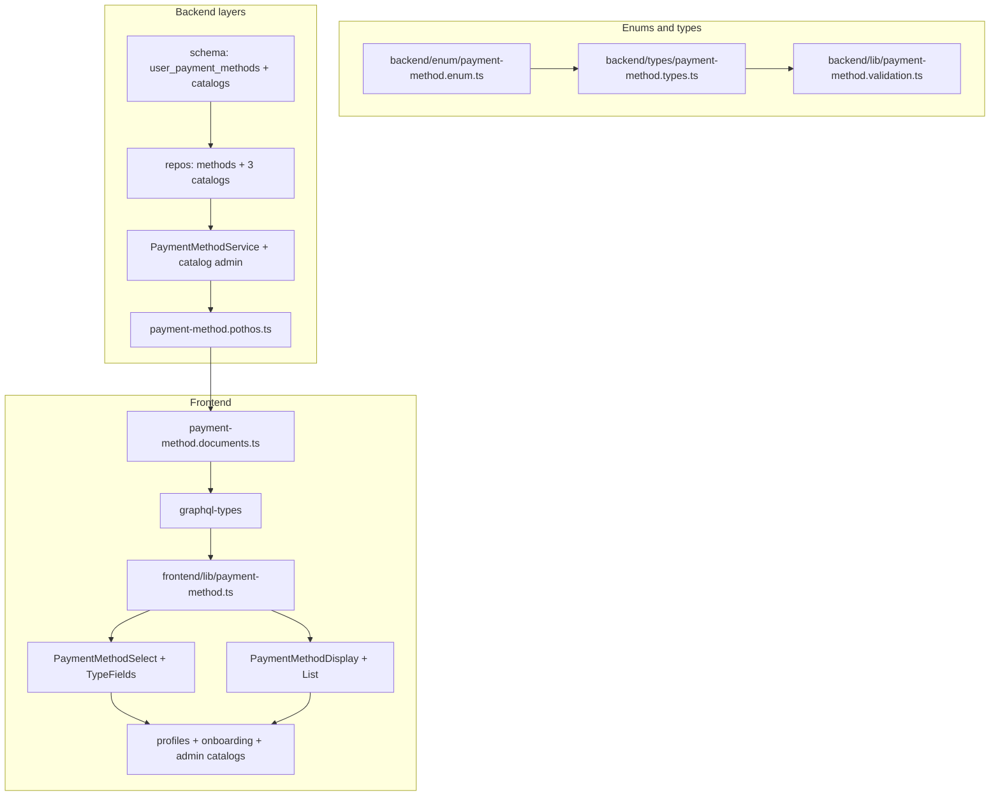

# Payment Methods Enhancement — Plan

See [spec.md](./spec.md) for requirements.

## Architecture

## Phase pipeline

| Phase | Work | Gate |
|-------|------|------|
| 0 | Planning docs | — |
| 1 | Enums + types + Zod validation libs | `bun tsgo` |
| 2 | Drizzle schema + 8C migration + seeds | db tests |
| 3 | Repositories (methods + catalogs) | `test:db` |
| 4 | Services (CRUD, defaults, masking, verify, billing wire-up) | service tests + `tsgo` |
| 5 | Pothos + mutations + `generate:gqlSchema` + `codegen` | `test:graphql` |
| 6 | Frontend GraphQL documents | codegen |
| 7 | Shared UI components + i18n + Storybook | Vitest Storybook |
| 8 | Replace view usages + admin catalog UI | manual + component tests |
| 9 | `bun quality-gate` | full gate |

## Migration (8C — clean generate, no deprecations)

Early dev: **delete** legacy surfaces in schema files, then regenerate a fresh migration set. No `@deprecated`, no dual-read, no backfill scripts.

1. Add schema files: `user-payment-methods.ts`, `supported-mobile-wallets.ts`, `supported-payment-links.ts`, `supported-online-accounts.ts`
2. Add PG enums: `paymentMethodTypeEnum`, `paymentDirectionEnum`, `identifierKindEnum` in `backend/db/schema/enums.ts`
3. **Delete** `paymentMethodEnum` from `enums.ts` (old `PAYPAL` \| `BANK_ACCOUNT`)
4. **Delete** `teachers.payment_method`, `parents.payment_method` columns
5. **Delete** `teacher-banking.ts` schema file (`teacher_banking_details_history` table)
6. Update `teacher_payments`: delete `banking_details_history_id` → add `user_payment_method_id`
7. Update `payments`: delete `payment_method` column → add `user_payment_method_id` (nullable FK) + `payment_method_type` (`PaymentMethodType`)
8. Add partial unique indexes for default slots on `user_payment_methods`
9. Edit Drizzle schema to final shape → drop local DB → `drizzle-kit generate` (clean migration set)
10. Apply migrations + reseed catalogs + demo user methods

## Masking and verification

Port `backend/services/profile/banking-summary.ts` → `backend/services/payment-method/payment-method-mask.ts`:

- `buildMaskedPaymentMethod(method, scope)` — per-type field masking
- `loadUserPaymentMethodsSummary(actorUserId, scope, userId)` — replaces `loadTeacherBankingSummary`
- Verification: `PaymentMethodService.verifyBankTransfer(id, adminUserId)` — sets `verifiedAt` / `verifiedByUserId`

Notification: **delete** `BANKING_DETAILS_CHANGED`; add `PAYMENT_METHOD_CHANGED` in `backend/enum/notificationDeliveries.enum.ts`. Update all references (no alias).

## Default slot logic (1bA)

In `PaymentMethodService.setDefault` / `create` / `update`:

1. Determine affected slots from `direction` (`PAYIN`, `PAYOUT`, or both for `BOTH`)
2. Within same transaction, unset `isDefault` on competing rows in those slots
3. Set target row `isDefault = true`
4. Repo provides `clearDefaultsInSlot(userId, slot, tx)` — no business logic in repo

## Billing integration

`billing.repository.recordPayment`:

- Accept optional `userPaymentMethodId`
- Snapshot `paymentMethodType` from resolved method (or from input when FK absent)
- Validate method belongs to invoice parent user and supports `PAYIN`

`teacher_payments` creation links `userPaymentMethodId` of teacher's payout method used.

## Catalog admin

New permissions in `backend/enum/permission.enum.ts`:

- `PAYMENT_METHODS_MANAGE_CATALOGS = "payment_methods.manage_catalogs"`
- `PAYMENT_METHODS_VERIFY_BANK_TRANSFER = "payment_methods.verify_bank_transfer"`

Seed permissions + assign to admin group. Admin UI at `frontend/views/dashboard/admin/payment-catalogs/`.

## Risks

| Risk | Mitigation |
|------|------------|
| GraphQL union/input complexity for `details` | Typed inputs per `PaymentMethodType`; Pothos input objects mirror Zod |
| ~90 files touch payment/banking | Shared UI components; phased replacement in tasks.md |
| Encrypted bank field migration | Re-seed under 8C; encrypt on write in service |
| Catalog deactivation with existing user methods | Allow read/display; block new creates referencing inactive catalog |
| Old `PaymentMethod` enum (`PAYPAL` \| `BANK_ACCOUNT`) | **Delete** from TS/PG/GraphQL; replace with `PaymentMethodType` everywhere |

## Layer compliance matrix

Read before editing each path prefix:

| Path prefix | AGENTS.md / instructions |
|-------------|--------------------------|
| `backend/types/` | `backend/types/AGENTS.md`, `.agents/instructions/backend.instructions.md` |
| `backend/enum/` | `backend/enum/AGENTS.md` |
| `backend/db/schema/` | `backend/AGENTS.md` |
| `backend/db/repo/` | `backend/db/repo/AGENTS.md`, `backend/AGENTS.md` |
| `backend/db/seeds/` | `backend/db/seeds/AGENTS.md` |
| `backend/services/` | `backend/services/AGENTS.md` |
| `backend/graphql/` | `backend/graphql/AGENTS.md` |
| `frontend/graphql/` | `frontend/graphql/AGENTS.md`, `frontend/graphql/sharedDocuments/AGENTS.md` |
| `frontend/components/ui/` | `frontend/AGENTS.md`, `frontend/COMPONENT_PATTERNS.md` |
| `frontend/views/` | `frontend/views/AGENTS.md`, `frontend/AGENTS.md` |
| `**/*.test.ts` | `.agents/instructions/tests.instructions.md` |

**Cross-cutting:** `@/` imports only; no `console.*`; MUI `sx`; Apollo from `@apollo/client/react`; **no deprecations** — delete legacy code outright.

## Rollback

Early dev only: reset DB and revert schema branch. No production rollback path.

## Verification

Per-file: `bun run scripts/health/sub-loop.ts <file> --lifecycle lint`  
DB tests: `bun run scripts/run-test/run-test.ts <path>`  
Final: `bun quality-gate`

---

## File inventory appendix

Grouped by phase. Paths are relative to repo root.

### Phase 1 — Enums + types

| File | Action |
|------|--------|
| `backend/enum/payment-method.enum.ts` | **Create** — `PaymentMethodType`, `PaymentDirection`, `IdentifierKind` |
| `backend/enum/billing.enum.ts` | **Update** — **delete** `PaymentMethod` enum; keep `InvoiceStatus`, `InvoiceType` |
| `backend/enum/permission.enum.ts` | **Update** — catalog + verify permissions |
| `backend/enum/index.ts` | **Update** — export new enum file |
| `backend/types/payment-method.types.ts` | **Create** — Select/Insert/Return/Submit types + details union |
| `backend/types/billing.types.ts` | **Update** — `PaymentRecordInput` + snapshot type |
| `backend/types/teacher.types.ts` | **Update** — **delete** banking history + summary types |
| `backend/types/parent.types.ts` | **Update** — remove `paymentMethod` scalar |
| `backend/types/profile.types.ts` | **Update** — replace `bankingSummary` with payment methods |
| `backend/types/teacher-onboarding.types.ts` | **Update** — payment method input |
| `backend/types/index.ts` | **Update** — export payment-method types |
| `backend/lib/payment-method.validation.ts` | **Create** — discriminated Zod schemas |
| `frontend/lib/payment-method.ts` | **Create** — label helpers, mask display, catalog option builders |

### Phase 2 — Schema + migration + seeds

| File | Action |
|------|--------|
| `backend/db/schema/user-payment-methods.ts` | **Create** |
| `backend/db/schema/supported-mobile-wallets.ts` | **Create** |
| `backend/db/schema/supported-payment-links.ts` | **Create** |
| `backend/db/schema/supported-online-accounts.ts` | **Create** |
| `backend/db/schema/enums.ts` | **Update** — add new PG enums; **delete** `paymentMethodEnum` |
| `backend/db/schema/teachers.ts` | **Update** — drop `payment_method` |
| `backend/db/schema/parents.ts` | **Update** — drop `payment_method` |
| `backend/db/schema/teacher-banking.ts` | **Delete** — replace with payment methods |
| `backend/db/schema/billing.ts` | **Update** — `user_payment_method_id` + type snapshot |
| `backend/db/schema/index.ts` | **Update** |
| `backend/db/drizzleRelations.ts` | **Update** |
| `backend/db/seeds/*` | **Update** — catalog seeds + demo user methods |

### Phase 3 — Repositories

| File | Action |
|------|--------|
| `backend/db/repo/user-payment-method.repository.ts` | **Create** |
| `backend/db/repo/supported-mobile-wallet.repository.ts` | **Create** |
| `backend/db/repo/supported-payment-link.repository.ts` | **Create** |
| `backend/db/repo/supported-online-account.repository.ts` | **Create** |
| `backend/db/repo/teacher-banking.repository.ts` | **Delete** |
| `backend/db/repo/teacher.repository.ts` | **Update** — remove paymentMethod |
| `backend/db/repo/parent.repository.ts` | **Update** — remove paymentMethod |
| `backend/db/repo/billing.repository.ts` | **Update** — recordPayment FK |
| `backend/db/repo/index.ts` | **Update** |
| `backend/db/test/repo/user-payment-method.repository.test.ts` | **Create** |
| `backend/db/test/repo/supported-*-repository.test.ts` | **Create** (×3) |

### Phase 4 — Services

| File | Action |
|------|--------|
| `backend/services/payment-method/payment-method.service.ts` | **Create** |
| `backend/services/payment-method/payment-method-mask.ts` | **Create** |
| `backend/services/payment-method/payment-catalog.service.ts` | **Create** |
| `backend/services/payment-method/index.ts` | **Create** |
| `backend/services/profile/banking-summary.ts` | **Delete** — replaced by mask module |
| `backend/services/profile/banking-summary.test.ts` | **Rewrite** → payment-method-mask tests |
| `backend/services/profile/profile.service.ts` | **Update** |
| `backend/services/profile/profile.service.test.ts` | **Update** |
| `backend/services/profile/parent-profile.service.ts` | **Update** |
| `backend/services/profile/parent-profile.service.test.ts` | **Update** |
| `backend/services/profile/teacher-profile.service.test.ts` | **Update** |
| `backend/services/parent/parent-onboarding.service.ts` | **Update** |
| `backend/services/teacher/teacher-onboarding.service.ts` | **Update** |
| `backend/services/teacher/teacher-portal.service.ts` | **Update** |
| `backend/services/staff/staff-profile.service.ts` | **Update** |

### Phase 5 — Pothos + GraphQL

| File | Action |
|------|--------|
| `backend/graphql/pothos/payment-method.pothos.ts` | **Create** |
| `backend/graphql/pothos/enum.pothos.ts` | **Update** — add new enums; **delete** `PaymentMethodPothosObject` |
| `backend/graphql/pothos/profile.pothos.ts` | **Update** — remove TeacherBankingSummary |
| `backend/graphql/pothos/staff-profile.pothos.ts` | **Update** |
| `backend/graphql/pothos/parent-profile.pothos.ts` | **Update** |
| `backend/graphql/pothos/parent-onboarding.pothos.ts` | **Update** |
| `backend/graphql/pothos/teacher-portal.pothos.ts` | **Update** |
| `backend/graphql/pothos/teacher-onboarding.pothos.ts` | **Update** — replace banking fields |
| `backend/graphql/mutation/payment-method.mutation.ts` | **Create** |
| `frontend/graphql/test/payment-method.test.ts` | **Create** |
| `backend/graphql/mutation/onboarding.mutation.ts` | **Update** |
| `backend/graphql/mutation/staff-profile.mutation.ts` | **Update** |

### Phase 6 — Frontend documents

| File | Action |
|------|--------|
| `frontend/graphql/sharedDocuments/payment-method.documents.ts` | **Create** |
| `frontend/graphql/sharedDocuments/profile.documents.ts` | **Update** |
| `frontend/graphql/sharedDocuments/parent-profile.documents.ts` | **Update** |
| `frontend/graphql/sharedDocuments/staff-profile.documents.ts` | **Update** |
| `frontend/graphql/sharedDocuments/teacher-portal.documents.ts` | **Update** |
| `frontend/graphql/sharedDocuments/parent-onboarding.documents.ts` | **Update** |
| `frontend/graphql/sharedDocuments/teacher-onboarding.documents.ts` | **Update** |
| `frontend/graphql/sharedDocuments/profile.documents.test.ts` | **Update** |
| `frontend/graphql/sharedDocuments/index.ts` | **Update** |

### Phase 7 — UI components + i18n

| File | Action |
|------|--------|
| `frontend/components/ui/input/PaymentMethodSelect.tsx` | **Create** |
| `frontend/components/ui/input/PaymentMethodTypeFields.tsx` | **Create** |
| `frontend/components/ui/input/PaymentMethodDefaultsEditor.tsx` | **Create** |
| `frontend/components/ui/input/PaymentMethodSelect.stories.tsx` | **Create** |
| `frontend/components/ui/display/PaymentMethodDisplay.tsx` | **Create** |
| `frontend/components/ui/display/PaymentMethodList.tsx` | **Create** |
| `frontend/components/ui/display/PaymentMethodDisplay.stories.tsx` | **Create** |
| `frontend/components/ui/input/index.ts` | **Update** |
| `frontend/components/ui/display/index.ts` | **Update** |
| `shared/messages/types/ui/payment-method.ts` | **Create** |
| `shared/messages/ar/ui/payment-method.ts` | **Create** |
| `shared/messages/en.ts` | **Update** |
| `shared/messages/types/ui/index.ts` | **Update** |
| `shared/messages/ar/ui/index.ts` | **Update** |

### Phase 8 — View usages

**Teacher banking (replace tab):**

- `frontend/views/dashboard/profile/teacher/banking/TeacherBankingTab.tsx` → **Replace** with `PaymentMethodsTab`
- `frontend/views/dashboard/profile/teacher/banking/TeacherBankingView.tsx` — **Delete**
- `frontend/views/dashboard/profile/teacher/banking/TeacherBankingEmptyState.tsx` — **Delete**
- `frontend/views/dashboard/profile/teacher/banking/TeacherBanking.stories.tsx` — **Delete**
- `frontend/views/dashboard/profile/core/profileTabs.ts` — delete `banking` tab; add `paymentMethods` tab

**Profile views:**

- `frontend/views/dashboard/profile/teacher/sections/CompensationSection.tsx`
- `frontend/views/dashboard/profile/teacher/TeacherAdminEditForm.tsx`
- `frontend/views/dashboard/profile/teacher/TeacherProfileContainer.tsx`
- `frontend/views/dashboard/profile/teacher/teacherProfileFormTypes.ts`
- `frontend/views/dashboard/profile/parent/sections/BillingSection.tsx`
- `frontend/views/dashboard/profile/parent/ParentProfileEditForm.tsx`
- `frontend/views/dashboard/profile/parent/ParentProfileContainer.tsx`
- `frontend/views/dashboard/profile/parent/parentProfileFormTypes.ts`

**Teacher surfaces:**

- `frontend/views/dashboard/teachers/onboarding/components/BankingLedgerSection.tsx` — **delete**; create `PaymentMethodSection.tsx`
- `frontend/views/dashboard/teachers/onboarding/TeacherOnboardingView.tsx`
- `frontend/views/dashboard/teachers/profile/components/SalaryDetailsSection.tsx`
- `frontend/views/dashboard/teachers/profile/TeacherProfileContainer.tsx`
- `frontend/views/dashboard/teachers/profile/schemas/teacherProfileSchema.ts`
- `frontend/views/dashboard/teachers/own-profile/TeacherOwnProfileContainer.tsx`

**Parent surfaces:**

- `frontend/views/dashboard/admin/parents/onboarding/FeesContractSection.tsx`
- `frontend/views/dashboard/admin/parents/onboarding/schemas/parentOnboardingSchema.ts`
- `frontend/views/dashboard/admin/parents/onboarding/ParentOnboardingContainer.tsx`
- `frontend/views/dashboard/parent/profile/edit/ParentProfileEditContainer.tsx`
- `frontend/views/dashboard/parent/profile/edit/parentProfileEditSchema.ts`
- `frontend/views/dashboard/parent/profile/ParentProfileDetails.tsx`
- `frontend/views/dashboard/parent/profile/ParentProfileContainer.tsx`

**Hooks + types:**

- `frontend/hooks/useCreateParentOnboarding.ts`
- `frontend/types/shared.types.ts`

**Admin catalog (new):**

- `frontend/views/dashboard/admin/payment-catalogs/PaymentCatalogAdminContainer.tsx`
- `frontend/views/dashboard/admin/payment-catalogs/PaymentCatalogAdminView.tsx`
- `frontend/views/dashboard/admin/payment-catalogs/components/*`

**Stories/tests to update:**

- `frontend/views/dashboard/profile/teacher/TeacherProfileView.test.tsx`
- `frontend/views/dashboard/profile/parent/ParentProfileView.test.tsx`
- `frontend/views/dashboard/profile/teacher/TeacherProfileView.stories.tsx`
- `frontend/views/dashboard/profile/parent/ParentProfileView.stories.tsx`
- `frontend/views/dashboard/admin/parents/onboarding/ParentOnboardingView.stories.tsx`
- `frontend/views/dashboard/teachers/onboarding/TeacherOnboardingView.stories.tsx`

**i18n cleanup (remove PayPal/Bank hardcodes):**

- `shared/messages/types/profile.ts`, `shared/messages/profile.ts`
- `shared/messages/types/dashboard/parents/onboarding.ts`
- `shared/messages/ar/dashboard/parents/onboarding.ts`
- `shared/messages/types/dashboard/teachers/onboarding.ts`
- `shared/messages/types/errors/main.ts`, `shared/messages/en/errors.ts`, `shared/messages/ar/errors.ts`
