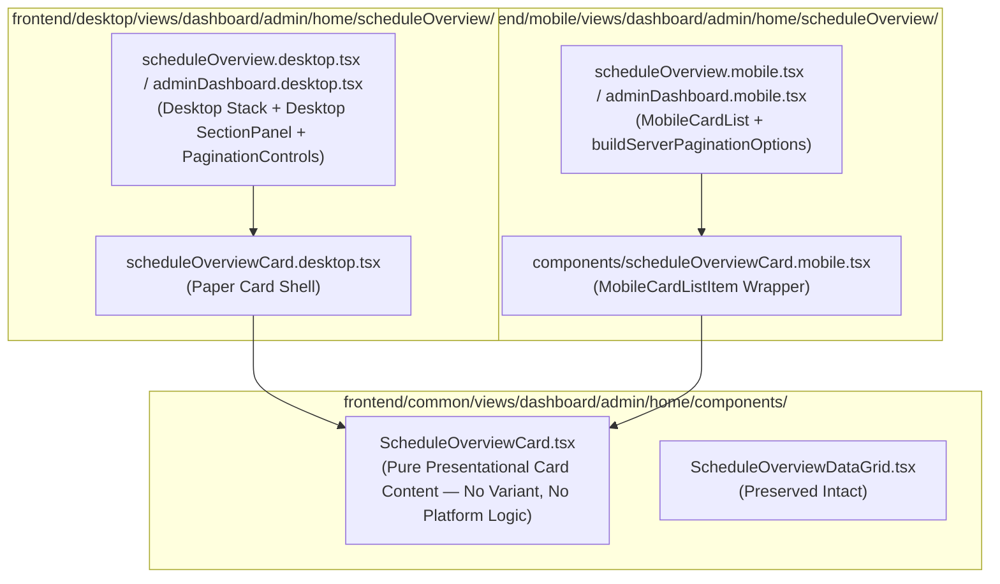

# Implementation Plan: Schedule Overview Card List Refactor

Refactor **Schedule Overview** on desktop to display a card list instead of `ScheduleOverviewDataGrid`, while preserving `ScheduleOverviewDataGrid.tsx` code intact in the codebase. 

The refactor follows strict layer isolation and architecture rules from `frontend/AGENTS.md`, `frontend/views/AGENTS.md`, `frontend/desktop/AGENTS.md`, and `frontend/mobile/AGENTS.md`. Card presentation logic is shared in `frontend/common/` as a pure, platform-agnostic component with **no `variant` prop** and **no platform-specific styling inside common**. Desktop and mobile modules independently own their respective card wrappers, list containers, and pagination controls.

---

## User Review Required

> [!IMPORTANT]
> - **Architecture & Layer Compliance**:
>   - **Common Layer (`frontend/common/`)**: Provides `ScheduleOverviewCard` (pure presentational card item). Accepts strictly domain props (`row`, `headers`, `statusLabels`, `detailsLabel`, `showTimezones`, `locale`). **No `variant` prop**, **no `useViewport`**, **no platform conditional styling**.
>   - **Desktop Layer (`frontend/desktop/`)**: Defines `ScheduleOverviewCardDesktop` (or uses desktop `Paper` container + `Stack`) and renders `PaginationControls` for pagination.
>   - **Mobile Layer (`frontend/mobile/`)**: Defines `ScheduleOverviewCardMobile` using `MobileCardListItem` and `MobileCardList` with `buildServerPaginationOptions`.
> - **Zero Duplication**: Both Desktop and Mobile import and render the exact same `ScheduleOverviewCard` from `common` for card item content.
> - **No Cross-Module Layer Violations**: `.desktop.tsx` files NEVER import from `@/frontend/mobile/...` (ESLint `no-restricted-imports`). `.mobile.tsx` files NEVER import from `@/frontend/desktop/...`.
> - **DataGrid Preservation**: `ScheduleOverviewDataGrid.tsx` and its unit tests (`ScheduleOverviewDataGrid.test.tsx`) are preserved 100% intact.

---

## Architecture Diagram



---

## Proposed Changes

### 1. Common Layer (`frontend/common/views/dashboard/admin/home/components/`)

#### [MODIFY] [ScheduleOverviewCardList.tsx](file:///home/ahmed/Projects/siraj/frontend/common/views/dashboard/admin/home/components/ScheduleOverviewCardList.tsx)
- Refactor file to export pure presentational `ScheduleOverviewCard`:
  - Renders Course Header (`ClassProfileLink`), Status Badge (`ScheduleInstanceStatusBadge`), Action Icons (`MeetingJoinAction`, History link, Details link).
  - Time Highlight Box (`formatScheduleYourTime`).
  - Meta Stat Bar (`ScheduleTimezoneOffsetCell`, `formatDurationMinutes`).
  - People Grid (Teacher & Student `PersonCell` / avatars / links).
- Uses theme palette tokens ONLY (`theme.palette.*`) and MUI v9 `sx` prop rules.
- Contains ZERO `variant` props, ZERO `useViewport`/`useMediaQuery` calls, and ZERO platform styling branches.

```tsx
export interface ScheduleOverviewCardProps {
  readonly row: DailyScheduleRow;
  readonly headers: ScheduleOverviewDataHeaders;
  readonly statusLabels: ScheduleOverviewDataStatusLabels;
  readonly detailsLabel: string;
  readonly showTimezones: boolean;
  readonly locale: string;
}

export function ScheduleOverviewCard({
  row,
  headers,
  statusLabels,
  detailsLabel,
  showTimezones,
  locale,
}: ScheduleOverviewCardProps) {
  // Pure presentational layout (Course header, status badge, join/history actions, time highlight, timezone meta tiles, people grid)
}
```

---

### 2. Desktop Layer (`frontend/desktop/views/dashboard/admin/home/`)

#### [NEW / MODIFY] [scheduleOverviewCard.desktop.tsx](file:///home/ahmed/Projects/siraj/frontend/desktop/views/dashboard/admin/home/scheduleOverview/components/scheduleOverviewCard.desktop.tsx)
- Creates desktop card wrapper component:
  - Wraps common `ScheduleOverviewCard` inside a desktop `Paper` container (`elevation={0}`, `border: 1px solid theme.palette.border.light`, `borderRadius: 2`).

#### [MODIFY] [scheduleOverview.desktop.tsx](file:///home/ahmed/Projects/siraj/frontend/desktop/views/dashboard/admin/home/scheduleOverview/scheduleOverview.desktop.tsx)
#### [MODIFY] [adminDashboard.desktop.tsx](file:///home/ahmed/Projects/siraj/frontend/desktop/views/dashboard/admin/home/adminDashboard.desktop.tsx)
- Replaces `ScheduleOverviewDataGrid` with desktop card list rendering:
  - Renders cards stacked vertically using MUI `Stack` (or `Box`).
  - Renders pagination at bottom using `PaginationControls` from `@/frontend/common/components/ui`.
  - Empty state rendered using desktop empty state or typography.

```tsx
<Stack spacing={2}>
  {rows.map(row => (
    <ScheduleOverviewDesktopCard
      key={row.id}
      row={row}
      headers={headers}
      statusLabels={statusLabels}
      detailsLabel={detailsLabel}
      showTimezones={showTimezones}
      locale={locale}
    />
  ))}
</Stack>
{totalCount && totalCount > 0 ? (
  <PaginationControls
    page={page}
    pageCount={Math.ceil(totalCount / pageSize)}
    rowCount={totalCount}
    pageSize={pageSize}
    onPageChange={onPageChange}
  />
) : null}
```

---

### 3. Mobile Layer (`frontend/mobile/views/dashboard/admin/home/`)

#### [MODIFY] [scheduleOverviewCard.mobile.tsx](file:///home/ahmed/Projects/siraj/frontend/mobile/views/dashboard/admin/home/scheduleOverview/components/scheduleOverviewCard.mobile.tsx)
- Updates `ScheduleOverviewMobileCard` to wrap common `ScheduleOverviewCard`:
  - Uses `MobileCardListItem` (with `variant="edge-to-edge"`).

#### [MODIFY] [scheduleOverview.mobile.tsx](file:///home/ahmed/Projects/siraj/frontend/mobile/views/dashboard/admin/home/scheduleOverview/scheduleOverview.mobile.tsx)
#### [MODIFY] [adminDashboard.mobile.tsx](file:///home/ahmed/Projects/siraj/frontend/mobile/views/dashboard/admin/home/adminDashboard.mobile.tsx)
- Leverages `MobileCardList` with `buildServerPaginationOptions` wrapping `ScheduleOverviewMobileCard`.

---

## Quality & Compliance Checklist

- [x] **No hardcoded colors**: All colors use `theme.palette.*` tokens.
- [x] **MUI v9 `sx` prop rule**: No direct style props on Typography (`fontWeight`), Stack (`alignItems`), Box (`p`, `mb`).
- [x] **Icon names**: Use `*Outlined` icons (e.g. `AccessTimeOutlined`, `HistoryOutlined`, `VisibilityOutlined`).
- [x] **No cross-layer imports**: `.desktop.tsx` never imports `.mobile.tsx` or vice-versa.
- [x] **Path aliases**: All imports use `@/frontend/...` alias.
- [x] **Logger**: No `console.log`.

---

## Verification Plan

### Automated Tests
```bash
# Type check
bun run tsgo

# Biome format and check
bun run biome:check

# UI component unit tests
bun run test:ui:components

# Database / repository tests verification (if affected)
bun run test:ui:components
```

### Manual Verification
1. Navigate to `/dashboard` on Desktop view:
   - Schedule Overview section renders cards in desktop `Paper` shells inside `DesktopSectionPanel`.
   - Pagination controls render and work properly.
2. Navigate to `/dashboard` on Mobile view:
   - Schedule Overview section renders cards inside `MobileCardList`.
3. Confirm `ScheduleOverviewDataGrid.test.tsx` passes cleanly without breakage.
