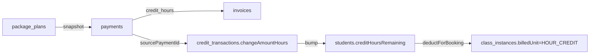
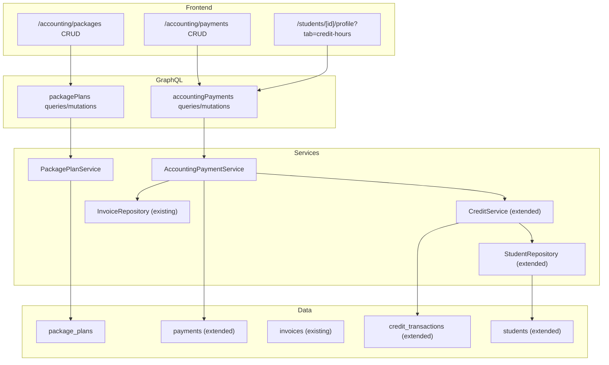

# Student Credit-Hours System — Design Specifications

## Document Information

- **Feature Name**: Credit-Hours Payments Module (Accounting extension on top of existing credit + quota ledgers)
- **Version**: 1.0
- **Date**: 2026-08-12
- **Related Documents**:
  - [Implementation Guide](./implementation.md)
  - [Trackable Tasks](./trackable-tasks.md)
- **Outcome Directory**: `.ai/plans/student-credit-hours-system/outcome/` — all task outcomes, research findings, and knowledge artifacts
- **Customer Reference**: Tiba Alarabya LMS Financial & Accounting (v1.5.2) — Payments Module video spec

## Overview

Introduce **credit-hour-based billing** as a parallel ledger alongside Siraj's existing class-count credits. Today, `students.classesRemaining` + `credit_transactions.changeAmount` track class sessions; the customer's video shows a separate financial accounting model where students buy **hour packages** (e.g. PLAN A-4HRS, PLAN B-6HRS), pay via tracked **payment gateways** (None, PayPal, Western Union, Bank), and the hours are credited to a per-student hour balance.

This is an **extension**, not a replacement:
- Existing class-count flow (`CreditService.recordPurchase` / `deductForBooking` / `refundOnCancel`) is **unchanged**.
- New hour-based operations write a **new nullable `changeAmountHours` column** on `credit_transactions` (existing rows keep `changeAmount` only — no backfill).
- New `AccountingPaymentService` orchestrates: `package_plans` → `invoices` → `payments` → `credit_transactions` (hour grant) → `students.creditHoursRemaining` bump — all in one transaction.

### Why extend and not replace

1. Existing students, parents, teachers, and recurring-class engine all read `students.classesRemaining`. Replacing it would force a rewrite of the scheduling, quota, and notification subsystems.
2. The video shows two parallel accounting models: "per-class" (existing Siraj) and "per-hour packages" (new). Some academies bill only by class; others only by hour; mixed academies use both.
3. `credit_transactions` already has the right shape — idempotency key, source payment FK, reason enum, class-instance FK. Adding a sibling `change_amount_hours` numeric column reuses 100% of the ledger invariants (unique idempotency key, append-only, FK cascade).

### Design Goals

- Provide a **credit-hour ledger** that mirrors the class-count ledger's idempotency and concurrency guarantees.
- Support **predefined package plans** (codename, hours, price, currency) that auto-fill the Add-Payment form.
- Track the **payment gateway** (None, PayPal, Western Union, Bank, Other) on every payment row.
- Provide a **Paid toggle** (`isPaidStatusOn`) that drives invoice status without requiring a separate `paymentDate` entry — matches the video's UX.
- Support filtering payments by **Student, Parent, From/To Date, Unpaid-only toggle**.
- Reuse the existing `invoices` + `payments` tables (extend with nullable columns) instead of duplicating them.
- Reuse the existing `currencyCodeEnum` (EGP, USD, EUR, GBP, SAR, …) — no new currency enum.
- Add a new `Accounting` sidebar group with `Payments` as its first item.

### Key Design Decisions

1. **Two parallel ledgers, one shared `credit_transactions` table** — existing rows use `changeAmount` (classes); new rows use `changeAmountHours` (decimal). A single row may carry EITHER classes OR hours, never both (enforced by CHECK constraint). This keeps the audit trail unified and lets `getStudentTransactions` return both in one query.
2. **`students.creditHoursRemaining` + `students.creditHoursTotal`** mirror the existing `classesRemaining`/`classesTotal` columns (numeric 12,2). Same optimistic-lock `version` column applies.
3. **`package_plans` is a config table, not a quota.** A package plan is a **catalog entry** (name, codename, hours, price, currency, active). When a student buys one, we copy the hour/price/currency snapshot onto the payment row — the plan can later be edited without retroactively changing payments.
4. **`payments` table extended**, not replaced. New nullable columns: `package_plan_id`, `payment_gateway`, `credit_hours`, `is_paid_status_on`, `payment_note`. Existing payment rows default these to NULL/FALSE — fully backward compatible.
5. **`PaymentGateway` enum** lives in the existing `backend/enum/billing/` barrel (new file `package-plan.enum.ts`); the corresponding pgEnum (`payment_gateway`) is registered in `backend/db/schema/enums.ts` via the shared `createPgEnumFromEnum("payment_gateway", PaymentGateway)` utility (matching the existing pattern for `currencyCodeEnum`, `creditReasonEnum`, etc. — NOT raw `pgEnum(...)`). Registered in the existing Pothos enum registry at `backend/graphql/pothos/shared/enum.pothos.ts` via `gqlSchemaBuilder.enumType(PaymentGateway, { name: "PaymentGateway" })`.
6. **AccountingPaymentService is the single orchestrator.** No repo writes payment rows directly; the service wraps `InvoiceRepository` + `PaymentRepository` + `CreditService.recordHourPurchase` + `StudentRepository.addCreditHours` in one `db.transaction`.
7. **Idempotency** uses the existing SHA-256 pattern from `CreditService` (`deriveBookingIdempotencyKey`), keyed on `studentId|packagePlanId|paymentDate|amount|currency|gateway`.
8. **No double-deduction.** Hour deductions for class instances (when a class consumes hours instead of a class credit) go through `CreditService.deductHoursForBooking` — a NEW method that never touches `students.classesRemaining`.
9. **Per-instance `billedUnit` discriminator** on `class_instances` — new nullable enum `CLASS_CREDIT` | `HOUR_CREDIT` (default NULL = legacy class-credit billing). Existing instances stay NULL; new hour-billed instances set `HOUR_CREDIT` and call `deductHoursForBooking`.
10. **Permission `ACCOUNTING_PAYMENTS_MANAGE` + `ACCOUNTING_PAYMENTS_VIEW`** are new; the existing `BILLING_CREATE_INVOICE` / `BILLING_UPDATE_STATUS_PAID` permissions remain for the legacy invoice flow.

## User Experience & Navigation (MANDATORY SECTION)

### New Routes & Role-Based Access

| Route | Purpose | Permission | Roles with Access |
|-------|---------|-----------|--------------------|
| `/accounting/payments` | Payments data table | `ACCOUNTING_PAYMENTS_VIEW` | super_admin, academy_admin, staff_default |
| `/accounting/payments/new` | Add Payment form | `ACCOUNTING_PAYMENTS_MANAGE` | super_admin, academy_admin |
| `/accounting/payments/[id]` | Payment detail (read-only) | `ACCOUNTING_PAYMENTS_VIEW` | super_admin, academy_admin, staff_default |
| `/accounting/payments/[id]/edit` | Edit Payment | `ACCOUNTING_PAYMENTS_MANAGE` | super_admin, academy_admin |
| `/accounting/packages` | Package Plans catalog | `ACCOUNTING_PAYMENTS_VIEW` | super_admin, academy_admin, staff_default |
| `/accounting/packages/new` | Create Package Plan | `ACCOUNTING_PAYMENTS_MANAGE` | super_admin, academy_admin |
| `/accounting/packages/[id]/edit` | Edit Package Plan | `ACCOUNTING_PAYMENTS_MANAGE` | super_admin, academy_admin |
| `/students/[id]/profile?tab=credit-hours` | Student credit-hours tab (new) | `STUDENT_EDIT_QUOTA` (existing) + new `ACCOUNTING_PAYMENTS_VIEW` for write actions | ALL audiences (student/parent read-only own; teacher read-only assigned; admin manage) |

### Sidebar Navigation Placement

A **new sidebar group `grp_accounting`** is created as a sibling of the existing **`grp_finance`** group (the actual existing group ID is `grp_finance` — NOT `grp_accounting` or `grp_billing`):

```
grp_accounting (Accounting)
  ├── Payments   (/accounting/payments)        → ACCOUNTING_PAYMENTS_VIEW
  │   ├── List   (/accounting/payments)
  │   ├── New    (/accounting/payments/new)      → ACCOUNTING_PAYMENTS_MANAGE
  │   └── View   (/accounting/payments/[id])
  └── Packages   (/accounting/packages)          → ACCOUNTING_PAYMENTS_VIEW
      ├── New    (/accounting/packages/new)      → ACCOUNTING_PAYMENTS_MANAGE
      └── Edit   (/accounting/packages/[id]/edit)
```

Navigation labels for the new group + items live in `shared/locale/types/dashboard/core/nav.ts` (as part of `DashboardNavigationLabels` interface — alongside existing `navGroupFinance`, `billingAdmin`, etc.).

Mobile bottom nav: add `accounting-payments` to `BOTTOM_NAV_ITEMS` for STAFF+ roles; not exposed on student/parent mobile.

### Per-Audience Rendering: Student Credit-Hours Tab

The new `/students/[id]/profile?tab=credit-hours` page renders role-specific content:

| Audience | Prominent Content |
|----------|-------------------|
| **Student** | Own credit-hours balance, recent hour purchases, low-balance alert |
| **Parent** | Children's hour balances (read-only), top-up CTA |
| **Teacher** | Assigned students' hour balances, "next class consumes X hours" |
| **Supervisor** | All students' hour balances, summary stats |

### Mobile vs Desktop

| Aspect | Desktop | Mobile |
|--------|---------|--------|
| Payments table | DataGrid with full column set | Card list with key fields (Student, Credit, Paid, Date) |
| Add Payment form | Modal/drawer form with package auto-fill | Inline stacked sections |
| Payment detail | Side panel + tabbed sections | Full-screen with collapsible sections |
| Package Plans | DataGrid CRUD | Card list with edit pencil |

Shared: navigation config, permission checks, ViewModels, GraphQL documents.

### Permission Matrix

| Permission | Value | Granted To (via groups) |
|------------|-------|--------------------------|
| `ACCOUNTING_PAYMENTS_VIEW` | `accounting.payments_view` | `super_admin`, `academy_admin`, `staff_default` |
| `ACCOUNTING_PAYMENTS_MANAGE` | `accounting.payments_manage` | `super_admin`, `academy_admin` |

---

## Architecture

### System Context



### High-Level Component Architecture



## Data Models

### Entity: `package_plans` (NEW)

| Column | Type | Notes |
|--------|------|-------|
| `id` | UUID PK | |
| `codename` | varchar 50 NOT NULL UNIQUE | e.g. `PLAN_A_4HRS` (machine code) |
| `displayName` | varchar 255 NOT NULL | e.g. "Plan A — 4 Hours" |
| `description` | text nullable | rich text for catalog tooltip |
| `creditHours` | numeric(12,2) NOT NULL | hours granted on purchase |
| `priceAmount` | numeric(12,2) NOT NULL | displayed price |
| `currency` | currencyCodeEnum NOT NULL | EGP / USD / EUR / GBP / SAR … |
| `active` | boolean NOT NULL DEFAULT true | soft-disable for catalog |
| `sortOrder` | integer NOT NULL DEFAULT 0 | catalog ordering |
| `metadata` | jsonb nullable | extensible (e.g. `validityDays`, `bonusHours`) |
| `createdAt` | timestamptz NOT NULL DEFAULT NOW() | |
| `updatedAt` | timestamptz NOT NULL DEFAULT NOW() | |
| `deletedAt` | timestamptz nullable | soft-delete |

**Indexes:** `unique(codename) WHERE deleted_at IS NULL`, `(active, sortOrder)`.

### Entity: `credit_transactions` (EXTENDED — add one column)

Existing columns unchanged. Add:

| Column | Type | Notes |
|--------|------|-------|
| `changeAmountHours` | numeric(12,2) nullable | NULL for legacy class-based rows; non-null for hour-based rows |

**New CHECK constraint:**

```sql
-- A row must affect EITHER classes OR hours, never both or neither.
CHECK (
  (change_amount IS NOT NULL AND change_amount_hours IS NULL)
  OR
  (change_amount IS NULL AND change_amount_hours IS NOT NULL)
)
```

> ⚠️ **Migration note:** existing rows all have `change_amount` NOT NULL and `change_amount_hours` will default to NULL → the constraint passes for existing rows. The existing `change_amount` column must be relaxed from `NOT NULL` to `NULL` (it stays populated for all class rows, but new hour rows will set it to NULL).

### Entity: `payments` (EXTENDED — add 5 nullable columns)

Existing columns unchanged. Add:

| Column | Type | Notes |
|--------|------|-------|
| `packagePlanId` | UUID nullable FK → package_plans ON DELETE SET NULL | nullable for backward compat; new accounting payments reference the plan |
| `paymentGateway` | paymentGatewayEnum NOT NULL DEFAULT `NONE` | NONE / PAYPAL / WESTERN_UNION / BANK / OTHER |
| `creditHours` | numeric(12,2) nullable | hours granted by this payment (snapshot of plan at purchase time; allows plan edits later) |
| `isPaidStatusOn` | boolean NOT NULL DEFAULT false | the "Paid toggle" from the video — drives invoice `status` flip |
| `paymentNote` | text nullable | rich-text note from the video |

**Indexes:** `(paymentGateway)`, `(packagePlanId)`, `(isPaidStatusOn)`.

### Entity: `invoices` (EXTENDED — add 1 nullable column)

| Column | Type | Notes |
|--------|------|-------|
| `creditHours` | numeric(12,2) nullable | hours granted via this invoice (denormalized from payment for fast filtering) |

**New `invoiceType` enum value:** `CREDIT_HOURS_PACKAGE` — added to the existing `invoiceTypeEnum`.

### Entity: `students` (EXTENDED — add 2 columns + 2 CHECKs)

Existing `classesRemaining` / `classesTotal` unchanged. Add:

| Column | Type | Notes |
|--------|------|-------|
| `creditHoursRemaining` | numeric(12,2) NOT NULL DEFAULT 0 | live hour balance |
| `creditHoursTotal` | numeric(12,2) NOT NULL DEFAULT 0 | lifetime purchased hours (mirrors `classesTotal`) |

**New CHECK constraints:**

```sql
CHECK (credit_hours_remaining >= 0)
CHECK (credit_hours_total >= 0)
```

### Entity: `class_instances` (EXTENDED — add 1 column)

| Column | Type | Notes |
|--------|------|-------|
| `billedUnit` | billedUnitEnum nullable | NULL for legacy class-credit instances; `CLASS_CREDIT` or `HOUR_CREDIT` for new instances |

**Why nullable:** existing instances have no concept of "billed unit" — they implicitly consume a class credit. New instances created via the accounting flow explicitly set `HOUR_CREDIT` and call `CreditService.deductHoursForBooking` instead of `deductForBooking`.

### System Settings (new keys)

| Key | Default | Purpose |
|-----|---------|---------|
| `accounting_default_currency` | `EGP` | Default currency in the Add Payment form |
| `accounting_low_hours_threshold` | `2.00` | Low-balance alert threshold (hours) |
| `accounting_paid_toggle_auto_flips_invoice` | `true` | When true, toggling `isPaidStatusOn` ON flips invoice status to PAID |

**Table exists:** `system_settings` (read via `SystemSettingsService`). Seed defaults via custom migration.

---

## User Stories & EARS Acceptance Criteria

### Epic 1: Package Plans Catalog

**US-1.1 — Admin creates a package plan**

> As an academy admin, I want to create predefined hour packages (e.g. "Plan A — 4 Hours") so that the Add Payment form can auto-fill the credit/paid/currency fields when a student purchases one.

**Acceptance criteria (EARS):**

- **WHEN** the admin navigates to `/accounting/packages/new` and submits a valid form (codename, displayName, creditHours > 0, priceAmount > 0, currency ∈ supported set), **THE SYSTEM SHALL** insert a new row into `package_plans` with `active=true` and `sortOrder=0` (or max+1).
- **WHEN** the admin submits a form with a `codename` that already exists (case-insensitive), **THE SYSTEM SHALL** reject with `package.codenameAlreadyExists` and NOT insert.
- **WHEN** the admin submits a form with `creditHours <= 0` or `priceAmount <= 0`, **THE SYSTEM SHALL** reject with `package.invalidInput`.
- **WHEN** the package is created, **THE SYSTEM SHALL** log an audit event with actor, codename, and snapshot.
- **WHILE** the form is being filled, **THE SYSTEM SHALL** disable the submit button until all required fields are valid.

**US-1.2 — Admin edits / archives a package plan**

- **WHEN** the admin archives a package (sets `active=false`), **THE SYSTEM SHALL** keep the row queryable for past payments but hide it from the catalog dropdown in the Add Payment form.
- **WHEN** the admin edits `creditHours` or `priceAmount` on a package, **THE SYSTEM SHALL NOT** retroactively change existing payments that reference this plan (snapshot pattern).

### Epic 2: Add Payment (Award Credit Hours)

**US-2.1 — Admin records an accounting payment**

> As an academy admin, I want to record a student's payment for an hour package, auto-fill the form from a selected package, track the payment gateway, and toggle paid status — exactly like the Tiba Alarabya video.

**Acceptance criteria (EARS):**

- **WHEN** the admin opens `/accounting/payments/new`, **THE SYSTEM SHALL** render a form with: Student select, Package Plan select (active only), Credit (numeric, auto-filled), Paid (numeric, auto-filled), Currency (auto-filled, editable), Payment Gateway (None/PayPal/Western Union/Bank/Other), Payment Date, Paid toggle (default OFF), Note (rich text).
- **WHEN** the admin selects a package plan, **THE SYSTEM SHALL** auto-fill Credit, Paid, Currency from the plan snapshot — these remain editable so the admin can override (e.g. discounted price).
- **WHEN** the admin submits with a valid student + plan + amount > 0 + currency, **THE SYSTEM SHALL** in a single DB transaction:
  1. Insert an `invoices` row with `invoiceType=CREDIT_HOURS_PACKAGE`, `amount` = Paid, `currency` = selected, `creditHours` = Credit, `status` = `UNPAID` or `PAID` based on the Paid toggle.
  2. Insert a `payments` row referencing the invoice, with `packagePlanId`, `paymentGateway`, `creditHours`, `isPaidStatusOn`, `paymentNote`, and a deterministic `idempotencyKey`.
  3. Insert a `credit_transactions` row with `changeAmountHours` = Credit, `changeAmount` = NULL, `reason = PURCHASE`, `sourcePaymentId` = new payment id.
  4. Bump `students.creditHoursRemaining` and `students.creditHoursTotal` by Credit.
- **WHEN** the admin re-submits the same form (same student + plan + amount + date + gateway) within the idempotency window, **THE SYSTEM SHALL** return the existing payment row instead of creating a duplicate.
- **WHEN** the Paid toggle is ON at submission, **THE SYSTEM SHALL** set `invoices.status = PAID` and `invoices.paidDate = paymentDate`.
- **WHEN** the Paid toggle is OFF, **THE SYSTEM SHALL** set `invoices.status = UNPAID` and `paidDate = NULL`.
- **IF** the student does not exist, **THE SYSTEM SHALL** reject with `studentNotFound`.
- **IF** the package plan is archived between form-open and submit, **THE SYSTEM SHALL** reject with `package.planArchived`.

**US-2.2 — Admin toggles Paid status after creation**

- **WHEN** the admin flips `isPaidStatusOn` from OFF → ON on an existing payment, **THE SYSTEM SHALL** set the parent invoice `status = PAID` and `paidDate = NOW()` (or `paymentDate` if already set).
- **WHEN** the admin flips ON → OFF, **THE SYSTEM SHALL** revert invoice `status = UNPAID` and clear `paidDate` (only if no other paid payment exists on the same invoice).
- **IF** `accounting_paid_toggle_auto_flips_invoice` is `false`, **THE SYSTEM SHALL NOT** touch the invoice status — only the payment row's toggle changes.

### Epic 3: Payments Data Table & Filters

**US-3.1 — Admin views the payments table**

> As an academy admin, I want a paginated table of all accounting payments with columns matching the video: Student Name, Credit, Paid, Currency, Package, Payment Gateway, Payment Date, Created At, Actions.

**Acceptance criteria (EARS):**

- **WHEN** the admin opens `/accounting/payments`, **THE SYSTEM SHALL** render a DataGrid with the 9 columns above, sorted by `createdAt DESC` by default, paginated 25/page.
- **WHEN** the admin filters by **Student**, **THE SYSTEM SHALL** show only payments for that student.
- **WHEN** the admin filters by **Parent**, **THE SYSTEM SHALL** show payments for all students linked to that parent.
- **WHEN** the admin filters by **From Date / To Date**, **THE SYSTEM SHALL** filter on `paymentDate` (inclusive).
- **WHEN** the admin toggles **Unpaid only**, **THE SYSTEM SHALL** filter on `isPaidStatusOn = false`.
- **WHEN** multiple filters are combined, **THE SYSTEM SHALL** AND them.
- **WHEN** no payments match, **THE SYSTEM SHALL** render an empty state with the localized `payments.empty` message.

**US-3.2 — Admin edits a payment**

- **WHEN** the admin opens a payment's edit page, **THE SYSTEM SHALL** pre-fill all fields from the existing row.
- **WHEN** the admin edits the `paymentNote` or `paymentGateway` and saves, **THE SYSTEM SHALL** update the payment row only (no credit / invoice re-derivation).
- **WHEN** the admin edits `creditHours` upward, **THE SYSTEM SHALL** insert an ADJUSTMENT credit_transaction row with `changeAmountHours` = delta, and bump the student's balance.
- **WHEN** the admin edits `creditHours` downward, **THE SYSTEM SHALL** reject if it would push `students.creditHoursRemaining` below 0; otherwise insert a negative ADJUSTMENT row.

### Epic 4: Hour-Based Class Booking

**US-4.1 — Booking consumes credit hours instead of class credits**

> As an academy admin scheduling a class for an hour-billed student, I want the system to consume from the student's credit-hour balance, not the class-count balance.

> **SCOPE NOTE:** The full wiring of `class_instances.billedUnit = HOUR_CREDIT` into recurring-schedule generation + class-instance activation depends on Epic 6's `student.billingMode` discriminator (deferred). For v1, only the CreditService-side primitives (`deductHoursForBooking` / `refundHoursOnCancel`) are implemented (Task 3.2) so that the scheduling integration can be added in a future plan without re-touching the CreditService. Tasks 3.2 + 1.5 (schema) + 1.7 (TS enum) cover the v1 in-scope portion of this AC.

**Acceptance criteria (EARS):**

- **WHEN** a recurring schedule is created for an hour-billed student (flagged via `student.billingMode = HOUR_BASED` — deferred to Epic 6), **THE SYSTEM SHALL** set `class_instances.billedUnit = HOUR_CREDIT` for all generated instances.
- **WHEN** a class instance with `billedUnit = HOUR_CREDIT` is activated (session start), **THE SYSTEM SHALL** call `CreditService.deductHoursForBooking` with the instance's duration (in hours, rounded to 2 decimals) instead of `deductForBooking`.
- **WHEN** the student has insufficient `creditHoursRemaining`, **THE SYSTEM SHALL** block activation with `credit.insufficientHours`.
- **WHEN** the instance is cancelled before session start, **THE SYSTEM SHALL** call `CreditService.refundHoursOnCancel` (no-op if already refunded via idempotency key).

### Epic 5: Student Credit-Hours Tab

**US-5.1 — Student views own hour balance**

> As a student, I want to see my remaining credit hours and recent hour purchases on my profile.

**Acceptance criteria (EARS):**

- **WHEN** a student opens their profile `?tab=credit-hours`, **THE SYSTEM SHALL** render a card with current `creditHoursRemaining`, total `creditHoursTotal`, and a table of their last 10 hour-based `credit_transactions`.
- **WHEN** `creditHoursRemaining` < `accounting_low_hours_threshold`, **THE SYSTEM SHALL** render a low-balance alert.

### Epic 6 (DEFERRED — out of scope for this plan)

> Future epic: `student.billingMode` discriminator (`CLASS_BASED` | `HOUR_BASED` | `MIXED`) to drive which booking path each student uses. Listed here only to show the extension point; not implemented in this plan.

---

## Edge Cases

| # | Scenario | Expected Behavior |
|---|----------|-------------------|
| EC-1 | Concurrent Add Payment for same student+plan+amount+date | Second request returns first's row via idempotency unique constraint (23505 → friendly `duplicatePurchase`) |
| EC-2 | Package plan archived mid-transaction | Payment insert succeeds (FK is `ON DELETE SET NULL`, archived check is at service layer via `active=false`) — but service pre-check rejects with `package.planArchived` |
| EC-3 | Paid toggle ON → OFF when invoice has multiple payments | Service checks: if any other payment on the same invoice still has `isPaidStatusOn=true`, leave invoice status as PAID |
| EC-4 | Admin edits `creditHours` down past current balance | Service rejects with `credit.insufficientHours` (HTTP 409 / GraphQL `ConflictError`) |
| EC-5 | Currency mismatch between package plan and existing student balance | Service allows it (a student may have hours in multiple currencies — they're tracked as a single numeric balance, currency is informational on the payment row); add a soft warning in the UI |
| EC-6 | Refund of a payment after partial hour consumption | Refund inserts a negative `change_amount_hours` ADJUSTMENT row capped at `(original - consumed)`; consumed hours are not refundable |
| EC-7 | Hour-billed instance scheduled for 0 minutes duration | Service rejects with `class.invalidDuration` |
| EC-8 | Student deleted after payment recorded | `credit_transactions.studentId` FK has `ON DELETE CASCADE` — payment row remains (`payments.studentId` is via invoice which has `ON DELETE RESTRICT`); the student is removed from the table joins |
| EC-9 | Migration on a DB with existing class-based rows | `change_amount_hours` column added as nullable; existing rows have `change_amount_hours IS NULL` and pass the new XOR CHECK constraint |
| EC-10 | Admin creates package plan with same codename after archival | Unique index is `WHERE deleted_at IS NULL` — soft-deleted codename can be reused |
| EC-11 | Payment gateway NONE + Paid toggle ON | Allowed — "Paid in cash at the academy" use case |
| EC-12 | Bulk payment import (future) | Out of scope — single-payment insert only |

## Non-Functional Requirements

- **Performance:** Payments table query with all filters + pagination must complete < 200ms p95 on a 100k-row dataset (covered by indexes on `studentId`, `paymentDate`, `isPaidStatusOn`, `packagePlanId`, `paymentGateway`).
- **Idempotency:** Every state-changing operation (purchase, paid-toggle, edit) produces a deterministic SHA-256 idempotency key; duplicates return the original row.
- **Audit trail:** Every credit_transaction insert is logged via `logger.info` with actor, studentId, changeAmountHours, reason, sourcePaymentId.
- **i18n:** All user-facing strings live in `shared/locale/types/dashboard/accounting/` (for page/form/grid labels) and `shared/locale/types/dashboard/core/nav.ts` (for navigation labels — reusing the existing `DashboardNavigationLabels` interface). Error strings live in `shared/locale/types/errors/index.ts` (extending existing `CreditErrors` + adding a new `PackageErrors` interface + `package: PackageErrors` property on `ErrorsLabels`). EN + AR implementations in `shared/locale/{en,ar}/dashboard/accounting/*.json`; no hardcoded strings.
- **RTL:** Arabic layout renders the Add Payment form fields right-to-left; currency symbols stay LTR.
- **Accessibility:** Payments DataGrid is keyboard-navigable (Tab, Arrow keys, Enter to open detail); all form fields have `aria-label` from i18n keys.
- **Backward compatibility:** Existing `/billing`, `/invoices`, `/quotas` flows continue to work unchanged; no migration required for existing data.
- **Permission isolation:** A user without `ACCOUNTING_PAYMENTS_VIEW` cannot see the Accounting sidebar group; the GraphQL queries return `ForbiddenError` for the new types.

## Backward Compatibility

- All new columns on existing tables are nullable with sensible defaults → existing rows pass all new CHECK constraints.
- `change_amount` on `credit_transactions` is relaxed from `NOT NULL` to `NULL` — this is the only breaking schema change, mitigated by the XOR CHECK constraint that enforces exactly one of `change_amount` / `change_amount_hours` is non-null per row.
- Existing `CreditService.recordPurchase` / `deductForBooking` / `refundOnCancel` are unchanged — they continue to set `change_amount` and leave `change_amount_hours = NULL`.
- New `CreditService.recordHourPurchase` / `deductHoursForBooking` / `refundHoursOnCancel` set `change_amount = NULL` and `change_amount_hours` to the hour value.
- Existing `class_instances` rows have `billedUnit = NULL` → they continue to call the existing `deductForBooking` path.

## Open Questions (resolve during implementation)

- **Mixed-currency student balances** — defer a true multi-currency hour ledger; for v1 the balance is a single numeric and currency is informational on the payment row.
- **Hour refund policy** — should refunds prorate against the most recent purchase, or be free-form? Defer to v1 free-form with admin note.
- **Package plan → quota bridge** — should buying an hour package also create a `quotas` row (kind=PACKAGE) with `totalHours`? The quotas table currently tracks classes only. Deferred to a follow-up plan; for v1 the hours sit on `students.creditHoursRemaining` directly.

## Acceptance Criteria — Knowledge Propagation Protocol

All implementation tasks MUST satisfy these acceptance criteria in addition to their functional requirements:

1. **Outcome Knowledge Base**: Every task writes an outcome file to `.ai/plans/student-credit-hours-system/outcome/<task-id>-outcome.md`.
2. **Pre-Execution Knowledge Read**: Before executing any task, read ALL existing files in `.ai/plans/student-credit-hours-system/outcome/`.
3. **Per-File Quality Loop**: Every file passes `bun tsgo` + `bun biome:check` + lint queue before being imported elsewhere.
4. **Global Health Check**: After all files in a task pass, `bun tsgo && bun biome:check && bun run lint` exits 0.
5. **Instruction Verification**: Every file is validated against ALL applicable AGENTS.md and `.agents/instructions/*.md` files.
6. **Knowledge Propagation (Final Task)**: Consolidate learnings into `docs/billing/credit-hours-system.md`, update layer AGENTS.md files, update `.agents/skills/drizzle/SKILL.md` and `.agents/skills/review-frontend/SKILL.md` (the plan originally referenced `.agents/skills/frontend-patterns/SKILL.md`, which does NOT exist in this repo).
7. **Progress Tracking**: Task checkboxes in `trackable-tasks.md` are updated `[ ]` → `[x]` upon completion of each subtask.

---

### Implementation Instruction References

**For subagents implementing any task, read these instruction files before starting:**

| Layer | AGENTS.md | .agents/instructions |
|-------|-----------|---------------------|
| Root | `/home/z/my-project/siraj-clone/AGENTS.md` | — |
| Backend Schema | `backend/db/schema/AGENTS.md` | `.agents/instructions/backend.instructions.md` |
| Backend Repos | `backend/db/repo/AGENTS.md` | `.agents/instructions/backend.instructions.md` |
| Backend Services | `backend/services/AGENTS.md` | `.agents/instructions/backend.instructions.md` |
| Backend GraphQL | `backend/graphql/AGENTS.md` | `.agents/instructions/backend.instructions.md` |
| Backend Types | `backend/types/AGENTS.md` | `.agents/instructions/backend.instructions.md` |
| Backend Enums | `backend/enum/AGENTS.md` | `.agents/instructions/backend.instructions.md` |
| Backend Tests | `backend/db/test/AGENTS.md` | `.agents/instructions/backend.instructions.md`, `.agents/instructions/tests.instructions.md` |
| Shared Locale | `shared/AGENTS.md` | — |
| App Router | `app/AGENTS.md` | `.agents/instructions/frontend.instructions.md` |
| Frontend Common | `frontend/common/views/AGENTS.md`, `frontend/common/graphql/AGENTS.md`, `frontend/common/stores/AGENTS.md` | `.agents/instructions/frontend.instructions.md` |

**Per-file verification loop after quality loop:**

```bash
bun tsgo
bun biome:check
curl -s -X POST http://localhost:4777/lint -H "Content-Type: application/json" -d '{"id":"verify","files":["<file-path>"]}'
```
