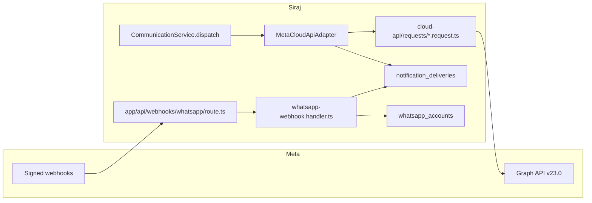

# WhatsApp Integration — Implementation Guide

## Document Information

- **Feature Name**: WhatsApp Business Cloud API (Meta direct)
- **Version**: 1.0
- **Date**: 2026-07-30
- **Related Documents**:
  - [Requirements (Specs)](./specs.md)
  - [Trackable Tasks](./trackable-tasks.md)

## Pre-Implementation Checklist

Before starting any task in [trackable-tasks.md](./trackable-tasks.md):

- [ ] Read root `AGENTS.md` and layer-specific AGENTS.md for each file you touch
- [ ] Read [specs.md](./specs.md) for requirements and confirmed stakeholder decisions
- [ ] Mark the task `[-]` in trackable-tasks.md when starting
- [ ] Mark the task `[x]` when complete and verified
- [ ] Run per-file verification loop before importing new code elsewhere

## Implementation Strategy

Build bottom-up in dependency order:

1. **Channel enum + types** → compile-time safety (`default: never` in `CommunicationService`)
2. **Env-config keys** → `whatsapp_accounts` schema → types → repository → services
3. **Typed Graph API request builders** → adapter → channel factory → `CommunicationService` dispatch
4. **Permissions migration (8a/8b)** before GraphQL mutations that gate on them
5. **Webhook route + handler** after delivery rows and account repo exist
6. **GraphQL + codegen** before any frontend Apollo hooks
7. **i18n namespace** before admin UI strings
8. **Frontend Numbers page** (tier-isolated) after GraphQL documents + codegen
9. **Tests** (`@live-comm` per request builder + webhook unit tests) in parallel where possible
10. **Quality gate** as final verification

### Development Conventions (from AGENTS.md)

- Runtime: **Bun** (not Node.js)
- Logging: `logger` from `@/backend/lib/logger` (backend) or `@/frontend/utils/logger` (frontend) — never `console.*`
- Path aliases: `@/*` maps to project root — no relative imports across layers
- i18n: compile-time system in `shared/locale/` — never hardcode user-facing strings
- GraphQL documents: `frontend/common/graphql/sharedDocuments/whatsapp/whatsapp.documents.ts`
- GraphQL hooks: import from `@apollo/client/react` — **NO `useLazyQuery`**
- Database tests: always use `runInRollback`; never `expect().rejects.toThrow()` inside it
- After Pothos/schema changes: `bun run generate:gqlSchema && bun codegen`
- After DB schema: `bun run db push` (no migrate for new tables during dev)
- **No official Meta Node SDK** — use typed `fetch` builders + `@live-comm` integration tests (REQ-9)

### Per-File Verification Loop (with layer-specific AGENTS.md)

After creating or extracting a file, before importing it elsewhere:

```bash
bun tsgo
bun biome:check
curl -s -X POST http://localhost:4777/lint \
  -H "Content-Type: application/json" \
  -d '{"id":"verify","files":["<the-file>"]}'
```

Then read **all applicable AGENTS.md files** for that file's layer (per `scripts/health/sub-loop.ts` mapping):

| File Path Prefix | AGENTS.md Files to Read (in addition to root `AGENTS.md`) |
|------------------|----------------------------------------------------------|
| `app/` | `app/AGENTS.md` |
| `backend/services/` | `backend/services/AGENTS.md`, `backend/AGENTS.md` |
| `backend/graphql/` | `backend/graphql/AGENTS.md`, `backend/AGENTS.md` |
| `backend/db/repo/` | `backend/db/repo/AGENTS.md`, `backend/AGENTS.md` |
| `backend/db/schema/` | `backend/db/schema/AGENTS.md`, `backend/AGENTS.md` |
| `backend/enum/` | `backend/enum/AGENTS.md`, `backend/AGENTS.md` |
| `backend/types/` | `backend/types/AGENTS.md`, `backend/AGENTS.md` |
| `backend/lib/` | `backend/AGENTS.md` |
| `shared/` | `shared/AGENTS.md` |
| `frontend/common/graphql/sharedDocuments/` | `frontend/common/graphql/sharedDocuments/AGENTS.md`, `frontend/common/graphql/AGENTS.md`, `frontend/AGENTS.md` |
| `frontend/common/graphql/` | `frontend/common/graphql/AGENTS.md`, `frontend/AGENTS.md` |
| `frontend/common/views/` | `frontend/common/views/AGENTS.md`, `frontend/AGENTS.md` |
| `frontend/common/stores/` | `frontend/common/stores/AGENTS.md`, `frontend/AGENTS.md` |
| `frontend/desktop/views/` | `frontend/desktop/AGENTS.md`, `frontend/views/AGENTS.md`, `frontend/AGENTS.md` |
| `frontend/mobile/views/` | `frontend/mobile/AGENTS.md`, `frontend/views/AGENTS.md`, `frontend/AGENTS.md` |


**Applicable instruction files by file path:**
| File Path Prefix | Instruction File(s) |
|------------------|---------------------|
| `backend/**/*.ts` | `.agents/instructions/backend.instructions.md` |
| `frontend/**/*.tsx`, `app/**/*.tsx` | `.agents/instructions/frontend.instructions.md` |
| `**/*.test.ts`, `**/*.test.tsx`, `scripts/run-test/**` | `.agents/instructions/tests.instructions.md` |
| `frontend/desktop/**`, `frontend/mobile/**` | `.agents/instructions/mobile-desktop.instructions.md` |

Fix any violations found before importing the file elsewhere.

## Architecture Overview



### Design Goals

- Fifth notification channel piggybacking on existing `CommunicationService` + `notification_deliveries`
- Meta Cloud API direct (no BSP markup); `WHATSAPP_PROVIDER` env slot = `cloud_api` only
- Hybrid credentials: global secrets in env-config; per-account token + PIN encrypted in DB
- Status-only webhooks; inbound `messages[]` acknowledged with 200, not persisted
- Every Graph API call wrapped in a typed builder with a paired `@live-comm` test

### Key Design Decisions

| Decision | Rationale |
|----------|-----------|
| Reuse `notification_deliveries` | Same lifecycle as email/SMS; `providerMessageId` = `wamid` |
| No `whatsapp_templates` table in v1 | Templates authored in WhatsApp Manager; webhook events → audit log only |
| `portfolioMessagingLimitTier` + `throughputLevel` on accounts | Meta deprecated `messaging_limit_tier` / `old_limit` field names (2025–2026) |
| Pair rate limit in adapter | Meta ~1 msg / recipient / 6s; guard before HTTP to avoid error `131056` |
| Raw-body HMAC on webhook POST | Meta requires hash of raw bytes before JSON parse |
| Request builder per endpoint | No SDK; integration test matrix enforces API contract coverage |

## Phase 1: Channel Foundations

### 1.1 Extend channel enums and types

**`backend/types/notifications/communications.types.ts`**
- Add `"whatsapp"` to `CommunicationChannelType`

**`backend/enum/notifications/notificationDeliveries.enum.ts`**
- `WHATSAPP = "WHATSAPP"`

**`backend/db/schema/enums.ts`** + **`backend/graphql/pothos/shared/enum.pothos.ts`**
- Register Drizzle + Pothos enum

Run `bun run generate:gqlSchema && bun codegen`. `CommunicationService.dispatch` `default: never` must fail until `case "whatsapp"` exists.

### 1.2 Env-config registry (global secrets)

**`backend/lib/env-config-keys.ts`** + **`backend/types/shared/env-config.types.ts`**

New `whatsapp` category:

| Key | Secret | Notes |
|-----|--------|-------|
| `WHATSAPP_PROVIDER` | no | plain; valid value `cloud_api` only |
| `WHATSAPP_APP_ID` | no | Meta app ID |
| `WHATSAPP_APP_SECRET` | yes | webhook HMAC |
| `WHATSAPP_VERIFY_TOKEN` | yes | GET verification |
| `WHATSAPP_WABA_ID` | no | default WABA for sync |
| `WHATSAPP_WEBHOOK_BASE_URL` | no | public HTTPS base |

Per-account `accessToken`, `phoneNumberId`, `twoStepPin` → `whatsapp_accounts` (Phase 2), not env-config.

### 1.3 WhatsApp channel layer

Mirror `backend/services/communication/channels/email/` + `sms/twilio/`:

**`IWhatsappChannel.ts`**
```typescript
send(payload, locale?) → WhatsappSendResult
sendTemplate(payload, templateName, languageCode, components, locale?) → WhatsappSendResult
validateConfig() → boolean
disconnect() → void
```

**`WhatsappChannelFactory.ts`**
- Lazy singleton (clone `EmailChannelFactory.ts`)
- Validate `WHATSAPP_PROVIDER === "cloud_api"`; warn + fallback otherwise

**`cloud-api/requests/*.request.ts`** (typed builders — one file per Graph API call)

Each exports `buildRequest(ctx)` → `{ url, init }` and `parseResponse(body)`.

| Builder file | Graph API |
|--------------|-----------|
| `send-text-message.request.ts` | POST `/{phone_number_id}/messages` type text |
| `send-template-message.request.ts` | POST `/{phone_number_id}/messages` type template |
| `list-phone-numbers.request.ts` | GET `/{waba_id}/phone_numbers` |
| `get-phone-number.request.ts` | GET `/{phone_number_id}` |
| `register-phone-number.request.ts` | POST `/{phone_number_id}/register` |
| `deregister-phone-number.request.ts` | POST `/{phone_number_id}/deregister` |
| `request-verification-code.request.ts` | POST `/{phone_number_id}/request_code` |
| `verify-phone-number.request.ts` | POST `/{phone_number_id}/verify_code` |
| `list-message-templates.request.ts` | GET `/{waba_id}/message_templates` |
| `create-message-template.request.ts` | POST `/{waba_id}/message_templates` |
| `delete-message-template.request.ts` | DELETE `/{waba_id}/message_templates` |

**`MetaCloudApiAdapter.ts`**
- `fetch` to `https://graph.facebook.com/v23.0/...` with `AbortSignal.timeout(10_000)`
- Decrypt active account token via `field-encryption.ts`
- Pair-rate-limit map: last send timestamp per E.164 recipient; skip HTTP if &lt; 6s
- `NotificationRepository.createDelivery` / `updateDeliveryStatus`
- `deliveryFailedMessage("whatsapp")` on failure

**`cloud-api/integration/*.integration.test.ts`**
- One `@live-comm` test file per request builder (REQ-9)
- Skip when `WHATSAPP_ACCESS_TOKEN`, `WHATSAPP_TEST_TO_PHONE`, `WHATSAPP_WABA_ID` unset
- `whatsapp-api-call-coverage.test.ts` fails if any builder lacks paired test

### 1.4 Notification dispatch integration

**`notification-dispatch.helpers.ts`**
- `EVENT_CHANNEL_ALLOWLIST`: add `WHATSAPP` for `CLASS_REMINDER`, `CLASS_ACTIVATED`, `LESSON_REPORT_SUBMITTED`, `LESSON_REPORT_REVIEWED`, `INVOICE_GENERATED` (utility events)
- `recipientAddressForChannel`: `if (channel === "whatsapp") return user?.phone ?? ""`

**`notification-payloads.builders.ts`**
- `ALL_CHANNELS` += `WHATSAPP`
- `CHANNEL_FROM_ENUM.WHATSAPP = "whatsapp"`

**`communication.service.ts`**
- `case "whatsapp":` → `dispatchRecipientChannel` or dedicated branch calling `getWhatsappChannel()`

## Phase 2: Accounts Backend

### 2.1 Schema

**`backend/db/schema/whatsapp/whatsapp-accounts.ts`**

```typescript
export const whatsappAccounts = pgTable("whatsapp_accounts", {
  id: uuid("id").defaultRandom().primaryKey(),
  wabaId: varchar("waba_id", { length: 64 }).notNull(),
  phoneNumberId: varchar("phone_number_id", { length: 64 }).notNull().unique(),
  displayName: jsonb("display_name").$type<LocalizedString>(),
  displayPhoneNumber: varchar("display_phone_number", { length: 32 }),
  qualityRating: varchar("quality_rating", { length: 16 }), // GREEN/YELLOW/RED
  portfolioMessagingLimitTier: varchar("portfolio_messaging_limit_tier", { length: 32 }),
  throughputLevel: varchar("throughput_level", { length: 16 }), // STANDARD/COEXISTENCE/HIGH
  encryptedAccessToken: text("encrypted_access_token").notNull(),
  encryptedTwoStepPin: text("encrypted_two_step_pin").notNull(),
  isActive: boolean("is_active").notNull().default(true),
  lastWebhookAt: timestamp("last_webhook_at", { withTimezone: true, precision: 3 }),
  createdAt: timestamp("created_at", { withTimezone: true, precision: 3 }).notNull().defaultNow(),
  updatedAt: timestamp("updated_at", { withTimezone: true, precision: 3 })
    .notNull()
    .defaultNow()
    .$onUpdate(() => new Date()),  // B4 — repository need not set this manually
}, table => [index("whatsapp_accounts_waba_id_idx").on(table.wabaId)]);
```

Export via `backend/db/schema/whatsapp/index.ts` and `backend/db/schema/index.ts`.

**Partial index on `notification_deliveries.provider_message_id`** (B5) — add to `backend/db/schema/communications/communications.ts` in the table's index list:

```typescript
index("notification_deliveries_provider_message_id_idx")
  .on(table.providerMessageId)
  .where(sql`${table.providerMessageId} IS NOT NULL`)
```

**Migrations:**

- **Drizzle-generated**: the `whatsapp_accounts` table + partial index above will be picked up by Drizzle when you run `bun db push` (after schema edits)
- **Custom SQL (edit in place — our `bun db migrate` auto-detects modified SQL files):**
  1. `backend/db/migration/8a-whatsapp-permissions-enum.sql` — enum values only (REQ-6, BL2: exactly 3 perms)
  2. `backend/db/migration/8b-whatsapp-permissions-data.sql` — seed rows + `super_admin` grants; mirror `7a/7b` with `trg_protect_system_permissions` wrap

After editing the custom SQL files, run:

```bash
bun db migrate
bun db push
```

### 2.2 Types

**`backend/types/whatsapp/whatsapp-account.types.ts`**
- `WhatsappAccountSelectType`, `InsertType`, `ReturnType`, `SubmitInput`, `UpdateInput`
- `ReturnType` excludes encrypted columns
- Separate mutation inputs: `SetWhatsappAccessTokenInput`, `SetWhatsappTwoStepPinInput`

### 2.3 Repository + service

**`whatsapp-account.repository.ts`** — CRUD, `findByPhoneNumberId`, `listActive`, all methods accept optional `tx`

**`whatsapp-account.service.ts`**
- Permission: `WHATSAPP_CONFIG_MANAGE` for writes, `WHATSAPP_VIEW` for reads
- `syncFromMeta()` — list + get phone numbers via request builders; map `portfolioMessagingLimitTier`, `throughputLevel`, `qualityRating`
- `setAccessToken`, `setTwoStepPin` — encrypt before persist; audit with `***`
- Optional `syncTemplates()` — list templates API only (no local table); audit log results

### 2.4 Permissions (two-phase migration)

**`backend/enum/permissions/permission.enum.ts`**
```typescript
WHATSAPP_VIEW = "whatsapp.view"
WHATSAPP_CONFIG_MANAGE = "whatsapp.config_manage"
WHATSAPP_TEMPLATES_MANAGE = "whatsapp.templates_manage"
// whatsapp.dispatch intentionally omitted — no send-mutation exists in v1 (BL2)
```

**`8a-whatsapp-permissions-enum.sql`** — enum values only  
**`8b-whatsapp-permissions-data.sql`** — seed rows + `super_admin` grants; mirror `7a/7b` with `trg_protect_system_permissions` wrap

**`backend/types/audit/audit.types.ts`** — `AuditEntityType.WHATSAPP_ACCOUNT`

### 2.5 GraphQL

**`backend/graphql/pothos/whatsapp/whatsapp.pothos.ts`** — objects + inputs from `backend/types/whatsapp` only; always `id`

**Mutations** (`whatsapp.mutation.ts`):
- `createWhatsappAccount`
- `updateWhatsappAccount` — also calls `resetWhatsappChannel()` on success (S4)
- `deleteWhatsappAccount`
- `syncWhatsappAccountsFromMeta` — includes `list-message-templates` reconciliation (BL3)
- `setWhatsappAccessToken` — also calls `resetWhatsappChannel()` (S4)
- `setWhatsappTwoStepPin` — also calls `resetWhatsappChannel()` (S4)

**Queries** (`whatsapp.query.ts`): `whatsappAccounts`, `whatsappAccount`

Use `withAuthResult` / `withAuthVoid` from existing mutation helpers.

Barrel exports + `bun run generate:gqlSchema && bun codegen`.

## Phase 3: Webhook Receiver

### 3.1 Route

**`app/api/webhooks/whatsapp/route.ts`**

Read `node_modules/next/dist/docs/` for Next.js 16 App Router before writing. `after` is available in this repo (verified: `node_modules/next/server.d.ts` exports it from `next/dist/server/after`).

- **GET**:
  - Rate-limit per IP via existing middleware / edge-config counter (S1)
  - Compare `hub.verify_token` against resolved `WHATSAPP_VERIFY_TOKEN` via `crypto.timingSafeEqual` over equal-length buffers (S5) — pad both sides with null bytes to length-equal before compare
  - On match: return `hub.challenge` text/plain 200
  - On mismatch: log `(ip, userAgent, contentLength)` only (S2); return 403
- **POST**:
  - `const rawBody = await req.text()` first
  - If `rawBody.length > 1_000_000` bytes → 413 without parsing
  - HMAC-SHA256 with resolved `WHATSAPP_APP_SECRET`; `timingSafeEqual` against `x-hub-signature-256` (strip `sha256=`)
  - On mismatch: log `(ip, userAgent, contentLength, signaturePrefix)` only (S2); return 401
  - Parse JSON
  - If `body.object !== "whatsapp_business_account"` → return 404
  - **Strip inbound messages now** (S3):
    ```typescript
    for (const entry of body.entry ?? []) {
      for (const change of entry.changes ?? []) {
        if (change.value) {
          delete change.value.messages;   // never enters handler / logs / audit
        }
      }
    }
    ```
  - Acknowledge immediately and defer heavy work (C3):
    ```typescript
    after(async () => {
      await whatsappWebhookHandler.process(body);  // rejects surface here, not after response
    });
    return NextResponse.json({ ok: true });
    ```

### 3.2 Handler

**`whatsapp-webhook.handler.ts`**

| Event field | Action |
|-------------|--------|
| `statuses[]` | Find delivery by `wamid`; forward-only `sent` &lt; `delivered` &lt; `read`; `failed` terminal; idempotent |
| `message_template_status_update` | Audit log only |
| `template_category_update` | Audit log only |
| `message_template_quality_update` | Audit log only |
| `message_template_components_update` | Audit log only |
| `phone_number_quality_update` | Update account `portfolioMessagingLimitTier` from `max_daily_conversations_per_business` (not deprecated fields) |
| `business_capability_update` | Update limits / `max_phone_numbers_per_business`; audit |
| `messages[]` (inbound) | No-op; do not persist |

Update `whatsapp_accounts.lastWebhookAt` on account-scoped events.

## Phase 4: Admin Numbers Page (Frontend)

### Routes

Add WhatsApp settings entry under dashboard settings (mirror environment config navigation pattern). Permission gate: `WHATSAPP_VIEW`.

### Files

| Layer | Path |
|-------|------|
| Store | `frontend/common/stores/whatsappAccountsStore.ts` |
| Documents | `frontend/common/graphql/sharedDocuments/whatsapp/whatsapp.documents.ts` |
| ViewModel | `frontend/common/views/dashboard/settings/whatsapp/useWhatsappAccountsViewModel.ts` |
| Switcher | `frontend/common/views/dashboard/settings/whatsapp/WhatsappConfigView.tsx` |
| Desktop | `frontend/desktop/views/dashboard/settings/whatsapp/whatsappConfig.desktop.tsx` |
| Mobile | `frontend/mobile/views/dashboard/settings/whatsapp/whatsappConfig.mobile.tsx` |

Patterns: `createLazyView` + `ResponsiveViewSwitch`; `DesktopPageContainer` / `MobilePageContainer`; no `useMediaQuery` in tier files.

UI: account cards with quality badge, tier, throughput; Sync from Meta; edit token/PIN dialogs.

### i18n (REQ-7)

**`shared/locale/types/whatsapp/index.ts`**, `en/whatsapp`, `ar/whatsapp`  
Register in `shared/locale/types/message.ts` and `shared/locale/server.ts`

Keys: page title, sync button, tier labels, quality badges, coexistence warning (R7: Business App vs Cloud API, 20 mps cap), unverified slot warning (2 numbers until verification).

Delivery failure labels: extend existing `notifications` namespace for `whatsapp` channel.

## Phase 5: Tests

| Suite | Path | Notes |
|-------|------|-------|
| Channel unit | `whatsapp-channel.test.ts` | Factory, validateConfig, missing creds |
| Webhook unit | `whatsapp-webhook.handler.test.ts` | HMAC +/-, forward-only, idempotency, inbound no-op |
| Live comm | `cloud-api/integration/*.integration.test.ts` | Per builder; `bun run test:live-comm` |
| Coverage guard | `whatsapp-api-call-coverage.test.ts` | Builder ↔ test pairing |

DB tests: `bun run scripts/run-test/run-test.ts <path>` — never raw `bun test` for DB.

Webhook handler tests: mock `req.text()`, no DB unless using `runInRollback`.

## Phase 6: Quality Loop

```bash
# Run quality loop (tsgo + biome + lint) on all modified files
bun tsgo && bun biome:check
# For whole repo via lint queue:
curl -s -X POST http://localhost:4777/lint \
  -H "Content-Type: application/json" \
  -d '{"id":"verify","files":["<the-file>"]}'
```

Per-file: `bun run scripts/health/sub-loop.ts <file> --lifecycle <stage>` (tsgo → biome → lint only)

Apply schema: after editing schema files, run:

```bash
bun db migrate
bun db push
```

Custom migrations (8a/8b) are edited in place and picked up by `bun db migrate`; Drizzle-generated changes (whatsapp_accounts table, partial index) are picked up by `bun db push`.

## Common Pitfalls

1. **Re-serializing JSON for HMAC** — always hash `await req.text()` raw bytes
2. **Deprecated Meta fields** — use `portfolioMessagingLimitTier`, `max_daily_conversations_per_business`
3. **Pair rate limit** — guard in adapter before `fetch`, not only after Meta error
4. **Exposing secrets in GraphQL** — never return encrypted or decrypted token/PIN fields
5. **Missing `id` on GraphQL objects** — breaks Apollo normalization
6. **`useLazyQuery`** — forbidden; use stateful `useQuery`
7. **Forgetting codegen** — run after every Pothos change
8. **Builder without integration test** — coverage guard test will fail (REQ-9)

## References

- [Cloud API overview](https://developers.facebook.com/docs/whatsapp/cloud-api/)
- [Messages API](https://developers.facebook.com/docs/whatsapp/cloud-api/reference/messages)
- [Webhooks](https://developers.facebook.com/docs/whatsapp/cloud-api/guides/set-up-webhooks/)
- [On-prem sunset](https://developers.facebook.com/docs/whatsapp/on-premises/sunset/)
