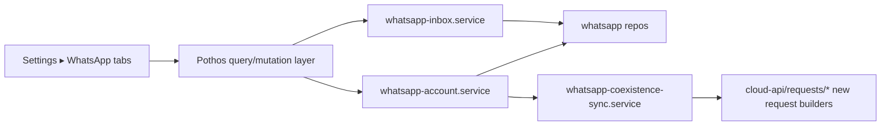
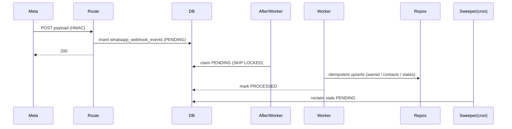
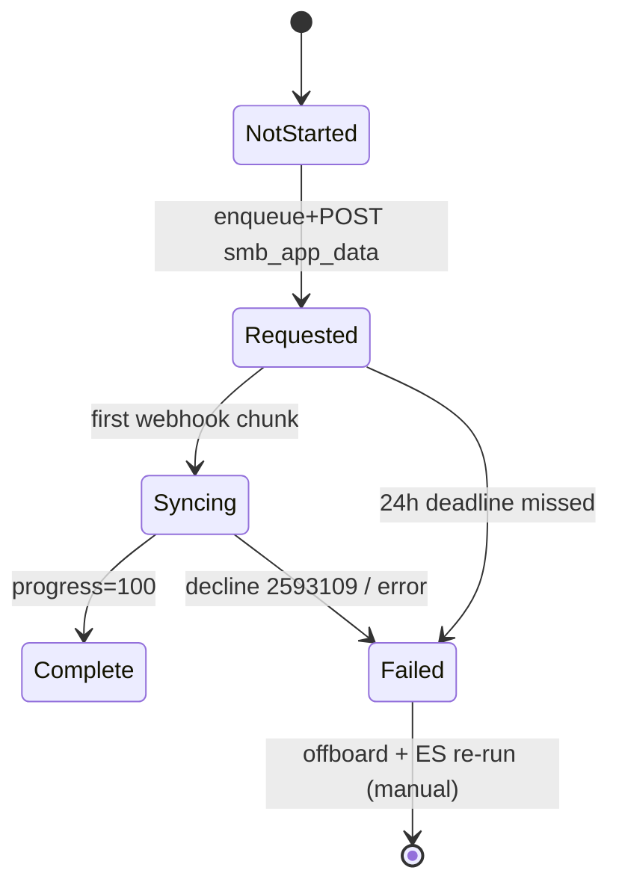

# WhatsApp v2 — Implementation Design

## Document Information

- **Feature Name**: WhatsApp Multi-Number Purpose Routing + Business-App Coexistence (Inbox)
- **Target Directory**: `.ai/plans/whatsapp2`
- **Outcome Directory**: `.ai/plans/whatsapp2/outcome/`
- **Version**: 1.0
- **Date**: 2026-09-04
- **Related Documents**: [Requirements](./specs.md) · [Trackable Tasks](./trackable-tasks.md) · [Deferred Items](./deferred-items.md) · outcome research: `inventory-backend.md`, `inventory-frontend.md`, `docs-research-coexistence.md`, `docs-research-multi-number.md`

## Overview

v1's WhatsApp stack has three multi-number-breaking chokepoints (singleton factory, first-active credential resolution, recipient-only rate-limit key) and actively destroys all inbound data (`stripInboundMessages`). v2: (1) makes the adapter per-account, (2) adds purpose routing across `NOTIFICATION_TEMPLATE_MAP → dispatchWhatsapp → adapter`, (3) replaces strip-and-discard with durable ingest (persist-first, process-async with a cron sweeper compensating for `after()`'s non-guarantee), (4) adds a one-shot coexistence sync orchestrator with a strict state machine, and (5) exposes an Inbox tab.

### Design Goals

- Multi-number: per-account sends, per-account rate limits, purpose segregation.
- Coexistence: ES v4 onboarding; 24h-bounded one-shot sync; phone-app echo mirroring.
- Durability: no customer message is ever dropped between webhook receipt and DB.
- Zero regression for single-account v1 tenants.

### Key Design Decisions (summary; full log below)

1. Factory keyed by `accountId`; credentials resolved per account with per-account cache.
2. Purpose is a DB enum + column, not free text.
3. Webhook ingest = insert → ack → async process; sweeper cron as durability backstop.
4. Replay distinction: short-window exact-body hash rejection + entity-level idempotent upserts.
5. `onboardingMode` column (not a separate account type) flags coexistence.
6. API version: single env-config default `v23.0` (kills the v20.0 hardcode); no per-number API versions.
7. Webhook field subscriptions remain App-Dashboard-managed; code only validates + surfaces.

### UX/Navigation Specification (REQUIRED)

#### Routes & Permissions

| Route | Purpose | Permission | Roles |
|---|---|---|---|
| `/settings/whatsapp?tab=numbers` | Accounts CRUD + purpose + sync status | `WHATSAPP_CONFIG_MANAGE` | super_admin, academy_admin |
| `/settings/whatsapp?tab=templates` | Template snapshot | `WHATSAPP_TEMPLATES_MANAGE` | super_admin, academy_admin |
| `/settings/whatsapp?tab=optin` | Opt-in prefs | `WHATSAPP_VIEW` | super_admin, academy_admin, staff_default |
| `/settings/whatsapp?tab=inbox` | **NEW** conversations + thread | `WHATSAPP_INBOX_VIEW` | super_admin, academy_admin, staff_default |
| (no composer route in v1) | reply composer | `WHATSAPP_INBOX_MANAGE` (reserved) | deferred |

#### Sidebar Navigation Integration

- **Group**: none — reuses `whatsapp-settings` under `grp_integrations` (`navigationConfig.ts:709-716`).
- **Mobile bottom nav**: unchanged.

#### Role-Based Access Matrix

| Role | Tabs | New permissions granted |
|---|---|---|
| SUPER_ADMIN | all 4 | `WHATSAPP_INBOX_VIEW`, `WHATSAPP_INBOX_MANAGE` |
| ACADEMY_ADMIN | all 4 | both |
| STAFF / SUPERVISOR | optin, inbox | `WHATSAPP_INBOX_VIEW` (view only) |
| TEACHER / PARENT / STUDENT | none | none |

#### Per-Audience Rendering

| Audience | Prominent content |
|---|---|
| Admin | Numbers (purpose select, coexistence badge, sync %), inbox |
| Staff | Inbox conversations/threads (read-only), opt-in |
| Student/Parent | n/a |

#### Mobile vs Desktop Variants

| Aspect | Desktop | Mobile |
|---|---|---|
| Numbers | `NumberCard` + `extraMetadata` (purpose, sync) | Mobile card parity |
| Inbox list | `AppDataGrid` | `MobileCardList` |
| Thread | under-grid panel | fullscreen dialog |
| Onboarding | ES dialog (`FB.login` popup) | same |

#### Permission Mapping

| Component/Route | Required | Source |
|---|---|---|
| Inbox tab button | `WHATSAPP_INBOX_VIEW` | `RequirePermission` (TAB_PERMISSIONS) |
| Numbers/edit purpose | `WHATSAPP_CONFIG_MANAGE` | existing TAB_PERMISSIONS |
| `whatsappConversations` query | `WHATSAPP_INBOX_VIEW` | resolver + service |
| `completeWhatsappEmbeddedSignup` mutation | `WHATSAPP_CONFIG_MANAGE` | resolver + service |

### Translation System Requirements

New namespace **`whatsappInbox`** (the existing `whatsapp` namespace stays for settings). New keys also added under `whatsapp` for purpose/sync labels.

- Types: `shared/locale/types/whatsappInbox/index.ts` (`WhatsappInboxLabels`).
- Leaves: `shared/locale/en/whatsappInbox/index.ts`, `shared/locale/ar/whatsappInbox/index.ts`.
- **Dual-surface wiring (mandatory, `shared/locale/AGENTS.md`)**: wire both leaf modules into `en/messages.ts` + `ar/messages.ts` AND add `shared/locale/namespaces/whatsappInbox/whatsappInbox.namespace.ts` via `defineNamespace`.
- `Translation` enum gains `WhatsappInbox = "whatsappInbox"`.
- Server components: `getTranslations(locale)` single-arg; resolvers `ctx.t("whatsappInbox")`; services `getServerTranslations(locale, "whatsappInbox")`.
- Errors added to `shared/locale/types/errors` under the existing whatsapp error group: `noSenderForPurpose`, `purposeRequiresActive`, `accountOffboarded`, `coexistenceTakenByOtherPartner`, `syncDeadlineExpired`, `historyDeclined`, `webhookProcessingFailed`.
- Enum import discipline: `WhatsappAccountPurpose`, `WhatsappOnboardingMode`, `WhatsappSyncStatus`, `WhatsappMessageDirection` imported as values.

## Architecture

### System Context

```mermaid
graph TB
  subgraph Meta
    ES[Embedded Signup v4]
    WH[Webhooks: messages/statuses/history/smb_*]
    GR[Graph API /{phone_number_id}]
  end
  subgraph Siraj
    RT[app/api/webhooks/whatsapp/route.ts]
    EV[whatsapp_webhook_events durable queue]
    PROC[Webhook worker + sweeper cron]
    ACCT[whatsapp_accounts per-number]
    FAC[WhatsappChannelFactory per-account]
    DISP[communication.service dispatchWhatsapp]
    INBOX[whatsapp_conversations/messages/contacts]
  end
  ES --> ACCT
  WH --> RT --> EV --> PROC --> INBOX
  DISP --> FAC --> GR
  PROC --> ACCT
```

### High-Level Architecture



### Technology Stack

| Layer | Tech | Rationale |
|---|---|---|
| Webhook route | Next.js route handler + `after()` | existing pattern; ack fast |
| Durability | `whatsapp_webhook_events` table + sweeper cron | `after()` is not guaranteed on serverless |
| Channel | `MetaCloudApiAdapter` per account | isolate credentials/limits |
| State | Drizzle tables; enums via `createPgEnumFromEnum` | existing conventions |
| UI | MUI v9 + existing whatsapp settings tab scaffold | pattern-locked extension |
| ES | Facebook JS SDK `FB.login` v4 | Meta mandate |

## Components and Interfaces

### Component 1: Per-Account Channel Factory & Adapter

**Files**: `backend/services/communication/channels/whatsapp/WhatsappChannelFactory.ts`, `cloud-api/MetaCloudApiAdapter.ts`, `backend/db/repo/whatsapp/whatsapp-account.repository.ts`.

**Purpose**: Replace the module-level singleton with per-account instances; resolve credentials per account; fix the API version inconsistency.

**Responsibilities**
- `getWhatsappChannel(accountId)` — lazily instantiate & cache `MetaCloudApiAdapter` per accountId; still expose a default-channel helper for legacy call sites that resolves via purpose `GENERAL` → first active (kept for the `syncFromMeta` transitional path).
- `resetWhatsappChannel(accountId?)` — drop one or all cache entries.
- Adapter: `resolveCredentials(accountId)` → repo lookup → decrypt `encryptedText` token; per-account 5s cache. Remove `findFirstActiveForCredentials` fallback.
- `resolveGraphApiVersion()` → env-config `whatsapp-graph.version` defaulting `v23.0`; deletes the hardcoded `v20.0` (`MetaCloudApiAdapter.ts:494`).
- Pair rate-limit key: `whatsapp:pair:<senderE164>:<recipientE164>`; 1 msg/6s, backoff 4^X on `131056`.

**Interfaces**
- Input: accountId, WhatsappPayload (extended with `senderAccountId`, `purpose`).
- Output: `WhatsappSendResult` (unchanged shape).
- Dependencies: `whatsappAccountRepository`, Redis rate limiter, env-config.

**Implementation Notes**
- Offboarded account → evicted from cache; sends throw `whatsapp.accountOffboarded` BEFORE Graph call.
- Keep `MAX_CONCURRENT_CALLS=10` fetch budget per account instance (per-number throughput 80 msg/s stays a Meta concern; our concurrency guard is process-local — document as v2 limitation, deferred).


### Component 2: Purpose Routing

**Files**: `backend/services/notification/notification-payloads.builders.ts:87` (NOTIFICATION_TEMPLATE_MAP), `backend/services/notification/notification-dispatch.helpers.ts` (allowlist), `backend/services/communication/communication.service.ts:139` (dispatchWhatsapp), `backend/types/whatsapp/whatsapp-channel.types.ts` (WhatsappPayload), `backend/types/whatsapp/whatsapp-account.types.ts`.

**Purpose**: Carry a purpose from event mapping to the correct sending number.

**Responsibilities**
- `NOTIFICATION_TEMPLATE_MAP` entries gain `purpose: WhatsappAccountPurpose` (CLASS_REMINDER/CLASS_ACTIVATED/LESSON_REPORT_SUBMITTED/LESSON_REPORT_REVIEWED/INVOICE_GENERATED → `STUDENTS`; future ads-reply templates → `ADVERTISING`). Events without a map entry default `GENERAL`.
- `dispatchWhatsapp`: resolve target account = active account with matching purpose → fallback active `GENERAL` → throw `whatsapp.noSenderForPurpose`.
- `WhatsappPayload` gains `senderAccountId` (+ optional `purpose` for observability); delivery rows attributable to the sending account.

**Interfaces**
- Input: notification event + user phone.
- Output: number selected, adapter instance returned, delivery row created with account FK.

**Implementation Notes**
- Same-purpose multiple numbers: pick lowest-latency healthy one via existing rounding logic (reuse v1's single-account selection order `createdAt ASC` for determinism).
- Any purpose-switch send is logged `logger.info` with accountId+purpose (audit).

### Component 3: Embedded Signup Client + Server Flow

**Files**: `frontend/.../settings/whatsapp/` onboarding dialog (new), new API route or GraphQL mutation `completeWhatsappEmbeddedSignup` under `backend/graphql/mutation/whatsapp/whatsapp-account.mutation.ts`, new request builders under `cloud-api/requests/`.

**Flow**
1. Numbers tab button "Connect Business App (Coexistence)" loads FB SDK; `FB.login` with `config_id`, `response_type: 'code'`, `extras: { setup: {}, featureType: 'whatsapp_business_app_onboarding', version: 'v4' }`.
2. `window` message listener captures `WA_EMBEDDED_SIGNUP` events; server receives `code` + asset IDs via mutation.
3. Server exchanges code → business-integration token; `POST /<WABA_ID>/subscribed_apps`; confirms `is_on_biz_app && platform_type === 'CLOUD_API'`; writes account row (`onboardingMode: COEXISTENCE`, `encryptedText` token, sync `NOT_STARTED`); immediately enqueues sync (Component 4).
4. UI surfaces `CANCEL` (with `current_step`) and ERROR states; success closes with account row visible.

**Interfaces**
- Mutation input: `{ code, phoneNumberId?, wabaId, businessId, displayPhoneNumber, name }` → output: created account.
- Token exchange uses `client_id`/`client_secret` env-config.

**Implementation Notes**
- `FINISH_WHATSAPP_BUSINESS_APP_ONBOARDING` may carry only `waba_id`; resolve phone_number_id server-side via `GET /<WABA_ID>?fields=phone_numbers` (existing `list-phone-numbers.request.ts`).
- Registration step is SKIPPED (number already registered via Business app).
- Two-step PIN already exists on the business app side; register calls are not needed.


### Component 4: Coexistence Sync Orchestrator

**Files**: new `backend/services/whatsapp/whatsapp-coexistence-sync.service.ts`, new request builder `cloud-api/requests/request-smb-app-data.request.ts`, schema `whatsapp_sync_requests` table.

**Purpose**: Enforce Meta's one-shot, within-24h sync rule for contacts (`smb_app_state_sync`) and history (`history`).

**Responsibilities**
- `enqueuePostOnboardingSync(accountId)`: in one tx, insert `whatsapp_sync_requests` rows (`syncType` `SMB_APP_STATE_SYNC`+`HISTORY`, status `PENDING`, unique `(accountId, syncType)`), then POST `/<PHONE_NUMBER_ID>/smb_app_data` for each, storing the returned `request_id` (status `REQUESTED`).
- Retry-safe: if a prior `request_id` exists → never re-POST (exactly-once per Meta); if POST errors transiently, leave `PENDING` and let the job retry — the unique constraint + `request_id` guard prevents double-calling Meta after a successful accept.
- `deadlineAt = onboardedAt + 24h`; a sweeper/cron flips un-REQUESTED rows past deadline to `FAILED(syncDeadlineExpired)`.
- Track arrival of `history` webhooks to advance phase/chunk_order/progress and flip account `syncStatus: SYNCING → COMPLETE` at progress 100 (history) or on contacts receipt (state sync); handle decline code `2593109` → `FAILED(historyDeclined)`.

**Interfaces**
- Input: accountId.
- Output: sync status queryable via existing accounts query + new `whatsappSyncStatus` resolver.

**Implementation Notes**
- The 24h rule and one-shot rule come from `docs-research-coexistence.md` §2 — no re-request after expiry or after completion; offboard+ES-rerun is the only recovery.
- Prereq validation: app subscribed to WABA + fields; log a warn if `subscribed_apps` confirm call fails.

### Component 5: Durable Webhook Ingest

**Files**: `app/api/webhooks/whatsapp/route.ts`, `backend/services/whatsapp/whatsapp-webhook.handler.ts`, new `backend/db/schema/whatsapp/whatsapp-webhook-events.ts` + `backend/db/repo/whatsapp/whatsapp-webhook-events.repository.ts`, new sweep job (`backend/services/cron/` registration).

**Route changes**
- Keep GET-verify, per-IP limit, double 1MB cap, HMAC-SHA256.
- Replace `stripInboundMessages` + defensive deletion with: parse → split into `changes[]` → insert one `whatsapp_webhook_events` row per change (payload `jsonb`, `payloadHash`, `status: PENDING`) → ack 200. Remove the 24h reject-on-identical-body replay policy for coexistence fields.
- Replay distinction: keep a SHORT Redis window (`webhook:replay:<sha256>`, TTL ~5 min) whose hit means "exact duplicate within minutes → still 200, but skip insert" (protects rapid-fire retries). Beyond the window, identical bodies insert again and dedupe at the entity level (Meta legitimately re-sends identical history chunks on redelivery).

**Processing worker** (`processPendingWebhookEvents`):
- Claims PENDING events (SELECT FOR UPDATE SKIP LOCKED batch), dispatches by `field`:
  - `history`: per message upsert keyed by `wamid`; conversations keyed by (accountId, wa_id|BSUID|username); chunk dedupe `(accountId, phase, chunk_order)`; `media_placeholder` recorded without content; `request_id` never assumed (not present in webhooks).
  - `smb_app_state_sync`: contacts upsert keyed by (accountId, phone|user_id), honoring add/remove + `metadata.timestamp` last-write-wins; advance `syncStatus`.
  - `smb_message_echoes`: upsert direction `echo`; `type: 'revoke'` (set `revokedAt` on `original_message_id` row), `type: 'edit'` (replace content, set `editedAt`).
  - `messages` (inbound): persist `direction: inbound`; statuses keep existing `handleDeliveryWebhook` path; remove analytics' CLASS_REMINDER fallback for pure inbound (no delivery row).
  - `account_update`: lifecycle handling (Component 6).
  - `phone_number_quality_update`, `business_capability_update`, template fields: existing behavior retained.
- Failed processing → status `FAILED` + `attempts++`; sweeper re-queues with backoff; poison events parked after N attempts (log + alert, not dropped silently).

**Interfaces**: webhook route → event rows → handler → repos.

**Implementation Notes**
- `after()` remains for inline processing attempt; sweeper cron covers `after()` failures — this is the durable mitigation (v1 accepted the `after()` risk for statuses only; conversation data tolerance is zero).
- Burst safety: per-change batch insert 500 rows; loop in chunks inside the claim transaction.
- The 1MB cap is kept: Meta chunks history server-side; no documented chunk exceeds it. (Outcome research found no documented max; recorded as an assumption.)


### Component 6: Account Lifecycle (account_update)

**Files**: `whatsapp-webhook.handler.ts` (`handleAccountUpdate`), `whatsapp-account.service.ts`, `whatsapp-account.repository.ts`.

- `ACCOUNT_OFFBOARDED` → set `status: OFFBOARDED`, evict adapter, leave sync FAILED unless already COMPLETE.
- `ACCOUNT_RECONNECTED` → `status: ACTIVE`, re-instantiate adapter; NO sync re-request.
- `PARTNER_APP_UNINSTALLED` → deactivate, surface warning.
- `DISABLED_UPDATE` (`ban_info.waba_ban_state`) → alert log + surface on Numbers tab.
- `business_capability_update.max_phone_numbers_per_business` → store on WABA-level settings record for admin visibility.
- Companion-device re-link is manual client action; surfaced as a post-reconnect hint string.

### Component 7: Inbox UI Tab

**Files**: extend `WhatsappConfigView.tsx` (`WhatsappConfigTab = "numbers" | "templates" | "optin" | "inbox"`), `whatsappConfig.constants.ts` (TAB_IDS/LABELS/PERMISSIONS), `WhatsappTabPanels.tsx`, `whatsappTabUrl.ts`; new `tabs/shared/InboxTabContent.tsx`, `tabs/shared/ConversationThread.tsx`, `useWhatsappInboxViewModel.ts`, desktop/mobile tab files (pattern-locked per inventory §6c).

**Responsibilities**
- Account selector (multi-number) defaulting to "all".
- Conversation list: AppDataGrid (desktop) / MobileCardList (mobile); columns: contact (name or wa_id/username fallback), last message preview, last message at, accountPurpose badge, unread indicator.
- Thread view: chronological bubbles (inbound left, echo/api-outbound right), status chip per message, media placeholder fallback, revoked/edited markers, expiry notice for media >14d (Meta retention).
- Poll via refetch-on-focus + interval (no WS in v1); no composer.

**Interfaces**
- Queries: `whatsappConversations(accountId?, pagination)`; `whatsappConversationMessages(conversationId, pagination)`.
- Permission: `WHATSAPP_INBOX_VIEW` resolver+service; `RequirePermission` on tab.

**Implementation Notes**
- Reuse `whatsappStatusBadge` (syncStatus category) for sync state; new `whatsappInbox` namespace strings; RTL-safe bubble alignment keyed by direction, not text direction.

## Data Models

### Extended: `whatsapp_accounts` (`backend/db/schema/whatsapp/whatsapp-accounts.ts`)

| Column | Type | Notes |
|---|---|---|
| `purpose` | `whatsapp_account_purpose` enum NOT NULL DEFAULT `GENERAL` | routing key |
| `onboardingMode` | `whatsapp_onboarding_mode` enum NOT NULL DEFAULT `CLOUD_API` | `CLOUD_API`/`COEXISTENCE` |
| `syncStatus` | `whatsapp_sync_status` enum NOT NULL DEFAULT `NOT_STARTED` | machine below |
| `syncPhase` | smallint nullable | 0/1/2 (history phases) |
| `syncProgress` | int NOT NULL DEFAULT 0 | 0-100 |
| `syncFailureReason` | varchar nullable | `historyDeclined`, `syncDeadlineExpired`, … |
| `syncDeadlineAt` | timestamptz nullable | onboarding +24h |
| `status` | reuse existing activity semantics; add `offboardedAt` timestamptz nullable | |
| `maxPhoneNumbersPerWaba` (via new WABA-level settings row, not this table) | int nullable | from `business_capability_update` |

New enums: `WhatsappAccountPurpose { GENERAL, ADVERTISING, STUDENTS }`, `WhatsappOnboardingMode { CLOUD_API, COEXISTENCE }`, `WhatsappSyncStatus { NOT_STARTED, REQUESTED, SYNCING, COMPLETE, FAILED }`, `WhatsappMessageDirection { INBOUND, ECHO, API_OUTBOUND }`, registered in `backend/enum/whatsapp/`, `backend/db/schema/enums.ts` (`createPgEnumFromEnum`), and `enum.pothos.ts`.

### New: `whatsapp_conversations`

| Column | Type | Notes |
|---|---|---|
| id | uuid PK | |
| accountId | uuid FK → whatsapp_accounts | |
| waId / userId / username | varchar nullable triple-tuple | conversation identity per Meta rollouts |
| displayName | varchar nullable | from contacts/profile |
| lastMessageAt, lastMessagePreview | timestamptz / varchar(140) | list rendering |
| createdAt/updatedAt/deletedAt | standard | soft delete |

Unique partial index `(accountId, waId)` + `(accountId, userId)`; the earlier of waId/userId present wins (usernames rollout).

### New: `whatsapp_messages`

| Column | Type | Notes |
|---|---|---|
| id | uuid PK | |
| conversationId | uuid FK | |
| accountId | uuid FK (denorm for queries) | |
| wamid | varchar NOT NULL | Meta message id |
| direction | `whatsapp_message_direction` | |
| type | varchar (text/image/…) | |
| content | jsonb | per-type payload |
| status | varchar nullable (SENT/DELIVERED/…/ERROR) | from history_context/statuses |
| mediaPlaceholder | boolean DEFAULT false | |
| mediaId / mediaMime / mediaSha256 | nullable | from media follow-up webhook |
| phase / chunkOrder | smallint nullable | history sync provenance |
| sentAt (Meta timestamp), editedAt, revokedAt | timestamptz nullable | |
| createdAt | timestamptz | |

Unique `wamid` (global per Meta); indexes `(conversationId, sentAt)`, `(accountId, sentAt)`.

### New: `whatsapp_contacts`

| Column | Type | Notes |
|---|---|---|
| id | uuid PK | |
| accountId | uuid FK | |
| phoneNumber | varchar nullable | may be omitted under usernames |
| userId / username | varchar nullable | BSUID / username fallback |
| fullName / firstName | varchar nullable | omitted on `remove` actions |
| removedAt | timestamptz nullable | soft state per `action: remove` |
| lastActionAt (from `metadata.timestamp`) | timestamptz | LWW guard |

Unique partial indexes `(accountId, phoneNumber)` / `(accountId, userId)`.

### New: `whatsapp_webhook_events`

| Column | Type | Notes |
|---|---|---|
| id | uuid PK | |
| accountId | uuid FK nullable | resolved post-insert when available |
| field | varchar | webhook field name |
| payload | jsonb | raw `change` |
| payloadHash | varchar(64) | sha256 of canonical body |
| status | enum `PENDING/PROCESSED/FAILED` | |
| attempts | int DEFAULT 0 | |
| receivedAt / processedAt | timestamptz | |

Indexes: `(status, receivedAt)`; payloadHash plus short Redis window as the replay guard.

### New: `whatsapp_sync_requests`

| Column | Type | Notes |
|---|---|---|
| id | uuid PK | |
| accountId | uuid FK | |
| syncType | enum `SMB_APP_STATE_SYNC`/`HISTORY` | |
| requestId | varchar nullable | Meta-issued; support handle |
| status | enum `PENDING/REQUESTED/STREAMING/COMPLETE/FAILED` | |
| requestedAt / completedAt | timestamptz | |
| Unique `(accountId, syncType)` | enforces one-shot | |

### Data Flow (webhook)



## Sync Lifecycle State Machine

| Current | Trigger | Next | Guard |
|---|---|---|---|
| NOT_STARTED | onboarding success → `enqueuePostOnboardingSync` | REQUESTED | prereqs green, subscribed_apps OK |
| REQUESTED | first history/state webhook arrives | SYNCING | matching account |
| SYNCING | progress < 100 | SYNCING | chunk_order advancing |
| SYNCING | progress === 100 (both types) | COMPLETE | — |
| REQUESTED/`PENDING` | now > syncDeadlineAt, un-REQUESTED | FAILED(`syncDeadlineExpired`) | sweeper tick |
| SYNCING | error `2593109` on history | FAILED(`historyDeclined`) for history; contacts may still COMPLETE | decline webhook |
| any | offboard event | FAILED + account offboarded | account_update |



## Side-Effect Matrix (per webhook transition)

| Transition | Rows created/updated | Notifications | Idempotency key |
|---|---|---|---|
| route insert | 1 `whatsapp_webhook_events` | — | payloadHash (short window) + insert always |
| history chunk | N `whatsapp_messages` upsert + conversations updated | none in v1 | `wamid`; chunk `(accountId, phase, chunkOrder)` |
| state sync | N `whatsapp_contacts` upsert | none | `(accountId, phone|userId, timestamp)` LWW |
| echo | upsert message (direction=echo); revoke/edit mutate original | none | `wamid` / `original_message_id` |
| inbound message | upsert inbound; conversation rolldate | none in v1 | `wamid` |
| status | existing delivery-rank path unchanged | unchanged | existing rank guard |
| account_update offboard | account status flip, cache eviction | admin alert (log) | event `wamid`-less → `payloadHash` dedupe |

## Cross-Actor Visibility (Inbox)

| Actor | Conversations visible | Restrictions |
|---|---|---|
| super/academy admin | all accounts | full |
| staff (`WHATSAPP_INBOX_VIEW`) | all accounts | read-only |
| no-permission user | none | GraphQL ForbiddenError |

## Concurrency & Race Condition Assessment

| Scenario | Actors | Risk | Mitigation |
|---|---|---|---|
| Meta redelivers identical chunk | Meta retry | duplicate rows | wamid upsert + (phase, chunkOrder) dedupe + short replay window |
| `after()` worker dies | platform | data loss | durable events table + sweeper cron |
| History webhook vs live echo same wamid | two webhook deliveries | dual row | single unique wamid constraint, upsert |
| Two sync POST retries | network timeout | Meta double-call | `(accountId, syncType)` unique + requestId-guard; recorded requestId means never re-POST |
| Purpose edit during in-flight send | admin + dispatcher | wrong-number send | read account in select-for-update in dispatch; fail-closed on offboard |
| Echo revoke vs original upsert order | webhook ordering | orphan revoke | revoke upserts a stub row if original not yet seen (marked revoked) |
| Media webhook before placeholder row | ordering | orphan media | upsert by wamid, placeholder flag flipped off when media arrives |
| Contact add/remove ordering | out-of-order sync webhooks | stale contact | LWW on `metadata.timestamp` |

**SELECT FOR UPDATE**: webhook event claim (`SKIP LOCKED`), account row during purpose-send resolution.

**Drizzle SQL anti-pattern compliance**: no inline `--` comments inside `sql` templates (repo rule).

## Outcome & Knowledge Transfer Protocol

Executing agents read all `.ai/plans/whatsapp2/outcome/*` before starting, write `<task-id>-outcome.md` after, and tick `trackable-tasks.md` checkboxes.

## Decision Log

### D1 — Per-account adapter instances vs parameterized send
- **Decision**: Per-account instances via factory keyed on accountId.
- **Context**: v1 singleton resolves "first active" account for all sends.
- **Options**: (a) parameterize every send call w/ credentials; (b) per-account instances; (c) per-purpose pool.
- **Rationale**: per-account instance isolates token cache, rate counters, and version resolution; parameterizing pushes credentials through every caller and defeats memoized connection reuse; purpose pool hides which physical number sent (auditing).

### D2 — Durable ingest approach
- **Decision**: persist-first insert into `whatsapp_webhook_events` pre-200; process via `after()` + sweeper cron.
- **Context**: v1 used `after()`-only with strip-and-discard; outcome research requires history bursts up to thousands of messages and guaranteed non-loss.
- **Options**: (a) process inline in request (timeout risk); (b) `after()` only (not guaranteed on serverless); (c) DB-backed queue with sweeper.
- **Rationale**: (c) gives at-least-once semantics and natural idempotency at entity level.

### D3 — Purpose as enum vs free-text
- **Decision**: DB enum `WhatsappAccountPurpose { GENERAL, ADVERTISING, STUDENTS }`, free-text custom purposes deferred.
- **Options**: (a) free text; (b) enum; (c) key-value purpose table.
- **Rationale**: enum keeps `NOTIFICATION_TEMPLATE_MAP` compile-time safe and GraphQL simple; free text invites drift; a purpose table is premature until dynamic purposes are requested.

### D4 — Coexistence as `onboardingMode` column vs separate account kind
- **Decision**: single `onboardingMode` column (`CLOUD_API` | `COEXISTENCE`).
- **Rationale**: one row per number already exists; mode only changes sync + lifecycle handling.

### D5 — Replay-nonce interplay with Meta retries
- **Decision**: replace 24h identical-body rejection with a ~5-minute exact-hash short window (status 200, no reprocess) PLUS entity-level idempotent upserts for long-window redelivery.
- **Context**: v1 rejected identical bodies for 24h, falsely rejecting Meta's legitimate history-chunk redelivery.
- **Rationale**: distinguishes "burst replay attack/rapid retry" (short window dedupe) from legitimate redelivery (entity dedupe on wamid/(phase, chunkOrder)).

### D6 — API version strategy
- **Decision**: single env-config `whatsapp-graph.version` defaulting `v23.0`, removing the hardcoded `v20.0`; no per-number versioning.
- **Context**: Meta exposes no per-number API version; helpers defaulted to v23.0 while the adapter pinned v20.0.
- **Rationale**: one version keeps request/response parsing uniform; env-config allows staged rollout.

### D7 — Webhook field subscription management
- **Decision**: field selection stays App Dashboard config (verified via startup/introspection); WABA attachment via `POST /<WABA_ID>/subscribed_apps` in onboarding code; missing subscription surfaces a settings warning.
- **Rationale**: Meta provides no per-field subscription API; dashboard state is authoritative.

### D8 — History media ≤ 14 days
- **Decision**: store `mediaPlaceholder: true` rows; on follow-up media webhook, fetch-and-store binary (≤14d window) or keep Meta asset id; UI renders expiry notice after 14d.
- **Options**: (a) ignore media; (b) store binary immediately; (c) store id + lazy fetch.
- **Rationale**: binary copy is storage-heavy and Meta only guarantees the id ≤14d; lazy fetch mirrors Meta's SLA.

### D9 — Sync destination of `request_id`
- **Decision**: persisted on `whatsapp_sync_requests.requestId`; NOT used as a webhook-correlation key (Meta doesn't echo it).
- **Rationale**: support/diagnostics only; idempotency is enforced by the unique `(accountId, syncType)`.

## Security Considerations

- **Authentication**: webhook HMAC-SHA256 unchanged; ES code exchange uses app secret server-side only; business token stored `encryptedText` (same as v1).
- **Authorization**: `WHATSAPP_INBOX_VIEW` + `WHATSAPP_INBOX_MANAGE` added to the AppPermission enum via two-phase DB migration (add enum value in one migration, grant to groups in a following one) — the TS enum MUST match the DB enum (existing repo gotcha).
- **Input validation**: webhook payload treated as untrusted parsed JSON; per-field shape validation; LIKE-wildcard escape for inbox search filters; 1MB cap retained.
- **Data protection**: message content stored in plaintext JSONB (tenant-internal); PII redaction preserved on error logging; media binaries stored with account scoping.
- **Rate limiting**: route-level IP limit unchanged; per-pair `whatsapp:pair:sender:recipient` Redis window.
- **Replay security**: 5-minute exact-hash window + HMAC + idempotent upserts (defense in depth).

## Error Handling

| Category | Behavior |
|---|---|
| Meta Graph error | `GraphApiError` + `extractMetaErrorCode`; `131056` → backoff retry; `131057` during throughput upgrade → defer; `2593109` → sync FAILED(historyDeclined) |
| Domain errors | `whatsapp.noSenderForPurpose`, `whatsapp.accountOffboarded`, `whatsapp.coexistenceTakenByOtherPartner`, `whatsapp.syncDeadlineExpired` — all i18n from `whatsapp`/`whatsappInbox` error groups |
| Webhook processing failures | attempts++, requeue with backoff; permanent failures parked with alert (no silent drop) |
| Validation | purpose required on coexistence onboarding; ES code rejection mapped to `whatsapp.embeddedSignupFailed` |

Logging: `logger.info` per send (accountId, purpose), `logger.warn` for fallback routes, `logger.logDomainError` for decline/deadline paths, `logger.error` for poison events.

## Performance Considerations

- Webhook ack < 200ms (single insert).
- Sweeper batch: 500 events; ingest worker chunked inserts 500 rows.
- Inbox list indexes as modeled; thread queries paginated 50/page.

## Testing Strategy

- **Repo tests** (`runInRollback`, `tx` propagation): conversation/message/contact/event upserts, idempotency, unique constraints; run via `bun run test/scripts/run-test.ts`.
- **Service tests** (external mocked): sync orchestrator (one-shot, deadline, decline), factory reset, routing fallback; sweep reprocessing.
- **Webhook handler tests**: burst chunk ingest, identical retry acceptance, revoke/edit, media placeholder + follow-up, deadline sweep.
- **Journey test**: `test/workflows/whatsapp/coexistence-journey.test.ts` — admin configures purposes, onboard stub via service-level fake ES, sync chunks ingested, staff reads inbox; permission denials (unauthorized actor). Real services + DB, committed fixtures, spied notifications, NO `runInRollback`.
- **UI component tests**: tab gating, list render, thread render, status badges.

## Deployment and Operations

- Prereq (manual, documented in KB doc): App Dashboard webhook fields `messages`, `history`, `smb_app_state_sync`, `smb_message_echoes`, `account_update`; Meta app with Solution Partner status; Login config for v4.
- Migrations: AppPermission two-phase enum migration; new tables + columns via `bun run db push`; permission seed via custom SQL migration.
- Rollback: feature-flag inbox tab; multi-number routing degrades to v1 first-active when only one active account exists (no behavior change).
- Monitoring: sweeper lag (`PENDING` backlog), sync `FAILED` count, `131056` occurrences per pair, ingest error rate.

## Migration and Compatibility

- Existing single-account tenants: purpose defaults `GENERAL`; v1 behavior is the fallback path.
- Existing `WhatsappAccountFields` fragment gains purpose/onboarding fields → additive GraphQL.
- OTP/status flows unchanged; delivery-rank guards unchanged.
- ES v2 NOT used (deprecated 2026-10-15); onboarding targets v4 only.

## Outcome Files

Every task writes `.ai/plans/whatsapp2/outcome/<task-id>-outcome.md` (see tasks).
