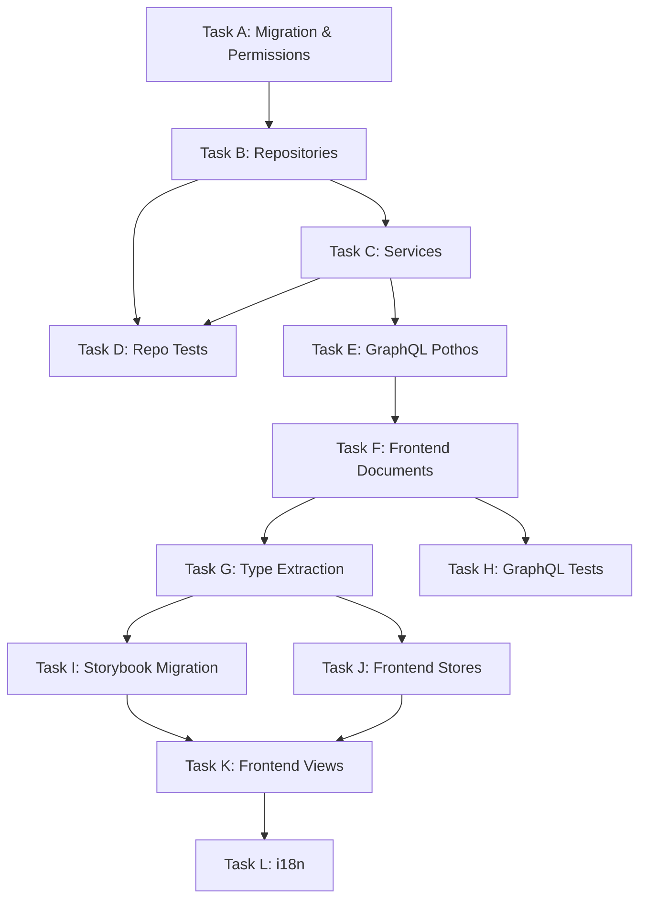

# Task M6 — Dependency Graph & Build Order

> Saved from meta plan execution for Sprint 14. This file defines the task sequence, dependencies, and target files for Story 14's implementation plan.

---

## 1. Synthesis of M1–M5 Findings

| Meta Task | Key Finding | Impact on Build Order |
|---|---|---|
| M1 (Schema) | All tables, columns, enums exist. No schema changes needed. | Migration task only adds permissions, no schema DDL |
| M2 (Permissions) | 3 existing `complaints.*` reused + 4 new permissions needed | Migration task adds enum values + migration SQL |
| M3 (Frontend) | 42 files exist with mock stores. No GraphQL documents, stores, or backend. | Full frontend migration path: documents → types → stores → views → stories |
| M4 (Backend) | Zero repos/services/pothos exist. Communication service architecture confirmed. | Full backend build path: repos → communication service → domain services → pothos |
| M5 (i18n) | UI labels complete. Missing: category labels, backend errors, notification keys. | i18n task adds ~15 new keys across 3 categories |

---

## 2. Task Dependency Graph

### Dependency Rules Verified

- **No forward dependencies**: Each task only depends on earlier tasks or current project state
- **Tests immediately follow implementation**: Task D (repo tests) follows Task B+C (repos+services); Task H (GraphQL tests) follows Task F (documents)
- **Type extraction before stores/views**: Task G comes before Tasks J and K
- **Storybook migration before views**: Task I comes before Task K
- **Self-contained per task**: After each task, the project compiles and passes quality gates

---

## 3. Task Build Order (12 Tasks)

### Task A — Migration & Permissions

**Objective**: Add 4 new permission enum values + migration SQL for new permissions and group assignments.

**Dependencies**: Current project state only.

**Target Files**:
- `shared/lib/enum.ts` — Add 4 new `AppPermission` values
- `backend/db/migration/3-system_permissions_and_groups.sql` — Add INSERT statements for new permissions + group assignments
- `shared/messages/types/dashboard/complaints/main.ts` — Add `categoryLabels` field to types
- `shared/messages/types/dashboard/core/notifications.ts` — Add notification keys
- `shared/messages/en.ts` — Add English translations for new keys
- `shared/messages/ar/dashboard/complaints/main.ts` — Add Arabic translations for new keys
- `shared/messages/ar/dashboard/core/notifications.ts` — Add Arabic notification keys

**Post-task commands**: `bun db cleanGenerate` → `bun db reset` → `bun db seed` → `bun test:db`

---

### Task B — Repositories (3 files)

**Objective**: Create complaint, complaint-response, and suggestion repositories.

**Dependencies**: Task A (permissions in enum). Current project state (schema tables exist).

**Target Files**:
- `backend/db/repo/complaint.repository.ts` — NEW
- `backend/db/repo/complaint-response.repository.ts` — NEW
- `backend/db/repo/suggestion.repository.ts` — NEW
- `backend/db/repo/index.ts` — Add 3 new exports

**Key Methods**:
- `ComplaintRepository`: `submitComplaint`, `getComplaintsByParent`, `getAdminComplaintQueue`, `getComplaintById`, `getComplaintMetrics`, `getUnansweredComplaints`
- `ComplaintResponseRepository`: `createResponse`, `getResponsesByComplaint`
- `SuggestionRepository`: `submitSuggestion`, `getSuggestionsForAdmin`, `getSuggestionMetrics`, `markSuggestionReviewed`

---

### Task C — Services (5 files)

**Objective**: Create communication service interface with channels, complaint service, and suggestion service.

**Dependencies**: Task B (repositories exist).

**Target Files**:
- `backend/services/communication/communication.service.ts` — NEW (interface + dispatch)
- `backend/services/communication/channels/on-app.channel.ts` — NEW (reuses notificationDeliveries)
- `backend/services/communication/channels/email.channel.ts` — NEW (stub)
- `backend/services/communication/complaint.service.ts` — NEW
- `backend/services/communication/suggestion.service.ts` — NEW

**Service Architecture**:
- `CommunicationService` interface with `send(channel, event, payload)` method
- `OnAppChannel` creates `notificationDeliveries` records with new `NotificationEventType` values
- `EmailChannel` stub: sets `emailSent: true` / `emailSentAt: now()` without actual sending
- `ComplaintService`: permission gating, validation, calls `ComplaintRepository` + `ComplaintResponseRepository` + `CommunicationService`
- `SuggestionService`: permission gating, validation, calls `SuggestionRepository` + `CommunicationService`

---

### Task D — Repository & Service Tests

**Objective**: 100% line + function coverage on all new repository and service methods.

**Dependencies**: Task B + C (repos and services exist).

**Target Files**:
- `backend/db/test/repo/complaint.repository.test.ts` — NEW
- `backend/db/test/repo/complaint-response.repository.test.ts` — NEW
- `backend/db/test/repo/suggestion.repository.test.ts` — NEW

**Test Requirements**:
- Success AND failure paths for every method
- IDOR protection: Parent A cannot access Parent B's complaints
- Admin override: Admin can access any complaint
- Transaction rollback on failure
- Soft-delete filtering verified

**Post-task command**: `bun run test:db` + `bun run test:coverage`

---

### Task E — GraphQL Pothos (2 files)

**Objective**: Define Pothos GraphQL objects, inputs, queries, and mutations for complaints and suggestions.

**Dependencies**: Task C (services exist).

**Target Files**:
- `backend/graphql/pothos/complaint.pothos.ts` — NEW
- `backend/graphql/pothos/suggestion.pothos.ts` — NEW
- `backend/graphql/pothos/index.ts` — Register new modules
- `backend/types/communications.types.ts` — Add complaint/suggestion types

**GraphQL Operations**:
- Queries: `parentComplaints`, `adminComplaintQueue`, `complaintMetrics`, `adminSuggestions`, `suggestionMetrics`
- Mutations: `submitComplaint`, `respondToComplaint`, `deleteComplaint`, `submitSuggestion`, `markSuggestionReviewed`

**Post-task commands**: `bun run generate:gqlSchema` → `bun codegen`

---

### Task F — Frontend Apollo Documents

**Objective**: Create TypedDocumentNode query and mutation documents for all new GraphQL operations.

**Dependencies**: Task E (backend GraphQL schema + codegen types exist).

**Target Files**:
- `frontend/graphql/sharedDocuments/complaint.documents.ts` — NEW
- `frontend/graphql/sharedDocuments/suggestion.documents.ts` — NEW
- `frontend/graphql/sharedDocuments/index.ts` — Add exports

**Post-task command**: `bun codegen`

---

### Task G — Type Extraction

**Objective**: Extract all types from mock stores into dedicated `.types` files, using generated GraphQL types.

**Dependencies**: Task F (codegen has run, generated types available).

**Target Files**:
- `frontend/views/dashboard/complaints/complaints.types.ts` — NEW (extracted from mock stores)
- `frontend/views/dashboard/suggestions/suggestions.types.ts` — NEW (extracted from mock stores)
- Update imports in 14+ complaint component files (from mock stores → `.types`)
- Update imports in 8+ suggestion component files (from mock stores → `.types`)
- Update mock store files to re-import from `.types`

**Rules**:
- Check `frontend/graphql/generated/gql/graphql-types.ts` first for every type
- Re-export generated types where available
- Define UI-specific types only where no generated equivalent exists
- No `any`, `unknown`, casting, or mapping

---

### Task H — GraphQL Integration Tests

**Objective**: Test all new GraphQL queries and mutations for authorization, data correctness, and security.

**Dependencies**: Task F (documents exist).

**Target Files**:
- `frontend/graphql/test/complaint.test.ts` — NEW
- `frontend/graphql/test/suggestion.test.ts` — NEW

**Test Requirements**:
- Authorized success + unauthorized denial for every operation
- Parent can only submit/view own complaints
- Admin can view/respond to any complaint
- IDOR protection at GraphQL level
- Permission denial for missing permissions

**Post-task command**: `bun run test:graphql`

---

### Task I — Storybook Migration

**Objective**: Update all 4 story files to use `MockedProvider` with mock GraphQL responses.

**Dependencies**: Task G (types extracted, mock stores updated).

**Target Files**:
- `frontend/views/dashboard/complaints/ParentComplaintsContainer.stories.tsx` — Rewrite
- `frontend/views/dashboard/complaints/AdminComplaintsContainer.stories.tsx` — Rewrite
- `frontend/views/dashboard/suggestions/ParentSuggestionsContainer.stories.tsx` — Rewrite
- `frontend/views/dashboard/suggestions/AdminSuggestionsContainer.stories.tsx` — Rewrite

**Rules**:
- Stories use `MockedProvider` decorator
- Mock data defined as constants in story files (with `__typename`)
- Containers remain top-level story components
- Permission gates mocked via decorators
- Multiple variants: Default, Empty, Loading

---

### Task J — Frontend Stores (Zustand)

**Objective**: Create real Zustand stores using Apollo hooks and generated GraphQL types, replacing mock stores.

**Dependencies**: Task G (types extracted).

**Target Files**:
- `frontend/stores/parentComplaintsStore.ts` — NEW
- `frontend/stores/adminComplaintsStore.ts` — NEW
- `frontend/stores/parentSuggestionsStore.ts` — NEW
- `frontend/stores/adminSuggestionsStore.ts` — NEW

**Rules**:
- Use generated GraphQL types directly (no mappers)
- Use `useQuery` with TypedDocumentNodes from Task F
- Manage UI state (filters, pagination, dialog state) while Apollo manages data

---

### Task K — Frontend Views (Container Migration)

**Objective**: Replace mock store imports in all 4 containers with real stores + `useQuery`. Fix permission checks.

**Dependencies**: Task I (stories ready), Task J (real stores exist).

**Target Files**:
- `frontend/views/dashboard/complaints/ParentComplaintsContainer.tsx` — Refactor
- `frontend/views/dashboard/complaints/AdminComplaintsContainer.tsx` — Refactor
- `frontend/views/dashboard/suggestions/ParentSuggestionsContainer.tsx` — Refactor
- `frontend/views/dashboard/suggestions/AdminSuggestionsContainer.tsx` — Refactor

**Changes**:
- Replace mock store imports with real Zustand stores
- Add `useQuery` with TypedDocumentNodes
- Fix permission checks:
  - `ParentComplaintsContainer`: `ComplaintsList` → `support.submit_complaint`
  - `ParentSuggestionsContainer`: `ComplaintsList` → `communication.submit_suggestion`
  - `AdminSuggestionsContainer`: `ComplaintsRespond` → correct admin permission
- Delete mock store files (4 files)

---

### Task L — i18n (Missing Keys)

**Objective**: Add missing translation keys for complaint categories, backend errors, and notification titles.

**Dependencies**: Task K (views reference the new keys).

**Target Files**:
- `shared/messages/types/dashboard/complaints/main.ts` — Add `categoryLabels` to types
- `shared/messages/en.ts` — Add English: category labels, error messages, notification keys
- `shared/messages/ar/dashboard/complaints/main.ts` — Add Arabic: category labels
- `shared/messages/ar/errors.ts` — Add Arabic: error messages
- `shared/messages/en.ts` (errors section) — Add English: backend error messages
- `shared/messages/types/dashboard/core/notifications.ts` — Add notification type keys
- `shared/messages/ar/dashboard/core/notifications.ts` — Add Arabic notification keys

**New Keys (~15)**:
- 5 complaint category labels (EN + AR)
- ~8 backend error messages (EN + AR)
- 2 notification titles (EN + AR)

---

## 4. File Creation Summary

| Category | New Files | Modified Files |
|---|---|---|
| Migration/Enum | 0 | 2 (`enum.ts`, migration SQL) |
| Repositories | 3 | 1 (`index.ts`) |
| Services | 5 | 0 |
| Tests (repo) | 3 | 0 |
| GraphQL Pothos | 2 | 2 (`index.ts`, `communications.types.ts`) |
| Frontend Documents | 2 | 1 (`index.ts`) |
| Type Extraction | 2 | ~22 (component imports) |
| Tests (GraphQL) | 2 | 0 |
| Storybook | 0 | 4 (stories) |
| Stores | 4 | 0 |
| Views | 0 | 4 (containers) |
| i18n | 0 | ~7 (types, EN, AR files) |
| **Deleted** | — | 4 (mock stores) |
| **Total** | **23 new** | **~43 modified** | **4 deleted** |

---

## 5. User-Confirmed Decisions (from M1–M5)

| # | Decision | Choice | Source |
|---|---|---|---|
| 1 | Schema changes needed? | No — existing schema covers all requirements | M1 |
| 2 | Permission strategy | 3 existing reused + 4 new | M2 |
| 3 | Email dispatch | Interface + stub now, real mailing in follow-up story | M4 |
| 4 | On-app channel storage | Reuse existing `notificationDeliveries` table | M4 |
| 5 | Repository structure | 3 separate files (complaint, complaint-response, suggestion) | M4 |
| 6 | English i18n convention | Keep monolithic `en.ts` | M5 |
| 7 | Category label structure | Add to existing `ComplaintsLabels` type | M5 |
