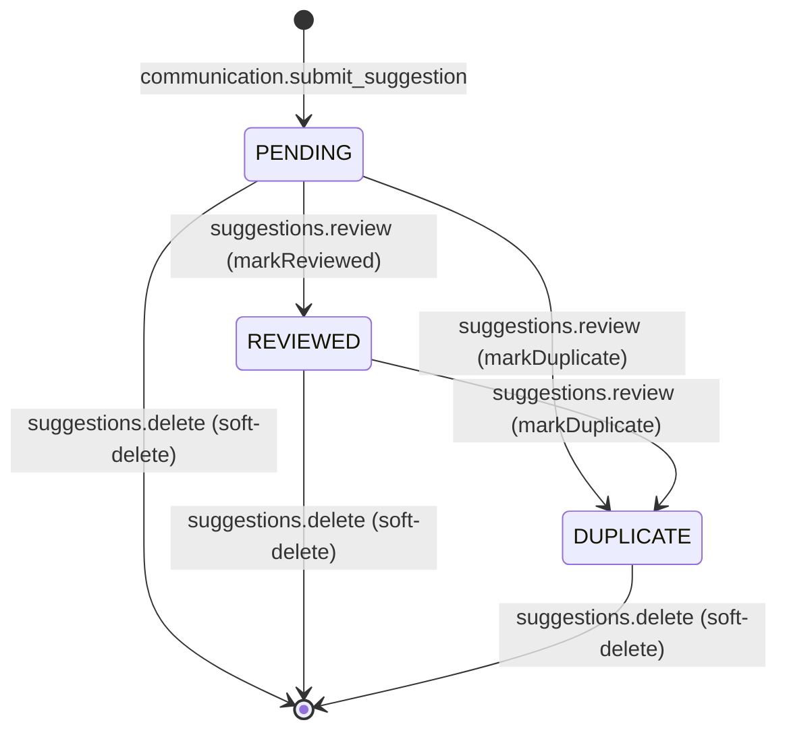
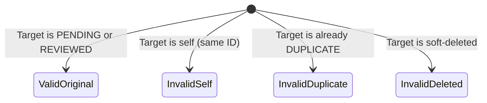
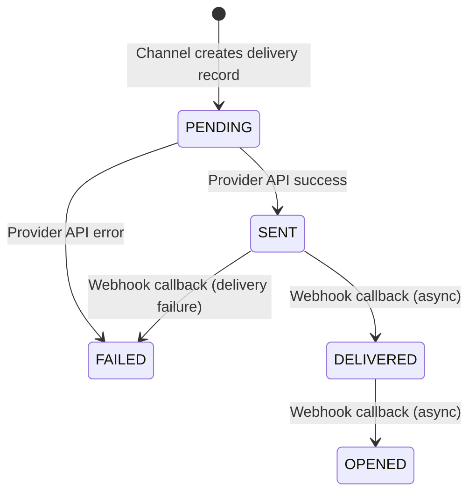
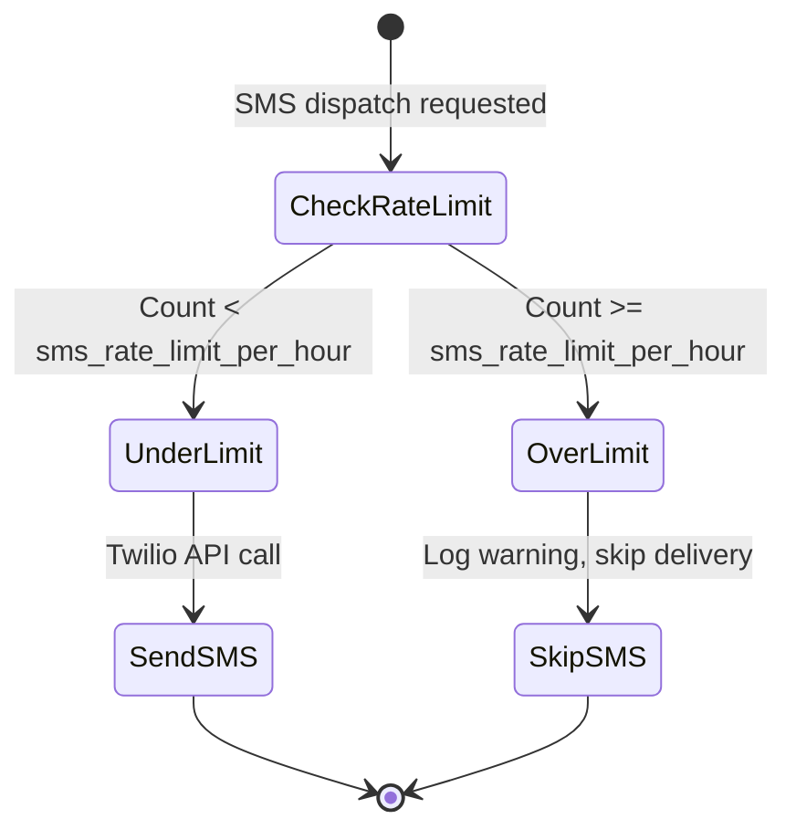

## Section 3: Suggestion State Machine & Threat Alignment

### 3.1 Suggestion Status State Machine

**State Transition Guards:**
- `PENDING → REVIEWED`: Requires `suggestions.review` permission. Sets `reviewedByUserId`, `reviewedAt`.
- `PENDING → DUPLICATE`: Requires `suggestions.review` permission. Sets `duplicateOfId` (must reference a non-duplicate suggestion), `reviewedByUserId`, `reviewedAt`.
- `REVIEWED → DUPLICATE`: Allowed — admin can reclassify a reviewed suggestion as duplicate if a matching original is found later.
- `DUPLICATE → REVIEWED`: **NOT allowed** — once marked duplicate, the suggestion stays duplicate. Admin should instead respond to the original.
- `Any → soft-deleted`: Requires `suggestions.delete` permission (Super Admin only). Sets `deletedAt`.

### 3.2 Duplicate Linking Rules

**Application-level validation (in `SuggestionService.markAsDuplicate()`):**
1. `duplicateOfId !== suggestionId` — cannot mark self as duplicate
2. Target suggestion must exist and NOT be soft-deleted
3. Target suggestion must NOT have `status = DUPLICATE` — cannot chain duplicates
4. Circular reference check: target must not have `duplicateOfId` pointing back to the current suggestion (prevents A→B→A cycles)

### 3.3 Notification Dispatch State Machine

**Status transition rules (from `NotificationRepository.assertValidStatusTransition()`):**
- Forward transitions only: `PENDING → SENT → DELIVERED → OPENED`
- `FAILED` is terminal — cannot transition out
- Same-state transitions allowed (idempotent)
- Backward transitions rejected

### 3.4 SMS Rate Limiting State Machine

**Rate limit check:**
- Query: `SELECT COUNT(*) FROM notification_deliveries WHERE user_id = $1 AND channel = 'SMS' AND created_at > NOW() - INTERVAL '1 hour'`
- Limit: `sms_rate_limit_per_hour` system setting (default: 3)
- If over limit: log warning, skip SMS delivery, do NOT fail the overall operation
