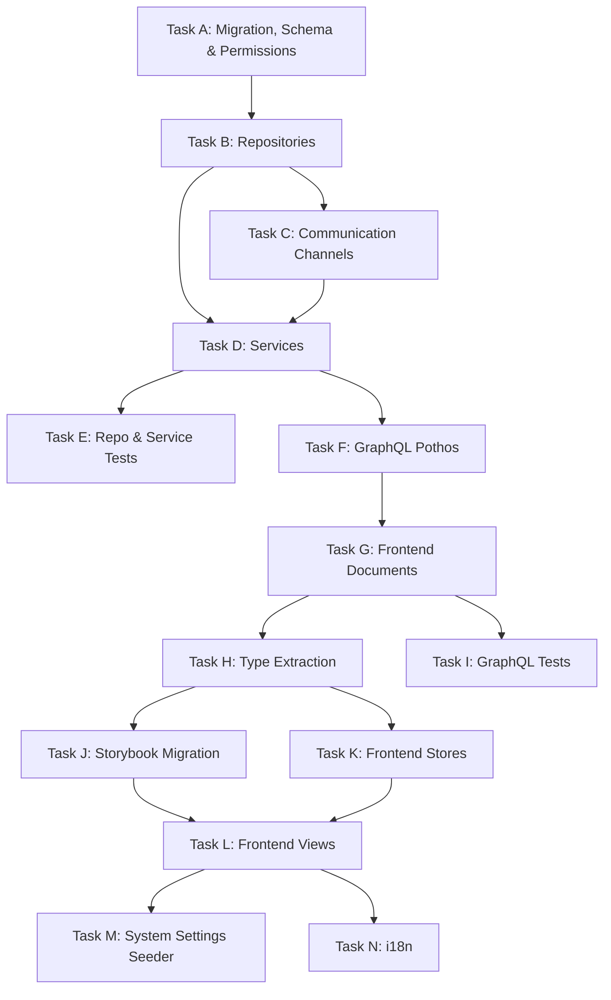

# M7 — Dependency Graph & Build Order

## Task Dependency Graph

## Build Order (14 Tasks)

### Task A — Migration, Schema & Permissions
**Objective**: Add `SuggestionStatus` enum, 6 new columns on `suggestions` (status, duplicateOfId, adminResponse, reviewedByUserId, reviewedAt, deletedAt), `ON_APP` to `NotificationChannel`, 4 new `NotificationEventType` values, 3 new `suggestions.*` permissions, group assignments, indexes.
**Dependencies**: Current project state (Story 14 executed).
**Post-task**: `bun db cleanGenerate` → `bun db reset` → `bun db seed` → `bun test:db`

### Task B — Repositories
**Objective**: Extend `SuggestionRepository` with review/respond/duplicate/soft-delete methods. Extend `NotificationRepository` with preference CRUD, batch delivery, SMS rate limit query. Add complaint file listing to `ComplaintRepository`.
**Dependencies**: Task A (schema changes).

### Task C — Communication Channels
**Objective**: Replace `EmailChannel` stub with Resend. Implement `SmsChannel` (Twilio). Implement `PushChannel` (FCM). Add email/SMS templates. Add `dispatchMulti()` fan-out.
**Dependencies**: Task B (NotificationRepository methods).
**New packages**: `resend`, `twilio`, `firebase-admin`

### Task D — Services
**Objective**: Extend `SuggestionService` with `respondToSuggestion()`, `markAsDuplicate()`, `deleteSuggestion()`, `getParentSuggestions()`. Update `ComplaintService` for file attachments. Update permission checks from `COMPLAINTS_LIST` to `SUGGESTIONS_*`.
**Dependencies**: Task B + C (repos + channels).

### Task E — Repo & Service Tests
**Objective**: 100% coverage on all new/modified repository methods. Service tests for suggestion management, channel dispatch, file attachment limits, SMS rate limiting.
**Dependencies**: Task D.

### Task F — GraphQL Pothos
**Objective**: Extend suggestion objects with status, duplicateOf, adminResponse, reviewedBy. New queries: `parentSuggestions`, `searchSuggestions` (for duplicate search). New mutations: `respondToSuggestion`, `markSuggestionDuplicate`, `deleteSuggestion`. Extend complaint objects with file attachments.
**Dependencies**: Task D.

### Task G — Frontend Documents
**Objective**: New documents for suggestion management queries/mutations. Complaint file upload mutation.
**Dependencies**: Task F.

### Task H — Type Extraction
**Objective**: Extract types from updated mock stores. Add suggestion status/duplicate/response types.
**Dependencies**: Task G.

### Task I — GraphQL Tests
**Objective**: Test all new suggestion mutations for authorization, duplicate linking, soft-delete.
**Dependencies**: Task G.

### Task J — Storybook Migration
**Objective**: Update suggestion stories with new action components, duplicate dialog, admin response panel.
**Dependencies**: Task H.

### Task K — Frontend Stores
**Objective**: Extend suggestion stores with review/respond/duplicate/delete actions. Add parent suggestion history store. Add complaint file upload state.
**Dependencies**: Task H.

### Task L — Frontend Views
**Objective**: Add `SuggestionDetailDialog`, `DuplicateSearchDialog`, `AdminResponsePanel`, `SuggestionActionBar`, `ComplaintFileUploadDropzone`, `ComplaintFileList`, `ParentSuggestionRecordCardList`. Modify admin suggestion DataGrid/cards. Modify complaint form. Add parent suggestion history section.
**Dependencies**: Task J + K.

### Task M — System Settings Seeder
**Objective**: Add `complaint_max_file_size_mb`, `complaint_max_files_per_complaint`, `sms_rate_limit_per_hour` to seeder. Add `communication` category.
**Dependencies**: Task L (views reference settings).

### Task N — i18n
**Objective**: Add suggestion status labels, action labels, duplicate dialog strings, file upload strings, email/SMS template strings. EN + AR.
**Dependencies**: Task L.

## File Creation Summary

| Category | New Files | Modified Files |
|---|---|---|
| Migration/Schema/Enum | 1 (migration) | 4 (enum.ts, enums.ts, communications.ts, drizzleRelations.ts) |
| Repositories | 0 | 3 (suggestion, notification, complaint repos) |
| Communication Channels | 4 (email, sms, push, templates) | 1 (communication.service.ts) |
| Services | 0 | 2 (complaint, suggestion services) |
| Tests (repo) | 2 | 1 |
| GraphQL Pothos | 0 | 2 (complaint, suggestion pothos) |
| Frontend Documents | 0 | 2 |
| Type Extraction | 0 | ~15 |
| Tests (GraphQL) | 0 | 2 |
| Storybook | 0 | 4 |
| Stores | 1 | 3 |
| Views/Components | 7 | ~12 |
| System Settings | 0 | 1 (seeder) |
| i18n | 0 | ~6 |
| **Total** | **~15 new** | **~58 modified** |
