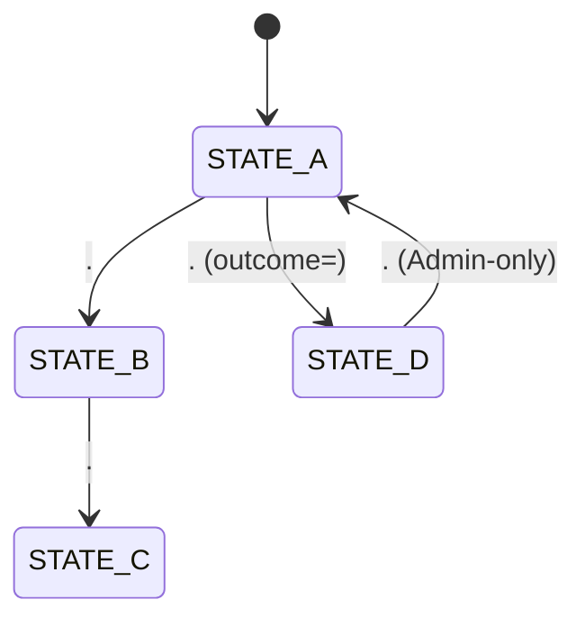
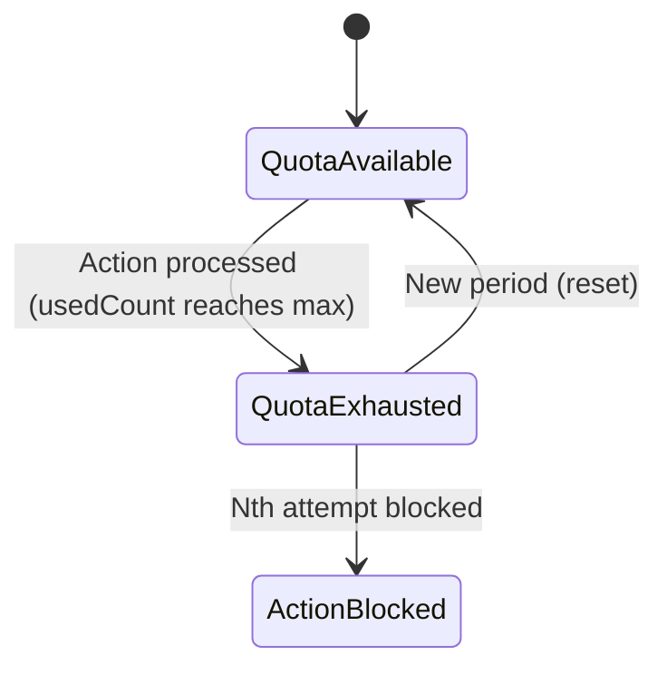

# Siraj Stories - Planning & Execution Guidelines for AI Agents

When working on any story or sprint in the `.ai/siraj_stories/` directory, AI Agents **MUST** strictly adhere to the following planning and execution protocol. **Failure to follow these instructions will result in immediate rejection by the user.**

This file acts as the orchestra, ruler, tasker, and documentary for creating perfect, bulletproof implementation plans.

---

## 1. Deep Context & System Analysis (The Reality Check)
Before writing any code or proposing an implementation plan, you must perform deep analysis and respect the verified repository facts:
- **Do not assume implementation completeness**: You must verify and implement all missing layers.
- **Trace the full stack**: Plan for Drizzle (DB), Domain Services (Logic), Pothos (Backend API), Apollo Documents (Frontend API), Zustand Stores (State), and React Components (Views).
- **Verified Repository Facts (DO NOT CONTRADICT)**:
  1. **Permission Catalog**: System permissions are now defined in `backend/db/migration/3-system_permissions_and_groups.sql` and seeded via the migration system, NOT `backend/db/seeds/permission-catalog.ts`. The enum values still exist in `shared/lib/enum.ts`.
  2. **GraphQL Types**: Backend GraphQL object and input types are in `backend/graphql/pothos/<domain>.pothos.ts` (or relevant pothos files), NOT a separate types file.
  3. **i18n Localization**: Uses `shared/messages/en.ts` and `shared/messages/ar/` directories. DO NOT create `frontend/locales/` or `backend/locales/` directories.
  4. **Permission Enums**: Values use PascalCase (e.g., `DOMAIN_ACTION_NAME = "domain.action_name"`) in `shared/lib/enum.ts`.
  5. **Schema Accuracy**: Do not hallucinate column names. Verify them against the actual schema files. If a column does not exist, explicitly plan a database migration/schema update first.
  6. **Existing Database Triggers**: Check existing DB triggers before writing new ones. For example, the existing state transition trigger uses a blacklist-style approach; do not overwrite it with a whitelist-style approach without explicit validation.
- **Transitioning from Mock to Real**: Hook up real backend repositories, real GraphQL queries, replace mock data with real stateful Apollo hooks (`useQuery`), and migrate layout wrappers.
- **Data Seeding Lifecycle**: Update seeders in `backend/db/seeds`. Run `bun run scripts/dbActions.ts push` before seeding. Ensure constraints and exact enums are respected.

---

## 2. Planning Requirements & Length Guidelines

Your implementation plan (`implementation_plan.md` or similar) must be **hyper-detailed, lengthy, and exhaustive**. 

### 📏 Length & Detail Thresholds:
- **Total Plan Length**: Must be at least **2,500+ lines of markdown**. Plans that are short, high-level summaries will be rejected.
- **Per-Task Length**: Each task within Section 6 must be at least **300 to 600+ lines long**. You must write out complete code snippets, database schemas, full query logic, and precise UI states.
- **Zero Placeholder Code**: No `...` inside code blocks. Code examples must be written out fully, displaying exact variable names, typings, error handlers, and imports.

---

## 3. Plan Section Outline & Concrete Examples

Every implementation plan MUST contain these exact 7 sections in order, formatted with the detailed examples shown below:

### Section 0: Story Metadata & Context
Provide clear metadata links and brief business objectives.

#### *Example Section 0:*
```markdown
## Section 0: Story Metadata & Context

- **Source story:** `.ai/siraj_stories/<N>.md` (Part <X> - <Feature Name>, timestamps 00:00 - 01:58)  
- **Security baseline:** `.ai/done/service/<previous-sprint>.md` (mandatory prerequisite)  
- **Story scope:** <Brief description of what this story implements>.
- **Target roles:** <Role A> (full access), <Role B> (restricted access).
- **Status:** Planning phase - awaiting approval for execution.

### 0.1 Business Objectives (Recommended)
Explain the WHY behind each feature. Example:
1. **Separation of Duties**: The `<permission.action>` permission is strictly reserved for Admins — lower roles cannot perform this action, ensuring accountability.
2. **Data Privacy**: Sensitive metrics are self-scoped; users see only their own data, not others'.

### 0.2 Scope Boundaries (Required for complex stories)
Clearly define what IS and IS NOT included in this story:

**In scope:**
- New migration file for permissions (if applicable)
- Backend repository methods for new queries
- Domain services with permission gating
- GraphQL Pothos objects and resolvers
- Frontend Apollo documents and Zustand stores
- i18n translations for all new UI strings
- RBAC enforcement via `<RequirePermission>`

**Out of scope:**
- <Feature X> (separate story)
- <Feature Y> (separate story)
- <Integration Z> (display only, no backend logic)
```

---

### Section 1: Core Principles & Strict Rules (Mandatory Checklist)
Include general system rules, a ban on monolithic services, and the **Zero Incomplete Implementation Policy** table.

#### *Example Section 1:*
```markdown
## Section 1: Core Principles & Strict Rules (Mandatory Checklist)

### 1.1 Service Layer Architecture
- [ ] **NO monolithic services** - Scoped strictly to domain-driven services (e.g. `<DomainName>Service`).
- [ ] **Business logic centralization** - All orchestration, validation, and permission checks reside in services, NOT repositories or resolvers.
- [ ] **🚫 Services MUST NOT import from DB/Drizzle** - Services can ONLY depend on the repository layer (`backend/db/repo/`). Importing from `drizzle-orm`, `backend/db/schema`, `backend/db/index`, or any Drizzle-related module is **strictly forbidden**. All database access must go through repo methods. This rule must be explicitly noted in every service layer task in Section 6.

### 1.1b GraphQL Resolver Architecture
- [ ] **🚫 GraphQL Resolvers MUST NOT import from DB/Repo** - Pothos resolvers can ONLY depend on the service layer (`backend/services/`). Importing from `backend/db/repo/`, `backend/db/schema`, or any database module is **strictly forbidden**. Resolvers are thin adapters: validate GraphQL input → call service method → return GraphQL result. No business logic, no direct data access.

### 1.2 Type Safety - NO `any`, NO Casts
- [ ] **Strict Type Narrowing** - BANNED: `any`, `as any`, and `as unknown as`. You must find the actual types. Narrow them using type guards.
- [ ] **No route param casts** - Instead of `useParams() as { id: string }`, use safety checks like `typeof params?.id === "string" ? params.id : ""`.

### 1.2b Task Ordering & Dependency Integrity
- [ ] **No forward dependencies** - A task MUST NOT depend on code, types, schemas, or modules introduced by a later task. Tasks can only depend on the current project state or on earlier tasks.
- [ ] **Incremental build order** - Tasks must be ordered so the dependency chain flows naturally: Database/Schema → Repository → Service → **DB/Repo Tests** → GraphQL (Backend) → GraphQL Documents (Frontend) → **GraphQL Tests** → Frontend Stores → Frontend Views. Tests immediately follow the layer they verify.
- [ ] **Self-contained tasks** - After completing each task, the project must compile and pass all quality gates. No task should leave the project in a broken state waiting for a later task to fix it.
- [ ] **Explicit dependency declaration** - Each task must list its dependencies (earlier task letters or "current project state only") in its Dependencies field.
- [ ] **Test tasks immediately follow implementation** - DB/repo/service tests come directly after the DB/repo/service implementation task. GraphQL tests come directly after the frontend GraphQL documents task. Tests are never deferred to the end.
- [ ] **Database Migration task protocol** - Migration tasks (typically first task) MUST add new permissions to `backend/db/migration/3-system_permissions_and_groups.sql`, then run in exact order: `bun db cleanGenerate` → `bun db reset` → `bun db seed` → `bun test:db`. All four must pass before the task is complete.

### 1.3 Zero Incomplete Implementation Policy
The following patterns are **strictly prohibited**:

| **Prohibited Pattern** | **Required Instead** | **Verification Command** |
|---|---|---|
| `// TODO`, `// FIXME`, `@todo` | Fully working implementation in same task | `rg -i "TODO\|FIXME" backend frontend` |
| `throw new Error("Not implemented")` | Complete service/repo method implementation | Manual code review |
| Handler calling only `logger.info` | Real GraphQL mutation + UI feedback | Grep for `logger.info.*handle` patterns |
| Service importing from `drizzle-orm` or `backend/db/schema` | Service depends ONLY on `backend/db/repo/` | `rg "from ['\"]drizzle\|from ['\"]backend/db/schema" backend/services/` |
| GraphQL resolver importing from `backend/db/repo/` | Resolver depends ONLY on `backend/services/` | `rg "from ['\"]backend/db" backend/graphql/pothos/` |
| Mock store in production views | Real `useQuery` with `TypedDocumentNode` | `rg "mock.*Store" frontend/views --glob "!**/*.stories.tsx"` |

### 1.4 SSR Compatibility (when applicable)
- [ ] **Services must work in Next.js Server Components** — Services can be used directly by SSR or Server Actions without GraphQL-specific context dependencies.
- [ ] **No Apollo client in services** — Services must not depend on `@apollo/client`, Apollo cache, or browser-only APIs.

### 1.5 Data Persistence & Mock Migration
- [ ] **NO dummy data in production** — Replace all mock stores (`mockXxxStore`) with real GraphQL-backed stores using `useQuery` and generated `TypedDocumentNode`.
- [ ] **Complete transaction boundaries** — Multi-table writes must be atomic (wrapped in `db.transaction()`).
- [ ] **Mock stores preserved for Storybook** — `*.stories.tsx` files MUST keep dummy data via mock store aliases. Production containers use real stores.

### 1.6 Logging & Observability
- [ ] **Logger utility mandatory** — Use `import { logger } from '@/frontend/utils/logger'` (frontend) or `import { logger } from '@/backend/lib/logger'` (backend).
- [ ] **Console methods forbidden** — ESLint will reject `console.log/warn/error/debug` usage.
- [ ] **Diagnostic-only logging** — `logger.info` must NEVER substitute for implementing user-facing functionality.

### 1.7 Testing Requirements
- [ ] **Repository coverage** — Tests for all new/modified repository methods in `backend/db/test/repo/`.
- [ ] **GraphQL integration tests** — Extend test files in `frontend/graphql/test/` for new queries and mutations.
- [ ] **Database test suite** — Run `bun run test:db` after every repository change.
- [ ] **Storybook stories** — Mock stores in `*.stories.tsx` files; production containers fully wired to real data.
```

---

### Section 2: RBAC Permissions (Canonical)
Map the exact permission strings from the sprint rules to the database catalog and file targets.

#### *Example Section 2:*
```markdown
## Section 2: RBAC Permissions (Canonical)

### 2.1 New Permissions

| **Permission Key** | **Group** | **UI Gate** | **Backend Service Method** | **GraphQL Mutation** |
|---|---|---|---|---|
| `<domain>.<action_1>` | <Role A> | <Component X> visibility | `<Domain>Service.<methodA>()` | `<mutationNameA>` |
| `<domain>.<action_2>` | <Role A> | <Button Y> | `<Domain>Service.<methodB>()` | `<mutationNameB>` |

### 2.2 Permission Mapping to Existing Permissions
Show how new permissions relate to existing ones (complementary, granular, superset):

| **Story Permission** | **Existing Related Permission** | **Relationship** |
|---|---|---|
| `<domain>.<new_perm>` | `<domain>.<existing_perm>` | Granular — the new permission specifically gates a sub-feature |
| `<domain>.<new_perm>` | `<other_domain>.<existing_perm>` | Complementary — each gates a different scope of the same data |

### 2.3 Permission Group Assignments
Map new permissions to permission groups:

| **Permission Group** | **Slug** | **New Permissions Assigned** |
|---|---|---|
| <Role A> | `<role_a_slug>` | `<domain>.<action_1>`, `<domain>.<action_2>` |
| <Role B> | `<role_b_slug>` | `<domain>.<action_1>` (self-scoped) |

### 2.4 Self-Scoping vs Any-Scoping (when applicable)
Some permissions have dual scoping — same permission key, different data access:
- **Lower role (self-scoped):** The service layer enforces that users can only query their own data. The GraphQL resolver resolves the actor's ID from the authenticated user's record.
- **Admin (any-scoped):** The service layer allows admins to pass any user/resource ID parameter.

This scoping is enforced in the service layer, NOT via separate permission keys.
```

---

### Section 3: State Machine & Threat Alignment (If Applicable)
Define the state machine diagrams and database transition rules. When your implementation involves state transitions, quota enforcement, or multi-step workflows, you **MUST** include Mermaid state diagrams to visualize the complete flow. This is not optional — visual state machines prevent logical gaps that text-only descriptions miss.

#### Required Diagrams (when applicable):

1. **Primary State Machine**: Show all entity states and transitions with permission guards.
2. **Processing Flow**: Show the end-to-end processing path including pre-checks, transaction boundaries, and rollback paths.
3. **Quota/Lifecycle Tracking**: Show time-based or count-based state changes (e.g., monthly quota reset).

#### *Example Section 3:*
```markdown
## Section 3: <Entity> State Machine & Threat Alignment



**State Transition Guards:**
- DB trigger `fn_enforce_<entity>_transition()` enforces allowed state paths.
- Repo guard `<entity>StateChange()` validates transition outcome alignment.

#### Quota/Lifecycle State Machine (if applicable):


#### Diagram Requirements:
- Use `stateDiagram-v2` syntax (not `graph` or `flowchart`).
- Label every transition with the permission/action that triggers it.
- Use `note` annotations to highlight critical business rules or admin bypass paths.
- Show rollback/failure paths explicitly (e.g., `QuotaGate --> STATE_A: Error: <errorKey>`).
- Include choice nodes (`<<choice>>`) for conditional branching (e.g., quota check pass/fail).
```

---

### Section 4: Security Threat Remediation
Address specific vulnerabilities such as IDOR, timezone differences, quota leaks, and payroll fraud. Describe the exact fix approach and which files are modified.

**For each threat, you MUST include Test Requirements** — specific test cases that verify the fix works correctly.

#### *Example Section 4:*
```markdown
## Section 4: Security Threat Remediation

### Threat 1: IDOR Scoping (Cross-User Access)
**Current Gap:** Repository `<entity>StateChange` checks ownership but doesn't support Admin overrides.
**Fix in `<domain>.repository.ts`:** Before the ownership check, call `PermissionsService.hasAnyPermission(actorUserId, [<OVERRIDE_PERMISSION>, <RESET_PERMISSION>])` to determine if the actor is a privileged admin. If not privileged, verify `instance.ownerUserId === actorUserId` and throw a localized unauthorized error if they don't match.

**Test Requirements:**
- User A cannot modify User B's entity → `unauthorized` error
- User A can modify their own entity → succeeds
- Admin can modify any user's entity → succeeds
- Unauthenticated user → `unauthorized`
```

---

### Section 5: Prerequisites Verification (BLOCKING)
A checklist to run before executing the plan to confirm previous sprint work is fully deployed.

Break prerequisites into structured sub-categories for clarity.

#### Verified Facts Tracking (MANDATORY):
Every prerequisite item MUST include:
- **Verification status marker** — Append `✅ (verified)` or `❌ (not verified — needs creation)` to each item so it's immediately clear what already exists vs what must be built.
- **Location reference** — Document *where* each fact was verified using exact file path and line number (e.g., `✅ (verified — backend/db/schema/billing.ts:42)`). If something doesn't exist yet, state that explicitly (e.g., `❌ (not verified — missing from shared/lib/enum.ts, needs creation)`).
- This prevents agents from hallucinating column names, enum values, or existing methods.

#### *Example Section 5:*
```markdown
## Section 5: Prerequisites Verification (BLOCKING)

### 5.1 Database Schema Verification
- [ ] Verify `<table_name>` table exists with columns: `id`, `<col_1>`, `<col_2>`, `<col_3>`. ✅ (verified — backend/db/schema/<domain>.ts:<lines>)
- [ ] Verify `<related_table>` table exists with required columns. ✅ (verified — backend/db/schema/<domain>.ts:<lines>)

### 5.2 Migration Verification
- [ ] Run `bun run scripts/dbActions.ts push` to ensure all migrations are applied.
- [ ] Verify `backend/db/migration/3-system_permissions_and_groups.sql` is applied (existing permissions seeded). ✅ (verified)
- [ ] Verify the `protect_system_permissions` trigger is active on `permissions` and `permission_groups` tables. ✅ (verified)

### 5.3 Test Suite Verification
- [ ] Run `bun run test:db` — all existing database tests pass (0 failures).
- [ ] Run `bun run test:graphql` — all existing GraphQL integration tests pass (0 failures).
- [ ] Run `bun tsgo` — TypeScript compilation passes with zero errors.

### 5.4 Existing Code Verification
- [ ] Verify `<DomainRepository>.<methodA>()` exists and works. ✅ (verified — backend/db/repo/<domain>.repository.ts:<line>)
- [ ] Verify `<OtherRepository>.<methodB>()` exists and works. ✅ (verified — backend/db/repo/<other>.repository.ts:<line>)
- [ ] Verify `PermissionsService.hasPermission()` and `PermissionsService.hasAnyPermission()` exist and work. ✅ (verified — backend/services/auth/permissions.service.ts)
- [ ] Verify `getBackendTranslations()` helper is available and functional. ✅ (verified — backend/lib/intl.ts)

### 5.5 Frontend Verification (when applicable)
- [ ] Verify `<FeatureContainer>` currently imports from `<mockStore>`. ✅ (verified — frontend/views/dashboard/<path>/<Container>.tsx:<line>)
- [ ] Verify `<ComponentName>` uses `globalThis.confirm()` for destructive actions (needs MUI Dialog replacement). ✅ (verified — frontend/views/dashboard/<path>/<Component>.tsx:<line>)
- [ ] Verify i18n keys exist for relevant namespaces. ✅ (verified — shared/messages/en.ts)
```

---

### Section 6: Granular Task Breakdown (The core breakdown - MUST be 300-600+ lines per task)
Break down the implementation into letters. Tasks **MUST** be strictly ordered by dependency — a task can only depend on the current state of the project or on work completed by an earlier task. Forward dependencies (relying on a later task) are **strictly forbidden** and will cause quality gates to fail. Each task MUST include:
1. **Objective**
2. **Dependencies** — Explicitly state what this task depends on (existing project state or earlier task letter). If none, state "None — depends only on current project state."
3. **Layer-Specific Rules** (flattened from sub-directory `AGENTS.md` rules)
4. **Target Files** (exact paths)
5. **Detailed Implementation Steps** (with extensive, fully-written code blocks)
6. **Test Execution Requirements** (running the whole test suite to prevent regressions)
7. **Success Criteria / Check Progress Points** (a detailed progress tracker within each task)

#### Task Ordering Rules (MANDATORY):
- **No forward dependencies**: A task MUST NOT call, import, reference, or assume the existence of any code, type, method, schema column, migration, or module that is introduced by a later task.
- **Build incrementally**: Order tasks so that the dependency chain flows naturally — typically Database/Schema → Repository → Service → **DB/Repo Tests** → GraphQL (Backend) → GraphQL Documents (Frontend) → **GraphQL Tests** → Frontend Stores → Frontend Views. Each layer builds on the one before it, and tests are placed immediately after the layer they verify.
- **Self-contained per task**: Every task must compile, pass all quality gates, and produce a working project state on its own. After completing Task B, the project must be in a fully working state — it must not be in a broken state waiting for Task C to "fix" or "complete" something.
- **Declare dependencies explicitly**: Each task's **Dependencies** field must list exactly what it relies on (e.g., "Depends on Task A: `SchedulingRepository.resetClassInstance` method" or "Depends on current project state only").
- **Reorder if needed**: If during planning you discover a task needs something from a later task, you MUST reorder the tasks so the dependency comes first. Never work around this by adding stubs, TODOs, or temporary imports.
- **Test tasks immediately follow their implementation**: Test tasks MUST be placed directly after the implementation task they verify — never deferred to the end of the plan:
  - **DB/Repo/Service tests** (`bun run test:db`, `bun run test:integration`): Must be the very next task after the DB schema, repository, and/or service implementation task that introduces the code under test.
  - **GraphQL tests** (`bun run test:graphql`): Must be the very next task after the frontend GraphQL documents/queries/mutations implementation task that introduces the operations under test.
- **Database Migration task protocol** (typically the first task): When a plan includes schema changes, new columns, or new permissions, the Database Migration task MUST:
  - Add any new permissions to `backend/db/migration/3-system_permissions_and_groups.sql` (NOT to a separate seed file).
  - Run the following commands **in exact order** after writing the migration:
    1. `bun db cleanGenerate` — regenerates Drizzle schema from the updated database
    2. `bun db reset` — drops and recreates the database with the new migration
    3. `bun db seed` — reseeds the database with updated permission catalog
    4. `bun test:db` — verifies the migration and seed data are correct
  - All four commands MUST pass before the task is considered complete. If any command fails, fix the migration and re-run the full sequence from step 1.

#### Mandatory Quality Gate Checklist (MUST appear in every task's Success Criteria):

Every task's **Success Criteria** section **MUST** include the following quality gate checklist verbatim, in addition to task-specific criteria. This is non-negotiable — tasks missing this checklist will be rejected:

```markdown
**Quality Gate — Per-File Validation:**
- [ ] `bun tsgo` on working files passes with 0 TypeScript errors & 0 warnings, after creating/modifying a single file
- [ ] `bun biome:check` on working files passes with 0 errors & 0 warnings, after creating/modifying a single file
- [ ] `bun lint` on working files passes with 0 errors & 0 warnings, after creating/modifying a single file
- [ ] `bun codescene` on working files passes with 0 errors & 0 warnings, after creating/modifying a single file
- [ ] `loop over tsgo, biome:check, lint, codescene` on working files till no issues at all, after creating/modifying a single file

**Quality Gate — Task Completion Validation:**
- [ ] `bun tsgo` on working files passes with 0 TypeScript errors & 0 warnings, after completing all steps
- [ ] `bun biome:check` on working files passes with 0 errors & 0 warnings, after completing all steps
- [ ] `bun lint` on working files passes with 0 errors & 0 warnings, after completing all steps
- [ ] `bun codescene` on working files passes with 0 errors & 0 warnings, after completing all steps
- [ ] `loop over tsgo, biome:check, lint, codescene` on working files till no issues at all, after completing all steps
```

#### *Example Task A (Database & Repo):*
```markdown
### Task A — Repository: <Feature> CRUD Operations

**Objective:** Implement transactional repository methods for `<methodA>` and `<methodB>`.

**Dependencies:** None — depends only on current project state (existing Drizzle schema and `<table_name>` table).

**Layer-Specific Rules (Database Repositories - Flattened from backend/db/repo/AGENTS.md):**
- Use Drizzle standard syntax `db.select().from(<table>).leftJoin()` instead of relational `findMany` when multiple joins are needed to avoid type compilation slow downs.
- Wrap all repository changes modifying multiple tables in an atomic `db.transaction()`.

**Target Files:**
- `backend/db/repo/<domain>.repository.ts`
- `backend/db/test/repo/<domain>.repository.test.ts`

**Detailed Implementation Steps:**

*Step 1: Write `<methodA>` with required business logic*

Implement as a namespace function in `<DomainRepository>`:
- Fetch the existing entity by ID
- Apply any conditional logic (e.g., quota restoration, status checks)
- Update the entity state within a `db.transaction()` for atomicity

*Step 2: Add comprehensive unit tests in `<domain>.repository.test.ts`*
Ensure unit tests verify both success states and rollback behavior on invalid inputs.

**Test Execution Requirements:**
- **Run the whole test suite:** Run `bun run test:db` across the database folder to make sure no existing tests are broken.
  ```bash
  bun run test:db
  ```

**Success Criteria / Check Progress Points:**
- [ ] `<methodA>` is fully implemented and updates entity state correctly.
- [ ] All conditional logic (quota, status, flags) works as expected.
- [ ] No compilation errors when compiling the database repository.
- [ ] `bun run test:db` passes successfully for all database tests (0 failures).

**Quality Gate — Per-File Validation:**
(standard quality gate checklist)

**Quality Gate — Task Completion Validation:**
(standard quality gate checklist)
```

#### *Example Task B (Frontend & Views):*
```markdown
### Task B — Frontend: <Feature> Dialogs & No-Casts

**Objective:** Integrate the <feature> action buttons inside `<FeatureToolbar>` using proper MUI modals, removing browser alerts, and eliminating blind castings.

**Dependencies:** Depends on Task A — uses `<DomainRepository>.<methodA>` and `<DomainRepository>.<methodB>` via GraphQL mutations exposed in prior tasks. Also depends on existing GraphQL schema and generated frontend types.

**Layer-Specific Rules (Frontend Views - Flattened from frontend/views/AGENTS.md):**
- BANNED: Do not use inline styling or arbitrary tailwind classes. Use Material UI theme tokens.
- Maintain localized text strings utilizing translation hooks.

**Target Files:**
- `frontend/views/dashboard/<domain>/components/<FeatureToolbar>.tsx`

**Detailed Implementation Steps:**

*Step 1: Replace `useParams() as { id: string }` with safe narrowing*

Extract the `id` from `useParams()` using a typeof guard (e.g., `typeof params?.id === "string" ? params.id : ""`). If `id` is empty, render an error `<Typography>` instead of proceeding.

*Step 2: Implement MUI Dialog instead of browser confirm/prompt*

Define a `dialogState` with open/type fields using `useState`. Render an accessible `<Dialog>` component enclosing localized text and theme-compliant action buttons. Remove all `confirm()` and `prompt()` calls.

**Test Execution Requirements:**
- **Run the entire test suite:** Run the full frontend and graphql tests to ensure there are no breaking changes.
  ```bash
  bun run test:graphql
  ```

**Success Criteria / Check Progress Points:**
- [ ] The browser `confirm()` and `prompt()` functions are completely deleted.
- [ ] MUI Dialog functions correctly for all action types.
- [ ] Typescript compilation is fully successful (no `any` or blind casts in modified components).
- [ ] Complete frontend integration and GraphQL queries compile without errors.

**Quality Gate — Per-File Validation:**
(standard quality gate checklist)

**Quality Gate — Task Completion Validation:**
(standard quality gate checklist)
```

#### *Example Task C (Backend GraphQL — Pothos Objects & Resolvers):*
```markdown
### Task C — Backend GraphQL: Pothos Objects, Queries & Mutations

**Objective:** Define Pothos GraphQL object types, input types, query fields, and mutation fields. Wire resolvers to the service layer.

**Dependencies:** Depends on Task B — service layer methods are implemented and tested.

**Layer-Specific Rules (Backend GraphQL — Flattened from backend/graphql/pothos/AGENTS.md):**
- Framework: Pothos code-first GraphQL schema builder.
- Nullability: Fields are non-nullable by default unless explicitly set to `nullable: true`.
- Resolvers: Pothos field resolvers should delegate to the `backend/services/` layer.
- Cache Updates: Ensure `id` fields are always exposed on GraphQL objects.
- Locale Propagation: Resolvers must propagate `ctx.locale` to service calls.
- **🚫 NO DB/Repo Imports**: Resolvers can ONLY depend on `backend/services/`.

**Target Files:**
- `backend/graphql/pothos/<domain>.pothos.ts` — Add/modify Pothos objects
- `backend/graphql/pothos/index.ts` — Export new modules

**Detailed Implementation Steps:**

*Step 1: Define Pothos object types with `id` field on every object*

Create type definitions for all GraphQL objects. Every object MUST expose an `id` field for Apollo cache normalization.

*Step 2: Wire query and mutation resolvers to service methods*

All resolvers delegate to service methods and propagate `ctx.locale`:
- Query resolvers call service methods that return data
- Mutation resolvers call service methods that perform writes
- All resolvers pass `ctx.userId` and `ctx.locale` to service calls

*Step 3: Register new Pothos modules in `index.ts`*

Export all new Pothos modules from the barrel file.

*Step 4: Run schema generation and codegen*

Run `bun run generate:gqlSchema` then `bun codegen` to update the GraphQL schema and TypeScript types.

**Test Execution Requirements:**
- Run GraphQL schema generation and codegen:
  ```bash
  bun run generate:gqlSchema
  bun codegen
  ```

**Success Criteria / Check Progress Points:**
- [ ] All Pothos object types expose `id` field
- [ ] All resolvers delegate to service layer with `ctx.locale` propagation
- [ ] `bun run generate:gqlSchema` succeeds
- [ ] `bun codegen` succeeds
- [ ] No DB/repo imports in GraphQL files

**Quality Gate — Per-File Validation:**
(standard quality gate checklist)

**Quality Gate — Task Completion Validation:**
(standard quality gate checklist)
```

#### *Example Task D (Frontend GraphQL — Apollo TypedDocumentNodes):*
```markdown
### Task D — Frontend GraphQL: Apollo TypedDocumentNodes

**Objective:** Create Apollo `TypedDocumentNode` query and mutation documents for new GraphQL operations.

**Dependencies:** Depends on Task C — backend GraphQL schema is generated and codegen has run.

**Layer-Specific Rules (Frontend GraphQL — Flattened from frontend/graphql/AGENTS.md):**
- One file per domain: `<domain>.documents.ts`
- Import from `"@apollo/client"` — never from `"@apollo/client/core"`
- TypedDocumentNode naming convention: `<camelCaseName>QueryDocument` / `<camelCaseName>MutationDocument`
- Every selection set must include `id` field on every named object type
- NO `useLazyQuery` — use stateful `useQuery` exclusively
- **🚫 NO DB/Repo Imports**: Frontend GraphQL can ONLY depend on generated types.

**Target Files:**
- `frontend/graphql/sharedDocuments/<domain>.documents.ts` — New file
- `frontend/graphql/sharedDocuments/index.ts` — Export new documents

**Detailed Implementation Steps:**

*Step 1: Create query documents with `id` on every object*

Create `TypedDocumentNode` for each query. Every selection set MUST include `id` on every named object type for Apollo cache normalization.

*Step 2: Create mutation documents*

Create `TypedDocumentNode` for each mutation. Include `id` on all returned objects.

*Step 3: Export from `index.ts`*

Add barrel exports for all new document files.

*Step 4: Run codegen*

Run `bun run generate:gqlSchema` then `bun codegen` to generate TypeScript types from the new documents.

**Test Execution Requirements:**
- Run GraphQL tests:
  ```bash
  bun run test:graphql
  ```

**Success Criteria / Check Progress Points:**
- [ ] All query documents include `id` on every object type
- [ ] All mutation documents include `id` on returned objects
- [ ] All documents use generated types from `frontend/graphql/generated/gql/graphql-types.ts`
- [ ] `bun run generate:gqlSchema` succeeds
- [ ] `bun codegen` succeeds
- [ ] No DB/repo imports in frontend GraphQL files

**Quality Gate — Per-File Validation:**
(standard quality gate checklist)

**Quality Gate — Task Completion Validation:**
(standard quality gate checklist)
```

#### *Example Task E (Frontend Stores — Zustand):*
```markdown
### Task E — Frontend Stores: Replace Mock Stores with Real Zustand Stores

**Objective:** Create real Zustand stores that use generated GraphQL types and Apollo hooks to fetch data from the backend, replacing mock stores in production containers.

**Dependencies:** Depends on Task D — frontend GraphQL documents are created and codegen has run.

**Layer-Specific Rules (Frontend Stores — Flattened from frontend/stores/AGENTS.md):**
- Zustand for global state management.
- Strict Typing: Stores should be strictly typed using the GraphQL generated types.
- Direct Assignment: Solve TypeScript errors by adjusting the GraphQL schema or queries. Do NOT create complex intermediate mapping functions.
- **No mock data in production** — Mock stores only in `*.stories.tsx` files.

**Target Files:**
- `frontend/stores/<domain>Store.ts` — New file (or modify existing)

**Detailed Implementation Steps:**

*Step 1: Create store with generated GraphQL types*

Define store state interface using types from `frontend/graphql/generated/gql/graphql-types.ts`. No intermediate mappings.

*Step 2: Implement actions that use Apollo hooks*

Store actions use `useQuery` with `TypedDocumentNode` from Task D. Store manages UI state (filters, pagination, dialog open/close) while Apollo manages data fetching.

**Test Execution Requirements:**
- Run TypeScript check:
  ```bash
  bun tsgo
  ```

**Success Criteria / Check Progress Points:**
- [ ] Store uses generated GraphQL types (no intermediate mappings)
- [ ] No mock data in production store
- [ ] Store actions use `useQuery` with `TypedDocumentNode`

**Quality Gate — Per-File Validation:**
(standard quality gate checklist)

**Quality Gate — Task Completion Validation:**
(standard quality gate checklist)
```

#### *Example Task F (Frontend Views — Real Data Integration & RBAC):*
```markdown
### Task F — Frontend Views: Real Data Integration & RBAC Enforcement

**Objective:** Replace mock store imports in production containers with real Apollo `useQuery` hooks. Add RBAC gates via `<RequirePermission>`. Replace `globalThis.confirm()` with MUI Dialog.

**Dependencies:** Depends on Task E — Zustand stores are implemented and use real GraphQL data.

**Layer-Specific Rules (Frontend Views — Flattened from frontend/views/AGENTS.md):**
- Functional Components only.
- Access Control: Use `<RequirePermission permissions={["domain.action"]} />` to gate components.
- Data Fetching: Use Apollo `useQuery` with generated TypedDocumentNodes.
- NO hardcoded colors — all from theme palette.
- MUI breaking changes: Typography style props via `sx` only. Stack layout props in `sx`.
- Dashboard UI Patterns: Use `PageContainer`, `PageHeader`, `SectionPanel`, `MetricCard`, `AppDataGrid`.
- **Mock Data Ban**: Mock data is strictly forbidden in production. Migrate to real components. (`*.stories.tsx` MUST KEEP dummy data).

**Target Files:**
- `frontend/views/dashboard/<domain>/components/<FeatureToolbar>.tsx` — Replace mock store with `useQuery`

**Detailed Implementation Steps:**

*Step 1: Replace mock store with `useQuery` and Zustand store*

Remove mock store imports. Use `useQuery` with `TypedDocumentNode` from Task D. Use Zustand store from Task E for UI state.

*Step 2: Add `<RequirePermission>` wrapper*

Wrap component content in `<RequirePermission permissions={["<domain>.<action>"]}>` to gate visibility.

*Step 3: Replace `globalThis.confirm()` with MUI Dialog*

Replace browser `confirm()` with MUI `<Dialog>` component. Use localized text from i18n.

**Test Execution Requirements:**
- Run UI component tests:
  ```bash
  bun run test:ui:components
  ```
- Run GraphQL tests:
  ```bash
  bun run test:graphql
  ```

**Success Criteria / Check Progress Points:**
- [ ] Container uses `useQuery` with `TypedDocumentNode` instead of mock store
- [ ] Container wraps content in `<RequirePermission>` with correct permission key
- [ ] `globalThis.confirm()` replaced with MUI `<Dialog>`
- [ ] No `any` or blind casts in modified components
- [ ] No mock store imports in production files

**Quality Gate — Per-File Validation:**
(standard quality gate checklist)

**Quality Gate — Task Completion Validation:**
(standard quality gate checklist)
```

#### *Example Task G (i18n — Translation Keys):*
```markdown
### Task G — i18n: Add Missing Translation Keys

**Objective:** Add translation keys for new UI strings in English and Arabic.

**Dependencies:** Depends on Task F — view components are implemented and need localized strings.

**Layer-Specific Rules (i18n — Flattened from AGENTS.md):**
- Uses `shared/messages/en.ts` and `shared/messages/ar/` directories.
- DO NOT create `frontend/locales/` or `backend/locales/` directories.
- No hardcoded errors/messages in services — use `getBackendTranslations`.

**Target Files:**
- `shared/messages/types/dashboard/<domain>/<feature>.ts` — New type file
- `shared/messages/en.ts` — Add English translations
- `shared/messages/ar/dashboard/<domain>/<feature>.ts` — New Arabic translation file

**Detailed Implementation Steps:**

*Step 1: Create type definition for translation keys*

Define TypeScript interface for all translation keys used by the new UI components.

*Step 2: Add English translations to `shared/messages/en.ts`*

Add all English strings for the new UI components.

*Step 3: Add Arabic translations*

Create Arabic translation file with all strings translated.

*Step 4: Update index files*

Add exports in type and translation index files.

**Test Execution Requirements:**
- Run TypeScript check:
  ```bash
  bun tsgo
  ```

**Success Criteria / Check Progress Points:**
- [ ] Type definition created for all new translation keys
- [ ] English translations added to `shared/messages/en.ts`
- [ ] Arabic translations created in `shared/messages/ar/` directory
- [ ] All index files updated with exports
- [ ] No hardcoded strings in new components

**Quality Gate — Per-File Validation:**
(standard quality gate checklist)

**Quality Gate — Task Completion Validation:**
(standard quality gate checklist)
```

#### *Example Task H (Navigation, Routing & Infrastructure):*
```markdown
### Task H — Navigation, Routing & Infrastructure

**Objective:** Add sidebar navigation items, create Next.js App Router page files for new parent routes, and wire permission gates on navigation entries.

**Dependencies:** Depends on the earlier tasks that implement the view components and i18n strings for the new feature.

**When to use this task type:** Only when the story introduces **new parent pages** that need their own route. Do NOT create this task for sub-components rendered inside an existing view, or for stories that only modify existing pages.

**Layer-Specific Rules:**
- Navigation items use the project's navigation config type (e.g., `NavItem`).
- Each nav item MUST include a `permission` field gating visibility via the RBAC system.
- Next.js App Router pages go in `app/[locale]/(dashboard)/<route>/page.tsx`.
- Page files are thin wrappers that import and render the Container component.

**Target Files:**
- Navigation config file — Add nav items with permission gates
- `app/[locale]/(dashboard)/<new-route>/page.tsx` — Create parent page files (NEW, only if story introduces new routes)
- New view directories under `frontend/views/dashboard/` as needed

**Detailed Implementation Steps:**

*Step 1: Add nav items to navigation config*

Add new sidebar navigation entries with `permission` field set to the correct `AppPermission` enum value. Nav items are only visible to users who hold the required permission.

*Step 2: Create Next.js App Router page files for parent routes*

For each new parent route, create a thin `page.tsx` file in the `app/[locale]/(dashboard)/` directory that imports and renders the corresponding Container component. Dynamic routes use `params: Promise<{ id: string }>` pattern with `await params`.

*Step 3: Verify routes are accessible and permission-gated*

Confirm that each new route renders correctly and that the navigation config properly gates visibility.

**Test Execution Requirements:**
- Run UI component tests:
  ```bash
  bun run test:ui:components
  ```

**Success Criteria / Check Progress Points:**
- [ ] Sidebar shows new nav items only for users with the correct permission
- [ ] Each parent route has a `page.tsx` file in `app/[locale]/(dashboard)/`
- [ ] Navigation config entries include `permission` field
- [ ] Dynamic routes use safe param extraction (no blind casts)

**Quality Gate — Per-File Validation:**
(standard quality gate checklist)

**Quality Gate — Task Completion Validation:**
(standard quality gate checklist)
```

#### Frontend View Component Composition Pattern (when applicable):

When a story's frontend feature involves **all three** of: user input, data display, and per-item detail rendering, agents MUST break it into a **Container → Form → View → Detail** component composition — NOT a single monolithic component.

For simpler features (e.g., modifying an existing component, adding a single dialog, or replacing a mock store), this pattern is NOT required — use the existing component structure.

**Component Roles:**
- **Container** (`XxxContainer.tsx`) — Manages state (form inputs, filters), triggers the GraphQL `useQuery`, handles loading/error states, and composes the child components. This is the orchestrator.
- **Form** (`XxxForm.tsx`) — Renders user input fields (text fields, selects, date pickers). Receives an `onSubmit` callback from the Container. Pure presentational — no GraphQL calls.
- **View** (`XxxView.tsx`) — Renders the query results (lists, grids, cards). Receives typed data as props from the Container. Pure presentational — no GraphQL calls.
- **Detail** (`XxxGrid.tsx`, `XxxCard.tsx`, `XxxItem.tsx`) — Renders individual items within the View (e.g., per-teacher grid, per-invoice card, per-gap time slot). Receives a single typed item as a prop.

**Rules:**
- Only the **Container** imports Apollo hooks (`useQuery`, `useMutation`) and Zustand stores.
- **Form**, **View**, and **Detail** components receive data via props — they never call hooks or access stores directly.
- All components use `useTranslations` for localized text.
- All components use MUI theme tokens — no hardcoded colors.
- Storybook stories (`*.stories.tsx`) are created for the Container with mock data.

Outline the list of commands to verify the entire system compiles and passes all checks.

#### *Example Section 7:*
```markdown
## Section 7: Final Verification & Integrity Protocol

Execute the following commands in order to guarantee system stability and prevent code regressions:

### 7.1 Schema & Type Generation
1. `bun run generate:gqlSchema` (checks GraphQL schema integration)
2. `bun codegen` (updates types and queries)

### 7.2 Quality Gate Loop
3. `bun tsgo` (runs global TypeScript typecheck)
4. `bun biome:check` (runs Biome formatter/linter checks)
5. `bun lint` (runs ESLint checks)
6. `bun codescene` (runs CodeScene analysis)
7. Loop commands 3-6 until all pass with 0 errors & 0 warnings

### 7.3 Test Suites
8. `bun run test:db` (runs all database repository and logic tests)
9. `bun run test:graphql` (runs all GraphQL integration tests)
10. `bun run test:ui:components` (runs all UI component tests)
11. `bun run test` (runs all unit and integration tests across backend and frontend)

### 7.4 Prohibited Pattern Check
12. `rg -i "TODO|FIXME|not implemented|placeholder|for now" backend frontend shared --glob "!**/*.md" --glob "!**/generated/**"`
    Output MUST be empty.

### 7.5 Mock Data Leak Check (when applicable)
13. `rg "mockXxxStore" frontend/views --glob "!**/*.stories.tsx"`
    Output MUST be empty — mock stores must not be imported in production view files.

### 7.6 Permission Enforcement Verification (when applicable)
14. Verify that all new views are properly gated:
    ```bash
    rg "RequirePermission" frontend/views/dashboard/<domain>/components/<NewContainer>.tsx
    ```
    Each file must contain a `<RequirePermission>` wrapper with the correct permission key.
```

---

## 4. Strict Layer Architecture Constraints

### A. Database Layer (`backend/db/repo/`)
- **Drizzle Constraints**: Avoid `db.query.tableName.findMany` with deeply nested `with`. Use standard `db.select().from(table).leftJoin(...)`.
- **Migration Protocol**: New permissions MUST be added to `backend/db/migration/3-system_permissions_and_groups.sql`. After writing any migration, run the full sequence: `bun db cleanGenerate` → `bun db reset` → `bun db seed` → `bun test:db`. All four must pass.

### B. Service Layer (`backend/services/`)
- **Domain-Driven Design**: Services must be scoped to their domain. NO Monoliths.
- **🚫 NO Drizzle/DB Imports Allowed**: Services are **strictly prohibited** from importing anything from `db/drizzle`, `drizzle-orm`, `backend/db/schema`, or any database-related modules. Services **may ONLY depend on the repository layer** (`backend/db/repo/`). All database access, queries, transactions, and schema references must be encapsulated within repository methods. If a service needs data, it calls a repo method — it never touches Drizzle directly.
- **SSR Compatibility**: Services must work in Next.js Server Components without GraphQL-specific context dependencies. No Apollo client, no browser-only APIs.
- **Logging**: Use `import { logger } from '@/backend/lib/logger'`. No `console.*` calls. `logger.info` must never substitute for implementing user-facing functionality.

### C. Backend GraphQL Layer (`backend/graphql/pothos/`)
- **Nullability**: `nullable: false` by default.
- **Cache Compliance**: Every object returned MUST expose an `id` field.
- **🚫 NO DB/Repo Imports Allowed**: GraphQL resolvers (Pothos) are **strictly prohibited** from importing anything from `backend/db/`, `backend/db/repo/`, `backend/db/schema`, or `drizzle-orm`. GraphQL resolvers may ONLY depend on the service layer (`backend/services/`). All business logic, validation, and data access orchestration must be delegated to service methods. Resolvers are thin adapters that map GraphQL inputs/outputs to service calls — nothing more.
- **Locale Propagation**: Resolvers must propagate `ctx.locale` to all service calls.

### D. Frontend GraphQL Layer (`frontend/graphql/`)
- **Codegen Lifecycle**: Must run `bun run generate:gqlSchema` then `bun codegen`.
- **Hook Restrictions**: BANNED from using `useLazyQuery`. Use stateful `useQuery`.

### E. Frontend Stores (`frontend/stores/`)
- **Zustand Types**: Strictly use generated GraphQL types from `frontend/graphql/generated/gql/graphql-types.ts`. NO intermediate mappings.

### F. Frontend Views (`frontend/views/`)
- **Sprint-Specific RBAC Enforcement**: Use `<RequirePermission permissions={["domain.action"]} />`.
- **Mock Data Ban (Production)**: Mock data is strictly forbidden in production. Migrate to real components. (Storybooks `*.stories.tsx` MUST KEEP dummy data).

### G. Backend Localization & next-intl (`backend/`)
- **No Hardcoded Errors/Messages**: Always use `getBackendTranslations({ locale, namespace })`. Propagate `locale` through the stack.

---

## 5. Final Validation
- Ensure the project passes strict TypeScript compilation by running `bun tsgo`. Do not leave unresolved type errors.
- Ensure no successful tests are broken by running the test suite after each task.
- **Mandatory Quality Gates**: After every task, and after creating/modifying each individual file within a task, the agent MUST run and pass:
  1. `bun tsgo` — 0 TypeScript errors & 0 warnings
  2. `bun biome:check` — 0 errors & 0 warnings
  3. `bun lint` — 0 errors & 0 warnings
  4. `bun codescene` — 0 errors & 0 warnings
  5. **Loop** over all four commands until no issues remain at all
- These quality gates apply at two checkpoints:
  - **Per-file**: After creating or modifying a single file
  - **Per-task**: After completing all steps of a task

---

## 6. Appendices (Recommended)

### Appendix A: File Creation Summary
Provide a table listing every file that will be created or modified, with the action and task letter:

| **File** | **Action** | **Task** |
|---|---|---|
| `shared/lib/enum.ts` | Modify | A |
| `backend/db/migration/<N>-story<_N>_permissions.sql` | Create | A |
| `backend/db/repo/<domain>.repository.ts` | Modify | B |
| `backend/services/<domain>/<feature>.service.ts` | Create | C |
| `backend/graphql/pothos/<domain>.pothos.ts` | Modify | D |
| `frontend/graphql/sharedDocuments/<domain>.documents.ts` | Create | E |
| `frontend/stores/<domain>Store.ts` | Create | F |
| `frontend/views/dashboard/<domain>/components/<Feature>.tsx` | Modify | G |
| `shared/messages/en.ts` | Modify | H |

### Appendix B: Dependency Graph
Show the task-to-task dependency chain as a visual text diagram:

```
Task A (Migration + Enum)
  └──► Task B (Repository)
         └──► Task C (Services)
                └──► Task D (GraphQL Pothos + Resolvers)
                       └──► Task E (Frontend Apollo Documents)
                              └──► Task F (Frontend Stores)
                                     └──► Task G (Frontend Views)
                                            └──► Task H (Navigation/Routing/i18n)
                                                   └──► Section 7 (Final Verification)
```

Tasks are strictly sequential — each depends on the previous. Tests are placed immediately after the layer they verify (per Section 6 task ordering rules), not consolidated at the end.
