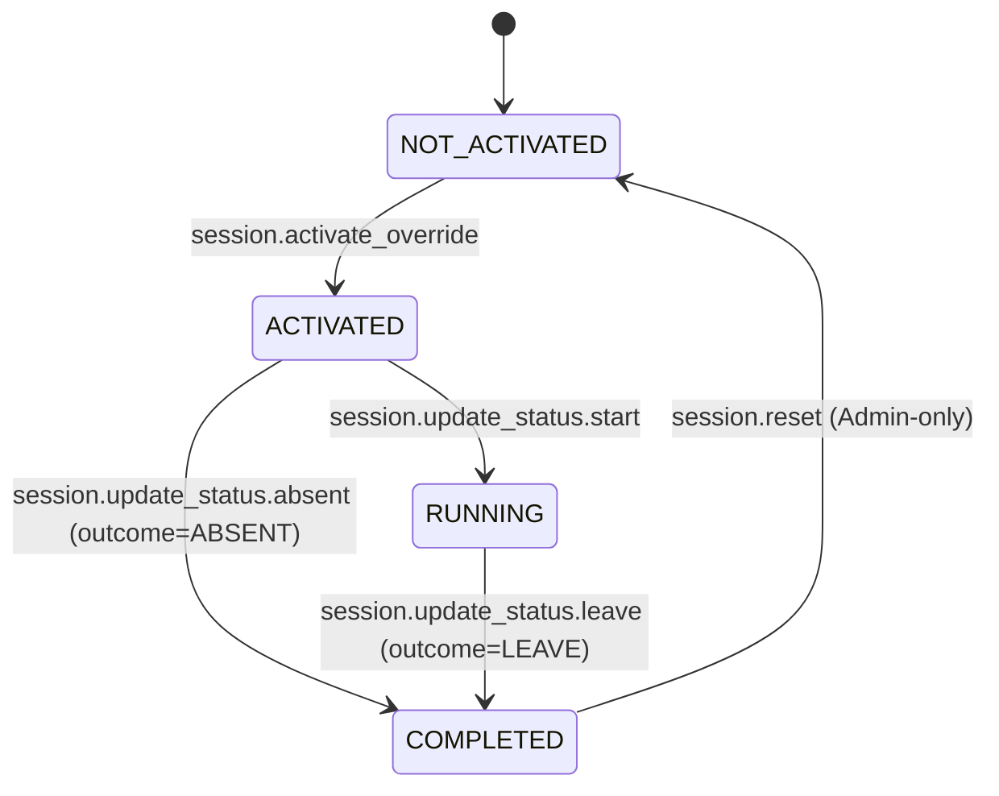
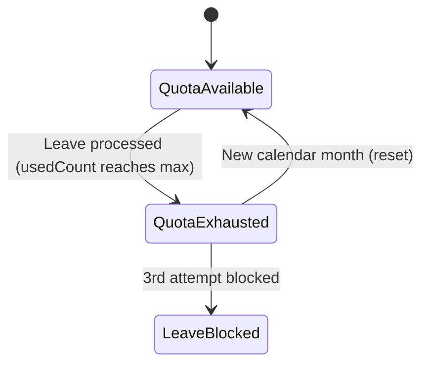

# Siraj Stories - Planning & Execution Guidelines for AI Agents

When working on any story or sprint in the `.ai/siraj_stories/` directory, AI Agents **MUST** strictly adhere to the following planning and execution protocol. **Failure to follow these instructions will result in immediate rejection by the user.**

This file acts as the orchestra, ruler, tasker, and documentary for creating perfect, bulletproof implementation plans.

---

## 1. Deep Context & System Analysis (The Reality Check)
Before writing any code or proposing an implementation plan, you must perform deep analysis and respect the verified repository facts:
- **Do not assume implementation completeness**: You must verify and implement all missing layers.
- **Trace the full stack**: Plan for Drizzle (DB), Domain Services (Logic), Pothos (Backend API), Apollo Documents (Frontend API), Zustand Stores (State), and React Components (Views).
- **Verified Repository Facts (DO NOT CONTRADICT)**:
  1. **Permission Catalog**: System permissions are now defined in `backend/db/migration/3-system_permissions_and_groups.sql` and seeded via the migration system, NOT `backend/db/seeds/permission-catalog.ts`. The enum values still exist in `shared/lib/enum.ts`.
  2. **GraphQL Types**: Backend GraphQL class/session object and input types are in `backend/graphql/pothos/class-session.pothos.ts` (or relevant pothos files), NOT a separate types file.
  3. **i18n Localization**: Uses `shared/messages/en.ts` and `shared/messages/ar/` directories. DO NOT create `frontend/locales/` or `backend/locales/` directories.
  4. **Permission Enums**: Values use PascalCase (e.g., `SESSION_FORCE_ACTIVATE = "session.force_activate"`) in `shared/lib/enum.ts`.
  5. **Schema Accuracy**: Do not hallucinate column names. Verify them (e.g., use `remarks`, not `remarksByTeacher`). If a column like `payrollCredited` does not exist, explicitly plan a database migration/schema update first.
  6. **Existing Database Triggers**: Check existing DB triggers before writing new ones. For example, the existing state transition trigger uses a blacklist-style approach; do not overwrite it with a whitelist-style approach without explicit validation.
- **Transitioning from Mock to Real**: Hook up real backend repositories, real GraphQL queries, replace mock data with real stateful Apollo hooks (`useQuery`), and migrate layout wrappers.
- **Data Seeding Lifecycle**: Update seeders in `backend/db/seeds`. Run `bun run scripts/dbActions.ts push` before seeding. Ensure constraints and exact enums are respected.

---

## 2. Planning Requirements & Length Guidelines

Your implementation plan (`implementation_plan.md` or similar) must be **hyper-detailed, lengthy, and exhaustive**. 

### 📏 Length & Detail Thresholds:
- **Total Plan Length**: Must be at least **2,500+ lines of markdown** (similar to `.ai/plan/2-enhanced.md` which is 3,300+ lines). Plans that are short, high-level summaries will be rejected.
- **Per-Task Length**: Each task within Section 6 must be at least **300 to 600+ lines long**. You must write out complete code snippets, database schemas, full query logic, and precise UI states.
- **Zero Placeholder Code**: No `...` inside code blocks. Code examples must be written out fully, displaying exact variable names, typings, error handlers, and imports.

---

## 3. Plan Section Outline & Concrete Examples

Every implementation plan MUST contain these exact 7 sections in order, formatted with the detailed examples shown below:

### Section 0: Story Metadata & Context
Provide clear metadata links and brief business objectives.

#### *Example Section 0:*
```markdown
## Section 0: Story Metadata & Context

- **Source story:** `.ai/siraj_stories/2.md` (Part 3 - Live Session Control, timestamps 00:00 - 01:58)  
- **Security baseline:** `.ai/done/service/1-sprint_1__db_repo_service_enhancments.md` (mandatory prerequisite)  
- **Story scope:** Implement live session control toolbar with Start, Absent, Leave, and Reset actions.
- **Target roles:** Academy Admin (full override + reset), Teacher (standard lifecycle management).
- **Status:** Planning phase - awaiting approval for execution.
```

---

### Section 1: Core Principles & Strict Rules (Mandatory Checklist)
Include general system rules, a ban on monolithic services, and the **Zero Incomplete Implementation Policy** table.

#### *Example Section 1:*
```markdown
## Section 1: Core Principles & Strict Rules (Mandatory Checklist)

### 1.1 Service Layer Architecture
- [ ] **NO monolithic services** - Scoped strictly to domain-driven services (e.g. `ClassSessionService`).
- [ ] **Business logic centralization** - All orchestration, validation, and permission checks reside in services, NOT repositories or resolvers.
- [ ] **🚫 Services MUST NOT import from DB/Drizzle** - Services can ONLY depend on the repository layer (`backend/db/repo/`). Importing from `drizzle-orm`, `backend/db/schema`, `backend/db/index`, or any Drizzle-related module is **strictly forbidden**. All database access must go through repo methods. This rule must be explicitly noted in every service layer task in Section 6.

### 1.1b GraphQL Resolver Architecture
- [ ] **🚫 GraphQL Resolvers MUST NOT import from DB/Repo** - Pothos resolvers can ONLY depend on the service layer (`backend/services/`). Importing from `backend/db/repo/`, `backend/db/schema`, or any database module is **strictly forbidden**. Resolvers are thin adapters: validate GraphQL input → call service method → return GraphQL result. No business logic, no direct data access.

### 1.2 Type Safety - NO `any`, NO Casts
- [ ] **Strict Type Narrowing** - BANNED: `any`, `as any`, and `as unknown as`. You must find the actual types. Narrow them using type guards.
- [ ] **No route param casts** - Instead of `useParams() as { id: string }`, use safety checks like `typeof params?.id === "string" ? params.id : ""`.

### 1.2b Task Ordering & Dependency Integrity
- [ ] **No forward dependencies** - A task MUST NOT depend on code, types, schemas, or modules introduced by a later task. Tasks can only depend on the current project state or on earlier tasks.
- [ ] **Incremental build order** - Tasks must be ordered so the dependency chain flows naturally: Database/Schema → Repository → Service → GraphQL → Frontend Stores → Frontend Views.
- [ ] **Self-contained tasks** - After completing each task, the project must compile and pass all quality gates. No task should leave the project in a broken state waiting for a later task to fix it.
- [ ] **Explicit dependency declaration** - Each task must list its dependencies (earlier task letters or "current project state only") in its Dependencies field.

### 1.3 Zero Incomplete Implementation Policy
The following patterns are **strictly prohibited**:

| **Prohibited Pattern** | **Required Instead** | **Verification Command** |
|---|---|---|
| `// TODO`, `// FIXME`, `@todo` | Fully working implementation in same task | `rg -i "TODO\|FIXME" backend frontend` |
| `throw new Error("Not implemented")` | Complete service/repo method implementation | Manual code review |
| Handler calling only `logger.info` | Real GraphQL mutation + UI feedback | Grep for `logger.info.*handle` patterns |
| Service importing from `drizzle-orm` or `backend/db/schema` | Service depends ONLY on `backend/db/repo/` | `rg "from ['\"]drizzle\|from ['\"]backend/db/schema" backend/services/` |
| GraphQL resolver importing from `backend/db/repo/` | Resolver depends ONLY on `backend/services/` | `rg "from ['\"]backend/db" backend/graphql/pothos/` |
```

---

### Section 2: RBAC Permissions (Canonical)
Map the exact permission strings from the sprint rules to the database catalog and file targets.

#### *Example Section 2:*
```markdown
## Section 2: RBAC Permissions (Canonical)

| **Permission Key** | **Group** | **UI Gate** | **Backend Service Method** | **GraphQL Mutation** |
|---|---|---|---|---|
| `session.activate_override` | Academy Admin | Live toolbar visibility | `ClassSessionService.activateOverride()` | `activateOverrideClass` |
| `session.reset` | Academy Admin | Reset button | `ClassSessionService.reset()` | `resetClass` |
```

---

### Section 3: State Machine & Threat Alignment (If Applicable)
Define the state machine diagrams and database transition rules. When your implementation involves state transitions, quota enforcement, or multi-step workflows, you **MUST** include Mermaid state diagrams to visualize the complete flow. This is not optional — visual state machines prevent logical gaps that text-only descriptions miss.

#### Required Diagrams (when applicable):

1. **Primary State Machine**: Show all entity states and transitions with permission guards.
2. **Processing Flow**: Show the end-to-end processing path including pre-checks, transaction boundaries, and rollback paths.
3. **Quota/Lifecycle Tracking**: Show time-based or count-based state changes (e.g., monthly quota reset).

#### *Example Section 3:*
```markdown
## Section 3: Session State Machine & Threat Alignment



**State Transition Guards (Threat 3):**
- DB trigger `fn_enforce_class_instance_transition()` enforces allowed state paths.
- Repo guard `runStateChange()` validates transition outcome alignment.

#### Quota Enforcement State Machine (if applicable):


#### Diagram Requirements:
- Use `stateDiagram-v2` syntax (not `graph` or `flowchart`).
- Label every transition with the permission/action that triggers it.
- Use `note` annotations to highlight critical business rules or admin bypass paths.
- Show rollback/failure paths explicitly (e.g., `QuotaGate --> ACTIVATED: Error: leaveQuotaExceeded`).
- Include choice nodes (`<<choice>>`) for conditional branching (e.g., quota check pass/fail).
```

---

### Section 4: Security Threat Remediation
Address specific vulnerabilities such as IDOR, timezone differences, quota leaks, and payroll fraud. Describe the exact fix approach and which files are modified.

#### *Example Section 4:*
```markdown
## Section 4: Security Threat Remediation

### Threat 1: IDOR Scoping (Cross-Teacher Access)
**Current Gap:** Repository `runStateChange` checks relationships but doesn't support Admin overrides.
**Fix in `scheduling.repository.ts`:** Before the ownership check, call `PermissionsService.hasAnyPermission(actorUserId, [SESSION_OVERRIDE_ACTIONS, SESSION_RESET])` to determine if the actor is a privileged admin. If not privileged, verify `instance.teacherUserId === actorUserId` and throw a localized unauthorized error if they don't match.
```

---

### Section 5: Prerequisites Verification (BLOCKING)
A checklist to run before executing the plan to confirm previous sprint work is fully deployed.

#### *Example Section 5:*
```markdown
## Section 5: Prerequisites Verification (BLOCKING)

Before starting story work, verify previous migrations:
- [ ] Run `bun run test:db` (or `bun test backend/db/test/logic/class_instances_security.test.ts`) to confirm Story 1 security baselines pass.
- [ ] Verify that schema columns `remarks`, `quotaDeducted`, and `isRescheduled` exist in `backend/db/schema/scheduling.ts`.
```

---

### Section 6: Granular Task Breakdown (The core breakdown - MUST be 300-600+ lines per task)
Break down the implementation into letters. Tasks **MUST** be strictly ordered by dependency — a task can only depend on the current state of the project or on work completed by an earlier task. Forward dependencies (relying on a later task) are **strictly forbidden** and will cause quality gates to fail. Each task MUST include:
1. **Objective**
2. **Dependencies** — Explicitly state what this task depends on (existing project state or earlier task letter). If none, state "None — depends only on current project state."
3. **Layer-Specific Rules** (flattened from sub-directory `AGENTS.md` rules)
4. **Target Files** (exact paths)
5. **Detailed Implementation Steps** (with extensive, fully-written code blocks)
6. **Test Execution Requirements** (running the whole test suite to prevent regressions)
7. **Success Criteria / Check Progress Points** (a detailed progress tracker within each task)

#### Task Ordering Rules (MANDATORY):
- **No forward dependencies**: A task MUST NOT call, import, reference, or assume the existence of any code, type, method, schema column, migration, or module that is introduced by a later task.
- **Build incrementally**: Order tasks so that the dependency chain flows naturally — typically Database/Schema → Repository → Service → GraphQL → Frontend Stores → Frontend Views. Each layer builds on the one before it.
- **Self-contained per task**: Every task must compile, pass all quality gates, and produce a working project state on its own. After completing Task B, the project must be in a fully working state — it must not be in a broken state waiting for Task C to "fix" or "complete" something.
- **Declare dependencies explicitly**: Each task's **Dependencies** field must list exactly what it relies on (e.g., "Depends on Task A: `SchedulingRepository.resetClassInstance` method" or "Depends on current project state only").
- **Reorder if needed**: If during planning you discover a task needs something from a later task, you MUST reorder the tasks so the dependency comes first. Never work around this by adding stubs, TODOs, or temporary imports.

#### Mandatory Quality Gate Checklist (MUST appear in every task's Success Criteria):

Every task's **Success Criteria** section **MUST** include the following quality gate checklist verbatim, in addition to task-specific criteria. This is non-negotiable — tasks missing this checklist will be rejected:

```markdown
**Quality Gate — Per-File Validation:**
- [ ] `bun tsgo` on working files passes with 0 TypeScript errors & 0 warnings, after creating/modifying a single file
- [ ] `bun biome:check` on working files passes with 0 errors & 0 warnings, after creating/modifying a single file
- [ ] `bun lint` on working files passes with 0 errors & 0 warnings, after creating/modifying a single file
- [ ] `bun codescene` on working files passes with 0 errors & 0 warnings, after creating/modifying a single file
- [ ] `loop over tsgo, biome:check, lint, codescene` on working files till no issues at all, after creating/modifying a single file

**Quality Gate — Task Completion Validation:**
- [ ] `bun tsgo` on working files passes with 0 TypeScript errors & 0 warnings, after completing all steps
- [ ] `bun biome:check` on working files passes with 0 errors & 0 warnings, after completing all steps
- [ ] `bun lint` on working files passes with 0 errors & 0 warnings, after completing all steps
- [ ] `bun codescene` on working files passes with 0 errors & 0 warnings, after completing all steps
- [ ] `loop over tsgo, biome:check, lint, codescene` on working files till no issues at all, after completing all steps
```

#### *Example Task A (Database & Repo):*
```markdown
### Task A — Repository: Reset, Absent, Leave

**Objective:** Implement transactional repository methods for `resetClassInstance` and `processClassLeave`.

**Dependencies:** None — depends only on current project state (existing Drizzle schema and `classInstances` table).

**Layer-Specific Rules (Database Repositories - Flattened from backend/db/repo/AGENTS.md):**
- Use Drizzle standard syntax `db.select().from(classInstances).leftJoin()` instead of relational `findMany` when multiple joins are needed to avoid type compilation slow downs.
- Wrap all repository changes modifying multiple tables in an atomic `db.transaction()`.

**Target Files:**
- `backend/db/repo/scheduling.repository.ts`
- `backend/db/test/repo/scheduling.repository.test.ts`

**Detailed Implementation Steps:**

*Step 1: Write `resetClassInstance` with Quota Restoration*

Implement as a namespace function in `SchedulingRepository`:
- Fetch the existing class instance by ID
- If `quotaDeducted` is true, call `adjustQuotaOnUpdate` to restore the student's quota
- Update the instance state to `NOT_ACTIVATED`, reset outcome to `PENDING`, and clear payroll/quota/rescheduled flags
- Wrap all operations in a `db.transaction()` for atomicity

*Step 2: Add comprehensive unit tests in `scheduling.repository.test.ts`*
Ensure unit tests verify both success states and rollback behavior on invalid inputs.

**Test Execution Requirements:**
- **Run the whole test suite:** Run `bun run test:db` across the database folder to make sure no existing tests are broken.
  ```bash
  bun run test:db
  ```

**Success Criteria / Check Progress Points:**
- [ ] `resetClassInstance` is fully implemented and resets the table state.
- [ ] Student quota is restored successfully if it was deducted.
- [ ] No compilation errors when compiling the database repository.
- [ ] `bun run test:db` passes successfully for all database tests (0 failures).

**Quality Gate — Per-File Validation:**
- [ ] `bun tsgo` on working files passes with 0 TypeScript errors & 0 warnings, after creating/modifying a single file
- [ ] `bun biome:check` on working files passes with 0 errors & 0 warnings, after creating/modifying a single file
- [ ] `bun lint` on working files passes with 0 errors & 0 warnings, after creating/modifying a single file
- [ ] `bun codescene` on working files passes with 0 errors & 0 warnings, after creating/modifying a single file
- [ ] `loop over tsgo, biome:check, lint, codescene` on working files till no issues at all, after creating/modifying a single file

**Quality Gate — Task Completion Validation:**
- [ ] `bun tsgo` on working files passes with 0 TypeScript errors & 0 warnings, after completing all steps
- [ ] `bun biome:check` on working files passes with 0 errors & 0 warnings, after completing all steps
- [ ] `bun lint` on working files passes with 0 errors & 0 warnings, after completing all steps
- [ ] `bun codescene` on working files passes with 0 errors & 0 warnings, after completing all steps
- [ ] `loop over tsgo, biome:check, lint, codescene` on working files till no issues at all, after completing all steps

- [ ] `bun run test:db` passes successfully for all database tests (0 failures).
```

#### *Example Task B (Frontend & Views):*
```markdown
### Task B — Frontend: Live Session Control Dialogs & No-Casts

**Objective:** Integrate the live session control buttons inside `LiveSessionToolbar` using proper MUI modals, removing browser alerts, and eliminating blind castings.

**Dependencies:** Depends on Task A — uses `SchedulingRepository.resetClassInstance` and `SchedulingRepository.processClassLeave` via GraphQL mutations exposed in prior tasks. Also depends on existing GraphQL schema and generated frontend types.

**Layer-Specific Rules (Frontend Views - Flattened from frontend/views/AGENTS.md):**
- BANNED: Do not use inline styling or arbitrary tailwind classes. Use Material UI theme tokens.
- Maintain localized text strings utilizing translation hooks.

**Target Files:**
- `frontend/views/dashboard/classes/details/components/LiveSessionToolbar.tsx`

**Detailed Implementation Steps:**

*Step 1: Replace `useParams() as { id: string }` with safe narrowing*

Extract the `id` from `useParams()` using a typeof guard (e.g., `typeof params?.id === "string" ? params.id : ""`). If `id` is empty, render an error `<Typography>` instead of proceeding.

*Step 2: Implement MUI Dialog instead of browser confirm/prompt*

Define a `dialogState` with open/type fields using `useState`. Render an accessible `<Dialog>` component enclosing localized text and theme-compliant action buttons. Remove all `confirm()` and `prompt()` calls.

**Test Execution Requirements:**
- **Run the entire test suite:** Run the full frontend and graphql tests to ensure there are no breaking changes.
  ```bash
  bun run test:graphql
  ```

**Success Criteria / Check Progress Points:**
- [ ] The browser `confirm()` and `prompt()` functions are completely deleted.
- [ ] MUI Dialog functions correctly for both Leave requests and Reset actions.
- [ ] Typescript compilation is fully successful (no `any` or blind casts in modified components).
- [ ] Complete frontend integration and GraphQL queries compile without errors.

**Quality Gate — Per-File Validation:**
- [ ] `bun tsgo` on working files passes with 0 TypeScript errors & 0 warnings, after creating/modifying a single file
- [ ] `bun biome:check` on working files passes with 0 errors & 0 warnings, after creating/modifying a single file
- [ ] `bun lint` on working files passes with 0 errors & 0 warnings, after creating/modifying a single file
- [ ] `bun codescene` on working files passes with 0 errors & 0 warnings, after creating/modifying a single file
- [ ] `loop over tsgo, biome:check, lint, codescene` on working files till no issues at all, after creating/modifying a single file

**Quality Gate — Task Completion Validation:**
- [ ] `bun tsgo` on working files passes with 0 TypeScript errors & 0 warnings, after completing all steps
- [ ] `bun biome:check` on working files passes with 0 errors & 0 warnings, after completing all steps
- [ ] `bun lint` on working files passes with 0 errors & 0 warnings, after completing all steps
- [ ] `bun codescene` on working files passes with 0 errors & 0 warnings, after completing all steps
- [ ] `loop over tsgo, biome:check, lint, codescene` on working files till no issues at all, after completing all steps
```

---

### Section 7: Final Verification & Integrity Protocol
Outline the list of commands to verify the entire system compiles and passes all checks.

#### *Example Section 7:*
```markdown
## Section 7: Final Verification & Integrity Protocol

Execute the following commands in order to guarantee system stability and prevent code regressions:
1. `bun run generate:gqlSchema` (checks GraphQL schema integration)
2. `bun codegen` (updates types and queries)
3. `bun tsgo` (runs global TypeScript typecheck)
4. `bun biome:check` (runs Biome formatter/linter checks)
5. `bun lint` (runs ESLint checks)
6. `bun codescene` (runs CodeScene analysis)
7. Loop commands 3-6 until all pass with 0 errors & 0 warnings
8. `bun run test` (runs all unit and integration tests across backend and frontend)
```

---

## 4. Strict Layer Architecture Constraints

### A. Database Layer (`backend/db/repo/`)
- **Drizzle Constraints**: Avoid `db.query.tableName.findMany` with deeply nested `with`. Use standard `db.select().from(table).leftJoin(...)`.

### B. Service Layer (`backend/services/`)
- **Domain-Driven Design**: Services must be scoped to their domain. NO Monoliths.
- **🚫 NO Drizzle/DB Imports Allowed**: Services are **strictly prohibited** from importing anything from `db/drizzle`, `drizzle-orm`, `backend/db/schema`, or any database-related modules. Services **may ONLY depend on the repository layer** (`backend/db/repo/`). All database access, queries, transactions, and schema references must be encapsulated within repository methods. If a service needs data, it calls a repo method — it never touches Drizzle directly.

### C. Backend GraphQL Layer (`backend/graphql/pothos/`)
- **Nullability**: `nullable: false` by default.
- **Cache Compliance**: Every object returned MUST expose an `id` field.
- **🚫 NO DB/Repo Imports Allowed**: GraphQL resolvers (Pothos) are **strictly prohibited** from importing anything from `backend/db/`, `backend/db/repo/`, `backend/db/schema`, or `drizzle-orm`. GraphQL resolvers may ONLY depend on the service layer (`backend/services/`). All business logic, validation, and data access orchestration must be delegated to service methods. Resolvers are thin adapters that map GraphQL inputs/outputs to service calls — nothing more.

### D. Frontend GraphQL Layer (`frontend/graphql/`)
- **Codegen Lifecycle**: Must run `bun run generate:gqlSchema` then `bun codegen`.
- **Hook Restrictions**: BANNED from using `useLazyQuery`. Use stateful `useQuery`.

### E. Frontend Stores (`frontend/stores/`)
- **Zustand Types**: Strictly use generated GraphQL types from `frontend/graphql/generated/gql/graphql-types.ts`. NO intermediate mappings.

### F. Frontend Views (`frontend/views/`)
- **Sprint-Specific RBAC Enforcement**: Use `<RequirePermission permissions={["domain.action"]} />`.
- **Mock Data Ban (Production)**: Mock data is strictly forbidden in production. Migrate to real components. (Storybooks `*.stories.tsx` MUST KEEP dummy data).

### G. Backend Localization & next-intl (`backend/`)
- **No Hardcoded Errors/Messages**: Always use `getBackendTranslations({ locale, namespace })`. Propagate `locale` through the stack.

---

## 5. Final Validation
- Ensure the project passes strict TypeScript compilation by running `bun tsgo`. Do not leave unresolved type errors.
- Ensure no successful tests are broken by running the test suite after each task.
- **Mandatory Quality Gates**: After every task, and after creating/modifying each individual file within a task, the agent MUST run and pass:
  1. `bun tsgo` — 0 TypeScript errors & 0 warnings
  2. `bun biome:check` — 0 errors & 0 warnings
  3. `bun lint` — 0 errors & 0 warnings
  4. `bun codescene` — 0 errors & 0 warnings
  5. **Loop** over all four commands until no issues remain at all
- These quality gates apply at two checkpoints:
  - **Per-file**: After creating or modifying a single file
  - **Per-task**: After completing all steps of a task
