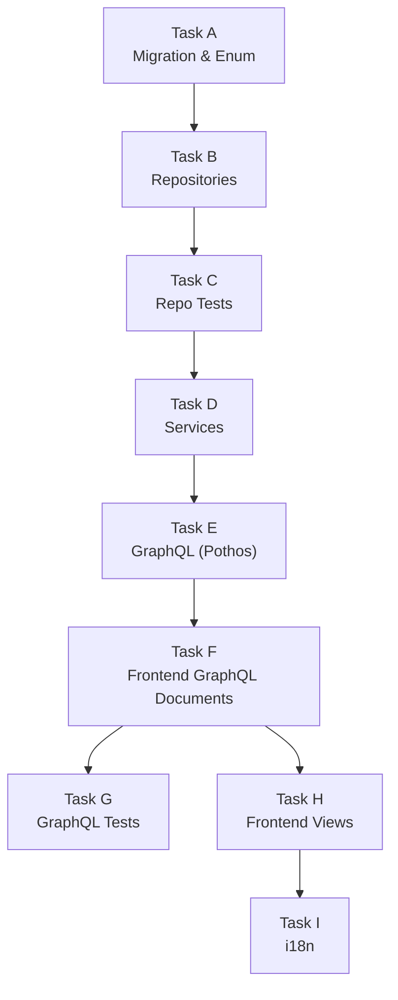

## Appendix: Story 9 — File Creation Summary, Dependency Graph & Task Overview

---

### A-1. New Files Created

| **File Path** | **Task** | **Type** | **Description** |
|---|---|---|---|
| `shared/lib/enum.ts` | A | MODIFY | Add 6 new `AppPermission` enum values |
| `backend/db/migration/3-system_permissions_and_groups.sql` | A | MODIFY | Add 6 new permission inserts + group assignments |
| `backend/db/repo/billing.repository.ts` | B | MODIFY | Add `deleteInvoice()` and `markInvoiceAsPaid()` methods |
| `backend/db/repo/student.repository.ts` | B | MODIFY | Add `reassignTeacher()` and `changeStatus()` methods |
| `backend/db/test/repo/billing.repository.test.ts` | C | MODIFY | Add tests for `deleteInvoice` and `markInvoiceAsPaid` |
| `backend/db/test/repo/student.repository.test.ts` | C | MODIFY | Add tests for `reassignTeacher` and `changeStatus` |
| `backend/db/test/logic/student_status_transition.test.ts` | C | MODIFY/NEW | Add/extend DB trigger tests |
| `backend/services/billing/billing-management.service.ts` | D | NEW | `BillingManagementService` namespace |
| `backend/services/student/student-lifecycle.service.ts` | D | NEW | `StudentLifecycleService` namespace |
| `backend/services/system/notification-sync.service.ts` | D | NEW | `NotificationSyncService` namespace |
| `backend/graphql/pothos/billing-management.pothos.ts` | E | NEW | `createManualInvoice`, `markInvoicePaid`, `deleteInvoice` mutations |
| `backend/graphql/pothos/student-lifecycle.pothos.ts` | E | NEW | `reassignStudentTeacher`, `changeStudentStatus` mutations |
| `backend/graphql/pothos/index.ts` | E | MODIFY | Add imports for 2 new Pothos modules |
| `frontend/graphql/sharedDocuments/billing-management.documents.ts` | F | NEW | 3 billing `TypedDocumentNode` mutations |
| `frontend/graphql/sharedDocuments/student-lifecycle.documents.ts` | F | NEW | 2 student `TypedDocumentNode` mutations |
| `frontend/graphql/sharedDocuments/index.ts` | F | MODIFY | Add exports for new document files |
| `frontend/graphql/test/billing-management.test.ts` | G | NEW | GraphQL integration tests for billing mutations |
| `frontend/graphql/test/student-lifecycle.test.ts` | G | NEW | GraphQL integration tests for student mutations |
| `frontend/views/dashboard/billing/AdminBillingContainer.tsx` | H | MODIFY | Replace mock store with real mutations |
| `frontend/views/dashboard/billing/manual/ManualInvoiceContainer.tsx` | H | MODIFY | Replace mock store with real mutation |
| `frontend/views/dashboard/parents/profile/ParentStudentsDataGrid.tsx` | H | MODIFY | Wire reassign teacher + change status actions |
| `frontend/views/dashboard/parents/profile/ParentProfileContainer.tsx` | H | MODIFY | Pass `refetch` callback to students grid |
| `shared/messages/en.ts` | I | MODIFY | Add 20+ new English translation keys |
| `shared/messages/ar.ts` | I | MODIFY | Add 20+ new Arabic translation keys |

**Total: 10 new files, 14 modified files**

---

### A-2. Files NOT Changed (Explicitly Out of Scope)

| **File Path** | **Reason Not Changed** |
|---|---|
| `backend/db/migration/student_status_transition_trigger.sql` | DB trigger not modified — Story 9 only gates the UI action; trigger remains unchanged |
| `backend/services/billing/billing-history.service.ts` | Read-only history service from Story 8 — not touched |
| `backend/services/billing/billing-alerts.service.ts` | Unpaid invoice alerts from Story 6 — not touched |
| `backend/services/student/student-management.service.ts` | Quota editing service from Story 8 — not touched |
| `frontend/views/dashboard/billing/AdminBillingContainer.stories.tsx` | Stories kept using mock store — production container replaced |
| `frontend/views/dashboard/billing/manual/ManualInvoiceContainer.stories.tsx` | Stories kept using mock store — production container replaced |
| `frontend/views/dashboard/billing/components/*` | Billing UI sub-components not modified |
| `frontend/views/dashboard/billing/types/*` | Types may need minor additions for new props, but no full rewrite |
| Any scheduling-related files | Scheduling cascade for SUSPENDED status is out of scope |

---

### A-3. Task Dependency Graph

All tasks must execute in the dependency order shown. Tasks with no dependency between them (e.g., Task G and Task H) MAY be run in parallel if multiple agents are executing the sprint.

---

### A-4. New Permission Catalog Summary

| **Permission Key** | **Enum Value** | **Category** | **Is System** | **Assigned Groups** |
|---|---|---|---|---|
| `billing.create_invoice` | `BILLING_CREATE_INVOICE` | Billing | ✅ | Super Admin, Admin |
| `billing.update_status_paid` | `BILLING_UPDATE_STATUS_PAID` | Billing | ✅ | Super Admin, Admin |
| `billing.delete_invoice` | `BILLING_DELETE_INVOICE` | Billing | ✅ | Super Admin, Admin |
| `student.reassign_teacher` | `STUDENT_REASSIGN_TEACHER` | Students | ✅ | Super Admin, Admin |
| `student.manage_status` | `STUDENT_MANAGE_STATUS` | Students | ✅ | Super Admin, Admin |
| `system.sync_notifications` | `SYSTEM_SYNC_NOTIFICATIONS` | System | ✅ | Super Admin, System Automated |

---

### A-5. GraphQL Schema Additions Summary

**New Mutations (5):**

| **Mutation Name** | **Input Args** | **Return Type** | **Permission Required** |
|---|---|---|---|
| `createManualInvoice` | `parentId`, `studentId?`, `amount`, `currency`, `invoiceType`, `issueDate`, `dueDate`, `exchangeRateSnapshot?`, `exchangeRateSource?` | `ManualInvoiceResult` | `billing.create_invoice` |
| `markInvoicePaid` | `invoiceId`, `expectedVersion?` | `MarkInvoicePaidResult` | `billing.update_status_paid` |
| `deleteInvoice` | `invoiceId` | `DeleteInvoiceResult` | `billing.delete_invoice` |
| `reassignStudentTeacher` | `studentId`, `newTeacherId`, `expectedVersion?` | `ReassignStudentTeacherResult` | `student.reassign_teacher` |
| `changeStudentStatus` | `studentId`, `newStatus`, `expectedVersion?` | `ChangeStudentStatusResult` | `student.manage_status` |

**New Object Types (5):**

| **Type Name** | **Fields** |
|---|---|
| `ManualInvoiceResult` | `id`, `parentId`, `studentId?`, `amount`, `currency`, `status`, `invoiceType`, `issueDate`, `dueDate`, `paidDate?`, `version`, `createdAt` |
| `MarkInvoicePaidResult` | `id`, `parentId`, `status`, `paidDate?`, `version`, `notificationSummaryUpdated` |
| `DeleteInvoiceResult` | `id`, `parentId`, `deletedAt?`, `version`, `notificationSummaryUpdated` |
| `ReassignStudentTeacherResult` | `id`, `primaryTeacherId?`, `version` |
| `ChangeStudentStatusResult` | `id`, `status`, `version` |

---

### A-6. Student Status Allowed Transitions (Service Layer & UI Reference)

| **Current Status** | **Allowed Targets via `student.manage_status`** | **UI Dropdown Options** |
|---|---|---|
| `ON_TRIAL` | `REGULAR`, `DEACTIVATED` | Regular, Deactivated |
| `REGULAR` | `SUSPENDED`, `ON_LEAVE`, `DEACTIVATED` | Suspended, On Leave, Deactivated |
| `SUSPENDED` | `REGULAR`, `DEACTIVATED` | Regular, Deactivated |
| `ON_LEAVE` | `REGULAR`, `DEACTIVATED` | Regular, Deactivated |
| `DEACTIVATED` | `REGULAR` | Regular |
| `GRADUATED` | *(none — terminal)* | Warning: "No transitions available" |

**Note:** `GRADUATED` is a terminal state enforced at both service layer (pre-validation) and DB trigger (final safety net).

---

### A-7. Security Threats Coverage Map

| **Threat** | **Section 4 Reference** | **Service Fix** | **Test Coverage** |
|---|---|---|---|
| Double-settlement / race condition | Section 4: Threat 1 | Advisory lock + post-lock UNPAID re-fetch in `BillingRepository.markInvoiceAsPaid` | Task G: `billing-management.test.ts` — "double settlement" test |
| IDOR on invoice operations | Section 4: Threat 2 | UUID format + permission check before any data access | Task G: non-existent ID tests |
| Student status transition bypass | Section 4: Threat 3 | `ALLOWED_STATUS_TRANSITIONS` map + DB trigger | Task C: DB trigger tests; Task G: invalid transition tests |
| Reassignment to inactive teacher | Section 4: Threat 4 | `TeacherRepository.findById()` validation in service | Task G: `student-lifecycle.test.ts` — "non-existent teacher" test |
| Notification sync failure masking billing | Section 4: Threat 5 | `.catch()` non-throwing pattern + `logger.error` | Task G: sync failure test; confirmed by structural code review |
