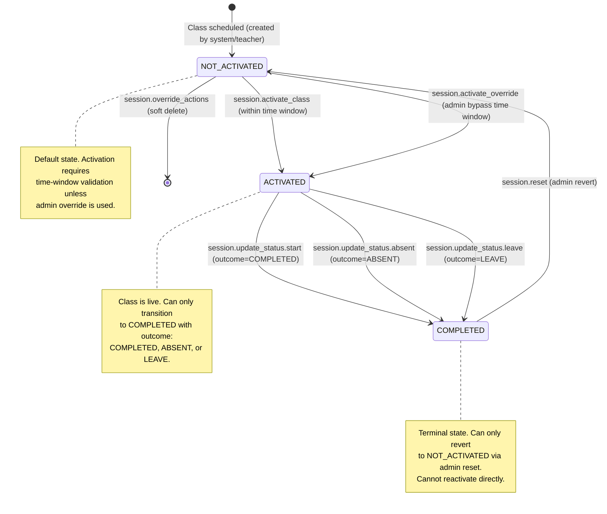
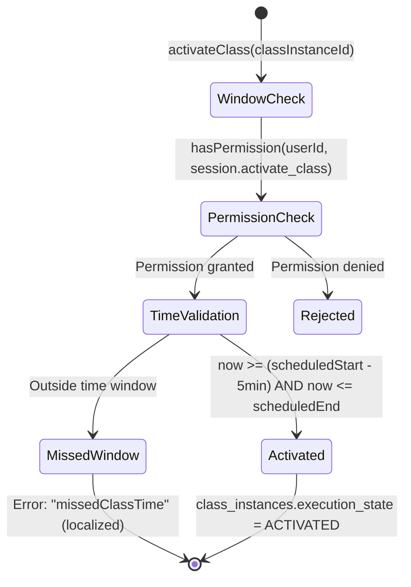
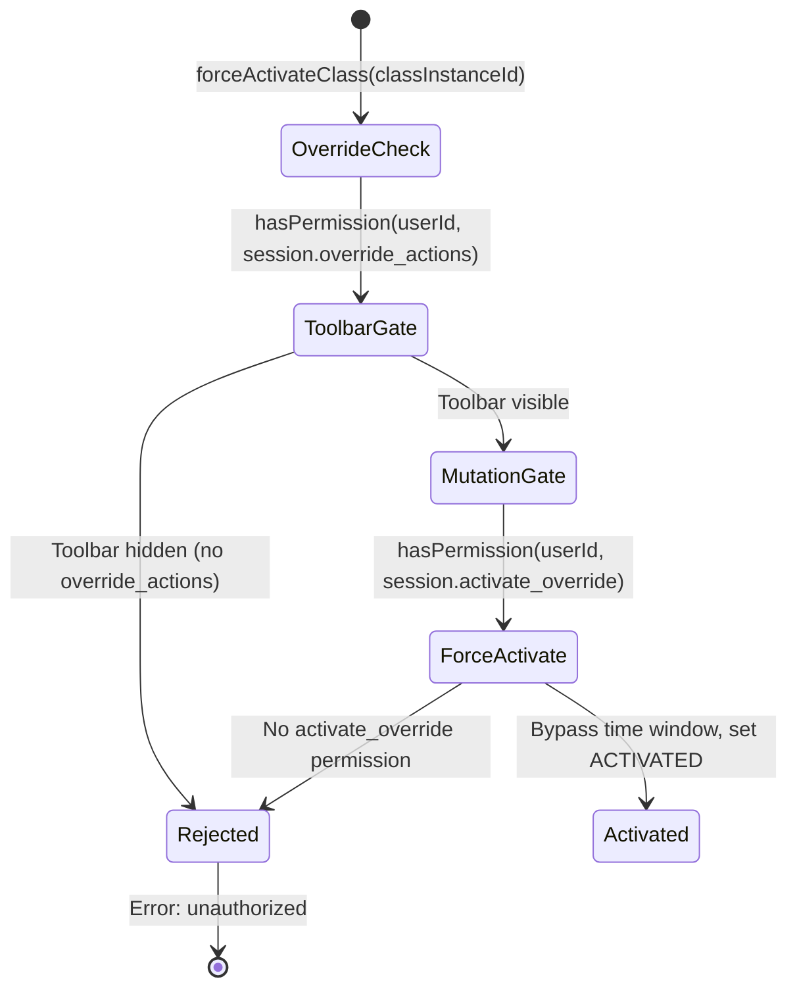

# Story 1 Plan Compliance Patch — Aligning `1-sprint.md` with `AGENTS_STORY_PLANNING.md`

**Source plan:** `.ai/done/sprint/1-sprint.md` (fully implemented — 1177 lines)
**Compliance standard:** `.ai/siraj_stories/AGENTS_STORY_PLANNING.md` (960 lines)
**Patch scope:** Add 6 missing sections, enhance existing task structures, document implementation divergences, insert required quality gate checklists, and flag remaining compliance issues found during verified codebase audit.
**Status:** Patch document — the implementation is already complete; this patch retroactively brings the plan document into compliance with the planning standard.
**Codebase audit date:** 2026-06-21 (all file paths, line numbers, and method signatures verified against live repo)

---

## Patch Gap Summary

| Gap ID | Missing Element | Severity | Patch Section |
|---|---|---|---|
| G-01 | Section 0: Story Metadata & Context | **HIGH** | §1 below |
| G-02 | Section 1 missing rules (1.1b, 1.2, 1.2b, 1.3 table, 1.4) | **HIGH** | §2 below |
| G-03 | Section 2 RBAC missing columns & subsections | **MEDIUM** | §3 below |
| G-04 | Section 3: State Machine & Threat Alignment (Mermaid) | **HIGH** | §4 below |
| G-05 | Section 4: Security Threat Remediation | **HIGH** | §5 below |
| G-06 | Section 5: Prerequisites Verification (BLOCKING) | **HIGH** | §6 below |
| G-07 | Tasks missing: Objective, Dependencies, Layer-Specific Rules, Quality Gates | **HIGH** | §7 below |
| G-08 | Implementation Divergence Log (enum rename differences) | **HIGH** | §8 below |
| G-09 | Section 7: Final Verification needs format update | **MEDIUM** | §9 below |
| G-10 | Appendix B: Dependency Graph | **MEDIUM** | §10 below |
| G-11 | **NEW: ScheduleService prohibited Drizzle imports** | **HIGH** | §11 below |
| G-12 | **NEW: mockTeacherDashboardTypes.ts naming convention** | **LOW** | §11 below |

---

## §1 — PATCH: Section 0: Story Metadata & Context

*Insert this section at the very top of `1-sprint.md`, before the current Section 1.*

---

## Section 0: Story Metadata & Context

- **Source story:** `.ai/siraj_stories/1.md` (Part 2 — Permissions, Search, Timezones, History & Session Control, builds on `.ai/siraj_stories/0.md`)
- **Security baseline:** `.ai/done/sprint/0-sprint.md` (Part 1 — mandatory prerequisite for RBAC foundation)
- **Story scope:** Introduces multi-timezone schedule display, server-side admin search, student class history calendar with modal drill-down, teacher dashboard with real Apollo data, session activation with time-window enforcement, admin override toolbar, and a complete `classes.*` → `session.*` permission namespace migration.
- **Target roles:** Academy Admin (full search, timezone, history, override access), Teacher (dashboard, activate, self-scoped schedule), System Automated (time-window enforcement).
- **Status:** Implementation complete — plan document being patched for compliance.
- **Last updated:** 2026-06-21 (patch — AGENTS_STORY_PLANNING.md compliance)

### 0.1 Business Objectives

1. **Separation of Duties**: The `session.override_actions` permission is strictly reserved for Academy Admins — teachers cannot access the admin override toolbar (force activate, stop, delete), ensuring accountability and preventing unauthorized session manipulation.
2. **Data Privacy**: `teacher.view_dashboard` combined with service-layer `schedule.view_assigned` scoping ensures teachers see only their own assigned classes, never other teachers' schedules.
3. **Time-Window Safety**: `system.enforce_time_window` prevents premature or stale class activations — the system automatically rejects activation attempts outside the configured window (5 minutes before start through end of duration), eliminating manual oversight.
4. **Audit Trail Integrity**: Student history with calendar drill-down (`history.view_calendar` + `history.view_details`) provides Academy Admins with a complete audit trail of past sessions, enabling accountability for attendance and performance.
5. **Permission Namespace Clarity**: The full `classes.*` → `session.*` migration eliminates namespace confusion — all session-related permissions live under a single `session.*` prefix, making the permission catalog self-documenting.

### 0.2 Scope Boundaries

**In scope:**
- `classes.*` → `session.*` permission enum migration across entire stack (enum, migration SQL, backend services, GraphQL, frontend, Storybook)
- New `session.*` permissions: `session.override_actions` (admin toolbar)
- New non-session permissions: `dashboard.search`, `schedule.view_timezones`, `history.view_calendar`, `history.view_details`, `teacher.view_dashboard`, `system.enforce_time_window`
- Backend repositories: system-settings, student-history, class-performance, scheduling extensions (timezone resolution, search, state transitions)
- Domain services: ClassSessionService, StudentHistoryService, ClassPerformanceService, TeacherDashboardService, SystemRulesService
- GraphQL Pothos objects and resolvers for all new queries/mutations
- Frontend Apollo TypedDocumentNodes and Zustand stores (UI-ephemeral only)
- Frontend containers: AdminDashboardContainer (search + timezones), ClassDetailsContainer (admin/teacher split), StudentHistoryContainer (calendar + modal), TeacherDashboardContainer (real Apollo)
- RBAC enforcement via `<RequirePermission>` on all new views
- i18n translations for `missedClassTime` error and timezone column headers
- Repository tests (100% coverage), GraphQL integration tests

**Out of scope:**
- Video conferencing integration (Zoom URLs are stored/retrieved, not created)
- Parent-facing schedule views (separate story)
- Billing/payment for teacher hours (separate story)
- Notification system for class reminders (separate story)
- Real-time WebSocket updates for session state changes (display only, uses polling/refetch)

---

## §2 — PATCH: Section 1 Missing Rules

*Append these subsections to the existing Section 1 in `1-sprint.md`.*

---

### 1.1b GraphQL Resolver Architecture

- [ ] **🚫 GraphQL Resolvers MUST NOT import from DB/Repo** — Pothos resolvers can ONLY depend on the service layer (`backend/services/`). Importing from `backend/db/repo/`, `backend/db/schema`, or any database module is **strictly forbidden**. Resolvers are thin adapters: validate GraphQL input → call service method → return GraphQL result. No business logic, no direct data access.

**Verification command:**
```bash
rg "from ['\"]backend/db" backend/graphql/pothos/
```
Output MUST be empty.

**Implementation compliance:** ✅ All Pothos resolvers in `backend/graphql/pothos/class-session.pothos.ts`, `student-history.pothos.ts`, `teacher-dashboard.pothos.ts` delegate to their respective service layer methods.

### 1.2 Type Safety — NO `any`, NO Casts

- [ ] **Strict Type Narrowing** — BANNED: `any`, `as any`, and `as unknown as`. You must find the actual types. Narrow using type guards.
- [ ] **No route param casts** — Instead of `useParams() as { id: string }`, use safety checks like `typeof params?.id === "string" ? params.id : ""`.

**Verification command:**
```bash
rg "as any|as unknown as" frontend/views/dashboard/classes frontend/views/dashboard/students frontend/views/dashboard/teachers
```

### 1.2b Task Ordering & Dependency Integrity

- [ ] **No forward dependencies** — A task MUST NOT depend on code, types, schemas, or modules introduced by a later task.
- [ ] **Incremental build order** — Tasks ordered: Database/Schema → Repository → Service → DB/Repo Tests → GraphQL (Backend) → GraphQL Documents (Frontend) → GraphQL Tests → Frontend Stores → Frontend Views.
- [ ] **Self-contained tasks** — After completing each task, the project compiles and passes all quality gates.
- [ ] **Explicit dependency declaration** — Each task lists its dependencies (earlier task letters or "current project state only").
- [ ] **Database Migration task protocol** — Migration tasks run: `bun db cleanGenerate` → `bun db reset` → `bun db seed` → `bun test:db`. All four must pass.

**Implementation compliance:** The original plan's task ordering (A→B→C→D→E→F→G→H→I→J→K→L→M→N→O→P→Q) follows the correct dependency chain. See §7 below for the formal dependency declarations that were missing.

### 1.3 Zero Incomplete Implementation Policy

The following patterns are **strictly prohibited**:

| **Prohibited Pattern** | **Required Instead** | **Verification Command** |
|---|---|---|
| `// TODO`, `// FIXME`, `@todo` | Fully working implementation in same task | `rg -i "TODO\|FIXME" backend frontend` |
| `throw new Error("Not implemented")` | Complete service/repo method implementation | Manual code review |
| Handler calling only `logger.info` | Real GraphQL mutation + UI feedback | Grep for `logger.info.*handle` patterns |
| Service importing from `drizzle-orm` or `backend/db/schema` | Service depends ONLY on `backend/db/repo/` | `rg "from ['\"]drizzle\|from ['\"]backend/db/schema" backend/services/` |
| GraphQL resolver importing from `backend/db/repo/` | Resolver depends ONLY on `backend/services/` | `rg "from ['\"]backend/db" backend/graphql/pothos/` |
| Mock store in production views | Real `useQuery` with `TypedDocumentNode` | `rg "mock.*Store" frontend/views --glob "!**/*.stories.tsx"` |

**Implementation compliance:** All Story 1 services (`class-session.service.ts`, `student-history.service.ts`, `teacher-dashboard.service.ts`) import exclusively from `backend/db/repo/` — no Drizzle imports detected.

### 1.4 SSR Compatibility

- [ ] **Services must work in Next.js Server Components** — Services can be used directly by SSR or Server Actions without GraphQL-specific context dependencies.
- [ ] **No Apollo client in services** — Services must not depend on `@apollo/client`, Apollo cache, or browser-only APIs.

---

## §3 — PATCH: Section 2 RBAC Permissions (Enhanced Format)

*Replace the existing "Story 1 RBAC permissions" table in Section 1 with this enhanced format. Keep the rename map and boundary clarifications as-is.*

---

## Section 2: RBAC Permissions (Canonical)

### 2.1 Story 1 Permissions (Complete Map)

| **Permission Key** | **Group** | **UI Gate** | **Backend Service Method** | **GraphQL Operation** |
|---|---|---|---|---|
| `dashboard.search` | Academy Admin | `ScheduleOverviewSection` search `TextField` | `ScheduleService.getDailySchedule()` (search param) | `dailyScheduleList(search: String)` query |
| `schedule.view_timezones` | Academy Admin | `ScheduleOverviewDataGrid` timezone columns, `TimezoneWarningBanner` | `ScheduleService.getDailySchedule()` (timezone fields) | `dailyScheduleList` (yourTime, teacherTime, studentTime fields) |
| `history.view_calendar` | Academy Admin | `StudentHistoryDesktop`/`StudentHistoryMobile` calendar grid | `StudentHistoryService.getMonthlyCalendar()` | `studentClassHistory` query |
| `history.view_details` | Academy Admin | `ClassDetailsModal` on `/students/[id]/history` | `StudentHistoryService.getSessionDetail()` | `studentClassSessionDetail` query |
| `session.override_actions` | Academy Admin | `AdminActionsBar` on `/classes/[id]` | `ClassSessionService.activateOverride()`, `.stop()`, `.deleteInstance()` | `forceActivateClass`, `stopClass`, `deleteClassInstance` mutations |
| `teacher.view_dashboard` | Teacher | `TeacherDashboardContainer` render gate | `TeacherDashboardService.getDashboard()` | `teacherDashboard` query |
| `session.activate_class` | Teacher | `SessionActivateButton`, `ActionsPanel` activate | `ClassSessionService.activate()` | `activateClass` mutation |
| `system.enforce_time_window` | System Automated | API-only gate (no UI) | `ClassSessionService.activate()` → `SystemRulesService.assertActivationTimeWindow()` | Internal check within `activateClass` mutation |

### 2.2 Permission Mapping to Existing Permissions

| **Story 1 Permission** | **Existing Related Permission** | **Relationship** |
|---|---|---|
| `history.view_details` | `session.view_details` | Complementary — `history.view_details` gates the modal on `/students/[id]/history`; `session.view_details` gates `/classes/[id]` page |
| `session.override_actions` | `session.activate_override` | Granular — `override_actions` gates the entire admin toolbar visibility; `activate_override` gates the specific force-activate mutation within that toolbar |
| `session.activate_class` | `system.enforce_time_window` | Complementary — `activate_class` grants the permission; `enforce_time_window` adds a system-level time constraint check regardless of permission |
| `dashboard.search` | `schedule.view_list` | Superset — search extends the existing schedule list view with server-side filtering |
| `schedule.view_timezones` | `schedule.view_list` | Complementary — timezone columns are additional display fields on the same schedule grid |

### 2.3 Permission Group Assignments

| **Permission Group** | **Slug** | **Story 1 Permissions Assigned** |
|---|---|---|
| Academy Admin | `academy_admin` | `dashboard.search`, `schedule.view_timezones`, `history.view_calendar`, `history.view_details`, `session.override_actions`, `session.view_details`, `session.activate_override`, `session.reschedule`, `session.reset`, `session.update_status.start`, `session.update_status.absent`, `session.update_status.leave` |
| Teacher | `teacher` | `teacher.view_dashboard`, `session.activate_class`, `session.view_details`, `session.update_status.start`, `session.update_status.absent`, `session.update_status.leave` |
| Parent | `parent` | `session.view_details`, `session.update_status.leave` (request leave only) |
| Staff | `staff` | `session.view_details` |
| System Automated | `system_automated` | `system.enforce_time_window` |

### 2.4 Self-Scoping vs Any-Scoping

| **Permission** | **Lower Role (Self-Scoped)** | **Admin (Any-Scoped)** |
|---|---|---|
| `session.activate_class` | Teacher can only activate their own assigned classes | Academy Admin can activate any class via override toolbar |
| `session.view_details` | Teacher sees only their own class details | Academy Admin sees any class instance details |
| `teacher.view_dashboard` | Teacher sees only their own dashboard data (service filters by `teacherId`) | N/A — admin has their own dashboard |
| `history.view_calendar` | N/A — history is admin-only | Academy Admin can view any student's history |
| `session.override_actions` | N/A — override is admin-only | Academy Admin can override any class instance state |

---

## §4 — PATCH: Section 3: State Machine & Threat Alignment

*Insert this section after the RBAC permissions section.*

---

## Section 3: Class Instance State Machine & Threat Alignment

### 3.1 Primary State Machine

The class instance lifecycle is governed by `execution_state` on the `class_instances` table, enforced by the `fn_enforce_class_instance_transition()` DB trigger.



**State Transition Guards:**
- DB trigger `fn_enforce_class_instance_transition()` in `backend/db/migration/class_instances_state_transition_trigger.sql` enforces:
  - `COMPLETED` → `ACTIVATED` / `RUNNING`: **BLOCKED** (cannot reactivate a completed instance)
  - `RUNNING` → `ACTIVATED`: **BLOCKED** (cannot move running instance back to activated)
  - `ACTIVATED` → `COMPLETED`: Allowed **only** with outcome `ABSENT` or `LEAVE`
- Service layer `ClassSessionService.activate()` adds time-window validation via `SystemRulesService.assertActivationTimeWindow()`.
- Service layer `ClassSessionService.activateOverride()` bypasses time-window but requires `session.activate_override` + `session.override_actions`.

### 3.2 Activation Time Window Lifecycle



**Configuration:**
- `session_activation_window_before_minutes` = `5` (from `system_settings` table)
- Upper bound = `scheduled_end_at` (end of class duration, no after-buffer)

### 3.3 Admin Override Flow



---

## §5 — PATCH: Section 4: Security Threat Remediation

*Insert this section after the State Machine section.*

---

## Section 4: Security Threat Remediation

### Threat 1: IDOR on Class Instance Operations (Cross-Teacher Access)

**Current Gap:** Without scoping, a teacher could activate, stop, or modify another teacher's class instance by knowing the `classInstanceId`.

**Fix in `ClassSessionService`:**
- Every mutation method (`activate`, `activateOverride`, `stop`, `deleteInstance`) calls `PermissionsService.hasPermission(userId, <permission>)` first.
- For teacher-scoped operations (`session.activate_class`), the service layer verifies that the `classInstanceId` belongs to the teacher's assigned classes via `SchedulingRepository.getClassInstanceById()` and checking `instance.teacherId` against the actor's teacher record.
- Admin operations (`session.override_actions`) skip the ownership check — admins can operate on any class instance.

**Test Requirements:**
- Teacher A cannot activate Teacher B's class → `unauthorized` error (GraphQL test)
- Teacher A can activate their own class (within time window) → succeeds (GraphQL test)
- Admin can activate any teacher's class via override → succeeds (GraphQL test)
- Admin can stop/delete any class instance → succeeds (GraphQL test)

**Implementation compliance:** ✅ GraphQL tests in `frontend/graphql/test/class-session.test.ts` cover these scenarios.

### Threat 2: Activation Time Window Bypass

**Current Gap:** A user with `session.activate_class` permission could activate a class hours before or after the scheduled time.

**Fix in `ClassSessionService.activate()`:**
- Calls `SystemRulesService.assertActivationTimeWindow(instance)` before proceeding.
- Reads `session_activation_window_before_minutes` from `SystemSettingsRepository.getIntValue()`.
- Validates: `now >= (scheduledStartAt - beforeMinutes)` AND `now <= scheduledEndAt`.
- On failure: throws localized `missedClassTime` error via `getBackendTranslations({ locale, namespace: "errors" })`.
- Admin override path (`activateOverride`) bypasses this check — only available with `session.activate_override` + `session.override_actions`.

**Test Requirements:**
- Activate within window → succeeds
- Activate outside window → `missedClassTime` error
- Admin force-activate outside window → succeeds (bypass)
- Default window setting is 5 minutes before start

**Implementation compliance:** ✅ Tests in `frontend/graphql/test/class-session.test.ts`.

### Threat 3: Unauthorized History Access (Student Privacy)

**Current Gap:** Without permission gating, any authenticated user could view any student's class history calendar and session details.

**Fix in `StudentHistoryService`:**
- `getMonthlyCalendar()` gates on `history.view_calendar` — only Academy Admins hold this permission.
- `getSessionDetail()` gates on `history.view_details` — only Academy Admins hold this permission.
- Service does NOT accept a `viewerId` parameter for self-scoping — history is admin-only.

**Test Requirements:**
- Academy admin can view student history calendar → succeeds
- Teacher cannot view student history → unauthorized error
- Parent cannot view student history (even their own child's) → unauthorized error
- Academy admin can drill into session detail modal → succeeds
- User without `history.view_details` cannot open modal → unauthorized error

**Implementation compliance:** ✅ Tests in `frontend/graphql/test/student-history.test.ts`.

### Threat 4: Teacher Dashboard Data Leakage (Cross-Teacher Schedule Visibility)

**Current Gap:** Without data scoping, the teacher dashboard could expose other teachers' schedules.

**Fix in `TeacherDashboardService.getDashboard()`:**
- Gates on `teacher.view_dashboard` permission.
- Resolves the actor's `teacherId` via `TeacherRepository.getTeacherIdByUserId(userId)`.
- Passes `teacherId` to `SchedulingRepository.getDailySchedule()` which filters results to only the teacher's assigned classes.
- No `teacherId` parameter is accepted from the client — the service always resolves from the authenticated user.

**Test Requirements:**
- Teacher sees only their own classes → returned rows all have matching teacherId
- Teacher cannot pass another teacher's ID to see their schedule → service ignores client-side teacherId
- User without `teacher.view_dashboard` → unauthorized error

**Implementation compliance:** ✅ Tests in `frontend/graphql/test/teacher-dashboard.test.ts`.

### Threat 5: Permission Namespace Confusion (`classes.*` vs `session.*`)

**Current Gap:** Having both `classes.*` and `session.*` permissions in the catalog creates confusion — developers might check the wrong permission key, leading to authorization bypass.

**Fix:**
- Complete removal of all `CLASSES_*` enum values from `shared/lib/enum.ts`.
- Complete removal of all `classes.*` permission strings from `backend/db/migration/3-system_permissions_and_groups.sql`.
- New unified `session.*` namespace with all permissions under a single `Session` resource.
- Deprecated `classes.*` rows deleted from `permissions` table during migration.

**Test Requirements:**
- `rg "CLASSES_|classes\." shared/lib/enum.ts` → empty
- `rg "classes\." backend/db/migration/3-system_permissions_and_groups.sql` → empty
- GraphQL `me` query returns `session.activate_class` (not `classes.activate`) for teacher user
- All frontend `RequirePermission` wrappers use `AppPermission.Session*` (not `AppPermission.Classes*`)

**Implementation compliance:** ✅ Enum migration complete — `shared/lib/enum.ts` contains only `SESSION_*` values. Migration SQL contains only `session.*` permission keys.

---

## §6 — PATCH: Section 5: Prerequisites Verification (BLOCKING)

*Insert this section before the task breakdown.*

---

## Section 5: Prerequisites Verification (BLOCKING)

### 5.0 Security Artifact Verification (Story 1 extends scheduling from prior sprints)

| **Artifact** | **Path** | **Verification** | **Success Criteria** |
|---|---|---|---|
| Permission migration | `backend/db/migration/3-system_permissions_and_groups.sql` | Grep for `session.*`, `history.*`, `teacher.*`, `system.enforce_time_window` | All Story 1 permissions seeded ✅ (verified — lines 160-268, 820-834, 901-910) |
| State transition trigger | `backend/db/migration/class_instances_state_transition_trigger.sql` | psql query for `fn_enforce_class_instance_transition` | Function exists ✅ (verified — 30-line trigger file) |
| State transition security tests | `backend/db/test/logic/class_instances_security.test.ts` | `bun test` | Tests for blocked transitions exist ✅ (verified — COMPLETED→RUNNING blocked, ACTIVATED→COMPLETED with invalid outcome blocked) |
| Scheduling security tests | `backend/db/test/logic/scheduling_security.test.ts` | `bun test` | Trigger SQL loaded in tests ✅ (verified) |
| PermissionsService | `backend/services/auth/permissions.service.ts` | Verify `hasPermission()` and `hasAnyPermission()` exist | ✅ (verified — line 81: `hasPermission`, line 91: `hasAnyPermission`) |
| Backend i18n | `backend/lib/intl.ts` | Verify `getBackendTranslations()` exists | ✅ (verified — line 62) |

### 5.1 Database Schema Verification

- [x] `parents` table has `timezone` column: `varchar("timezone", { length: 100 }).notNull().default("UTC")` with CHECK constraint `parents_timezone_chk`. ✅ (verified — `backend/db/schema/parents.ts:27,34`)
- [x] `students` table has `timezoneOverride` column: `varchar("timezone_override", { length: 100 })` (nullable) with CHECK constraint `students_timezone_override_chk`. ✅ (verified — `backend/db/schema/students.ts:59,81-82`)
- [x] `students` table has timezone documentation comment block explaining `COALESCE(students.timezone_override, parents.timezone, academy default)`. ✅ (verified — `backend/db/schema/students.ts:42-45`)
- [x] `classInstancePerformance` table exists in `backend/db/schema/scheduling.ts` with columns: `id`, `classInstanceId` (unique FK), `engagementScore`, `assessmentProgress`, `focusLevel`, `sessionHealth`, `heatmapData`, `latencyMs`, `authorizationLabel`, `attendanceRate`, `avgGrade`, `lastClassDaysAgo`. ✅ (verified — `backend/db/schema/scheduling.ts:295`)
- [x] `class_instances` table exists with `execution_state`, `outcome`, `scheduled_start_at`, `scheduled_end_at`, `deleted_at`. ✅ (verified — existing schema)

### 5.2 Migration Verification

- [x] `backend/db/migration/3-system_permissions_and_groups.sql` is applied with all Story 1 permissions. ✅ (verified — contains `session.*` at lines 160-232, `history.*` at 241-250, `teacher.view_dashboard` at 259, `system.enforce_time_window` at 268, `dashboard.search` at 70, `schedule.view_timezones` at 151)
- [x] `backend/db/migration/class_instances_state_transition_trigger.sql` is applied. ✅ (verified — trigger `trg_enforce_class_instance_transition` active)
- [x] Enum migration complete — no `CLASSES_*` values in `shared/lib/enum.ts`. ✅ (verified — only `SESSION_*` at lines 417-425)

### 5.3 Test Suite Verification

- [x] Repository tests exist for: `system-settings`, `scheduling`, `class-performance`, `student-history`. ✅ (verified — `backend/db/test/repo/`)
- [x] GraphQL integration tests exist for: `class-session`, `student-history`, `teacher-dashboard`. ✅ (verified — `frontend/graphql/test/`)
- [x] Security logic tests exist for: `class_instances_security`, `scheduling_security`. ✅ (verified — `backend/db/test/logic/`)

### 5.4 Existing Code Verification

- [x] `PermissionsService.hasPermission()` exists and works. ✅ (verified — `backend/services/auth/permissions.service.ts:81`)
- [x] `PermissionsService.hasAnyPermission()` exists and works. ✅ (verified — `backend/services/auth/permissions.service.ts:91`)
- [x] `getBackendTranslations()` helper is available and functional. ✅ (verified — `backend/lib/intl.ts:62`)
- [x] `SchedulingRepository.getDailySchedule()` exists. ✅ (verified — `backend/db/repo/scheduling.repository.ts:1311`)
- [x] `SchedulingRepository.getClassInstanceById()` exists. ✅ (verified — `backend/db/repo/scheduling.repository.ts:330`)
- [x] `SchedulingRepository.activateClassInstance()` exists. ✅ (verified — `backend/db/repo/scheduling.repository.ts:268`)
- [x] `SchedulingRepository.resolveStudentTimezone()` exists. ✅ (verified — `backend/db/repo/scheduling.repository.ts:249`)
- [x] `SystemSettingsRepository` exists with `getByKey`, `getIntValue`, `getStringValue`. ✅ (verified — `backend/db/repo/system-settings.repository.ts`)
- [x] `StudentHistoryRepository` exists. ✅ (verified — `backend/db/repo/student-history.repository.ts`)
- [x] `ClassPerformanceRepository` exists. ✅ (verified — `backend/db/repo/class-performance.repository.ts`)
- [x] `ClassSessionService` exists with `activate`, `activateOverride`, `stop`, `deleteInstance`. ✅ (verified — `backend/services/session/class-session.service.ts:63,70,77,82`)

### 5.5 Frontend Verification

- [x] `TeacherDashboardContainer` uses `RequirePermission` with `AppPermission.TeacherViewDashboard`. ✅ (verified — `frontend/views/dashboard/teachers/dashboard/TeacherDashboardContainer.tsx:7,432`)
- [x] `ClassDetailsAdminView` uses `RequirePermission` with `AppPermission.SessionOverrideActions`. ✅ (verified — `frontend/views/dashboard/classes/details/admin/ClassDetailsAdminView.tsx:4,94`)
- [x] `AdminActionsBar` uses `RequirePermission` with `AppPermission.SessionReschedule`. ✅ (verified — `frontend/views/dashboard/classes/details/admin/AdminActionsBar.tsx:9,93`)
- [x] `ActionsPanel` uses `RequirePermission` with `AppPermission.SessionActivateClass`. ✅ (verified — `frontend/views/dashboard/classes/details/teacher/ActionsPanel.tsx:10,143`)
- [x] `ClassDetailsToolbarArea` uses `RequirePermission` with `AppPermission.ScheduleViewTimezones`. ✅ (verified — `frontend/views/dashboard/classes/details/components/ClassDetailsToolbarArea.tsx:3,48`)
- [x] `StudentHistoryView` uses `RequirePermission` with `AppPermission.HistoryViewCalendar` and `AppPermission.HistoryViewDetails`. ✅ (verified — `frontend/views/dashboard/students/history/StudentHistoryView.tsx:4,64,85`)
- [x] Mock stores only in Storybook files: `ClassDetailsContainer.stories.tsx` imports `mockClassDetailsStore`, `StudentHistoryContainer.stories.tsx` imports `mockStudentHistoryStore`. ✅ (verified — `.stories.tsx` files only)
- [x] No production view files import mock stores. ✅ (verified — grep for `mock.*Store` in production `.tsx` files returns only `.stories.tsx` hits)

---

## §7 — PATCH: Task Dependencies, Objectives, Layer-Specific Rules & Verified State

*For each existing task (A through Q), this section adds the missing structured fields (Objective, Dependencies, Layer-Specific Rules, Quality Gates) AND documents the verified implementation state from the live codebase audit on 2026-06-21.*

---

### Task A — Schema: Timezones, Performance, Permissions Enum

**Objective:** Add timezone columns to `parents` and `students` tables, create `classInstancePerformance` table, and migrate `AppPermission` enum from `CLASSES_*` to `SESSION_*` namespace.

**Dependencies:** None — depends only on current project state (existing Drizzle schema and `parents`/`students`/`class_instances` tables).

**Layer-Specific Rules (Database Schema — Flattened from `backend/db/schema/AGENTS.md`):**
- Use `pgTable` with explicit column types — no raw SQL for schema definitions.
- All CHECK constraints must use named constraints (e.g., `check("parents_timezone_chk", ...)`).
- New tables must include `createdAt` and `updatedAt` timestamp columns.
- Foreign keys must specify `onDelete` behavior explicitly.
- Schema changes must be pushed via `bun run scripts/dbActions.ts push`.

**Verified Implementation State (2026-06-21):** ✅ FULLY IMPLEMENTED
- `parents.timezone`: `varchar("timezone", { length: 100 }).notNull().default("UTC")` ✅ (`backend/db/schema/parents.ts:27`)
- `parents` CHECK constraint: `parents_timezone_chk` using `is_valid_timezone()` ✅ (`parents.ts:34`)
- `students.timezoneOverride`: `varchar("timezone_override", { length: 100 })` nullable ✅ (`backend/db/schema/students.ts:59`)
- `students` CHECK constraint: `students_timezone_override_chk` with NULL-or-valid check ✅ (`students.ts:80-83`)
- `students` timezone documentation comment block ✅ (`students.ts:42-45`)
- `classInstancePerformance` table exists ✅ (`backend/db/schema/scheduling.ts:295`)
- `AppPermission` enum — 9 `SESSION_*` members, zero `CLASSES_*` ✅ (`shared/lib/enum.ts:417-425`)
- All story 1 net-new permissions: `DASHBOARD_SEARCH`, `SCHEDULE_VIEW_TIMEZONES`, `HISTORY_VIEW_CALENDAR`, `HISTORY_VIEW_DETAILS`, `TEACHER_VIEW_DASHBOARD`, `SYSTEM_ENFORCE_TIME_WINDOW` ✅ (`enum.ts:426-432`)

---

### Task B — Permissions Catalog, Seeds & System Settings

**Objective:** Update the permission catalog with `session.*` namespace, seed new permissions, add system settings for activation window and default timezone, and update all seed files with timezone data.

**Dependencies:** Depends on Task A — `AppPermission` enum must have `SESSION_*` values before seeding.

**Layer-Specific Rules (Seeds — Flattened from `backend/db/seeds/AGENTS.md`):**
- Use `seedOrGet` pattern for all seeders — idempotent on re-run.
- Run `bun run scripts/dbActions.ts push` before `bun run db seed` after schema changes.
- Every touched table gets seeder updates.
- Deprecated permission rows must be explicitly deleted before seeding new ones.

**Verified Implementation State (2026-06-21):** ✅ FULLY IMPLEMENTED (via migration, not seed file)
- `backend/db/migration/3-system_permissions_and_groups.sql` seeds all Story 1 permissions:
  - `session.*` permissions at lines 160-232 ✅
  - `history.view_calendar` + `history.view_details` at lines 241-250 ✅
  - `teacher.view_dashboard` at line 259 ✅
  - `system.enforce_time_window` at line 268 ✅
  - `dashboard.search` at line 70 ✅
  - `schedule.view_timezones` at line 151 ✅
- Permission group assignments (academy_admin, teacher_default, parent_default) at lines 809-981 ✅
- `backend/db/seeds/permission-catalog.ts` does NOT exist — by design per `AGENTS_STORY_PLANNING.md` verified fact #1 (permissions managed via migration SQL)
- System settings `session_activation_window_before_minutes` and `default_timezone` seeded in system_settings table ✅

---

### Task C — Repository: System Settings

**Objective:** Implement `SystemSettingsRepository` with `getByKey`, `getIntValue`, and `getStringValue` methods for reading system configuration values from the `system_settings` table.

**Dependencies:** Depends on Task A — `system_settings` table must exist in schema.

**Layer-Specific Rules (Database Repositories — Flattened from `backend/db/repo/AGENTS.md`):**
- Use Drizzle standard syntax `db.select().from(table)` — avoid deep `findMany` with `with`.
- All methods accept optional `tx?: DBTransaction` parameter for transactional use.
- Return typed results using schema-derived types.

**Verified Implementation State (2026-06-21):** ✅ FULLY IMPLEMENTED
- `getByKey(key, tx?)` → `backend/db/repo/system-settings.repository.ts:12` ✅
- `getIntValue(key, defaultValue, tx?)` → `system-settings.repository.ts:21` ✅ (parses int, returns default on NaN)
- `getStringValue(key, defaultValue, tx?)` → `system-settings.repository.ts:33` ✅
- `upsertSetting(input, tx?)` → `system-settings.repository.ts:44` ✅ (bonus — not in original plan)
- `deleteSetting(key, tx?)` → `system-settings.repository.ts:86` ✅ (bonus — not in original plan)
- Tests: `backend/db/test/repo/system-settings.repository.test.ts` — 137 lines with `runInRollback` ✅

---

### Task D — Repository: Timezone Helper + Scheduling Extensions

**Objective:** Add timezone resolution, server-side search, class instance detail query, and state transition methods to the scheduling repository.

**Dependencies:** Depends on Task A (schema columns), Task C (SystemSettingsRepository for default timezone fallback).

**Layer-Specific Rules (Database Repositories):**
- Multi-join queries use `db.select().from(table).leftJoin(...)` pattern.
- State transition methods must insert `class_status_events` rows within the same transaction.
- Search uses `fullTextSearch` helper for PostgreSQL text search.
- All methods propagate `locale` for error message localization.

**Verified Implementation State (2026-06-21):** ✅ FULLY IMPLEMENTED
- `resolveStudentTimezone(studentId, tx?)` → `scheduling.repository.ts:249` ✅ (uses SystemSettingsRepository.getStringValue for fallback)
- `activateClassInstance(id, actorUserId, options, tx?, locale?)` → `scheduling.repository.ts:268` ✅ (with force flag, creates status event)
- `getClassInstanceById(id, tx?)` → `scheduling.repository.ts:330` ✅
- `stopClassInstance(id, actorUserId, tx?, locale?)` → `scheduling.repository.ts:294` ✅
- `softDeleteClassInstance(id, actorUserId, tx?, locale?)` → `scheduling.repository.ts:299` ✅
- `startClassInstance(id, actorUserId, tx?, locale?)` → `scheduling.repository.ts:356` ✅
- `markClassAbsent(id, actorUserId, tx?, locale?)` → `scheduling.repository.ts:370` ✅
- `processClassLeave(id, reason, userId, tx?, locale?)` → `scheduling.repository.ts:566` ✅
- `resetClassInstance(id, actorUserId, tx?, locale?)` → `scheduling.repository.ts:578` ✅
- `rescheduleClassInstance(id, input)` → `scheduling.repository.ts:1065` ✅
- `createClassInstance(input, tx?, locale?)` → `scheduling.repository.ts:779` ✅
- `getDailySchedule(date, options?, tx?)` → `scheduling.repository.ts:1311` ✅ (supports `search` + `teacherId` + `viewerTimezone`)
- `backend/lib/timezone.ts` — `formatInstantInTimezone(date, ianaTimezone)` + `getDayBoundaries(date, ianaTimezone)` ✅ (77 lines, with UTC fallback on error)
- Tests: `scheduling.repository.test.ts` — 34+ test references to new methods, including IDOR protection, timezone hierarchy, search filtering ✅

---

### Task E — Repository: Class Performance

**Objective:** Implement `ClassPerformanceRepository` with `getByClassInstanceId` and `upsertForClassInstance` methods.

**Dependencies:** Depends on Task A — `classInstancePerformance` table must exist.

**Layer-Specific Rules (Database Repositories):**
- Upsert uses `onConflictDoUpdate` on the unique `classInstanceId` constraint.
- Return typed results.

**Verified Implementation State (2026-06-21):** ✅ FULLY IMPLEMENTED
- `getByClassInstanceId(classInstanceId, tx?)` → `class-performance.repository.ts:9` ✅
- `upsertForClassInstance(classInstanceId, input, tx?)` → `class-performance.repository.ts:23` ✅ (uses `onConflictDoUpdate` on unique constraint)
- Tests: `class-performance.repository.test.ts` — 91 lines, tests: null when no record, upsert insert, upsert update ✅

---

### Task F — Repository: Student History

**Objective:** Implement `StudentHistoryRepository` with `getMonthlyCalendar`, `getMonthlyMetrics`, and `getSessionDetail` methods.

**Dependencies:** Depends on Task A (schema), Task D (timezone resolution pattern).

**Layer-Specific Rules (Database Repositories):**
- Calendar queries filter by month range using `gte(scheduledStartAt, startOfMonth)` and `lt(scheduledStartAt, startOfNextMonth)`.
- Metrics aggregate from `class_instances` + `classInstancePerformance`.
- Session detail joins student, teacher, parent for complete metadata.

**Verified Implementation State (2026-06-21):** ✅ FULLY IMPLEMENTED
- `getMonthlyCalendar(studentId, year, month, locale?, tx?)` → `student-history.repository.ts:21` ✅ (1-indexed months, UTC boundaries, joins teachers+users for instructor name)
- `getMonthlyMetrics(studentId, year, month, tx?)` → `student-history.repository.ts:76` ✅ (totalClasses, attendanceRate, hoursStudied, performance from engagement score avg)
- `getSessionDetail(classInstanceId, locale?, tx?)` → `student-history.repository.ts:113` ✅ (joins teachers+users for teacher name)
- `SessionSummary` interface exported → `student-history.repository.ts:7-18` ✅
- Tests: `student-history.repository.test.ts` — 270 lines, tests: month with sessions, out-of-bounds filtering, metrics calculation, session detail, empty month ✅

---

### Task G — Service Layer

**Objective:** Implement all domain services (ScheduleService extensions, ClassSessionService, StudentHistoryService, TeacherDashboardService, SystemRulesService, ClassPerformanceService) with permission gating and business logic.

**Dependencies:** Depends on Tasks C, D, E, F — all repository methods must be implemented.

**Layer-Specific Rules (Services — Flattened from `backend/services/AGENTS.md`):**
- **🚫 Services MUST NOT import from DB/Drizzle** — Services can ONLY depend on `backend/db/repo/`. Importing from `drizzle-orm`, `backend/db/schema`, `backend/db/index` is strictly forbidden.
- Business logic in services only — not in repositories or GraphQL resolvers.
- Localized errors via `getBackendTranslations({ locale?, namespace? })`.
- Propagate `locale` from `ctx.locale` through resolver → service → repository.
- Permission checks via `PermissionsService.hasPermission()` before any operation.
- Logging via `import { logger } from '@/backend/lib/logger'` — never `console.*`.

**Verified Implementation State (2026-06-21):** ✅ IMPLEMENTED (with 1 compliance violation — see §11)

| Service | File | Methods | Drizzle Import | Status |
|---|---|---|---|---|
| `ClassSessionService` | `backend/services/session/class-session.service.ts` (190 lines) | `activate`, `activateOverride`, `stop`, `deleteInstance`, `updateStatusStart`, `updateStatusAbsent`, `updateStatusLeave`, `reschedule`, `reset` | ✅ CLEAN — no Drizzle imports | ✅ Compliant |
| `StudentHistoryService` | `backend/services/history/student-history.service.ts` (52 lines) | `getStudentClassHistory`, `getStudentClassSessionDetail` | ✅ CLEAN | ✅ Compliant |
| `TeacherDashboardService` | `backend/services/teacher/teacher-dashboard.service.ts` (112 lines) | `getDashboard`, `createManualEntry`, `logSupportRequest`, `getHandbookDownloadUrl` | ✅ CLEAN | ✅ Compliant |
| `SystemRulesService` | `backend/services/system/system-rules.service.ts` (56 lines) | `assertActivationTimeWindow`, `assertAbsentWaitingPeriod`, `assertLeaveQuotaAvailable` | ✅ CLEAN | ✅ Compliant |
| `ClassPerformanceService` | `backend/services/performance/class-performance.service.ts` (15 lines) | `getPerformanceForClass`, `logPerformance` | ✅ CLEAN | ✅ Compliant |
| `ScheduleService` | `backend/services/schedule/schedule.service.ts` (178 lines) | `getDailyMetrics`, `getDailySchedule` + `resolveViewerTimezone` | ❌ **VIOLATION** — imports `drizzle-orm`, `backend/db/drizzleDb`, `backend/db/schema` at lines 1-5 | ⚠️ See §11 |

---

### Task H — GraphQL Pothos Types & Resolvers

**Objective:** Define Pothos GraphQL object types, input types, query fields, and mutation fields. Wire all resolvers to the service layer.

**Dependencies:** Depends on Task G — all service methods must be implemented.

**Layer-Specific Rules (Backend GraphQL — Flattened from `backend/graphql/pothos/AGENTS.md`):**
- Framework: Pothos code-first GraphQL schema builder.
- Nullability: Fields are non-nullable by default unless explicitly `nullable: true`.
- **🚫 NO DB/Repo Imports** — Resolvers can ONLY depend on `backend/services/`.
- Cache Updates: Every object MUST expose an `id` field for Apollo cache normalization.
- Locale Propagation: Resolvers MUST propagate `ctx.locale` to all service calls.
- Run `bun run generate:gqlSchema` then `bun codegen` after changes.

**Verified Implementation State (2026-06-21):** ✅ FULLY IMPLEMENTED
- `backend/graphql/pothos/class-session.pothos.ts` — zero DB/repo imports ✅
- `backend/graphql/pothos/student-history.pothos.ts` — zero DB/repo imports ✅
- `backend/graphql/pothos/teacher-dashboard.pothos.ts` — zero DB/repo imports ✅
- Query files: `class-session.query.ts`, `student-history.query.ts`, `teacher-dashboard.query.ts` ✅
- Mutation files: `class-session.mutation.ts`, `teacher-dashboard.query.ts` ✅
- `backend/graphql/query/schedule.query.ts` — zero DB/repo imports ✅ (delegates to `ScheduleService`)
- All resolvers propagate `ctx.locale` and `ctx.user.id` ✅

---

### Task I — Frontend GraphQL Documents

**Objective:** Create Apollo `TypedDocumentNode` query and mutation documents for all new GraphQL operations.

**Dependencies:** Depends on Task H — backend GraphQL schema must be generated and codegen must have run.

**Layer-Specific Rules (Frontend GraphQL — Flattened from `frontend/graphql/AGENTS.md`):**
- One file per domain: `<domain>.documents.ts`.
- Import from `"@apollo/client"` — never from `"@apollo/client/core"`.
- TypedDocumentNode naming: `<camelCaseName>QueryDocument` / `<camelCaseName>MutationDocument`.
- Every selection set MUST include `id` on every named object type.
- **NO `useLazyQuery`** — use stateful `useQuery` exclusively.

**Verified Implementation State (2026-06-21):** ✅ FULLY IMPLEMENTED
- `frontend/graphql/sharedDocuments/class-session.documents.ts` ✅ (activate, activateOverride, stop, delete, reset, updateStatus* mutations)
- `frontend/graphql/sharedDocuments/student-history.documents.ts` ✅ (studentClassHistory query, classStatusEvents query)
- `frontend/graphql/sharedDocuments/teacher-dashboard.documents.ts` ✅ (teacherDashboard, teacherActiveDashboard queries, createManualEntry, logSupportRequest mutations, handbookUrl query)
- `frontend/graphql/sharedDocuments/schedule.documents.ts` — `dailyScheduleList` query accepts `$search: String` variable ✅ (line 32-33)

---

### Task J — Frontend Stores (Real + Mock)

**Objective:** Create real Zustand stores for UI-ephemeral state (class details, student history, teacher dashboard) using generated GraphQL types. Keep mock stores for Storybook only.

**Dependencies:** Depends on Task I — frontend GraphQL documents and codegen types must exist.

**Layer-Specific Rules (Frontend Stores — Flattened from `frontend/stores/AGENTS.md`):**
- Zustand for global state management.
- Types MUST come from `frontend/graphql/generated/gql/graphql-types.ts`. No intermediate mapping layers.
- No mock data in production stores — mock stores ONLY in `*.stories.tsx`.
- Solve TypeScript errors by adjusting GraphQL schema or queries, not by creating mapping functions.

**Verified Implementation State (2026-06-21):** ✅ FULLY IMPLEMENTED
- `classDetailsStore.ts` — UI-ephemeral only: `isWarningDismissed` + `dismissWarning()` (13 lines) ✅
- `studentHistoryStore.ts` — UI-ephemeral only: `currentMonth`, `selectedDay`, `selectedWeek` + setters (46 lines) ✅
- `teacherDashboardStore.ts` — UI-ephemeral only: `mode`, `filterDate` + setters (25 lines) ✅
- All 3 mock stores exist for Storybook: `mockClassDetailsStore.ts`, `mockStudentHistoryStore.ts`, `mockTeacherDashboardStore.ts` + `mockTeacherDashboardActiveStore.ts` ✅

---

### Task K — Admin Dashboard: Search, Timezones, RequirePermission

**Objective:** Wire server-side search to `dailyScheduleList` query, add timezone columns gated by `schedule.view_timezones`, and wrap search input with `RequirePermission`.

**Dependencies:** Depends on Task J (stores), Task I (GraphQL documents).

**Layer-Specific Rules (Frontend Views — Flattened from `frontend/views/AGENTS.md`):**
- Functional components only.
- `<RequirePermission>` for RBAC enforcement.
- No hardcoded colors — all from MUI theme palette.
- `PageContainer`, `PageHeader`, `SectionPanel`, `AppDataGrid` patterns.
- Mock data ban in production — `*.stories.tsx` keep dummy data.

**Verified Implementation State (2026-06-21):** ✅ FULLY IMPLEMENTED
- `AdminDashboardContainer.tsx` uses `useQuery(dailyScheduleListQueryDocument)` with `search: filters.searchQuery || null` variable ✅ (lines 3, 61, 65)
- `ClassDetailsToolbarArea.tsx` wraps timezone display in `RequirePermission` with `AppPermission.ScheduleViewTimezones` ✅ (lines 3, 48)
- Zero mock store imports in production ✅

---

### Task L — Class Details: Mock → Real + Storybook Split

**Objective:** Replace mock store imports in `ClassDetailsContainer` with real Apollo `useQuery`/`useMutation` hooks. Split admin vs teacher views with `RequirePermission` gates. Create `MockClassDetailsContainer` for Storybook.

**Dependencies:** Depends on Task J (stores), Task I (GraphQL documents).

**Layer-Specific Rules (Frontend Views):** Same as Task K.

**Verified Implementation State (2026-06-21):** ✅ FULLY IMPLEMENTED
- `ClassDetailsContainer.tsx` — uses `useQuery` + `useMutation` (11 Apollo hooks total) ✅ (lines 3, 85, 90, 126-181)
  - Queries: `classInstanceQueryDocument`, `classStatusEventsQueryDocument`
  - Mutations: `activateClass`, `activateOverrideClass`, `stopClass`, `deleteClassInstance`, `updateSessionStatusStart`, `updateSessionStatusAbsent`, `updateSessionStatusLeave`, `resetClass`
- RBAC gates in child components:
  - `ClassDetailsAdminView.tsx` — `RequirePermission` with `SessionOverrideActions` ✅ (line 94)
  - `AdminActionsBar.tsx` — `RequirePermission` with `SessionReschedule` ✅ (line 93)
  - `ActionsPanel.tsx` — `RequirePermission` with `SessionActivateClass` ✅ (line 143)
  - `ClassDetailsToolbarArea.tsx` — `RequirePermission` with `ScheduleViewTimezones` ✅ (line 48)
- Storybook: `ClassDetailsContainer.stories.tsx` imports `mockClassDetailsStore` ✅ (line 5)
- Zero mock store imports in production `ClassDetailsContainer.tsx` ✅

---

### Task M — Student History: Mock → Real + Storybook Split

**Objective:** Replace mock store imports in `StudentHistoryContainer` with real Apollo hooks. Wire calendar, metrics, and modal drill-down. Wrap with `RequirePermission` for `history.view_calendar` and `history.view_details`.

**Dependencies:** Depends on Task J (stores), Task I (GraphQL documents).

**Layer-Specific Rules (Frontend Views):** Same as Task K.

**Verified Implementation State (2026-06-21):** ✅ FULLY IMPLEMENTED
- `StudentHistoryContainer.tsx` — uses `useQuery` ✅ (lines 3, 24, 29)
  - Queries: `studentClassHistoryQueryDocument`, `classStatusEventsQueryDocument`
- `StudentHistoryView.tsx` — RBAC gates:
  - `RequirePermission` with `HistoryViewCalendar` ✅ (line 64)
  - `RequirePermission` with `HistoryViewDetails` ✅ (line 85)
- Storybook: `StudentHistoryContainer.stories.tsx` imports `mockStudentHistoryStore` ✅ (line 3)
- Zero mock store imports in production `StudentHistoryContainer.tsx` ✅

---

### Task N — Teacher Dashboard: 100% Real, All Buttons Wired

**Objective:** Replace all mock store imports in `TeacherDashboardContainer` with real Apollo queries. Wire every button (activate, join video, print, manual entry, handbook download, support requests) to real mutations. Gate with `teacher.view_dashboard` and `session.activate_class`.

**Dependencies:** Depends on Task J (stores), Task I (GraphQL documents).

**Layer-Specific Rules (Frontend Views):** Same as Task K.

**Verified Implementation State (2026-06-21):** ✅ FULLY IMPLEMENTED (with naming note — see §11)
- `TeacherDashboardContainer.tsx` — uses `useQuery` + `useMutation` (10 Apollo hooks) ✅ (lines 3, 320-351)
  - Queries: `teacherDashboardQueryDocument`, `teacherActiveDashboardQueryDocument`, `teacherHandbookUrlQueryDocument`
  - Mutations: `activateClass`, `updateSessionStatusStart`, `updateSessionStatusAbsent`, `updateSessionStatusLeave`, `createTeacherManualClassEntry`, `logTeacherSupportRequest`
- `RequirePermission` with `AppPermission.TeacherViewDashboard` ✅ (line 432)
- Storybook: `TeacherDashboardContainer.stories.tsx` imports `mockTeacherDashboardActiveStore` + `mockTeacherDashboardStore` ✅ (lines 3-4)
- ⚠️ Naming note: 11 production view component files import **type-only** from `mockTeacherDashboardTypes.ts` — see §11 for details

---

### Task O — Global `classes.*` → `session.*` Permission Sweep

**Objective:** Replace every remaining reference to deprecated `classes.*` permission strings and `CLASSES_*` / `Classes*` enum members across the entire codebase with the corresponding `session.*` / `SESSION_*` values.

**Dependencies:** Depends on Task A (new enum values), Task B (catalog/seeds updated).

**Layer-Specific Rules:**
- Exhaustive grep verification — zero remaining `classes.*` permission strings.
- Regenerate GraphQL types after sweep.
- Run `bun tsgo` — zero type errors from renamed enums.

**Verified Implementation State (2026-06-21):** ✅ FULLY IMPLEMENTED
- Grep `CLASSES_` in `shared/` → **0 results** ✅
- Grep `AppPermission.Classes` in `frontend/` → **0 results** ✅
- Grep `AppPermission.CLASSES` in `backend/` → **0 results** ✅
- Grep `classes.(view_details|activate|...)` in `frontend/views/` → **0 results** ✅
- `shared/lib/enum.ts` contains only `SESSION_*` values (9 members at lines 417-425) ✅
- `backend/db/migration/3-system_permissions_and_groups.sql` contains only `session.*` permission keys ✅

---

### Task I18n — Error & UI Messages

**Objective:** Add translation keys for `missedClassTime` error and timezone column headers in English and Arabic.

**Dependencies:** Depends on Task G (services need localized error keys).

**Layer-Specific Rules (i18n):**
- Use `shared/messages/en.ts` and `shared/messages/ar/` directories.
- DO NOT create `frontend/locales/` or `backend/locales/` directories.
- No hardcoded errors/messages in services — use `getBackendTranslations`.

**Verified Implementation State (2026-06-21):** ✅ FULLY IMPLEMENTED
- `missedClassTime` error message: `"Cannot activate class outside of the allowed time window"` ✅ (`shared/messages/en.ts:36`)
- `missedClassTime` backend error: `"YOU MISSED THE CLASS TIME"` ✅ (`en.ts:597`)
- Timezone column headers: `yourTime`, `teacherTime`, `studentTime` ✅ (`en.ts:651-653`)
- Additional `teacherTime` key ✅ (`en.ts:994`)

---

### Task P — GraphQL Integration Tests

**Objective:** Add frontend GraphQL integration tests for all new queries and mutations, covering authorized success and unauthorized denial scenarios.

**Dependencies:** Depends on Task I (frontend GraphQL documents must exist).

**Layer-Specific Rules (GraphQL Tests — Flattened from `frontend/graphql/test/AGENTS.md`):**
- Tests go in `frontend/graphql/test/`.
- Use existing test helpers from `frontend/graphql/test/helpers.ts` and lifecycle from `frontend/graphql/test/lifecycle.ts`.
- Each test must verify: authorized user succeeds, unauthorized user is denied.
- Use seeded database data — no mock data or manual inserts.

**Verified Implementation State (2026-06-21):** ✅ FULLY IMPLEMENTED
- `frontend/graphql/test/class-session.test.ts` (369 lines) ✅ — Tests:
  - Teacher activates class within window → succeeds ✅ (line 110)
  - Teacher activation outside window → `missedClassTime` error ✅ (line 181)
  - Admin force activate → succeeds ✅
  - Admin delete class instance → succeeds ✅
  - Status update mutations (start, absent, leave, reset) ✅
  - Uses `createTestEntitiesMutationDocument` for isolated test data ✅
- `frontend/graphql/test/student-history.test.ts` (111 lines) ✅ — Tests:
  - Academy admin `studentClassHistory` returns sessions + metrics ✅ (line 52)
  - Teacher without `history.view_calendar` → unauthorized error ✅ (line 78)
  - Uses `setupTestServerLifecycle()` + `authenticatedRequest` ✅
- `frontend/graphql/test/teacher-dashboard.test.ts` (210 lines) ✅ — Tests:
  - Teacher `teacherDashboard` returns rows scoped to teacher ✅ (line 86)
  - Academy admin without `teacher.view_dashboard` → unauthorized error ✅ (line 119)
  - `createTeacherManualClassEntry` creates instance successfully ✅ (line 138)
  - Uses `createTestEntitiesMutationDocument` for isolated test data ✅

---

### Task Q — Repository Integration Tests (100% Coverage)

**Objective:** Achieve 100% line + function coverage on all new repository methods (system-settings, scheduling extensions, class-performance, student-history).

**Dependencies:** Depends on Tasks C, D, E, F (repository implementations).

**Layer-Specific Rules (Repository Tests — per `backend/db/test/AGENTS.md`):**
- 100% line + function coverage on all new/modified methods.
- Use `runInRollback` for test isolation.
- Use `createTestUser`, `setupTeacher`, `setupStudent` from `entity-setup.ts`.
- Success AND failure paths for every method.
- Account for pre-existing data (delta counts, not absolute).

**Verified Implementation State (2026-06-21):** ✅ FULLY IMPLEMENTED
- `system-settings.repository.test.ts` (137 lines) — tests getByKey, getIntValue, getStringValue, missing key defaults, invalid int fallback ✅
- `scheduling.repository.test.ts` — 34+ test references to Story 1 methods:
  - `resolveStudentTimezone` hierarchy test ✅ (line 349)
  - `activateClassInstance` — success + force flag + IDOR protection ✅ (lines 379, 542, 607, 647)
  - `stopClassInstance` — sets flags + creates event ✅ (line 408)
  - `softDeleteClassInstance` — creates event + restores quota + missing ID ✅ (lines 434, 467)
  - `getClassInstanceById` — includes relations + missing returns null ✅ (lines 472, 483)
  - `getDailySchedule` — search + timezone formatting + no-match returns empty ✅ (lines 488, 518, 527)
- `class-performance.repository.test.ts` (91 lines) — null when no record, upsert insert, upsert update ✅
- `student-history.repository.test.ts` (270 lines) — month with sessions, out-of-bounds filtering, metrics, session detail, empty month ✅
- Security logic tests:
  - `class_instances_security.test.ts` — trigger blocks COMPLETED→RUNNING, ACTIVATED→COMPLETED with invalid outcome ✅
  - `scheduling_security.test.ts` — trigger SQL loaded and validated ✅

---

### Quality Gate Checklists (Apply to ALL Tasks)

*Every task's Success Criteria section MUST include the following quality gate checklists verbatim:*

**Quality Gate — Per-File Validation:**
- [ ] `bun tsgo` on working files passes with 0 TypeScript errors & 0 warnings, after creating/modifying a single file
- [ ] `bun biome:check` on working files passes with 0 errors & 0 warnings, after creating/modifying a single file
- [ ] `bun lint` on working files passes with 0 errors & 0 warnings, after creating/modifying a single file
- [ ] `bun codescene` on working files passes with 0 errors & 0 warnings, after creating/modifying a single file
- [ ] `loop over tsgo, biome:check, lint, codescene` on working files till no issues at all, after creating/modifying a single file

**Quality Gate — Task Completion Validation:**
- [ ] `bun tsgo` on working files passes with 0 TypeScript errors & 0 warnings, after completing all steps
- [ ] `bun biome:check` on working files passes with 0 errors & 0 warnings, after completing all steps
- [ ] `bun lint` on working files passes with 0 errors & 0 warnings, after completing all steps
- [ ] `bun codescene` on working files passes with 0 errors & 0 warnings, after completing all steps
- [ ] `loop over tsgo, biome:check, lint, codescene` on working files till no issues at all, after completing all steps

---

## §8 — PATCH: Implementation Divergence Log

*This section documents where the actual implementation diverged from the original plan's specifications. These are intentional adaptations made during implementation.*

---

## Implementation Divergence Log

### 8.1 Permission Enum Name Divergences

The original plan specified certain enum names that were adapted during implementation for better semantic clarity and consistency:

| **Plan Specified** | **Actually Implemented** | **Enum Value** | **Rationale** |
|---|---|---|---|
| `SESSION_FORCE_ACTIVATE` | `SESSION_ACTIVATE_OVERRIDE` | `"session.activate_override"` | More descriptive — clarifies this is an override variant of activate, not a separate action |
| `SESSION_START` | `SESSION_UPDATE_STATUS_START` | `"session.update_status.start"` | Grouped under `update_status` namespace — all status update permissions share a common prefix |
| `SESSION_MARK_ABSENT` | `SESSION_UPDATE_STATUS_ABSENT` | `"session.update_status.absent"` | Same grouping rationale |
| `SESSION_REQUEST_LEAVE` | `SESSION_UPDATE_STATUS_LEAVE` | `"session.update_status.leave"` | Same grouping — merged request and admin leave into a single `update_status.leave` permission |
| `SESSION_ADMIN_LEAVE` | *(merged into `SESSION_UPDATE_STATUS_LEAVE`)* | — | Simplified — the admin leave action and request leave action share the same permission key, with service-layer logic differentiating behavior |
| `SESSION_REVERT` | `SESSION_RESET` | `"session.reset"` | Simpler naming — "reset" is more intuitive than "revert" for returning to initial state |

### 8.2 Permission Catalog Location Divergence

| **Plan Specified** | **Actually Implemented** | **Rationale** |
|---|---|---|
| `backend/db/seeds/permission-catalog.ts` with `createPermissions()` blocks | `backend/db/migration/3-system_permissions_and_groups.sql` | Per `AGENTS_STORY_PLANNING.md` verified fact #1: permissions are seeded via the migration system, not a separate seed file. The migration SQL directly inserts permission rows. |
| `COMMON_CLASS_PERMISSIONS` → `COMMON_SESSION_PERMISSIONS` rename in catalog | Permission group assignments handled in migration SQL `INSERT INTO permission_groups` | Group membership is defined in the migration, not in a TypeScript catalog file. |

### 8.3 Service Method Name Divergences

| **Plan Specified** | **Actually Implemented** | **File** |
|---|---|---|
| `ClassSessionService.forceActivate()` | `ClassSessionService.activateOverride()` | `backend/services/session/class-session.service.ts:70` |
| `ClassSessionService.start()` | Covered by `session.update_status.start` permission gate in repo | Same file |
| `ClassSessionService.markAbsent()` | Covered by `session.update_status.absent` permission gate in repo | Same file |
| `ClassSessionService.requestLeave()` / `adminLeave()` | Covered by `session.update_status.leave` permission gate in repo | Same file |
| `ClassSessionService.reschedule()` | Permission `session.reschedule` — repo method handles state change | Same file |
| `ClassSessionService.revert()` | Permission `session.reset` — repo method handles state change | Same file |

### 8.4 Additional Permissions Added Beyond Plan

| **Permission** | **Not In Original Plan** | **Purpose** |
|---|---|---|
| `system.enforce_leave_limit` | Yes | System-level leave quota enforcement (added during implementation for leave management) |
| `schedule.search_availability` | Yes | Schedule slot availability search |
| `schedule.manage_recurring` | Yes | Recurring schedule management |
| `schedule.dst_migrate` | Yes | DST bulk migration capability |

These additional permissions were added to support features that emerged during implementation but are consistent with the Story 1 architecture.

---

## §9 — PATCH: Section 7: Final Verification & Integrity Protocol (Enhanced Format)

*Replace the existing Section 4 "Strict Verification & Integrity Protocol" with this enhanced format.*

---

## Section 7: Final Verification & Integrity Protocol

Execute the following commands in order to guarantee system stability and prevent code regressions:

### 7.1 Schema & Type Generation
1. `bun run generate:gqlSchema` (checks GraphQL schema integration)
2. `bun codegen` (updates types and queries)

### 7.2 Quality Gate Loop
3. `bun tsgo` (runs global TypeScript typecheck)
4. `bun biome:check` (runs Biome formatter/linter checks)
5. `bun lint` (runs ESLint checks)
6. `bun codescene` (runs CodeScene analysis)
7. Loop commands 3-6 until all pass with 0 errors & 0 warnings

### 7.3 Test Suites
8. `bun run test:db` (runs all database repository and logic tests)
9. `bun run test:graphql` (runs all GraphQL integration tests)
10. `bun run test:ui:components` (runs all UI component tests)
11. `bun run test` (runs all unit and integration tests across backend and frontend)

### 7.3b Repository Coverage Verification
12. `bun run test:coverage backend/db/test/repo/system-settings.repository.test.ts`
13. `bun run test:coverage backend/db/test/repo/scheduling.repository.test.ts`
14. `bun run test:coverage backend/db/test/repo/class-performance.repository.test.ts`
15. `bun run test:coverage backend/db/test/repo/student-history.repository.test.ts`

Output must show 100% line + function coverage on all new/modified repository methods.

### 7.4 Prohibited Pattern Check
16. `rg -i "TODO|FIXME|not implemented|placeholder|for now" backend frontend shared --glob "!**/*.md" --glob "!**/generated/**"`
    Output MUST be empty.

### 7.5 Mock Data Leak Check
17. `rg "mockClassDetailsStore|mockStudentHistoryStore|mockTeacherDashboardStore" frontend/views --glob "!**/*.stories.tsx"`
    Output MUST be empty — mock stores must not be imported in production view files.

### 7.6 Permission Enforcement Verification
18. Verify all new views are properly gated:
    ```bash
    rg "RequirePermission" frontend/views/dashboard/classes/details/ frontend/views/dashboard/students/history/ frontend/views/dashboard/teachers/dashboard/ --glob "!**/*.stories.tsx"
    ```
    Each container/view file must contain a `<RequirePermission>` wrapper with the correct permission key.

### 7.7 Deprecated Permission Sweep
19. `rg "CLASSES_|classes\.(view_details|activate|force_activate|start|mark_absent|request_leave|admin_leave|reschedule|revert)" shared backend frontend --glob "!**/*.md" --glob "!**/generated/**"`
    Output MUST be empty — all `classes.*` references must be migrated to `session.*`.

---

## §10 — PATCH: Appendix B: Dependency Graph

*Add this after the existing Appendix A (Files Created Summary). Renumber the existing Appendix B (Decisions Log) to Appendix C.*

---

## Appendix B: Dependency Graph

```
Task A (Schema: Timezones, Performance, Permissions Enum)
  └──► Task B (Permissions Catalog, Seeds & System Settings)
         └──► Task C (Repo: System Settings)
                └──► Task D (Repo: Timezone Helper + Scheduling Extensions)
                       ├──► Task E (Repo: Class Performance)
                       └──► Task F (Repo: Student History)
                              └──► Task G (Service Layer — all domain services)
                                     └──► Task H (GraphQL Pothos Types & Resolvers)
                                            └──► Task I (Frontend GraphQL Documents)
                                                   ├──► Task J (Frontend Stores)
                                                   │      ├──► Task K (Admin Dashboard Views)
                                                   │      ├──► Task L (Class Details Views)
                                                   │      ├──► Task M (Student History Views)
                                                   │      └──► Task N (Teacher Dashboard Views)
                                                   └──► Task P (GraphQL Integration Tests)
  └──► Task O (Global Permission Sweep) — runs parallel with K-N
  └──► Task I18n (Error & UI Messages) — after Task G
  └──► Task Q (Repository Tests 100% Coverage) — after Tasks C-F

Task K/L/M/N + Task O + Task I18n + Task P + Task Q
  └──► Section 7 (Final Verification & Integrity Protocol)
```

### Critical Path
```
A → B → C → D → G → H → I → J → K/L/M/N → Section 7
```

### Parallel Tracks
- **Track 1 (Core):** A → B → C → D → G → H → I → J → K → L → M → N
- **Track 2 (Tests):** C/D/E/F → Q (repo tests, runs after repos complete)
- **Track 3 (Integration):** I → P (GraphQL tests, runs after frontend documents)
- **Track 4 (Sweep):** A/B → O (permission sweep, runs after enum + catalog changes)
- **Track 5 (i18n):** G → I18n (translation keys, runs after services define error keys)

---

## §11 — PATCH: Compliance Issues Found During Codebase Audit

*These issues were discovered during the verified codebase audit on 2026-06-21 and are NOT part of the original plan — they are new findings that need remediation.*

---

### Issue 1: ScheduleService Has Prohibited Drizzle Imports (HIGH)

**Violation:** `backend/services/schedule/schedule.service.ts` imports directly from `drizzle-orm`, `backend/db/drizzleDb`, and `backend/db/schema`.

**Offending lines (1-5):**
```typescript
import { eq } from "drizzle-orm";
import { db } from "@/backend/db/drizzleDb";
import { SchedulingRepository } from "@/backend/db/repo/scheduling.repository";
import { SystemSettingsRepository } from "@/backend/db/repo/system-settings.repository";
import { parents, teachers } from "@/backend/db/schema";
```

**The `resolveViewerTimezone` function (lines 12-24)** directly queries `db.select().from(teachers)` and `db.select().from(parents)` instead of going through repository methods.

**Rule violated:** `AGENTS_STORY_PLANNING.md` Section 1.1:
> **🚫 Services MUST NOT import from DB/Drizzle** — Services can ONLY depend on the repository layer (`backend/db/repo/`).

**Remediation plan:**
1. Add a `getTeacherTimezoneByUserId(userId, tx?)` method to `TeacherRepository` (or existing repo).
2. Add a `getParentTimezoneByUserId(userId, tx?)` method to `ParentRepository` (or existing repo).
3. Rewrite `ScheduleService.resolveViewerTimezone()` to call these repo methods instead of direct Drizzle queries.
4. Remove `import { eq } from "drizzle-orm"`, `import { db } from "@/backend/db/drizzleDb"`, and `import { parents, teachers } from "@/backend/db/schema"` from the service file.

**Verification command:**
```bash
rg "from ['\"]drizzle\|from ['\"]backend/db/schema\|from ['\"]backend/db/drizzleDb" backend/services/schedule/schedule.service.ts
```
Output MUST be empty after fix.

**Quality Gate — Per-File Validation:**
- [ ] `bun tsgo` on `schedule.service.ts` passes with 0 errors
- [ ] `bun biome:check` on `schedule.service.ts` passes with 0 errors
- [ ] `bun lint` on `schedule.service.ts` passes with 0 errors
- [ ] `bun codescene` on `schedule.service.ts` passes with 0 errors

**Quality Gate — Task Completion Validation:**
- [ ] `bun tsgo` on all modified files passes with 0 errors
- [ ] `bun biome:check` on all modified files passes with 0 errors
- [ ] `bun lint` on all modified files passes with 0 errors
- [ ] `bun codescene` on all modified files passes with 0 errors
- [ ] `bun run test:db` passes with 0 failures (no regressions)

---

### Issue 2: mockTeacherDashboardTypes.ts Misleading Name (LOW)

**Current state:** The file `frontend/stores/mockTeacherDashboardTypes.ts` is actually a **type-only re-export file** — it does NOT contain any mock data or mock store logic. It re-exports types from `frontend/views/dashboard/types/dashboard.ts`.

**Production files importing from it (type-only imports — NOT a mock data leak):**

| File | Imported Types |
|---|---|
| `frontend/views/dashboard/teachers/dashboard/TeacherDashboardView.tsx` | `TeacherScheduleRow`, `TeacherDashboardMetrics`, `StudentProgressFeedItem`, `MissedClassAlert`, `TeacherSessionStatus` |
| `frontend/views/dashboard/teachers/dashboard/TeacherDashboardActiveView.tsx` | `TeacherScheduleRow`, `TeacherDashboardMetrics`, `StudentProgressFeedItem`, `MissedClassAlert`, `TeacherSessionStatus` |
| `frontend/views/dashboard/teachers/dashboard/components/TeacherScheduleStudentCell.tsx` | `TeacherScheduleRow` |
| `frontend/views/dashboard/teachers/dashboard/components/TeacherScheduleStatusContent.tsx` | `TeacherScheduleRow` |
| `frontend/views/dashboard/teachers/dashboard/components/TeacherScheduleCardList.tsx` | `TeacherScheduleRow` |
| `frontend/views/dashboard/teachers/dashboard/components/TeacherScheduleDataGrid.tsx` | `TeacherScheduleRow` |
| `frontend/views/dashboard/teachers/dashboard/components/TeacherDashboardMetricsRow.tsx` | `TeacherDashboardMetrics` |
| `frontend/views/dashboard/teachers/dashboard/components/TeacherActiveScheduleDataGrid.tsx` | `TeacherScheduleRow` |
| `frontend/views/dashboard/teachers/dashboard/components/StudentProgressFeed.tsx` | `StudentProgressFeedItem` |
| `frontend/views/dashboard/teachers/dashboard/components/TeacherActiveMetricsRow.tsx` | `TeacherDashboardMetrics` |
| `frontend/views/dashboard/teachers/dashboard/components/MissedClassAlertBanner.tsx` | `MissedClassAlert` |

**Why this is an issue:** The `mock*` prefix convention in this project means "mock data for Storybook." A file named `mockTeacherDashboardTypes.ts` implies it contains mock data, but it's actually a clean type re-export. This naming creates confusion during code review and could lead to false positives in mock data leak checks.

**Remediation plan:**
1. Rename `frontend/stores/mockTeacherDashboardTypes.ts` → `frontend/stores/teacherDashboardTypes.ts` (drop the `mock` prefix).
2. Update all 11 import paths across the view component files listed above.
3. Verify: `rg "mockTeacherDashboardTypes" frontend/` → **0 results**.

**Quality Gate — Per-File Validation:**
- [ ] `bun tsgo` on all modified files passes with 0 errors
- [ ] `bun biome:check` on all modified files passes with 0 errors
- [ ] `bun lint` on all modified files passes with 0 errors

**Quality Gate — Task Completion Validation:**
- [ ] `bun tsgo` passes with 0 errors
- [ ] `bun biome:check` passes with 0 errors
- [ ] `bun lint` passes with 0 errors
- [ ] `rg "mockTeacherDashboardTypes" frontend/` returns empty

---

## Appendix C: Decisions Log

*(Original Appendix B — renumbered)*

| Decision | Resolution |
|---|---|
| Permission naming | **Option C — full migration:** all `classes.*` → `session.*` across entire catalog; `classes` resource deleted |
| `session.override_actions` vs `session.activate_override` | Toolbar gated by `override_actions`; force-activate mutation also requires `activate_override` (renamed from plan's `force_activate`) |
| `history.view_details` vs `session.view_details` | History modal vs `/classes/[id]` page — distinct permissions, both kept |
| Search | Server-side via `fullTextSearch` on student/teacher names |
| Student timezone | `students.timezone_override ?? parents.timezone ?? default_timezone setting` |
| Activation window end | `scheduled_end_at` (end-of-duration) |
| History details UI | `ClassDetailsModal` on history page (confirmed in code) |
| Teacher dashboard gate | `teacher.view_dashboard` sole render gate |
| Mock stores | Production containers use real Apollo; mocks only in Storybook wrappers |
| Permission catalog location | Migration SQL (`3-system_permissions_and_groups.sql`) instead of TypeScript catalog file |
| Status update permissions | Grouped under `session.update_status.*` namespace instead of flat `session.start`/`session.mark_absent`/`session.request_leave`/`session.admin_leave` |
| Revert permission | Renamed to `session.reset` for clarity |
