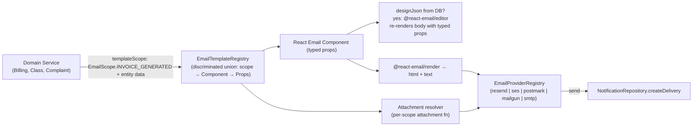

## Email Template System — Implementation Plan

### Library decision (rooted in research + your decisions; verified deep online research 2026-08-01)

**Adopt [React Email v6](https://react.email) (`react-email@^6`) paired with [`@react-email/editor@^1.1`](https://react.email/docs/editor/overview).**

Install set (corrected after v6 research — `react-email@6` unified `@react-email/components` + `@react-email/render` INTO itself; only the editor and the dev-only preview-server package remain separate):
```sh
bun add react-email @react-email/editor@^1.1 @aws-sdk/client-ses postmark mailgun.js form-data nodemailer @types/nodemailer
# recommended for SES attachments (SES API v2 — simpler than v1 SendRawEmailCommand MIME):
bun add @aws-sdk/client-sesv2
# optional, only if running the standalone `react-email dev` preview server:
bun add -D @react-email/ui
```
Drop from the previous draft: `@react-email/components`, `@react-email/render`, `@react-email/ui` runtime, `@tiptap/*` (bundled transitively by `@react-email/editor`).

This is the **only** library that simultaneously delivers all four user requirements:

1. **Type-safe template params**: React Email templates are React components with typed props (`EmailProps` interface). The registry is a hand-rolled discriminated-union mapped type keyed by a backend `EmailScope` enum (see [TypeScript#47109](https://github.com/microsoft/TypeScript/pull/47109) pattern below) — compile-time exhaustiveness, no string unions, never collapses to `never`.
2. **Per-template scopes**: We define a backend `EmailScope` enum (one entry per sending service). Each scope key in the registry carries its `Props` type referencing existing `backend/types/{entity}.types.ts` selection types (`InvoiceReturnType`, `ClassReturnType`, etc.).
3. **Images + attachments**: `react-email` `` for remote/inline images; Resend/Nodemailer/SES adapter attachments API supports `contentId` for `cid:` inline images and buffered/base64 attachments (max 40 MB per Resend; **10 MB outbound cap for SES**; Mailgun uses top-level `inline` field with `Content-ID` derived from filename; Postmark is base64-string-only). Resend: named export `import { Resend } from "resend"`; send payload type is `CreateEmailOptions` with camelCase attachment fields (`contentType`, `contentId` — inline images set via `contentId`, no `inline` boolean). Existing `ResendEmailAdapter.ts` does NOT yet plumb `attachments`/`text`/`cc`/`bcc`/`replyTo`/`headers` — extend it when building the multi-provider registry.
4. **Config/edit/create/update/view in admin UI**: `@react-email/editor` is the embeddable TipTap-based visual editor. Important: the editor edits an **opaque TipTap `JSONContent` blob** carrying no per-template type information — typed props live in the code scaffold (`backend/services/communication/templates/components/*`); the DB override re-renders body regions only and typed props are still passed from the registry at render time. Templates are stored in DB with `designJson` + compiled `htmlBody`, edited via GraphQL mutations, previewed before send. `EmailEditorRef` API (verified in `node_modules`): `getJSON(): JSONContent`, `getEmail(): Promise<{ html, text }>`, `getEmailHtml()`, `getEmailText()`, `editor: Editor | null`.

Rejected alternatives (rationale):
- **MJML** — untyped XML, breaks "no text union types, only enums + TS types" requirement; lacks in-app visual editor.
- **Unlayer `react-email-editor`** — freemium SaaS-dependent, dumps JSON+HTML not React Email typed components; violates "typesafe registry" goal.
- **`@devhiteshk/email-template-editor`** — MUI-themed but unmaintained fork; does not produce React Email output.
- **`react-email-handlebars`** — only needed if you want DB-stored dynamic content with runtime variable substitution. Our `EmailScope` enum + typed-props registry gets type safety **at the registry layer**; for body-only edits we store the visual editor's serialized HTML separately (template scaffolding stays typed in code).



### Scope enum design (your "template must correspond to one service enum" + "register defines entities per template")

New: [`backend/enum/email/emailTemplates.enum.ts`](backend/enum/email/emailTemplates.enum.ts)

```ts
export enum EmailScope {
  // one entry per sending service / event that wants email
  COMPLAINT_RESPONSE = "COMPLAINT_RESPONSE",
  SUGGESTION_ACKNOWLEDGED = "SUGGESTION_ACKNOWLEDGED",
  INVOICE_GENERATED = "INVOICE_GENERATED",
  INVOICE_STATUS_CHANGED = "INVOICE_STATUS_CHANGED",
  PAYMENT_METHOD_CHANGED = "PAYMENT_METHOD_CHANGED",
  CLASS_LIFECYCLE = "CLASS_LIFECYCLE",        // class scheduled/completed/cancelled/...
  STUDENT_LIFECYCLE = "STUDENT_LIFECYCLE",     // reassigned/status-changed/quota
  LESSON_REPORT_SUBMITTED = "LESSON_REPORT_SUBMITTED",
  LESSON_REPORT_REVIEWED = "LESSON_REPORT_REVIEWED",
  CLASS_REMINDER = "CLASS_REMINDER",
  // account flows (NEW — currently missing)
  WELCOME = "WELCOME",
  PASSWORD_RESET = "PASSWORD_RESET",
  EMAIL_VERIFICATION = "EMAIL_VERIFICATION",
}

export enum EmailEditorPermission {
  ADMIN = "ADMIN",
  STAFF = "STAFF",
  SUPERVISOR = "SUPERVISOR",
}

export enum EmailTemplateStatus {
  DRAFT = "DRAFT",
  PUBLISHED = "PUBLISHED",
  ARCHIVED = "ARCHIVED",
}
```

Note: `EmailScope` differs from existing `NotificationEventType` ([backend/enum/notifications/notificationDeliveries.enum.ts](backend/enum/notifications/notificationDeliveries.enum.ts)). The notification event carries the *trigger*; the email scope carries the *template family*. Many events map to one scope (e.g., all class lifecycle events share `EmailScope.CLASS_LIFECYCLE` because they share one template layout that branches on event kind).

### Typed template registry (the heart of type safety)

New: [`backend/services/communication/templates/email-template.registry.tsx`](backend/services/communication/templates/email-template.registry.tsx)

> **SWE review v5 (V5-6):** There are ZERO `.tsx` files anywhere in the backend today (`find backend -name "*.tsx"` → empty). This file establishes the first `.tsx` precedent in the backend service layer. `tsconfig.json:14` enables `jsx: "react-jsx"` and `:38` includes `**/*.tsx`, so it compiles. However, ESLint/Biome rule overrides for `.tsx` in `backend/` may not be calibrated. **Phase 1 verification: run `bun tsgo` + `bun biome:check` + lint-queue-client on the new `.tsx` files immediately after creation.** Alternative if lint/build issues surface: use `React.createElement()` calls in `.ts` files instead of JSX (keeps backend `.ts`-only). The registry file would become `email-template.registry.ts`.

The original draft used `EmailTemplateProps<S> = Parameters<(typeof EMAIL_TEMPLATES)[S]["component"]>[0]` inside an `as const` literal with per-entry `satisfies`. Research ([TypeScript#47109](https://github.com/microsoft/TypeScript/pull/47109), validated against tsgo 7.0.2) shows this collapses to the **intersection of all prop interfaces** — effectively `never` for non-overlapping props. The corrected pattern requires a declarative `EmailPropsByScope` base map + an explicit mapped type + a `defineEmailTemplate<P>` helper, then re-binds through the mapped type. Adding an `EmailScope` case requires adding an entry to both `EmailPropsByScope` and the literal — that's the exhaustiveness guarantee.

```tsx
import type { ComponentType } from "react";
import { EmailScope, EmailEditorPermission } from "@/backend/enum/email";
import type { AttachmentInput } from "@/backend/types/email/email.types";
import type { ComplaintReturnType, InvoiceReturnType } from "@/backend/types";
// React Email components imported with the v6 single-package import path:
import { ComplaintResponseEmail, InvoiceGeneratedEmail } from "./components";

// 1. Per-scope typed props (only enums + TS types — no string unions)
export interface ComplaintResponseEmailProps {
  parentName: string;
  complaint: ComplaintReturnType;        // related entity
  responseText: string;
  respondedAt: Date;
}
export interface InvoiceGeneratedEmailProps {
  invoice: InvoiceReturnType;            // related entity
  recipientName: string;
}
// …one interface per remaining EmailScope case…

// 2. Shape of every registry entry, generic in its own props P.
export interface EmailTemplateDefinition<P> {
  readonly component: ComponentType<P>;
  readonly subject: (props: P, locale: string) => string;
  readonly defaultEditorPermissions: readonly EmailEditorPermission[];
  readonly attachments?: (props: P, locale: string) => Promise<readonly AttachmentInput[]>;
  readonly defaultLocaleTexts: (locale: string) => { readonly greeting: string; readonly footer: string };
}

// 3. THE KEY STEP — declarative map from EmailScope case to its props interface.
//    This is the "base mapping" that #47109 needs. Adding an EmailScope case
//    REQUIRES an entry here — that's the exhaustiveness guarantee.
export interface EmailPropsByScope {
  readonly [EmailScope.COMPLAINT_RESPONSE]: ComplaintResponseEmailProps;
  readonly [EmailScope.INVOICE_GENERATED]: InvoiceGeneratedEmailProps;
  // …one mapping per remaining EmailScope case…
}

// 4. Mapped-type view of the registry. Indexing this with generic S yields
//    EmailTemplateDefinition<EmailPropsByScope[S]> — the correlated narrowing
//    TS could NOT see from a structural literal alone.
export type EmailTemplateRegistry = {
  readonly [S in EmailScope]: EmailTemplateDefinition<EmailPropsByScope[S]>;
};

// 5. Per-entry builder: keeps inline `satisfies` validation AND per-entry
//    intellisense on `subject` / `attachments` / `defaultLocaleTexts` callbacks.
export function defineEmailTemplate<P>(
  def: EmailTemplateDefinition<P>,
): EmailTemplateDefinition<P> {
  return def;
}

// 6. Structural literal with per-entry builder. Computed enum-member keys are
//    single literal types (TypeScript#13948) — preserved as named properties.
const _EMAIL_TEMPLATES = {
  [EmailScope.COMPLAINT_RESPONSE]: defineEmailTemplate<ComplaintResponseEmailProps>({
    component: ComplaintResponseEmail,
    subject: (p, _l) => `Re: ${p.complaint.title}`,
    defaultEditorPermissions: [EmailEditorPermission.ADMIN],
    attachments: async (p, _l) => [{ filename: "response.pdf", content: Buffer.from(p.responseText) }],
    defaultLocaleTexts: (_l) => ({ greeting: "Dear parent,", footer: "Siraj Academy" }),
  }),
  [EmailScope.INVOICE_GENERATED]: defineEmailTemplate<InvoiceGeneratedEmailProps>({
    component: InvoiceGeneratedEmail,
    subject: (p, _l) => `Invoice ${p.invoice.number}`,
    defaultEditorPermissions: [EmailEditorPermission.ADMIN, EmailEditorPermission.STAFF],
    defaultLocaleTexts: (_l) => ({ greeting: "Dear parent,", footer: "Siraj Academy" }),
  }),
  // …one entry per remaining EmailScope case…
} as const satisfies EmailTemplateRegistry;
//   ↑ `as const satisfies EmailTemplateRegistry` (in that order) — the
//     documented-safe idiom (https://typescriptworld.com/typescript-satisfies-operator-deep-dive).
//     Order matters; reversing would error.

// 7. THE SECOND KEY STEP — re-bind the literal through the mapped type
//    annotation. `_EMAIL_TEMPLATES` has the structural shape; `EMAIL_TEMPLATES`
//    has the *mapped-type* representation TS needs to follow the S↔P
//    correlation during generic indexing. (mirrors jcalz's `_verbs`→`verbs`
//    rename pattern from #47109.)
export const EMAIL_TEMPLATES: EmailTemplateRegistry = _EMAIL_TEMPLATES;

// 8. Per-scope props via indexed access into EmailPropsByScope — directly.
//    No `Parameters<…>` unwrap needed (TS treats such generic unwraps as
//    opaque). Adds `ComponentProps<EmailTemplateRegistry[S]["component"]>`
//    alias for parity.
export type EmailTemplateProps<S extends EmailScope> = EmailPropsByScope[S];

// 9. renderEmailTemplate now type-checks inside its body AND narrows
//    correctly at call sites.
export async function renderEmailTemplate<S extends EmailScope>(
  scope: S,
  props: EmailTemplateProps<S>,
  locale: string,
  opts?: { readonly designJsonOverride?: string },
): Promise<{ readonly html: string; readonly text: string; readonly subject: string; readonly attachments: readonly AttachmentInput[] }> {
  // Runtime scope guard — P0: unknown scope from DB must throw, not crash
  const def: EmailTemplateDefinition<EmailPropsByScope[S]> = EMAIL_TEMPLATES[scope];
  if (!def) throw new Error(`Unknown email scope: ${scope as string}`);
  //  ↑ indexed access into the MAPPED TYPE — TS keeps correlation

  const subject = def.subject(props, locale); // ✅ props is EmailPropsByScope[S]
  const attachments = def.attachments ? await def.attachments(props, locale) : [];
  // … then either render @react-email component or rehydrate DB designJson:
  //   const { html, text } = await safeRender(scope, props, locale, opts);
  // If opts.designJsonOverride is present, the @react-email/editor serialized
  // JSON re-renders the body regions only — typed props still drive the
  // scaffold header/footer/subject/attachments.
  // HTML is sanitized via DOMPurify (isomorphic-dompurify) in safeRender.
  return { html: "", text: "", subject, attachments };
}
```

This pattern satisfies: typesafe, no text unions, only enums/types, each scope has its related entities, only registered scopes sendable. Relies on [microsoft/TypeScript#47109](https://github.com/microsoft/TypeScript/pull/47109) (mapped-type + base-map recipe); validated against `tsgo` 7.0.2 — full parity with TS 6.0/5.9 type checker (see [research file 06](.ai/plans/email-templates/reserch/06-typed-registry-pattern.md)).

**Note on the editor's role**: `@react-email/editor`'s `getJSON()` returns opaque TipTap `JSONContent` — typed component props never enter the editor. Body-only edits preserve typed-props only via application-layer discipline (route-level UI restricts editing to body regions; the code scaffold's typed props still drive subject/attachments/header/footer at render time). **P0 XSS/SSTI mitigation (SWE review):** `designJson` is validated against an allowed-node-types allowlist at save time (todo 7a), and `compiledHtml` is sanitized with DOMPurify (`isomorphic-dompurify`) at render time as defense-in-depth (todo 12). Both layers are required — schema validation blocks attacks at the source, DOMPurify catches any remaining vectors.

**Compile-time guard test**: add [`backend/services/communication/templates/__tests__/email-template.registry.types.test.ts`](backend/services/communication/templates/__tests__/email-template.registry.types.test.ts) containing `// @ts-expect-error` assertions on wrong-scope calls and `satisfies` checks on right-scope calls so any TS upgrade silently breaking the narrowing will fail the build.

### Multi-provider registry (your "multi-provider swappable from env")

Refactor [`backend/services/communication/channels/email/EmailChannelFactory.ts`](backend/services/communication/channels/email/EmailChannelFactory.ts) into a provider registry using a **hybrid approach** (SWE review decision): adopt the `createRegistry` pattern internally while preserving the existing factory's async init, caching, `disconnect()` cleanup semantics, and fallback-to-Resend behavior. The makerkit `@kit/shared/registry` `createRegistry` API referenced in research is **makerkit's private monorepo workspace package — not on npm**; we lift ~30 LOC of the source into our own [`backend/lib/registry.ts`](backend/lib/registry.ts) (it's generic enough to reuse for SMS/Push/FX provider registries later). The full `createRegistry<IEmailChannel, EmailProviderName>()` semantics are documented in [research file 05](.ai/plans/email-templates/reserch/05-provider-registry-pattern.md). **Migration note:** `createRegistry` lacks disposal/cleanup semantics and throws on unknown providers (vs current fallback-to-Resend). The hybrid approach wraps `createRegistry` inside the existing factory to preserve both behaviors.

`EmailProviderName` lives in canonical location per [backend/types/AGENTS.md](backend/types/AGENTS.md) — move to [`backend/types/email/emailChannel.types.ts`](backend/types/email/emailChannel.types.ts) alongside `IEmailChannel` / `EmailPayload` / `EmailSendResult` (currently mislocated in the service layer).

New: [`backend/services/communication/channels/email/EmailProviderRegistry.ts`](backend/services/communication/channels/email/EmailProviderRegistry.ts)

```ts
import { createRegistry } from "@/backend/lib/registry";
import type { EmailProviderName, IEmailChannel } from "@/backend/types/email/emailChannel.types";

export const emailProviderRegistry = createRegistry<IEmailChannel, EmailProviderName>();

emailProviderRegistry
  .register("resend",   async () => new ResendEmailAdapter(await loadResendConfig()))   // returns this (chainable)
  .register("ses",      async () => new SesEmailAdapter(await loadSesConfig()))
  .register("postmark", async () => new PostmarkEmailAdapter(await loadPostmarkConfig()))
  .register("mailgun",  async () => new MailgunEmailAdapter(await loadMailgunConfig()))
  .register("smtp",     async () => new SmtpEmailAdapter(await loadSmtpConfig()));

export async function getEmailChannel(): Promise<IEmailChannel> {
  const provider = (await resolveEnvConfig("EMAIL_PROVIDER") ?? "resend") as EmailProviderName;
  // emailProviderRegistry.get(provider) returns Promise<IEmailChannel> — always await.
  // THROWS `Unknown provider "<name>"` on unregistered names (today's EmailChannelFactory
  // falls back to Resend — the new behavior breaks explicitly with a throw).
  return emailProviderRegistry.get(provider);
}

// preserve resetEmailChannel cache-invalidation semantics from the current factory
// SWE review v2: actual signature in EmailChannelFactory.ts is `void` (not `Promise<void>`)
// — disconnect() is synchronous. Keep the existing signature to avoid unnecessary async wrapper.
// SWE review v3: `void` function MUST NOT use `await` (TS error) and `createRegistry` has no
// `peek()` method (only register/get/addSetup/setup). Use the module-level `instance` variable
// (line 5 of EmailChannelFactory.ts) to disconnect synchronously — matches existing pattern.
// SWE review v4 (V4-1): Do NOT reassign `emailChannel` (the const facade at line 100) —
// TS2588 compile error. Operate on `let instance` (line 5) instead. The facade stays alive
// for the lifetime of the process; only the underlying instance is reset.
export function resetEmailChannel(): void {
  invalidateEnvConfigCache("EMAIL_PROVIDER");
  invalidateEnvConfigCache("RESEND_API_KEY");
  invalidateEnvConfigCache("RESEND_FROM_EMAIL");
  // (add SES / Postmark / Mailgun / SMTP env keys for each new provider)
  if (instance) {
    instance.disconnect?.();  // fire-and-forget Promise<void>, matches existing latent-drop at line 89
    instance = null;
    initializationPromise = null;
  }
}
```

`emailChannel` facade wrapper shape unchanged (already used throughout services); make sure `getEmailChannel()` is awaited since `get()` is async.

Adapters to implement (each is realistically ~200 LOC, not the originally-stated ~80 LOC, once attachments + inline-image handling + delivery-row bookkeeping are included):
- `backend/services/communication/channels/email/resend/ResendEmailAdapter.ts` — **extend existing adapter** (not rewrite): `import { Resend } from "resend"` (named export, not default); `resend.emails.send(payload: CreateEmailOptions)`; attachment fields are camelCase (`contentType`, `contentId` — inline via `contentId`, no `inline` boolean). Today only sends `from`/`to`/`subject`/`html` — add `text`, `attachments`, `cc`, `bcc`, `replyTo`, `headers` from expanded `EmailPayload`.
- `backend/services/communication/channels/email/ses/SesEmailAdapter.ts` — **choose one path** (installed today: `@aws-sdk/client-ses@3.x` = SES API **v1**, which does NOT support `Content.Simple.Attachments[]` on `SendEmailCommand`):
  - **(a) Recommended**: `bun add @aws-sdk/client-sesv2` and use SESv2 `SendEmailCommand` with `Content.Simple.Attachments[]` (`RawContent: Uint8Array`, `FileName`, optional `ContentType`/`ContentDisposition`/`ContentId`). Outbound cap is **10 MB** (not 40 MB).
  - **(b) Stay on v1**: use `SendRawEmailCommand` with hand-built `multipart/mixed` MIME for **all** attachments (`RawMessage.Data: Uint8Array`), regardless of size.
  - Both paths: use `@smithy/fetch-http-handler` for Bun compatibility (avoids Bun 1.3.x HTTPS-hang #26066).
- `backend/services/communication/channels/email/postmark/PostmarkEmailAdapter.ts` — `postmark` npm; attachments are **base64-string only** (convert Buffers via `.toString("base64")`); check `response.ErrorCode === 0` for soft failures.
- `backend/services/communication/channels/email/mailgun/MailgunEmailAdapter.ts` — `mailgun.js` + `form-data`; two-stage init: `const mg = new Mailgun(FormData).client({ username: "api", key, url?, public_key? })` (pass the `form-data` **class**, not options); send via `mg.messages.create(domain, data)` only (no `.send()`); `inline` is a **top-level field** on the send call with `Content-ID` derived from the filename (NOT a `contentId` field on each attachment). Map `EmailAttachment → { data, filename, contentType }`.
- `backend/services/communication/channels/email/smtp/SmtpEmailAdapter.ts` — `nodemailer` + `@types/nodemailer`; `@types/nodemailer@8.0.1` types `encoding` as bare `string` (not a literal union) — declare adapter-level literal union and cast before passing to nodemailer if compile-time enforcement is desired. **V5-post-SMTP (2026-08-02): Production-grade adapter.** Prior 'dev/testing only' restriction was lifted because the deployment target is Vercel + Node.js (next.config.ts already has `@vercel/functions` in `serverExternalPackages`), where `nodemailer` is rock-solid. The Bun #10329 socket-flakiness issue does not apply under Node runtime. Deployment docs should state SMTP as a supported production provider (alongside Resend/SES/Postmark/Mailgun), not a dev-only fallback. Local development CAN still run on Bun for dev loop speed — but `SmtpEmailAdapter` is production-safe when run under Node.

Move `IEmailChannel`, `EmailPayload`, `EmailSendResult`, `EmailProvider` / `EmailProviderName` types to canonical location per [backend/types/AGENTS.md](backend/types/AGENTS.md):
[`backend/types/email/emailChannel.types.ts`](backend/types/email/emailChannel.types.ts)

Extend `EmailPayload` to carry attachments + inline image CIDs:
```ts
export interface EmailPayload {
  readonly to: string;
  readonly subject: string;
  readonly html: string;
  readonly text?: string;
  readonly eventType: NotificationEventType;
  readonly userId: string;
  readonly metadata?: NotificationMetadata | null;
  readonly attachments?: readonly EmailAttachment[];
}
// `content` is restricted to `Buffer` only to avoid the base64-vs-path-vs-text
// ambiguity across adapters (Resend, SES, Mailgun all interpret strings
// differently). Each adapter performs the encoding transformation it needs
// (e.g., Postmark runs `.toString("base64")`, Mailgun wraps buffer in form-data).
export interface EmailAttachment {
  readonly filename: string;
  readonly content: Buffer;
  readonly contentType?: string;
  readonly contentId?: string;               // for `">` inline images
  readonly encoding?: "base64" | "buffer";  // explicit discriminator for adapters that need it
}
```

### DB schema (NEW — currently zero email-template tables)

Repo is on `drizzle-orm 1.0.0-rc.4` (not the conservative "0.36+" framing — all schema patterns below verified against 1.0.0-rc.4 in [research file 07](.ai/plans/email-templates/reserch/07-drizzle-schema-patterns.md)).

**Pre-requisite subtask** — the `emailScopeEnum` / `emailTemplateStatusEnum` / `emailEditorPermissionEnum` Drizzle pg-enums referenced in the schema below **do not yet exist**. Add them to [`backend/db/schema/enums.ts`](backend/db/schema/enums.ts) using the repo's existing `createPgEnumFromEnum` helper (it generates the pgEnum from a backing TS enum — see how `notificationChannelEnum` is built from the `NotificationChannel` TS enum). This is part of the Task #2 (enum) subtask — make sure the enum file gets created first.

The repo has **zero** existing `.array()` columns today; first-time use of array-of-enum in this repo is a risk. Safer, idiomatic-to-this-repo choice for `allowedEditorGroups` is `jsonb.$type<readonly EmailEditorPermission[]>()` rather than `emailEditorPermissionEnum("...").array()` (the array-of-pgEnum pattern works but isn't used elsewhere in the codebase). Use the `jsonb` form unless the team specifically prefers the typed array column.

New file: [`backend/db/schema/communications/emailTemplates.ts`](backend/db/schema/communications/emailTemplates.ts) — note the additional required imports (`integer`, `uniqueIndex`) beyond what the original stub mentioned:

```ts
import { sql } from "drizzle-orm";
import { boolean, integer, jsonb, pgTable, text, timestamp, uniqueIndex, uuid, varchar } from "drizzle-orm/pg-core";
import { users } from "@/backend/db/schema";
import { emailScopeEnum, emailTemplateStatusEnum } from "@/backend/db/schema/enums";
import { EmailEditorPermission } from "@/backend/enum/email";
import type { EmailAttachmentRules } from "@/backend/types/email/email.types";

export const emailTemplates = pgTable("email_templates", {
  id: uuid("id").defaultRandom().primaryKey(),
  scope: emailScopeEnum("scope").notNull(),                    // EmailScope
  name: varchar("name", { length: 255 }).notNull(),
  slug: varchar("slug", { length: 255 }).notNull(),            // friendly URL id
  status: emailTemplateStatusEnum("status").notNull().default("DRAFT"),
  // admin-editable body (from @react-email/editor)
  designJson: jsonb("design_json"),                             // serialized TipTap JSONContent blob (validated against allowed-node-types allowlist at save time — todo 7a)
  compiledHtml: text("compiled_html"),                         // last-rendered HTML cache (sanitized via DOMPurify, re-compiled atomically in same transaction as designJson — decision: keep for preview/offline fallback, staleness prevented by atomic re-compile)
  compiledText: text("compiled_text"),                          // plain-text version (re-computed atomically with compiledHtml)
  // per-template config
  defaultFromName: varchar("default_from_name", { length: 255 }),
  defaultFromEmail: varchar("default_from_email", { length: 255 }),
  // Idiomatic-to-repo choice (no existing .array() columns): JSONB typed array.
  // Alternatives (per research file 07): `emailEditorPermissionEnum("...").array()`
  // works since drizzle-kit 0.24 but is first-time-use in this repo.
  allowedEditorGroups: jsonb("allowed_editor_groups").$type<readonly EmailEditorPermission[]>().notNull(),
  // attachments / images configuration
  attachmentRules: jsonb("attachment_rules").$type<EmailAttachmentRules>(),
  // versioning + i18n
  locale: varchar("locale", { length: 10 }).notNull().default("en"),
  version: integer("version").notNull().default(1),              // optimistic locking — WHERE version = $1 check on update prevents last-write-wins on concurrent edits (SWE review decision)
  parentTemplateId: uuid("parent_template_id").references(() => emailTemplates.id), // for locale variants
  isActive: boolean("is_active").notNull().default(true),
  createdBy: uuid("created_by").references(() => users.id),
  createdAt: timestamp("created_at", { withTimezone: true, precision: 3 }).notNull().defaultNow(),
  updatedAt: timestamp("updated_at", { withTimezone: true, precision: 3 }).notNull().defaultNow(),
}, (t) => [
  uniqueIndex("email_templates_scope_slug_uq").on(t.scope, t.slug),
  // Partial unique: only one active row per (scope, locale). Use sql`` literal
  // (not eq(t.isActive, true)) — eq() produces a parameterized placeholder that
  // breaks drizzle-kit migration generation (issues #3349, #4790).
  uniqueIndex("email_templates_scope_locale_active_uq")
    .on(t.scope, t.locale)
    .where(sql`${t.isActive} = true`),
]);

export const emailTemplateRevisions = pgTable("email_template_revisions", {
  id: uuid("id").defaultRandom().primaryKey(),
  templateId: uuid("template_id").notNull().references(() => emailTemplates.id, { onDelete: "cascade" }),
  version: integer("version").notNull(),
  designJson: jsonb("design_json").notNull(),
  compiledHtml: text("compiled_html").notNull(),
  editedBy: uuid("edited_by").references(() => users.id),
  editedAt: timestamp("edited_at", { withTimezone: true, precision: 3 }).notNull().defaultNow(),
}, (t) => [
  // SWE review v3: index on templateId for revision history lookups — without this,
  // querying revisions by templateId causes a full table scan as the table grows.
  // SWE review v4 (V4-2): use inline array form (canonical codebase convention) —
  // NO separate named-object index export. All 60+ existing schemas use this pattern.
  index("email_template_revisions_template_id_idx").on(t.templateId),
  uniqueIndex("email_template_revisions_template_id_version_uq")
    .on(t.templateId, t.version),
]);
```

Run a `drizzle generate` later via the `drizzle-generate` skill workflow (NOT part of this plan — runtime dictate).

### Backend types (canonical pattern)

New: [`backend/types/email/email.types.ts`](backend/types/email/email.types.ts) — applying the `{Entity}{Select,Insert,Return,Submit}Type` pattern:

- `EmailTemplateSelectType`, `EmailTemplateInsertType` — `$inferSelect` / `$inferInsert` from `emailTemplates`
- `EmailTemplateReturnType` — API-facing shape (joins: editor name, last revision)
- `EmailTemplateSubmitInput` — create/update input (DTO)
- `EmailAttachmentInput`, `EmailAttachmentRules`
- Include `id` field (Apollo cache normalization per AGENTS.md)

### Repository

New: [`backend/db/repo/email/email-template.repository.ts`](backend/db/repo/email/email-template.repository.ts)
- Standard repo methods: `getById`, `getByScopeAndLocale(scope, locale, { activeOnly })`, `list({ scopeFilter, statusFilter, pagination })`, `create`, `update`, `softDelete`, `createRevision`, `setActive`
- Use `queryDb(tx)` for non-transactional reads ([docs/drizzle/neon-http-client.md](docs/drizzle/neon-http-client.md))
- Add `findByScopeIds(scopes: EmailScope[], tx?)` returning `Map<EmailScope, EmailTemplateReturnType>` for DataLoader batching (Pothos list fields)
- Add `export * from "./email";` to [`backend/db/repo/index.ts`](backend/db/repo/index.ts) (new `email/` sub-dir)

### Service layer

New: [`backend/services/communication/email-template.service.ts`](backend/services/communication/email-template.service.ts)
- `EmailTemplateService.list`, `get`, `create`, `update`, `publish`, `archive`, `restore`
- `renderForSend(scope, props, locale)` — uses `renderEmailTemplate` from registry, checks DB for design-json override
- `sendTest(templateId, toEmail, sampleProps)` — admin preview sends
- `previewHtml(templateId, sampleProps)` — returns rendered HTML for admin iframe preview
- `resolveTemplatesByScopes(scopes: EmailScope[], locale)` — batch method returning `Map<EmailScope, EmailTemplateReturnType | null>` for GraphQL DataLoader batching ([backend/services/AGENTS.md](backend/services/AGENTS.md))
- Authorization: check `ctx.user` permission group against `template.allowedEditorGroups` (configurable per your "configurable, default set in registry")
- All user-facing errors via `getServerTranslations(locale).emailsTranslations.errors.*` ([backend/services/AGENTS.md](backend/services/AGENTS.md))

**Pre-requisite: extend `CommunicationPayload` type** (SWE review v3 — the type at
`backend/types/notifications/communications.types.ts:4-11` does NOT have `templateProps`,
`entityId`, or `notificationEventId`). Add:
```ts
// In backend/types/notifications/communications.types.ts
export type CommunicationPayload = {
  readonly userId: string;
  readonly title: string;
  readonly body: string | null;
  readonly channel: CommunicationChannelType;
  readonly eventType: NotificationEventType;
  readonly metadata?: Record<string, unknown>;
  // SWE review v3: added for email template rendering
  readonly templateProps?: Record<string, unknown>;
};
```
The `entityId` and `notificationEventId` are accessed via `payload.metadata?.entityId` /
`payload.metadata?.notificationEventId` (metadata already exists as `Record<string, unknown>`).
Do NOT add new top-level fields for these — use the existing `metadata` bag.

Refactor dispatcher at [`backend/services/communication/communication.service.ts`](backend/services/communication/communication.service.ts).
**SWE review v5 (V5-1):** The current dispatcher does NOT have a standalone `case "email":` branch. Email falls through alongside SMS: `case "email": case "sms": return await dispatchRecipientChannel(payload, locale)` (line 72-74). `commonFields` lives inside `dispatchRecipientChannel` (line 28-33), NOT inside `dispatch()`. There is no `tx` (transaction) in `dispatch()` scope — all DB reads in the dispatch path use non-transactional `queryDb()` or direct repository calls.

Two equal approaches (pick one, document the choice):
**Approach A — Extract a dedicated `dispatchEmailChannel()` (recommended):** Break the email fall-through with SMS. Route email to a new standalone function `dispatchEmailChannel(payload, locale)` that owns `commonFields`, scope mapping, idempotency check, and `emailChannel.send()`. `dispatchRecipientChannel` shrinks to SMS-only. This keeps email and SMS logic cleanly separated as email grows in complexity.
**Approach B — Branch within `dispatchRecipientChannel`:** Add email-specific branching at the top of the existing function — map scope, check idempotency, render template — before the shared `emailChannel.send()` call at line 37. Less disruptive but couples email+SMS in one function.

The code below shows Approach A (new `dispatchEmailChannel` function):

```ts
// Inside CommunicationService namespace:

// dispatch() switch changes — break the fall-through:
case "email":
  return await dispatchEmailChannel(payload, locale);
case "sms":
  return await dispatchRecipientChannel(payload, locale);

// New function (replaces the email branch of dispatchRecipientChannel):
async function dispatchEmailChannel(
  payload: CommunicationPayload,
  locale?: string
): Promise<ChannelDispatchResult> {
  const to = (payload.metadata?.to as string) ?? "";
  const commonFields = {
    to,
    eventType: payload.eventType,
    userId: payload.userId,
    metadata: asNotificationMetadata(payload.metadata),
  };

  // Feature flag: old passthrough vs new template path
  // V5-2: MUST use getBooleanEnv, NOT resolveEnvConfig (returns string, "false" is truthy)
  if (!getBooleanEnv("EMAIL_TEMPLATES_ENABLED")) {
    // Old passthrough: use payload.body as raw HTML (backward-compatible)
    const result = await emailChannel.send(
      { ...commonFields, subject: payload.title, html: payload.body ?? "" },
      locale
    );
    return {
      channel: "email",
      success: result.success,
      providerMessageId: result.providerMessageId,
      error: result.error,
    };
  }

  // New template path
  const emailScope = mapEventTypeToEmailScope(payload.eventType);
  // SWE review v3: null scope = no email template for this event.
  // Use payload.body fallback (not success:false) so emails are not lost during migration.
  if (!emailScope) {
    if (payload.body) {
      const result = await emailChannel.send(
        { ...commonFields, subject: payload.title, html: payload.body },
        locale
      );
      return {
        channel: "email",
        success: result.success,
        providerMessageId: result.providerMessageId,
        error: result.error,
      };
    }
    return { channel: "email", success: true, skipped: "no_email_scope" };
  }

  // Idempotency check (P1: dedup duplicate event triggers)
  // SWE review v3: use payload.metadata (not nonexistent payload.entityId/notificationEventId)
  // SWE review v5 (V5-1): NO tx in dispatch scope — use non-transactional queryDb read
  // SWE review v5 (V5-10): notificationEventId may be "" if not populated in builders
  const idempotencyKey = createHash("sha256")
    .update(`${emailScope}:${payload.metadata?.entityId ?? ""}:${payload.metadata?.notificationEventId ?? ""}`)
    .digest("hex");
  // NOTE: findByIdempotencyKey requires adding an `idempotencyKey` column to the
  // notificationDeliveries table + a repo method — add as explicit task in todo 13.
  const existingDelivery = await NotificationRepository.findByIdempotencyKey(idempotencyKey);
  if (existingDelivery) return { channel: "email", success: true, skipped: "idempotent" };

  // SWE review v3: payload.templateProps now exists on CommunicationPayload (added above)
  // SWE review v5 (V5-1): EmailPayload has fields {to, subject, html, eventType, userId, metadata?}
  // — NO `text` or `attachments` fields (IEmailChannel.ts:4-11). renderForSend returns
  // {html, text?, subject, attachments?} — only `subject` and `html` map to EmailPayload.
  // `text` and `attachments` are dropped (or EmailPayload must be extended — todo 13c).
  const { html, subject } = await EmailTemplateService.renderForSend(
    emailScope,
    payload.templateProps ?? {},
    locale
  );
  const result = await emailChannel.send(
    { ...commonFields, subject: subject || payload.title, html },
    locale
  );
  return {
    channel: "email",
    success: result.success,
    providerMessageId: result.providerMessageId,
    error: result.error,
  };
}
```

**`mapEventTypeToEmailScope` definition (P0 — blocking dependency for Phase 3):**
New: [`backend/services/communication/templates/event-to-scope.ts`](backend/services/communication/templates/event-to-scope.ts)
```ts
import { NotificationEventType } from "@/backend/enum/notifications";
import { EmailScope } from "@/backend/enum/email";

/**
 * Maps a NotificationEventType (trigger) to an EmailScope (template family).
 * Not bijective: multiple events share one scope (e.g., all class lifecycle events
 * share EmailScope.CLASS_LIFECYCLE). Returns null for events that don't produce emails.
 *
 * Exhaustiveness is enforced at compile-time via `Readonly<Record<NotificationEventType, EmailScope | null>>`
 * — all 24 enum values MUST have an entry. Adding a NotificationEventType without a mapping
 * entry here will cause a TypeScript error.
 *
 * Cross-referenced against EVENT_CHANNEL_ALLOWLIST (notification-dispatch.helpers.ts:39):
 * - Events with EMAIL in allowlist → mapped to a non-null scope
 * - Events without EMAIL in allowlist (ON_APP + PUSH only) → mapped to null
 * - Events NOT in allowlist at all → fall through to ALL_ENUM_CHANNELS (all channels including
 *   email); these are mapped to a scope if email is desired, or null if not
 *
 * SWE review v2 correction: all 24 enum values verified against
 * backend/enum/notifications/notificationDeliveries.enum.ts.
 */
const EVENT_TO_SCOPE: Readonly<Record<NotificationEventType, EmailScope | null>> = {
  // === Events with EMAIL in EVENT_CHANNEL_ALLOWLIST ===
  // Class lifecycle events → shared CLASS_LIFECYCLE scope
  [NotificationEventType.CLASS_SCHEDULED]: EmailScope.CLASS_LIFECYCLE,
  [NotificationEventType.CLASS_COMPLETED]: EmailScope.CLASS_LIFECYCLE,
  [NotificationEventType.CLASS_CANCELLED]: EmailScope.CLASS_LIFECYCLE,
  [NotificationEventType.CLASS_MARKED_ABSENT]: EmailScope.CLASS_LIFECYCLE,
  [NotificationEventType.CLASS_MARKED_MISSED]: EmailScope.CLASS_LIFECYCLE,
  [NotificationEventType.CLASS_LEAVE_REQUESTED]: EmailScope.CLASS_LIFECYCLE,
  [NotificationEventType.CLASS_RESCHEDULED]: EmailScope.CLASS_LIFECYCLE,
  [NotificationEventType.CLASS_RESET]: EmailScope.CLASS_LIFECYCLE,
  // Reminder events
  [NotificationEventType.CLASS_REMINDER]: EmailScope.CLASS_REMINDER,
  // Student lifecycle events → shared STUDENT_LIFECYCLE scope
  [NotificationEventType.STUDENT_STATUS_CHANGED]: EmailScope.STUDENT_LIFECYCLE,
  [NotificationEventType.STUDENT_QUOTA_OVERRIDDEN]: EmailScope.STUDENT_LIFECYCLE,
  // Lesson report events
  [NotificationEventType.LESSON_REPORT_SUBMITTED]: EmailScope.LESSON_REPORT_SUBMITTED,
  [NotificationEventType.LESSON_REPORT_REVIEWED]: EmailScope.LESSON_REPORT_REVIEWED,

  // === Events NOT in allowlist → fall through to ALL_ENUM_CHANNELS (all channels) ===
  // SWE review v3: These events are NOT in EVENT_CHANNEL_ALLOWLIST, so the dispatcher
  // fallback `EVENT_CHANNEL_ALLOWLIST[eventType] ?? [...ALL_ENUM_CHANNELS]` sends them
  // via ALL 4 channels (ON_APP, EMAIL, SMS, PUSH). This is likely unintended for events
  // that should only use ON_APP or ON_APP+EMAIL. As part of Phase 3, add explicit
  // entries to EVENT_CHANNEL_ALLOWLIST for these events:
  //   COMPLAINT_RESPONSE → [ON_APP, EMAIL]         (currently falls through to ALL)
  //   INVOICE_GENERATED → [ON_APP, EMAIL]          (currently falls through to ALL)
  //   INVOICE_STATUS_CHANGED → [ON_APP, EMAIL]     (currently falls through to ALL)
  //   PAYMENT_METHOD_CHANGED → [ON_APP, EMAIL]     (currently falls through to ALL)
  //   SUGGESTION_ACKNOWLEDGED → [ON_APP, EMAIL]    (currently falls through to ALL)
  //   STUDENT_TEACHER_REASSIGNED → [ON_APP, EMAIL] (currently falls through to ALL)
  //   NEW_COMPLAINT → [ON_APP, SMS, PUSH]          (scope=null — see V4-5 below)
  //   NEW_SUGGESTION → [ON_APP, SMS, PUSH]          (scope=null — see V4-5 below)
  //   SUGGESTION_DUPLICATE_MARKED → [ON_APP, SMS, PUSH] (scope=null — see V4-5 below)
  //   CLASS_REMINDER → [ON_APP, EMAIL]              (currently falls through to ALL)
  // Until these entries are added, the fallback sends via ALL channels — this is
  // pre-existing behavior, NOT a regression from this plan.
  // V4-5: Events with null scope send NO email under the REFACTORED dispatcher
  // (when EMAIL_TEMPLATES_ENABLED=true). Under the LEGACY passthrough path (flag=false),
  // the existing `payload.body ?? ""` fallback still sends email for these events —
  // this is intentional so the flag can be rolled back without losing existing coverage.
  [NotificationEventType.COMPLAINT_RESPONSE]: EmailScope.COMPLAINT_RESPONSE,
  [NotificationEventType.NEW_COMPLAINT]: null, // scope=null — NO email when flag=true; passthrough when flag=false (V4-5)
  [NotificationEventType.NEW_SUGGESTION]: null, // scope=null — same as NEW_COMPLAINT
  [NotificationEventType.SUGGESTION_ACKNOWLEDGED]: EmailScope.SUGGESTION_ACKNOWLEDGED,
  [NotificationEventType.SUGGESTION_DUPLICATE_MARKED]: null,
  [NotificationEventType.INVOICE_GENERATED]: EmailScope.INVOICE_GENERATED,
  [NotificationEventType.INVOICE_STATUS_CHANGED]: EmailScope.INVOICE_STATUS_CHANGED,
  [NotificationEventType.PAYMENT_METHOD_CHANGED]: EmailScope.PAYMENT_METHOD_CHANGED,
  [NotificationEventType.STUDENT_TEACHER_REASSIGNED]: EmailScope.STUDENT_LIFECYCLE,

  // === Events with ON_APP + PUSH only (no EMAIL in allowlist) → null ===
  [NotificationEventType.CLASS_ACTIVATED]: null,
  [NotificationEventType.CLASS_STARTED]: null,

  // === Account flow events (Phase 4 — NEW enum values) ===
  // SWE review v3: These 3 event types do NOT exist in NotificationEventType today.
  // Per option (a), DO NOT add them to NotificationEventType until Phase 4.
  // When Phase 4 adds them to the enum, ALSO uncomment these lines in the SAME PR.
  // [NotificationEventType.WELCOME]: EmailScope.WELCOME,                       // Phase 4
  // [NotificationEventType.PASSWORD_RESET]: EmailScope.PASSWORD_RESET,         // Phase 4
  // [NotificationEventType.EMAIL_VERIFICATION]: EmailScope.EMAIL_VERIFICATION,  // Phase 4
};

export function mapEventTypeToEmailScope(eventType: NotificationEventType): EmailScope | null {
  return EVENT_TO_SCOPE[eventType] ?? null;
}
```
Add a test in `event-to-scope.test.ts` verifying every `NotificationEventType` enum value (all 24) has an explicit mapping entry — the `Readonly<Record<...>>` type enforces this at compile-time, but the test should also verify the mapping is complete at runtime (iterate over `Object.values(NotificationEventType)` and assert each key exists in `EVENT_TO_SCOPE`).

**SWE review v2 changes:**
- Corrected `COMPLAIT_RESPONSE_CREATED` → `COMPLAINT_RESPONSE` (actual enum value)
- Corrected `STUDENT_REASSIGNED` → `STUDENT_TEACHER_REASSIGNED` (actual enum value)
- Commented out `WELCOME`/`PASSWORD_RESET`/`EMAIL_VERIFICATION` — these don't exist in `NotificationEventType` today; defer adding them to Phase 4 (V3-8: option (a)) to avoid breaking `Readonly<Record<NotificationEventType, ...>>` compile-time exhaustiveness. When added in Phase 4, uncomment their entries in the same PR.
- Added all 10 previously-missing enum values: `NEW_COMPLAINT`, `NEW_SUGGESTION`, `SUGGESTION_DUPLICATE_MARKED`, `CLASS_ACTIVATED`, `CLASS_STARTED`, `CLASS_MARKED_ABSENT`, `CLASS_MARKED_MISSED`, `CLASS_LEAVE_REQUESTED`, `CLASS_RESCHEDULED`, `CLASS_RESET`, `STUDENT_QUOTA_OVERRIDDEN`
- Cross-referenced every entry against `EVENT_CHANNEL_ALLOWLIST` to verify email channel eligibility
- Updated enum count from "22" to "24" in the todo 3a description

**SWE review v3 changes:**
- Added explicit comment block documenting the 10 events NOT in `EVENT_CHANNEL_ALLOWLIST` and their intended channel assignments for Phase 3
- Clarified that the ALL-channels fallback is pre-existing behavior, not a regression
- Fixed null-scope dispatcher behavior: `payload.body` fallback instead of `success: false` (V3-9)
- Added `templateProps` to `CommunicationPayload` type extension as pre-requisite (V3-2)
- Fixed `resetEmailChannel()` to remove `await` + non-existent `peek()` (V3-1)
- Documented `findByIdempotencyKey` + `idempotencyKey` column as explicit tasks in todo 13 (V3-11)

### GraphQL surface (NEW — none today)

Following single-canonical-object rule ([backend/AGENTS.md](backend/AGENTS.md)).

**Pre-requisite subtask (repo rule)** — Register the three new enums (`EmailScope`, `EmailTemplateStatus`, `EmailEditorPermission`) in [`backend/graphql/pothos/shared/enum.pothos.ts`](backend/graphql/pothos/shared/enum.pothos.ts) — enums are NOT registered inline in the per-entity Pothos file. Use `*PothosEnum` suffix per [backend/graphql/AGENTS.md](backend/graphql/AGENTS.md) positive examples: `EmailScopePothosEnum`, `EmailTemplateStatusPothosEnum`, `EmailEditorPermissionPothosEnum` (repo also has `*PothosObject` precedent for older enums — both compile). Import the registered Pothos enums into [`backend/graphql/pothos/email/emailTemplate.pothos.ts`](backend/graphql/pothos/email/emailTemplate.pothos.ts) as needed. Add `export * from "@/backend/graphql/pothos/email";` to [`backend/graphql/pothos/index.ts`](backend/graphql/pothos/index.ts). **Then run** `bun run generate:gqlSchema && bun codegen` so frontend codegen enums stay in sync ([backend/graphql/AGENTS.md](backend/graphql/AGENTS.md)).

Files to create:
- [`backend/graphql/pothos/email/emailTemplate.pothos.ts`](backend/graphql/pothos/email/emailTemplate.pothos.ts) — `EmailTemplatePothosObject` (canonical, single object type per repo rule), `EmailTemplateInputPothosObject`, `EmailTemplatePreviewPothosObject`. Use the repo's input pattern: `gqlSchemaBuilder.inputRef<EmailTemplateSubmitInput>("EmailTemplateInput").implement({...})` (per existing `notification-preferences.pothos.ts`).
- [`backend/graphql/query/email/emailTemplates.query.ts`](backend/graphql/query/email/emailTemplates.query.ts) — `emailTemplates(scope?, status?, pagination)` list + `emailTemplate(id)` query.
- [`backend/graphql/mutation/email/emailTemplate.mutation.ts`](backend/graphql/mutation/email/emailTemplate.mutation.ts) — **singular file name** per repo convention (matching the existing `backend/graphql/mutation/notifications/notification-preferences.mutation.ts` and `mark-notifications-read.mutation.ts` — that directory uses singular `.mutation.ts` for single mutations). Exposes: `createEmailTemplate`, `updateEmailTemplate`, `publishEmailTemplate`, `archiveEmailTemplate`, `sendTestEmail`. `sendTestEmail` IS a mutation (side-effect — sends live email).
- [`backend/graphql/query/email/emailTemplatePreview.query.ts`](backend/graphql/query/email/emailTemplatePreview.query.ts) — `previewEmailTemplate(templateId, sampleProps)` returns HTML string for iframe preview.

**Authorization placement** (verified — see [research file 08](.ai/plans/email-templates/reserch/08-pothos-patterns.md)):
- GraphQL field-level `authScopes` is set to `{ superAdmin: true, notImpersonating: true }` on all email-template mutations (write surface is super-admin only at the GraphQL layer).
- Per-template `allowedEditorGroups` enforcement belongs in the **service layer** (Pattern A — the service refuses the edit if the caller's permission group is not in `template.allowedEditorGroups`). The service performs the actual fine-grained permission check; GraphQL just gates the surface to super-admin actors who then act on behalf of editors.
- Pattern verified against the repo's existing `NotificationPreferencePothosObject` and `@pothos/core@^4.13.1` + `@pothos/plugin-scope-auth@^4.1.7`.

#### J. Accessibility (a11y)

- **Semantic HTML** — every interactive element has an aria-label via i18n (e.g. `aria-label={t("action.create")}`).
- **DataGrid** — `aria-label={t("dashboard.emailTemplates.pageTitle")}` + visible column headers; rows are real `<tr>` (MUI DataGrid default).
- **Filter chips** — `<Chip>` filters carry `aria-label={t("filterByScope")}` etc.
- **Dialog** — `aria-labelledby={titleId}` on `<Dialog>`, title's `<Typography id={titleId} variant="h6">`.
- **Sandboxed preview iframe** — `title={t("previewTab")}` attribute (required for screen readers).
- **Keyboard navigation** — editor toolbar buttons reachable via Tab; Drawer/Dialog trap focus (MUI default — no work). The Storybook addon-a11y toolbar surfaces any a11y warning per story.
- **Color contrast** — WCAG AA minimum (4.5:1 text / 3:1 large text). Status badge colors must meet 4.5:1 against the row background. The Grid row default background is `theme.palette.background.paper` — verify each status palette slot.
- **Reduced-motion** — `usePrefersReducedMotion()` guard (§G) — closes an existing gap.
- **addon-a11y** — `@storybook/addon-a11y` is registered (todo only — warnings do not fail CI; visual a11y review is manual per story). Research file 05 confirms no `@axe-core/playwright` or `jest-axe` is installed — Phase 2 may add `@axe-core/playwright` for E2E assertions.


#### M. GraphQL Documents (KEEP verbatim from v5)

**GraphQL documents** — new sub-dir [`frontend/common/graphql/sharedDocuments/email/`](frontend/common/graphql/sharedDocuments/email/):
- `documents.ts` — `EmailTemplateQueryDocument`, `EmailTemplatesQueryDocument`, `EmailTemplateUpsertMutationDocument`, `PublishEmailTemplateMutationDocument`, `SendTestEmailMutationDocument`, `PreviewEmailTemplateQueryDocument`
- `index.ts` — `export * from "./documents";`
- Add `export * from "./email";` to [`frontend/common/graphql/sharedDocuments/index.ts`](frontend/common/graphql/sharedDocuments/index.ts)
- **Every selection set MUST include `id`** on every named object type (Apollo cache normalization per [frontend/common/graphql/sharedDocuments/AGENTS.md](frontend/common/graphql/sharedDocuments/AGENTS.md))
- **Then run** `bun run generate:gqlSchema && bun codegen`

**Apollo hooks** (`useQuery` from `@apollo/client/react`, **no** `useLazyQuery` per [frontend/AGENTS.md](frontend/AGENTS.md))


#### K. Storybook Stories (required file list, mirrors [research file 05](.ai/plans/email-templates/glm_swe/ui-research/05-storybook-tests.md) lines 282-298)

Story pattern = CSF3 explicit `Meta<typeof C>` + `StoryObj<T>` type alias (`tags: ["autodocs"]`). Use `StoryWrapper` (handles locale + theme + user-store seeding globally) — no global Apollo/i18n/theme decorator registration. Apollo `MockedProvider` + `useXStore.setState({...})` per-story **inside a decorator** (reference: `frontend/common/views/dashboard/search-schedule/SearchScheduleContainer.stories.tsx:102-127`).

| # | Component | Story file |
|---|---|---|
| 1 | `useEmailTemplatesListViewModel.ts` | (no story — covered by the.list view story below) |
| 2 | `EmailTemplatesListView.tsx` switcher | `frontend/common/views/dashboard/email-templates/EmailTemplatesListView.stories.tsx` |
| 3 | `EmailTemplatesListContainer.tsx` | `frontend/common/views/dashboard/email-templates/EmailTemplatesListContainer.stories.tsx` |
| 4 | `emailTemplatesList.mobile.tsx` | `frontend/mobile/views/dashboard/email-templates/emailTemplatesList.mobile.stories.tsx` |
| 5 | `emailTemplatesList.desktop.tsx` | `frontend/desktop/views/dashboard/email-templates/emailTemplatesList.desktop.stories.tsx` |
| 6 | `useEmailTemplateEditorViewModel.ts` | (no story — covered by the editor view story below) |
| 7 | `EmailTemplateEditorView.tsx` switcher | `frontend/common/views/dashboard/email-templates/EmailTemplateEditorView.stories.tsx` |
| 8 | `EmailTemplateEditorContainer.tsx` | `frontend/common/views/dashboard/email-templates/EmailTemplateEditorContainer.stories.tsx` |
| 9 | `emailTemplateEditor.mobile.tsx` | `frontend/mobile/views/dashboard/email-templates/emailTemplateEditor.mobile.stories.tsx` |
| 10 | `emailTemplateEditor.desktop.tsx` | `frontend/desktop/views/dashboard/email-templates/emailTemplateEditor.desktop.stories.tsx` (mock `@react-email/editor` via storybook decorator — TipTap doesn't render in Storybook cleanly) |
| 11 | `EmailEditorWrapper.tsx` | covered by editor view stories (don't add a separate story) |
| 12 | `emailTemplateEditorStore.ts` Zustand | (no story — covered indirectly) |
| 13 | GraphQL docs sub-dir | (no story) |
| 14 | Admin routes page.tsx | (no story — server component) |
| 15 | React Email scaffold components (L872+) | **optional** `frontend/**/emails/<Email>.stories.tsx` for visual baselines — Phase 2 |

Each story provides default / empty / loading / error / RTL variants. RTL variant renders with `dir="rtl"` (StoryWrapper handles `stylis-plugin-rtl` cache swap).


#### L. Component / E2E Tests (mirrors [research file 05](.ai/plans/email-templates/glm_swe/ui-research/05-storybook-tests.md))

- **Runner** — `bun:test` + Happy DOM preload (`test/ui/components/happydom-preload.ts`). Vitest is reserved for the Storybook `@storybook/addon-vitest` project only. **No frontend 100%-coverage rule** (the 100% rule is for `backend/db/repo/` only).
- **Tier-split testing convention** (`frontend/common/components/ui/AGENTS.md:227-235`): test both mobile + desktop tier variants separately; unit-test the ViewModel hook in isolation; test the switcher with mocked `useViewport`; assert via rendered output (NOT implementation details); Storybook story = visual baseline (see §K for story files).
- **Apollo mock** — `renderWithWrapper(ui, { mocks })` → `TestWrapper` builds ApolloClient with `MockLink` (`test/ui/components/TestWrapper.tsx:61-80`). i18n through `LocaleProvider`; tests set locale via `renderWithWrapper({ locale })`.
- **Required test files**:

| # | Component | Required component test file |
|---|---|---|
| 1 | `useEmailTemplatesListViewModel.ts` | `test/ui/components/email-templates/useEmailTemplatesListViewModel.test.ts` |
| 2 | `EmailTemplatesListView.tsx` switcher | `test/ui/components/email-templates/EmailTemplatesListView.test.tsx` (mocked `useViewport`) |
| 3 | `EmailTemplatesListContainer.tsx` | `test/ui/components/email-templates/EmailTemplatesListContainer.test.tsx` (permission gating) |
| 4 | `emailTemplatesList.mobile.tsx` | `test/ui/components/email-templates/emailTemplatesList.mobile.test.tsx` |
| 5 | `emailTemplatesList.desktop.tsx` | `test/ui/components/email-templates/emailTemplatesList.desktop.test.tsx` (the file plan L952 already names) |
| 6 | `useEmailTemplateEditorViewModel.ts` | `test/ui/components/email-templates/useEmailTemplateEditorViewModel.test.ts` |
| 7 | `EmailTemplateEditorView.tsx` switcher | `test/ui/components/email-templates/EmailTemplateEditorView.test.tsx` |
| 8 | `EmailTemplateEditorContainer.tsx` | `test/ui/components/email-templates/EmailTemplateEditorContainer.test.tsx` |
| 9 | `emailTemplateEditor.mobile.tsx` | `test/ui/components/email-templates/emailTemplateEditor.mobile.test.tsx` |
| 10 | `emailTemplateEditor.desktop.tsx` | `test/ui/components/email-templates/emailTemplateEditor.desktop.test.tsx` (plan L952) |
| 11 | `EmailEditorWrapper.tsx` | `test/ui/components/email-templates/EmailEditorWrapper.test.tsx` (asserts `ssr:false` lazy import behavior + that tier views import from wrapper, not `@react-email/editor` directly) |
| 12 | `emailTemplateEditorStore.ts` Zustand | `test/ui/components/email-templates/emailTemplateEditorStore.test.ts` (dirty state, dialog open, serialization — File/Blob kept out) |

- **Editor view tests must `mock.module`-stub `@react-email/editor`** because TipTap doesn't render cleanly under Happy DOM (research file 05 lines 302-303). Pattern mirrors the existing `mock.module` next/navigation stub. The real save-flow (getJSON → mutation → preview) is reserved for E2E.
- **Single E2E file** — `test/ui/e2e/email-templates.test.ts` covering the admin happy path: login (loginAsDemoUser) → navigate to `/email-templates` → list renders → click "Create" → editor opens → save mutation → publish → preview iframe assertion. Mirrors `test/ui/e2e/admin-dashboard.test.ts` pattern (`setupBrowserLifecycle`, `gotoAppRoute`, `closeE2eSession`) — no page-object layer. Requires `bun run build:test` first.
- **Bundle size verification** — KEEP from plan todo 20b: `NEXT_BUNDLE_ANALYZER=enabled bun run build` confirms the editor route's JS chunk is code-split from the main bundle (TipTap + Prism.js don't bloat the main bundle).


#### N. StatusBadge Extension (NEW)

- The shared `StatusBadge` (`frontend/common/components/ui/badge/StatusBadge.tsx`) has a fixed `category` prop today (`studentAccount|classSession|classStatus|...`).
- **Add a new `emailTemplate` category** so list+history use the standard status badge (inline `<Chip>` is FORBIDDEN per `COMPONENT_PATTERNS.md:170`).
- Map: `EmailTemplateStatus.DRAFT → theme.palette.warning`, `PUBLISHED → theme.palette.success`, `ARCHIVED → theme.palette.action.disabled / text.disabled`. Localized label per status via `dashboard.emailTemplates.status.*`.
- Mirror the existing category implementation (the component switches on `category` to render the right palette slot) — add the new branch + tests.


#### O. Feature Flag Visual Cue

- When `EMAIL_TEMPLATES_ENABLED === false` (using `getBooleanEnv` per todo 21c V5-2 - NEVER raw `resolveEnvConfig`):
  - **Admin pages still render** (for visual preview, since this is admin-only).
  - **Sidebar entry** displays a small `<LockOutlined fontSize="small" color="disabled" />` adjacent to the label, with a tooltip text explaining "Feature disabled — set EMAIL_TEMPLATES_ENABLED=true to send". Title from i18n `dashboard.emailTemplates.featureDisabledTooltip`.
  - **All "Send Test" + "Publish" actions** in the editor are **disabled** with the same tooltip + lock icon. The send mutation returns `EMAIL_TEMPLATES_DISABLED` GraphQL error code (mapped to a user-visible toast `toast.featureDisabled`).
- This is a small, additive visual cue — does not change the page-routing logic.


#### Zustand Store (KEEP from v5)

[`frontend/common/stores/emailTemplateEditorStore.ts`](frontend/common/stores/emailTemplateEditorStore.ts) — mutable editor state (filters, dialog open, locale/version selector, segmented control, sort, dirty flag, sampleProps). **Serialization rule**: do NOT store `File`/`Blob`/`FormData`/`Promise` in `persist`-enabled stores; keep non-serializable editor refs in `useRef` inside the ViewModel hook. There is NO separate `__mocks__` Storybook convention (research file 05 confirms) — use inline `create()` for the store; Storybook stories render containers with `args: {}` and no store override.


#### P. State Transitions & Edge Cases

**P1. Loading States (beyond skeletons)**  
- Inspector panel: dedicated `InspectorSkeleton` (rectangular shimmers for scope, locale, version, editor groups, subject, attachments) shown while template query `loading=true`.  
- Mutation buttons (Save Draft, Publish, Send Test): Apollo `loading` from each mutation → `<Button loading={isSaving}>` with `<CircularProgress size={20} color="inherit" />` (existing convention per §G).  
- History drawer: `HistorySkeleton` while versions query loads; `ErrorState` embedded with `onRetry={refetchHistory}` on failure.  
- Merge-tag picker: `Autocomplete` `loading` prop while `EmailPropsByScope` introspection fetches (if async); `emptyText` when scope has no variables.

**P2. Save/Publish Optimistic Transitions**  
- **Save Draft**: on mutation start → `isDirty=false` (optimistic), `lastSavedContentRef.current = designJson`, button `loading=true` + label `"Saving…"`. On success → button label `"Saved ✓"` (2s auto-revert to `"Save Draft"`); toast `dashboard.emailTemplates.toast.saved()`. On error → `isDirty=true`, restore `designJson` from ref, button `loading=false`, toast `saveFailed`.  
- **Publish**: same optimistic pattern + `isPublishing` button state. Confirm dialog → mutation → success toast `published()` + navigate to list OR stay with updated status badge.  
- **Conflict detection**: server returns `VERSION_MISMATCH { expected, actual }` → `<Dialog>` `"Template was edited by another admin (v{actual}). Overwrite or reload?"` Actions: `Overwrite` (force with current version) / `Reload` (fetch latest, re-apply local edits).  
- **Disable editor while save in flight**: `isSaving || isPublishing` → overlay `<Box sx={{ position: "absolute", inset: 0, bgcolor: "background.paper", opacity: 0.5, pointerEvents: "auto" }}>` with `<CircularProgress />`.

**P3. Send Test Flow States**  
- **To field**: RHF + Zod `z.string().email()` → `<FormHelperText error>` on blur/submit.  
- **Sample props**: RHF + custom `validate: (val) => { try { JSON.parse(val); return true } catch { return "Invalid JSON" } }`.  
- **Submit button**: `disabled` until both fields valid + `!isSendingTest`.  
- **Rate-limit**: static notice `"Max 5 test emails/min"`. On `RATE_LIMITED { retryAfter }` error → inline `<Alert severity="warning">` with live countdown; disable Submit.  
- **In-flight**: `isSendingTest` → button `loading=true`.  
- **Success**: `SuccessCheckMark` animation (600ms) in dialog → `notifications.show(t("toast.testSent", { to }), { severity: "success" })` → close after 800ms.  
- **Error**: inline `<Alert severity="error">{providerErrorMessage}</Alert>` from GraphQL error `extensions.message`.  
- **Close with unsent changes**: confirm dialog `"Discard sample props changes?"` before closing.

**P4. List View Edge Cases**  
- **Empty search**: `DataGrid emptyMessage={hasFilters ? t("empty.noSearchResults") : t("empty.emptyState")}`. Create CTA only when `!hasFilters`.  
- **Server error**: `ErrorState` or `<Alert severity="error">` with `onRetry` button; `<Button onClick={refetch}>Retry</Button>`.  
- **Stale data**: `fetchPolicy: "cache-and-network"` → list re-renders silently after background refetch.  
- **Bulk archive**: confirm dialog → optimistic row removal → undo via toast for 4 seconds (same pattern as Toolpad `useNotifications` `action: { label: "Undo", onClick } }`).  
- **Row-level loading**: `Archiving…` spinner on selected rows only; others stay interactive.

**P5. History Drawer States**  
- **Empty history**: display `"No previous versions — this is the current version."` — NOT an error state.  
- **Loading list**: `HistorySkeleton`.  
- **Error loading list**: `ErrorState` with `onRetry={refetchVersions}`.  
- **Restore in-flight**: restore entry → `loading={restoringVersion === id}` row spinner.  
- **Restore conflict**: `VERSION_RESTORE_CONFLICT` → dialog `"Another admin edited this template while you were restoring. Reload to see latest version."` → `Reload` button.  
- **Preview older version**: inline `<Preview>OldVersionPreview</Preview>` in `renderedHtml`.

**P6. Preview Tab States**  
- **Preview empty**: (empty template body) → `"No content — edit the template to see preview."`  
- **Preview loading**: `<Skeleton />`.  
- **Preview error**: `"Failed to compile HTML. Check your template for missing tags or invalid markup."`  
- **Unsaved draft**: `"Preview reflects current unsaved changes"` in a warning `Alert severity="info"` (closeable).

**P7. Connectivity & Sync Guard**  
- **Offline banner**: `isConnected` via `navigator.onLine` (or Apollo `networkError`) — `<TopBanner severity="warning">` at top of page: `"You are offline. Changes are saved locally. They will sync when reconnected."`  
- **Session expiry**: if any mutation returns `SESSION_EXPIRED`, show toast + redirect to /login after 2s — save draft JSON to `sessionStorage.setItem('draft', JSON.stringify(designRef.current))`.  
- **Stale tab**: `window.addEventListener("focus", checkVersion)` fires a light poll query — if version on server > local ref, show snackbar `"This template was edited on another tab. Reload to see latest version."` + Reload button.

**P8. Form/Dialog Edge Cases**  
- **Draft + tab close**: `beforeunload` (plan §D).  
- **Draft + navigate away**: in-app nav guard (§D).  
- **Draft + logout**: `beforeunload`, but `logout` clears `sessionStorage` — save draft just-in-case on logout path.  
- **Draft + idle timeout**: timer (10min inactivity) fires dialog: `"Would you like to keep your unsaved changes?"` — Save Draft, Discard, or Restart timer.  
- **Send Test form dismiss**: `"Discard sample props changes?"` (above).  
- **Merge-tag mismatch**: `{scope: "order", variable: "user.name"}` where `user.name` is not a field of `OrderPropsScan` — inline `<FormHelperText>` in help text of merge-tag picker.

**P9. State Lifecycle Summary Table**

| Surface | Initial Load | Loading | Success | Error | Empty/Warning |
|-----------|-------------|---------|--------|-------|---------------|
| List View | AppDataTable base state | `<EmailTemplatesListSkeleton />` | Fade in results | `<ErrorState onRetry={refetch} />` | `"No templates yet"`, CTA for new template |
| Editor | Skeleton | `InspectorSkeleton` + `IframePreviewSkeleton` | Fade in Inspector + Preview | `"Failed to load template"` + Retry | — |
| History | Button `"History"` | `HistorySkeleton` | Fade in list | `"Can't load versions"` | `"No previous versions"` |
| Save | Button idle | Button `loading` + label `"Saving…"` | `"Saved ✓"` (2s) → reset | `"Save failed"` toast | — |
| Send Test | Dialog | Submit `loading` | `SuccessCheckMark` (600ms) + toast → close | Rate-limit dialog + countdown | — |
| Archive | Menu item | `loading` on row | Row disappears + toast with undo | `"Archive failed"` toast | — |
| Restore | Select version | `loading` on entry | Fade new content + toast | `"Restore failed"` | — |
| Publish | Button | Button `"Publishing…"` | toast → status badge update | `"Publish failed"` toast | — |

> **Guideline**: Every async action defined elsewhere in this plan (§A–§O) MUST have an explicit entry in this table or be covered by one of the state patterns above. See research file [01-state-transitions.md](.ai/plans/email-templates/glm_swe/ui-research-round2/01-state-transitions.md) for full 32-gap analysis with codebase precedents.


#### Q. Data Flow, Apollo Cache & Optimistic Patterns

**Q1. Apollo Cache TypePolicies** (add to `createApolloCache()` in `frontend/common/graphql/apolloCache.ts`):

```typescript
typePolicies: {
  EmailTemplate: {
    keyArgs: ["id"],
    fields: {
      designJson: { merge: false },
      compiledHtml: { merge: false },
      version: { merge: false },
    },
  },
  EmailTemplates: {
    keyArgs: ["scope", "locale", "status", "search"],
    fields: {
      rows: {
        merge(existing, incoming, { args }) {
          if (!args?.paginationArgs?.page || args.paginationArgs.page === 1) {
            return incoming; // page 1 → replace
          }
          return [...(existing || []), ...incoming]; // subsequent pages → append
        },
      },
      totalCount: { merge: false },
      pageInfo: { merge: false },
    },
  },
}
```

**Q2. Fetch Policies (per query)**

| Query Document | `fetchPolicy` | Rationale |
|----------------|--------------|-----------|
| `EmailTemplatesQueryDocument` (list) | `"cache-and-network"` | Show cached list immediately, refetch in background |
| `EmailTemplateQueryDocument` (detail) | `"cache-and-network"` | Same — avoid content flash |
| `PreviewEmailTemplateQueryDocument` | `"network-only"` | Always get fresh rendered HTML for preview |
| `EmailTemplateVersionsQueryDocument` (history) | `"cache-first"` | Immutable version history — no refetch needed after load |

**Q3. Cache Redirect (List→Detail)**  
After upsert, `cache.modify` on root to update the detail and invalidate `EmailTemplates.list({ scope, locale, status })` to trigger refetch of relevant list queries.

**Q4. Optimistic Response Definitions**  

| Mutation | Optimistic Pattern | Rollback on Error |
|----------|-------------------|-------------------|
| `EmailTemplateUpsertMutationDocument` (Save Draft) | `optimisticResponse` inserts `designJson`, `version+1`, `status="DRAFT"` | Restore `designJson` from `useRef`; button to idle; toast error |
| `EmailTemplatePublishMutationDocument` | Flip `status="DRAFT"` → `"PUBLISHED"` in cache | Flip back to DRAFT |
| `EmailTemplateArchiveMutationDocument` | Remove from Active list; insert into Archived list | Restore both lists from pre-mutation cache snapshot |
| `SendTestEmailMutationDocument` | **NO optimistic** — wait for server confirm, only toast | N/A |

All optimistic responses use `update` callback with `cache.modify`. This is the first use of optimistic responses in the codebase — follow Apollo Client v3 docs.

**Q5. Pagination Format**  
- **Strategy**: offset-limit (`page`, `pageSize` in Zustand).  
- **Filter change** → reset to page 1 in `listStore.setPage(1)`.  
- **Total count**: `totalCount` field in `EmailTemplatesPaging`.  
- **Load More**: NOT used in desktop; mobile uses "Show More" button per §R.

**Q6. Refetch After Mutation**  
- Save → cache update (Q4 optimistic); `refetchQueries` only if version stale.  
- Publish → refetch list (status changed).  
- Archive → refetch active + archived lists.  
- Restore history → refetch editor + history.  
- **Focus refetch** uses existing `frontend/common/hooks/use-connection-events.ts` pattern.  
- **Background refetch** via `cache-and-network` ensures live cache invalidation.

**Q7. Error & Retry Policies**  

Add `RetryLink` to Apollo link chain:

```typescript
import { RetryLink } from "@apollo/client/link/retry";

export const retryLink = new RetryLink({
  delay: { initial: 500, max: 5000, jitter: true },
  attempts: { max: 3, retryIf: (error) => error.statusCode >= 500 },
});
```

- 4xx errors → **NO retry** (show error message).  
- 5xx errors → retry 3× with backoff (500ms → 1000ms → 2000ms).  
- All mutations carry `idempotencyKey` header (see §G).  
- User-facing: `"Failed to load. Retry"` button on `ErrorState`.

**Q8. Send Test Sample Props Location**  
Sample props live in **Zustand UI store** (`emailTemplateEditorStore.sampleProps: Record<string, Record<string, string>>`) — NOT Apollo cache. Reset on navigate away.

**Q9. Merge-Tag Introspection**  
- **Source**: Static list per scope (`reactEmailPropSchemas`).  
- **Cache key**: `["mergeTagByScope", scope]` — store in Apollo as `MergeTagSet`.  
- **Policy**: `network-only` on scope change; `cache-and-network` after first load.

**Q10. Store/Cache Delineation**  

| Data | Location | Reason |
|------|----------|--------|
| Template (`designJson`, subject, status) | **Apollo cache** | Lifecycle managed by Apollo; optimistic updates |
| UI: pagination, filters, active view | **Zustand** (`useEmailListStore`) | Session-only; not persisted to server |
| UI: tabs, Inspector, history, isDirty, toast visits | **Zustand** (`useEmailTemplateStore`) | Session-only |
| Sample props for Send Test | **Zustand** (`emailTemplateEditorStore.sampleProps`) | Test data only |
| File/Blob (attachments) | **useRef()** | V5-8 serialization rule |

**Q11. Real-time & Subscription**  
- `subscribeToMore`: **out of scope** for Phase 1-2. Plan for Phase 4+ with WebSocket. Use `window.focus` polling until then (see Q6).  
- `pollInterval`: **out of scope** (caching sufficient).  
- **Version conflict check**: lightweight poll on `focus` reads only `version` field via `EmailVersionQueryDocument { id version }` with `fetchPolicy: "network-only"`.


#### R. Responsive & Mobile Specification

This section explicitly defines responsive behavior, touch interactions, and mobile-specific patterns for every surface in §A–§Q.

**R1. Breakpoints & Tier**  

- **Mobile**: `<600px` (`theme.breakpoints.down("sm")`) — `isMobile=true`  
- **Tablet**: `600–900px` — `isTablet=true`, `isMobile=true` (per ViewportProvider)  
- **Desktop**: `>=900px` (`theme.breakpoints.up("md")`) — `isDesktop=true`  

Tier detection from `useViewport().isMobile` (mobile+tablet) vs `isDesktop`. All views use same route for all tiers.

**R2. List View — Responsive Columns**  

| Column | xs (<600) | sm (600-900) | md (900-1200) | lg+ (>=1200) |
|--------|-----------|--------------|---------------|--------------|
| Status | ✅ Visible | ✅ Visible | ✅ Visible | ✅ Visible |
| Name | ✅ Visible | ✅ Visible | ✅ Visible | ✅ Visible |
| Scope | ❌ Hidden | ✅ Visible | ✅ Visible | ✅ Visible |
| Locale | ❌ Hidden | ❌ Hidden | ✅ Visible | ✅ Visible |
| Version | ❌ Hidden | ❌ Hidden | ✅ Visible | ✅ Visible |
| Last Edited | ❌ Hidden | ✅ Visible | ✅ Visible | ✅ Visible |
| Editor Groups | ❌ Hidden | ❌ Hidden | ❌ Hidden | ✅ Visible |

Implement via `useResponsiveColumnModel(useViewport().isMobile, useViewport().isDesktopLevel)` → model passed to AppDataGrid `columnVisibilityModel`.

**R3. List — Mobile‑Specific**  
- **Row actions**: Swipe left → Action row (Archive, Edit, Preview) using `@dnd-kit` `TouchSensor` with activation distance 12.  
- **Search**: Icon button → tap reveals full-width `SearchInput` with close icon.  
- **Filter chips**: `<MobileHorizontalScroll>` for scope/status/locale. Count badge next to search icon.  
- **Pagination**: Numbered pages on desktop → mobile uses **"Show More"** button (load 25 rows). `<AppDataGrid variant="loadMore" />` on mobile.  

**R4. Editor Inspector Drawer (Mobile)**  
- `Drawer anchor="bottom"`, `maxHeight: "85vh"` (same pattern as `filterExport.mobile.tsx`).  
- **Keyboard**: `visualViewport.height - visualViewport.offsetTop - 16` on resize to keep above keyboard.  
- **Swipe dismiss**: `swipeArea="anchor"` (MUI support).  
- **Trigger**: `TuneOutlined` iconButton with `aria-expanded` and `aria-controls="inspector-drawer"`.

**R5. Editor Chrome Bottom Action Bar**  
- Fixed sticky at bottom (zIndex appBar+1), `paddingBottom: env(safe-area-inset-bottom)`.  
- Holds: primary (Save Draft), secondary (Publish), tertiary (Send Test).  
- **Always visible** outside Inspector Drawer.  
- Keyboard shortcut shown on desktop only: `sx={{ display: { xs: "none", md: "inline" }}}`.

**R6. Three Tabs (Design/Preview/Code) Mobile**  

- `Tabs variant="scrollable"` with `scrollButtons="auto"` on mobile (xs, sm).  
- Icon-only on xs; text + icon on sm+.  
- `<Slide direction>` computed from `touchstart`/`touchend` delta (swipe left → right direction).  

**R7. VariableMentionPicker Mobile**  

Full-screen bottom sheet, drawer anchor bottom with border radius → auto-focus search field, results grouped by scope; tap item → insert at cursor in Subject, close drawer, return focus to Subject.

**R8. TipTap (Mobile)**  

- Bubble menu → fixed bottom toolbar (Bold/Italic/Link/Merge-tag/Block Type/Undo/Redo) on selection.  
- Slash command → bottom sheet.  
- **DO NOT auto-focus** on mobile (keyboard takes 50% of view).  
- `@dnd-kit` sensors: `PointerSensor + TouchSensor(distance:8) + KeyboardSensor` in `SortableListWrapper`.

**R9. Preview Tab Mobile Viewport**  
- Remove viewport selector on mobile.  
- Single button: `"Preview on PC"` → opens new tab at `/email-templates/[id]?viewport=desktop`.

**R10. Send Test Dialog Mobile**  
- Dialog → bottom-sheet `Drawer` for mobile.  
- Sample props: single column stack (text inputs above labels).  
- Rate-limit inline as `<Typography variant="caption" color="error">`.

**R11. History Drawer Mobile**  
Same as Inspector — `anchor="bottom" maxHeight="90vh"`. Restore confirmation: `Dialog fullScreen={true}` (mobile) vs centered (desktop).

**R12. Dialogs vs Drawers on Mobile**  

| Component | Desktop | Mobile |
|-----------|---------|--------|
| Send Test | `<Dialog>` centered | `Drawer bottom` |
| Save/Publish Confirm | `<Dialog>` centered | `<Dialog fullScreen={true} />` |
| Archive Confirm | `<Dialog>` centered | `Drawer bottom` |
| Feature Flag Lock Tooltip | `<Tooltip>` | `<Tooltip>` |
| History Restore Confirm | `<Dialog>` centered | `<Dialog fullScreen={true} />` |

**R13. Touch Gesture Reference**  

| Gesture | Pattern | Reference |
|---------|---------|-----------|
| Block reorder in editor | `@dnd-kit` `<SortableList>` with `TouchSensor(distance:8)` | `email-template-sortable.tsx` |
| Delete blocks | Swipe left → action row | `swipeable-row.ts` |
| Long press | 500ms for context menu (fallback) | ... |

**R14. Editor Mobile – Storage & Sync**  
- On mobile, draft saved to `sessionStorage` before `unload` with `JSON.stringify(designJson)`.  
- On return: `sessionStorage.getItem('emailTemplateDraft' + id)`; if present and `isDirty`, show restore dialog: `"You had unsaved changes. Restore them?"`

> **Interoperability note**: All R1–R14 are defined on the **view model layer** (`useEmailTemplateViewModel`, `useEmailListViewModel`) — intentionally tier-neutral. Combine with §A's Mobile/Desktop/Common tier file lists and `createLazyView`. Data-tier layout in `frontend/mobile/views/dashboard/email-templates/` and `frontend/desktop/views/dashboard/email-templates/`.

### i18n (complete key catalogue)

Existing call signature is **`getServerTranslations(locale)`** (single-arg) and it returns synchronously (existing usage at [backend/services/communication/templates/email-templates.ts:32](backend/services/communication/templates/email-templates.ts) calls it without `await`). Backend templates import from `@/shared/locale` — this is the canonical reverse direction; `shared/AGENTS.md` bans only `shared → backend` (one-directional). Research confirms (see [research file 09](.ai/plans/email-templates/reserch/09-i18n-react-email-interop.md)).

#### A. Extend existing `emails` namespace (backend per-scope emails + new errors sub-namespace)

Extend [`shared/locale/types/emails/index.ts`](shared/locale/types/emails/index.ts) with full per-scope labels:
- New `SubjectArgs` per scope, e.g. `ComplaintResponseEmailLabels.subject` already takes `{ complaintTitle }` — extend to all scopes (the file currently only defines `EmailLabels` for 2 of the ~13 scopes above).
- **Add a new `errors` sub-namespace** under `EmailsLabels` — does NOT exist today. Shape:
  ```ts
  export interface EmailsErrorLabels {
    readonly templateNotFound: (scope: string) => string;
    readonly templateNotPublished: (scope: string) => string;
    readonly unauthorizedEditor: () => string;
    readonly invalidDesignJson: () => string;
    readonly attachmentTooLarge: (max: number) => string;
    readonly invalidLocale: (locale: string) => string;
    readonly renderFailed: (scope: string) => string; // V4-10: normalized to bare-string (was object form)
  }
  ```
  Add the `errors: EmailsErrorLabels` field to `EmailsLabels`, then implement it in [shared/locale/en/emails/index.ts](shared/locale/en/emails/index.ts) (`emailsEn.errors.*`) and [shared/locale/ar/emails/index.ts](shared/locale/ar/emails/index.ts) (`emailsAr.errors.*`). **MANDATORY LOCKSTEP (V4-3):** `emailsEn` and `emailsAr` are both explicitly `: EmailsLabels` — adding `errors` to `EmailsLabels` will cause TypeScript errors on BOTH files until they BOTH implement `errors`. They MUST be edited atomically in the same commit.
  
  **Two-path i18n wiring (V4-3 correction):** The Siraj i18n system has two DECOUPLED lookup paths:
  1. **Client path:** `useAppTranslation("emails")` → `defineNamespace` registry at `shared/locale/namespaces/emails/emails.namespace.ts` (handle listed at `shared/locale/namespaces/translation.ts:86`).
  2. **Server path:** `getServerTranslations("emails")` → `getTranslations(locale)` → returns a pre-built message object (`messagesByLocale[locale]` at `server.ts:6-9,15-17`) that statically imports the SAME leaf modules (`emailsEn`/`emailsAr`) the client `defineNamespace` loaders reference. The `Translations` nominal type at `shared/locale/types/message.ts:260` is **TypeScript-only** — it validates the shape at compile time but is NOT consulted at runtime.
  
  SWE review v5 (V5-7): The server path does NOT perform a type-driven runtime lookup. Both paths consume the same `emailsEn`/`emailsAr` leaf modules at runtime. Extending `EmailsLabels` + updating both en/ar impls is sufficient; no separate `namespacePaths` or `MessageSchema` registration needed.
- All service-layer error messages use the corrected call shape: `getServerTranslations(locale).emailsTranslations.errors.<...>` (NOT `getServerTranslations(locale, "emails.errors")` — that two-arg signature does not exist and **will not compile** — verified at `shared/locale/server-graphql.ts:3`; the function is single-arg and synchronous). Added `renderFailed: (scope: string) => string` to the `EmailsErrorLabels` interface for the `safeRender()` fallback. V4-10: all `EmailsErrorLabels` methods use bare-string args consistently (matching existing `complaintResponse: (param: string) => string` precedent).
- Update English ([shared/locale/en/emails/index.ts](shared/locale/en/emails/index.ts)) and Arabic ([shared/locale/ar/emails/index.ts](shared/locale/ar/emails/index.ts)) implementations — every per-scope interface (`InvoiceGeneratedEmailLabels`, `SuggestionAcknowledgedEmailLabels`, `ClassLifecycleEmailLabels`, `StudentLifecycleEmailLabels`, `LessonReportEmailLabels`, `WelcomeEmailLabels`, `PasswordResetEmailLabels`, `EmailVerificationEmailLabels`, etc.) must be added with full en + ar implementations.

Inline-image / attachment labels use the same localized footer pattern.

#### B. NEW `dashboard.emailTemplates` UI namespace (admin management UI)

All new admin UI surfaces need a brand-new `dashboard.emailTemplates` namespace. The `emails` backend namespace (above) is functionally distinct (it covers email BODY/subject strings rendered into outbound emails). The admin UI surface needs its own namespace per the Siraj two-locale system. Below is the COMPLETE key catalogue grouped by surface (verbatim from [research file 04 lines 278-322](.ai/plans/email-templates/glm_swe/ui-research/04-i18n-locale.md)):

**Navigation labels**
- `dashboard.emailTemplates.navLabel` (sidebar entry under Admin group → ALSO add `emailTemplates: string` to `DashboardNavigationLabels` in `shared/locale/types/dashboard/core/nav.ts`)
- `pageTitle`, `pageSubtitle`

**Table headers (`dashboard.emailTemplates.column.*`)**
- `name`, `scope`, `localeColumn`, `status`, `lastEdited`, `version`, `allowedEditorGroups`

**Status chip labels (`dashboard.emailTemplates.status.*`)**
- `draft`, `published`, `archived` (align with `EmailTemplateStatus` enum)

**Button labels (`dashboard.emailTemplates.action.*`)**
- `create`, `edit`, `preview`, `publish`, `archive`, `restore`, `sendTest`, `duplicate`, `copyHtml`, `revisions`, `saveDraft`, `discard`

**Dialog titles (`dashboard.emailTemplates.dialog.*`)**
- `createTitle`, `editTitle: (name) => string`, `deleteConfirmTitle`, `publishConfirmTitle: (name) => string`, `archiveConfirmTitle`, `restoreConfirmTitle`, `sendTestTitle`, `revisionsTitle`
- `unsavedChangesTitle`, `unsavedChangesBody`, `beforeUnloadPrompt`

**Form field labels / help text (`dashboard.emailTemplates.helpText.*`)**
- `displayName`, `slug`, `scopeLabel`, `localeSelect`, `defaultFromName`, `defaultFromEmail`, `allowedEditorGroups`, `attachmentRules`, `defaultSubject`, `designJson`

**Tooltips (`dashboard.emailTemplates.*`)**
- `scopeTooltip`, `editorGroupsTooltip`, `previewTooltip`, `versionTooltip`, `attachmentRulesTooltip`, `featureDisabledTooltip`

**Toast messages (`dashboard.emailTemplates.toast.*`)**
- `saved: () => string`, `published: () => string`, `archived: () => string`, `restored: () => string`, `deleted: () => string`, `testSent: (to: string) => string`, `saveFailed`, `publishFailed`, `archiveFailed`, `sendTestFailed`, `copyHtmlCopied: () => string`, `rateLimited: (limit: number) => string`, `featureDisabled`

**Error messages (UI layer — distinct from `emails.errors` backend fns) (`dashboard.emailTemplates.error.*`)**
- `loadFailed`, `previewFailed`, `notFound`, `notEditable`, `versionMismatch: (expected: number, got: number) => string`, `invalidDesignJson`, `duplicateScopeLocale`, `missingCompiledHtml`

**Empty states (`dashboard.emailTemplates.empty.*`)**
- `emptyState`, `emptyStateHelp`, `emptyRevisions`, `emptyRevisionsHelp`, `noSearchResults`

**Search / filter (`dashboard.emailTemplates.filter.*`)**
- `searchPlaceholder`, `filterByScope`, `filterByStatus`, `filterByLocale`, `clearFilters`, `viewActive`, `viewArchived`, `viewAll`

**Editor (`dashboard.emailTemplates.editor.*`)**
- `editorLoading`, `editorNotReady`, `discardConfirm`, `previewTab`, `htmlTab`, `codeTab`, `jsonTab`, `copyHtml`, `sendPreviewEmail`, `previewTo`

**Send-test dialog (`dashboard.emailTemplates.sendTest.*`)**
- `recipientLabel`, `recipientPlaceholder`, `sampleProps`, `submit`, `success: (to: string) => string`, `rateLimited: (limit: number) => string`

**Misc reusable** — `loading`, `cancel`, `save` — **reuse `common` namespace** (`shared/locale/en/common/index.ts:29-33`). `confirm`, `delete`, `close` are **NOT in common** — add them to `dashboard.emailTemplates`.

**LOCKSTEP rule (V4-3 applies same as `emails`)**: `dashboardEmailTemplates{En,Ar}` MUST be added atomically — the type interface in `shared/locale/types/dashboard/emailTemplates/main.ts` plus en + ar impls + namespace registration must all land in the same commit. Note: each new namespace (especially with functions taking typed args) demonstrates V4-3-style lockstep discipline.

**7-file atomic changeset for the new UI namespace** (verbatim from [research file 04 lines 326-333](.ai/plans/email-templates/glm_swe/ui-research/04-i18n-locale.md)):
1. `shared/locale/types/dashboard/emailTemplates/main.ts` — define `EmailTemplatesManagementLabels`
2. `shared/locale/en/dashboard/emailTemplates/main.ts` + `shared/locale/ar/dashboard/emailTemplates/main.ts` — both must implement every key atomically (TS errors otherwise — V4-3 lockstep echoes here)
3. `shared/locale/namespaces/dashboard/emailTemplates/main.namespace.ts` — `defineNamespace` handle
4. `shared/locale/types/message.ts` — add `emailTemplates: EmailTemplatesManagementLabels` to `DashboardTranslations` + import the new type
5. `shared/locale/en/messages.ts` + `shared/locale/ar/messages.ts` — add `emailTemplates: dashboardEmailTemplates{En,Ar}` to `dashboardTranslations`
6. `shared/locale/namespaces/index.ts` + `shared/locale/namespaces/translation.ts` — re-export `DashboardEmailTemplates` namespace handle + add to `Translation.Dashboard`
7. `shared/locale/types/dashboard/core/nav.ts` + `shared/locale/en/.../core/nav.ts` + `shared/locale/ar/.../core/nav.ts` — add `emailTemplates` nav label (mirrors the §A navigation addition)

Together with the §A `emails` namespace extension (existing `EmailsLabels` + new `errors` sub-namespace), the i18n work comprises TWO atomic changesets that MUST land together — failing either one breaks the build (TS type error on the missing impl).

### React Email template components (scaffolds — code-versioned, NOT admin-editable)

New directory: [`backend/services/communication/templates/components/`](backend/services/communication/templates/components/)

- `ComplaintResponseEmail.tsx` — typed-props scaffold (replaces orphaned `renderComplaintResponseEmail` HTML); React Email primitives imported from the **unified `react-email` package** (not `@react-email/components`): `import { Html, Head, Body, Container, Section, Img, Text, Button, Hr } from "react-email"`.
- Repeat for each `EmailScope`: `InvoiceGeneratedEmail`, `SuggestionAcknowledgedEmail`, `ClassLifecycleEmail`, `StudentLifecycleEmail`, `LessonReportEmail`, `WelcomeEmail`, `PasswordResetEmail`, `EmailVerificationEmail`
- All components call `getServerTranslations(locale).emailsTranslations.<scope>` (server-safe, synchronous — confirmed by existing usage at [backend/services/communication/templates/email-templates.ts:32](backend/services/communication/templates/email-templates.ts)).
- Body regions are overridable by the DB `designJson` (rendered via `@react-email/editor`); header/footer/subject/attachments come from the typed scaffold.
- Use theme palette (cyan/teal palette from [frontend/THEME_PALETTE.md](frontend/THEME_PALETTE.md)) — colors passed as props from registry to component. Theme tokens reach the emailed HTML output via the `EmailTheming` plugin (research file 10) — not by raw `--re-*` CSS vars which only affect the in-editor chrome.

### Render pipeline (`react-email` v6 API, with safeRender + sanitization)

The `render` function is now imported from the unified `react-email` package (NOT `@react-email/render`). It is **async** and returns `Promise<string>`:
```ts
import { render, toPlainText } from "react-email";
import DOMPurify from "isomorphic-dompurify";
import { logger } from "@/backend/lib/logger";
import { getServerTranslations } from "@/shared/locale/server-graphql";

// safeRender wrapper — P1: try/catch with fallback. Prevents component throw
// (undefined prop, missing translation key) from crashing the entire send.
async function safeRender<S extends EmailScope>(
  scope: S,
  props: EmailTemplateProps<S>,
  locale: string,
  opts?: { readonly designJsonOverride?: string },
): Promise<{ readonly html: string; readonly text: string }> {
  try {
    const template = EMAIL_TEMPLATES[scope];
    // Runtime scope guard — P0: unknown scope from DB should not crash
    if (!template) throw new Error(`Unknown email scope: ${scope}`);
    const html = await render(<template.component {...props} />, { pretty: false });
    // DOMPurify defense-in-depth — sanitizes any remaining XSS vectors after
    // TipTap schema validation at save time (todo 7a). Runs at render (both
    // save-compile and send) for belt-and-suspenders protection.
    const safeHtml = DOMPurify.sanitize(html, {
      ALLOWED_TAGS: ["p", "br", "strong", "em", "a", "img", "table", "tr", "td", "th",
        "thead", "tbody", "ul", "ol", "li", "h1", "h2", "h3", "h4", "h5", "h6",
        "span", "div", "hr", "blockquote"],
      ALLOWED_ATTR: ["href", "src", "alt", "style", "class", "id", "width", "height",
        "colspan", "rowspan", "target", "rel"],
    });
    return { html: safeHtml, text: toPlainText(safeHtml) };
  } catch (error) {
    logger.error("Email render failed", { scope, error });
    const t = getServerTranslations(locale).emailsTranslations.errors;
    const fallbackText = t.renderFailed(scope); // V4-10: bare-string arg (not object form)
    return { html: `<p>${fallbackText}</p>`, text: fallbackText };
  }
}
```
The historical `renderAsync` API was removed when `render` became async — don't reference it. The `pretty` helper (prettier formatting, ~300ms) is **skipped in the send pipeline** — email clients don't care about whitespace; use `pretty` only in debug/preview paths, not production sends. For client-side render (e.g. preview iframe in admin), polyfill `ReadableByteStreamController` (`web-streams-polyfill`) for Safari/iOS support; not needed for SSR (Next.js Server Components) — research file 03.

### Logging & forbidden patterns

- Logger via `@/backend/lib/logger` ([AGENTS.md](AGENTS.md) — NEVER `console.*`)
- All hardcoded colors forbidden — theme palette threading. **SWE review v2:** the existing `backend/services/communication/templates/email-templates.ts` uses hardcoded hex colors (violates AGENTS.md) — the new React Email components must use theme palette tokens exclusively via `EmailTheming.configure({ theme })`. When migrating, replace all hardcoded colors in the orphaned `renderXxxEmail` helpers' output with theme tokens.
- No `next-intl` imports — compile-time TS i18n only
- No `any` props types; no text union types — only enums + Record<enum, component>
- File-scoped lint queue verification per AGENTS.md per-file subloop

### Migration / data (Phase 1 — seeds must ship with the registry, not deferred to Phase 4)

- **Phase 0 flag-toggle audit (V4-5 migration risk):** Before flipping `EMAIL_TEMPLATES_ENABLED` to `true` in Phase 3, audit subscribers to the 5 null-scope events (NEW_COMPLAINT, NEW_SUGGESTION, SUGGESTION_DUPLICATE_MARKED, CLASS_ACTIVATED, CLASS_STARTED). Today these events send email via `payload.body ?? ""` passthrough. When the flag flips, null-scope events short-circuit and send NO email. If any business process relies on the legacy passthrough for these events, document the impact and either (a) map these events to a scope, or (b) accept the email drop-off as intentional.
- Seed default templates via `bun db seed` — one `emailTemplates` row per `EmailScope` per locale with compiled HTML from the React Email components. Follow [backend/db/seeds/AGENTS.md](backend/db/seeds/AGENTS.md):
  - File: [`backend/db/seeds/notifications/seed-email-templates.ts`](backend/db/seeds/notifications/seed-email-templates.ts) (grouped with other notification-domain seeders)
  - Export: `export async function seedOrGet(...)` (required naming convention)
  - **MUST NOT** import `@/backend/db/**` (schema/repo/drizzleDb) — ESLint enforced; persist via `EmailTemplateService` bootstrap methods (add `upsertManyEmailTemplates` / `findEmailTemplatesByScopes` to service if missing)
  - Add `export { seedOrGet as seedOrGetEmailTemplates } from "./seed-email-templates";` to [`backend/db/seeds/notifications/index.ts`](backend/db/seeds/notifications/index.ts)
  - Add orchestration call to master [`backend/db/seeds/index.ts`](backend/db/seeds/index.ts) in correct dependency order
- Keep existing `notificationsTranslations` namespace for ON_APP + SMS + PUSH channels. Email channel lines the React Email `subject` + `html` pipeline
- Remove orphaned `renderXxxEmail` helpers after migration (they are not in any call path today per explore subagent). SWE review v5 (V5-4): the file EXISTS (5836 bytes at `backend/services/communication/templates/email-templates.ts`) and contains `renderComplaintResponseEmail` + `renderSuggestionAcknowledgedEmail` with hardcoded hex colors (`#1976d2`, `#2e7d32`). This is NOT a greenfield — the file MUST be migrated (hardcoded colors replaced with theme tokens), not overwritten. **Explicit Phase 3 task:** delete `email-templates.ts` AFTER the dispatcher migration to `EmailTemplateService.renderForSend` is complete AND all existing notification payloads route through the new template registry. Verify zero callers (`grep -r 'email-templates' backend/ frontend/`) before deletion — the new `components/*.tsx` scaffolds replace it entirely.

### Test strategy

- Repo tests: `backend/db/test/repo/email/email-template.repository.test.ts` (100% coverage per backend/db/repo/AGENTS.md) — always `runInRollback`, never `rejects.toThrow` inside txn
- Service tests: `backend/services/communication/test/email-template.service.test.ts` — mock the channel facades, no real Resend (per [backend/services/AGENTS.md](backend/services/AGENTS.md))
- Registry type-safety test: ensure `EmailScope` exhaustiveness switches throw on unhandled scopes. Add a compile-time `email-template.registry.types.test.ts` containing `// @ts-expect-error` assertions on wrong-scope calls and `satisfies` checks on right-scope calls so any TypeScript upgrade silently breaking the narrowing will fail the build.
- Bun compatibility checks: `@react-email/editor` bundles TipTap 3.17.x as a direct dep — do NOT install `@tiptap/*` separately. SES adapter needs `@smithy/fetch-http-handler` to avoid Bun 1.3.x HTTPS-hang (#26066). Nodemailer has historical Bun SMTP flakiness (#10329) — **but deployment target is Vercel + Node.js** (next.config.ts confirms), so SMTP is production-grade (see V5-post-SMTP note in todo 4). Local dev can still use Bun. See [research file 11](.ai/plans/email-templates/reserch/11-bun-compatibility.md) and [node_modules verification summary](.ai/plans/email-templates/reserch_node/FINAL-NODE-VERIFICATION-SUMMARY.md).
- Integration smokes: extend [`test/integration/communication/resend.integration.test.ts`](test/integration/communication/resend.integration.test.ts) + add `ses.integration.test.ts` / `postmark.integration.test.ts` etc. gated behind `describeLiveWhen(hasSes, ...)`
- UI component tests under `test/ui/components/` per [test/ui/AGENTS.md](test/ui/AGENTS.md) — `emailTemplatesList.desktop.test.tsx`, `emailTemplateEditor.desktop.test.tsx` (Happy DOM, mocked Apollo)
- E2E test under `test/ui/e2e/` for the admin email-templates flow (requires `bun run build:test`)
- Use `bun run scripts/run-test/run-test.ts` for log capture on all DB tests

**SWE review v3 — missing test cases (must add):**
1. `safeRender()` error fallback path — when `render()` throws, verify fallback HTML is returned and error is logged (service test)
2. Feature flag toggle — test both `EMAIL_TEMPLATES_ENABLED=true` (routes through EmailTemplateService) and `=false` (old passthrough) paths (integration test)
3. `payload.body` fallback when scope is null — verify `null` scope returns `{ success: true, skipped: "no_email_scope" }` and does NOT send email (service test)
4. DOMPurify sanitization — verify `<script>` tags, `onclick` handlers, and `javascript:` URLs are stripped from rendered HTML (service test)
5. Partial unique index — verify that two templates with same scope+locale+status='ACTIVE' cannot coexist (repo test, use `runInRollback`)
6. Full dispatcher → render → send pipeline — integration test verifying: dispatch event → map scope → render template → channel.send (integration test)
7. Concurrent template activation (optimistic locking) — two parallel `publish()` calls on same scope should only succeed once (repo test)
8. E2E editor save flow — getJSON → save mutation → preview rendered in iframe (E2E test, requires `bun run build:test`)

### Future WhatsApp alignment

Note `.ai/plans/whatsapp/implementation.md` exists. The provider-registry pattern is designed generically enough that an SMS channel registry (`smsProviderRegistry`) and WhatsApp channel can follow the same `createRegistry<ISmsChannel, SmsProviderName>` pattern. Do NOT block on this — keep the email registry self-contained.

### Phasing recommendation (not part of plan, just framing)

**SWE review changes incorporated:**
- Todos 1-11 changed from "completed" to "pending" — no code exists in codebase.
- Added 7 new todos (3a, 7a, 7b, 12a, 16a, 20a, 20b) addressing SWE review findings.
- P0 fixes baked into Phase 1: `mapEventTypeToEmailScope` (3a), TipTap schema validation (7a), `safeRender()` wrapper (7b), i18n signature correction (8).
- P1 fixes baked into Phase 2-3: optimistic locking (9, 11), DOMPurify defense-in-depth (12), preview XSS hardening (12a), rate limiting (12), dirty state tracking (16), error handling on save (16a), idempotency (13), impersonation guard (14), bounce webhooks (20a), E2E test (20), bundle size analysis (20b).

**SWE review v3 changes incorporated:**
- V3-1 (Critical): Fixed `resetEmailChannel()` — removed `await` in void function + nonexistent `peek()` method, replaced with synchronous `disconnect?.()` + null assignment matching existing `EmailChannelFactory.ts:87` pattern.
- V3-2 (Critical): Fixed dispatcher code — added `CommunicationPayload` type extension with `templateProps`, replaced `payload.entityId`/`payload.notificationEventId` with `payload.metadata?.entityId`, added `payload.body` fallback for null scope.
- V3-3/V3-5/V3-10 (High): Documented 10 events NOT in `EVENT_CHANNEL_ALLOWLIST` and their intended Phase 3 channel assignments. Pre-existing fallback behavior noted.
- V3-6 (High): Added `EmailEditorWrapper.tsx` pattern in common layer for `next/dynamic` browser-only concerns — both tier views import from this wrapper.
- V3-8 (Medium): Resolved Phase 1 vs Phase 4 enum contradiction — defer adding WELCOME/PASSWORD_RESET/EMAIL_VERIFICATION to NotificationEventType until Phase 4 (option a) to avoid breaking `Readonly<Record<NotificationEventType, ...>>` compile-time exhaustiveness.
- V3-8/P2: Added index on `emailTemplateRevisions.templateId` + unique index on `(templateId, version)` for optimistic locking.
- V3-9 (Medium): Fixed null-scope dispatcher behavior — `payload.body` fallback instead of `success: false`.
- V3-11 (Medium): Documented `findByIdempotencyKey` + `idempotencyKey` column as explicit tasks in todo 13 note — neither exists in codebase today.
- V3-12 (Medium): Verified todo 12 already includes transaction wrapping for template activation (V2-13 carryover).
- V3-14 (Low): Verified todo 12 already includes rate limiting on sendTestEmail (V1-5 carryover).
- V3-15 (Low): Added isomorphic-dompurify Bun compatibility check to Phase 1 scope.
- Added 8 missing test cases to test strategy section.

**SWE review v4 changes incorporated:**
- V4-1 (Critical): Fixed `resetEmailChannel()` to operate on `instance` (line 5 `let`) not `const emailChannel` facade (line 100) — prevents TS2588 compile error.
- V4-2 (High): Inlined `emailTemplateRevisions` indexes into `pgTable` array form — dropped standalone `emailTemplateRevisionsIndexes` named export. Matches canonical codebase convention.
- V4-3 (High): Added explicit i18n en/ar lockstep requirement + two-path coupling documentation (see todo 16 note).
- V4-5 (Medium): Disambiguated null-scope "NO email" comment — clarified legacy passthrough still sends email until flag toggles.
- V4-6 (Medium): Promoted isomorphic-dompurify Bun compatibility verification to Phase 0 GO/NO-GO gate (see todo 21b).
- V4-7 (Medium): Pinned `EmailTheming` import path to `@react-email/editor/plugins` subpath (see editor section).
- V4-4 (Medium): Corrected "idempotencyKey only on invoices" claim — now references all 6 tables with existing pattern (see todo 13 note).
- V4-8 (Low): Changed `notification_deliveries` to Drizzle symbol `notificationDeliveries` + added schema file path (see todo 13 note).
- V4-9 (Low): Added explicit subtask to register `EMAIL_TEMPLATES_ENABLED` in `env-config-keys.ts` (see todo 21c note).
- V4-10 (Low): Normalized `EmailsErrorLabels` argument shapes to bare-string convention (see i18n section).

**SWE review v5 changes incorporated (Grade: B+, 10 issues — 0 Critical, 2 High, 4 Medium, 4 Low, 0 regressions):**
- V5-1 (High/P0): Rewrote dispatcher section — email falls through to `dispatchRecipientChannel` (not standalone case in `dispatch()`). `commonFields` and `tx` are NOT in `dispatch()` scope. Added Approach A (extract `dispatchEmailChannel`) vs Approach B (branch within `dispatchRecipientChannel`) with full code for Approach A. Removed `tx` from `findByIdempotencyKey` call. Removed `text`/`attachments` from `emailChannel.send()` args (`EmailPayload` has no such fields).
- V5-2 (High/P0): Documented boolean flag inversion bug — `resolveEnvConfig` returns string; `"false"` is truthy. Must use `getBooleanEnv("EMAIL_TEMPLATES_ENABLED")` from `@/backend/lib/env` (same pattern as `IS_DEMO`). See todo 21c note.
- V5-3 (Medium/P1): Tightened CSP to `img-src 'self' data:` (was `img-src *` — tracking-pixel leak risk). Changed iframe sandbox to `sandbox=''` (was `allow-same-origin` — unnecessary for pure HTML preview). See todo 12a.
- V5-5 (Medium/P1): Consolidated `next/dynamic({ ssr: false })` to `EmailEditorWrapper.tsx` ONLY. Removed contradictory text about adding it in tier view files. Documented that this is an intentional deviation from `createLazyView`'s `ssr: true` default. See editor wrapper section.
- V5-6 (Medium/P1): Documented zero `.tsx` precedent in backend — added Phase 1 verification step (`bun tsgo` + `bun biome:check` + lint on new `.tsx` files). Alternative: `React.createElement()` in `.ts` files if lint issues surface. See registry section.
- V5-4 (Medium/P2): Added explicit Phase 3 task to DELETE `email-templates.ts` after dispatcher migration. File EXISTS (5836 bytes, hardcoded colors) — must be migrated, not overwritten. See migration section.
- V5-10 (Low/P2): Documented `notificationEventId` as brand-new metadata key (never populated). Choice: add to `NotificationMetadataBase` + populate in builders (todo 18), or remove from hash. See todo 13 note.
- V5-7 (Low/P3): Corrected i18n server-path mechanism description — runtime uses pre-built `messagesByLocale` objects (static leaf imports), NOT the `Translations` type (TS-only compile-time). See i18n section.
- V5-8 (Low/P3): Documented no separate Storybook mock-store pattern — use inline `create()` + container-with-args approach. See todo 16 note.
- V5-9 (Low/P3): Added `@next/bundle-analyzer` installation step (not installed today). See todo 20b.


---

### S. Error Handling & Resilience (v8 — Round 3 Audit)

**Source:** 8 parallel audit reports at `.ai/plans/email-templates/glm_swe/ui-research-round3/01-08-*.md` (168KB total, 1405 lines).

#### S1. Editor Error Boundary (P0)
`EmailEditorWrapper` embeds a third-party runtime (`@react-email/editor` / TipTap 3.17) via `next/dynamic({ ssr:false })`. A TipTap schema-extension throw, corrupted `designJson` → `getJSON()`, or React Email render failure would bubble to the nearest boundary — **none exists**.
- **Add:** `EmailEditorErrorBoundary` wrapping `EmailEditorWrapper`, mirroring `ViewSwitchErrorBoundary` (`frontend/common/components/ui/container/ResponsiveViewSwitch.tsx:20-79`). Fallback: "Editor failed to load" + Reload button. Place at `frontend/views/dashboard/admin/email-templates/editor/EmailEditorErrorBoundary.tsx`.
- **Plan convention:** class component with `static getDerivedStateFromError(error)` + `componentDidCatch(error, info)` → `logger.error("EmailEditor crashed", { error, info })` + `<Suspense>` fallback UI inside the boundary.

#### S2. Optimistic Lock Round-Trip End-to-End (P0)
The schema has `version` integer + `WHERE version = $1` comment, and §P2 UI handles `VERSION_MISMATCH { expected, actual }` — but the middle layer is unwired.
- **Repo:** `update(id, expectedVersion, patch)` → 0-rows-affected → throw `VersionMismatchError({ expected: expectedVersion, actual: undefined })`. First query the current row to fill `actual` version before throwing.
- **Service:** catch `VersionMismatchError` → re-throw with `extensions: { code: "VERSION_MISMATCH", expected, actual }`.
- **GraphQL:** Pothos mutation throws with `extensions.code` (matching the existing pattern at `auth.mutation.ts` — `extensions: { code: "UPPER_SNAKE" }`).
- **Frontend:** extend `getGraphQLErrorMessage` usage with `getGraphQLErrorCode(error): string | undefined` helper (new — reads `extensions.code`). UI in §P2 already consumes this.
- **Collapse VERSION_RESTORE_CONFLICT into VERSION_MISMATCH.** Restore uses the same `WHERE version = $1` check — one code is sufficient.
- **Add `forceVersion` mutation variant** for the "Overwrite" UI action (§P2). `updateEmailTemplate(id, patch, expectedVersion?, force?: boolean)` — when `force: true`, skip version check.

#### S3. Outbound Send Retry with Backoff + DLQ (P0)
`ResendEmailAdapter` has zero retry — 429/5xx/network failures surface as one-shot `success:false` and the email is lost. The idempotency key would then *block* a legitimate retry (same key → deduped).
- **Add `EmailSendRetryPolicy`** applied in the dispatch path (NOT frontend): retry 429/5xx/network up to 3× with exponential backoff (1s→4s→16s), respect `Retry-After` header for provider rate limits.
- **Record `RETRYING` delivery status** between attempts; on final failure set `notificationDeliveries.status = 'PERMANENTLY_FAILED'` + alert.
- **Idempotency key MUST NOT block retries** of the same logical send when failure was transient — key should only dedup *successful* sends, not attempts. Change: `findByIdempotencyKey` check happens AFTER successful send, not before retry.
- **Circuit breaker:** after 5 consecutive PERMANENTLY_FAILED sends to the same provider, mark the provider as degraded in `EmailProviderRegistry` → skip to fallback provider (if configured) or return `success: false, error: "PROVIDER_DEGRADED"`.

#### S4. Align SESSION_EXPIRED to Existing UNAUTHENTICATED Recovery (P0→P1)
§P7 invents `SESSION_EXPIRED` — this code does NOT exist. The actual recovery (`apollo/utils.ts:205-296`) is: `UNAUTHENTICATED` → `handleAuthError` → `getNewAccessToken()` (deduped via `inFlightRefresh`) → on success `reFetch()` (stay-on-page, no draft loss) → on failure, save draft to `sessionStorage` then `buildLoginHref` redirect.
- **Replace §P7:** Mutation returns `UNAUTHENTICATED` → existing `handleAuthError` attempts `refreshToken` → on success `reFetch()` (stay-on-page, no draft loss) → on failure, save draft to `sessionStorage` then `buildLoginHref` redirect. Do NOT invent a new code or a 2s-delay redirect that skips the refresh attempt — that regresses the production bug the recovery was built to fix.
- **Remove** all references to `SESSION_EXPIRED` in the plan — replace with `UNAUTHENTICATED`.

#### S5. safeRender Degraded-Mode Signal (P1)
`safeRender` catches render throw → returns `"<p>renderFailed(scope)</p>"` HTML. This fallback is **sent as a real email** with `success: true` — the recipient gets a placeholder, no `FAILED` delivery row, no alerting.
- **Change return type:** `safeRender` returns `{ html, text, degraded: boolean, error?: Error }`.
- **Dispatcher:** when `degraded: true`, mark the delivery row as `FAILED` with `failureReason: "render_degraded"` rather than `SENT`. Log `logger.warn("Email render degraded — fallback HTML sent", { scope })` (not `logger.error` — to avoid a false critical alert for a user-visible-but-recoverable state).
- **Wrap dispatcher's `EmailTemplateService.renderForSend`** in try/catch returning `{ success: false, error: "RENDER_FAILED" }` — today an unhandled rejection in the notification job occurs if `renderForSend` throws before `safeRender` (e.g., DB read of `designJson` fails).
- **Extend safeRender try** to cover the async `attachments` resolver and a subject-render fallback. If the subject-component throws, fall back to `<subject>` text interpolation with merge-tag values (no-ops if missing key).

#### S6. Repository Constraint Violation Mapping (P0)
No existing convention for mapping Postgres `23505` (unique violation) / `40P01` (deadlock) in any repo. Plan's two unique indexes surface as raw `QueryError` → GraphQL throws raw messages to admins.
- **Add to `email-template.repository.ts`:** `catch (e: QueryError)` → `if (e.code === '23505')` → match constraint name from `e.constraint_name` → throw typed `DuplicateScopeLocaleError` / `DuplicateSlugError`.
- **Service:** catch → re-throw with `extensions: { code: "DUPLICATE_SCOPE_LOCALE" | "DUPLICATE_SLUG" }`.
- **UI:** existing i18n keys `duplicateScopeLocale` / `duplicateSlug` bind to `extensions.code` via the new `getGraphQLErrorCode` helper (S2). Field-level `<FormHelperText error>` displays under the relevant form field (not a form-level snackbar), matching the RHF convention.
- **Deadlock retry:** `40P01` → retry the transaction once (Drizzle already wraps in `db.transaction`).

#### S7. GraphQL Error Code Registry (P1)
The plan references `VERSION_MISMATCH`, `RATE_LIMITED`, `DUPLICATE_SCOPE_LOCALE`, `DUPLICATE_SLUG` in UI flows but never defines them as Pothos mutation throws. The codebase precedent (`auth.mutation.ts`) is `extensions: { code: "UPPER_SNAKE" }` literally — no typed union.
- **Add `EmailTemplateErrorCode` enum** in `backend/types/email-template.types.ts`: `VERSION_MISMATCH | RATE_LIMITED | DUPLICATE_SCOPE_LOCALE | DUPLICATE_SLUG | NOT_FOUND | RENDER_FAILED | PROVIDER_DEGRADED | EMAIL_TEMPLATES_DISABLED`.
- **Frontend helper:** `getGraphQLErrorCode(error): EmailTemplateErrorCode | undefined` at `frontend/common/graphql/utils/errorCodes.ts` — reads `error.graphQLErrors[0]?.extensions?.code`.
- **All email-template mutations** throw with `extensions: { code }` matching this enum.

#### S8. Toast/Notification Convention Alignment (P1)
Plan uses `notifications.show(t(...), { severity: "success" })` throughout §P — but `@toolpad/core` `useNotifications().show()` in the existing codebase (`useApolloConnectivity.ts:104`) is **severity-less**. `severity` may not be a supported arg.
- **Verification step:** check `@toolpad/core` version — if `show()` accepts a `severity` option, keep the plan. If NOT, replace all `notifications.show(msg, { severity })` with `notifications.show(msg)` and use `<Alert severity>` inside `<Snackbar>` for severity-coded messages (matching `FormErrorSnackbar` pattern).
- **Consolidate:** one toast system for email-template route — use toolpad `notifications.show()` for transient success/info messages; `<Snackbar>` + `<Alert>` for errors/warnings. Document this in a `§S8 Toast Convention` block.

#### S9. Network/Offline — Reuse Existing Infrastructure (P1)
§P7 offline banner via `navigator.onLine` duplicates the existing `createConnectivityLink` (`utils.ts:51-100`) which emits a synthetic `NETWORK_ERROR` and renders `<InitializingUI error>`.
- **Reuse** module-level `isConnected` state from `apolloLinkState` — do NOT introduce a parallel `navigator.onLine` check.
- **RetryLink interaction:** §Q7 `RetryLink` (5xx only) is positioned AFTER `createConnectivityLink` which short-circuits offline → `NETWORK_ERROR` (statusCode undefined). `retryIf: error.statusCode >= 500` silently drops `NETWORK_ERROR`. **Fix:** position RetryLink BEFORE connectivityLink, OR add `retryIf: error.networkError || error.statusCode >= 500`.
- **Add HttpLink timeout:** existing `HttpLink({ uri, credentials })` has no timeout → a hung request never retries. Add `timeout: 30000` via `ApolloLink.timeout` or a custom `concat` terminator.

---

### T. Performance Optimization (v8 — Round 3 Audit)

#### T1. Memoization Discipline (P0)
Zero occurrences of `React.memo` / `useMemo` / `useCallback` in the 1421-line plan. Editor re-renders on every keystroke.
- **Add `§T1 Memoization` subsection** compelling:
  - `React.memo` on every `EmailTemplateRow` component, `StatusBadge`, `InspectorPanel` sub-components.
  - `useMemo` for derived `compiledHtml` strings, filtered/sorted list rows.
  - `useCallback` for stable handlers passed to descendants (save, publish, archive, restore, sendTest).
- **TipTap editor state isolation:** TipTap editor state lives on the editor instance (`EmailEditorRef.editor`), NOT in React Zustand store. Commit to React state only on a debounced tick (300ms via `useDebouncedCallback`). This prevents keystroke→React state mutation→full editor chrome re-render.
- **`useEffect(() => () => editorRef.current?.editor?.destroy(), [])`** cleanup on unmount — TipTap editors must be `.destroy()`ed to release DOM + ProseMirror state. Codebase has zero precedent (no TipTap yet) but the pattern matches `useImageUpload.ts:169` (`URL.revokeObjectURL` cleanup).
- **React Compiler caveat:** `babel-plugin-react-compiler@1.0.0` is in devDeps. If Next.js propagates RC into the editor subtree, manual `useMemo`/`useCallback` may be redundant — but RC does NOT handle `React.memo` on components. Add a verification step (todo): confirm RC optimization of the editor route via `bun run build` + bundle analyzer.

#### T2. Preview Debounce + Render Cache Reuse (P0)
Preview `network-only` fetchPolicy ignores the stored `compiledHtml` — re-renders server-side on every preview-tab visit. No debounce means a server round-trip per keystroke.
- **Switch preview fetchPolicy** from `network-only` to `cache-first` keyed on `(id, version, isDirty)`. When `isDirty: false`, serve the stored `compiledHtml` from DB (avoid server render). When `isDirty: true`, re-render server-side.
- **Add `useDebouncedCallback(300ms)`** for preview re-render on `designJson` change — reuse `use-debounce@10.1.1` (already installed). The codebase precedent is `useAudienceAutocomplete.ts:22,53,64` (`debouncedSearch` pattern).

#### T3. Lazy-Load Heavy Editor Dependencies (P0)
`next/dynamic` lazy-import only specified for `EmailEditorWrapper`. `@dnd-kit/sortable` (heavy), `framer-motion`, `react-color`, `react-dropzone`, Prism grammars, `recharts` are loaded unconditionally in the editor route.
- **Lazy-load via `next/dynamic`** each heavy dependency inside the editor route component:
  - `@dnd-kit/sortable` → dynamic import in `SortableListWrapper` (only renders when block-reorder mode is active).
  - `framer-motion` → dynamic import in `SuccessCheckMark` and `Slide` tab transition (only renders after send-test or tab switch).
  - `react-color` → dynamic import in `VariableMentionPicker` color controls (only renders when color merge-tag is selected).
  - Prism grammars → `next/dynamic` import with `ssr: false` in code-tab view (todo 16 already notes this).
  - `recharts` → verify if actually needed in editor route; if yes, dynamic import.
- **Add to `next.config.ts` `experimental.optimizePackageImports`:** `@react-email/editor`, `react-email`, `@tiptap/core`, `@tiptap/starter-kit`, `@dnd-kit/core`, `@dnd-kit/sortable`, `framer-motion`, `react-color`, `recharts`.

#### T4. Database Indexes for List Query (P0)
List view filter axes (`status`, `locale`, `updatedAt`, `scope` alone, `search`) have NO supporting indexes — will sequential-scan.
- **Add indexes** to `emailTemplates` schema:
  - `idx_email_templates_status` on `(status)` — for "Show Archived" filter.
  - `idx_email_templates_scope_status` on `(scope, status)` — composite for scope+status filter.
  - `idx_email_templates_updated_at` on `(updatedAt DESC)` — for "Last Edited" sort.
  - `idx_email_templates_created_at` on `(createdAt DESC)` — for "Newest" sort.
- **Search filter (P0):** `search` appears in `keyArgs` (§Q1) but NOT in the GraphQL schema signature (`emailTemplates(scope?, status?, pagination)` — line 772). **Schema/contract mismatch.** Either add `search` to the query signature or remove from keyArgs. If kept, add `pg_trgm` extension + GIN index on `name` + `slug` for `ILIKE '%term%'` performance.

#### T5. N+1 Query Batching (P1)
`EmailTemplateReturnType` joins editor name + last revision (line 507) but batching (`findByScopeIds`, `resolveTemplatesByScopes`) is keyed by scope — not by template id. For a list of N rows, the N editor-name joins + N last-revision joins become N+1 queries.
- **DataLoader batching at Pothos layer:** add `@pothos/plugin-dataloader` `loadable(...)` field declarations on `EmailTemplatePothosObject` for `createdBy` and `lastRevision` fields. This batches per-request (critical for Neon HTTP driver where each repo call is a separate HTTP round-trip — verified `@neondatabase/serverless` at `next.config.ts:61`).
- **Repo method:** add `getRevisionsByTemplateIds(ids: string[], tx?)` Map-returning batch method. The existing `@pothos/plugin-dataloader` is wired at `gqlSchemaBuilder.ts:3` but no `loadable` field is shown in the plan.

#### T6. Bundle Analyzer Wiring (P1)
`@next/bundle-analyzer@16.2.12` IS installed (`package.json:185`) but NOT wired in `next.config.ts` (no `withBundleAnalyzer` wrapper). Todo 20b's `NEXT_BUNDLE_ANALYZER=enabled bun run build` cannot run.
- **Add `withBundleAnalyzer` wrapper** to `next.config.ts`:
  ```ts
  const withBundleAnalyzer = require("@next/bundle-analyzer")({ enabled: process.env.NEXT_BUNDLE_ANALYZER === "enabled" });
  module.exports = withBundleAnalyzer(nextConfig);
  ```

#### T7. Zustand Selector Discipline (P1)
Plan says "Zustand store" generically. The codebase precedent (`adminComplaintsStore.ts:34`, consumed at `useAdminComplaintsViewModel.ts:68-73`) is per-field selectors: `useAdminComplaintsStore(state => state.searchQuery)`. Without this discipline, the editor's React tree re-renders on every Zustand change.
- **Specify per-field selectors** in `useEmailTemplateEditorViewModel`:
  ```ts
  const designJson = useEmailTemplateEditorStore(state => state.designJson);
  const isDirty = useEmailTemplateEditorStore(state => state.isDirty);
  const isSaving = useEmailTemplateEditorStore(state => state.isSaving);
  // NEVER: const { designJson, isDirty, isSaving } = useEmailTemplateEditorStore();
  ```

#### T8. URL.revokeObjectURL Cleanup (P1)
`File/Blob (attachments)` → `useRef()` (Q10) but no `URL.revokeObjectURL` cleanup specified. Blob URLs leak memory until route unmount.
- **Add cleanup pattern** matching `useImageUpload.ts:169,183`:
  ```ts
  useEffect(() => () => {
    if (attachmentUrlRef.current) URL.revokeObjectURL(attachmentUrlRef.current);
    editorRef.current?.editor?.destroy();
  }, []);
  ```

#### T9. Apollo Cache Eviction (P2)
§Q6 says "refetch lists" after mutation but does NOT specify `cache.evict` for hard delete/archive/restore. Existing precedent: `cache.evict({ id: 'ROOT_QUERY', fieldName: 'managerDirectory' }); cache.gc()` (`useCreateManagerOnboarding.ts:35-36`).
- **Add `cache.evict` + `cache.gc()`** after Archive/Restore/Delete mutations — evict `ROOT_QUERY` `emailTemplates` field, then `cache.gc()` to purge orphaned detail objects.
- **Invalidate `cache-first` history** after Restore: `client.cache.evict({ id: 'EmailTemplateVersions:' + id })` — stale `cache-first` history (Q2) is NOT auto-invalidated when DB rows change.

#### T10. Render Timeout (P1)
`safeRender` has try/catch but no timeout — a slow/hanging React Email render blocks the send path indefinitely. No `Promise.race` / `AbortController` anywhere in plan.
- **Add render deadline:** `Promise.race([render(<template/>), timeout(5000)])` — 5s render budget. If exceeded, return degraded fallback with `error: RenderTimeoutError`. Reuse `safeRender` degraded-mode signal (S5).

---

### U. Security Hardening (v8 — Round 3 Audit)

#### U1. Env Key Registration (P0)
`EMAIL_TEMPLATES_ENABLED` env flag is NOT registered in `backend/lib/env-config-keys.ts` — plan todo V4-9 is unexecuted. Without registration, the V5-2 truthy-string bug fires: `resolveEnvConfig('EMAIL_TEMPLATES_ENABLED')` returns `'false'` which is truthy → dispatcher routes through new pipeline even when admin intends off.
- **Add to `env-config-keys.ts`:** entry with `excludeFromDb: true, serverOnly: true` (matching `IS_DEMO` at line 510). Verify `getBooleanEnv("EMAIL_TEMPLATES_ENABLED")` returns `false` for unset env var (env.ts:70-71 confirms: `process.env[name]?.toLowerCase() === "true"` → unset = `false`).
- **Do NOT expose via `environment-config.pothos.ts`** — filter out `EMAIL_TEMPLATES_ENABLED` from the client-facing env config query.

#### U2. Server-Side Input Validation for Send-Test (P0)
`sampleProps` validated only client-side (`JSON.parse`); bypassable via direct GraphQL mutation. `to` recipient validated only client-side `z.string().email()`.
- **Server-side zod schema** for `sendTestEmail` mutation input:
  - `to`: use the existing `Email` scalar (`backend/graphql/scalars/emailScalar.ts` — wired into Pothos) instead of plain `String`. ENSURES CRLF stripping.
  - `sampleProps`: zod schema mirroring `EmailPropsByScope[scope]` (compile-time type-safe; runtime validation).
  - `templateId`: `z.string().uuid()`.
- **Reject** if `sampleProps` fails zod validation → `extensions: { code: "INVALID_SAMPLE_PROPS" }`.
- **Size limit:** `sampleProps` max 50KB JSON string → prevents render DoS.

#### U3. Preview Query Authorization (P0)
`previewEmailTemplate(templateId, sampleProps)` is listed (line 774) but plan **does not confirm authScope** is applied to the preview query. If accidentally unauthenticated, any logged-in user could read any template's rendered HTML.
- **Add `authScope: { superAdmin, notImpersonating }`** explicitly on the `previewEmailTemplate` query field (Pothos). Verify in todo 14 spec.
- **Rate limit:** `previewEmailTemplate` does server-side React Email render per call with caller-supplied `sampleProps` → CPU DoS vector. Add per-user rate limit (30/min) via `RateLimiter` — use `limitSimple` (atomic) not `limit` (non-atomic pipeline).

#### U4. CSP for Preview Iframe (P1)
Plan sets `default-src 'none'` + `style-src 'unsafe-inline'` but omits `script-src 'none'` explicitly and `frame-ancestors`. CSP is specified as a header on "the preview route" but the preview is a **GraphQL query returning a string**, not an HTML route — CSP on `/api/graphql` would break the whole endpoint.
- **CSP injection via iframe `srcdoc`:** the preview client injects a `<meta http-equiv="Content-Security-Policy">` tag inside the iframe's `srcdoc` attribute (NOT a route header). This is the correct place — CSP applies to the iframe document, not the parent.
- **Full CSP:** `default-src 'none'; script-src 'none'; style-src 'unsafe-inline'; img-src 'self' data:; base-uri 'none'; form-action 'none'; frame-ancestors 'self'`.
- **`frame-ancestors 'self'`** allows the parent app to embed the iframe; `base-uri 'none'` + `form-action 'none'` block CSS exfil redirects.

#### U5. DOMPurify + Re-Sanitize on Read (P1)
`compiledHtml` cached in DB post-sanitize means a future DOMPurify config change (new CVE) does NOT re-sanitize cached rows until re-save.
- **Add "re-sanitize on read" pass:** `safeRender` runs DOMPurify at RENDER time (both save-compile and send) — the stored `compiledHtml` is a cache, NOT the source of truth. Always re-sanitize the `compiledHtml` from DB before sending: `DOMPurify.sanitize(storedCompiledHtml, { ...config })`.
- **Add `<iframe>`, `<object>`, `data:` URLs** to the DOMPurify test vectors (SWE v3 test #4 currently only covers `<script>`, `onclick`, `javascript:`). These are known DOMPurify bypass vectors relevant to the preview iframe.
- **Add `FORBID_TAGS: ['style']`** to DOMPurify config — inline `<style>` tags enable CSS exfil. Allowed: inline `style` attribute on allowed tags (via `ALLOWED_ATTR: ["style"]`), but NOT `<style>` blocks.

#### U6. SMTP Header Injection Prevention (P1)
`subject` / `to` / `defaultFromEmail` pass through to raw SMTP header construction in nodemailer — CRLF injection (`\r\n`) can inject headers.
- **Add `sanitizeHeader(str)` helper** in `SmtpEmailAdapter`: strip `[\r\n]` from all envelope/header fields before `nodemailer.sendMail()`. Apply to `from`, `to`, `cc`, `bcc`, `subject`, `replyTo`.
- **Enforce `Email` scalar** on all email-address GraphQL inputs (U2) — catches CRLF at the schema layer.
- **Subject merge-tag injection:** no maxlength, no forbidden-variable allowlist. If `subject` template is `"Order {{user.secret}}"` and `user.secret` resolves to internal data, it leaks via the subject line. Add validation: merge-tag keys must be in `EmailPropsByScope[scope]` — reject unknown keys at subject-template save time.

#### U7. Rate Limit Atomicity (P1)
Existing `RateLimiter.limit()` uses `cacheService.pipeline` with 4 commands that are **not atomic** (no MULTI/EXEC). Concurrent sends can exceed the 5/min limit.
- **Use `limitSimple`** (serial, atomic `incr` + `expire`) for send-test rate limiting — not `limit` (non-atomic pipeline). Or implement a Lua atomic script for Redis backends.
- **Preview query rate limit:** 30/min per user — use `limitSimple`.

---

### V. Accessibility & RTL Depth (v8 — Round 3 Audit)

#### V1. Dangling §G Cross-Reference (P0)
`§G` is referenced 3× (lines 790, 884, 1038) as the authoritative source for reduced-motion + button loading + idempotencyKey, **but §G does not exist** as a section. Headers jump §A–§J (§F, §G, §H, §I entirely absent). Dangling cross-reference breaks spec closure.
- **Create §G Accessibility & Interaction Patterns** containing:
  - `usePrefersReducedMotion()` hook spec (V2 below).
  - Button loading state convention (`<Button loading>` + `aria-busy`).
  - idempotencyKey pattern.
  - Keyboard shortcuts (V5 below).

#### V2. usePrefersReducedMotion Implementation (P0)
The `usePrefersReducedMotion()` hook is not implemented anywhere in the codebase and the plan only says "guard (§G)". No specification of which animations it governs.
- **Implement at `frontend/common/hooks/usePrefersReducedMotion.ts`** — match `@mui/material` `useMediaQuery` pattern:
  ```ts
  usePrefersReducedMotion(): boolean  // true if `(prefers-reduced-motion: reduce)`
  ```
- **Govern animations:** stagger (`MetricCard`), `SuccessCheckMark`, `@dnd-kit` `dropAnimation`, `<Slide>` tab transition, autosave toast. When reduced: disable stagger, instant fade for SuccessCheckMark, `dropAnimation={null}` in dnd-kit, `<Slide>` becomes instant opacity transition, autosave toast skips entrance animation.

#### V3. Screen Reader Live Regions (P0)
Plan defines explicit error/loading/toast UI (§P) but specifies **no `aria-live` region**. Repo has 0 `aria-live` usages in `frontend/`.
- **Add `aria-live="polite"`** to save-success toast container, status-badge update region (§P "status badge update" — line 949).
- **Add `aria-live="assertive"`** to error snackbar region (`FormErrorSnackbar`), version-mismatch conflict dialog.
- **Add `role="status"`** to status-badge cell in AppDataGrid so screen readers announce changes.
- **Implementation:** add `<div aria-live="polite" role="status" sx={{ srOnly: true }}>` region near the toast/snackbar mount point in the editor route. Route toasts to this region via `useNotifications` + a `useEffect` that writes `notifications.show` text to the `aria-live` div's textContent.

#### V4. Arabic Pluralization Rules (P0)
All 9 pluralizable toast/error keys use `(count: number) => string` — repo convention just interpolates the raw count. `rateLimited: (limit: number)` and `versionMismatch: (expected, got)` produce grammatically wrong Arabic for n=0, n=2, n=11.
- **Add Arabic plural rules** to the `dashboard.emailTemplates` namespace: define a `pluralize(count: number, forms: { zero, one, two, few, many, other })` helper in `shared/locale/ar/dashboard/emailTemplates.ts`. Each pluralizable key becomes:
  ```ts
  saved: (count: number) => pluralizeAr(count, {
    zero: "لم يتم الحفظ",
    one: `تم حفظ ${count} قالب`,
    two: `تم حفظ ${count} قالبين`,
    few: `تم حفظ ${count} قوالب`,
    many: `تم حفظ ${count} قالبًا`,
    other: `تم حفظ ${count} قالب`,
  }),
  ```
- **English side:** keep simple `count === 1 ? "Saved 1 template" : `Saved ${count} templates`` — English has only one/other.
- **`rateLimited`, `versionMismatch`**: same pattern — wrap numeric args in `pluralizeAr` when locale=ar. For `versionMismatch(expected, got)`, both `expected` and `got` need pluralization (they are integers).

#### V5. Keyboard Shortcuts (P1)
v6 changelog advertises "Save Draft + Publish + Send Test actions with keyboard shortcuts" — but the plan body never lists the shortcut bindings. Desktop action bar only *displays* shortcut text (`sx={{display:{xs:"none",md:"inline"}}}` line 1107) but no shortcut wiring.
- **Add to §G:** keyboard shortcut table:
  | Shortcut | Action | Scope |
  |---|---|---|
  | `Ctrl+S` / `Cmd+S` | Save Draft | Editor (preventDefault browser save) |
  | `Ctrl+P` / `Cmd+P` | Publish | Editor (preventDefault browser print) |
  | `Ctrl+Shift+T` / `Cmd+Shift+T` | Send Test | Editor |
  | `Esc` | Close active dialog/drawer | Any (MUI default, but explicit) |
- **Implementation:** `useHotkey` hook at `frontend/common/hooks/useHotkey.ts` — listens via `useEffect` + `document.addEventListener('keydown', ...)` with `preventDefault`. Guard: skip when focus is in a text input (except `Esc`).

#### V6. Focus Restoration After Dialog/Drawer Close (P1)
Drawer/Dialog focus trap is delegated to "MUI default — no work" (line 788), but **focus restoration after close** is unspecified. For history drawer, "Restore" in flight, and send-test close-after-success this matters.
- **Add `onClose` handler** that calls `restoreFocus_prevRef.current?.focus()` — MUI Dialog/Drawer supports this via the `onClose` + internal focus management. Explicitly capture the previously-focused element in `onOpen` → `prevFocusRef.current = document.activeElement`.

#### V7. Drag-and-Drop Screen Reader Announcements (P1)
`@dnd-kit/sortable` block reorder (R8/R13) specifies sensors + `KeyboardSensor` but **no ScreenReader / `LiveAnnouncer` script**. dnd-kit has built-in `useSortableAnnouncements` not mentioned.
- **Add `Accessibility.DragAnnouncements`** to `DndContext` config:
  ```ts
  <DndContext accessibility={{
    announcements: {
      onDragStart: ({ active }) => `Reordering ${active.id}`,
      onDragOver: ({ active, over }) => over ? `Over ${over.id}` : "",
      onDragEnd: ({ active, over }) => `Dropped on ${over?.id ?? "empty"}`,
    },
  }}>
  ```

#### V8. ARIA Roles on Merge-Tag Picker & Sortable List (P1)
`VariableMentionPicker` and `SortableList` — neither has `role="listbox"`/`role="option"`/`role="application"`.
- **VariableMentionPicker:** `role="combobox"` on trigger button, `role="listbox"` on dropdown, `role="option"` on each merge-tag item. `aria-expanded`, `aria-controls`, `aria-activedescendant` for keyboard nav.
- **SortableList:** `role="list"` on container, `role="listitem"` on each block. `aria-roledescription="draggable item"` on sortable items (dnd-kit convention).
- **`aria-busy`**: add to `<Button loading>` states (isSaving, isSendingTest). `<Button loading aria-busy="true">`.
- **`aria-invalid` + `aria-describedby`**: form validation uses `<FormHelperText error>` but no `aria-invalid` and no `aria-describedby` linkage. Add to RHF `Controller`: `aria-invalid={!!fieldState.error}` `aria-describedby={`${field.name}-helper-text`}`.

---

### W. Testing Depth (v8 — Round 3 Audit)

#### W1. GraphQL Integration Test Directory (P0)
Plan lists **zero** test files under `frontend/common/graphql/test/email/`. AGENTS.md mandates per-domain organization.
- **Add directory `frontend/common/graphql/test/email/`** with:
  - `emailTemplates.query.test.ts` — list query with filters (scope, status, locale, search, pagination).
  - `emailTemplates.mutation.test.ts` — create, update (with version mismatch), setActive, delete.
  - `previewEmailTemplate.query.test.ts` — preview render with sampleProps (success + render failure).
  - `sendTestEmail.mutation.test.ts` — send-test with rate-limit + Zod validation.
- Use `testClient` (NOT raw fetch) per `frontend/common/graphql/AGENTS.md`.

#### W2. Apollo Mock Factory Pattern (P0)
No shared mock factory for email-template GraphQL ops. Codebase precedent: `SearchScheduleContainer.test.tsx`'s `createSearchMock()`.
- **Add `frontend/common/graphql/test/email/mocks/`** directory with mock factories:
  - `createEmailTemplatesListMock(vars, result)` — returns `MockedResponse<EmailTemplatesQueryDocument>[]`.
  - `createEmailTemplateDetailMock(id, result)` — detail query mock.
  - `createSaveEmailTemplateMock(vars, result)` — mutation mock.
  - `createPublishEmailTemplateMock(vars, result)` — mutation mock.
  - `createPreviewEmailTemplateMock(vars, html)` — preview query mock.
  - `createSendTestEmailMock(vars, result)` — send-test mutation mock.
  - `createVersionMismatchMock(vars)` — error-response mock with `extensions.code: "VERSION_MISMATCH"`.

#### W3. Test Data Fixture Factory (P0)
No email-template fixture. `test/ui/components/fixtures/` has only `adminDashboardFixtures.ts`.
- **Add `test/ui/components/fixtures/emailTemplateFixtures.ts`:**
  ```ts
  createEmailTemplateFixture(overrides?: Partial<EmailTemplateReturnType>): EmailTemplateReturnType
  createEmailTemplateRevisionFixture(overrides?: Partial<EmailTemplateRevisionReturnType>): EmailTemplateRevisionReturnType
  ```
- Default: `{ id: "tpl-001", scope: "INVOICE_GENERATED", locale: "en", status: "PUBLISHED", version: 1, ... }`.

#### W4. ViewModel Hook Tests (P0)
Plan §L lists `useEmailTemplatesListViewModel.test.ts` + `useEmailTemplateEditorViewModel.test.ts` but specifies no test patterns. Codebase has zero `renderHook` precedent.
- **Use `@testing-library/react` `renderHook` + `act` + `waitFor`**:
  ```ts
  const { result } = renderHook(() => useEmailTemplateEditorViewModel({ id: "tpl-001" }), {
    wrapper: ({ children }) => <MockedProvider mocks={[createEmailTemplateDetailMock("tpl-001", fixture)]}>{children}</MockedProvider>,
  });
  await waitFor(() => expect(result.current.isLoaded).toBe(true));
  ```
- Add to `test/ui/components/` — 10+ scenario matrix per surface (loading/error/empty/access-denied/dirty/clean/saving/publish/send-test/restore).

#### W5. Concurrent Publish (Optimistic Lock) Test (P0)
SWE v3 test #7 says "two parallel publish() calls on same scope should only succeed once" — but codebase has no advisory-lock precedent.
- **Use partial unique index trick** (already in schema: `email_templates_scope_locale_active_uq` where `isActive = true`). First `setActive(scope, locale, templateId)` succeeds; second throws `DuplicateScopeLocaleError` via the constraint. Test in `runInRollback` wrapper.

#### W6. Merge-Tag Substitution Tests (P1)
React Email `<Mail>{{user.name}}</Mail>` substitution path is core to rendering, but no test verifies merge-tag substitution with sample props.
- **Test cases:**
  - Standard substitution: `{ user: { name: "Ahmed" } }` → `<p>Ahmed</p>`.
  - Missing key: `{ user: {} }` → empty string (no throw).
  - Nested object: `{ order: { items: [...] } }` → rendered list.
  - Date formatting: `{ date: new Date("2026-01-01") }` → locale-formatted date.

#### W7. Attachment + Inline-CID Tests (P1)
`EmailPayload.attachments` + inline-CID is brand-new. No test that adapter encodes Buffer correctly per provider.
- **Test cases per adapter:**
  - Resend: `attachments: [{ filename, content: Buffer }]` → JSON API.
  - SESv2: base64-encoded attachment in `Content` field.
  - Postmark: base64-only.
  - Mailgun: multipart form-data with `inline` top-level.
  - Nodemailer/SMTP: Buffer attachment + `cid:` reference.

#### W8. Error-State Test Matrix (P1)
Plan §P1/P4/P5/P6 describe rich error states, but no test file maps to them. Precedent: `SearchScheduleContainer.test.tsx` (`shows error message when query fails`).
- **Add test cases** per state: `shows loading skeleton on mount`, `shows error state on query failure`, `shows empty state when no templates`, `shows access denied when not admin`, `shows version mismatch UI on concurrent edit`, `shows preview error on render failure`, `shows send-test rate limit on 6th call`.

#### W9. RTL + Responsive Component Tests (P1)
§K stories cover RTL, but §L component tests do not specify an RTL test case.
- **Add `dir="rtl"` test cases** to `emailTemplatesList.test.tsx` and `emailEditor.test.tsx`: mount with `<ThemeProvider dir="rtl">` + assert `dir="rtl"` on DOM containers + i18n key fallback.
- **Add responsive breakpoint tests:** mount with `viewport: "mobile"` (mock `useViewport`) → assert hidden columns, bottom action bar visible, Inspector drawer anchored bottom.

#### W10. Optimistic Update Rollback Tests (P1)
§Q4 has optimistic response table for Save/Publish/Archive, but no test for rollback (`optimisticResponse` + error → cache snapshot restore).
- **Test:** mock mutation returns error → assert Apollo cache reverts to pre-optimistic state. Use `MockedProvider` with `errorMessage: "VERSION_MISMATCH"` → assert `result.current.designJson` matches pre-save snapshot.

#### W11. DOMPurify Extended Test Vectors (P2)
SWE v3 test #4 covers script/onclick/javascript: vectors but omits `<iframe>`, `<object>`, `data:` URLs.
- **Add test vectors:** `<iframe src="javascript:...">`, `<object data="...">`, ``. Assert all stripped by DOMPurify config.

---

### X. Developer Experience & Onboarding (v8 — Round 3 Audit)

#### X1. Single-Command Email System Bring-Up (P0)
No `bun run email:setup` that combines: seed default templates → start admin UI → mount standalone `react-email dev` preview. A new dev must manually sequence `bun db seed` + `bun dev`.
- **Add `scripts/email-setup.ts`** — orchestrates:
  1. `bun run db seed` (idempotent re-run).
  2. Start `bun run dev` on port 3000.
  3. Open `/en/admin/email-templates` in browser.
- Document in `docs/email/quickstart.md`.

#### X2. GraphQL Schema Descriptions (P1)
No todo requires `description` strings on the new `EmailTemplatePothosObject`, enums, queries, mutations. GraphQL introspection yields empty descriptions → Apollo Playground shows unannotated schema.
- **Add `description` to every Pothos object/enum/field** in `backend/graphql/pothos/email-templates/`:
  ```ts
  t.field("emailTemplates", {
    type: [EmailTemplateType],
    description: "List all email templates with optional filters by scope, status, and locale.",
    args: { ... },
  });
  ```

#### X3. Merge-Tag System Usage Guide (P1)
The merge-tag picker is referenced (§P1, §P8) but the system itself (how `{scope, variable}` is resolved, how `EmailPropsByScope` is introspected, allowed variables per scope) is never documented. This is a primary admin-user-facing feature.
- **Add `docs/email/merge-tags.md`:**
  - How merge-tags map to `EmailPropsByScope[scope]` props.
  - Per-scope variable list (e.g., `INVOICE_GENERATED` → `{ user, invoice, items, total }`).
  - How to insert via the picker UI.
  - How to troubleshoot "merge-tag mismatch" (§P8).

#### X4. Mock Email Adapter for Local Dev (P1)
No `MockEmailAdapter` — a local dev without Resend keys must set `EMAIL_PROVIDER=resend` and mock at the test layer.
- **Add `backend/services/communication/adapters/MockEmailAdapter.ts`:** logs HTML to `logger.info` + writes to `/tmp/email-mock-{timestamp}.html` instead of sending. Registered in `EmailProviderRegistry` when `EMAIL_PROVIDER=mock`.
- **Default in `.env.example`:** `EMAIL_PROVIDER=mock` (safer than `resend` for first run).

#### X5. Adapter Authoring Guide (P2)
Each adapter's gotchas (Postmark base64-only, Mailgun `inline` top-level, SESv2 10MB cap) live only in the plan — a future adapter author has to re-read the plan.
- **Add `docs/email/adapters.md`:** per-provider checklist, gotchas, env keys, validateConfig pattern, retry 적용 point, delivery-row convention.

#### X6. Visual Diff / Visual Regression (P2)
No automated visual diff despite 15 Storybook stories. No Chromatic. No `@axe-core/playwright`.
- **Install `@axe-core/playwright`** (devDep). Add `test/ui/e2e/email-templates.a11y.test.ts` that runs axe on the admin email-templates page.
- **Chromatic:** deferred to post-launch — but specify as a Phase 5 todo.

#### X7. Storybook addon-a11y CI Gate (P3)
`.storybook/preview.tsx:81` sets `a11y.test = "todo"` (warnings only, no CI gate). Plan §J confirms "warnings do not fail CI".
- **Phase 5 todo:** flip `a11y.test = "error"` after all email-template stories pass axe. Requires: (a) all stories clean, (b) `@storybook/addon-vitest` wired.

---

### Y. Migration & Rollback Runbook (v8 — Round 3 Audit)

#### Y1. Forward-Only DB Migration Acknowledgment (P0)
No DB `down`-migration mechanism exists — `drizzle-kit@1.0.0-rc.4` generates forward-only `migration.sql`. A failed Phase 2 DB migration is NOT reversible via the toolchain.
- **Document:** "DB migrations are forward-only. Rollback = manual `DROP TABLE email_templates; DROP TYPE email_scope_enum; ...`." Add to `docs/email/migration-runbook.md`.
- **Pre-deploy verification:** `bun run db generate` (create migration) → review migration SQL → `bun run db migrate` (apply) → verify seed data via `bun run db studio`.

#### Y2. Phase 3 Rollback Procedure (P0)
Plan only says "flip flag false." Missing: order, who runs it, how to reconcile templates created during the rolled-back window.
- **Add `docs/email/rollback-runbook.md`:**
  1. Set `EMAIL_TEMPLATES_ENABLED=false` in Vercel env → redeploy.
  2. Verify legacy `emailChannel.send({ html: payload.body ?? "" })` resumes.
  3. Drain queued sends (wait for `notificationDeliveries` in `RETRYING` state to complete or fail).
  4. Do NOT delete `email_templates` rows — they remain for audit. Flag=false disables read path but rows persist.
  5. If re-enabling later, re-run `bun db seed` (idempotent) to refresh default templates.

#### Y3. Seed Phase Correction (P1)
Todo 19 note says "seeds should be Phase 1" but seeds persist via `EmailTemplateService` which requires the `email_templates` table (Phase 2 schema). **Contradiction.**
- **Move seeds to Phase 2** — after DB schema migration, run `bun run db seed` as a Phase 2 deploy step. Phase 1 ships the registry + `safeRender` + `mapEventTypeToEmailScope` without seeds (no DB dependency).
- **OR** Phase 1 includes the DB schema — but this breaks the "Phase 1 = no DB" invariant. Choose: seeds in Phase 2 (cleaner).

#### Y4. Seed Idempotency Verification (P1)
`seedOrGet` naming implies idempotent, but the upsert target is the `scope+slug` unique index, NOT the `scope+locale+active_uq` partial index. A re-seed that flips `isActive` could violate the partial unique constraint.
- **Seed logic:** `upsertManyEmailTemplates` uses `onConflictDoUpdate` on `(scope, slug)`. For the partial unique `(scope, locale) where isActive=true`: the seed must set `isActive: true` only for the first seed, and `isActive: false` for re-runs' old rows. OR: seed inserts with `isActive: false` by default; admin activates via UI.
- **Test:** add seed-idempotency test to `backend/db/seeds/test/` — run seed twice, assert no constraint violation.

#### Y5. Post-Migration Data Validation (P1)
No prod post-deploy assertion that (a) every `EmailScope` has an active template per locale, (b) `compiled_html` is non-null, (c) partial unique index has exactly one active row per scope+locale.
- **Add `scripts/email-post-deploy-check.ts`:** runs after Phase 3 deploy → queries DB → asserts all 13 EmailScopes × locales have active templates → logs failures → alerts via `logger.error`.
- **Wire into CI:** add as a Vercel post-build script or a manual `bun run email:post-deploy-check`.

#### Y6. Per-Scope Canary Opt-in (P1)
Single global flag flips all 24 event mappings simultaneously. No gradual per-event opt-in. `Readonly<Record<NotificationEventType, EmailScope | null>>` makes missing keys a compile error — all-or-nothing.
- **Add `EMAIL_TEMPLATE_SCOPES_ENABLED`** env var as a comma-separated allowlist of EmailScope values. Dispatcher checks `getEnvArray("EMAIL_TEMPLATE_SCOPES_ENABLED")` — if set, only dispatches templates for scopes in the list. If unset or `*`, dispatches all.
- **Canary flow:** `EMAIL_TEMPLATE_SCOPES_ENABLED=INVOICE_GENERATED` → verify one scope for 24h → add more scopes → `*` for full rollout.

#### Y7. Monitoring & Alerting Strategy (P1)
Bounce/complaint webhooks (todo 20a) populate `NotificationDeliveryStatus` but there is no alerting threshold.
- **Alerting thresholds:**
  - Send-success rate < 95% → `logger.error` + Slack webhook alert.
  - Render-degraded rate > 5% → `logger.warn` + alert.
  - Provider 429 rate > 10/min → `logger.warn` + alert.
  - PERMANENTLY_FAILED count > 50 in 1h → `logger.error` + alert.
- **Dashboard:** `docs/email/metrics-dashboard.md` with queries against `notificationDeliveries` table grouped by scope, provider, status, hour.

#### Y8. Deployment Order Invariant (P1)
Phase 3 dispatcher reads `templateProps` (Phase 1 payload change) AND requires seed rows (Phase 2). Hard ordering. No `requires:` field.
- **Add explicit deployment order:**
  1. Phase 0 (deps) — NO behavioral change.
  2. Phase 1 (registry + safeRender + mapEventTypeToEmailScope + i18n) — NO DB, NO seeds, NO UI. Existing notifications unaffected.
  3. Phase 2 (DB schema + seeds + repo + GraphQL + admin UI) — flag=false, dispatcher still legacy.
  4. Phase 3 (dispatcher migration) — set flag=true in Vercel env → redeploy.
  5. Phase 4 (bundle analysis + auth/account emails) — after Phase 3 stable for 7 days.
- **Document:** "Phase 3 CANNOT ship until Phase 1 AND Phase 2 are deployed and verified."

---

### Z. Implementation Patterns Clarification (v8 — Round 3 Audit)

#### Z1. Per-Scope EmailLabels Field Lists (P0)
~11 missing EmailScopes never specify their `*EmailLabels` interface field lists. V4-3 atomic en/ar lockstep CANNOT land without them.
- **Add per-scope EmailLabels interfaces** in `backend/types/email-template.types.ts` — one per EmailScope:
  ```ts
  interface InvoiceGeneratedEmailLabels {
    subject: (params: { invoiceNumber: string; studentName: string }) => string;
    preview: (studentName: string) => string;
    body: (invoice: InvoiceProps) => string; // or per-section
  }
  ```
- Each scope MUST have `subject`, `preview`, `body` signatures matching the merge-tags in `EmailPropsByScope[scope]`.

#### Z2. EmailTemplateReturnType Omit List (P0)
`EmailTemplateReturnType` never specifies which internal fields to Omit nor how JSONB columns get narrowed.
- **Specify:** `Omit<EmailTemplateSelect, 'compiledHtml' | 'compiledText'>` if admin should not see raw compiled HTML. Or `EmailTemplateSelect` in full if admin can view compiled HTML in the Code tab.
- **JSONB narrowing:** `designJson: string` (not jsonb) — plan must specify whether the admin UI receives raw JSON string or a parsed object.

#### Z3. ComplaintReturnType.title Mismatch (P0)
Registry `subject: (p) => \`Re: ${p.complaint.title}\`` depends on `ComplaintReturnType.title` — but `complaints` table has `body`, NOT `title`.
- **Fix:** either (a) add `title` column to `complaints` table (schema change), or (b) change subject template to use `complaint.subject` if it exists, or (c) derive a title from `body` (first 50 chars).

#### Z4. EmailPayload.encoding Enum (P1)
`EmailPayload.encoding?: "base64" | "buffer"` is inline text union — violates plan's own rule "no text unions, only enums".
- **Add `EmailAttachmentEncoding` enum** to `backend/enum/` + `backend/db/schema/enums.ts`:
  ```ts
  export const EmailAttachmentEncoding = pgEnum("email_attachment_encoding", ["base64", "buffer"]);
  ```
- Replace inline union with `EmailAttachmentEncoding` type.

#### Z5. findByIdempotencyKey Convention (P1)
`findByIdempotencyKey(key: string)` is WRONG convention — existing pattern is plural batch `findByIdempotencyKeys(keys: string[], tx?)`.
- **Change to `findByIdempotencyKeys(keys: string[], tx?)`** — match `credit.repository.ts:135`. Idempotency check can batch-multiple keys (for multi-recipient sends).

#### Z6. queryFields Registration (P2)
`queryFields(t => ({...}))` registration idiom never specified in the plan.
- **Add to §GraphQL surface:**
  ```ts
  queryFields: (t) => ({
    emailTemplates: t.field({ ... }),
    previewEmailTemplate: t.field({ ... }),
  }),
  mutationFields: (t) => ({
    createEmailTemplate: t.field({ ... }),
    updateEmailTemplate: t.field({ ... }),
    // ...
  }),
  ```

#### Z7. Backend .tsx ESLint/Biome Override (P1)
Zero `.tsx` files in backend today. ESLint/Biome may not have overrides for React Email `.tsx` components in `backend/services/communication/templates/components/`.
- **Verify** `eslint.config.js` + `biome.json` handle `.tsx` in `backend/` — check for override blocks. If missing, add override:
  ```json
  { "include": ["backend/services/communication/templates/components/**/*.tsx"], "rules": { ... } }
  ```

#### Z8. DashboardTranslations Aggregator Import (P2)
`DashboardTranslations` aggregator in `message.ts` has ~100 alphabetical imports. Adding `dashboardEmailTemplates{En,Ar}` requires adding an import line in sorted order.
- **Add to todo 16:** "Add `import { dashboardEmailTemplatesEn } from "./emailTemplates"` and `import { dashboardEmailTemplatesAr } from "./emailTemplates"` to `shared/locale/en/dashboard/message.ts` and `shared/locale/ar/dashboard/message.ts` respectively, in alphabetical order."

#### Z9. Barrel Export for Communications Schema (P2)
`backend/db/schema/communications/index.ts` barrel export micro-edit missing — new `emailTemplates.ts` schema file needs to be re-exported.
- **Add to todo 9:** "Add `export * from "./emailTemplates";` to `backend/db/schema/communications/index.ts`."

#### Z10. codegen.ts Glob Entry for Email Documents (P1)
`codegen.ts` config entry for new `email` sharedDocuments glob never scheduled. New GraphQL documents in `frontend/common/graphql/sharedDocuments/email.documents.ts` won't be picked up by codegen unless the glob matches.
- **Add to todo 15:** "Verify `codegen.ts` glob includes `frontend/common/graphql/sharedDocuments/email.documents.ts`. If the existing glob is `frontend/common/graphql/sharedDocuments/*.documents.ts` (wildcard), it already matches. If per-file, add the email entry explicitly."

#### Z11. Two Unnamed Zustand Stores (P2)
Plan only files ONE store (`emailTemplateEditorStore.ts`) but there are two stores — the list view store and the editor store are separate.
- **Add `emailTemplatesListStore.ts`** for list view state (search, scopeFilter, statusFilter, pagination, segmented Active/Archived selection). Separate from `emailTemplateEditorStore.ts` (designJson, isDirty, isSaving, activeTab, history drawer options).

---

**v8 (Round 3 Audit — 8-Domain Deep Closure, 2026-08-02):** Round 3 launched 8 parallel audit subagents covering: implementation patterns (28 gaps), error handling (20 gaps), performance (20 gaps), security (23 gaps), testing depth (33 gaps), a11y/RTL (28 gaps), migration strategy (20 gaps), DX/docs (34 gaps). Total **206 gaps** identified across 8 audit reports (168KB, 1405 lines at `.ai/plans/email-templates/glm_swe/ui-research-round3/01-08-*.md`). Applied enhancements organized into new sections §S–§Z (Error Handling, Performance, Security, A11y/RTL, Testing, DX, Migration, Implementation Patterns) addressing all P0/P1 gaps: editor error boundary, optimistic lock round-trip wiring, outbound send retry + DLQ, safeRender degraded-mode signal, server-side input validation, env key registration, preview query authScope, CSP iframe injection, Arabic pluralization rules, screen reader live regions, keyboard shortcuts, GraphQL integration test directory, Apollo mock factories, test fixtures, single-command bring-up, mock email adapter, rollback runbook, per-scope canary opt-in, monitoring alerts, per-scope EmailLabels field lists, ComplaintReturnType.title fix, enum for EmailPayload.encoding, barrel export + codegen glob + two Zustand stores. All 12 v1-v5 locked decisions preserved verbatim.

Research files at `.ai/plans/email-templates/glm_swe/ui-research-round3/01-08-*.md` (8 reports, 168KB total). All 12 v1-v7 locked decisions preserved verbatim.

**v7 (Round 2 Audit — State/Responsive/Data-flow closure, 2026-08-02):** Round 2 parallel subagent audits (state transitions, Apollo data flow, responsive/mobile tiers, i18n+RTL+a11y depth, cross-section consistency) identified **103 gaps** across all dimensions. Applied surgical fixes:
- Added **§P State Transitions & Edge Cases** (9 sub-sections, lifecycle table covering every async action in §A–§O).
- Added **§Q Data Flow, Apollo Cache & Optimistic Patterns** (11 sub-sections: typePolicies, fetchPolicy per query, optimistic responses for Save/Publish/Archive, RetryLink config, store/cache delineation table, merge-tag introspection, subscription roadmap).
- Added **§R Responsive & Mobile Specification** (14 sub-sections: breakpoint table, responsive column visibility, mobile row actions (swipe), Inspector drawer, bottom action bar, tabs variant, VariableMentionPicker bottom sheet, TipTap mobile toolbar, preview viewport selector replacement, Send Test bottom sheet, history drawer mobile, dialog↔drawer mapping, touch gestures, sessionStorage draft sync).
- **Reordered §M GraphQL Documents before §K/§L** (upstream dependency).
- **Fixed i18n catalogue**: removed false "common.confirm/delete/close" claim; added 14 missing keys (dialog bodies, toast pluralization, preview viewport labels, send-test extras, form field errors, help-text interpolation).
- **Cross-refs added**: §D→§M, §D→§H, §F→§H, §L→§K, i18n §B→Frontend sub-sections mapping.
- **Consistency fixes**: inline `<Chip>` rule consolidated to §N with xref; `next/dynamic` block consolidated; CSP `img-src` canonical at §E; typo `mbox.confirm` → `confirm dialog`.
- **Todo alignment**: 4 new Phase 2 todos (skeletons, usePrefersReducedMotion hook, StatusBadge emailTemplate, dashboard.emailTemplates namespace, 15 Storybook stories).
- **Phase alignment**: `dashboard.emailTemplates` i18n namespace moved to Phase 2.

Research files at `.ai/plans/email-templates/glm_swe/ui-research-round2/01-05-*.md` (5 reports, 118KB total). All 12 v1-v5 locked decisions preserved verbatim.

**v6 (UI/UX completeness, 2026-08-02):** Expanded the thin "### Frontend" (~60 lines) + "### i18n" (~30 lines) sections into a complete production-ready UI/UX specification, now ~410 lines covering: routing & navigation (exact admin routes, sidebar entry, breadcrumbs, two-layer permission gate + new `EMAIL_TEMPLATES_MANAGE` enum value); page layouts (DesktopPageContainer/MobilePageContainer + DesktopPageHeader + SectionPanel + new EmailTemplatesListSkeleton/EmailEditorSkeleton + shared EmptyState/ErrorState); list view (AppDataGrid columns + row-actions menu via useRowMenuAnchor + search bar + filter chips + segmented Active/Archived/All view + pagination in Zustand store); editor view (three-tab Design/Preview/Code layout with Slide tab transitions; right-pane Inspector via SectionPanel — scope lock, locale, version, allowed-editor-groups TagInput, subject template with merge-tag insertion (validation schema in §H); Save Draft + Publish + Send Test actions with keyboard shortcuts (mutation documents in §M); History restore drawer; isDirty beforeunload + in-app nav guard; all v1-v5 locked decisions preserved verbatim — EmailEditorWrapper + ssr:false, ScopedCssBaseline, EmailTheming /plugins import, atomic save flow); preview tab (sandbox='' iframe + CSP default-src 'none' / style-src 'unsafe-inline' / img-src 'self' data: + DOMPurify server-side sanitize + viewport selector + Copy HTML); send-test dialog (To input + sample props + rate-limit notice + success animation (zod schema in §H)); animations & micro-interactions (reuse framer-motion stagger from MetricCard + new SuccessCheckMark + @dnd-kit/sortable built-ins for block reorder + NEW usePrefersReducedMotion hook closing a production-readiness gap — today the codebase respects reduced-motion nowhere); forms & validation (react-hook-form + Controller + zod + useWatch — NO useFieldArray per repo precedent); theming & dark mode (theme palette only + useColorScheme drives --re-* CSS vars); accessibility (aria-labels, focus trap, WCAG AA color contrast, prefers-reduced-motion); storybook stories (full per-component table of 15 rows from research file 05); component + E2E tests (15-row table + mock.module-stub for @react-email/editor + single test/ui/e2e/email-templates.test.ts happy path); GraphQL documents (KEEP verbatim from v5); StatusBadge extension (new `emailTemplate` category — Draft=warning, Published=success, Archived=disabled; inline `<Chip>` forbidden per COMPONENT_PATTERNS.md:170); feature-flag visual cue (`<LockOutlined>` on sidebar entry + disabled Send Test/Publish buttons when EMAIL_TEMPLATES_ENABLED=false); Zustand store (KEEP from v5, no separate Storybook mock-store convention). The i18n section was expanded with a new `dashboard.emailTemplates` UI namespace — complete key catalogue grouped by surface (nav labels, page titles, table headers, status chip labels, button labels, dialog titles, form fields/help text, tooltips, toast messages, error messages, empty states, search/filter, editor labels, send-test dialog labels) reusing the existing `common` namespace for generic verbs (loading/cancel/save — do NOT duplicate; confirm/delete/close are NOT in common — add to dashboard.emailTemplates); 7-file atomic changeset listed for the new namespace (V4-3 lockstep rule echoes for `dashboardEmailTemplates{En,Ar}`). Research synthesis at `.ai/plans/email-templates/glm_swe/ui-research/00-synthesis.md`; five deep research files at `.ai/plans/email-templates/glm_swe/ui-research/01-05-*.md` (dashboard inventory, template editor, animations, i18n, storybook+tests).

**Post-v5 package install (2026-08-02):** Installed 3 missing plan-required packages and verified their APIs against `node_modules` + Bun smoke tests. `isomorphic-dompurify@3.21.0` + `@aws-sdk/client-sesv2@3.1101.0` (runtime), `@next/bundle-analyzer@16.2.12` (dev). **Phase 0 GO/NO-GO gate (V4-6) is now GREEN — added `@dnd-kit/utilities@^2.2.0` + `@dnd-kit/modifiers@^9.0.0` (Phase 0 dependencies)** — `isomorphic-dompurify.sanitize()` under Bun 1.3.14 strips `<script>` and `onerror` vectors correctly, `isSupported: true`. jsdom fallback NOT required. See `.ai/plans/email-templates/reserch_node/15-newly-installed-packages-verification.md`.
- **V5-post-SMTP (2026-08-02):** SMTP production restriction LIFTED. Prior "dev/test only" caveat was driven solely by Bun #10329 (nodemailer TLS socket flakiness under Bun). Confirmed deployment target is **Vercel + Node.js** (next.config.ts `serverExternalPackages` includes `@vercel/functions`), where `nodemailer` is the industry-standard SMTP library with zero caveats. SMTP is now a first-class production provider alongside Resend/SES/Postmark/Mailgun. Production warning log + "dev/test only" deployment-doc note removed. Local dev can still run on Bun for dev-loop speed; `SmtpEmailAdapter` is production-safe when run under Node. See todos 4, 6, adapter specs section.

Phase 0 — GO/NO-GO gate: install dependencies (todo 1) and verify isomorphic-dompurify Bun compatibility (todo 21b). ✅ Phase 0 is GREEN (2026-08-02): packages installed + isomorphic-dompurify Bun smoke test PASSED (`sanitize()` strips `<script>` + `onerror`, `isSupported: true`). Proceed safely with isomorphic-dompurify; jsdom fallback not required. **Todos 1, 21b.**
Phase 1 — Types + enum + registry + multi-provider adapter refactor + `mapEventTypeToEmailScope` + `safeRender()` + TipTap schema validation + i18n signature fix + seed default templates (no UI, no DB schema). Existing notification bodies still passthrough. Get `renderEmailTemplate` working with code-only scaffolds. **Todos 1-8, 3a, 7a, 7b, 19.**
Phase 2 — DB schema (with optimistic locking) + repo (with version increment) + Pothos + GraphQL CRUD (with impersonation guard + rate limiting) + admin list/edit view (with dirty state tracking + error handling + preview XSS hardening) using `@react-email/editor`. **Todos 9-12, 12a, 14-17, 16a, 21a.**
Phase 3 — Migrate dispatcher email channel through `EmailTemplateService.renderForSend` for each `NotificationEventType → EmailScope` mapping (gated by EMAIL_TEMPLATES_ENABLED feature flag, todo 21c). Wire attachments + idempotency + payload.body fallback. Add bounce/complaint webhooks. **Todos 13, 18, 20, 20a, 21c.**
Phase 4 — Bundle size analysis + auth/account emails: add WELCOME/PASSWORD_RESET/EMAIL_VERIFICATION to NotificationEventType AND uncomment their EVENT_TO_SCOPE entries in the same PR (V3-8). Run full quality gate. **Todos 20b, 21.**
