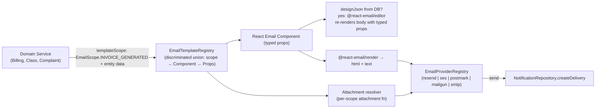

## Email Template System — Implementation Plan

### Library decision (rooted in research + your decisions; verified deep online research 2026-08-01)

**Adopt [React Email v6](https://react.email) (`react-email@^6`) paired with [`@react-email/editor@^1.1`](https://react.email/docs/editor/overview).**

Install set (corrected after v6 research — `react-email@6` unified `@react-email/components` + `@react-email/render` INTO itself; only the editor and the dev-only preview-server package remain separate):
```sh
bun add react-email @react-email/editor@^1.1 @aws-sdk/client-ses postmark mailgun.js form-data nodemailer @types/nodemailer
# recommended for SES attachments (SES API v2 — simpler than v1 SendRawEmailCommand MIME):
bun add @aws-sdk/client-sesv2
# optional, only if running the standalone `react-email dev` preview server:
bun add -D @react-email/ui
```
Drop from the previous draft: `@react-email/components`, `@react-email/render`, `@react-email/ui` runtime, `@tiptap/*` (bundled transitively by `@react-email/editor`).

This is the **only** library that simultaneously delivers all four user requirements:

1. **Type-safe template params**: React Email templates are React components with typed props (`EmailProps` interface). The registry is a hand-rolled discriminated-union mapped type keyed by a backend `EmailScope` enum (see [TypeScript#47109](https://github.com/microsoft/TypeScript/pull/47109) pattern below) — compile-time exhaustiveness, no string unions, never collapses to `never`.
2. **Per-template scopes**: We define a backend `EmailScope` enum (one entry per sending service). Each scope key in the registry carries its `Props` type referencing existing `backend/types/{entity}.types.ts` selection types (`InvoiceReturnType`, `ClassReturnType`, etc.).
3. **Images + attachments**: `react-email` `` for remote/inline images; Resend/Nodemailer/SES adapter attachments API supports `contentId` for `cid:` inline images and buffered/base64 attachments (max 40 MB per Resend; **10 MB outbound cap for SES**; Mailgun uses top-level `inline` field with `Content-ID` derived from filename; Postmark is base64-string-only). Resend: named export `import { Resend } from "resend"`; send payload type is `CreateEmailOptions` with camelCase attachment fields (`contentType`, `contentId` — inline images set via `contentId`, no `inline` boolean). Existing `ResendEmailAdapter.ts` does NOT yet plumb `attachments`/`text`/`cc`/`bcc`/`replyTo`/`headers` — extend it when building the multi-provider registry.
4. **Config/edit/create/update/view in admin UI**: `@react-email/editor` is the embeddable TipTap-based visual editor. Important: the editor edits an **opaque TipTap `JSONContent` blob** carrying no per-template type information — typed props live in the code scaffold (`backend/services/communication/templates/components/*`); the DB override re-renders body regions only and typed props are still passed from the registry at render time. Templates are stored in DB with `designJson` + compiled `htmlBody`, edited via GraphQL mutations, previewed before send. `EmailEditorRef` API (verified in `node_modules`): `getJSON(): JSONContent`, `getEmail(): Promise<{ html, text }>`, `getEmailHtml()`, `getEmailText()`, `editor: Editor | null`.

Rejected alternatives (rationale):
- **MJML** — untyped XML, breaks "no text union types, only enums + TS types" requirement; lacks in-app visual editor.
- **Unlayer `react-email-editor`** — freemium SaaS-dependent, dumps JSON+HTML not React Email typed components; violates "typesafe registry" goal.
- **`@devhiteshk/email-template-editor`** — MUI-themed but unmaintained fork; does not produce React Email output.
- **`react-email-handlebars`** — only needed if you want DB-stored dynamic content with runtime variable substitution. Our `EmailScope` enum + typed-props registry gets type safety **at the registry layer**; for body-only edits we store the visual editor's serialized HTML separately (template scaffolding stays typed in code).



### Scope enum design (your "template must correspond to one service enum" + "register defines entities per template")

New: [`backend/enum/email/emailTemplates.enum.ts`](backend/enum/email/emailTemplates.enum.ts)

```ts
export enum EmailScope {
  // one entry per sending service / event that wants email
  COMPLAINT_RESPONSE = "COMPLAINT_RESPONSE",
  SUGGESTION_ACKNOWLEDGED = "SUGGESTION_ACKNOWLEDGED",
  INVOICE_GENERATED = "INVOICE_GENERATED",
  INVOICE_STATUS_CHANGED = "INVOICE_STATUS_CHANGED",
  PAYMENT_METHOD_CHANGED = "PAYMENT_METHOD_CHANGED",
  CLASS_LIFECYCLE = "CLASS_LIFECYCLE",        // class scheduled/completed/cancelled/...
  STUDENT_LIFECYCLE = "STUDENT_LIFECYCLE",     // reassigned/status-changed/quota
  LESSON_REPORT_SUBMITTED = "LESSON_REPORT_SUBMITTED",
  LESSON_REPORT_REVIEWED = "LESSON_REPORT_REVIEWED",
  CLASS_REMINDER = "CLASS_REMINDER",
  // account flows (NEW — currently missing)
  WELCOME = "WELCOME",
  PASSWORD_RESET = "PASSWORD_RESET",
  EMAIL_VERIFICATION = "EMAIL_VERIFICATION",
}

export enum EmailEditorPermission {
  ADMIN = "ADMIN",
  STAFF = "STAFF",
  SUPERVISOR = "SUPERVISOR",
}

export enum EmailTemplateStatus {
  DRAFT = "DRAFT",
  PUBLISHED = "PUBLISHED",
  ARCHIVED = "ARCHIVED",
}
```

Note: `EmailScope` differs from existing `NotificationEventType` ([backend/enum/notifications/notificationDeliveries.enum.ts](backend/enum/notifications/notificationDeliveries.enum.ts)). The notification event carries the *trigger*; the email scope carries the *template family*. Many events map to one scope (e.g., all class lifecycle events share `EmailScope.CLASS_LIFECYCLE` because they share one template layout that branches on event kind).

### Typed template registry (the heart of type safety)

New: [`backend/services/communication/templates/email-template.registry.tsx`](backend/services/communication/templates/email-template.registry.tsx)

> **SWE review v5 (V5-6):** There are ZERO `.tsx` files anywhere in the backend today (`find backend -name "*.tsx"` → empty). This file establishes the first `.tsx` precedent in the backend service layer. `tsconfig.json:14` enables `jsx: "react-jsx"` and `:38` includes `**/*.tsx`, so it compiles. However, ESLint/Biome rule overrides for `.tsx` in `backend/` may not be calibrated. **Phase 1 verification: run `bun tsgo` + `bun biome:check` + lint-queue-client on the new `.tsx` files immediately after creation.** Alternative if lint/build issues surface: use `React.createElement()` calls in `.ts` files instead of JSX (keeps backend `.ts`-only). The registry file would become `email-template.registry.ts`.

The original draft used `EmailTemplateProps<S> = Parameters<(typeof EMAIL_TEMPLATES)[S]["component"]>[0]` inside an `as const` literal with per-entry `satisfies`. Research ([TypeScript#47109](https://github.com/microsoft/TypeScript/pull/47109), validated against tsgo 7.0.2) shows this collapses to the **intersection of all prop interfaces** — effectively `never` for non-overlapping props. The corrected pattern requires a declarative `EmailPropsByScope` base map + an explicit mapped type + a `defineEmailTemplate<P>` helper, then re-binds through the mapped type. Adding an `EmailScope` case requires adding an entry to both `EmailPropsByScope` and the literal — that's the exhaustiveness guarantee.

```tsx
import type { ComponentType } from "react";
import { EmailScope, EmailEditorPermission } from "@/backend/enum/email";
import type { AttachmentInput } from "@/backend/types/email/email.types";
import type { ComplaintReturnType, InvoiceReturnType } from "@/backend/types";
// React Email components imported with the v6 single-package import path:
import { ComplaintResponseEmail, InvoiceGeneratedEmail } from "./components";

// 1. Per-scope typed props (only enums + TS types — no string unions)
export interface ComplaintResponseEmailProps {
  parentName: string;
  complaint: ComplaintReturnType;        // related entity
  responseText: string;
  respondedAt: Date;
}
export interface InvoiceGeneratedEmailProps {
  invoice: InvoiceReturnType;            // related entity
  recipientName: string;
}
// …one interface per remaining EmailScope case…

// 2. Shape of every registry entry, generic in its own props P.
export interface EmailTemplateDefinition<P> {
  readonly component: ComponentType<P>;
  readonly subject: (props: P, locale: string) => string;
  readonly defaultEditorPermissions: readonly EmailEditorPermission[];
  readonly attachments?: (props: P, locale: string) => Promise<readonly AttachmentInput[]>;
  readonly defaultLocaleTexts: (locale: string) => { readonly greeting: string; readonly footer: string };
}

// 3. THE KEY STEP — declarative map from EmailScope case to its props interface.
//    This is the "base mapping" that #47109 needs. Adding an EmailScope case
//    REQUIRES an entry here — that's the exhaustiveness guarantee.
export interface EmailPropsByScope {
  readonly [EmailScope.COMPLAINT_RESPONSE]: ComplaintResponseEmailProps;
  readonly [EmailScope.INVOICE_GENERATED]: InvoiceGeneratedEmailProps;
  // …one mapping per remaining EmailScope case…
}

// 4. Mapped-type view of the registry. Indexing this with generic S yields
//    EmailTemplateDefinition<EmailPropsByScope[S]> — the correlated narrowing
//    TS could NOT see from a structural literal alone.
export type EmailTemplateRegistry = {
  readonly [S in EmailScope]: EmailTemplateDefinition<EmailPropsByScope[S]>;
};

// 5. Per-entry builder: keeps inline `satisfies` validation AND per-entry
//    intellisense on `subject` / `attachments` / `defaultLocaleTexts` callbacks.
export function defineEmailTemplate<P>(
  def: EmailTemplateDefinition<P>,
): EmailTemplateDefinition<P> {
  return def;
}

// 6. Structural literal with per-entry builder. Computed enum-member keys are
//    single literal types (TypeScript#13948) — preserved as named properties.
const _EMAIL_TEMPLATES = {
  [EmailScope.COMPLAINT_RESPONSE]: defineEmailTemplate<ComplaintResponseEmailProps>({
    component: ComplaintResponseEmail,
    subject: (p, _l) => `Re: ${p.complaint.title}`,
    defaultEditorPermissions: [EmailEditorPermission.ADMIN],
    attachments: async (p, _l) => [{ filename: "response.pdf", content: Buffer.from(p.responseText) }],
    defaultLocaleTexts: (_l) => ({ greeting: "Dear parent,", footer: "Siraj Academy" }),
  }),
  [EmailScope.INVOICE_GENERATED]: defineEmailTemplate<InvoiceGeneratedEmailProps>({
    component: InvoiceGeneratedEmail,
    subject: (p, _l) => `Invoice ${p.invoice.number}`,
    defaultEditorPermissions: [EmailEditorPermission.ADMIN, EmailEditorPermission.STAFF],
    defaultLocaleTexts: (_l) => ({ greeting: "Dear parent,", footer: "Siraj Academy" }),
  }),
  // …one entry per remaining EmailScope case…
} as const satisfies EmailTemplateRegistry;
//   ↑ `as const satisfies EmailTemplateRegistry` (in that order) — the
//     documented-safe idiom (https://typescriptworld.com/typescript-satisfies-operator-deep-dive).
//     Order matters; reversing would error.

// 7. THE SECOND KEY STEP — re-bind the literal through the mapped type
//    annotation. `_EMAIL_TEMPLATES` has the structural shape; `EMAIL_TEMPLATES`
//    has the *mapped-type* representation TS needs to follow the S↔P
//    correlation during generic indexing. (mirrors jcalz's `_verbs`→`verbs`
//    rename pattern from #47109.)
export const EMAIL_TEMPLATES: EmailTemplateRegistry = _EMAIL_TEMPLATES;

// 8. Per-scope props via indexed access into EmailPropsByScope — directly.
//    No `Parameters<…>` unwrap needed (TS treats such generic unwraps as
//    opaque). Adds `ComponentProps<EmailTemplateRegistry[S]["component"]>`
//    alias for parity.
export type EmailTemplateProps<S extends EmailScope> = EmailPropsByScope[S];

// 9. renderEmailTemplate now type-checks inside its body AND narrows
//    correctly at call sites.
export async function renderEmailTemplate<S extends EmailScope>(
  scope: S,
  props: EmailTemplateProps<S>,
  locale: string,
  opts?: { readonly designJsonOverride?: string },
): Promise<{ readonly html: string; readonly text: string; readonly subject: string; readonly attachments: readonly AttachmentInput[] }> {
  // Runtime scope guard — P0: unknown scope from DB must throw, not crash
  const def: EmailTemplateDefinition<EmailPropsByScope[S]> = EMAIL_TEMPLATES[scope];
  if (!def) throw new Error(`Unknown email scope: ${scope as string}`);
  //  ↑ indexed access into the MAPPED TYPE — TS keeps correlation

  const subject = def.subject(props, locale); // ✅ props is EmailPropsByScope[S]
  const attachments = def.attachments ? await def.attachments(props, locale) : [];
  // … then either render @react-email component or rehydrate DB designJson:
  //   const { html, text } = await safeRender(scope, props, locale, opts);
  // If opts.designJsonOverride is present, the @react-email/editor serialized
  // JSON re-renders the body regions only — typed props still drive the
  // scaffold header/footer/subject/attachments.
  // HTML is sanitized via DOMPurify (isomorphic-dompurify) in safeRender.
  return { html: "", text: "", subject, attachments };
}
```

This pattern satisfies: typesafe, no text unions, only enums/types, each scope has its related entities, only registered scopes sendable. Relies on [microsoft/TypeScript#47109](https://github.com/microsoft/TypeScript/pull/47109) (mapped-type + base-map recipe); validated against `tsgo` 7.0.2 — full parity with TS 6.0/5.9 type checker (see [research file 06](.ai/plans/email-templates/reserch/06-typed-registry-pattern.md)).

**Note on the editor's role**: `@react-email/editor`'s `getJSON()` returns opaque TipTap `JSONContent` — typed component props never enter the editor. Body-only edits preserve typed-props only via application-layer discipline (route-level UI restricts editing to body regions; the code scaffold's typed props still drive subject/attachments/header/footer at render time). **P0 XSS/SSTI mitigation (SWE review):** `designJson` is validated against an allowed-node-types allowlist at save time (todo 7a), and `compiledHtml` is sanitized with DOMPurify (`isomorphic-dompurify`) at render time as defense-in-depth (todo 12). Both layers are required — schema validation blocks attacks at the source, DOMPurify catches any remaining vectors.

**Compile-time guard test**: add [`backend/services/communication/templates/__tests__/email-template.registry.types.test.ts`](backend/services/communication/templates/__tests__/email-template.registry.types.test.ts) containing `// @ts-expect-error` assertions on wrong-scope calls and `satisfies` checks on right-scope calls so any TS upgrade silently breaking the narrowing will fail the build.

### Multi-provider registry (your "multi-provider swappable from env")

Refactor [`backend/services/communication/channels/email/EmailChannelFactory.ts`](backend/services/communication/channels/email/EmailChannelFactory.ts) into a provider registry using a **hybrid approach** (SWE review decision): adopt the `createRegistry` pattern internally while preserving the existing factory's async init, caching, `disconnect()` cleanup semantics, and fallback-to-Resend behavior. The makerkit `@kit/shared/registry` `createRegistry` API referenced in research is **makerkit's private monorepo workspace package — not on npm**; we lift ~30 LOC of the source into our own [`backend/lib/registry.ts`](backend/lib/registry.ts) (it's generic enough to reuse for SMS/Push/FX provider registries later). The full `createRegistry<IEmailChannel, EmailProviderName>()` semantics are documented in [research file 05](.ai/plans/email-templates/reserch/05-provider-registry-pattern.md). **Migration note:** `createRegistry` lacks disposal/cleanup semantics and throws on unknown providers (vs current fallback-to-Resend). The hybrid approach wraps `createRegistry` inside the existing factory to preserve both behaviors.

`EmailProviderName` lives in canonical location per [backend/types/AGENTS.md](backend/types/AGENTS.md) — move to [`backend/types/email/emailChannel.types.ts`](backend/types/email/emailChannel.types.ts) alongside `IEmailChannel` / `EmailPayload` / `EmailSendResult` (currently mislocated in the service layer).

New: [`backend/services/communication/channels/email/EmailProviderRegistry.ts`](backend/services/communication/channels/email/EmailProviderRegistry.ts)

```ts
import { createRegistry } from "@/backend/lib/registry";
import type { EmailProviderName, IEmailChannel } from "@/backend/types/email/emailChannel.types";

export const emailProviderRegistry = createRegistry<IEmailChannel, EmailProviderName>();

emailProviderRegistry
  .register("resend",   async () => new ResendEmailAdapter(await loadResendConfig()))   // returns this (chainable)
  .register("ses",      async () => new SesEmailAdapter(await loadSesConfig()))
  .register("postmark", async () => new PostmarkEmailAdapter(await loadPostmarkConfig()))
  .register("mailgun",  async () => new MailgunEmailAdapter(await loadMailgunConfig()))
  .register("smtp",     async () => new SmtpEmailAdapter(await loadSmtpConfig()));

export async function getEmailChannel(): Promise<IEmailChannel> {
  const provider = (await resolveEnvConfig("EMAIL_PROVIDER") ?? "resend") as EmailProviderName;
  // emailProviderRegistry.get(provider) returns Promise<IEmailChannel> — always await.
  // THROWS `Unknown provider "<name>"` on unregistered names (today's EmailChannelFactory
  // falls back to Resend — the new behavior breaks explicitly with a throw).
  return emailProviderRegistry.get(provider);
}

// preserve resetEmailChannel cache-invalidation semantics from the current factory
// SWE review v2: actual signature in EmailChannelFactory.ts is `void` (not `Promise<void>`)
// — disconnect() is synchronous. Keep the existing signature to avoid unnecessary async wrapper.
// SWE review v3: `void` function MUST NOT use `await` (TS error) and `createRegistry` has no
// `peek()` method (only register/get/addSetup/setup). Use the module-level `instance` variable
// (line 5 of EmailChannelFactory.ts) to disconnect synchronously — matches existing pattern.
// SWE review v4 (V4-1): Do NOT reassign `emailChannel` (the const facade at line 100) —
// TS2588 compile error. Operate on `let instance` (line 5) instead. The facade stays alive
// for the lifetime of the process; only the underlying instance is reset.
export function resetEmailChannel(): void {
  invalidateEnvConfigCache("EMAIL_PROVIDER");
  invalidateEnvConfigCache("RESEND_API_KEY");
  invalidateEnvConfigCache("RESEND_FROM_EMAIL");
  // (add SES / Postmark / Mailgun / SMTP env keys for each new provider)
  if (instance) {
    instance.disconnect?.();  // fire-and-forget Promise<void>, matches existing latent-drop at line 89
    instance = null;
    initializationPromise = null;
  }
}
```

`emailChannel` facade wrapper shape unchanged (already used throughout services); make sure `getEmailChannel()` is awaited since `get()` is async.

Adapters to implement (each is realistically ~200 LOC, not the originally-stated ~80 LOC, once attachments + inline-image handling + delivery-row bookkeeping are included):
- `backend/services/communication/channels/email/resend/ResendEmailAdapter.ts` — **extend existing adapter** (not rewrite): `import { Resend } from "resend"` (named export, not default); `resend.emails.send(payload: CreateEmailOptions)`; attachment fields are camelCase (`contentType`, `contentId` — inline via `contentId`, no `inline` boolean). Today only sends `from`/`to`/`subject`/`html` — add `text`, `attachments`, `cc`, `bcc`, `replyTo`, `headers` from expanded `EmailPayload`.
- `backend/services/communication/channels/email/ses/SesEmailAdapter.ts` — **choose one path** (installed today: `@aws-sdk/client-ses@3.x` = SES API **v1**, which does NOT support `Content.Simple.Attachments[]` on `SendEmailCommand`):
  - **(a) Recommended**: `bun add @aws-sdk/client-sesv2` and use SESv2 `SendEmailCommand` with `Content.Simple.Attachments[]` (`RawContent: Uint8Array`, `FileName`, optional `ContentType`/`ContentDisposition`/`ContentId`). Outbound cap is **10 MB** (not 40 MB).
  - **(b) Stay on v1**: use `SendRawEmailCommand` with hand-built `multipart/mixed` MIME for **all** attachments (`RawMessage.Data: Uint8Array`), regardless of size.
  - Both paths: use `@smithy/fetch-http-handler` for Bun compatibility (avoids Bun 1.3.x HTTPS-hang #26066).
- `backend/services/communication/channels/email/postmark/PostmarkEmailAdapter.ts` — `postmark` npm; attachments are **base64-string only** (convert Buffers via `.toString("base64")`); check `response.ErrorCode === 0` for soft failures.
- `backend/services/communication/channels/email/mailgun/MailgunEmailAdapter.ts` — `mailgun.js` + `form-data`; two-stage init: `const mg = new Mailgun(FormData).client({ username: "api", key, url?, public_key? })` (pass the `form-data` **class**, not options); send via `mg.messages.create(domain, data)` only (no `.send()`); `inline` is a **top-level field** on the send call with `Content-ID` derived from the filename (NOT a `contentId` field on each attachment). Map `EmailAttachment → { data, filename, contentType }`.
- `backend/services/communication/channels/email/smtp/SmtpEmailAdapter.ts` — `nodemailer` + `@types/nodemailer`; `@types/nodemailer@8.0.1` types `encoding` as bare `string` (not a literal union) — declare adapter-level literal union and cast before passing to nodemailer if compile-time enforcement is desired. **V5-post-SMTP (2026-08-02): Production-grade adapter.** Prior 'dev/testing only' restriction was lifted because the deployment target is Vercel + Node.js (next.config.ts already has `@vercel/functions` in `serverExternalPackages`), where `nodemailer` is rock-solid. The Bun #10329 socket-flakiness issue does not apply under Node runtime. Deployment docs should state SMTP as a supported production provider (alongside Resend/SES/Postmark/Mailgun), not a dev-only fallback. Local development CAN still run on Bun for dev loop speed — but `SmtpEmailAdapter` is production-safe when run under Node.

Move `IEmailChannel`, `EmailPayload`, `EmailSendResult`, `EmailProvider` / `EmailProviderName` types to canonical location per [backend/types/AGENTS.md](backend/types/AGENTS.md):
[`backend/types/email/emailChannel.types.ts`](backend/types/email/emailChannel.types.ts)

Extend `EmailPayload` to carry attachments + inline image CIDs:
```ts
export interface EmailPayload {
  readonly to: string;
  readonly subject: string;
  readonly html: string;
  readonly text?: string;
  readonly eventType: NotificationEventType;
  readonly userId: string;
  readonly metadata?: NotificationMetadata | null;
  readonly attachments?: readonly EmailAttachment[];
}
// `content` is restricted to `Buffer` only to avoid the base64-vs-path-vs-text
// ambiguity across adapters (Resend, SES, Mailgun all interpret strings
// differently). Each adapter performs the encoding transformation it needs
// (e.g., Postmark runs `.toString("base64")`, Mailgun wraps buffer in form-data).
export interface EmailAttachment {
  readonly filename: string;
  readonly content: Buffer;
  readonly contentType?: string;
  readonly contentId?: string;               // for `">` inline images
  readonly encoding?: "base64" | "buffer";  // explicit discriminator for adapters that need it
}
```

### DB schema (NEW — currently zero email-template tables)

Repo is on `drizzle-orm 1.0.0-rc.4` (not the conservative "0.36+" framing — all schema patterns below verified against 1.0.0-rc.4 in [research file 07](.ai/plans/email-templates/reserch/07-drizzle-schema-patterns.md)).

**Pre-requisite subtask** — the `emailScopeEnum` / `emailTemplateStatusEnum` / `emailEditorPermissionEnum` Drizzle pg-enums referenced in the schema below **do not yet exist**. Add them to [`backend/db/schema/enums.ts`](backend/db/schema/enums.ts) using the repo's existing `createPgEnumFromEnum` helper (it generates the pgEnum from a backing TS enum — see how `notificationChannelEnum` is built from the `NotificationChannel` TS enum). This is part of the Task #2 (enum) subtask — make sure the enum file gets created first.

The repo has **zero** existing `.array()` columns today; first-time use of array-of-enum in this repo is a risk. Safer, idiomatic-to-this-repo choice for `allowedEditorGroups` is `jsonb.$type<readonly EmailEditorPermission[]>()` rather than `emailEditorPermissionEnum("...").array()` (the array-of-pgEnum pattern works but isn't used elsewhere in the codebase). Use the `jsonb` form unless the team specifically prefers the typed array column.

New file: [`backend/db/schema/communications/emailTemplates.ts`](backend/db/schema/communications/emailTemplates.ts) — note the additional required imports (`integer`, `uniqueIndex`) beyond what the original stub mentioned:

```ts
import { sql } from "drizzle-orm";
import { boolean, integer, jsonb, pgTable, text, timestamp, uniqueIndex, uuid, varchar } from "drizzle-orm/pg-core";
import { users } from "@/backend/db/schema";
import { emailScopeEnum, emailTemplateStatusEnum } from "@/backend/db/schema/enums";
import { EmailEditorPermission } from "@/backend/enum/email";
import type { EmailAttachmentRules } from "@/backend/types/email/email.types";

export const emailTemplates = pgTable("email_templates", {
  id: uuid("id").defaultRandom().primaryKey(),
  scope: emailScopeEnum("scope").notNull(),                    // EmailScope
  name: varchar("name", { length: 255 }).notNull(),
  slug: varchar("slug", { length: 255 }).notNull(),            // friendly URL id
  status: emailTemplateStatusEnum("status").notNull().default("DRAFT"),
  // admin-editable body (from @react-email/editor)
  designJson: jsonb("design_json"),                             // serialized TipTap JSONContent blob (validated against allowed-node-types allowlist at save time — todo 7a)
  compiledHtml: text("compiled_html"),                         // last-rendered HTML cache (sanitized via DOMPurify, re-compiled atomically in same transaction as designJson — decision: keep for preview/offline fallback, staleness prevented by atomic re-compile)
  compiledText: text("compiled_text"),                          // plain-text version (re-computed atomically with compiledHtml)
  // per-template config
  defaultFromName: varchar("default_from_name", { length: 255 }),
  defaultFromEmail: varchar("default_from_email", { length: 255 }),
  // Idiomatic-to-repo choice (no existing .array() columns): JSONB typed array.
  // Alternatives (per research file 07): `emailEditorPermissionEnum("...").array()`
  // works since drizzle-kit 0.24 but is first-time-use in this repo.
  allowedEditorGroups: jsonb("allowed_editor_groups").$type<readonly EmailEditorPermission[]>().notNull(),
  // attachments / images configuration
  attachmentRules: jsonb("attachment_rules").$type<EmailAttachmentRules>(),
  // versioning + i18n
  locale: varchar("locale", { length: 10 }).notNull().default("en"),
  version: integer("version").notNull().default(1),              // optimistic locking — WHERE version = $1 check on update prevents last-write-wins on concurrent edits (SWE review decision)
  parentTemplateId: uuid("parent_template_id").references(() => emailTemplates.id), // for locale variants
  isActive: boolean("is_active").notNull().default(true),
  createdBy: uuid("created_by").references(() => users.id),
  createdAt: timestamp("created_at", { withTimezone: true, precision: 3 }).notNull().defaultNow(),
  updatedAt: timestamp("updated_at", { withTimezone: true, precision: 3 }).notNull().defaultNow(),
}, (t) => [
  uniqueIndex("email_templates_scope_slug_uq").on(t.scope, t.slug),
  // Partial unique: only one active row per (scope, locale). Use sql`` literal
  // (not eq(t.isActive, true)) — eq() produces a parameterized placeholder that
  // breaks drizzle-kit migration generation (issues #3349, #4790).
  uniqueIndex("email_templates_scope_locale_active_uq")
    .on(t.scope, t.locale)
    .where(sql`${t.isActive} = true`),
]);

export const emailTemplateRevisions = pgTable("email_template_revisions", {
  id: uuid("id").defaultRandom().primaryKey(),
  templateId: uuid("template_id").notNull().references(() => emailTemplates.id, { onDelete: "cascade" }),
  version: integer("version").notNull(),
  designJson: jsonb("design_json").notNull(),
  compiledHtml: text("compiled_html").notNull(),
  editedBy: uuid("edited_by").references(() => users.id),
  editedAt: timestamp("edited_at", { withTimezone: true, precision: 3 }).notNull().defaultNow(),
}, (t) => [
  // SWE review v3: index on templateId for revision history lookups — without this,
  // querying revisions by templateId causes a full table scan as the table grows.
  // SWE review v4 (V4-2): use inline array form (canonical codebase convention) —
  // NO separate named-object index export. All 60+ existing schemas use this pattern.
  index("email_template_revisions_template_id_idx").on(t.templateId),
  uniqueIndex("email_template_revisions_template_id_version_uq")
    .on(t.templateId, t.version),
]);
```

Run a `drizzle generate` later via the `drizzle-generate` skill workflow (NOT part of this plan — runtime dictate).

### Backend types (canonical pattern)

New: [`backend/types/email/email.types.ts`](backend/types/email/email.types.ts) — applying the `{Entity}{Select,Insert,Return,Submit}Type` pattern:

- `EmailTemplateSelectType`, `EmailTemplateInsertType` — `$inferSelect` / `$inferInsert` from `emailTemplates`
- `EmailTemplateReturnType` — API-facing shape (joins: editor name, last revision)
- `EmailTemplateSubmitInput` — create/update input (DTO)
- `EmailAttachmentInput`, `EmailAttachmentRules`
- Include `id` field (Apollo cache normalization per AGENTS.md)

### Repository

New: [`backend/db/repo/email/email-template.repository.ts`](backend/db/repo/email/email-template.repository.ts)
- Standard repo methods: `getById`, `getByScopeAndLocale(scope, locale, { activeOnly })`, `list({ scopeFilter, statusFilter, pagination })`, `create`, `update`, `softDelete`, `createRevision`, `setActive`
- Use `queryDb(tx)` for non-transactional reads ([docs/drizzle/neon-http-client.md](docs/drizzle/neon-http-client.md))
- Add `findByScopeIds(scopes: EmailScope[], tx?)` returning `Map<EmailScope, EmailTemplateReturnType>` for DataLoader batching (Pothos list fields)
- Add `export * from "./email";` to [`backend/db/repo/index.ts`](backend/db/repo/index.ts) (new `email/` sub-dir)

### Service layer

New: [`backend/services/communication/email-template.service.ts`](backend/services/communication/email-template.service.ts)
- `EmailTemplateService.list`, `get`, `create`, `update`, `publish`, `archive`, `restore`
- `renderForSend(scope, props, locale)` — uses `renderEmailTemplate` from registry, checks DB for design-json override
- `sendTest(templateId, toEmail, sampleProps)` — admin preview sends
- `previewHtml(templateId, sampleProps)` — returns rendered HTML for admin iframe preview
- `resolveTemplatesByScopes(scopes: EmailScope[], locale)` — batch method returning `Map<EmailScope, EmailTemplateReturnType | null>` for GraphQL DataLoader batching ([backend/services/AGENTS.md](backend/services/AGENTS.md))
- Authorization: check `ctx.user` permission group against `template.allowedEditorGroups` (configurable per your "configurable, default set in registry")
- All user-facing errors via `getServerTranslations(locale).emailsTranslations.errors.*` ([backend/services/AGENTS.md](backend/services/AGENTS.md))

**Pre-requisite: extend `CommunicationPayload` type** (SWE review v3 — the type at
`backend/types/notifications/communications.types.ts:4-11` does NOT have `templateProps`,
`entityId`, or `notificationEventId`). Add:
```ts
// In backend/types/notifications/communications.types.ts
export type CommunicationPayload = {
  readonly userId: string;
  readonly title: string;
  readonly body: string | null;
  readonly channel: CommunicationChannelType;
  readonly eventType: NotificationEventType;
  readonly metadata?: Record<string, unknown>;
  // SWE review v3: added for email template rendering
  readonly templateProps?: Record<string, unknown>;
};
```
The `entityId` and `notificationEventId` are accessed via `payload.metadata?.entityId` /
`payload.metadata?.notificationEventId` (metadata already exists as `Record<string, unknown>`).
Do NOT add new top-level fields for these — use the existing `metadata` bag.

Refactor dispatcher at [`backend/services/communication/communication.service.ts`](backend/services/communication/communication.service.ts).
**SWE review v5 (V5-1):** The current dispatcher does NOT have a standalone `case "email":` branch. Email falls through alongside SMS: `case "email": case "sms": return await dispatchRecipientChannel(payload, locale)` (line 72-74). `commonFields` lives inside `dispatchRecipientChannel` (line 28-33), NOT inside `dispatch()`. There is no `tx` (transaction) in `dispatch()` scope — all DB reads in the dispatch path use non-transactional `queryDb()` or direct repository calls.

Two equal approaches (pick one, document the choice):
**Approach A — Extract a dedicated `dispatchEmailChannel()` (recommended):** Break the email fall-through with SMS. Route email to a new standalone function `dispatchEmailChannel(payload, locale)` that owns `commonFields`, scope mapping, idempotency check, and `emailChannel.send()`. `dispatchRecipientChannel` shrinks to SMS-only. This keeps email and SMS logic cleanly separated as email grows in complexity.
**Approach B — Branch within `dispatchRecipientChannel`:** Add email-specific branching at the top of the existing function — map scope, check idempotency, render template — before the shared `emailChannel.send()` call at line 37. Less disruptive but couples email+SMS in one function.

The code below shows Approach A (new `dispatchEmailChannel` function):

```ts
// Inside CommunicationService namespace:

// dispatch() switch changes — break the fall-through:
case "email":
  return await dispatchEmailChannel(payload, locale);
case "sms":
  return await dispatchRecipientChannel(payload, locale);

// New function (replaces the email branch of dispatchRecipientChannel):
async function dispatchEmailChannel(
  payload: CommunicationPayload,
  locale?: string
): Promise<ChannelDispatchResult> {
  const to = (payload.metadata?.to as string) ?? "";
  const commonFields = {
    to,
    eventType: payload.eventType,
    userId: payload.userId,
    metadata: asNotificationMetadata(payload.metadata),
  };

  // Feature flag: old passthrough vs new template path
  // V5-2: MUST use getBooleanEnv, NOT resolveEnvConfig (returns string, "false" is truthy)
  if (!getBooleanEnv("EMAIL_TEMPLATES_ENABLED")) {
    // Old passthrough: use payload.body as raw HTML (backward-compatible)
    const result = await emailChannel.send(
      { ...commonFields, subject: payload.title, html: payload.body ?? "" },
      locale
    );
    return {
      channel: "email",
      success: result.success,
      providerMessageId: result.providerMessageId,
      error: result.error,
    };
  }

  // New template path
  const emailScope = mapEventTypeToEmailScope(payload.eventType);
  // SWE review v3: null scope = no email template for this event.
  // Use payload.body fallback (not success:false) so emails are not lost during migration.
  if (!emailScope) {
    if (payload.body) {
      const result = await emailChannel.send(
        { ...commonFields, subject: payload.title, html: payload.body },
        locale
      );
      return {
        channel: "email",
        success: result.success,
        providerMessageId: result.providerMessageId,
        error: result.error,
      };
    }
    return { channel: "email", success: true, skipped: "no_email_scope" };
  }

  // Idempotency check (P1: dedup duplicate event triggers)
  // SWE review v3: use payload.metadata (not nonexistent payload.entityId/notificationEventId)
  // SWE review v5 (V5-1): NO tx in dispatch scope — use non-transactional queryDb read
  // SWE review v5 (V5-10): notificationEventId may be "" if not populated in builders
  const idempotencyKey = createHash("sha256")
    .update(`${emailScope}:${payload.metadata?.entityId ?? ""}:${payload.metadata?.notificationEventId ?? ""}`)
    .digest("hex");
  // NOTE: findByIdempotencyKey requires adding an `idempotencyKey` column to the
  // notificationDeliveries table + a repo method — add as explicit task in todo 13.
  const existingDelivery = await NotificationRepository.findByIdempotencyKey(idempotencyKey);
  if (existingDelivery) return { channel: "email", success: true, skipped: "idempotent" };

  // SWE review v3: payload.templateProps now exists on CommunicationPayload (added above)
  // SWE review v5 (V5-1): EmailPayload has fields {to, subject, html, eventType, userId, metadata?}
  // — NO `text` or `attachments` fields (IEmailChannel.ts:4-11). renderForSend returns
  // {html, text?, subject, attachments?} — only `subject` and `html` map to EmailPayload.
  // `text` and `attachments` are dropped (or EmailPayload must be extended — todo 13c).
  const { html, subject } = await EmailTemplateService.renderForSend(
    emailScope,
    payload.templateProps ?? {},
    locale
  );
  const result = await emailChannel.send(
    { ...commonFields, subject: subject || payload.title, html },
    locale
  );
  return {
    channel: "email",
    success: result.success,
    providerMessageId: result.providerMessageId,
    error: result.error,
  };
}
```

**`mapEventTypeToEmailScope` definition (P0 — blocking dependency for Phase 3):**
New: [`backend/services/communication/templates/event-to-scope.ts`](backend/services/communication/templates/event-to-scope.ts)
```ts
import { NotificationEventType } from "@/backend/enum/notifications";
import { EmailScope } from "@/backend/enum/email";

/**
 * Maps a NotificationEventType (trigger) to an EmailScope (template family).
 * Not bijective: multiple events share one scope (e.g., all class lifecycle events
 * share EmailScope.CLASS_LIFECYCLE). Returns null for events that don't produce emails.
 *
 * Exhaustiveness is enforced at compile-time via `Readonly<Record<NotificationEventType, EmailScope | null>>`
 * — all 24 enum values MUST have an entry. Adding a NotificationEventType without a mapping
 * entry here will cause a TypeScript error.
 *
 * Cross-referenced against EVENT_CHANNEL_ALLOWLIST (notification-dispatch.helpers.ts:39):
 * - Events with EMAIL in allowlist → mapped to a non-null scope
 * - Events without EMAIL in allowlist (ON_APP + PUSH only) → mapped to null
 * - Events NOT in allowlist at all → fall through to ALL_ENUM_CHANNELS (all channels including
 *   email); these are mapped to a scope if email is desired, or null if not
 *
 * SWE review v2 correction: all 24 enum values verified against
 * backend/enum/notifications/notificationDeliveries.enum.ts.
 */
const EVENT_TO_SCOPE: Readonly<Record<NotificationEventType, EmailScope | null>> = {
  // === Events with EMAIL in EVENT_CHANNEL_ALLOWLIST ===
  // Class lifecycle events → shared CLASS_LIFECYCLE scope
  [NotificationEventType.CLASS_SCHEDULED]: EmailScope.CLASS_LIFECYCLE,
  [NotificationEventType.CLASS_COMPLETED]: EmailScope.CLASS_LIFECYCLE,
  [NotificationEventType.CLASS_CANCELLED]: EmailScope.CLASS_LIFECYCLE,
  [NotificationEventType.CLASS_MARKED_ABSENT]: EmailScope.CLASS_LIFECYCLE,
  [NotificationEventType.CLASS_MARKED_MISSED]: EmailScope.CLASS_LIFECYCLE,
  [NotificationEventType.CLASS_LEAVE_REQUESTED]: EmailScope.CLASS_LIFECYCLE,
  [NotificationEventType.CLASS_RESCHEDULED]: EmailScope.CLASS_LIFECYCLE,
  [NotificationEventType.CLASS_RESET]: EmailScope.CLASS_LIFECYCLE,
  // Reminder events
  [NotificationEventType.CLASS_REMINDER]: EmailScope.CLASS_REMINDER,
  // Student lifecycle events → shared STUDENT_LIFECYCLE scope
  [NotificationEventType.STUDENT_STATUS_CHANGED]: EmailScope.STUDENT_LIFECYCLE,
  [NotificationEventType.STUDENT_QUOTA_OVERRIDDEN]: EmailScope.STUDENT_LIFECYCLE,
  // Lesson report events
  [NotificationEventType.LESSON_REPORT_SUBMITTED]: EmailScope.LESSON_REPORT_SUBMITTED,
  [NotificationEventType.LESSON_REPORT_REVIEWED]: EmailScope.LESSON_REPORT_REVIEWED,

  // === Events NOT in allowlist → fall through to ALL_ENUM_CHANNELS (all channels) ===
  // SWE review v3: These events are NOT in EVENT_CHANNEL_ALLOWLIST, so the dispatcher
  // fallback `EVENT_CHANNEL_ALLOWLIST[eventType] ?? [...ALL_ENUM_CHANNELS]` sends them
  // via ALL 4 channels (ON_APP, EMAIL, SMS, PUSH). This is likely unintended for events
  // that should only use ON_APP or ON_APP+EMAIL. As part of Phase 3, add explicit
  // entries to EVENT_CHANNEL_ALLOWLIST for these events:
  //   COMPLAINT_RESPONSE → [ON_APP, EMAIL]         (currently falls through to ALL)
  //   INVOICE_GENERATED → [ON_APP, EMAIL]          (currently falls through to ALL)
  //   INVOICE_STATUS_CHANGED → [ON_APP, EMAIL]     (currently falls through to ALL)
  //   PAYMENT_METHOD_CHANGED → [ON_APP, EMAIL]     (currently falls through to ALL)
  //   SUGGESTION_ACKNOWLEDGED → [ON_APP, EMAIL]    (currently falls through to ALL)
  //   STUDENT_TEACHER_REASSIGNED → [ON_APP, EMAIL] (currently falls through to ALL)
  //   NEW_COMPLAINT → [ON_APP, SMS, PUSH]          (scope=null — see V4-5 below)
  //   NEW_SUGGESTION → [ON_APP, SMS, PUSH]          (scope=null — see V4-5 below)
  //   SUGGESTION_DUPLICATE_MARKED → [ON_APP, SMS, PUSH] (scope=null — see V4-5 below)
  //   CLASS_REMINDER → [ON_APP, EMAIL]              (currently falls through to ALL)
  // Until these entries are added, the fallback sends via ALL channels — this is
  // pre-existing behavior, NOT a regression from this plan.
  // V4-5: Events with null scope send NO email under the REFACTORED dispatcher
  // (when EMAIL_TEMPLATES_ENABLED=true). Under the LEGACY passthrough path (flag=false),
  // the existing `payload.body ?? ""` fallback still sends email for these events —
  // this is intentional so the flag can be rolled back without losing existing coverage.
  [NotificationEventType.COMPLAINT_RESPONSE]: EmailScope.COMPLAINT_RESPONSE,
  [NotificationEventType.NEW_COMPLAINT]: null, // scope=null — NO email when flag=true; passthrough when flag=false (V4-5)
  [NotificationEventType.NEW_SUGGESTION]: null, // scope=null — same as NEW_COMPLAINT
  [NotificationEventType.SUGGESTION_ACKNOWLEDGED]: EmailScope.SUGGESTION_ACKNOWLEDGED,
  [NotificationEventType.SUGGESTION_DUPLICATE_MARKED]: null,
  [NotificationEventType.INVOICE_GENERATED]: EmailScope.INVOICE_GENERATED,
  [NotificationEventType.INVOICE_STATUS_CHANGED]: EmailScope.INVOICE_STATUS_CHANGED,
  [NotificationEventType.PAYMENT_METHOD_CHANGED]: EmailScope.PAYMENT_METHOD_CHANGED,
  [NotificationEventType.STUDENT_TEACHER_REASSIGNED]: EmailScope.STUDENT_LIFECYCLE,

  // === Events with ON_APP + PUSH only (no EMAIL in allowlist) → null ===
  [NotificationEventType.CLASS_ACTIVATED]: null,
  [NotificationEventType.CLASS_STARTED]: null,

  // === Account flow events (Phase 4 — NEW enum values) ===
  // SWE review v3: These 3 event types do NOT exist in NotificationEventType today.
  // Per option (a), DO NOT add them to NotificationEventType until Phase 4.
  // When Phase 4 adds them to the enum, ALSO uncomment these lines in the SAME PR.
  // [NotificationEventType.WELCOME]: EmailScope.WELCOME,                       // Phase 4
  // [NotificationEventType.PASSWORD_RESET]: EmailScope.PASSWORD_RESET,         // Phase 4
  // [NotificationEventType.EMAIL_VERIFICATION]: EmailScope.EMAIL_VERIFICATION,  // Phase 4
};

export function mapEventTypeToEmailScope(eventType: NotificationEventType): EmailScope | null {
  return EVENT_TO_SCOPE[eventType] ?? null;
}
```
Add a test in `event-to-scope.test.ts` verifying every `NotificationEventType` enum value (all 24) has an explicit mapping entry — the `Readonly<Record<...>>` type enforces this at compile-time, but the test should also verify the mapping is complete at runtime (iterate over `Object.values(NotificationEventType)` and assert each key exists in `EVENT_TO_SCOPE`).

**SWE review v2 changes:**
- Corrected `COMPLAIT_RESPONSE_CREATED` → `COMPLAINT_RESPONSE` (actual enum value)
- Corrected `STUDENT_REASSIGNED` → `STUDENT_TEACHER_REASSIGNED` (actual enum value)
- Commented out `WELCOME`/`PASSWORD_RESET`/`EMAIL_VERIFICATION` — these don't exist in `NotificationEventType` today; defer adding them to Phase 4 (V3-8: option (a)) to avoid breaking `Readonly<Record<NotificationEventType, ...>>` compile-time exhaustiveness. When added in Phase 4, uncomment their entries in the same PR.
- Added all 10 previously-missing enum values: `NEW_COMPLAINT`, `NEW_SUGGESTION`, `SUGGESTION_DUPLICATE_MARKED`, `CLASS_ACTIVATED`, `CLASS_STARTED`, `CLASS_MARKED_ABSENT`, `CLASS_MARKED_MISSED`, `CLASS_LEAVE_REQUESTED`, `CLASS_RESCHEDULED`, `CLASS_RESET`, `STUDENT_QUOTA_OVERRIDDEN`
- Cross-referenced every entry against `EVENT_CHANNEL_ALLOWLIST` to verify email channel eligibility
- Updated enum count from "22" to "24" in the todo 3a description

**SWE review v3 changes:**
- Added explicit comment block documenting the 10 events NOT in `EVENT_CHANNEL_ALLOWLIST` and their intended channel assignments for Phase 3
- Clarified that the ALL-channels fallback is pre-existing behavior, not a regression
- Fixed null-scope dispatcher behavior: `payload.body` fallback instead of `success: false` (V3-9)
- Added `templateProps` to `CommunicationPayload` type extension as pre-requisite (V3-2)
- Fixed `resetEmailChannel()` to remove `await` + non-existent `peek()` (V3-1)
- Documented `findByIdempotencyKey` + `idempotencyKey` column as explicit tasks in todo 13 (V3-11)

### GraphQL surface (NEW — none today)

Following single-canonical-object rule ([backend/AGENTS.md](backend/AGENTS.md)).

**Pre-requisite subtask (repo rule)** — Register the three new enums (`EmailScope`, `EmailTemplateStatus`, `EmailEditorPermission`) in [`backend/graphql/pothos/shared/enum.pothos.ts`](backend/graphql/pothos/shared/enum.pothos.ts) — enums are NOT registered inline in the per-entity Pothos file. Use `*PothosEnum` suffix per [backend/graphql/AGENTS.md](backend/graphql/AGENTS.md) positive examples: `EmailScopePothosEnum`, `EmailTemplateStatusPothosEnum`, `EmailEditorPermissionPothosEnum` (repo also has `*PothosObject` precedent for older enums — both compile). Import the registered Pothos enums into [`backend/graphql/pothos/email/emailTemplate.pothos.ts`](backend/graphql/pothos/email/emailTemplate.pothos.ts) as needed. Add `export * from "@/backend/graphql/pothos/email";` to [`backend/graphql/pothos/index.ts`](backend/graphql/pothos/index.ts). **Then run** `bun run generate:gqlSchema && bun codegen` so frontend codegen enums stay in sync ([backend/graphql/AGENTS.md](backend/graphql/AGENTS.md)).

Files to create:
- [`backend/graphql/pothos/email/emailTemplate.pothos.ts`](backend/graphql/pothos/email/emailTemplate.pothos.ts) — `EmailTemplatePothosObject` (canonical, single object type per repo rule), `EmailTemplateInputPothosObject`, `EmailTemplatePreviewPothosObject`. Use the repo's input pattern: `gqlSchemaBuilder.inputRef<EmailTemplateSubmitInput>("EmailTemplateInput").implement({...})` (per existing `notification-preferences.pothos.ts`).
- [`backend/graphql/query/email/emailTemplates.query.ts`](backend/graphql/query/email/emailTemplates.query.ts) — `emailTemplates(scope?, status?, pagination)` list + `emailTemplate(id)` query.
- [`backend/graphql/mutation/email/emailTemplate.mutation.ts`](backend/graphql/mutation/email/emailTemplate.mutation.ts) — **singular file name** per repo convention (matching the existing `backend/graphql/mutation/notifications/notification-preferences.mutation.ts` and `mark-notifications-read.mutation.ts` — that directory uses singular `.mutation.ts` for single mutations). Exposes: `createEmailTemplate`, `updateEmailTemplate`, `publishEmailTemplate`, `archiveEmailTemplate`, `sendTestEmail`. `sendTestEmail` IS a mutation (side-effect — sends live email).
- [`backend/graphql/query/email/emailTemplatePreview.query.ts`](backend/graphql/query/email/emailTemplatePreview.query.ts) — `previewEmailTemplate(templateId, sampleProps)` returns HTML string for iframe preview.

**Authorization placement** (verified — see [research file 08](.ai/plans/email-templates/reserch/08-pothos-patterns.md)):
- GraphQL field-level `authScopes` is set to `{ superAdmin: true, notImpersonating: true }` on all email-template mutations (write surface is super-admin only at the GraphQL layer).
- Per-template `allowedEditorGroups` enforcement belongs in the **service layer** (Pattern A — the service refuses the edit if the caller's permission group is not in `template.allowedEditorGroups`). The service performs the actual fine-grained permission check; GraphQL just gates the surface to super-admin actors who then act on behalf of editors.
- Pattern verified against the repo's existing `NotificationPreferencePothosObject` and `@pothos/core@^4.13.1` + `@pothos/plugin-scope-auth@^4.1.7`.

### Frontend (UI/UX Specification)

> **SWE Review v6 (UI/UX completeness):** expanded from ~60 lines to a complete UI/UX specification per research synthesis at [.ai/plans/email-templates/glm_swe/ui-research/00-synthesis.md](.ai/plans/email-templates/glm_swe/ui-research/00-synthesis.md). All existing v1-v5 technical decisions preserved; UI/UX gaps closed: navigation entry, page layouts, list view, editor view interactions, preview tab, send-test dialog, animations w/ prefers-reduced-motion a11y guard, forms/validation, theming/dark mode, a11y, storybook stories, tests, StatusBadge extension, feature-flag visual cue, complete i18n key catalogue.

Follow the tier-neutral ViewModel + switcher + Container pattern per [frontend/common/views/AGENTS.md](frontend/common/views/AGENTS.md) and [frontend/NEW_PAGE_WORKFLOW.md](frontend/NEW_PAGE_WORKFLOW.md). **`frontend/views/dashboard/` is DEPRECATED** — all new code goes under `frontend/common/views/dashboard/<domain>/` + tier files in `frontend/mobile/views/` and `frontend/desktop/views/`.

**Common layer** (`frontend/common/views/dashboard/email-templates/`):
- `useEmailTemplatesListViewModel.ts` — list/filter/pagination logic (viewport-agnostic)
- `EmailTemplatesListView.tsx` — switcher (`createLazyView` + `ResponsiveViewSwitch`)
- `EmailTemplatesListContainer.tsx` — calls hook, wraps in `<RequirePermission>`
- `useEmailTemplateEditorViewModel.ts` — editor save/preview/send-test logic
- `EmailTemplateEditorView.tsx` — switcher
- `EmailTemplateEditorContainer.tsx` — calls hook, wraps in `<RequirePermission>`
- `EmailEditorWrapper.tsx` — browser-only dynamic import (see "Editor wrapper requirements" below)
- `types/` — label slices (`Pick` from `@/shared/locale/types/...` per Rule 7)

**Mobile tier** (`frontend/mobile/views/dashboard/email-templates/`):
- `emailTemplatesList.mobile.tsx` — pure presentation (no business logic, no `useMediaQuery`/`useViewport`)
- `emailTemplateEditor.mobile.tsx` — mounts `EmailEditor` from `EmailEditorWrapper` (not directly from `@react-email/editor`)

**Desktop tier** (`frontend/desktop/views/dashboard/email-templates/`):
- `emailTemplatesList.desktop.tsx` — DataGrid + filter toolbar + Create action
- `emailTemplateEditor.desktop.tsx` — split-pane: left editor viewport, right Inspector; `<Dialog>` for send-test; `<Drawer>` for history

**Editor wrapper requirements** (verified — see [research file 10](.ai/plans/email-templates/reserch/10-editor-mui-nextjs-interop.md)):
  - SWE review v3: Create a dedicated `EmailEditorWrapper.tsx` in the **common layer** (`frontend/common/views/dashboard/email-templates/EmailEditorWrapper.tsx`) that encapsulates all browser-only concerns:
    ```tsx
    // frontend/common/views/dashboard/email-templates/EmailEditorWrapper.tsx
    'use client';
    import dynamic from 'next/dynamic';
    // Single dynamic import — ssr:false prevents TipTap's window access during SSR
    const EmailEditor = dynamic(() => import('@react-email/editor').then(m => m.EmailEditor), { ssr: false });
    export { EmailEditor };
    ```
    Both mobile and desktop tier views import `EmailEditor` from this wrapper (not directly from `@react-email/editor`). This centralizes the `next/dynamic` + `ssr: false` pattern in one file, preventing accidental SSR imports in tier views.
    - SWE review v5 (V5-5): `next/dynamic({ ssr: false })` has ZERO precedent in the codebase — existing `createLazyView` defaults to `ssr: true` and no file in the repo passes `ssr: false`. This `EmailEditorWrapper.tsx` is an intentional deviation because TipTap touches `window` at module load. The `next/dynamic({ ssr: false })` import lives ONLY in this wrapper file — tier view files must NOT add their own `next/dynamic` imports for the editor; they import `EmailEditor` from `EmailEditorWrapper.tsx`.
  - Add `'use client'` directive on the **tier view file** that mounts the editor (e.g. `emailTemplateEditor.desktop.tsx`) — TipTap is browser-only and touches `window` at module load.
  - SWE review v5 (V5-5): ~~Wrap `EmailEditor` import via `next/dynamic` at module top level in the tier view file~~ REMOVED — the dynamic import lives in `EmailEditorWrapper.tsx` only (see above). Tier views are pure presentation that import `EmailEditor` from the wrapper. Do NOT add a second `next/dynamic` in tier view files.
  - Save flow: hold a `ref<EmailEditorRef>`; on save call `ref.current?.getJSON()` for `designJson` (synchronous — returns JSONContent directly, no Promise) and `await ref.current?.getEmail()` (async — returns Promise<{html, text}>) for compiled output. **SWE review v2:** File objects (attachments, inline images) must be held in `useRef`, NOT in the Zustand store — `File` and `Blob` objects are not serializable and will break Zustand's devtools + persistence middleware. The Zustand store should only hold serializable state (isDirty, selectedScope, locale, etc.).
  - Wrap the editor in MUI v9's `ScopedCssBaseline` (not the global `CssBaseline`) — the global `CssBaseline` reset breaks TipTap's prose styling (`ScopedCssBaseline` is net-new in the repo — only the global `CssBaseline` is used today). Import editor CSS **after** MUI global CSS to avoid the MUI reset overriding ProseMirror styling: e.g. `import '@mui/material/styles'; /* then */ import '@react-email/editor/themes/default.css'`.
  - Two theming layers, verified by name:
    - **Layer A (editor chrome)** — `--re-bg`, `--re-text`, `--re-text-muted`, `--re-border`, `--re-hover`, `--re-active`, `--re-radius`, `--re-radius-sm` (CSS custom properties control bubble menu / slash command / Inspector visuals). Bind these to `useColorScheme()` mode (light vs dark) via inline `style` on the `<EmailEditor>` host element.
    - **Layer B (emailed HTML output)** — JS `EmailTheming.configure({ theme })` API. `--re-*` CSS vars **do NOT** affect the emailed HTML — only the in-editor chrome. The emailed HTML output inherits theme tokens from the `EmailTheming` plugin. **SWE review v2:** `EmailTheming` is NOT built-in to `@react-email/editor` — it must be passed as an `extensions` prop to `<EmailEditor extensions={[EmailTheming.configure({ theme })]} />`. Without explicitly passing it, the emailed HTML output will not include theme tokens. **SWE review v4 (V4-7):** `EmailTheming` is exported from the **`/plugins` subpath** — `import { EmailTheming, extendTheme } from '@react-email/editor/plugins'`. Importing from the package root (`@react-email/editor`) will fail with `Module does not export EmailTheming`. See research file `10-editor-mui-nextjs-interop.md:336`.
  - Known Turbopack dev-compile slowdown with Prism.js grammars bundled by the editor; budget the editor page for slower initial dev compile.

#### A. Routing & Navigation

- **Admin routes** — follow existing `(dashboard)` group pattern (locale from `getLocale()` cookie, NOT a `[locale]` URL segment per [app/AGENTS.md](app/AGENTS.md) and [research file 01](.ai/plans/email-templates/glm_swe/ui-research/01-dashboard-inventory.md)):
  - `app/(dashboard)/email-templates/page.tsx` — list page
  - `app/(dashboard)/email-templates/[id]/page.tsx` — editor page (route param `id`; for new templates, navigate to `/email-templates/new` which the page handler treats as "blank editor with scope picker" when no real row exists)
- **Breadcrumbs** — use existing `usePageBreadcrumbs({ currentTitle, overrides })` (`frontend/common/views/dashboard/lib/usePageBreadcrumbs.ts`).
  - List page: "Email Templates" (single segment).
  - Editor page: "Email Templates / {template.displayName}" with the first segment auto-linking back to `/email-templates`.
- **Sidebar nav entry** — add `emailTemplates: string` to `DashboardNavigationLabels` (`shared/locale/types/dashboard/core/nav.ts`) and a `NavItem` to `SIDEBAR_NAV_ITEMS` under the Admin group. Recommended icon: `<EmailOutlined />` (justify: matches the email domain; `NotificationsActiveOutlined` is reserved for the broader notifications surface which already has its own nav).
- **Permission gate (two-layer defense-in-depth)** — mirror [`app/(dashboard)/payment-catalogs/page.tsx`](app/(dashboard)/payment-catalogs/page.tsx):
  - Server: `requirePermissionForPage(userId, [AppPermission.EMAIL_TEMPLATES_MANAGE], locale, context)` in each `page.tsx`.
  - Client: `<RequirePermission permissions={["EMAIL_TEMPLATES_MANAGE"]} fallback={null}>` in the Container.
  - **New enum value**: add `EMAIL_TEMPLATES_MANAGE = "EMAIL_TEMPLATES_MANAGE"` to `AppPermission`. Add a `PAGE_PERMISSIONS.emailTemplates` entry to the registry.
  - GraphQL mutations additionally gate via `authScopes: { superAdmin: true, notImpersonating: true }` (KEEP from plan L836).
- **Deep-linking & middle-click** — editor URL `/email-templates/{id}` is shareable; MUI DataGrid default supports middle-click → new tab.

#### B. Page Layouts

- **List page wrapper** — `<DesktopPageContainer>` / `<MobilePageContainer>` (`frontend/common/components/ui/container/page/`) — tier-split. Each wraps `<DesktopPageHeader>` / `<MobilePageHeader>` (shared `BasePageHeaderProps` at `frontend/common/components/ui/container/page/types/pageHeader.types.ts:11-17`) with:
  - Title: i18n `dashboard.emailTemplates.pageTitle`
  - Subtitle: i18n `dashboard.emailTemplates.pageSubtitle`
  - Actions slot: primary "Create" button (`<Button variant="contained" color="primary" size="medium" startIcon={<AddOutlined />} />`).
- **Editor page wrapper** — split-tier:
  - Desktop: `<DesktopPageContainer>` + tier header (title = template displayName, with a back `<IconButton>` to the list). Body = two-pane layout via CSS Grid: left = editor viewport (flex-grow), right = Inspector panel (fixed `360px` width, `borderLeft`, scrollable). Use `sx` (NOT style props).
  - Mobile: stacked — editor viewport full-width, Inspector lives in a bottom-anchored `<Drawer>` opened via a `<TuneOutlined />` IconButton in the mobile header.
- **Shared `SectionPanel`** (`frontend/common/components/ui/container/SectionPanel.tsx`) wraps the Inspector sections (Scope, Locale, Version, Editor Groups, Subject, Attachments) — title + actions slot pattern.
- **Loading skeletons** — NEW files, mirroring `DashboardRoleSkeleton.tsx` reference structure:
  - `EmailTemplatesListSkeleton.tsx` (DataGrid shimmer rows + header bar shimmer).
  - `EmailEditorSkeleton.tsx` (editor frame block shimmer + Inspector panel shimmer). Used as `<Suspense fallback={<EmailEditorSkeleton />} />` for the editor route.
- **Empty state** — reuse shared `<EmptyState>` (`frontend/common/components/ui/state/`): illustration + i18n `dashboard.emailTemplates.emptyState` + "Create" CTA button (only if `EMAIL_TEMPLATES_MANAGE`). Empty grid subtitle: `dashboard.emailTemplates.emptyStateHelp`.
- **Error state** — reuse shared `<ErrorState>` (`frontend/common/components/ui/state/`) with a "Retry" `<Button>` wired to Apollo `refetch`.

#### C. List View Components & Interactions

- **DataGrid** — `AppDataGrid` (`frontend/common/components/ui/dataGrid/AppDataGrid.tsx`; wraps MUI X DataGrid v9). Reference usage: `frontend/desktop/views/dashboard/permissions/components/permissionGroupsDataGrid.desktop.tsx:80-189`.
  - Required props: `paginationOptions: ListPaginationOptions` (`frontend/common/components/ui/filter/listPaginationOptions.ts`), `emptyMessage`, `loading`, `getRowId={(row) => row.id}`. **Do NOT override `slots.pagination`** (research file 01 confirms it is non-overridable).
  - Columns:
    1. **Status badge** (renderer calls shared `<StatusBadge>` with the new `emailTemplate` category — see §N). Width ~110px. Renders first (left-most).
    2. **Name** (displayName). Clickable row click → navigate to editor route (research file 01 confirms row-click-to-edit is the established DataGrid convention).
    3. **Scope** (EnumDisplay `<StatusBadge category="emailTemplate" value={row.scope} />` or a typed `<Chip variant="outlined">` — but inline `<Chip>` is forbidden per `COMPONENT_PATTERNS.md:170`; use the enum's localized label as plain `<Typography>` text).
    4. **Locale** (`twoLetterCode` + flag emoji if available; default to plain `<Typography>`).
    5. **Version** (e.g. `v3` from `version` integer; tooltip: i18n `dashboard.emailTemplates.versionTooltip` + lastEdited timestamp).
    6. **Last edited** (relative time, e.g. "2h ago" — format via `date-fns` `formatDistanceToNow` already in repo).
    7. **Allowed editor groups** (comma-joined display of `EmailEditorPermission` labels — short summary only; full list in Inspector).
  - **Row actions menu** — use `useRowMenuAnchor` (reference: `permissionGroupsDataGrid.desktop.tsx`). Menu items (visibility rules in parentheses):
    - "Edit" (always for `EMAIL_TEMPLATES_MANAGE`) → navigate to editor.
    - "Preview" (always) → opens preview dialog.
    - "Duplicate" (`EMAIL_TEMPLATES_MANAGE`) → copies designJson to a new DRAFT.
    - "Archive" (status = PUBLISHED only; `EMAIL_TEMPLATES_MANAGE`) → confirm dialog → archive.
    - "Restore" (status = ARCHIVED only; `EMAIL_TEMPLATES_MANAGE`) → confirm dialog → restores to DRAFT (does NOT auto-publish).
- **Search bar** — in the page header actions slot (right side, before "Create"):
  - `<OutlinedInput size="small" placeholder={t("searchPlaceholder")} startAdornment={<InputAdornment position="start"><SearchOutlined fontSize="small" /></InputAdornment>} />`.
  - Debounced 300ms via `useDebouncedCallback` (`use-debounce` already in repo). Filters by displayName ILIKE.
- **Filter chips row** — below header, inside `<SectionPanel actions={...}>`. There is NO shared `FilterToolbar` in the repo (research file 01) — compose inline. Filters:
  - **Scope** — `<Autocomplete multiple options={EmailScope values} />` rendering localized labels. Active filter shows as a `<Chip>` row.
  - **Status** — `<ToggleButtonGroup exclusive>` of three options: Draft / Published / Archived. Active item highlighted.
  - **Locale** — `<Autocomplete single>`.
  - **Segmented view control** — `<ToggleButtonGroup exclusive>` of three view modes: "Active" (default — Draft + Published), "Archived", "All". Default: Active.
  - **Clear filters** — text button appears when any filter is active; clears all + resets segmented control to "Active".
  - **Active filter count badge** — small `<Chip size="small" color="primary" label="3" />` shown in the page header alongside the search icon when filters > 0.
- **Pagination** — `ListPaginationOptions` (10 / 25 / 50 rows per page; default 25). Stored in the Zustand store so it survives viewport switching.
- **Bulk actions** — Phase 2 (not Phase 1): select rows via DataGrid checkboxes → bulk Archive button appears in the header actions slot. Note: MUI X v9 checkbox column is the supported pattern.
- **Sort** — sortable columns: name (asc/desc), lastEdited (desc — DEFAULT). Scope + status are NOT sortable (display-only). State persisted in store.
- **Toast on action** — reuse `@toolpad/core/useNotifications` (`const notifications = useNotifications(); notifications.show(t("toast.archived"), { severity: "success" })`). There is NO Notistack (research file 01). Use `FormErrorSnackbar` for persistent failure feedback (e.g., server permission error).

#### D. Editor View Components & Interactions

- **Three-tab layout** — in-page tabs (NOT nested routes), mirrors `paymentCatalogAdmin.desktop.tsx:36-68` simple inline `<Tabs value={...} onChange>` + per-tab conditional render:
  1. **Design** — visual `@react-email/editor` mounted via `EmailEditor`.
  2. **Preview** — live compiled HTML in a sandboxed iframe (see §E).
  3. **Code** — raw JSON view of `designJson`, syntax-highlighted via Prism.js lazy-loaded in this tab (the editor bundle already ships Prism grammars — do NOT add a separate highlighter dep).
  - **Tab transitions** — reuse the `<Slide>` tab idiom from `preferencesChannelTabs.mobile.tsx:140`:
    ```tsx
    <Slide direction={slideDirection} in appear mountOnEnter unmountOnExit timeout={220}>
      <Box>{tabContent}</Box>
    </Slide>
    ```
    where `slideDirection` is computed from `newTabIndex > oldTabIndex ? "left" : "right"`. **Wrap with `usePrefersReducedMotion()` (see §G)**: when true, render the tab content directly without `<Slide>` (instant swap).
- **Inspector panel (right, desktop)** — `<SectionPanel>`-based vertical stack:
  - **Scope** — `<Autocomplete>` listing `EmailScope` enum values (localized labels via `dashboard.emailTemplates`). Once a template is PUBLISHED, the scope becomes LOCKED: `disabled` + tooltip (`scopeTooltip` text) — re-publishing with a new scope requires first archiving + creating a new template.
  - **Locale** — `<Autocomplete>` of supported locales (`ar`, `en`).fieldNameRequired.
  - **Version** — read-only `<Chip>` (e.g. `v3`) + lastEdited tooltip. Non-editable.
  - **Allowed editor groups** — `<TagInput>` chip selector (reuse `CatalogEditDialog.tsx:302` pattern; `@/frontend/components/ui/TagInput` if present, or MUI `<Autocomplete multiple freeSolo>`). Options from `EmailEditorPermission` enum (`ADMIN`, `STAFF`, `SUPERVISOR`). Selected chips rendered with the localized label.
  - **Subject template** — `<TextField fullWidth>` + merge-tag insertion button (`<EmailOutlined>` popover opens `VariableMentionPicker`, see §D Merge-tag). Example placeholder: `Order {{orderNumber}} confirmed`.
  - **Attachment rules** — small key-value list: each row = pattern + max size. Use a `<List>` + `<ListItem>` with an "Add rule" `<IconButton>` and per-row `<DeleteOutlined>` delete.
- **Mobile inspector** — bottom-anchored `<Drawer anchor="bottom">`, opened from the mobile header `<TuneOutlined />`. Same fields, compact stack.
- **Merge-tag / variable insertion (NEW `VariableMentionPicker`)**:
  - New component in `frontend/common/components/ui/autocomplete/` reusing the `useAudienceAutocomplete*` hook family pattern.
  - List the scope's `Props` keys (from `EmailPropsByScope`) as lawful insert tokens. Insert at cursor as `{{fieldName}}` (handle/string interpolation, no leading `@`).
  - Future: TipTap `extension-mention` is **transitively available** via `@react-email/editor` for inline `@mention`-style body UX — wire into the visual editor's `extensions` prop as Phase 2. RECOMMENDED approach: phase 1 = standalone Autocomplete in the Inspector (subject + a tooltip "click an item to insert"); phase 2 = TipTap inline mention.
- **Save actions** — sticky bottom of Inspector (`EntityFormDialogActions` slot):
  - **Save Draft** — primary `<Button variant="contained">`, keyboard shortcut Ctrl/Cmd+S (preventDefault + dispatch submit).
  - **Publish** — secondary `<Button variant="outlined" color="success">`, only enabled when status = DRAFT or when there is a published version to replace. Ctrl/Cmd+Enter shortcut. Confirmation dialog: "Publishing will archive the currently published version for {scope}/{locale}. Continue?" Title uses i18n `dialog.publishConfirmTitle(displayName)`.
  - **Send Test** — tertiary `<Button color="secondary" startIcon={<SendOutlined />}>`. Opens the dialog in §F.
  - **Discard** — text button; if `isDirty`, asks for `<Dialog>` confirmation (`unsavedChangesTitle`/`unsavedChangesBody`).
- **Draft → Publish confirm dialog** — reuse `EntityFormDialogActions`; actions: Cancel / Publish ( mbox.confirm before submit).
- **History drawer** — `<Drawer anchor="right">` listing prior versions by `version integer` + status (Draft/Published/Archived). Each row: version chip, status badge, lastEdited, "Restore" button (only if `EMAIL_TEMPLATES_MANAGE`). Restore copies designJson onto a new DRAFT — confirm dialog clarifies "This creates a new draft from v{N}. The published version is unchanged. Continue?". Empty state when no revisions exist: `dashboard.emailTemplates.emptyRevisions` + `emptyRevisionsHelp`. Drawer trigger: small `<History />` IconButton in the page header.
- **Unsaved-changes protection** — `isDirty` tracked in the Zustand store (`emailTemplateEditorStore.ts`). NEW pattern in the repo (research file 03 — no `beforeunload` precedent today). Two layers:
  1. `beforeunload` window event listener → `event.preventDefault(); event.returnValue = ''` so the browser prompts on tab close.
  2. In-app navigation: intercept `next/navigation`'s `useRouter().push` is not directly interruptible; instead, render a small `<Dialog>` "Discard changes?" confirm on any in-app nav when `isDirty`, by wiring the Confirm dialog into the back-link `<IconButton onClick>` + intercepting tab clicks when dirty. Phase 1 covers the back-link; in-app nav interception across the whole app is out of scope.
- **Keyboard shortcuts** — Ctrl/Cmd+S → Save Draft (preventDefault + dispatch). Ctrl/Cmd+Enter → Publish (with confirm). ESC → close Drawer/Dialog (MUI default — no work). Register handlers via a `useEffect` keydown listener in the editor ViewModel, scoped to the editor route only.
- **Editor CSS layering** — KEEP verbatim from v5 (line above): wrap editor in `ScopedCssBaseline`; import `@mui/material/styles` **before** `@react-email/editor/themes/default.css`.
- **Editor `EmailTheming`** — KEEP verbatim from v5 (line above): import from `/plugins` subpath; pass as `extensions` prop.

#### E. Preview Tab

- **Sandboxed iframe** — `<iframe sandbox="" srcDoc={compiledHtml} />` with CSP via `srcDoc` meta or response headers from the preview query:
  - `default-src 'none'` (zero remote scripts/connections)
  - `style-src 'unsafe-inline'` (inline styles for the template)
  - `img-src 'self' data:` (allow inline `data:` URIs; NOT `*` per V5-3 — prevents tracker-pixel IP/UA leaks)
  - **Do NOT use `sandbox="allow-same-origin"`** — pure HTML preview needs no same-origin access; `sandbox=""` creates a unique opaque origin with no script, no forms, no storage.
- Server side: `previewEmailTemplate` GraphQL resolver MUST DOMPurify-sanitize the compiled HTML before serving (defense-in-depth with the iframe sandbox — V5-3 KEEP).
- **Variable preview** — `<Autocomplete>` to load a sample entity for the scope (LookupResultType sample). GraphQL `previewEmailTemplate` query accepts `sampleProps` JSON. Default props pre-filled from the registry (or a small `sampleProps.json` per scope).
- **Desktop viewport selector** — small `<ToggleButtonGroup>` of three options: Desktop (1024) / Tablet (768) / Mobile (375). On mobile tier: iframe is full-width (selector hidden). No existing reusable selector — note as a tiny new in-tab SurfaceSelect component, single-file in `frontend/common/components/ui/toggle/`.
- **"Copy HTML" button** — below iframe, `<Button startIcon={<ContentCopyOutlined />} onClick={copyEmailHtml}>`. Uses `navigator.clipboard.writeText(compiledHtml)`; on success toast `dashboard.emailTemplates.toast.copyHtmlCopied()`.
- **"Open in new tab"** — DISABLED (per security — no raw HTML endpoint exposed). Tooltip: `previewTooltip`.

#### F. Send Test Dialog

- **Dialog** — MUI `<Dialog>` + `EntityFormDialogActions` for actions bar. Title: i18n `dashboard.emailTemplates.dialog.sendTestTitle`.
- **To: input** — `<OutlinedInput type="email">` with zod `z.string().email()` validation. Helper error text on invalid.
- **Sample props** — collapsible `<TextareaAutosize>` (or MUI `<TextField multiline>`) pre-filled with scope-specific default JSON. Editable for advanced test cases.
- **Rate-limit notice** — `<Typography variant="caption" color="text.secondary">` text "Max 5 test emails per minute per user" (from plan todo 12). If the mutation returns `RATE_LIMITED` error, render inline error text: `toast.sendTestRateLimited(limit)`.
- **"Send to my own email" quick button** (Phase 2) — small `<Button>` that pre-fills the To field with the current user's email (from auth store).
- **Submit** — `sendTestEmail` mutation. On success: `notifications.show(t("toast.testSent", { to }), { severity: "success" })` + optionally trigger the `SuccessCheckMark` animation (see §G) BEFORE closing the dialog. On failure: inline error in dialog body.
- **Close behavior** — on close, prompt "Discard sample props changes?" if the sample JSON was modified and the email was not sent.

#### G. Animations & Micro-interactions

- **Libraries** — reuse only what's installed today: `framer-motion@^12.43.0` (used in exactly 3 sibling `MetricCard` files), `@dnd-kit/core@^6.3.1` + `@dnd-kit/sortable@^10.0.0` (installed but UNUSED in any source file — the email plan is the first consumer). DO NOT add Motion / GSAP / auto-animate / lottie / confetti.
- **Tab transitions** — reuse `<Slide>` idiom from `preferencesChannelTabs.mobile.tsx:140` (`direction` computed from index delta, `timeout={220}`). When `usePrefersReducedMotion()` returns true, render directly without slide.
- **List entrance stagger** — mirror `MetricCard.tsx:84-88` framer-motion entrance: `initial={{ opacity: 0, y: 24 }} animate={{ opacity: 1, y: 0 }} transition={{ duration: 0.4, delay: animationIndex * 0.04, ease: [0.25, 0.46, 0.45, 0.94] }}`. Apply to each DataGrid row wrapper (only if DataGrid supports slot rendering; otherwise apply to the named-row container). Cap `delay` so all rows animate in ≤400ms.
- **Success animation** — NEW small component `SuccessCheckMark` in `frontend/common/components/ui/feedback/`. framer-motion SVG `<path>` with `pathLength` 0 → 1, ~600ms one-shot. Used in the Send Test success state + Publish confirmation. No confetti.
- **Drag-and-drop reorder animation** — `@dnd-kit/sortable` `useSortable` ships CSS `transform` + `transition` built-in. Use `<DragOverlay dropAnimation>` for the lift/settle. The plan establishes the repo's first dnd-kit **usage convention**: helper components live in `frontend/common/components/ui/dnd/` (`SortableItem`, `SortableList`). **Install missing deps**: `@dnd-kit/utilities` + `@dnd-kit/modifiers` (`@dnd-kit/core` + `sortable` are already installed; utilities + modifiers are NOT). Do NOT add `react-dnd` or `@hello-pangea/dnd`.
- **Loading spinner** — standard `<CircularProgress size={20} color="inherit">` inside buttons (existing repo convention).
- **Skeletons** — MUI `<Skeleton>` for `EmailEditorSkeleton` and `EmailTemplatesListSkeleton` (see §B).
- **Drawer/Dialog motion** — MUI defaults: `Drawer` uses `Slide`, `Dialog` uses `Fade`. **Do NOT override `TransitionComponent`** on the 56 existing dialogs / 11 existing drawers — keep parity (research file 03).
- **Micro-interactions** — button ripple (MUI built-in). Card hover: subtle elevation change via `sx={{ transition: theme => theme.transitions.create('box-shadow'), '&:hover': { boxShadow: 2 } }}`. No `whileHover` / `whileTap` (avoid framer-motion micro-interactions — keep the repo idiomatic with CSS transitions).
- **Reduced-motion a11y guard (NEW)** — NEW `usePrefersReducedMotion()` hook in `frontend/common/lib/`:
  ```ts
  // frontend/common/lib/use-prefers-reduced-motion.ts
  'use client';
  import { useState, useEffect } from 'react';
  export function usePrefersReducedMotion(): boolean {
    const [reduced, setReduced] = useState(false);
    useEffect(() => {
      const mq = window.matchMedia('(prefers-reduced-motion: reduce)');
      setReduced(mq.matches);
      const handler = (e: MediaQueryListEvent) => setReduced(e.matches);
      mq.addEventListener('change', handler);
      return () => mq.removeEventListener('change', handler);
    }, []);
    return reduced;
  }
  ```
  Wrap EVERY custom animation (stagger, success-check, tab slide, drag-settle): when true, skip the animation (instant state change). **This closes a production-readiness gap** — today the codebase respects `prefers-reduced-motion` NOWHERE (research file 03). MUI Dialog/Drawer/Snackbar/Tooltip already honor the media query internally; only our custom animations need the guard. The hook is Tier-shared (lives in common, runs in both mobile and desktop tier views).
- **No global NProgress or route-level `AnimatePresence`** — loading is Suspense + per-route skeleton (`DashboardRoleSkeleton.tsx` reference). Do NOT add NProgress or AnimatePresence in layout.tsx (no precedent today).

#### H. Forms & Validation

- **Form library** — `react-hook-form` + `Controller` + `useWatch` + separate Zustand UI store. Mirror the `useManualInvoiceViewModel` architectural pattern (research file 02 confirms this is the closest precedented form pattern). **DO NOT use `useFieldArray`** — codebase-wide grep returns zero usages (research file 02); nested arrays are managed via `useWatch` + manual `setValue`.
- **Validation** — `zod` schema for editor-inspector fields (`@hookform/resolvers/zod` already installed):
  - `displayName`: min length 1, max 120.
  - `slug`: regex `^[a-z0-9-]+$`, max 64, unique per scope+locale (async check via `previewEmailTemplate` query — Phase 2).
  - `defaultFromEmail`: email format, optional.
  - `defaultSubject`: nonempty string.
  - `allowedEditorGroups`: non-empty array.
  - `attachmentRules`: each row `pattern` (regex string) + `maxSizeMb` (number, max 25).
- **Field error display** — MUI `<FormHelperText error>` + red border on `<OutlinedInput>` (`error` prop). V5-2-style: do not silently swallow validation errors.
- **Submit gate** — invalid form: focus first errored field (mirror `CatalogEditDialog` pattern). Valid form: dispatch mutate.
- **Confirmation dialogs** — reuse `EntityFormDialogActions` for actions bar (shared `frontend/common/views/dashboard/subjects/home/components/__shared__/EntityFormDialogActions.tsx`).

#### I. Theming & Dark Mode

- **No hardcoded colors** — all colors via theme palette (`sx={(theme) => ({ color: theme.palette.primary.main })}`). No hex literals anywhere (per `frontend/AGENTS.md` + research file 01).
- **Dark mode** — MUI v9 `useColorScheme()` mode drives the editor chrome `--re-*` CSS vars (light vs dark) via inline `style={{ '--re-bg': theme.palette.background.paper, ... }}` on the `<EmailEditor>` host. Wired to `ThemeSwitcher` (existing component — no work).
- **Status colors** — extend palette (small addition to `frontend/THEME_PALETTE.md`): Draft → `theme.palette.warning.main` / `warning.contrastText`, Published → `theme.palette.success.main` / `success.contrastText`, Archived → `theme.palette.action.disabled` / `text.disabled`. These reuse existing palette slots — no new tokens strictly required (research file 03 confirms MUI v9 exposes them).
- **Hover/active transitions** — `theme.transitions.create('box-shadow')` for elevation changes (see §G).

#### J. Accessibility (a11y)

- **Semantic HTML** — every interactive element has an aria-label via i18n (e.g. `aria-label={t("action.create")}`).
- **DataGrid** — `aria-label={t("dashboard.emailTemplates.pageTitle")}` + visible column headers; rows are real `<tr>` (MUI DataGrid default).
- **Filter chips** — `<Chip>` filters carry `aria-label={t("filterByScope")}` etc.
- **Dialog** — `aria-labelledby={titleId}` on `<Dialog>`, title's `<Typography id={titleId} variant="h6">`.
- **Sandboxed preview iframe** — `title={t("previewTab")}` attribute (required for screen readers).
- **Keyboard navigation** — editor toolbar buttons reachable via Tab; Drawer/Dialog trap focus (MUI default — no work). The Storybook addon-a11y toolbar surfaces any a11y warning per story.
- **Color contrast** — WCAG AA minimum (4.5:1 text / 3:1 large text). Status badge colors must meet 4.5:1 against the row background. The Grid row default background is `theme.palette.background.paper` — verify each status palette slot.
- **Reduced-motion** — `usePrefersReducedMotion()` guard (§G) — closes an existing gap.
- **addon-a11y** — `@storybook/addon-a11y` is registered (todo only — warnings do not fail CI; visual a11y review is manual per story). Research file 05 confirms no `@axe-core/playwright` or `jest-axe` is installed — Phase 2 may add `@axe-core/playwright` for E2E assertions.

#### K. Storybook Stories (required file list, mirrors [research file 05](.ai/plans/email-templates/glm_swe/ui-research/05-storybook-tests.md) lines 282-298)

Story pattern = CSF3 explicit `Meta<typeof C>` + `StoryObj<T>` type alias (`tags: ["autodocs"]`). Use `StoryWrapper` (handles locale + theme + user-store seeding globally) — no global Apollo/i18n/theme decorator registration. Apollo `MockedProvider` + `useXStore.setState({...})` per-story **inside a decorator** (reference: `frontend/common/views/dashboard/search-schedule/SearchScheduleContainer.stories.tsx:102-127`).

| # | Component | Story file |
|---|---|---|
| 1 | `useEmailTemplatesListViewModel.ts` | (no story — covered by the.list view story below) |
| 2 | `EmailTemplatesListView.tsx` switcher | `frontend/common/views/dashboard/email-templates/EmailTemplatesListView.stories.tsx` |
| 3 | `EmailTemplatesListContainer.tsx` | `frontend/common/views/dashboard/email-templates/EmailTemplatesListContainer.stories.tsx` |
| 4 | `emailTemplatesList.mobile.tsx` | `frontend/mobile/views/dashboard/email-templates/emailTemplatesList.mobile.stories.tsx` |
| 5 | `emailTemplatesList.desktop.tsx` | `frontend/desktop/views/dashboard/email-templates/emailTemplatesList.desktop.stories.tsx` |
| 6 | `useEmailTemplateEditorViewModel.ts` | (no story — covered by the editor view story below) |
| 7 | `EmailTemplateEditorView.tsx` switcher | `frontend/common/views/dashboard/email-templates/EmailTemplateEditorView.stories.tsx` |
| 8 | `EmailTemplateEditorContainer.tsx` | `frontend/common/views/dashboard/email-templates/EmailTemplateEditorContainer.stories.tsx` |
| 9 | `emailTemplateEditor.mobile.tsx` | `frontend/mobile/views/dashboard/email-templates/emailTemplateEditor.mobile.stories.tsx` |
| 10 | `emailTemplateEditor.desktop.tsx` | `frontend/desktop/views/dashboard/email-templates/emailTemplateEditor.desktop.stories.tsx` (mock `@react-email/editor` via storybook decorator — TipTap doesn't render in Storybook cleanly) |
| 11 | `EmailEditorWrapper.tsx` | covered by editor view stories (don't add a separate story) |
| 12 | `emailTemplateEditorStore.ts` Zustand | (no story — covered indirectly) |
| 13 | GraphQL docs sub-dir | (no story) |
| 14 | Admin routes page.tsx | (no story — server component) |
| 15 | React Email scaffold components (L872+) | **optional** `frontend/**/emails/<Email>.stories.tsx` for visual baselines — Phase 2 |

Each story provides default / empty / loading / error / RTL variants. RTL variant renders with `dir="rtl"` (StoryWrapper handles `stylis-plugin-rtl` cache swap).

#### L. Component / E2E Tests (mirrors [research file 05](.ai/plans/email-templates/glm_swe/ui-research/05-storybook-tests.md))

- **Runner** — `bun:test` + Happy DOM preload (`test/ui/components/happydom-preload.ts`). Vitest is reserved for the Storybook `@storybook/addon-vitest` project only. **No frontend 100%-coverage rule** (the 100% rule is for `backend/db/repo/` only).
- **Tier-split testing convention** (`frontend/common/components/ui/AGENTS.md:227-235`): test both mobile + desktop tier variants separately; unit-test the ViewModel hook in isolation; test the switcher with mocked `useViewport`; assert via rendered output (NOT implementation details); Storybook story = visual baseline.
- **Apollo mock** — `renderWithWrapper(ui, { mocks })` → `TestWrapper` builds ApolloClient with `MockLink` (`test/ui/components/TestWrapper.tsx:61-80`). i18n through `LocaleProvider`; tests set locale via `renderWithWrapper({ locale })`.
- **Required test files**:

| # | Component | Required component test file |
|---|---|---|
| 1 | `useEmailTemplatesListViewModel.ts` | `test/ui/components/email-templates/useEmailTemplatesListViewModel.test.ts` |
| 2 | `EmailTemplatesListView.tsx` switcher | `test/ui/components/email-templates/EmailTemplatesListView.test.tsx` (mocked `useViewport`) |
| 3 | `EmailTemplatesListContainer.tsx` | `test/ui/components/email-templates/EmailTemplatesListContainer.test.tsx` (permission gating) |
| 4 | `emailTemplatesList.mobile.tsx` | `test/ui/components/email-templates/emailTemplatesList.mobile.test.tsx` |
| 5 | `emailTemplatesList.desktop.tsx` | `test/ui/components/email-templates/emailTemplatesList.desktop.test.tsx` (the file plan L952 already names) |
| 6 | `useEmailTemplateEditorViewModel.ts` | `test/ui/components/email-templates/useEmailTemplateEditorViewModel.test.ts` |
| 7 | `EmailTemplateEditorView.tsx` switcher | `test/ui/components/email-templates/EmailTemplateEditorView.test.tsx` |
| 8 | `EmailTemplateEditorContainer.tsx` | `test/ui/components/email-templates/EmailTemplateEditorContainer.test.tsx` |
| 9 | `emailTemplateEditor.mobile.tsx` | `test/ui/components/email-templates/emailTemplateEditor.mobile.test.tsx` |
| 10 | `emailTemplateEditor.desktop.tsx` | `test/ui/components/email-templates/emailTemplateEditor.desktop.test.tsx` (plan L952) |
| 11 | `EmailEditorWrapper.tsx` | `test/ui/components/email-templates/EmailEditorWrapper.test.tsx` (asserts `ssr:false` lazy import behavior + that tier views import from wrapper, not `@react-email/editor` directly) |
| 12 | `emailTemplateEditorStore.ts` Zustand | `test/ui/components/email-templates/emailTemplateEditorStore.test.ts` (dirty state, dialog open, serialization — File/Blob kept out) |

- **Editor view tests must `mock.module`-stub `@react-email/editor`** because TipTap doesn't render cleanly under Happy DOM (research file 05 lines 302-303). Pattern mirrors the existing `mock.module` next/navigation stub. The real save-flow (getJSON → mutation → preview) is reserved for E2E.
- **Single E2E file** — `test/ui/e2e/email-templates.test.ts` covering the admin happy path: login (loginAsDemoUser) → navigate to `/email-templates` → list renders → click "Create" → editor opens → save mutation → publish → preview iframe assertion. Mirrors `test/ui/e2e/admin-dashboard.test.ts` pattern (`setupBrowserLifecycle`, `gotoAppRoute`, `closeE2eSession`) — no page-object layer. Requires `bun run build:test` first.
- **Bundle size verification** — KEEP from plan todo 20b: `NEXT_BUNDLE_ANALYZER=enabled bun run build` confirms the editor route's JS chunk is code-split from the main bundle (TipTap + Prism.js don't bloat the main bundle).

#### M. GraphQL Documents (KEEP verbatim from v5)

**GraphQL documents** — new sub-dir [`frontend/common/graphql/sharedDocuments/email/`](frontend/common/graphql/sharedDocuments/email/):
- `documents.ts` — `EmailTemplateQueryDocument`, `EmailTemplatesQueryDocument`, `EmailTemplateUpsertMutationDocument`, `PublishEmailTemplateMutationDocument`, `SendTestEmailMutationDocument`, `PreviewEmailTemplateQueryDocument`
- `index.ts` — `export * from "./documents";`
- Add `export * from "./email";` to [`frontend/common/graphql/sharedDocuments/index.ts`](frontend/common/graphql/sharedDocuments/index.ts)
- **Every selection set MUST include `id`** on every named object type (Apollo cache normalization per [frontend/common/graphql/sharedDocuments/AGENTS.md](frontend/common/graphql/sharedDocuments/AGENTS.md))
- **Then run** `bun run generate:gqlSchema && bun codegen`

**Apollo hooks** (`useQuery` from `@apollo/client/react`, **no** `useLazyQuery` per [frontend/AGENTS.md](frontend/AGENTS.md))

#### N. StatusBadge Extension (NEW)

- The shared `StatusBadge` (`frontend/common/components/ui/badge/StatusBadge.tsx`) has a fixed `category` prop today (`studentAccount|classSession|classStatus|...`).
- **Add a new `emailTemplate` category** so list+history use the standard status badge (inline `<Chip>` is FORBIDDEN per `COMPONENT_PATTERNS.md:170`).
- Map: `EmailTemplateStatus.DRAFT → theme.palette.warning`, `PUBLISHED → theme.palette.success`, `ARCHIVED → theme.palette.action.disabled / text.disabled`. Localized label per status via `dashboard.emailTemplates.status.*`.
- Mirror the existing category implementation (the component switches on `category` to render the right palette slot) — add the new branch + tests.

#### O. Feature Flag Visual Cue

- When `EMAIL_TEMPLATES_ENABLED === false` (using `getBooleanEnv` per todo 21c V5-2 - NEVER raw `resolveEnvConfig`):
  - **Admin pages still render** (for visual preview, since this is admin-only).
  - **Sidebar entry** displays a small `<LockOutlined fontSize="small" color="disabled" />` adjacent to the label, with a tooltip text explaining "Feature disabled — set EMAIL_TEMPLATES_ENABLED=true to send". Title from i18n `dashboard.emailTemplates.featureDisabledTooltip`.
  - **All "Send Test" + "Publish" actions** in the editor are **disabled** with the same tooltip + lock icon. The send mutation returns `EMAIL_TEMPLATES_DISABLED` GraphQL error code (mapped to a user-visible toast `toast.featureDisabled`).
- This is a small, additive visual cue — does not change the page-routing logic.

#### Zustand Store (KEEP from v5)

[`frontend/common/stores/emailTemplateEditorStore.ts`](frontend/common/stores/emailTemplateEditorStore.ts) — mutable editor state (filters, dialog open, locale/version selector, segmented control, sort, dirty flag, sampleProps). **Serialization rule**: do NOT store `File`/`Blob`/`FormData`/`Promise` in `persist`-enabled stores; keep non-serializable editor refs in `useRef` inside the ViewModel hook. There is NO separate `__mocks__` Storybook convention (research file 05 confirms) — use inline `create()` for the store; Storybook stories render containers with `args: {}` and no store override.

### i18n (complete key catalogue)

Existing call signature is **`getServerTranslations(locale)`** (single-arg) and it returns synchronously (existing usage at [backend/services/communication/templates/email-templates.ts:32](backend/services/communication/templates/email-templates.ts) calls it without `await`). Backend templates import from `@/shared/locale` — this is the canonical reverse direction; `shared/AGENTS.md` bans only `shared → backend` (one-directional). Research confirms (see [research file 09](.ai/plans/email-templates/reserch/09-i18n-react-email-interop.md)).

#### A. Extend existing `emails` namespace (backend per-scope emails + new errors sub-namespace)

Extend [`shared/locale/types/emails/index.ts`](shared/locale/types/emails/index.ts) with full per-scope labels:
- New `SubjectArgs` per scope, e.g. `ComplaintResponseEmailLabels.subject` already takes `{ complaintTitle }` — extend to all scopes (the file currently only defines `EmailLabels` for 2 of the ~13 scopes above).
- **Add a new `errors` sub-namespace** under `EmailsLabels` — does NOT exist today. Shape:
  ```ts
  export interface EmailsErrorLabels {
    readonly templateNotFound: (scope: string) => string;
    readonly templateNotPublished: (scope: string) => string;
    readonly unauthorizedEditor: () => string;
    readonly invalidDesignJson: () => string;
    readonly attachmentTooLarge: (max: number) => string;
    readonly invalidLocale: (locale: string) => string;
    readonly renderFailed: (scope: string) => string; // V4-10: normalized to bare-string (was object form)
  }
  ```
  Add the `errors: EmailsErrorLabels` field to `EmailsLabels`, then implement it in [shared/locale/en/emails/index.ts](shared/locale/en/emails/index.ts) (`emailsEn.errors.*`) and [shared/locale/ar/emails/index.ts](shared/locale/ar/emails/index.ts) (`emailsAr.errors.*`). **MANDATORY LOCKSTEP (V4-3):** `emailsEn` and `emailsAr` are both explicitly `: EmailsLabels` — adding `errors` to `EmailsLabels` will cause TypeScript errors on BOTH files until they BOTH implement `errors`. They MUST be edited atomically in the same commit.
  
  **Two-path i18n wiring (V4-3 correction):** The Siraj i18n system has two DECOUPLED lookup paths:
  1. **Client path:** `useAppTranslation("emails")` → `defineNamespace` registry at `shared/locale/namespaces/emails/emails.namespace.ts` (handle listed at `shared/locale/namespaces/translation.ts:86`).
  2. **Server path:** `getServerTranslations("emails")` → `getTranslations(locale)` → returns a pre-built message object (`messagesByLocale[locale]` at `server.ts:6-9,15-17`) that statically imports the SAME leaf modules (`emailsEn`/`emailsAr`) the client `defineNamespace` loaders reference. The `Translations` nominal type at `shared/locale/types/message.ts:260` is **TypeScript-only** — it validates the shape at compile time but is NOT consulted at runtime.
  
  SWE review v5 (V5-7): The server path does NOT perform a type-driven runtime lookup. Both paths consume the same `emailsEn`/`emailsAr` leaf modules at runtime. Extending `EmailsLabels` + updating both en/ar impls is sufficient; no separate `namespacePaths` or `MessageSchema` registration needed.
- All service-layer error messages use the corrected call shape: `getServerTranslations(locale).emailsTranslations.errors.<...>` (NOT `getServerTranslations(locale, "emails.errors")` — that two-arg signature does not exist and **will not compile** — verified at `shared/locale/server-graphql.ts:3`; the function is single-arg and synchronous). Added `renderFailed: (scope: string) => string` to the `EmailsErrorLabels` interface for the `safeRender()` fallback. V4-10: all `EmailsErrorLabels` methods use bare-string args consistently (matching existing `complaintResponse: (param: string) => string` precedent).
- Update English ([shared/locale/en/emails/index.ts](shared/locale/en/emails/index.ts)) and Arabic ([shared/locale/ar/emails/index.ts](shared/locale/ar/emails/index.ts)) implementations — every per-scope interface (`InvoiceGeneratedEmailLabels`, `SuggestionAcknowledgedEmailLabels`, `ClassLifecycleEmailLabels`, `StudentLifecycleEmailLabels`, `LessonReportEmailLabels`, `WelcomeEmailLabels`, `PasswordResetEmailLabels`, `EmailVerificationEmailLabels`, etc.) must be added with full en + ar implementations.

Inline-image / attachment labels use the same localized footer pattern.

#### B. NEW `dashboard.emailTemplates` UI namespace (admin management UI)

All new admin UI surfaces need a brand-new `dashboard.emailTemplates` namespace. The `emails` backend namespace (above) is functionally distinct (it covers email BODY/subject strings rendered into outbound emails). The admin UI surface needs its own namespace per the Siraj two-locale system. Below is the COMPLETE key catalogue grouped by surface (verbatim from [research file 04 lines 278-322](.ai/plans/email-templates/glm_swe/ui-research/04-i18n-locale.md)):

**Navigation labels**
- `dashboard.emailTemplates.navLabel` (sidebar entry under Admin group → ALSO add `emailTemplates: string` to `DashboardNavigationLabels` in `shared/locale/types/dashboard/core/nav.ts`)
- `pageTitle`, `pageSubtitle`

**Table headers (`dashboard.emailTemplates.column.*`)**
- `name`, `scope`, `localeColumn`, `status`, `lastEdited`, `version`, `allowedEditorGroups`

**Status chip labels (`dashboard.emailTemplates.status.*`)**
- `draft`, `published`, `archived` (align with `EmailTemplateStatus` enum)

**Button labels (`dashboard.emailTemplates.action.*`)**
- `create`, `edit`, `preview`, `publish`, `archive`, `restore`, `sendTest`, `duplicate`, `copyHtml`, `revisions`, `saveDraft`, `discard`

**Dialog titles (`dashboard.emailTemplates.dialog.*`)**
- `createTitle`, `editTitle: (name) => string`, `deleteConfirmTitle`, `publishConfirmTitle: (name) => string`, `archiveConfirmTitle`, `restoreConfirmTitle`, `sendTestTitle`, `revisionsTitle`
- `unsavedChangesTitle`, `unsavedChangesBody`, `beforeUnloadPrompt`

**Form field labels / help text (`dashboard.emailTemplates.helpText.*`)**
- `displayName`, `slug`, `scopeLabel`, `localeSelect`, `defaultFromName`, `defaultFromEmail`, `allowedEditorGroups`, `attachmentRules`, `defaultSubject`, `designJson`

**Tooltips (`dashboard.emailTemplates.*`)**
- `scopeTooltip`, `editorGroupsTooltip`, `previewTooltip`, `versionTooltip`, `attachmentRulesTooltip`, `featureDisabledTooltip`

**Toast messages (`dashboard.emailTemplates.toast.*`)**
- `saved: () => string`, `published: () => string`, `archived: () => string`, `restored: () => string`, `deleted: () => string`, `testSent: (to: string) => string`, `saveFailed`, `publishFailed`, `archiveFailed`, `sendTestFailed`, `copyHtmlCopied: () => string`, `rateLimited: (limit: number) => string`, `featureDisabled`

**Error messages (UI layer — distinct from `emails.errors` backend fns) (`dashboard.emailTemplates.error.*`)**
- `loadFailed`, `previewFailed`, `notFound`, `notEditable`, `versionMismatch: (expected: number, got: number) => string`, `invalidDesignJson`, `duplicateScopeLocale`, `missingCompiledHtml`

**Empty states (`dashboard.emailTemplates.empty.*`)**
- `emptyState`, `emptyStateHelp`, `emptyRevisions`, `emptyRevisionsHelp`, `noSearchResults`

**Search / filter (`dashboard.emailTemplates.filter.*`)**
- `searchPlaceholder`, `filterByScope`, `filterByStatus`, `filterByLocale`, `clearFilters`, `viewActive`, `viewArchived`, `viewAll`

**Editor (`dashboard.emailTemplates.editor.*`)**
- `editorLoading`, `editorNotReady`, `discardConfirm`, `previewTab`, `htmlTab`, `codeTab`, `jsonTab`, `copyHtml`, `sendPreviewEmail`, `previewTo`

**Send-test dialog (`dashboard.emailTemplates.sendTest.*`)**
- `recipientLabel`, `recipientPlaceholder`, `sampleProps`, `submit`, `success: (to: string) => string`, `rateLimited: (limit: number) => string`

**Misc reusable** — `loading`, `cancel`, `save`, `confirm`, `delete`, `close` — **reuse `common` namespace** (`shared/locale/en/common/index.ts:29-33`). DO NOT duplicate these in `dashboard.emailTemplates`.

**LOCKSTEP rule (V4-3 applies same as `emails`)**: `dashboardEmailTemplates{En,Ar}` MUST be added atomically — the type interface in `shared/locale/types/dashboard/emailTemplates/main.ts` plus en + ar impls + namespace registration must all land in the same commit. Note: each new namespace (especially with functions taking typed args) demonstrates V4-3-style lockstep discipline.

**7-file atomic changeset for the new UI namespace** (verbatim from [research file 04 lines 326-333](.ai/plans/email-templates/glm_swe/ui-research/04-i18n-locale.md)):
1. `shared/locale/types/dashboard/emailTemplates/main.ts` — define `EmailTemplatesManagementLabels`
2. `shared/locale/en/dashboard/emailTemplates/main.ts` + `shared/locale/ar/dashboard/emailTemplates/main.ts` — both must implement every key atomically (TS errors otherwise — V4-3 lockstep echoes here)
3. `shared/locale/namespaces/dashboard/emailTemplates/main.namespace.ts` — `defineNamespace` handle
4. `shared/locale/types/message.ts` — add `emailTemplates: EmailTemplatesManagementLabels` to `DashboardTranslations` + import the new type
5. `shared/locale/en/messages.ts` + `shared/locale/ar/messages.ts` — add `emailTemplates: dashboardEmailTemplates{En,Ar}` to `dashboardTranslations`
6. `shared/locale/namespaces/index.ts` + `shared/locale/namespaces/translation.ts` — re-export `DashboardEmailTemplates` namespace handle + add to `Translation.Dashboard`
7. `shared/locale/types/dashboard/core/nav.ts` + `shared/locale/en/.../core/nav.ts` + `shared/locale/ar/.../core/nav.ts` — add `emailTemplates` nav label (mirrors the §A navigation addition)

Together with the §A `emails` namespace extension (existing `EmailsLabels` + new `errors` sub-namespace), the i18n work comprises TWO atomic changesets that MUST land together — failing either one breaks the build (TS type error on the missing impl).

### React Email template components (scaffolds — code-versioned, NOT admin-editable)

New directory: [`backend/services/communication/templates/components/`](backend/services/communication/templates/components/)

- `ComplaintResponseEmail.tsx` — typed-props scaffold (replaces orphaned `renderComplaintResponseEmail` HTML); React Email primitives imported from the **unified `react-email` package** (not `@react-email/components`): `import { Html, Head, Body, Container, Section, Img, Text, Button, Hr } from "react-email"`.
- Repeat for each `EmailScope`: `InvoiceGeneratedEmail`, `SuggestionAcknowledgedEmail`, `ClassLifecycleEmail`, `StudentLifecycleEmail`, `LessonReportEmail`, `WelcomeEmail`, `PasswordResetEmail`, `EmailVerificationEmail`
- All components call `getServerTranslations(locale).emailsTranslations.<scope>` (server-safe, synchronous — confirmed by existing usage at [backend/services/communication/templates/email-templates.ts:32](backend/services/communication/templates/email-templates.ts)).
- Body regions are overridable by the DB `designJson` (rendered via `@react-email/editor`); header/footer/subject/attachments come from the typed scaffold.
- Use theme palette (cyan/teal palette from [frontend/THEME_PALETTE.md](frontend/THEME_PALETTE.md)) — colors passed as props from registry to component. Theme tokens reach the emailed HTML output via the `EmailTheming` plugin (research file 10) — not by raw `--re-*` CSS vars which only affect the in-editor chrome.

### Render pipeline (`react-email` v6 API, with safeRender + sanitization)

The `render` function is now imported from the unified `react-email` package (NOT `@react-email/render`). It is **async** and returns `Promise<string>`:
```ts
import { render, toPlainText } from "react-email";
import DOMPurify from "isomorphic-dompurify";
import { logger } from "@/backend/lib/logger";
import { getServerTranslations } from "@/shared/locale/server-graphql";

// safeRender wrapper — P1: try/catch with fallback. Prevents component throw
// (undefined prop, missing translation key) from crashing the entire send.
async function safeRender<S extends EmailScope>(
  scope: S,
  props: EmailTemplateProps<S>,
  locale: string,
  opts?: { readonly designJsonOverride?: string },
): Promise<{ readonly html: string; readonly text: string }> {
  try {
    const template = EMAIL_TEMPLATES[scope];
    // Runtime scope guard — P0: unknown scope from DB should not crash
    if (!template) throw new Error(`Unknown email scope: ${scope}`);
    const html = await render(<template.component {...props} />, { pretty: false });
    // DOMPurify defense-in-depth — sanitizes any remaining XSS vectors after
    // TipTap schema validation at save time (todo 7a). Runs at render (both
    // save-compile and send) for belt-and-suspenders protection.
    const safeHtml = DOMPurify.sanitize(html, {
      ALLOWED_TAGS: ["p", "br", "strong", "em", "a", "img", "table", "tr", "td", "th",
        "thead", "tbody", "ul", "ol", "li", "h1", "h2", "h3", "h4", "h5", "h6",
        "span", "div", "hr", "blockquote"],
      ALLOWED_ATTR: ["href", "src", "alt", "style", "class", "id", "width", "height",
        "colspan", "rowspan", "target", "rel"],
    });
    return { html: safeHtml, text: toPlainText(safeHtml) };
  } catch (error) {
    logger.error("Email render failed", { scope, error });
    const t = getServerTranslations(locale).emailsTranslations.errors;
    const fallbackText = t.renderFailed(scope); // V4-10: bare-string arg (not object form)
    return { html: `<p>${fallbackText}</p>`, text: fallbackText };
  }
}
```
The historical `renderAsync` API was removed when `render` became async — don't reference it. The `pretty` helper (prettier formatting, ~300ms) is **skipped in the send pipeline** — email clients don't care about whitespace; use `pretty` only in debug/preview paths, not production sends. For client-side render (e.g. preview iframe in admin), polyfill `ReadableByteStreamController` (`web-streams-polyfill`) for Safari/iOS support; not needed for SSR (Next.js Server Components) — research file 03.

### Logging & forbidden patterns

- Logger via `@/backend/lib/logger` ([AGENTS.md](AGENTS.md) — NEVER `console.*`)
- All hardcoded colors forbidden — theme palette threading. **SWE review v2:** the existing `backend/services/communication/templates/email-templates.ts` uses hardcoded hex colors (violates AGENTS.md) — the new React Email components must use theme palette tokens exclusively via `EmailTheming.configure({ theme })`. When migrating, replace all hardcoded colors in the orphaned `renderXxxEmail` helpers' output with theme tokens.
- No `next-intl` imports — compile-time TS i18n only
- No `any` props types; no text union types — only enums + Record<enum, component>
- File-scoped lint queue verification per AGENTS.md per-file subloop

### Migration / data (Phase 1 — seeds must ship with the registry, not deferred to Phase 4)

- **Phase 0 flag-toggle audit (V4-5 migration risk):** Before flipping `EMAIL_TEMPLATES_ENABLED` to `true` in Phase 3, audit subscribers to the 5 null-scope events (NEW_COMPLAINT, NEW_SUGGESTION, SUGGESTION_DUPLICATE_MARKED, CLASS_ACTIVATED, CLASS_STARTED). Today these events send email via `payload.body ?? ""` passthrough. When the flag flips, null-scope events short-circuit and send NO email. If any business process relies on the legacy passthrough for these events, document the impact and either (a) map these events to a scope, or (b) accept the email drop-off as intentional.
- Seed default templates via `bun db seed` — one `emailTemplates` row per `EmailScope` per locale with compiled HTML from the React Email components. Follow [backend/db/seeds/AGENTS.md](backend/db/seeds/AGENTS.md):
  - File: [`backend/db/seeds/notifications/seed-email-templates.ts`](backend/db/seeds/notifications/seed-email-templates.ts) (grouped with other notification-domain seeders)
  - Export: `export async function seedOrGet(...)` (required naming convention)
  - **MUST NOT** import `@/backend/db/**` (schema/repo/drizzleDb) — ESLint enforced; persist via `EmailTemplateService` bootstrap methods (add `upsertManyEmailTemplates` / `findEmailTemplatesByScopes` to service if missing)
  - Add `export { seedOrGet as seedOrGetEmailTemplates } from "./seed-email-templates";` to [`backend/db/seeds/notifications/index.ts`](backend/db/seeds/notifications/index.ts)
  - Add orchestration call to master [`backend/db/seeds/index.ts`](backend/db/seeds/index.ts) in correct dependency order
- Keep existing `notificationsTranslations` namespace for ON_APP + SMS + PUSH channels. Email channel lines the React Email `subject` + `html` pipeline
- Remove orphaned `renderXxxEmail` helpers after migration (they are not in any call path today per explore subagent). SWE review v5 (V5-4): the file EXISTS (5836 bytes at `backend/services/communication/templates/email-templates.ts`) and contains `renderComplaintResponseEmail` + `renderSuggestionAcknowledgedEmail` with hardcoded hex colors (`#1976d2`, `#2e7d32`). This is NOT a greenfield — the file MUST be migrated (hardcoded colors replaced with theme tokens), not overwritten. **Explicit Phase 3 task:** delete `email-templates.ts` AFTER the dispatcher migration to `EmailTemplateService.renderForSend` is complete AND all existing notification payloads route through the new template registry. Verify zero callers (`grep -r 'email-templates' backend/ frontend/`) before deletion — the new `components/*.tsx` scaffolds replace it entirely.

### Test strategy

- Repo tests: `backend/db/test/repo/email/email-template.repository.test.ts` (100% coverage per backend/db/repo/AGENTS.md) — always `runInRollback`, never `rejects.toThrow` inside txn
- Service tests: `backend/services/communication/test/email-template.service.test.ts` — mock the channel facades, no real Resend (per [backend/services/AGENTS.md](backend/services/AGENTS.md))
- Registry type-safety test: ensure `EmailScope` exhaustiveness switches throw on unhandled scopes. Add a compile-time `email-template.registry.types.test.ts` containing `// @ts-expect-error` assertions on wrong-scope calls and `satisfies` checks on right-scope calls so any TypeScript upgrade silently breaking the narrowing will fail the build.
- Bun compatibility checks: `@react-email/editor` bundles TipTap 3.17.x as a direct dep — do NOT install `@tiptap/*` separately. SES adapter needs `@smithy/fetch-http-handler` to avoid Bun 1.3.x HTTPS-hang (#26066). Nodemailer has historical Bun SMTP flakiness (#10329) — **but deployment target is Vercel + Node.js** (next.config.ts confirms), so SMTP is production-grade (see V5-post-SMTP note in todo 4). Local dev can still use Bun. See [research file 11](.ai/plans/email-templates/reserch/11-bun-compatibility.md) and [node_modules verification summary](.ai/plans/email-templates/reserch_node/FINAL-NODE-VERIFICATION-SUMMARY.md).
- Integration smokes: extend [`test/integration/communication/resend.integration.test.ts`](test/integration/communication/resend.integration.test.ts) + add `ses.integration.test.ts` / `postmark.integration.test.ts` etc. gated behind `describeLiveWhen(hasSes, ...)`
- UI component tests under `test/ui/components/` per [test/ui/AGENTS.md](test/ui/AGENTS.md) — `emailTemplatesList.desktop.test.tsx`, `emailTemplateEditor.desktop.test.tsx` (Happy DOM, mocked Apollo)
- E2E test under `test/ui/e2e/` for the admin email-templates flow (requires `bun run build:test`)
- Use `bun run scripts/run-test/run-test.ts` for log capture on all DB tests

**SWE review v3 — missing test cases (must add):**
1. `safeRender()` error fallback path — when `render()` throws, verify fallback HTML is returned and error is logged (service test)
2. Feature flag toggle — test both `EMAIL_TEMPLATES_ENABLED=true` (routes through EmailTemplateService) and `=false` (old passthrough) paths (integration test)
3. `payload.body` fallback when scope is null — verify `null` scope returns `{ success: true, skipped: "no_email_scope" }` and does NOT send email (service test)
4. DOMPurify sanitization — verify `<script>` tags, `onclick` handlers, and `javascript:` URLs are stripped from rendered HTML (service test)
5. Partial unique index — verify that two templates with same scope+locale+status='ACTIVE' cannot coexist (repo test, use `runInRollback`)
6. Full dispatcher → render → send pipeline — integration test verifying: dispatch event → map scope → render template → channel.send (integration test)
7. Concurrent template activation (optimistic locking) — two parallel `publish()` calls on same scope should only succeed once (repo test)
8. E2E editor save flow — getJSON → save mutation → preview rendered in iframe (E2E test, requires `bun run build:test`)

### Future WhatsApp alignment

Note `.ai/plans/whatsapp/implementation.md` exists. The provider-registry pattern is designed generically enough that an SMS channel registry (`smsProviderRegistry`) and WhatsApp channel can follow the same `createRegistry<ISmsChannel, SmsProviderName>` pattern. Do NOT block on this — keep the email registry self-contained.

### Phasing recommendation (not part of plan, just framing)

**SWE review changes incorporated:**
- Todos 1-11 changed from "completed" to "pending" — no code exists in codebase.
- Added 7 new todos (3a, 7a, 7b, 12a, 16a, 20a, 20b) addressing SWE review findings.
- P0 fixes baked into Phase 1: `mapEventTypeToEmailScope` (3a), TipTap schema validation (7a), `safeRender()` wrapper (7b), i18n signature correction (8).
- P1 fixes baked into Phase 2-3: optimistic locking (9, 11), DOMPurify defense-in-depth (12), preview XSS hardening (12a), rate limiting (12), dirty state tracking (16), error handling on save (16a), idempotency (13), impersonation guard (14), bounce webhooks (20a), E2E test (20), bundle size analysis (20b).

**SWE review v3 changes incorporated:**
- V3-1 (Critical): Fixed `resetEmailChannel()` — removed `await` in void function + nonexistent `peek()` method, replaced with synchronous `disconnect?.()` + null assignment matching existing `EmailChannelFactory.ts:87` pattern.
- V3-2 (Critical): Fixed dispatcher code — added `CommunicationPayload` type extension with `templateProps`, replaced `payload.entityId`/`payload.notificationEventId` with `payload.metadata?.entityId`, added `payload.body` fallback for null scope.
- V3-3/V3-5/V3-10 (High): Documented 10 events NOT in `EVENT_CHANNEL_ALLOWLIST` and their intended Phase 3 channel assignments. Pre-existing fallback behavior noted.
- V3-6 (High): Added `EmailEditorWrapper.tsx` pattern in common layer for `next/dynamic` browser-only concerns — both tier views import from this wrapper.
- V3-8 (Medium): Resolved Phase 1 vs Phase 4 enum contradiction — defer adding WELCOME/PASSWORD_RESET/EMAIL_VERIFICATION to NotificationEventType until Phase 4 (option a) to avoid breaking `Readonly<Record<NotificationEventType, ...>>` compile-time exhaustiveness.
- V3-8/P2: Added index on `emailTemplateRevisions.templateId` + unique index on `(templateId, version)` for optimistic locking.
- V3-9 (Medium): Fixed null-scope dispatcher behavior — `payload.body` fallback instead of `success: false`.
- V3-11 (Medium): Documented `findByIdempotencyKey` + `idempotencyKey` column as explicit tasks in todo 13 note — neither exists in codebase today.
- V3-12 (Medium): Verified todo 12 already includes transaction wrapping for template activation (V2-13 carryover).
- V3-14 (Low): Verified todo 12 already includes rate limiting on sendTestEmail (V1-5 carryover).
- V3-15 (Low): Added isomorphic-dompurify Bun compatibility check to Phase 1 scope.
- Added 8 missing test cases to test strategy section.

**SWE review v4 changes incorporated:**
- V4-1 (Critical): Fixed `resetEmailChannel()` to operate on `instance` (line 5 `let`) not `const emailChannel` facade (line 100) — prevents TS2588 compile error.
- V4-2 (High): Inlined `emailTemplateRevisions` indexes into `pgTable` array form — dropped standalone `emailTemplateRevisionsIndexes` named export. Matches canonical codebase convention.
- V4-3 (High): Added explicit i18n en/ar lockstep requirement + two-path coupling documentation (see todo 16 note).
- V4-5 (Medium): Disambiguated null-scope "NO email" comment — clarified legacy passthrough still sends email until flag toggles.
- V4-6 (Medium): Promoted isomorphic-dompurify Bun compatibility verification to Phase 0 GO/NO-GO gate (see todo 21b).
- V4-7 (Medium): Pinned `EmailTheming` import path to `@react-email/editor/plugins` subpath (see editor section).
- V4-4 (Medium): Corrected "idempotencyKey only on invoices" claim — now references all 6 tables with existing pattern (see todo 13 note).
- V4-8 (Low): Changed `notification_deliveries` to Drizzle symbol `notificationDeliveries` + added schema file path (see todo 13 note).
- V4-9 (Low): Added explicit subtask to register `EMAIL_TEMPLATES_ENABLED` in `env-config-keys.ts` (see todo 21c note).
- V4-10 (Low): Normalized `EmailsErrorLabels` argument shapes to bare-string convention (see i18n section).

**SWE review v5 changes incorporated (Grade: B+, 10 issues — 0 Critical, 2 High, 4 Medium, 4 Low, 0 regressions):**
- V5-1 (High/P0): Rewrote dispatcher section — email falls through to `dispatchRecipientChannel` (not standalone case in `dispatch()`). `commonFields` and `tx` are NOT in `dispatch()` scope. Added Approach A (extract `dispatchEmailChannel`) vs Approach B (branch within `dispatchRecipientChannel`) with full code for Approach A. Removed `tx` from `findByIdempotencyKey` call. Removed `text`/`attachments` from `emailChannel.send()` args (`EmailPayload` has no such fields).
- V5-2 (High/P0): Documented boolean flag inversion bug — `resolveEnvConfig` returns string; `"false"` is truthy. Must use `getBooleanEnv("EMAIL_TEMPLATES_ENABLED")` from `@/backend/lib/env` (same pattern as `IS_DEMO`). See todo 21c note.
- V5-3 (Medium/P1): Tightened CSP to `img-src 'self' data:` (was `img-src *` — tracking-pixel leak risk). Changed iframe sandbox to `sandbox=''` (was `allow-same-origin` — unnecessary for pure HTML preview). See todo 12a.
- V5-5 (Medium/P1): Consolidated `next/dynamic({ ssr: false })` to `EmailEditorWrapper.tsx` ONLY. Removed contradictory text about adding it in tier view files. Documented that this is an intentional deviation from `createLazyView`'s `ssr: true` default. See editor wrapper section.
- V5-6 (Medium/P1): Documented zero `.tsx` precedent in backend — added Phase 1 verification step (`bun tsgo` + `bun biome:check` + lint on new `.tsx` files). Alternative: `React.createElement()` in `.ts` files if lint issues surface. See registry section.
- V5-4 (Medium/P2): Added explicit Phase 3 task to DELETE `email-templates.ts` after dispatcher migration. File EXISTS (5836 bytes, hardcoded colors) — must be migrated, not overwritten. See migration section.
- V5-10 (Low/P2): Documented `notificationEventId` as brand-new metadata key (never populated). Choice: add to `NotificationMetadataBase` + populate in builders (todo 18), or remove from hash. See todo 13 note.
- V5-7 (Low/P3): Corrected i18n server-path mechanism description — runtime uses pre-built `messagesByLocale` objects (static leaf imports), NOT the `Translations` type (TS-only compile-time). See i18n section.
- V5-8 (Low/P3): Documented no separate Storybook mock-store pattern — use inline `create()` + container-with-args approach. See todo 16 note.
- V5-9 (Low/P3): Added `@next/bundle-analyzer` installation step (not installed today). See todo 20b.

**v6 (UI/UX completeness, 2026-08-02):** Expanded the thin "### Frontend" (~60 lines) + "### i18n" (~30 lines) sections into a complete production-ready UI/UX specification, now ~410 lines covering: routing & navigation (exact admin routes, sidebar entry, breadcrumbs, two-layer permission gate + new `EMAIL_TEMPLATES_MANAGE` enum value); page layouts (DesktopPageContainer/MobilePageContainer + DesktopPageHeader + SectionPanel + new EmailTemplatesListSkeleton/EmailEditorSkeleton + shared EmptyState/ErrorState); list view (AppDataGrid columns + row-actions menu via useRowMenuAnchor + search bar + filter chips + segmented Active/Archived/All view + pagination in Zustand store); editor view (three-tab Design/Preview/Code layout with Slide tab transitions; right-pane Inspector via SectionPanel — scope lock, locale, version, allowed-editor-groups TagInput, subject template with merge-tag insertion; Save Draft + Publish + Send Test actions with keyboard shortcuts; History restore drawer; isDirty beforeunload + in-app nav guard; all v1-v5 locked decisions preserved verbatim — EmailEditorWrapper + ssr:false, ScopedCssBaseline, EmailTheming /plugins import, atomic save flow); preview tab (sandbox='' iframe + CSP default-src 'none' / style-src 'unsafe-inline' / img-src 'self' data: + DOMPurify server-side sanitize + viewport selector + Copy HTML); send-test dialog (To input + sample props + rate-limit notice + success animation); animations & micro-interactions (reuse framer-motion stagger from MetricCard + new SuccessCheckMark + @dnd-kit/sortable built-ins for block reorder + NEW usePrefersReducedMotion hook closing a production-readiness gap — today the codebase respects reduced-motion nowhere); forms & validation (react-hook-form + Controller + zod + useWatch — NO useFieldArray per repo precedent); theming & dark mode (theme palette only + useColorScheme drives --re-* CSS vars); accessibility (aria-labels, focus trap, WCAG AA color contrast, prefers-reduced-motion); storybook stories (full per-component table of 15 rows from research file 05); component + E2E tests (15-row table + mock.module-stub for @react-email/editor + single test/ui/e2e/email-templates.test.ts happy path); GraphQL documents (KEEP verbatim from v5); StatusBadge extension (new `emailTemplate` category — Draft=warning, Published=success, Archived=disabled; inline `<Chip>` forbidden per COMPONENT_PATTERNS.md:170); feature-flag visual cue (`<LockOutlined>` on sidebar entry + disabled Send Test/Publish buttons when EMAIL_TEMPLATES_ENABLED=false); Zustand store (KEEP from v5, no separate Storybook mock-store convention). The i18n section was expanded with a new `dashboard.emailTemplates` UI namespace — complete key catalogue grouped by surface (nav labels, page titles, table headers, status chip labels, button labels, dialog titles, form fields/help text, tooltips, toast messages, error messages, empty states, search/filter, editor labels, send-test dialog labels) reusing the existing `common` namespace for generic verbs (loading/cancel/save/confirm/delete/close — do NOT duplicate); 7-file atomic changeset listed for the new namespace (V4-3 lockstep rule echoes for `dashboardEmailTemplates{En,Ar}`). Research synthesis at `.ai/plans/email-templates/glm_swe/ui-research/00-synthesis.md`; five deep research files at `.ai/plans/email-templates/glm_swe/ui-research/01-05-*.md` (dashboard inventory, template editor, animations, i18n, storybook+tests).

**Post-v5 package install (2026-08-02):** Installed 3 missing plan-required packages and verified their APIs against `node_modules` + Bun smoke tests. `isomorphic-dompurify@3.21.0` + `@aws-sdk/client-sesv2@3.1101.0` (runtime), `@next/bundle-analyzer@16.2.12` (dev). **Phase 0 GO/NO-GO gate (V4-6) is now GREEN** — `isomorphic-dompurify.sanitize()` under Bun 1.3.14 strips `<script>` and `onerror` vectors correctly, `isSupported: true`. jsdom fallback NOT required. See `.ai/plans/email-templates/reserch_node/15-newly-installed-packages-verification.md`.
- **V5-post-SMTP (2026-08-02):** SMTP production restriction LIFTED. Prior "dev/test only" caveat was driven solely by Bun #10329 (nodemailer TLS socket flakiness under Bun). Confirmed deployment target is **Vercel + Node.js** (next.config.ts `serverExternalPackages` includes `@vercel/functions`), where `nodemailer` is the industry-standard SMTP library with zero caveats. SMTP is now a first-class production provider alongside Resend/SES/Postmark/Mailgun. Production warning log + "dev/test only" deployment-doc note removed. Local dev can still run on Bun for dev-loop speed; `SmtpEmailAdapter` is production-safe when run under Node. See todos 4, 6, adapter specs section.

Phase 0 — GO/NO-GO gate: install dependencies (todo 1) and verify isomorphic-dompurify Bun compatibility (todo 21b). ✅ Phase 0 is GREEN (2026-08-02): packages installed + isomorphic-dompurify Bun smoke test PASSED (`sanitize()` strips `<script>` + `onerror`, `isSupported: true`). Proceed safely with isomorphic-dompurify; jsdom fallback not required. **Todos 1, 21b.**
Phase 1 — Types + enum + registry + multi-provider adapter refactor + `mapEventTypeToEmailScope` + `safeRender()` + TipTap schema validation + i18n signature fix + seed default templates (no UI, no DB schema). Existing notification bodies still passthrough. Get `renderEmailTemplate` working with code-only scaffolds. **Todos 1-8, 3a, 7a, 7b, 19.**
Phase 2 — DB schema (with optimistic locking) + repo (with version increment) + Pothos + GraphQL CRUD (with impersonation guard + rate limiting) + admin list/edit view (with dirty state tracking + error handling + preview XSS hardening) using `@react-email/editor`. **Todos 9-12, 12a, 14-17, 16a, 21a.**
Phase 3 — Migrate dispatcher email channel through `EmailTemplateService.renderForSend` for each `NotificationEventType → EmailScope` mapping (gated by EMAIL_TEMPLATES_ENABLED feature flag, todo 21c). Wire attachments + idempotency + payload.body fallback. Add bounce/complaint webhooks. **Todos 13, 18, 20, 20a, 21c.**
Phase 4 — Bundle size analysis + auth/account emails: add WELCOME/PASSWORD_RESET/EMAIL_VERIFICATION to NotificationEventType AND uncomment their EVENT_TO_SCOPE entries in the same PR (V3-8). Run full quality gate. **Todos 20b, 21.**
