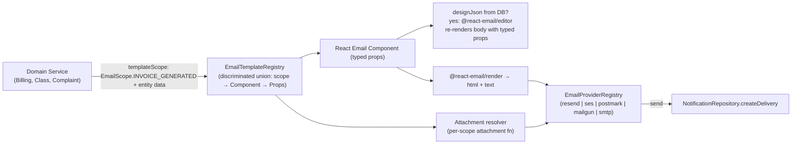

## Email Template System — Implementation Plan

### Library decision (rooted in research + your decisions; verified deep online research 2026-08-01)

**Adopt [React Email v6](https://react.email) (`react-email@^6`) paired with [`@react-email/editor@^1.1`](https://react.email/docs/editor/overview).**

Install set (corrected after v6 research — `react-email@6` unified `@react-email/components` + `@react-email/render` INTO itself; only the editor and the dev-only preview-server package remain separate):
```sh
bun add react-email @react-email/editor@^1.1 @aws-sdk/client-ses postmark mailgun.js form-data nodemailer @types/nodemailer
# recommended for SES attachments (SES API v2 — simpler than v1 SendRawEmailCommand MIME):
bun add @aws-sdk/client-sesv2
# optional, only if running the standalone `react-email dev` preview server:
bun add -D @react-email/ui
```
Drop from the previous draft: `@react-email/components`, `@react-email/render`, `@react-email/ui` runtime, `@tiptap/*` (bundled transitively by `@react-email/editor`).

This is the **only** library that simultaneously delivers all four user requirements:

1. **Type-safe template params**: React Email templates are React components with typed props (`EmailProps` interface). The registry is a hand-rolled discriminated-union mapped type keyed by a backend `EmailScope` enum (see [TypeScript#47109](https://github.com/microsoft/TypeScript/pull/47109) pattern below) — compile-time exhaustiveness, no string unions, never collapses to `never`.
2. **Per-template scopes**: We define a backend `EmailScope` enum (one entry per sending service). Each scope key in the registry carries its `Props` type referencing existing `backend/types/{entity}.types.ts` selection types (`InvoiceReturnType`, `ClassReturnType`, etc.).
3. **Images + attachments**: `react-email` `` for remote/inline images; Resend/Nodemailer/SES adapter attachments API supports `contentId` for `cid:` inline images and buffered/base64 attachments (max 40 MB per Resend; **10 MB outbound cap for SES**; Mailgun uses top-level `inline` field with `Content-ID` derived from filename; Postmark is base64-string-only). Resend: named export `import { Resend } from "resend"`; send payload type is `CreateEmailOptions` with camelCase attachment fields (`contentType`, `contentId` — inline images set via `contentId`, no `inline` boolean). Existing `ResendEmailAdapter.ts` does NOT yet plumb `attachments`/`text`/`cc`/`bcc`/`replyTo`/`headers` — extend it when building the multi-provider registry.
4. **Config/edit/create/update/view in admin UI**: `@react-email/editor` is the embeddable TipTap-based visual editor. Important: the editor edits an **opaque TipTap `JSONContent` blob** carrying no per-template type information — typed props live in the code scaffold (`backend/services/communication/templates/components/*`); the DB override re-renders body regions only and typed props are still passed from the registry at render time. Templates are stored in DB with `designJson` + compiled `htmlBody`, edited via GraphQL mutations, previewed before send. `EmailEditorRef` API (verified in `node_modules`): `getJSON(): JSONContent`, `getEmail(): Promise<{ html, text }>`, `getEmailHtml()`, `getEmailText()`, `editor: Editor | null`.

Rejected alternatives (rationale):
- **MJML** — untyped XML, breaks "no text union types, only enums + TS types" requirement; lacks in-app visual editor.
- **Unlayer `react-email-editor`** — freemium SaaS-dependent, dumps JSON+HTML not React Email typed components; violates "typesafe registry" goal.
- **`@devhiteshk/email-template-editor`** — MUI-themed but unmaintained fork; does not produce React Email output.
- **`react-email-handlebars`** — only needed if you want DB-stored dynamic content with runtime variable substitution. Our `EmailScope` enum + typed-props registry gets type safety **at the registry layer**; for body-only edits we store the visual editor's serialized HTML separately (template scaffolding stays typed in code).



### Scope enum design (your "template must correspond to one service enum" + "register defines entities per template")

New: [`backend/enum/email/emailTemplates.enum.ts`](backend/enum/email/emailTemplates.enum.ts)

```ts
export enum EmailScope {
  // one entry per sending service / event that wants email
  COMPLAINT_RESPONSE = "COMPLAINT_RESPONSE",
  SUGGESTION_ACKNOWLEDGED = "SUGGESTION_ACKNOWLEDGED",
  INVOICE_GENERATED = "INVOICE_GENERATED",
  INVOICE_STATUS_CHANGED = "INVOICE_STATUS_CHANGED",
  PAYMENT_METHOD_CHANGED = "PAYMENT_METHOD_CHANGED",
  CLASS_LIFECYCLE = "CLASS_LIFECYCLE",        // class scheduled/completed/cancelled/...
  STUDENT_LIFECYCLE = "STUDENT_LIFECYCLE",     // reassigned/status-changed/quota
  LESSON_REPORT_SUBMITTED = "LESSON_REPORT_SUBMITTED",
  LESSON_REPORT_REVIEWED = "LESSON_REPORT_REVIEWED",
  CLASS_REMINDER = "CLASS_REMINDER",
  // account flows (NEW — currently missing)
  WELCOME = "WELCOME",
  PASSWORD_RESET = "PASSWORD_RESET",
  EMAIL_VERIFICATION = "EMAIL_VERIFICATION",
}

export enum EmailEditorPermission {
  ADMIN = "ADMIN",
  STAFF = "STAFF",
  SUPERVISOR = "SUPERVISOR",
}

export enum EmailTemplateStatus {
  DRAFT = "DRAFT",
  PUBLISHED = "PUBLISHED",
  ARCHIVED = "ARCHIVED",
}
```

Note: `EmailScope` differs from existing `NotificationEventType` ([backend/enum/notifications/notificationDeliveries.enum.ts](backend/enum/notifications/notificationDeliveries.enum.ts)). The notification event carries the *trigger*; the email scope carries the *template family*. Many events map to one scope (e.g., all class lifecycle events share `EmailScope.CLASS_LIFECYCLE` because they share one template layout that branches on event kind).

### Typed template registry (the heart of type safety)

New: [`backend/services/communication/templates/email-template.registry.tsx`](backend/services/communication/templates/email-template.registry.tsx)

The original draft used `EmailTemplateProps<S> = Parameters<(typeof EMAIL_TEMPLATES)[S]["component"]>[0]` inside an `as const` literal with per-entry `satisfies`. Research ([TypeScript#47109](https://github.com/microsoft/TypeScript/pull/47109), validated against tsgo 7.0.2) shows this collapses to the **intersection of all prop interfaces** — effectively `never` for non-overlapping props. The corrected pattern requires a declarative `EmailPropsByScope` base map + an explicit mapped type + a `defineEmailTemplate<P>` helper, then re-binds through the mapped type. Adding an `EmailScope` case requires adding an entry to both `EmailPropsByScope` and the literal — that's the exhaustiveness guarantee.

```tsx
import type { ComponentType } from "react";
import { EmailScope, EmailEditorPermission } from "@/backend/enum/email";
import type { AttachmentInput } from "@/backend/types/email/email.types";
import type { ComplaintReturnType, InvoiceReturnType } from "@/backend/types";
// React Email components imported with the v6 single-package import path:
import { ComplaintResponseEmail, InvoiceGeneratedEmail } from "./components";

// 1. Per-scope typed props (only enums + TS types — no string unions)
export interface ComplaintResponseEmailProps {
  parentName: string;
  complaint: ComplaintReturnType;        // related entity
  responseText: string;
  respondedAt: Date;
}
export interface InvoiceGeneratedEmailProps {
  invoice: InvoiceReturnType;            // related entity
  recipientName: string;
}
// …one interface per remaining EmailScope case…

// 2. Shape of every registry entry, generic in its own props P.
export interface EmailTemplateDefinition<P> {
  readonly component: ComponentType<P>;
  readonly subject: (props: P, locale: string) => string;
  readonly defaultEditorPermissions: readonly EmailEditorPermission[];
  readonly attachments?: (props: P, locale: string) => Promise<readonly AttachmentInput[]>;
  readonly defaultLocaleTexts: (locale: string) => { readonly greeting: string; readonly footer: string };
}

// 3. THE KEY STEP — declarative map from EmailScope case to its props interface.
//    This is the "base mapping" that #47109 needs. Adding an EmailScope case
//    REQUIRES an entry here — that's the exhaustiveness guarantee.
export interface EmailPropsByScope {
  readonly [EmailScope.COMPLAINT_RESPONSE]: ComplaintResponseEmailProps;
  readonly [EmailScope.INVOICE_GENERATED]: InvoiceGeneratedEmailProps;
  // …one mapping per remaining EmailScope case…
}

// 4. Mapped-type view of the registry. Indexing this with generic S yields
//    EmailTemplateDefinition<EmailPropsByScope[S]> — the correlated narrowing
//    TS could NOT see from a structural literal alone.
export type EmailTemplateRegistry = {
  readonly [S in EmailScope]: EmailTemplateDefinition<EmailPropsByScope[S]>;
};

// 5. Per-entry builder: keeps inline `satisfies` validation AND per-entry
//    intellisense on `subject` / `attachments` / `defaultLocaleTexts` callbacks.
export function defineEmailTemplate<P>(
  def: EmailTemplateDefinition<P>,
): EmailTemplateDefinition<P> {
  return def;
}

// 6. Structural literal with per-entry builder. Computed enum-member keys are
//    single literal types (TypeScript#13948) — preserved as named properties.
const _EMAIL_TEMPLATES = {
  [EmailScope.COMPLAINT_RESPONSE]: defineEmailTemplate<ComplaintResponseEmailProps>({
    component: ComplaintResponseEmail,
    subject: (p, _l) => `Re: ${p.complaint.title}`,
    defaultEditorPermissions: [EmailEditorPermission.ADMIN],
    attachments: async (p, _l) => [{ filename: "response.pdf", content: Buffer.from(p.responseText) }],
    defaultLocaleTexts: (_l) => ({ greeting: "Dear parent,", footer: "Siraj Academy" }),
  }),
  [EmailScope.INVOICE_GENERATED]: defineEmailTemplate<InvoiceGeneratedEmailProps>({
    component: InvoiceGeneratedEmail,
    subject: (p, _l) => `Invoice ${p.invoice.number}`,
    defaultEditorPermissions: [EmailEditorPermission.ADMIN, EmailEditorPermission.STAFF],
    defaultLocaleTexts: (_l) => ({ greeting: "Dear parent,", footer: "Siraj Academy" }),
  }),
  // …one entry per remaining EmailScope case…
} as const satisfies EmailTemplateRegistry;
//   ↑ `as const satisfies EmailTemplateRegistry` (in that order) — the
//     documented-safe idiom (https://typescriptworld.com/typescript-satisfies-operator-deep-dive).
//     Order matters; reversing would error.

// 7. THE SECOND KEY STEP — re-bind the literal through the mapped type
//    annotation. `_EMAIL_TEMPLATES` has the structural shape; `EMAIL_TEMPLATES`
//    has the *mapped-type* representation TS needs to follow the S↔P
//    correlation during generic indexing. (mirrors jcalz's `_verbs`→`verbs`
//    rename pattern from #47109.)
export const EMAIL_TEMPLATES: EmailTemplateRegistry = _EMAIL_TEMPLATES;

// 8. Per-scope props via indexed access into EmailPropsByScope — directly.
//    No `Parameters<…>` unwrap needed (TS treats such generic unwraps as
//    opaque). Adds `ComponentProps<EmailTemplateRegistry[S]["component"]>`
//    alias for parity.
export type EmailTemplateProps<S extends EmailScope> = EmailPropsByScope[S];

// 9. renderEmailTemplate now type-checks inside its body AND narrows
//    correctly at call sites.
export async function renderEmailTemplate<S extends EmailScope>(
  scope: S,
  props: EmailTemplateProps<S>,
  locale: string,
  opts?: { readonly designJsonOverride?: string },
): Promise<{ readonly html: string; readonly text: string; readonly subject: string; readonly attachments: readonly AttachmentInput[] }> {
  const def: EmailTemplateDefinition<EmailPropsByScope[S]> = EMAIL_TEMPLATES[scope];
  //  ↑ indexed access into the MAPPED TYPE — TS keeps correlation

  const subject = def.subject(props, locale); // ✅ props is EmailPropsByScope[S]
  const attachments = def.attachments ? await def.attachments(props, locale) : [];
  // … then either render @react-email component or rehydrate DB designJson:
  //   const html = await render(<def.component {...props} />);
  //   const text = toPlainText(html);
  // If opts.designJsonOverride is present, the @react-email/editor serialized
  // JSON re-renders the body regions only — typed props still drive the
  // scaffold header/footer/subject/attachments.
  return { html: "", text: "", subject, attachments };
}
```

This pattern satisfies: typesafe, no text unions, only enums/types, each scope has its related entities, only registered scopes sendable. Relies on [microsoft/TypeScript#47109](https://github.com/microsoft/TypeScript/pull/47109) (mapped-type + base-map recipe); validated against `tsgo` 7.0.2 — full parity with TS 6.0/5.9 type checker (see [research file 06](.ai/plans/email-templates/reserch/06-typed-registry-pattern.md)).

**Note on the editor's role**: `@react-email/editor`'s `getJSON()` returns opaque TipTap `JSONContent` — typed component props never enter the editor. Body-only edits preserve typed-props only via application-layer discipline (route-level UI restricts editing to body regions; the code scaffold's typed props still drive subject/attachments/header/footer at render time).

**Compile-time guard test**: add [`backend/services/communication/templates/__tests__/email-template.registry.types.test.ts`](backend/services/communication/templates/__tests__/email-template.registry.types.test.ts) containing `// @ts-expect-error` assertions on wrong-scope calls and `satisfies` checks on right-scope calls so any TS upgrade silently breaking the narrowing will fail the build.

### Multi-provider registry (your "multi-provider swappable from env")

Refactor [`backend/services/communication/channels/email/EmailChannelFactory.ts`](backend/services/communication/channels/email/EmailChannelFactory.ts) into a provider registry. The makerkit `@kit/shared/registry` `createRegistry` API referenced in research is **makerkit's private monorepo workspace package — not on npm**; we lift ~30 LOC of the source into our own [`backend/lib/registry.ts`](backend/lib/registry.ts) (it's generic enough to reuse for SMS/Push/FX provider registries later). The full `createRegistry<IEmailChannel, EmailProviderName>()` semantics are documented in [research file 05](.ai/plans/email-templates/reserch/05-provider-registry-pattern.md).

`EmailProviderName` lives in canonical location per [backend/types/AGENTS.md](backend/types/AGENTS.md) — move to [`backend/types/email/emailChannel.types.ts`](backend/types/email/emailChannel.types.ts) alongside `IEmailChannel` / `EmailPayload` / `EmailSendResult` (currently mislocated in the service layer).

New: [`backend/services/communication/channels/email/EmailProviderRegistry.ts`](backend/services/communication/channels/email/EmailProviderRegistry.ts)

```ts
import { createRegistry } from "@/backend/lib/registry";
import type { EmailProviderName, IEmailChannel } from "@/backend/types/email/emailChannel.types";

export const emailProviderRegistry = createRegistry<IEmailChannel, EmailProviderName>();

emailProviderRegistry
  .register("resend",   async () => new ResendEmailAdapter(await loadResendConfig()))   // returns this (chainable)
  .register("ses",      async () => new SesEmailAdapter(await loadSesConfig()))
  .register("postmark", async () => new PostmarkEmailAdapter(await loadPostmarkConfig()))
  .register("mailgun",  async () => new MailgunEmailAdapter(await loadMailgunConfig()))
  .register("smtp",     async () => new SmtpEmailAdapter(await loadSmtpConfig()));

export async function getEmailChannel(): Promise<IEmailChannel> {
  const provider = (await resolveEnvConfig("EMAIL_PROVIDER") ?? "resend") as EmailProviderName;
  // emailProviderRegistry.get(provider) returns Promise<IEmailChannel> — always await.
  // THROWS `Unknown provider "<name>"` on unregistered names (today's EmailChannelFactory
  // falls back to Resend — the new behavior breaks explicitly with a throw).
  return emailProviderRegistry.get(provider);
}

// preserve resetEmailChannel cache-invalidation semantics from the current factory
export async function resetEmailChannel(): Promise<void> {
  invalidateEnvConfigCache("EMAIL_PROVIDER");
  invalidateEnvConfigCache("RESEND_API_KEY");
  invalidateEnvConfigCache("RESEND_FROM_EMAIL");
  // (add SES / Postmark / Mailgun / SMTP env keys for each new provider)
  (await emailProviderRegistry.peek("resend"))?.disconnect?.();
}
```

`emailChannel` facade wrapper shape unchanged (already used throughout services); make sure `getEmailChannel()` is awaited since `get()` is async.

Adapters to implement (each is realistically ~200 LOC, not the originally-stated ~80 LOC, once attachments + inline-image handling + delivery-row bookkeeping are included):
- `backend/services/communication/channels/email/resend/ResendEmailAdapter.ts` — **extend existing adapter** (not rewrite): `import { Resend } from "resend"` (named export, not default); `resend.emails.send(payload: CreateEmailOptions)`; attachment fields are camelCase (`contentType`, `contentId` — inline via `contentId`, no `inline` boolean). Today only sends `from`/`to`/`subject`/`html` — add `text`, `attachments`, `cc`, `bcc`, `replyTo`, `headers` from expanded `EmailPayload`.
- `backend/services/communication/channels/email/ses/SesEmailAdapter.ts` — **choose one path** (installed today: `@aws-sdk/client-ses@3.x` = SES API **v1**, which does NOT support `Content.Simple.Attachments[]` on `SendEmailCommand`):
  - **(a) Recommended**: `bun add @aws-sdk/client-sesv2` and use SESv2 `SendEmailCommand` with `Content.Simple.Attachments[]` (`RawContent: Uint8Array`, `FileName`, optional `ContentType`/`ContentDisposition`/`ContentId`). Outbound cap is **10 MB** (not 40 MB).
  - **(b) Stay on v1**: use `SendRawEmailCommand` with hand-built `multipart/mixed` MIME for **all** attachments (`RawMessage.Data: Uint8Array`), regardless of size.
  - Both paths: use `@smithy/fetch-http-handler` for Bun compatibility (avoids Bun 1.3.x HTTPS-hang #26066).
- `backend/services/communication/channels/email/postmark/PostmarkEmailAdapter.ts` — `postmark` npm; attachments are **base64-string only** (convert Buffers via `.toString("base64")`); check `response.ErrorCode === 0` for soft failures.
- `backend/services/communication/channels/email/mailgun/MailgunEmailAdapter.ts` — `mailgun.js` + `form-data`; two-stage init: `const mg = new Mailgun(FormData).client({ username: "api", key, url?, public_key? })` (pass the `form-data` **class**, not options); send via `mg.messages.create(domain, data)` only (no `.send()`); `inline` is a **top-level field** on the send call with `Content-ID` derived from the filename (NOT a `contentId` field on each attachment). Map `EmailAttachment → { data, filename, contentType }`.
- `backend/services/communication/channels/email/smtp/SmtpEmailAdapter.ts` — `nodemailer` + `@types/nodemailer`; `@types/nodemailer@8.0.1` types `encoding` as bare `string` (not a literal union) — declare adapter-level literal union and cast before passing to nodemailer if compile-time enforcement is desired. Has historical Bun SMTP flakiness (#10329) — prefer API providers in production.

Move `IEmailChannel`, `EmailPayload`, `EmailSendResult`, `EmailProvider` / `EmailProviderName` types to canonical location per [backend/types/AGENTS.md](backend/types/AGENTS.md):
[`backend/types/email/emailChannel.types.ts`](backend/types/email/emailChannel.types.ts)

Extend `EmailPayload` to carry attachments + inline image CIDs:
```ts
export interface EmailPayload {
  readonly to: string;
  readonly subject: string;
  readonly html: string;
  readonly text?: string;
  readonly eventType: NotificationEventType;
  readonly userId: string;
  readonly metadata?: NotificationMetadata | null;
  readonly attachments?: readonly EmailAttachment[];
}
// `content` is restricted to `Buffer` only to avoid the base64-vs-path-vs-text
// ambiguity across adapters (Resend, SES, Mailgun all interpret strings
// differently). Each adapter performs the encoding transformation it needs
// (e.g., Postmark runs `.toString("base64")`, Mailgun wraps buffer in form-data).
export interface EmailAttachment {
  readonly filename: string;
  readonly content: Buffer;
  readonly contentType?: string;
  readonly contentId?: string;               // for `">` inline images
  readonly encoding?: "base64" | "buffer";  // explicit discriminator for adapters that need it
}
```

### DB schema (NEW — currently zero email-template tables)

Repo is on `drizzle-orm 1.0.0-rc.4` (not the conservative "0.36+" framing — all schema patterns below verified against 1.0.0-rc.4 in [research file 07](.ai/plans/email-templates/reserch/07-drizzle-schema-patterns.md)).

**Pre-requisite subtask** — the `emailScopeEnum` / `emailTemplateStatusEnum` / `emailEditorPermissionEnum` Drizzle pg-enums referenced in the schema below **do not yet exist**. Add them to [`backend/db/schema/enums.ts`](backend/db/schema/enums.ts) using the repo's existing `createPgEnumFromEnum` helper (it generates the pgEnum from a backing TS enum — see how `notificationChannelEnum` is built from the `NotificationChannel` TS enum). This is part of the Task #2 (enum) subtask — make sure the enum file gets created first.

The repo has **zero** existing `.array()` columns today; first-time use of array-of-enum in this repo is a risk. Safer, idiomatic-to-this-repo choice for `allowedEditorGroups` is `jsonb.$type<readonly EmailEditorPermission[]>()` rather than `emailEditorPermissionEnum("...").array()` (the array-of-pgEnum pattern works but isn't used elsewhere in the codebase). Use the `jsonb` form unless the team specifically prefers the typed array column.

New file: [`backend/db/schema/communications/emailTemplates.ts`](backend/db/schema/communications/emailTemplates.ts) — note the additional required imports (`integer`, `uniqueIndex`) beyond what the original stub mentioned:

```ts
import { sql } from "drizzle-orm";
import { boolean, integer, jsonb, pgTable, text, timestamp, uniqueIndex, uuid, varchar } from "drizzle-orm/pg-core";
import { users } from "@/backend/db/schema";
import { emailScopeEnum, emailTemplateStatusEnum } from "@/backend/db/schema/enums";
import { EmailEditorPermission } from "@/backend/enum/email";
import type { EmailAttachmentRules } from "@/backend/types/email/email.types";

export const emailTemplates = pgTable("email_templates", {
  id: uuid("id").defaultRandom().primaryKey(),
  scope: emailScopeEnum("scope").notNull(),                    // EmailScope
  name: varchar("name", { length: 255 }).notNull(),
  slug: varchar("slug", { length: 255 }).notNull(),            // friendly URL id
  status: emailTemplateStatusEnum("status").notNull().default("DRAFT"),
  // admin-editable body (from @react-email/editor)
  designJson: jsonb("design_json"),                             // serialized TipTap JSONContent blob (opaque)
  compiledHtml: text("compiled_html"),                         // last-rendered HTML cache
  compiledText: text("compiled_text"),                          // plain-text version
  // per-template config
  defaultFromName: varchar("default_from_name", { length: 255 }),
  defaultFromEmail: varchar("default_from_email", { length: 255 }),
  // Idiomatic-to-repo choice (no existing .array() columns): JSONB typed array.
  // Alternatives (per research file 07): `emailEditorPermissionEnum("...").array()`
  // works since drizzle-kit 0.24 but is first-time-use in this repo.
  allowedEditorGroups: jsonb("allowed_editor_groups").$type<readonly EmailEditorPermission[]>().notNull(),
  // attachments / images configuration
  attachmentRules: jsonb("attachment_rules").$type<EmailAttachmentRules>(),
  // versioning + i18n
  locale: varchar("locale", { length: 10 }).notNull().default("en"),
  version: integer("version").notNull().default(1),
  parentTemplateId: uuid("parent_template_id").references(() => emailTemplates.id), // for locale variants
  isActive: boolean("is_active").notNull().default(true),
  createdBy: uuid("created_by").references(() => users.id),
  createdAt: timestamp("created_at", { withTimezone: true, precision: 3 }).notNull().defaultNow(),
  updatedAt: timestamp("updated_at", { withTimezone: true, precision: 3 }).notNull().defaultNow(),
}, (t) => [
  uniqueIndex("email_templates_scope_slug_uq").on(t.scope, t.slug),
  // Partial unique: only one active row per (scope, locale). Use sql`` literal
  // (not eq(t.isActive, true)) — eq() produces a parameterized placeholder that
  // breaks drizzle-kit migration generation (issues #3349, #4790).
  uniqueIndex("email_templates_scope_locale_active_uq")
    .on(t.scope, t.locale)
    .where(sql`${t.isActive} = true`),
]);

export const emailTemplateRevisions = pgTable("email_template_revisions", {
  id: uuid("id").defaultRandom().primaryKey(),
  templateId: uuid("template_id").notNull().references(() => emailTemplates.id, { onDelete: "cascade" }),
  version: integer("version").notNull(),
  designJson: jsonb("design_json").notNull(),
  compiledHtml: text("compiled_html").notNull(),
  editedBy: uuid("edited_by").references(() => users.id),
  editedAt: timestamp("edited_at", { withTimezone: true, precision: 3 }).notNull().defaultNow(),
});
```

Run a `drizzle generate` later via the `drizzle-generate` skill workflow (NOT part of this plan — runtime dictate).

### Backend types (canonical pattern)

New: [`backend/types/email/email.types.ts`](backend/types/email/email.types.ts) — applying the `{Entity}{Select,Insert,Return,Submit}Type` pattern:

- `EmailTemplateSelectType`, `EmailTemplateInsertType` — `$inferSelect` / `$inferInsert` from `emailTemplates`
- `EmailTemplateReturnType` — API-facing shape (joins: editor name, last revision)
- `EmailTemplateSubmitInput` — create/update input (DTO)
- `EmailAttachmentInput`, `EmailAttachmentRules`
- Include `id` field (Apollo cache normalization per AGENTS.md)

### Repository

New: [`backend/db/repo/email/email-template.repository.ts`](backend/db/repo/email/email-template.repository.ts)
- Standard repo methods: `getById`, `getByScopeAndLocale(scope, locale, { activeOnly })`, `list({ scopeFilter, statusFilter, pagination })`, `create`, `update`, `softDelete`, `createRevision`, `setActive`
- Use `queryDb(tx)` for non-transactional reads ([docs/drizzle/neon-http-client.md](docs/drizzle/neon-http-client.md))
- Add `findByScopeIds(scopes: EmailScope[], tx?)` returning `Map<EmailScope, EmailTemplateReturnType>` for DataLoader batching (Pothos list fields)
- Add `export * from "./email";` to [`backend/db/repo/index.ts`](backend/db/repo/index.ts) (new `email/` sub-dir)

### Service layer

New: [`backend/services/communication/email-template.service.ts`](backend/services/communication/email-template.service.ts)
- `EmailTemplateService.list`, `get`, `create`, `update`, `publish`, `archive`, `restore`
- `renderForSend(scope, props, locale)` — uses `renderEmailTemplate` from registry, checks DB for design-json override
- `sendTest(templateId, toEmail, sampleProps)` — admin preview sends
- `previewHtml(templateId, sampleProps)` — returns rendered HTML for admin iframe preview
- `resolveTemplatesByScopes(scopes: EmailScope[], locale)` — batch method returning `Map<EmailScope, EmailTemplateReturnType | null>` for GraphQL DataLoader batching ([backend/services/AGENTS.md](backend/services/AGENTS.md))
- Authorization: check `ctx.user` permission group against `template.allowedEditorGroups` (configurable per your "configurable, default set in registry")
- All user-facing errors via `getServerTranslations(locale).emailsTranslations.errors.*` ([backend/services/AGENTS.md](backend/services/AGENTS.md))

Refactor dispatcher at [`backend/services/communication/communication.service.ts:37`](backend/services/communication/communication.service.ts) — replace plain-text passthrough with template render:
```ts
case "email": {
  const emailScope = mapEventTypeToEmailScope(payload.eventType);
  if (!emailScope) return { channel: "email", success: false, error: "No email template registered" };
  const { html, text, subject, attachments } = await EmailTemplateService.renderForSend(
    emailScope, payload.templateProps ?? {}, locale
  );
  return await emailChannel.send({
    ...commonFields, subject: subject || payload.title, html, text, attachments,
  }, locale);
}
```

### GraphQL surface (NEW — none today)

Following single-canonical-object rule ([backend/AGENTS.md](backend/AGENTS.md)).

**Pre-requisite subtask (repo rule)** — Register the three new enums (`EmailScope`, `EmailTemplateStatus`, `EmailEditorPermission`) in [`backend/graphql/pothos/shared/enum.pothos.ts`](backend/graphql/pothos/shared/enum.pothos.ts) — enums are NOT registered inline in the per-entity Pothos file. Use `*PothosEnum` suffix per [backend/graphql/AGENTS.md](backend/graphql/AGENTS.md) positive examples: `EmailScopePothosEnum`, `EmailTemplateStatusPothosEnum`, `EmailEditorPermissionPothosEnum` (repo also has `*PothosObject` precedent for older enums — both compile). Import the registered Pothos enums into [`backend/graphql/pothos/email/emailTemplate.pothos.ts`](backend/graphql/pothos/email/emailTemplate.pothos.ts) as needed. Add `export * from "@/backend/graphql/pothos/email";` to [`backend/graphql/pothos/index.ts`](backend/graphql/pothos/index.ts). **Then run** `bun run generate:gqlSchema && bun codegen` so frontend codegen enums stay in sync ([backend/graphql/AGENTS.md](backend/graphql/AGENTS.md)).

Files to create:
- [`backend/graphql/pothos/email/emailTemplate.pothos.ts`](backend/graphql/pothos/email/emailTemplate.pothos.ts) — `EmailTemplatePothosObject` (canonical, single object type per repo rule), `EmailTemplateInputPothosObject`, `EmailTemplatePreviewPothosObject`. Use the repo's input pattern: `gqlSchemaBuilder.inputRef<EmailTemplateSubmitInput>("EmailTemplateInput").implement({...})` (per existing `notification-preferences.pothos.ts`).
- [`backend/graphql/query/email/emailTemplates.query.ts`](backend/graphql/query/email/emailTemplates.query.ts) — `emailTemplates(scope?, status?, pagination)` list + `emailTemplate(id)` query.
- [`backend/graphql/mutation/email/emailTemplate.mutation.ts`](backend/graphql/mutation/email/emailTemplate.mutation.ts) — **singular file name** per repo convention (matching the existing `backend/graphql/mutation/notifications/notification-preferences.mutation.ts` and `mark-notifications-read.mutation.ts` — that directory uses singular `.mutation.ts` for single mutations). Exposes: `createEmailTemplate`, `updateEmailTemplate`, `publishEmailTemplate`, `archiveEmailTemplate`, `sendTestEmail`. `sendTestEmail` IS a mutation (side-effect — sends live email).
- [`backend/graphql/query/email/emailTemplatePreview.query.ts`](backend/graphql/query/email/emailTemplatePreview.query.ts) — `previewEmailTemplate(templateId, sampleProps)` returns HTML string for iframe preview.

**Authorization placement** (verified — see [research file 08](.ai/plans/email-templates/reserch/08-pothos-patterns.md)):
- GraphQL field-level `authScopes` is set to `{ superAdmin: true, notImpersonating: true }` on all email-template mutations (write surface is super-admin only at the GraphQL layer).
- Per-template `allowedEditorGroups` enforcement belongs in the **service layer** (Pattern A — the service refuses the edit if the caller's permission group is not in `template.allowedEditorGroups`). The service performs the actual fine-grained permission check; GraphQL just gates the surface to super-admin actors who then act on behalf of editors.
- Pattern verified against the repo's existing `NotificationPreferencePothosObject` and `@pothos/core@^4.13.1` + `@pothos/plugin-scope-auth@^4.1.7`.

### Frontend

Follow the tier-neutral ViewModel + switcher + Container pattern per [frontend/common/views/AGENTS.md](frontend/common/views/AGENTS.md) and [frontend/NEW_PAGE_WORKFLOW.md](frontend/NEW_PAGE_WORKFLOW.md). **`frontend/views/dashboard/` is DEPRECATED** — all new code goes under `frontend/common/views/dashboard/<domain>/` + tier files in `frontend/mobile/views/` and `frontend/desktop/views/`.

**Common layer** (`frontend/common/views/dashboard/email-templates/`):
- `useEmailTemplatesListViewModel.ts` — list/filter/pagination logic (viewport-agnostic)
- `EmailTemplatesListView.tsx` — switcher (`createLazyView` + `ResponsiveViewSwitch`)
- `EmailTemplatesListContainer.tsx` — calls hook, wraps in `<RequirePermission>`
- `useEmailTemplateEditorViewModel.ts` — editor save/preview/send-test logic
- `EmailTemplateEditorView.tsx` — switcher
- `EmailTemplateEditorContainer.tsx` — calls hook, wraps in `<RequirePermission>`
- `types/` — label slices (`Pick` from `@/shared/locale/types/...` per Rule 7)

**Mobile tier** (`frontend/mobile/views/dashboard/email-templates/`):
- `emailTemplatesList.mobile.tsx` — pure presentation (no business logic, no `useMediaQuery`/`useViewport`)
- `emailTemplateEditor.mobile.tsx` — mounts `@react-email/editor` for visual body editing

**Desktop tier** (`frontend/desktop/views/dashboard/email-templates/`):
- `emailTemplatesList.desktop.tsx`
- `emailTemplateEditor.desktop.tsx` — mounts `@react-email/editor`; left pane for properties (scope locked, from enum), subject template editor, attachment rules, locale/version selector, allowed editor groups (chip selector from `EmailEditorPermission` enum), preview button → calls `previewEmailTemplate` query, renders in `<iframe sandbox>`, "Send Test Email" action button

**Editor wrapper requirements** (verified — see [research file 10](.ai/plans/email-templates/reserch/10-editor-mui-nextjs-interop.md)):
  - Add `'use client'` directive on the **tier view file** that mounts the editor (e.g. `emailTemplateEditor.desktop.tsx`) — TipTap is browser-only and touches `window` at module load.
  - Wrap `EmailEditor` import via `next/dynamic` at **module top level** in the tier view file: `const EmailEditor = dynamic(() => import('@react-email/editor').then(m => m.EmailEditor), { ssr: false })` — **REQUIRED**, not optional (without `ssr: false` the SSR pass throws on TipTap's `window` access).
  - Save flow: hold a `ref<EmailEditorRef>`; on save call `ref.current?.getJSON()` for `designJson` and `await ref.current?.getEmail()` (or `getEmailHtml()`/`getEmailText()` separately) for compiled output.
  - Wrap the editor in MUI v9's `ScopedCssBaseline` (not the global `CssBaseline`) — the global `CssBaseline` reset breaks TipTap's prose styling. Import editor CSS **after** MUI global CSS to avoid the MUI reset overriding ProseMirror styling: e.g. `import '@mui/material/styles'; /* then */ import '@react-email/editor/themes/default.css'`.
  - Two theming layers, verified by name:
    - **Layer A (editor chrome)** — `--re-bg`, `--re-text`, `--re-text-muted`, `--re-border`, `--re-hover`, `--re-active`, `--re-radius`, `--re-radius-sm` (CSS custom properties control bubble menu / slash command / Inspector visuals).
    - **Layer B (emailed HTML output)** — JS `EmailTheming.configure({ theme })` API. `--re-*` CSS vars **do NOT** affect the emailed HTML — only the in-editor chrome. The emailed HTML output inherits theme tokens from the `EmailTheming` plugin.
  - Known Turbopack dev-compile slowdown with Prism.js grammars bundled by the editor; budget the editor page for slower initial dev compile.

**GraphQL documents** — new sub-dir [`frontend/common/graphql/sharedDocuments/email/`](frontend/common/graphql/sharedDocuments/email/):
- `documents.ts` — `EmailTemplateQueryDocument`, `EmailTemplatesQueryDocument`, `EmailTemplateUpsertMutationDocument`, `PublishEmailTemplateMutationDocument`, `SendTestEmailMutationDocument`, `PreviewEmailTemplateQueryDocument`
- `index.ts` — `export * from "./documents";`
- Add `export * from "./email";` to [`frontend/common/graphql/sharedDocuments/index.ts`](frontend/common/graphql/sharedDocuments/index.ts)
- **Every selection set MUST include `id`** on every named object type (Apollo cache normalization per [frontend/common/graphql/sharedDocuments/AGENTS.md](frontend/common/graphql/sharedDocuments/AGENTS.md))
- **Then run** `bun run generate:gqlSchema && bun codegen`

**Apollo hooks** (`useQuery` from `@apollo/client/react`, **no** `useLazyQuery` per [frontend/AGENTS.md](frontend/AGENTS.md))

**Admin routes** — follow existing `(dashboard)` group pattern (locale from `getLocale()` cookie, NOT a `[locale]` URL segment per [app/AGENTS.md](app/AGENTS.md)):
- `app/(dashboard)/email-templates/page.tsx` — list page
- `app/(dashboard)/email-templates/[id]/page.tsx` — editor page

Each `page.tsx` must call `requirePermissionForPage(userId, [AppPermission.<TBD>], locale, context)` before rendering the Container (mirror [`app/(dashboard)/payment-catalogs/page.tsx`](app/(dashboard)/payment-catalogs/page.tsx)). Keep client `<RequirePermission>` in the Container as defense-in-depth. GraphQL mutations additionally gate via `authScopes: { superAdmin: true, notImpersonating: true }`.

**Zustand store**: [`frontend/common/stores/emailTemplateEditorStore.ts`](frontend/common/stores/emailTemplateEditorStore.ts) — mutable editor state (filters, dialog open, locale/version selector). **Serialization rule**: do NOT store `File`/`Blob`/`FormData`/`Promise` in `persist`-enabled stores; keep non-serializable editor refs in `useRef` inside the ViewModel hook.

**Storybook stories**: co-located with tier views — `emailTemplatesList.desktop.stories.tsx`, `emailTemplateEditor.desktop.stories.tsx` (and mobile variants)

### i18n (compile-time system — extends existing pattern)

Existing call signature is **`getServerTranslations(locale)`** (single-arg) and it returns synchronously (existing usage at [backend/services/communication/templates/email-templates.ts:32](backend/services/communication/templates/email-templates.ts) calls it without `await`). Backend templates import from `@/shared/locale` — this is the canonical reverse direction; `shared/AGENTS.md` bans only `shared → backend` (one-directional). Research confirms (see [research file 09](.ai/plans/email-templates/reserch/09-i18n-react-email-interop.md)).

Extend [`shared/locale/types/emails/index.ts`](shared/locale/types/emails/index.ts) with full per-scope labels:
- New `SubjectArgs` per scope, e.g. `ComplaintResponseEmailLabels.subject` already takes `{ complaintTitle }` — extend to all scopes (the file currently only defines `EmailLabels` for 2 of the ~13 scopes above).
- **Add a new `errors` sub-namespace** under `EmailsLabels` — does NOT exist today. Shape:
  ```ts
  export interface EmailsErrorLabels {
    readonly templateNotFound: (scope: string) => string;
    readonly templateNotPublished: (scope: string) => string;
    readonly unauthorizedEditor: () => string;
    readonly invalidDesignJson: () => string;
    readonly attachmentTooLarge: (max: number) => string;
    readonly invalidLocale: (locale: string) => string;
  }
  ```
  Add the `errors: EmailsErrorLabels` field to `EmailsLabels`, then implement it in [shared/locale/en/emails/index.ts](shared/locale/en/emails/index.ts) (`emailsEn.errors.*`) and [shared/locale/ar/emails/index.ts](shared/locale/ar/emails/index.ts) (`emailsAr.errors.*`). The `emailsTranslations` namespace is **already wired** via [`shared/locale/namespaces/emails/emails.namespace.ts`](shared/locale/namespaces/emails/emails.namespace.ts) (`defineNamespace`) and exported in [`shared/locale/namespaces/translation.ts`](shared/locale/namespaces/translation.ts) — no separate `namespacePaths` or `MessageSchema` registration needed; extending `EmailsLabels` + en/ar impls is sufficient.
- All service-layer error messages use the corrected call shape: `getServerTranslations(locale).emailsTranslations.errors.<...>` (NOT `getServerTranslations(locale, "emails.errors")` — that two-arg signature does not exist).
- Update English ([shared/locale/en/emails/index.ts](shared/locale/en/emails/index.ts)) and Arabic ([shared/locale/ar/emails/index.ts](shared/locale/ar/emails/index.ts)) implementations — every per-scope interface (`InvoiceGeneratedEmailLabels`, `SuggestionAcknowledgedEmailLabels`, `ClassLifecycleEmailLabels`, `StudentLifecycleEmailLabels`, `LessonReportEmailLabels`, `WelcomeEmailLabels`, `PasswordResetEmailLabels`, `EmailVerificationEmailLabels`, etc.) must be added with full en + ar implementations.

Inline-image / attachment labels use the same localized footer pattern.

### React Email template components (scaffolds — code-versioned, NOT admin-editable)

New directory: [`backend/services/communication/templates/components/`](backend/services/communication/templates/components/)

- `ComplaintResponseEmail.tsx` — typed-props scaffold (replaces orphaned `renderComplaintResponseEmail` HTML); React Email primitives imported from the **unified `react-email` package** (not `@react-email/components`): `import { Html, Head, Body, Container, Section, Img, Text, Button, Hr } from "react-email"`.
- Repeat for each `EmailScope`: `InvoiceGeneratedEmail`, `SuggestionAcknowledgedEmail`, `ClassLifecycleEmail`, `StudentLifecycleEmail`, `LessonReportEmail`, `WelcomeEmail`, `PasswordResetEmail`, `EmailVerificationEmail`
- All components call `getServerTranslations(locale).emailsTranslations.<scope>` (server-safe, synchronous — confirmed by existing usage at [backend/services/communication/templates/email-templates.ts:32](backend/services/communication/templates/email-templates.ts)).
- Body regions are overridable by the DB `designJson` (rendered via `@react-email/editor`); header/footer/subject/attachments come from the typed scaffold.
- Use theme palette (cyan/teal palette from [frontend/THEME_PALETTE.md](frontend/THEME_PALETTE.md)) — colors passed as props from registry to component. Theme tokens reach the emailed HTML output via the `EmailTheming` plugin (research file 10) — not by raw `--re-*` CSS vars which only affect the in-editor chrome.

### Render pipeline (`@react-email/render` API, v6-corrected)

The `render` function is now imported from the unified `react-email` package (NOT `@react-email/render`). It is **async** and returns `Promise<string>`:
```ts
import { render, pretty, toPlainText } from "react-email";

// render the component to HTML (await)
const html = await pretty(await render(<def.component {...props} />));
// toPlainText consumes the rendered HTML string (sync)
const text = toPlainText(html);
```
The historical `renderAsync` API was removed when `render` became async — don't reference it. The `pretty` / `toPlainText` are standalone helpers, not options on `render()`. For client-side render (e.g. preview iframe in admin), polyfill `ReadableByteStreamController` (`web-streams-polyfill`) for Safari/iOS support; not needed for SSR (Next.js Server Components) — research file 03.

### Logging & forbidden patterns

- Logger via `@/backend/lib/logger` ([AGENTS.md](AGENTS.md) — NEVER `console.*`)
- All hardcoded colors forbidden — theme palette threading
- No `next-intl` imports — compile-time TS i18n only
- No `any` props types; no text union types — only enums + Record<enum, component>
- File-scoped lint queue verification per AGENTS.md per-file subloop

### Migration / data

- Seed default templates via `bun db seed` — one `emailTemplates` row per `EmailScope` per locale with compiled HTML from the React Email components. Follow [backend/db/seeds/AGENTS.md](backend/db/seeds/AGENTS.md):
  - File: [`backend/db/seeds/notifications/seed-email-templates.ts`](backend/db/seeds/notifications/seed-email-templates.ts) (grouped with other notification-domain seeders)
  - Export: `export async function seedOrGet(...)` (required naming convention)
  - **MUST NOT** import `@/backend/db/**` (schema/repo/drizzleDb) — ESLint enforced; persist via `EmailTemplateService` bootstrap methods (add `upsertManyEmailTemplates` / `findEmailTemplatesByScopes` to service if missing)
  - Add `export { seedOrGet as seedOrGetEmailTemplates } from "./seed-email-templates";` to [`backend/db/seeds/notifications/index.ts`](backend/db/seeds/notifications/index.ts)
  - Add orchestration call to master [`backend/db/seeds/index.ts`](backend/db/seeds/index.ts) in correct dependency order
- Keep existing `notificationsTranslations` namespace for ON_APP + SMS + PUSH channels. Email channel lines the React Email `subject` + `html` pipeline
- Remove orphaned `renderXxxEmail` helpers after migration (they are not in any call path today per explore subagent)

### Test strategy

- Repo tests: `backend/db/test/repo/email/email-template.repository.test.ts` (100% coverage per backend/db/repo/AGENTS.md) — always `runInRollback`, never `rejects.toThrow` inside txn
- Service tests: `backend/services/communication/test/email-template.service.test.ts` — mock the channel facades, no real Resend (per [backend/services/AGENTS.md](backend/services/AGENTS.md))
- Registry type-safety test: ensure `EmailScope` exhaustiveness switches throw on unhandled scopes. Add a compile-time `email-template.registry.types.test.ts` containing `// @ts-expect-error` assertions on wrong-scope calls and `satisfies` checks on right-scope calls so any TypeScript upgrade silently breaking the narrowing will fail the build.
- Bun compatibility checks: `@react-email/editor` bundles TipTap 3.17.x as a direct dep — do NOT install `@tiptap/*` separately. SES adapter needs `@smithy/fetch-http-handler` to avoid Bun 1.3.x HTTPS-hang (#26066). Nodemailer has historical Bun SMTP flakiness (#10329) — prefer API providers in production. See [research file 11](.ai/plans/email-templates/reserch/11-bun-compatibility.md) and [node_modules verification summary](.ai/plans/email-templates/reserch_node/FINAL-NODE-VERIFICATION-SUMMARY.md).
- Integration smokes: extend [`test/integration/communication/resend.integration.test.ts`](test/integration/communication/resend.integration.test.ts) + add `ses.integration.test.ts` / `postmark.integration.test.ts` etc. gated behind `describeLiveWhen(hasSes, ...)`
- UI component tests under `test/ui/components/` per [test/ui/AGENTS.md](test/ui/AGENTS.md) — `emailTemplatesList.desktop.test.tsx`, `emailTemplateEditor.desktop.test.tsx` (Happy DOM, mocked Apollo)
- E2E test under `test/ui/e2e/` for the admin email-templates flow (requires `bun run build:test`)
- Use `bun run scripts/run-test/run-test.ts` for log capture on all DB tests

### Future WhatsApp alignment

Note `.ai/plans/whatsapp/implementation.md` exists. The provider-registry pattern is designed generically enough that an SMS channel registry (`smsProviderRegistry`) and WhatsApp channel can follow the same `createRegistry<ISmsChannel, SmsProviderName>` pattern. Do NOT block on this — keep the email registry self-contained.

### Phasing recommendation (not part of plan, just framing)

Phase 1 — Types + enum + registry + multi-provider adapter refactor (no UI, no DB template table). Existing notification bodies still passthrough. Get `renderEmailTemplate` working with code-only scaffolds.
Phase 2 — DB schema + repo + Pothos + GraphQL CRUD + admin list/edit view (using `@react-email/editor`).
Phase 3 — Migrate dispatcher email channel through `EmailTemplateService.renderForSend` for each `NotificationEventType → EmailScope` mapping. Wire attachments (e.g., invoice PDF for INVOICE_GENERATED).
Phase 4 — Auth/account emails (welcome, password reset, email verification) — currently missing entirely.