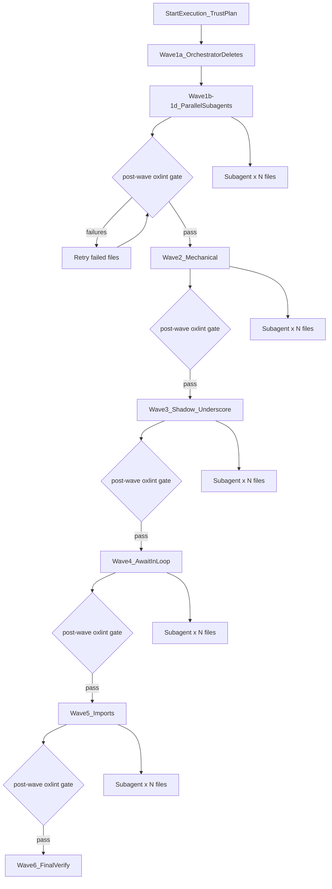
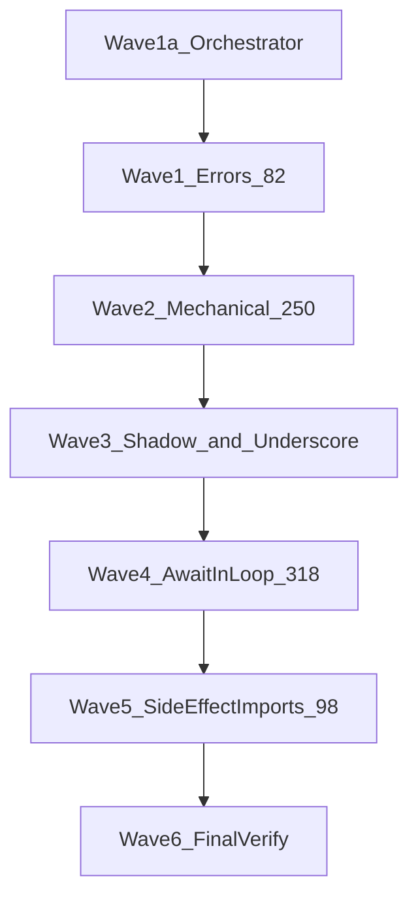

# Fix all `bun oxlint` issues (no rule disabling)

## EXECUTOR INSTRUCTIONS — TRUST THIS PLAN (read first)

**This plan is pre-verified. Do not re-run `bun oxlint` before starting execution.**

The baseline below was captured on **2026-08-07** by running `bun oxlint` against the repo. The inventory (870 findings / 383 files / rule breakdown) is **authoritative**. Executors and orchestrators must **trust these numbers** and begin at **Wave 1a** immediately — no discovery pass, no baseline re-scan, no “confirm the problem exists” step.

| Do | Don't |
|----|-------|
| Start execution at Wave 1a (empty-file cleanup) | Run `bun oxlint` before Wave 1 |
| Use the rule counts and file lists in this plan | Re-generate `.oxlint-baseline.json` unless Wave 6 final verify fails |
| Build `.oxlint-wave-manifest.json` from this plan's inventory (Wave 0) | Block on Wave 0 waiting for a fresh full-repo oxlint pass |
| Run `bun oxlint` only **after** each fix wave completes, and once at Wave 6 | Treat pre-execution oxlint as a gate |

**Why:** Re-running oxlint at plan start wastes time and signals distrust of a plan that already contains a complete, validated inventory. Execution begins with fixes, not re-diagnosis.

---
## Current baseline (pre-verified — do not re-scan)

**Status:** Verified 2026-08-07. **Trust this section; do not run oxlint to confirm it.**

Running `bun oxlint` at plan authoring time reported **870 findings across 383 files**, exit code **1**:

| Severity | Count |
|----------|------:|
| Errors   | 82    |
| Warnings | 788   |

**By layer:**

| Directory   | Findings |
|-------------|--------:|
| `backend/`  | 587     |
| `frontend/` | 179     |
| `scripts/`  | 57      |
| `test/`     | 19      |
| `shared/`   | 15      |
| `app/`      | 8       |
| `.storybook/`| 5      |

Oxlint is **not** wired into [`scripts/quality-gate.ts`](../../scripts/quality-gate.ts) yet — only [`package.json`](../../package.json) script `"oxlint": "oxlint --ignore-path .gitignore"` and config [`.oxlintrc.json`](../../.oxlintrc.json).

**Constraint:** Fix code only. Do **not** add `oxlint-disable` comments, turn rules `"off"`, or weaken `.oxlintrc.json`. Existing overrides (`react/react-in-jsx-scope`, `no-console` in scripts/tests) stay as-is.

**Autofix:** `bun oxlint --fix --fix-suggestions` fixes almost nothing here — expect manual/refactor work.

---

## Success criteria

1. `bun oxlint` exits **0** with **zero** errors and warnings.
2. No rule disabling anywhere.
3. Targeted tests for behavior-sensitive areas (a11y focus, cron workers, parallel test runners, GraphQL schema registration).
4. Optional follow-up: add oxlint to quality-gate after clean pass.

---

## Execution model

**Orchestrator + parallel subagents.** A single parent agent (orchestrator) runs waves **sequentially**; within each wave it dispatches **one subagent per file** in parallel (Cursor `Task` tool, `subagent_type: generalPurpose`). Subagents fix only their assigned file and report back.

**Start immediately at Wave 1a** — skip any pre-execution oxlint. Run full-repo `bun oxlint` only as post-wave gates (after fixes) and at Wave 6 final verify.





> Techniques for `no-underscore-dangle`, concrete rename examples, CSS/side-effect import shape, and empty-module stubs were merged from [`.kilo/plans/1786085664306-fix-oxlint-issues.md`](../../.kilo/plans/1786085664306-fix-oxlint-issues.md) (that plan covers ~7 rules; this plan remains the full-repo inventory).

---

## Parallel subagent orchestration (mandatory)

This plan is **executed exclusively via parallel subagents**, following the same dispatch model as [`AGENTS.md` Parallel Subagent Quality Gate Workflow](../../AGENTS.md#parallel-subagent-quality-gate-workflow).

### Roles

| Role | Responsibility |
|------|----------------|
| **Orchestrator** (parent agent) | Dispatches waves from this plan's inventory, handles cross-file deps, runs post-wave `bun oxlint` gates only **after** fixes, retries failures |
| **Subagent** (one per file) | Read assigned file + applicable `AGENTS.md` / instruction files, fix **only** that file, report status (no pre-fix oxlint) |

### Dispatch rules

1. **One subagent per file** — maximum parallelism within a wave.
2. **Wave isolation** — never mix waves in the same dispatch batch (same as quality-gate lifecycle isolation).
3. **No cross-file edits by subagents** — if a fix needs another file, subagent reports `CROSS-FILE DEPENDENCY` (format below); orchestrator schedules a follow-up wave.
4. **Read before fix** — each subagent runs `bun run scripts/health/sub-loop.ts <file> --lifecycle tsgo` once at start to print applicable instruction files and `AGENTS.md` paths; subagent reads all of them before editing.
5. **Parallel launch** — orchestrator sends **one message with multiple `Task` tool calls** (all subagents for the wave in a single turn), not sequential one-by-one dispatch.

### Per-file verification (each subagent) — post-fix only

Subagents **do not** run oxlint before editing. Fix first, then verify the assigned file only:

```bash
bun oxlint <assigned-file>          # post-fix: assigned file must be clean
bun run scripts/health/sub-loop.ts <assigned-file> --lifecycle lint
```

- `sub-loop` covers tsgo → biome → ESLint (oxlint is separate — subagent runs both **after** the fix).
- If `bun oxlint <file>` reports issues in **other** files, ignore those; only the assigned file must be clean.
- Subagent returns: `PASS` + file path, or `FAIL` + remaining oxlint output + whether cross-file dependency.

### Orchestrator wave gate — post-fix only

**Do not run full-repo oxlint before starting a wave.** Run only **after** all subagents in that wave complete:

```bash
bun oxlint   # post-wave gate — confirms wave progress toward zero
```

- **Any failures:** re-dispatch subagents only for failed files (same wave, do not advance).
- **All pass:** advance to next wave.
- **First full-repo oxlint of the entire execution** may optionally be deferred until Wave 6 if wave gates pass incrementally.

### Cross-file dependency protocol

Subagents **must not** edit files they were not assigned. Report to orchestrator:

```
CROSS-FILE DEPENDENCY:
  Target file: <assigned file>
  Blocked by: <other file>
  Rule violated: <oxlint rule>
  Required fix: <what the other file needs>
```

Orchestrator resolves known multi-file cases **before** parallel dispatch (see **Pre-wave setup** below).

### Pre-wave setup (orchestrator-only, not parallelized)

These run **once** before subagent dispatch to avoid cross-file conflicts:

| Setup | When | Action |
|-------|------|--------|
| `useFocusOnMount` hook | Before Wave 1c | Orchestrator creates [`frontend/common/hooks/useFocusOnMount.ts`](../../frontend/common/hooks/useFocusOnMount.ts) + barrel export; then dispatches one subagent per autofocus component |
| Empty-file deletions | Wave 1a | Orchestrator deletes empty files **and** removes imports (e.g. `schema.types.ts` + `gqlSchema.definitions.ts` import) in one sequential step, then verifies |
| Oxlint manifest | Optional Wave 0 | Build `.oxlint-wave-manifest.json` **from this plan's inventory** — do not require a fresh oxlint scan |

### Subagent prompt template

Orchestrator includes this in every subagent `Task` prompt:

```
Full Repository Path: /home/ahmed/Projects/siraj
Assigned file: <path>
Wave: <N> — fix only these oxlint rules: <rule list>
Fix strategy: <paste relevant section from this plan>
Constraints:
  - TRUST THE PLAN: do NOT run bun oxlint before fixing — baseline is pre-verified (2026-08-07)
  - Do NOT disable any oxlint rules (no inline comments, no config changes)
  - Do NOT edit any file other than the assigned file
  - Read all AGENTS.md / instruction files printed by sub-loop before editing
  - Post-fix verify only: bun oxlint <assigned-file> && bun run scripts/health/sub-loop.ts <assigned-file> --lifecycle lint
  - Report CROSS-FILE DEPENDENCY if blocked
Return: PASS or FAIL with oxlint output
```

### Parallelism by wave

| Wave | Parallel subagents | Notes |
|------|-------------------:|-------|
| 0 | 0 (optional, skip if manifest built from plan) | Manifest from plan inventory — **no oxlint scan** |
| 1a | 0 (orchestrator) | **First execution step** — deletes + import cleanup |
| 1b | ~8 files | One per jsdoc-heavy file (`storage.types.ts`, whatsapp files, `enum.ts`, etc.) |
| 1c | ~20 files | One per autofocus component (after hook exists) |
| 1d | 5 files | locale picker + history calendar |
| 2 | ~80 files | Full parallel — mechanical fixes |
| 3 | ~120 files | Full parallel — renames / bracket access |
| 4 | ~150 files | Full parallel — per-file bucket (A/B/C) in prompt |
| 5 | ~30 files | One subagent per GraphQL barrel / layout / storybook file |
| 6 | 0 (orchestrator) | Full verify pipeline |

**Expected concurrency:** up to ~150 subagents in Wave 4 (largest). Launch all in one orchestrator turn; Cursor schedules them concurrently.

### Retry policy

- Subagent `FAIL` → orchestrator re-dispatches **same file, same wave** with failure output appended to prompt (max 2 retries).
- After 3 failures → orchestrator fixes manually or splits file into smaller scope.
- Never advance wave while any file in that wave still fails per-file `bun oxlint`.

---

## Wave 0 — Manifest from plan (optional, ~5 min, no oxlint)

**Skip the oxlint scan.** The baseline is already in this plan (see **Current baseline** and **Findings by rule**).

Orchestrator may optionally write **`.oxlint-wave-manifest.json`** by grouping known hot files from this plan — **not** by re-running oxlint:

```json
{
  "wave1b_jsdoc": ["backend/types/storage/storage.types.ts", "..."],
  "wave1c_autofocus": ["frontend/common/components/ui/input/countrySelect/CountryAutocomplete.tsx", "..."],
  "wave2_mechanical": ["..."],
  "wave3_shadow": ["..."],
  "wave3_underscore": ["..."],
  "wave4_await_a": ["scripts/run-integration-tests-parallel.ts", "..."],
  "wave4_await_b": ["backend/db/seeds/users/seed-users.ts", "..."],
  "wave5_imports": ["backend/graphql/query/index.ts", "..."]
}
```

**Proceed to Wave 1a immediately** — manifest is optional scaffolding, not a blocking gate.

---

## Wave 1 — All 82 errors (quick wins)

> **Dispatch:** Wave 1a = orchestrator sequential. Waves 1b–1d = parallel subagents (one file each) after pre-wave setup.

### 1a. `unicorn/no-empty-file` (8 errors) — orchestrator only

**Orchestrator runs sequentially** (cross-file import cleanup). Subagents not used.

**Prefer delete** when nothing imports the file. Use `export {};` only when the path must remain as a valid ESM module stub (e.g. a barrel that is still referenced).

| File | Action |
|------|--------|
| [`shared/lib/index.ts`](../../shared/lib/index.ts) | Delete if unused; otherwise `export {};` |
| [`frontend/common/views/dashboard/parents/lifecycle/components/__shared__/index.ts`](../../frontend/common/views/dashboard/parents/lifecycle/components/__shared__/index.ts) | Delete (no importers) |
| 5× `*Labels.ts` under `frontend/common/views/dashboard/student/**/types/` | Delete (labels live in `*LabelsContext` / `.context` files) |
| [`backend/graphql/pothos/schema.types.ts`](../../backend/graphql/pothos/schema.types.ts) | Delete file **and** remove side-effect import from [`backend/graphql/gqlSchema.definitions.ts`](../../backend/graphql/gqlSchema.definitions.ts) (comment-only stub) |

### 1b. `jsdoc/check-tag-names` (39 errors) — parallel subagents

**Dispatch:** one subagent per file from `wave1b_jsdoc` manifest (~8 files).

Oxlint's jsdoc plugin rejects non-standard tags. Replace in place:

| Invalid tag | Replacement |
|-------------|-------------|
| `@typeParam T` | `@template T` (or drop tag, use TS generics) |
| `@remarks ...` | Plain block comment or `@description` |
| `@drizzle ...` | Plain comment (e.g. in [`backend/services/auth/demo-auth.service.ts`](../../backend/services/auth/demo-auth.service.ts)) |

**Hot files:** [`backend/types/storage/storage.types.ts`](../../backend/types/storage/storage.types.ts) (23 hits), WhatsApp request helpers, [`backend/lib/enum.ts`](../../backend/lib/enum.ts).

### 1c. `jsx-a11y/no-autofocus` (30 errors) — parallel subagents

**Pre-wave:** orchestrator creates `useFocusOnMount` hook (see Pre-wave setup).

**Dispatch:** one subagent per file from `wave1c_autofocus` manifest (~20 files).

Replace `autoFocus={...}` with programmatic focus — already used elsewhere (e.g. [`frontend/common/components/ui/input/tagInput/useTagInputEditing.ts`](../../frontend/common/components/ui/input/tagInput/useTagInputEditing.ts)):

1. Import shared hook `useFocusOnMount(ref, enabled)` from `@/frontend/common/hooks/useFocusOnMount`.
2. Replace `autoFocus` prop with hook + ref in each assigned component.
3. Preserve behavior: focus only when `autoFocus` prop is true (dialogs, edit mode).

### 1d. `jsx-a11y/prefer-tag-over-role` (5 errors) — parallel subagents

**Dispatch:** one subagent per file (5 files).

| Location | Fix |
|----------|-----|
| [`localeAdornmentSwitch.*.tsx`](../../frontend/desktop/components/ui/input/localizedString/localeAdornmentSwitch.desktop.tsx) | Replace `Stack role="listbox"` / `role="option"` with `<ul>` / `<li>` (keep `aria-selected`, keyboard handling) |
| [`historyCalendar.desktop.tsx`](../../frontend/desktop/views/dashboard/student/history/components/historyCalendar.desktop.tsx) | Replace `role="button"` div with `<button type="button">` (styled via `sx` / `component` wrapper) |

**Wave 1 gate:** orchestrator runs `bun oxlint` — all 82 errors must be gone before Wave 2.

---

## Wave 2 — Mechanical warnings (~250 findings)

> **Dispatch:** full parallel — one subagent per file in `wave2_mechanical` manifest (~80 files). Include applicable rule subset in each subagent prompt.

### 2a. `unicorn/no-array-sort` + `no-array-reverse` (40)

Replace mutating calls with immutable equivalents:

```typescript
// Before
items.sort(compareFn)
items.reverse()

// After
items.toSorted(compareFn)
items.toReversed()
```

If the sorted array must be reused, assign: `const sorted = items.toSorted(...)`.

**Hot files:** [`scripts/run-test/run-test.ts`](../../scripts/run-test/run-test.ts), [`scripts/health/sonar/ts/results.ts`](../../scripts/health/sonar/ts/results.ts), [`scripts/dbActions/envFile.ts`](../../scripts/dbActions/envFile.ts), [`scripts/generate-iana-timezone-enum.ts`](../../scripts/generate-iana-timezone-enum.ts), [`scripts/sonar-manager.ts`](../../scripts/sonar-manager.ts), [`scripts/dbActions/cleanGenerate.ts`](../../scripts/dbActions/cleanGenerate.ts) (if still present).

### 2b. `unicorn/consistent-function-scoping` (54)

Move inner helpers that don't close over component state to **module scope**:

```typescript
// Before (inside component)
function flipSx(theme) { return { ... }; }

// After (module level)
function flipSx(theme: Theme) { return { ... }; }
```

**Examples:** `flipSx`, `isSchedulingModeValue`, `hasMain` in [`frontend/common/lib/server-theme-css.ts`](../../frontend/common/lib/server-theme-css.ts) (move `hasMain` outside `extractTokens`).

### 2c. `react/no-object-type-as-default-prop` (22)

Extract literals to module-level constants:

```typescript
const DEFAULT_FIELDS: FieldConfig[] = [];
function Component({ fields = DEFAULT_FIELDS }) { ... }
```

**Hot files:** payment method editors under `frontend/*/components/ui/input/paymentMethod*`.

### 2d. `oxc/no-map-spread` (31)

Replace spread-in-`map` with explicit object construction:

```typescript
// Before
rows.map(r => ({ ...r, status: "done" }))

// After
rows.map(r => Object.assign({}, r, { status: "done" }))
// or, if r is a fresh object: { id: r.id, status: "done", ...pick(r, keys) }
```

### 2e. Smaller rules (≤20 total)

| Rule | Fix |
|------|-----|
| `eslint/no-useless-concat` | Use template literal |
| `eslint/no-new` | Assign `new X()` to variable |
| `import/no-named-as-default-member` | Named import or namespace import |
| `unicorn/prefer-add-event-listener` | `addEventListener` instead of `.onload =` |
| `promise/always-return` | Ensure every `.then` branch returns |
| `eslint/no-unmodified-loop-condition` (9) | Refactor `while (running)` / date loops to `for (;;)` + `break`, or hoist mutating step into loop body (see [`scripts/cron-worker.ts`](../../scripts/cron-worker.ts), [`scripts/ondemand-instance-generator.ts`](../../scripts/ondemand-instance-generator.ts)) |

**Wave 2 gate:** orchestrator runs `bun oxlint` before Wave 3.

---

## Wave 3 — `eslint/no-shadow` (138) + `eslint/no-underscore-dangle` (59)

> **Dispatch:** full parallel — one subagent per file from `wave3_shadow` + `wave3_underscore` manifests (~120 files). A file with both rules gets one subagent fixing all its issues.

### 3a. `no-shadow` — rename only

Rename inner bindings that collide with imports/outer scope. **Do not** disable the rule.

| Location | Rename |
|----------|--------|
| [`parent.repository.ts`](../../backend/db/repo/parents/parent.repository.ts) (24 hits) | inner `queryDb` → `dbConn` / `txHandle` |
| [`app/api/graphql/route.ts`](../../app/api/graphql/route.ts) | `withRateLimit` / `withIdempotency` param `handler` → `actionHandler` |
| [`app/api/storage/vercel-upload/route.ts`](../../app/api/storage/vercel-upload/route.ts) | inner `sessionId` → `payloadSessionId` |
| [`test/ui/e2e/teacher_lesson_report.test.ts`](../../test/ui/e2e/teacher_lesson_report.test.ts) | inner `page` / `context` → `testPage` / `browserContext` |
| [`.storybook/StoryWrapper.tsx`](../../.storybook/StoryWrapper.tsx) | inner `theme` → `activeTheme` |
| [`.storybook/main.ts`](../../.storybook/main.ts) | inner `config` → `storybookConfig` |
| [`scripts/run-test/run-test.ts`](../../scripts/run-test/run-test.ts) | inner `listFeedback` → `shouldListFeedback` |

Apply the same rename pattern across remaining backend repos, scripts, and tests.

### 3b. `no-underscore-dangle` (59) — rename or bracket access

Do **not** allow-list names in config. Fix in code:

| Case | Fix |
|------|-----|
| Local `__dirname` | Rename to `currentDir` / `dir` and update references ([`scripts/health/sonar/ts/config.ts`](../../scripts/health/sonar/ts/config.ts), [`scripts/health/codescene/config.ts`](../../scripts/health/codescene/config.ts), [`.storybook/main.ts`](../../.storybook/main.ts)) |
| Third-party / AST fields (`_ref`, `_cache`, `_viewport`) | Use **bracket notation** so the identifier is a string literal, not a dangled member: `Module["_cache"]`, `block["_ref"]` ([`test/ui/e2e-preload.ts`](../../test/ui/e2e-preload.ts), [`scripts/health/sonar/ts/results.ts`](../../scripts/health/sonar/ts/results.ts), [`.storybook/StoryWrapper.tsx`](../../.storybook/StoryWrapper.tsx)) |
| Intentional unused `_foo` bindings | Prefer rename without leading `_`, or omit the binding if unused |

**Wave 3 gate:** orchestrator runs `bun oxlint` before Wave 4.

---

## Wave 4 — `eslint/no-await-in-loop` (318, largest wave)

> **Dispatch:** full parallel — one subagent per file (~150 files). Orchestrator tags each file in manifest with bucket **A**, **B**, or **C** so subagent prompt includes the correct refactor pattern.

Split into three buckets — **do not** blindly `Promise.all` everywhere.

### Bucket A — Safe to parallelize (`wave4_await_a`)

Test runners, locale snapshot generation, icon generation, independent file I/O:

- Refactor to `Promise.all(batch.map(...))` with concurrency limit where needed.
- Existing worker pool in [`scripts/run-integration-tests-parallel.ts`](../../scripts/run-integration-tests-parallel.ts) already parallelizes workers; inner `while` still flags — replace with **recursive drain**:

```typescript
async function worker(): Promise<void> {
  const file = queue.shift();
  if (!file) return;
  await runSingleTestFile(file);
  return worker();
}
```

Same pattern for [`scripts/run-services-tests-parallel.ts`](../../scripts/run-services-tests-parallel.ts), [`scripts/run-db-tests-parallel.ts`](../../scripts/run-db-tests-parallel.ts).

### Bucket B — Must stay sequential (`wave4_await_b`)

Seeds, cron drains, paginated API collection, rate-limited sweeps:

- Use **`reduce` chain** (preserves order, satisfies linter):

```typescript
await items.reduce(
  (prev, item) => prev.then(() => processItem(item)),
  Promise.resolve(),
);
```

- Or **`for await` over async generator** that yields work items one at a time.

**Files:** [`backend/db/seeds/`](../../backend/db/seeds/), [`scripts/cron-worker.ts`](../../scripts/cron-worker.ts), [`scripts/quota-expiry-sweeper.ts`](../../scripts/quota-expiry-sweeper.ts), [`scripts/health/sonar/ts/results.ts`](../../scripts/health/sonar/ts/results.ts), WhatsApp `collect-all-pages.ts`.

### Bucket C — E2E polling helpers (`wave4_await_c`)

[`test/ui/e2e/helpers.ts`](../../test/ui/e2e/helpers.ts) (7 hits): sequential retries are intentional — use reduce/recursive retry helper extracted to module scope.

**Wave 4 gate:** orchestrator runs `bun oxlint` before Wave 5.

---

## Wave 5 — `import/no-unassigned-import` (98)

> **Dispatch:** full parallel — **one subagent per barrel file** (~30 files). Each barrel file may contain many side-effect imports; one agent owns the whole file to avoid merge conflicts.

Side-effect barrels are intentional in GraphQL ([`backend/graphql/query/index.ts`](../../backend/graphql/query/index.ts), mutation/auth barrels, etc.) per [`backend/graphql/query/AGENTS.md`](../../backend/graphql/query/AGENTS.md).

**Fix without changing architecture** — assign to a `_`-prefixed namespace (matches `.oxlintrc.json` `varsIgnorePattern: "^_"` for unused vars):

```typescript
// Before
import "./auth";
import "@/app/index.css";

// After — side effects still run; binding is intentionally unused
import * as _authRegistration from "./auth";
import * as _indexCss from "@/app/index.css";
```

Concrete targets:

- [`backend/graphql/gqlSchema.ts`](../../backend/graphql/gqlSchema.ts) → `import * as _gqlSchemaDefinitions from "@/backend/graphql/gqlSchema.definitions"`
- All GraphQL query/mutation/pothos barrel `index.ts` files (~40 imports), e.g. `import * as _classCategoryQuery from "./class-category.query"`
- [`app/layout.tsx`](../../app/layout.tsx) and [`.storybook/preview.tsx`](../../.storybook/preview.tsx) CSS side-effects

**Alternative (long-term, out of scope unless needed):** explicit `registerXQueries()` functions instead of side-effect imports — much larger refactor; namespace import is the minimal fix.

**Wave 5 gate:** orchestrator runs `bun oxlint` — expect **0 findings** before Wave 6.

---

## Wave 6 — Verification & CI hardening (orchestrator only)

Pipeline (must all pass):

```bash
bun oxlint          # 0 findings, exit 0
bun run tsgo        # types
bun run lint        # ESLint still clean after renames / import shape changes
bun run build       # app still builds (CSS + GraphQL side-effect imports)
```

**Targeted tests:**

- GraphQL schema: `bun run generate:gqlSchema` + `bun run test:graphql` (after barrel import changes)
- UI inputs with focus refactor: `bun run test:ui:components` (autocomplete/tag input stories)
- Scripts: smoke-run parallel test scripts with `--help` or dry-run flags
- Cron: verify [`scripts/cron-worker.ts`](../../scripts/cron-worker.ts) loop still drains correctly

**Optional CI integration:** add oxlint stage to [`scripts/quality-gate.ts`](../../scripts/quality-gate.ts) after `lint` in `BASIC_CHECKS`, or add a dedicated `bun run oxlint` step in CI.

---

## Suggested batch schedule (parallel dispatch)

| Batch | Wave | Rules | ~Files | Subagents | Risk |
|-------|------|-------|-------:|----------:|------|
| 0 | 0 | manifest (optional) | 0 | 0 — **skip oxlint scan** | — |
| 1a | 1 | empty-file | ~8 | 0 (orchestrator) — **START HERE** | Low |
| 1b–d | 1 | jsdoc, a11y | ~33 | ~33 parallel | Low–medium |
| 2 | 2 | mechanical | ~80 | ~80 parallel | Low |
| 3 | 3 | shadow + underscore | ~120 | ~120 parallel | Low |
| 4 | 4 | no-await-in-loop | ~150 | ~150 parallel | Medium |
| 5 | 5 | no-unassigned-import | ~30 | ~30 parallel | Low |
| 6 | 6 | full verify | 0 | 0 (orchestrator) | — |

**Total subagent dispatches:** ~413 file-scoped tasks across waves 1b–5 (plus orchestrator retries for failures).

**Launch pattern:** orchestrator sends one message per wave with N concurrent `Task` calls — never interleave waves.

---

## Findings by rule (full inventory)

| Rule | Count |
|------|------:|
| `eslint/no-await-in-loop` | 318 |
| `eslint/no-shadow` | 138 |
| `import/no-unassigned-import` | 98 |
| `eslint/no-underscore-dangle` | 59 |
| `unicorn/consistent-function-scoping` | 54 |
| `jsdoc/check-tag-names` | 39 |
| `unicorn/no-array-sort` | 38 |
| `oxc/no-map-spread` | 31 |
| `jsx-a11y/no-autofocus` | 30 |
| `react/no-object-type-as-default-prop` | 22 |
| `eslint/no-unmodified-loop-condition` | 9 |
| `unicorn/no-empty-file` | 8 |
| `unicorn/prefer-add-event-listener` | 7 |
| `jsx-a11y/prefer-tag-over-role` | 5 |
| `promise/always-return` | 5 |
| `import/no-named-as-default-member` | 3 |
| `eslint/no-new` | 3 |
| `unicorn/no-array-reverse` | 2 |
| `eslint/no-useless-concat` | 1 |

---

## Risk notes

1. **`no-await-in-loop` in seeds/cron** — wrong parallelization can cause deadlocks or rate-limit violations; prefer reduce/recursive patterns over `Promise.all` (Kilo’s seed `Promise.all` suggestion only where batch concurrency is safe).
2. **GraphQL side-effect imports** — verify schema registration after namespace-import refactor (`bun run generate:gqlSchema`).
3. **`no-autofocus` removal** — programmatic focus must respect dialog open timing (`requestAnimationFrame` or `useEffect` after mount); test editable fields and autocomplete popovers.
4. **`prefer-tag-over-role` on locale picker** — `<ul>/<li>` preserves custom styling better than forcing native `<select>`.
5. **`no-underscore-dangle` bracket access** — `obj["_ref"]` is intentional to satisfy the rule without renaming third-party shapes; keep TypeScript typing via casts if needed.
6. **CSS namespace imports** — `import * as _indexCss from "@/app/index.css"` must still inject styles; confirm via build/Storybook after change.

---

## Estimated effort

| Phase | Orchestrator | Parallel subagents | Calendar time (parallel) |
|-------|-------------|-------------------|-------------------------|
| Wave 0 manifest (optional) | 5 min | — | 5 min (or skip) |
| Wave 1 | 30 min setup + post-wave gate | ~33 agents × ~10 min | ~1 hour |
| Wave 2 | gate only | ~80 agents × ~5 min | ~1 hour |
| Wave 3 | gate only | ~120 agents × ~5 min | ~1.5 hours |
| Wave 4 | gate only | ~150 agents × ~10 min | ~2–3 hours |
| Wave 5 | gate only | ~30 agents × ~5 min | ~45 min |
| Wave 6 verify | 2–3 hours | — | 2–3 hours |
| **Total** | ~4–5 hours | ~413 file tasks | **~8–12 hours wall-clock** |

Sequential single-agent estimate remains ~17–26 hours; parallel subagents cut wall-clock time roughly in half.
